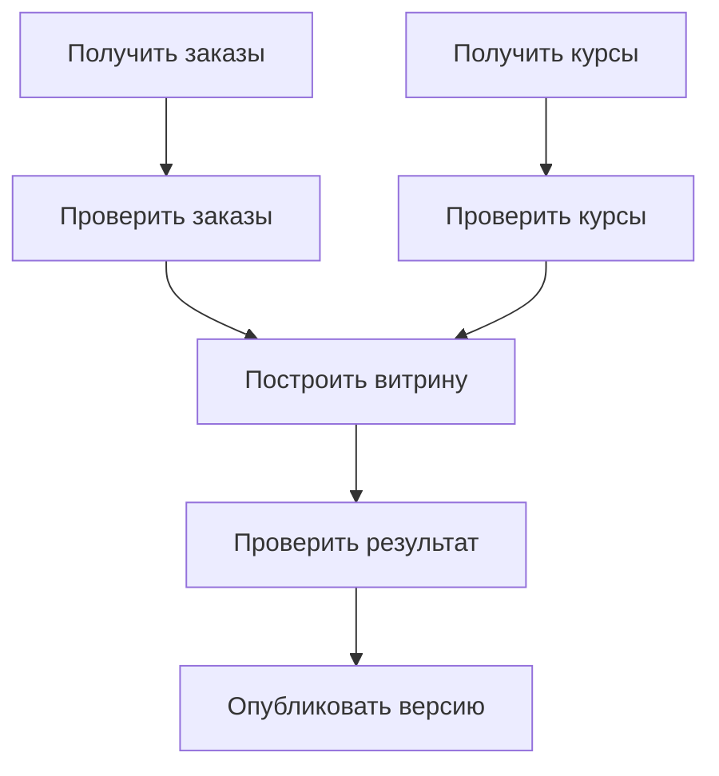
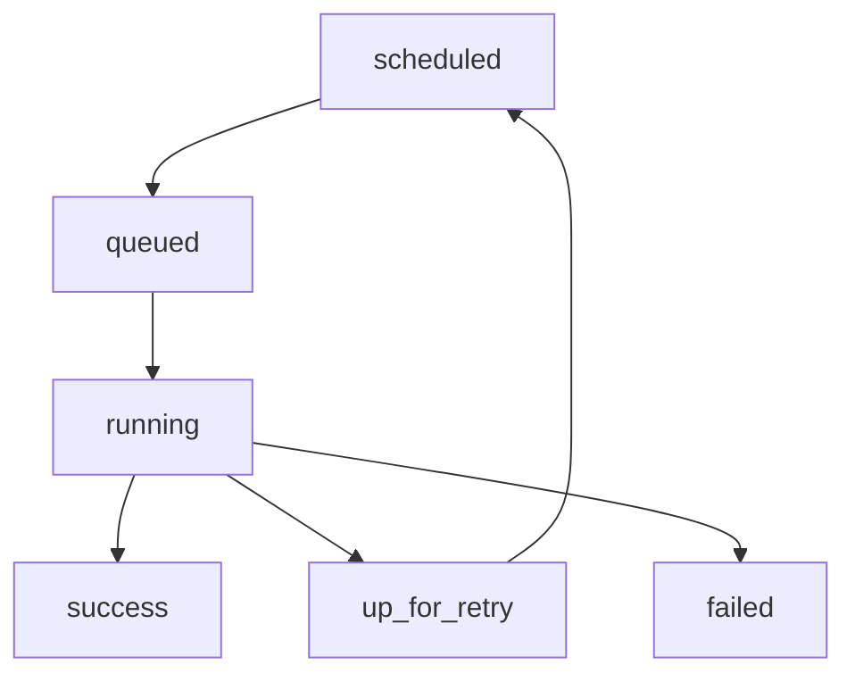
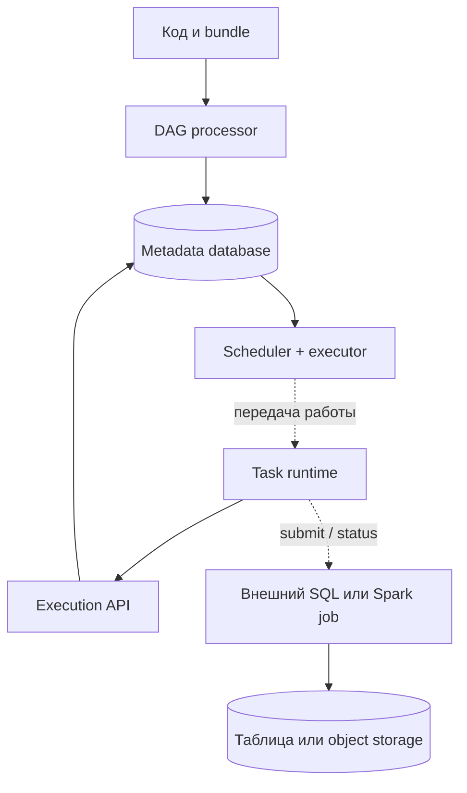

# 1. Фундамент и место Airflow в платформе данных

**Apache Airflow Zero to Hero · Профессиональный справочник**

| Параметр | Значение |
| --- | --- |
| Основа разбора | Apache Airflow 3.3.2; публичный интерфейс Task SDK |
| Дата проверки документации | 18 октября 2026 года |
| Состав главы | Все 8 тем и 41 пункт первого раздела README |
| Сквозной пример | Ежедневная обработка заказов и публикация аналитической витрины |
| Результат изучения | Умение определить роль Airflow, выбрать границы DAG/tasks и объяснить поведение процесса при сбоях |

Airflow становится понятным, когда рассматриваешь конкретный результат и путь его получения. Например: к 07:00 должна быть готова витрина заказов за предыдущий бизнес-день. Для этого нужны входные данные, вычисления, проверки, публикация и возможность повторить обработку после ошибки.

Эта глава строит именно такую модель. Сначала разберём задачи оркестрации, затем назначение и границы Airflow, выбор инструментов, необходимые знания и основные сущности. После этого свяжем понятия небольшим DAG и инженерными заданиями. Подробная установка, scheduling, TaskFlow, backfill и эксплуатация получат отдельные главы.

**Как читать:** при первом проходе изучи темы 1.1–1.3 и словарь 1.6; затем вернись к сравнению инструментов и выполни практику. Материал о гарантиях, версиях и восстановлении нужен с начала обучения: он определяет, каким должен быть код первой задачи.

## Содержание

1. [Введение в оркестрацию](#s1-1)
2. [Назначение Apache Airflow](#s1-2)
3. [Границы применения](#s1-3)
4. [Сравнение инструментов оркестрации](#s1-4)
5. [Предварительные знания](#s1-5)
6. [Основные сущности](#s1-6)
7. [Версии и состав платформы](#s1-7)
8. [Инженерная модель обучения](#s1-8)
9. [Практика: первый осмысленный DAG](#practice)
10. [Разбор архитектурных ситуаций](#cases)
11. [Вопросы для самопроверки и ориентиры ответов](#questions)
12. [Словарь и карта дальнейшего изучения](#glossary)

Примеры, оценки нагрузки и архитектурные разборы в главе — авторские учебные модели. Ссылки `[Sxx]` ведут к первичным источникам для конкретных API и свойств инструментов. Числовые примеры иллюстрируют метод рассуждения; они не являются измерениями производительности Airflow.

<a id="s1-1"></a>
## 1.1. Введение в оркестрацию

### 1.1.1. Оркестрация, планирование, выполнение и наблюдение за процессами

**Оркестрация** — управление жизненным циклом составного процесса: какие действия нужны, в каком порядке они становятся допустимыми, как отслеживается результат и что делать после сбоя.

Пусть аналитическая команда использует ежедневную витрину `daily_sales`. Чтобы её подготовить, необходимо получить заказы и курсы валют, проверить оба набора, пересчитать суммы, проверить агрегаты и опубликовать результат. При этом выгрузки могут задерживаться, вычисление — завершаться ошибкой, а публикация — требовать повторного запуска.

Полезно разделять четыре функции:

| Функция | Основной вопрос | Пример |
| --- | --- | --- |
| Планирование, scheduling | Когда создавать работу и когда она готова к запуску? | Начать обработку завершившегося дня; дождаться upstream |
| Оркестрация | Как согласовать шаги и их состояния? | После успешных проверок разрешить построение витрины |
| Выполнение, execution | Где и каким кодом делается работа? | SQL в warehouse, Spark application, Python-процесс |
| Наблюдение и управление | Как понять состояние и вмешаться? | Найти failed task, посмотреть логи, восстановить нужный период |

На практике orchestration platform объединяет эти функции через разные компоненты. Поэтому слово «планировщик» иногда употребляют для всей системы. При диагностике полезнее уточнять, о каком слое идёт речь: процесс не создан, задача ждёт слот, код уже работает или внешний job завершился без корректного результата.

Для сквозного примера удобно сформулировать **контракт результата**:

> Заказы за бизнес-день D обработаны по согласованному snapshot входов; витрина прошла проверки полноты и качества; её версия доступна потребителям до 07:00 следующего дня.

**Snapshot** — определённая версия набора данных. **Manifest** — описание конкретного набора объектов и их metadata, например путей, размеров и checksum. Эти понятия помогают повторно обработать именно нужный вход, даже если источник уже изменился.

Такой контракт сразу требует больше, чем расписание `0 3 * * *`. Нужно знать, что считать входом, где хранится результат, как подтверждается готовность и как исправлять уже опубликованные данные.

### 1.1.2. Зависимости, состояние, повторы и восстановление после сбоя

**Зависимость** задаёт условие допустимости следующей работы. В простой цепочке сначала нужна выгрузка, затем преобразование. В более сложном графе преобразование ждёт два независимых входа.

**Состояние** позволяет отличить работу, которая ещё не разрешена, ожидает ресурс, выполняется или завершилась. Оно должно переживать потерю отдельного процесса. Одна Python-переменная в памяти worker не даёт такой истории.

**Повторная попытка, retry** помогает пережить временный сбой. **Восстановление процесса** шире: иногда требуется исправить код, отменить внешний job, переобработать период и проверить потребителей. Автоматический retry не может принять все эти решения.

Разберём особенно важный частичный отказ:

1. Задача отправила SQL-запрос на обновление витрины.
2. База выполнила `COMMIT`.
3. Соединение оборвалось до получения подтверждения.
4. Airflow видит ошибку попытки.
5. Повтор запускает тот же прикладной код.

Ошибка соединения не доказывает отсутствие записи. Если код делает обычный `INSERT`, возможны дубли. Если он идемпотентно заменяет результат конкретной операции, повтор может быть безопасным.

**Идемпотентность** означает, что повтор одной логической операции сохраняет требуемый итоговый эффект. Для витрины это может быть пересчёт и замена определённой партиции, для API — поддерживаемый сервисом idempotency key. Ключ обычно связан с бизнес-операцией, периодом и версией расчёта; новый `try_number` не должен превращать retry в новую бизнес-операцию.

| Ситуация | Чего достаточно узнать перед повтором |
| --- | --- |
| API вернул явный отказ до обработки | Допускается ли повтор и с какой задержкой |
| Истёк timeout после отправки запроса | Был ли запрос принят; как найти результат по ключу |
| Worker исчез, внешний Spark job жив | Как восстановить наблюдение за существующим application |
| Входные данные исправлены | Какой результат пересчитывается и какие consumers затронуты |
| Ошибка бизнес-логики | Какая версия кода корректна и какой диапазон требует исправления |

Первый профессиональный вопрос о retry: **какой внешний эффект уже мог произойти?**

### 1.1.3. ETL, ELT, пакетные процессы и событийные конвейеры

В ETL данные сначала извлекаются, затем преобразуются и загружаются в целевую систему. В ELT сначала попадают в выбранный слой хранения, а существенная часть преобразований выполняется уже там. Эти названия описывают размещение этапов относительно загрузки, а не конкретный продукт.

| Подход | Пример | Основные вопросы оркестрации |
| --- | --- | --- |
| ETL | API → Python/Spark → готовая таблица | Где промежуточный результат; как повторить transform/load |
| ELT | Источник → raw warehouse → SQL/dbt | Когда raw-слой полон; какой набор моделей обновлять |
| Пакетный процесс | Пересчёт заказов за один день | Как задать границы периода и подтвердить его завершение |
| Событийный конвейер | После готовности набора пересчитать отчёт | Как идентифицировать событие, ограничить повторы и связать версии |

**Событийный запуск и непрерывная обработка — разные измерения.** Событие `orders/day=D ready` может запускать конечный пакетный расчёт. Запуск по CRON тоже может управлять внешним непрерывным приложением, например обновлять его конфигурацию.

Для выбора модели зафиксируй:

- **Единицу входа:** строка, файл, партиция, snapshot или сообщение о готовности.
- **Границу работы:** за какой диапазон задача отвечает и когда заканчивается.
- **Требуемую задержку:** секунды, минуты или готовность к заданному времени.
- **Поведение при повторе:** как сопоставить старый и новый результат.

В сквозном примере ежедневная витрина остаётся пакетной задачей, даже если её запуск инициирует событие от upstream producer. Готовность данных обычно надёжнее определять по проверенному manifest/snapshot, чем по существованию первого файла в каталоге.

Поддержка event-driven scheduling в Airflow 3 позволяет использовать события как основание запуска; настройка watchers/triggers и семантика доставки рассматриваются отдельно. [S02](#source-02)

### 1.1.4. Ограничения cron, shell-скриптов и самописных планировщиков

Cron хорошо решает запуск команды по календарю. Shell позволяет связать команды и передать exit code. Для небольшой задачи это может быть достаточно: один владелец, короткое исполнение, простой эффект, понятный повтор и доступные логи.

Проблемы появляются по мере роста требований. Например, схема «выгрузка в 03:00, расчёт в 04:00» предполагает, что выгрузка всегда укладывается в час. Если она завершилась в 04:20, второй скрипт мог обработать неполный набор.

Shell-цепочка `extract && transform && load` устраняет часть проблемы порядка, но возникает следующая: как повторить только `load`, сохранив точные входы успешного `transform`? Можно добавить marker files, таблицу состояния, locks, retries и UI. Тогда команда постепенно создаёт собственную orchestration platform.

| Требование | Возможная самописная реализация | Цена сопровождения |
| --- | --- | --- |
| Исключить пересечение запусков | Lock file или advisory lock | Поведение после crash и истечения lease |
| Восстановить конкретный день | CLI с параметром даты | История входов, версий кода и результатов |
| Повторить отдельный этап | Marker/state store | Атомарность состояния и внешнего эффекта |
| Ограничить параллелизм | Semaphore, очередь | Fairness, starvation и межпроцессная координация |
| Найти причину сбоя | Логи и correlation ID | Retention, поиск, права и алерты |

Выбор Airflow определяется стоимостью этих требований. Сам по себе cron не делает обработку ненадёжной, а установка Airflow не исправляет некорректный код.

То же относится к Kubernetes CronJob: у него есть собственные политики конкурентности и опоздавших запусков, но автор job по-прежнему проектирует поведение при повторе. Документация Kubernetes отдельно обсуждает приблизительную семантику создания Jobs и необходимость идемпотентности. [S03](#source-03)

### 1.1.5. Граф процесса, единица работы и критерий завершения

Граф полезен, когда его узлы соответствуют наблюдаемым единицам работы, а рёбра объясняют допустимость дальнейших действий.



Здесь две ветви могут выполняться независимо. Построение витрины требует успешной готовности обеих. Публикация допустима после проверки результата.

Ребро графа описывает зависимость управления. Реальные данные должны передаваться отдельным способом: через таблицу, object storage, небольшой XCom либо другой явный контракт.

**Граница task** одновременно задаёт:

1. Единицу наблюдения: какой шаг виден в UI и логах.
2. Единицу retry: какой код будет выполнен заново.
3. Границу ресурса: сколько памяти, CPU и внешних соединений нужно.
4. Границу результата: что можно проверить после выполнения.

Если одна task запускает десять независимых загрузок, при retry придётся разобраться с их частичными результатами. Если одна короткая загрузка раздроблена на сотни микрозадач, накладные расходы могут стать выше полезной работы.

Для `publish_mart` критерий завершения можно задать так: «проверенная версия доступна по согласованному указателю; записан её идентификатор; повтор с тем же ключом не создаёт вторую публикацию». Сообщение в логах «готово» такого контракта не заменяет.

**Контрольный вопрос:** можно ли по имени task, её входам и результату объяснить, что именно повторять после failure? Если ответ требует восстановления всех действий по неструктурированному логу, граница работы выбрана неудачно.

<a id="s1-2"></a>
## 1.2. Назначение Apache Airflow

### 1.2.1. История Airbnb, развитие Apache-проекта и открытая экосистема

Airflow начался в Airbnb в октябре 2014 года; инициатором проекта был Maxime Beauchemin. В марте 2016 года проект вошёл в Apache Incubator, а в январе 2019 года было объявлено о статусе Apache Top-Level Project. [S04](#source-04)

Для практики важнее следствия открытой экосистемы:

- Поведение можно проверить по исходному коду, документации и regression tests.
- Интеграции поставляются отдельными пакетами и имеют собственные ограничения.
- Развёртывание и эксплуатация могут выполняться собственной командой или внешней платформой.
- Исправление и развитие конкретного API зависят от процесса проекта и его release cycle.

Наличие открытого исходного кода не означает автоматически выбранную поддержку, время реакции на инцидент или готовую конфигурацию HA. Эти характеристики относятся к конкретному deployment и договорённостям команды.

У платформы есть несколько уровней ответственности: Apache-проект развивает core и community providers, автор DAG проектирует процесс, platform team поддерживает окружение, а владельцы внешних систем отвечают за их интерфейсы и ограничения. В реальной организации часть ролей может совмещаться.

При поиске решения полезно различать официальную документацию, пример из исходников, community provider и блог с настройками другой версии. Код из старой статьи способен выражать верную идею и одновременно использовать удалённый import path.

### 1.2.2. Workflows as code и декларативное описание зависимостей на Python

Airflow использует Python для описания workflows. Разработчик создаёт задачи, задаёт их параметры и связи; система получает представление процесса, пригодное для планирования и наблюдения. Публичная авторская поверхность Airflow 3 сосредоточена в `airflow.sdk`. [S05](#source-05)

Слово «декларативное» относится прежде всего к описанному результату построения графа: «задача B зависит от A». Сам Python-код построения DAG исполняется обычным интерпретатором и может иметь побочные эффекты.

```python
# Пример формы объявления; требует Airflow 3 и standard provider.
from airflow.sdk import DAG
from airflow.providers.standard.operators.empty import EmptyOperator

with DAG(dag_id="foundation_structure", schedule=None):
    extract_orders = EmptyOperator(task_id="extract_orders")
    extract_rates = EmptyOperator(task_id="extract_rates")
    build_mart = EmptyOperator(task_id="build_mart")

    [extract_orders, extract_rates] >> build_mart
```

Эти `EmptyOperator` ничего не загружают и не вычисляют: они демонстрируют структуру. Полезная работа появится в реализациях tasks. Вызов конструктора operator при чтении файла создаёт описание узла.

Разделяй два момента:

| Момент | Что должно происходить | Что опасно смешивать |
| --- | --- | --- |
| Parse time | Построение объектов DAG/tasks и их связей | Выгрузку данных, дорогие API-вызовы, запуск внешнего job |
| Execution time | Выполнение кода конкретной TaskInstance | Надежду на память, оставшуюся после импорта в другом процессе |

Верхнеуровневый `requests.get(...)` выполнится при импорте Python-модуля. DAG processor может читать файл повторно, поэтому такой вызов влияет на скорость и надёжность загрузки определения. Код получения данных должен иметь ясную execution boundary. [S06](#source-06)

Workflows as code дают Git history, review, тестирование и повторно используемые функции. Воспроизводимость появляется при дополнительной фиксации входных данных, конфигурации и зависимостей.

### 1.2.3. Конечные задачи, повторяемые запуски и наблюдаемое состояние

Airflow удобно описывает работу, у которой можно сформулировать начало, конечный результат и terminal outcome. Например: выгрузить одну партицию, выполнить SQL-расчёт, дождаться завершения внешнего application, проверить опубликованный набор.

«Конечная» не означает «короткая». Внешний Spark job может работать несколько часов, если понятны способ наблюдения, timeout и восстановление. Проблема появляется, когда task превращается в бесконечный consumer без отдельного контракта завершения.

Одно определение DAG обычно выполняется многократно. Сначала полезно различать три объекта:

| Объект | Смысл | Пример |
| --- | --- | --- |
| DAG | Определение процесса | `daily_sales` |
| DagRun | Конкретный запуск этого процесса | Обработка согласованного входа за D |
| TaskInstance | Задача в конкретном запуске | `check_mart` внутри выбранного DagRun |

Повторная попытка task относится к истории её выполнения. Другой DagRun — другой экземпляр процесса, даже если он обрабатывает тот же бизнес-период.

Отсюда важное следствие: **техническая идентичность запуска и бизнес-идентичность операции различаются**. Ручной повтор и историческая переобработка могут иметь новые run IDs, но писать в одну партицию. Защиту результата нужно строить с учётом этого пересечения.

Наблюдаемость даёт возможность увидеть состояние и причину задержки. Бизнес-корректность подтверждается контрактами и проверками данных. Если operator лишь успешно отправил запрос и не проверил его завершение, зелёное состояние этой task может означать только успешную отправку.

### 1.2.4. Control plane оркестрации и внешние системы обработки данных

В платформе данных удобно выделять **control plane** — управление работой — и **data plane** — чтение, перемещение, вычисление и запись бизнес-данных.

В Airflow к управлению относятся описание зависимостей, состояние запусков, очереди готовой работы, параметры и история выполнения. Обработку могут выполнять tasks на workers, SQL warehouse, Spark, контейнеры или облачные jobs.

| Действие | Основная ответственность |
| --- | --- |
| Решить, что после готовности двух входов допустим расчёт | Airflow и контракт DAG |
| Выделить executors Spark и выполнить shuffle | Spark и его cluster manager |
| Обеспечить SQL-транзакцию записи таблицы | Целевая СУБД и прикладной SQL |
| Хранить Parquet и управлять доступом к объектам | Storage service и IAM |
| Связать конкретный job с задачей и дождаться результата | Интеграционный код operator/hook |
| Проверить полноту и пригодность результата | Автор data product и quality checks |

Python task вполне может сама преобразовать небольшой файл или выполнить лёгкий расчёт. Практический критерий размещения вычисления — ресурсы, стоимость старта, доступ к данным и граница восстановления.

Для большого Spark-расчёта через Airflow обычно проходят параметры, идентификатор application и сведения о результате. Пересылка гигабайт строк через scheduler/XCom создаёт лишнюю нагрузку на управляющую систему.

Отдельная проверка нужна при запуске асинхронной работы: «submit принят» и «результат опубликован» — разные milestones. Контракт task должен явно указывать, какой из них означает success.

### 1.2.5. Расширяемость через providers, operators, hooks и triggers

Интеграцию полезно рассматривать как несколько слоёв с разными обязанностями:

| Элемент | Назначение | Условный пример |
| --- | --- | --- |
| Provider | Пакет возможностей для системы/класса задач | PostgreSQL, HTTP, Spark, Kubernetes |
| Operator | Единица работы в workflow | Выполнить SQL или запустить application |
| Hook | Адаптер подключения и клиента | Получить DB connection, выполнить запрос |
| Sensor | Задача ожидания условия | Дождаться готовности файла/таблицы/job |
| Trigger | Сериализуемое асинхронное ожидание/событие в поддерживаемой модели | Периодически проверять внешний job без занятого worker |

Providers устанавливаются отдельно; их возможности и версии нужно проверять по собственному reference/changelog. Существование пакета не означает, что любой operator поддерживает deferrable или durable execution. [S07](#source-07)

Для обычной задачи «обратиться к API и обработать ответ» может быть достаточно TaskFlow и небольшого клиентского пакета. Собственный provider оправдан при переиспользуемом контракте: одинаковые подключения, диагностика, retries, links на external jobs и тесты совместимости для многих DAG.

Deferrable operator освобождает worker во время поддерживаемого ожидания и продолжает работу после события. Trigger при этом должен выполнять неблокирующее ожидание. Само использование `async def` в произвольной функции не превращает её автоматически в deferrable task. [S08](#source-08)

Расширение Airflow нужно сопровождать как обычную библиотеку: фиксировать публичный интерфейс, проверять версии, документировать side effects и обеспечивать доступность нужного кода в соответствующих компонентах.

<a id="s1-3"></a>
## 1.3. Границы применения

### 1.3.1. Пакетная обработка, ingestion, SQL-трансформации и ML-процессы

Хороший кандидат для Airflow имеет различимую единицу работы и полезную историю запусков. Можно ответить: какой вход обрабатывается, какой результат ожидается, когда он должен появиться и что повторять после failure.

| Класс работы | Единица запуска | Значимые детали контракта |
| --- | --- | --- |
| API ingestion | Диапазон cursor или временной интервал | Pagination, rate limits, отсутствие пропусков |
| SQL/dbt transformations | Набор моделей для версии входа | Transaction boundaries, schema, завершение query |
| Spark batch | Партиции/manifest/snapshot | Application ID, table commit, ресурсы кластера |
| Экспорт отчёта | Бизнес-день и версия расчёта | Полнота, формат, публикация потребителю |
| Lakehouse maintenance | Ограниченный набор таблиц/партиций | Безопасный retention и отсутствие конфликта writers |
| ML training | Версия dataset и параметры | Артефакт модели, качество, стоимость и registry |
| Batch inference/embeddings | Manifest входных объектов | Model version, квоты, повтор дорогой операции |

Общий признак — наблюдаемый результат конечной работы. Сам вычислительный стек может сильно отличаться.

Для ingestion важны границы чтения. API, возвращающий «последние записи», способен выдавать другой набор при retry. Для ML недостаточно сохранить номер DagRun: результат зависит от данных, версии модели/кода, parameters и окружения. Для SQL нужна проверка, что job действительно завершился и записал нужную таблицу.

Если задача только отправляет внешнюю работу, явно выбери контракт: «успешный submit» либо «успешное завершение результата». Можно разделить submit и wait/check, сохранив job ID. Возможности конкретного provider определяют, как это лучше реализовать.

### 1.3.2. Событийный запуск конечной работы и непрерывная обработка потока

У процесса есть по меньшей мере две независимые характеристики: **основание запуска** и **способ обработки**.

| Основание | Работа | Пример |
| --- | --- | --- |
| Время | Конечный batch | Ежедневно пересчитать завершившийся день |
| Событие | Конечный batch | После публикации manifest обработать его файлы |
| Время | Управляющая операция над stream job | Проверить/обновить конфигурацию приложения |
| Поток событий | Непрерывная stateful обработка | Постоянно считать окна, joins и late events |

Airflow может управлять первыми тремя сценариями. В четвёртом вычислительная ответственность обычно принадлежит stream processor или сервису с соответствующей моделью состояния.

Рассмотрим Kafka → lakehouse → витрина. Spark Structured Streaming или Flink постоянно обрабатывает записи и поддерживает собственные checkpoints. После подтверждённой готовности партиции публикуется data-ready event. Airflow запускает конечную проверку и downstream расчёт. Планировщик может также выполнять maintenance или согласованный deployment потокового приложения.

При этом offset/checkpoint потокового приложения остаётся источником сведений о его прогрессе. Статус одной Airflow task не заменяет историю обработки каждого Kafka record. Общую идею stateful processing и восстановления по checkpoint описывает документация Flink. [S33](#source-33)

**Бесконечный цикл внутри Python task** требует отдельных ответов: как его обновлять, где хранить progress, как обрабатывать rebalance, что считать success и как ограничить retry. Если основная функция процесса именно такая, стоит оценить execution model непрерывного сервиса до выбора Airflow task как контейнера для него.

### 1.3.3. Ограничения для низких задержек и миллионов мелких событий

Система, которая создаёт и отслеживает отдельные задачи, несёт накладные расходы на каждый экземпляр работы. Для Airflow это включает metadata/API operations, scheduling, доставку определения, подготовку runtime и логи. Их стоимость зависит от deployment, executor и нагрузки.

Задержку результата удобно разложить:

\[
T_{result}=T_{detection}+T_{scheduling}+T_{queue}+T_{startup}+T_{compute}+T_{publish}
\]

Расписание влияет лишь на часть пути. Увеличение числа workers не помогает, если основная задержка находится в detection, metadata DB или внешней системе.

**Учебный расчёт нагрузки.** Пусть появляется 200 событий/с; для каждого создаётся DagRun с четырьмя tasks; среднее занятие worker одной task — 10 секунд. В устойчивом режиме это:

\[
\lambda_{tasks}=200\cdot4=800\ task/s,
\qquad L\approx\lambda W=800\cdot10=8000
\]

В упрощённой модели потребуется около 8 000 одновременно занятых task slots, ещё до запаса на пики и накладных расходов. Расчёт предполагает конечные средние, устойчивый поток и возможность распараллеливания; он не является benchmark или пределом Airflow.

Следующий вопрос — можно ли изменить единицу работы. Например, обрабатывать bounded batch записей или запускать DAG по готовности партиции, оставив per-record реакцию специализированному processor.

Для latency-sensitive запроса клиента также оценивай end-to-end deadline, стоимость очереди и последствия недоступности control plane. **SLO, service level objective** — согласованная измеримая цель сервиса, например доля результатов, готовых за допустимое время. Синхронный API-сервис, message consumer и data workflow могут иметь разные требования даже при одинаковом Python-коде преобразования.

Профессиональное обоснование выбора содержит измерения p95/p99 задержки, throughput, размера backlog и поведения при отказе. Формулировка «Airflow выдерживает N DAG» без workload profile мало помогает принять решение.

### 1.3.4. Отличие от брокера сообщений, stream processor и вычислительного движка

Инструменты полезнее сравнивать по ответственности, состоянию и гранулярности работы.

| Слой | Основная единица | Какое состояние особенно важно | Примеры |
| --- | --- | --- | --- |
| Оркестрация | Workflow run и task instance | Зависимости, попытки, результат этапов | Airflow, Dagster, Prefect |
| Брокер / журнал событий | Сообщение или record | Доставка, retention, порядок в своей области | RabbitMQ, Kafka |
| Stateful stream processing | Событие, key, window | Aggregation state, offsets, checkpoints | Flink, Kafka Streams, Spark streaming |
| Вычисление batch/SQL | Query или application | План, ресурсы, task/stage/query state | Warehouse, Spark, Trino |
| Очередь фоновых задач | Задание | Доставка исполнителю, retry и result | Celery и сходные systems |
| Прикладной сервис | Запрос/бизнес-операция | Доменная модель, авторизация, транзакция | HTTP service, consumer |

Один продукт способен покрывать несколько слоёв. Kafka включает экосистему клиентов и интеграций для обработки событий; роль конкретного broker отличается от роли приложения Kafka Streams. Celery поддерживает композицию задач, а внутри Airflow может использоваться как execution backend. [S32](#source-32) [S34](#source-34)

Для связки Airflow + Spark: Airflow управляет application как частью процесса, Spark распределяет вычисление. Для Airflow + Kafka: событие может инициировать workflow, но порядком чтения partition и commits consumer управляет Kafka-клиент/processor.

Эти границы особенно полезны при инциденте. Задержка SQL-запроса требует анализа warehouse; задержка постановки готовой task — scheduling/quotas; отставание consumer — streaming pipeline. Общий SLO данных объединяет все слои, но способы исправления различаются.

### 1.3.5. Когда достаточно cron, SQL scheduler, очереди задач или сервиса

Выбирать следует достаточную модель управления. Новый компонент приносит эксплуатационные обязанности: обновления, credentials, метабазу, логи, наблюдаемость и восстановление.

| Ситуация | Что проверить первым |
| --- | --- |
| Один короткий идемпотентный скрипт на одном узле | Cron/systemd timer, логи, lock и понятный retry |
| Вся работа — один SQL-процесс в warehouse | Встроенные scheduled queries/jobs и их история |
| Фоновая обработка запросов приложения | Queue workers, доменная БД и idempotency keys |
| Непрерывная реакция на события | Consumer/service или stream processor |
| Несколько зависимых систем и восстановление периодов | Workflow orchestration с явными contracts |
| Контейнерные batch jobs внутри зрелого Kubernetes-контура | Kubernetes Job/CronJob или Argo Workflows |

Для исходного витринного примера сильными аргументами в пользу оркестратора будут независимые входы, история периодов, выборочный повтор, лимиты внешних сервисов, UI для дежурного и единая наблюдаемость процесса.

Полезная проверка выбора: **кто и по каким сведениям восстановит процесс в 05:30 после сбоя?** Если действующая простая система уже даёт ясный и проверенный ответ, миграция требует дополнительного обоснования. Если восстановление держится на памяти автора скрипта, следует оценить цену сохранения такого состояния.

Сравнивай полную стоимость: разработку процесса, эксплуатацию платформы, риск некорректных данных, труд дежурного и стоимость миграции. Эти величины оценивают для конкретной команды и нагрузки.

<a id="s1-4"></a>
## 1.4. Сравнение инструментов оркестрации

### 1.4.1. Airflow, Dagster и Prefect: модели процессов и данных

У трёх инструментов пересекающиеся возможности. Полезнее сравнить типичную отправную модель и проверить её соответствие своим требованиям.

| Инструмент | Центральные понятия, полезные при оценке | На чём строить пилот |
| --- | --- | --- |
| Airflow | DAG, DagRun, TaskInstance, operators/providers, assets | Scheduling/reprocessing, интеграции и эксплуатация выбранного executor |
| Dagster | Software-defined assets, materializations, partitions, resources | Зависимости данных, выбор партиций, quality/lineage и developer workflow |
| Prefect | Python flows/tasks, runtime control flow, states, deployments/events | Динамический Python-процесс, recovery и инфраструктура запуска |

В Dagster asset связывает желаемый объект данных, его зависимости и вычисление. Prefect описывает flows на Python и поддерживает runtime control flow. Эти акценты подтверждаются собственными материалами проектов. [S09](#source-09) [S10](#source-10)

Сравнение «Airflow знает только задачи, Dagster знает данные» уже слишком грубое: Airflow 3 также имеет Assets, event-based scheduling и partition-related возможности. Аналогично dynamic task mapping означает, что граф Airflow не обязан состоять только из заранее известного фиксированного списка tasks.

Для витрины за D проверь в пилоте один и тот же набор действий: обработать текущую партицию, пропустить пустой разрешённый вход, переобработать исторический диапазон, восстановиться после потери worker и объяснить результат дежурному.

Удобство локальной разработки важно сопоставить с возможностями deployment и сопровождения. Работающий пример из пяти функций ещё не показывает, как будут обновляться credentials и восстанавливаться сотни активных runs.

### 1.4.2. Luigi и Oozie: исторические подходы и существующие платформы

Luigi полезен для понимания модели **Task → Target**. Задача объявляет dependencies, выходные targets и способ выполнения; проверка завершённости связана с её output/`complete()` contract. [S11](#source-11)

Такой подход помогает поставить хороший вопрос и к Airflow: где находится проверяемый результат task? Однако существование target само по себе тоже требует корректной публикации. Частично записанный файл не становится полноценным результатом только потому, что появился по нужному пути.

Luigi продолжает иметь действующую документацию и собственную модель. Его стоит оценивать по текущей реализации и потребностям системы, а не считать автоматически устаревшим из-за возраста проекта.

Oozie исторически тесно связан с Hadoop: workflows описывают действия, coordinators учитывают время и готовность данных. На дату проверки официальный сайт сообщает о retirement проекта и отсылает в Apache Attic. Для существующих Oozie-процессов это существенный фактор сопровождения. [S12](#source-12)

При миграции старого Hadoop workflow нужно перенести смысл: календарь, условия готовности, credentials/Kerberos, способы повторов и контракт результата. Механическое преобразование каждого XML-узла в operator может сохранить старую сложность и добавить новую.

### 1.4.3. Argo Workflows и Kubernetes Jobs: контейнерная оркестрация

Kubernetes Job управляет выполнением конечной контейнерной работы. Kubernetes отвечает за pods и политики controller, а приложение — за корректный эффект при возможных повторах. Argo Workflows добавляет Kubernetes-native workflow model с последовательностями/графами шагов и передачей artifacts/parameters. [S13](#source-13) [S14](#source-14)

| Вопрос | Kubernetes Job | Argo Workflows | Airflow с Kubernetes-интеграцией |
| --- | --- | --- | --- |
| Что является основным объектом? | Один Job и его pods | Workflow со steps/DAG templates | DAG/run/tasks и внешние pods/jobs |
| Где естественная операционная среда? | Kubernetes | Kubernetes | Разные deployments; Kubernetes — один из вариантов |
| Как размещается код работы? | Container image | Images и workflow templates | Task runtime, KPO, Job или внешняя система |
| Что нужно оценить для data workflow? | Координацию нескольких jobs | Историю, scheduling и data contracts | Версии providers, overhead, данные и orchestration state |

Если вся работа уже упакована в контейнеры, доступны cluster operations и Kubernetes-native security, Argo может хорошо соответствовать существующей модели. Если процесс связывает warehouse, Spark, API и data-aware scheduling, полезно отдельно оценить возможности интеграционного слоя и интерфейс дежурного.

Выбор может быть композиционным. Airflow task запускает Kubernetes pod/job и отслеживает результат; контейнер выполняет работу независимо от оркестратора. В таком случае нужны correlation ID, ограничение повторного submit и ясная cancellation policy.

Поддержка DAG в обоих инструментах показывает сходство графической формы. Она не делает одинаковыми семантику запуска, историю состояния, изоляцию или стоимость эксплуатации.

### 1.4.4. Temporal и durable execution: длительные бизнес-процессы

Temporal использует Workflow Execution с Event History. Детерминированное переисполнение workflow-кода по истории восстанавливает логическое состояние; внешние действия выносятся в Activities. Важны ограничения replay и совместимость кода длительно живущих workflows. [S15](#source-15)

Представим процесс заказа: зарезервировать товар, запросить оплату, дождаться ответа, подтвердить либо компенсировать резервирование. Здесь существенны сообщения, длительные ожидания и доменная модель одного заказа.

Для Airflow исходной единицей часто служит конечный data processing run за период/manifest. Разработчик управляет задачами, их попытками, состоянием данных и внешних jobs. При этом Airflow 3.3 уже поддерживает resumable/durable execution для подходящих операторов через сохраняемое task state, например reconnect по external job ID. Возможность зависит от provider и реализации. [S17](#source-17)

Поэтому сравнивать стоит конкретный механизм восстановления:

| Вопрос | Что нужно выяснить |
| --- | --- |
| Восстанавливается orchestration task или workflow-код по истории? | Граница сохранённого состояния |
| Будет ли внешнее действие выполнено ещё раз? | Idempotency и обработка ambiguous outcome |
| Как приходит ответ спустя несколько дней? | Signals/messages/correlation и полномочия отправителя |
| Что происходит после обновления кода? | Правила совместимости активного процесса |
| Как отменяется работа? | Cancellation propagation и compensation |

Durable orchestration не создаёт общую транзакцию с любой внешней системой. Temporal также рекомендует проектировать Activities идемпотентно. [S16](#source-16)

Это архитектурный выбор по форме процесса. Число дней ожидания само по себе недостаточно: важнее единица состояния, способ взаимодействия, гарантия внешнего эффекта и модель сопровождения.

### 1.4.5. Выбор по гарантиям, задержкам, стоимости и возможностям эксплуатации

Составь требования до пилота. Так проще проверить решение и избежать сравнения рекламных списков features.

| Критерий | Конкретизирующий вопрос | Как проверить |
| --- | --- | --- |
| Гарантии | Что происходит при потере ответа после записи? | Fault injection и проверка дублей |
| Scheduling | Нужны ли интервалы, calendars, partitions и late data? | Исторический диапазон со сложными границами |
| Latency | Какой end-to-end p95/p99 допустим? | Репрезентативный нагрузочный профиль |
| Recovery | Кто и как повторяет часть процесса? | Восстановление дежурным по runbook |
| Изоляция | Какие классы кода/команд доверяют друг другу? | Threat model и проверка permissions/runtime boundaries |
| Доставка | Как сменить код при активной работе? | Canary, compatibility и rollback |
| Стоимость | Что потребляют control plane, compute и дежурства? | Измерения и оценка эксплуатационных обязанностей |
| Экосистема | Поддерживается ли нужная интеграция? | Проверка актуального provider/SDK, а не только имени класса |

Минимальный профессиональный пилот включает успешный запуск, потерю worker, неоднозначный внешний submit, поздний вход и переобработку старого периода. Зафиксируй результаты и пределы испытания.

Вывод пилота может звучать так: «для двух ежедневных источников выбран Airflow с таким executor; текущий объём и backfill проверены; external job восстанавливается по ID; слабое место — API квота, для неё введён отдельный pool/limiter». Это проверяемое решение, которое можно пересмотреть при изменении нагрузки.

<a id="s1-5"></a>
## 1.5. Предварительные знания

### 1.5.1. Python: функции, декораторы, импорты, исключения и контекстные менеджеры

Для первых DAG не требуется знать все внутренние механизмы CPython. Нужна уверенная модель исполнения кода и владения ресурсами.

| Конструкция | Что понимать | Почему это важно в Airflow |
| --- | --- | --- |
| Функция | Объявление, вызов, аргументы, return | Передача callable и получение результата task |
| Декоратор | Применяется при выполнении объявления функции | `@task` создаёт специальный объект; его вызов участвует в построении DAG |
| Импорт | Исполняет верхний уровень модуля | Сетевой вызов на верхнем уровне влияет на DAG processing |
| Исключение | Распространение, тип ошибки, traceback | Ошибка должна корректно отразиться в task state |
| Контекстный менеджер | Вход, выход и cleanup | Закрытие соединения/файла даже при failure |
| Коллекции и сериализация | Схема значений, JSON-совместимость | Контракты аргументов, XCom и manifests |

Порядок применения обычного Python-декоратора легко увидеть без Airflow:

```python
# example: decorator_phases
def register(function):
    print(f"Объявлена функция: {function.__name__}")
    return function


@register
def do_work():
    print("Выполняется работа")


print("Модуль загружен")
do_work()
```

Сначала появится сообщение об объявлении, затем о загрузке модуля, затем о работе. У Airflow-декоратора другой контракт объекта, но факт исполнения Python-объявлений при загрузке остаётся важен.

Следующее правило касается исключений. Если код ловит все ошибки, печатает текст и возвращает обычное значение, orchestration layer может увидеть нормальное завершение. Перехватывать исключение полезно для очистки, добавления контекста или перевода в осмысленный тип; решение о продолжении должно соответствовать контракту.

```python
# example: exception_visibility
def require_nonempty(values: list[int]) -> int:
    if not values:
        raise ValueError("Ожидался непустой набор значений")
    return sum(values)
```

Чистая функция отделяет правила вычисления от Airflow. Её можно проверить обычным Python, затем вызвать из `@task`. Для самостоятельного изучения полезны также typing, logging, `datetime`, `decimal`, virtual environments и основы `asyncio`; глубокие детали добавляются по мере необходимости.

### 1.5.2. SQL: транзакции, ключи, индексы и изоляция

Оркестратор определяет, когда запускать SQL. Целевая СУБД определяет атомарность, ограничения и поведение конкурентных транзакций.

**Транзакция** позволяет связать несколько изменений внутри поддерживаемой DB boundary. **Ключ** задаёт идентичность записи. **Уникальное ограничение** может защитить от повторного создания того же результата. **Индекс** влияет на стоимость поиска/проверок и иногда обеспечивает уникальность. **Изоляция** определяет допустимые взаимодействия параллельных транзакций.

Условный контракт витрины: одна запись на бизнес-день, валюту и версию расчёта. Для PostgreSQL и SQLite можно продемонстрировать такую схему:

```sql
-- example: result_table
CREATE TABLE daily_sales (
    business_date TEXT NOT NULL,
    currency TEXT NOT NULL,
    calculation_version TEXT NOT NULL,
    revenue_minor BIGINT NOT NULL CHECK (revenue_minor >= 0),
    PRIMARY KEY (business_date, currency, calculation_version)
);
```

Здесь `TEXT` для даты выбран для короткого переносимого примера. В промышленной схеме типы, ограничения и календарная семантика выбираются для конкретной СУБД.

```sql
-- example: idempotent_result_write
INSERT INTO daily_sales (
    business_date, currency, calculation_version, revenue_minor
)
VALUES ('2026-10-17', 'RUB', 'v1', 102500)
ON CONFLICT (business_date, currency, calculation_version)
DO UPDATE SET revenue_minor = excluded.revenue_minor;
```

Повтор этой записи не добавляет вторую строку с тем же ключом. Он перезаписывает результат, поэтому корректность требует того же входного контракта либо осмысленной политики обновления. Если разные runs одновременно вычислили разные snapshot одного дня, один upsert ещё не определяет, какая версия должна победить.

Другой опасный шаблон: `SELECT` проверяет отсутствие строки, затем `INSERT` создаёт её. Две конкурентные задачи способны увидеть отсутствие одновременно. Защита должна находиться в транзакционном контракте/ограничении БД, а не только в предварительном Python-проверяющем условии.

Транзакция между двумя обычными Airflow tasks автоматически не продолжается. Они могут выполняться разными процессами и подключениями. Длинную общую транзакцию следует проектировать явно либо выбрать другую границу задачи.

### 1.5.3. Linux: процессы, сигналы, файлы, права и переменные окружения

Сбой task — часто событие на уровне процесса или машины. Для диагностики важно отличать PID процесса от имени task, worker от выполняющегося в нём subprocess и локальный путь от общего хранилища.

| Знание | Практическое применение |
| --- | --- |
| Процессы и дочерние процессы | Понять, кто реально выполняет код и кому отправляется сигнал |
| Exit code и stderr | Отличить штатное завершение от ошибки команды |
| SIGTERM и SIGKILL | Спроектировать graceful shutdown и понять, почему cleanup мог не выполниться |
| Пользователь/группа и file permissions | Проверить доступ к DAG, логам, mounts и временным файлам |
| Environment variables | Найти конфигурацию, влияющую на конкретный процесс |
| RAM/CPU/disk/network | Объяснить OOM, disk full, throttling и I/O timeout |

Путь `/tmp/orders.csv` относится к файловой системе конкретной среды. Следующая task может работать на другой машине. Для устойчивого обмена обычно нужен доступный обеим задачам storage и явный URI/manifest.

SIGKILL не даёт Python-коду выполнить `finally`. Даже graceful stop локального процесса не гарантирует остановку уже запущенного удалённого Spark/SQL job. Lifecycle внешней работы контролируется отдельным API и его правилами.

Для проверки интерпретатора и окружения полезны простые команды:

```bash
# example: python_environment
python --version
python -c 'import sys; print(sys.executable)'
python -m pip check
```

Проверка в терминале ноутбука не доказывает, что тот же пакет или маршрут есть у worker/triggerer. Диагностика должна воспроизводить фактическую среду выполнения.

Environment variables участвуют в конфигурации и могут содержать секреты. Полный вывод окружения в task logs способен раскрыть credentials; при расследовании выбирают нужные безопасные поля.

### 1.5.4. HTTP, DNS, TLS, сети и клиентские библиотеки

Интеграционная задача проходит несколько технических границ до ответа прикладного API. Ошибки на этих границах требуют разных решений.

| Слой | Пример симптома | Что проверять |
| --- | --- | --- |
| DNS | Имя не разрешается | Resolver и доступность имени из worker network |
| Маршрут/TCP | Connect timeout, connection refused | Firewall, endpoint, service readiness, egress |
| TLS | Ошибка сертификата/hostname | Trust store, private CA, имя и время системы |
| Authentication | 401, expired token | Получение/refresh credentials и срок действия |
| Authorization | Запрещена операция/ресурс | IAM/scopes и фактическая identity |
| HTTP/application | 429, 5xx, ошибка payload | Quotas, контракт API, rate limit и validation |
| Client library | Неожиданная десериализация/отсутствующий метод | Версии SDK, schema и client configuration |

Код должен иметь ограниченное ожидание. Connect timeout ограничивает установление соединения; read timeout относится к ожиданию данных по правилам выбранной библиотеки. Один параметр timeout не всегда означает полный deadline всей операции.

Решение о retry зависит от семантики запроса. Повтор чтения и повтор команды «создать ресурс» могут иметь разную цену. После timeout создания нужно учитывать, что сервер уже мог принять запрос. Помогают idempotency token, внешний request ID и endpoint проверки результата.

**Pagination** требует отдельного контракта: стабильность cursor, границы snapshot, повтор страницы и фиксация прогресса. Если во время листания источник изменяется, два успешных HTTP-ответа ещё не доказывают полноту выгрузки.

Также учитывай вложенные повторы: SDK повторяет запросы внутри одной task attempt, а Airflow повторяет task целиком. При двух уровнях общего backoff процесс может намного превысить ожидаемое окно восстановления.

### 1.5.5. Docker, Git и основы автоматизации доставки

Airflow workflow существует как сочетание кода, библиотек, конфигурации и входных данных. Git фиксирует версию репозитория, но не гарантирует совпадение всех остальных частей.

| Что фиксировать | Зачем |
| --- | --- |
| Commit/bundle version DAG | Восстановить определение процесса |
| Версию пакета бизнес-логики | Понять, какое преобразование выполнялось |
| Версии Airflow/SDK/providers | Проверить API и поведение интеграции |
| Образ и зависимости runtime | Воспроизвести libraries/system environment |
| Params и версию конфигурации | Повторить тот же сценарий |
| Snapshot/manifest входов | Получить сопоставимый результат |

Docker-образ полезен как артефакт окружения, когда он собран воспроизводимо и указан неизменяемой ссылкой/digest. Один тег вроде `latest` может в разное время указывать на разные байты.

Важна и граница процесса: наличие файла в image scheduler не делает его доступным pod задачи. Нужный код должен попасть в среду, которая его импортирует и выполняет.

Минимальная цепочка доставки включает review, проверки кода/импортов, сборку артефакта, публикацию в окружение и smoke validation. Для изменяющего данные процесса отдельно проектируется восстановление результата после ошибки новой версии.

**Rollback кода и rollback данных — отдельные операции.** Возврат старого image не удаляет дубли, записанные предыдущей ошибочной попыткой. Для коррекции понадобится подходящий контракт публикации и переобработка.

На начальном этапе достаточно уметь пользоваться Git, виртуальной средой, контейнером, environment-specific конфигурацией и CI-проверкой. Глубокий Helm/Kubernetes нужен при выборе соответствующего deployment.

### 1.5.6. Частичные отказы, идемпотентность и согласованность распределённых систем

Когда task обращается к удалённой системе, возможны несколько независимых фактов: запрос был отправлен, принят, выполнен, зафиксирован и подтверждён клиенту. Между этими фактами может произойти сбой.

| Точка сбоя | Возможное внешнее состояние | Требование к восстановлению |
| --- | --- | --- |
| До отправки | Работа отсутствует | Безопасно отправить её впервые |
| После принятия submit | Job существует, ID не получен | Найти по стабильному ключу или безопасно дедуплицировать |
| Во время compute | Есть частичный или ещё не опубликованный результат | Дождаться/отменить/продолжить согласно контракту |
| После commit до acknowledgement | Результат уже опубликован | Проверить результат и избежать повторного эффекта |
| После task success | Downstream мог начать работу | Исправлять с учётом затронутых consumers |

Полезно различать три свойства:

| Свойство | Что оно означает | Чего само по себе не гарантирует |
| --- | --- | --- |
| Детерминированность | Одинаковый определённый вход даёт одинаковый результат | Безопасность повторной записи результата |
| Идемпотентность | Повтор одной операции сохраняет нужный бизнес-эффект | Использование неизменяемого snapshot входа |
| Воспроизводимость | Есть достаточно сведений, чтобы повторить вычисление | Автоматическую атомарность нескольких систем |

Для бизнес-состояния S и одинакового operation key k идемпотентный эффект можно условно выразить как:

\[
apply(apply(S,k),k)=apply(S,k)
\]

Дополнительная строка технического лога обычно не нарушает бизнес-идемпотентность; повторная отправка товара или новая строка начисления — нарушает.

Общая exactly-once гарантия требует явно заданной транзакционной границы и механизма дедупликации/commit. В распределённом процессе она не появляется только от настройки retries, уникального run ID или одного worker.

Сохраняемый external job ID помогает reattach, но оставляет окно «job создан, ID ещё не записан». Его закрывают возможностями внешней системы: idempotency key, поиск по business key, transactional handoff либо явно ограниченная reconciliation procedure.

На уровне первой главы достаточно научиться находить такие окна. Подробные retry policies, state stores и согласованность между системами разбираются в последующих разделах.

<a id="s1-6"></a>
## 1.6. Основные сущности

### 1.6.1. DAG, task, operator, sensor и hook

**DAG, directed acyclic graph** — направленный ациклический граф. Направление показывает зависимость; ацикличность позволяет выстроить допустимый порядок выполнения. В Airflow объект DAG дополнительно содержит operational configuration: идентификатор, расписание, параметры и другие свойства процесса. В документации также используется написание Dag. [S19](#source-19)

Отсутствие цикла внутри графа не запрещает повторные запуски всего DAG, итерации внутри task или ограниченный runtime mapping. Это разные уровни модели. Цикл ожидания между несколькими DAG возможен и требует отдельного анализа.

| Сущность | Объяснение | Пример для витрины |
| --- | --- | --- |
| DAG | Определение процесса и его operational contract | `daily_sales` |
| Task | Логический узел работы внутри DAG | `build_mart` |
| Operator | Шаблон/реализация поведения task | SQL execution operator |
| Sensor | Специализированная задача ожидания | Ожидание готовности manifest |
| Hook | Адаптер подключения/клиента внешней системы | DB hook, HTTP hook |

Класс operator описывает способ работы, а экземпляр с `task_id` задаёт узел конкретного DAG. `@task` упаковывает Python callable в соответствующее описание задачи. Hook обычно используется исполняющим кодом; его создание само по себе не добавляет узел в граф. Базовую классификацию tasks подтверждает reference Airflow. [S18](#source-18)

Для sensor недостаточно сформулировать «файл существует». В нашем процессе необходимы полнота набора, завершение записи и валидная версия схемы. Это может означать ожидание подтверждённого manifest вместо отдельного data file.

Ожидание тоже имеет resource contract: timeout, частоту проверки, работу в poke/reschedule/deferrable режиме и доступ к внешней системе. Введение этих ограничений предотвращает бесконечное удержание ресурса при ошибочно заданном условии.

### 1.6.2. DagRun, TaskInstance, attempt и состояние выполнения

Представь чертёж, конкретный строящийся объект и повторную попытку отдельной операции. Аналогично DAG описывает процесс, DagRun относится к одному запуску, а TaskInstance — к task внутри этого запуска.

Для рассуждения удобно использовать логический ключ:

```text
(dag_id, run_id, task_id, map_index)
```

Это объяснительная модель идентичности, а не обещание конкретного primary key внутренней DB-схемы. `map_index` различает экземпляры mapped task; подробности mapping появятся в отдельной главе.

| DAG | Run | Task | Attempt | Наблюдение |
| --- | --- | --- | ---: | --- |
| `daily_sales` | `manual__example_001` | `build_mart` | 1 | Потеря соединения после submit |
| `daily_sales` | `manual__example_001` | `build_mart` | 2 | Reattach и получение результата |
| `daily_sales` | `manual__example_002` | `build_mart` | 1 | Другой запуск, возможно за тот же день |

В первых двух строках повторяется task того же run. В третьей — новый run. Внешний `application_id/query_id` относится к вычислителю и может сохраняться между попытками, если повтор восстанавливает уже существующую работу.

Ниже показана упрощённая часть lifecycle; это не полный автомат всех состояний и специальных операций.



| Состояние | Какой вопрос задавать |
| --- | --- |
| `scheduled` | Готова ли задача к передаче исполнителю согласно текущему циклу планирования? |
| `queued` | Есть ли подходящий worker/executor capacity и нет ли задержки старта? |
| `running` | Выполняется локальный код, ожидается API или работает внешний job? |
| `up_for_retry` | Какая ошибка произошла и безопасно ли повторять эффект? |
| `deferred` / `up_for_reschedule` | Как проверяется условие ожидания и кто обеспечивает продолжение? |
| `skipped` / `upstream_failed` | Была ли задача пропущена по логике либо не допущена из-за upstream? |
| `success` / `failed` | Как соотносится технический статус с внешним результатом? |

Полную историю полезно читать вместе с логами попыток, текущим состоянием внешнего job и версией результата. Сам факт отсутствия живого Python-процесса не доказывает отсутствие продолжающейся удалённой работы.

### 1.6.3. Scheduler, executor, worker, triggerer и DAG processor

В Airflow 3 определение DAG, scheduling, runtime и пользовательский API разделены по обязанностям. Executor — логика запуска в составе scheduler; выбранный backend определяет, какие исполняющие процессы или pods потребуются. Топология зависит от deployment. [S21](#source-21) [S27](#source-27)

| Компонент | Обязанность | На что смотреть при сбое |
| --- | --- | --- |
| DAG processor | Загружает определения из bundle, выполняет Python-построение, сериализует граф | Import errors, parse duration, доступность кода |
| Scheduler | Создаёт/обрабатывает runs, проверяет готовность и ограничения | Scheduling delay, active runs, DB latency |
| Executor | Передаёт task выбранной execution infrastructure и получает события | Capacity, routing и совместимость backend |
| Worker / task runtime | Обеспечивает выполнение кода TaskInstance | Логи процесса, память, зависимости, сеть |
| Triggerer | Выполняет асинхронные triggers для поддерживаемых ожиданий/событий | Доступность, capacity, blocking I/O |
| API server | Обслуживает UI/API и runtime-взаимодействие через Execution API | Доступ, auth, latency и connectivity |
| Metadata database | Хранит orchestration state и metadata | Соединения, locks, доступность, рост истории |
| DAG bundle | Источник определения и связанного кода, возможно с versioning | Нужная версия, refresh и доставка worker |

Логический путь работы:



Это схема обязанностей, а не полный сетевой deployment diagram. Например, конкретная доставка executor может использовать broker или Kubernetes API. Triggerer для наглядности описан в таблице, а не включён во все связи.

Рабочий код штатно обращается к ресурсам Airflow через Task SDK/runtime API. Прямой доступ task к internal ORM не является устойчивым авторским контрактом. При этом наличие API-boundary само по себе не доказывает полной безопасности среды: произвольный код способен обращаться к ресурсам, доступным его credentials и сети. Модель доверия рассматривается отдельно. [S31](#source-31)

Следующая task может оказаться в другом subprocess, worker или pod. Поэтому общая Python-переменная и локальный `/tmp` не являются универсальным способом передачи результата.

### 1.6.4. Connections, Variables, Params, XCom и Assets

Эти сущности часто смешивают, потому что все они «хранят какие-то значения». Их назначения различаются.

| Сущность | Для чего | Пример | На что обратить внимание |
| --- | --- | --- | --- |
| Connection | Описание доступа к внешней системе | `warehouse_reporting` | Credentials, extras, secrets backend и permissions |
| Variable | Runtime-конфигурация среды/процесса | Порог допустимой задержки входа | Изменяемость и воспроизводимость старых runs |
| Param | Входной параметр определения/запуска | Режим расчёта, разрешённый диапазон | Schema validation и правила runtime override |
| XCom | Обмен небольшими результатами/metadata | URI manifest и snapshot ID | Scope run/task, serializer и стоимость payload |
| Asset | Логическая сущность данных и события её обновления | Набор `orders/day=D` | Identity, producer/consumer и семантика готовности |

**Connections.** В `conn_id` обычно хранится ссылка на конфигурацию, а не сам пароль. Пример кода может ссылаться на `warehouse_reporting`, а детали доступа разрешаются в окружении. Чувствительные значения защищаются выбранным способом хранения и управления секретами; поля Connections и внешние secrets backends имеют собственные правила. [S23](#source-23)

**Variables.** Подходят для runtime-настроек, но не должны незаметно подменять versioned contract. Если сегодня изменить коэффициент обработки и завтра повторить старый период, результат может измениться. Структурную конфигурацию DAG часто разумно версионировать в Git. [S24](#source-24)

**Params.** Описывают входы с defaults и при необходимости JSON Schema. Schema проверяет допустимость значения; право пользователя запустить значимую операцию проверяется отдельно. [S25](#source-25)

**XCom.** TaskFlow может автоматически передавать результаты через XCom. Это позволяет писать композицию функций, но создаёт реальный storage/API contract. Для большого набора передают URI, checksum, schema version и сведения о готовности. Универсального современного лимита «48 KB на всё» использовать как правило проектирования нельзя. [S22](#source-22)

**Assets.** Объявление URI описывает logical asset. Появление произвольного физического файла не регистрирует asset event автоматически: нужен producer/watcher/API-путь. Событие о готовности должно соответствовать реальному commit данных и ожидаемому качеству. Сам Airflow не выводит бизнес-корректность набора из его имени. [S26](#source-26)

Для `daily_sales` это может выглядеть так: Connection даёт доступ к warehouse; Param выбирает разрешённый режим; versioned конфиг фиксирует правила; task возвращает XCom с output manifest; после проверки публикуется asset update для consumers.

Дополнительные task/asset state stores в Airflow 3.3 решают сохранение execution state, например job ID. Их не стоит смешивать с user-facing Params или обычной Variable-конфигурацией; подробности относятся к главе о XCom и состоянии.

### 1.6.5. Расписание, интервал данных и логическая дата

**Расписание** задаёт правила возникновения запусков. **Интервал данных** описывает диапазон, который обрабатывается по выбранной модели. **Logical date** — логический временной атрибут запуска, а не фактическое время старта его Python-кода. Конкретную связь этих величин определяет Timetable/type of run. [S20](#source-20)

Зафиксируем для учебного примера сутки UTC:

| Понятие | Значение в примере |
| --- | --- |
| Бизнес-период D | 17 октября 2026 года, UTC |
| `data_interval_start` | `2026-10-17T00:00:00+00:00` |
| `data_interval_end` | `2026-10-18T00:00:00+00:00` |
| Допустимость планового расчёта | После завершения соответствующего интервала, если так устроен Timetable |
| Фактический старт task | Например, `2026-10-18T00:07:00+00:00` из-за очереди |
| Повтор после сбоя | Может начаться значительно позже, сохраняя тот же контракт входа |

Границы периода обычно удобно трактовать как полуоткрытый диапазон:

\[
start \le timestamp < end
\]

Тогда запись ровно в `end` принадлежит следующему интервалу. Это предотвращает двойное включение граничного timestamp при согласованных фильтрах.

Ошибочный приём — внутри retry получать «вчера» через текущую дату worker. Задача, повторённая через два дня, способна обработать другой период. Входной интервал должен приходить из явного контракта запуска/данных.

Не все Airflow 3 runs обязаны иметь обычную календарную logical date или осмысленный суточный интервал. Manual/event-driven сценарии требуют проверки nullable fields и источника входных границ. `run_id` и business operation key используются по назначению, без подмены одним `ds`.

DAG `start_date` — параметр определения, связанный с допустимостью планирования; `DagRun.start_date` относится к фактическому времени начала конкретного run. Указание `start_date` в коде не является обещанием запуска ровно в эту секунду.

На практике сначала договорись о бизнес-зоне времени и правилах готовности данных. UTC в примере выбран для однозначности; real business day может следовать другой зоне и переходам DST.

<a id="s1-7"></a>
## 1.7. Версии и состав платформы

### 1.7.1. Airflow core, Task SDK, providers и отдельные циклы релизов

«Версия Airflow» недостаточна для воспроизведения окружения. Core, Task SDK, providers, Python и системные зависимости образуют матрицу совместимости.

| Часть | Роль | Что фиксировать |
| --- | --- | --- |
| `apache-airflow` / core packages | Установка платформы и её orchestration/runtime components | Версию core и способ сборки окружения |
| `apache-airflow-task-sdk` | Авторские/runtime-интерфейсы `airflow.sdk` | Совместимую версию SDK |
| `apache-airflow-providers-standard` | Базовые operators/decorators соответствующего набора | Версию provider и import paths |
| Другие `apache-airflow-providers-*` | SQL, облака, storage, Kubernetes и другие интеграции | Собственные requirements и changelog |
| Внешние SDK/drivers | Реальный клиент сервиса/СУБД | Версии, бинарную совместимость и параметры клиента |
| Runtime image / ОС | Системные libraries и execution environment | Проверенный image digest/артефакт |

Providers выпускаются отдельно, поэтому обновление интеграции возможно без синхронной смены всех пакетов. Но resolver обязан удовлетворить requirements, и выбранный новый provider может требовать более свежий core/SDK. Constraints официальной установки помогают зафиксировать проверенное сочетание. [S07](#source-07) [S29](#source-29)

Инвентаризация установленных версий — обычная диагностическая операция:

```python
# example: package_inventory
from importlib.metadata import PackageNotFoundError, version

packages = (
    "apache-airflow",
    "apache-airflow-core",
    "apache-airflow-task-sdk",
    "apache-airflow-providers-standard",
)

for package in packages:
    try:
        installed = version(package)
    except PackageNotFoundError:
        installed = "не установлен"
    print(f"{package}: {installed}")
```

Этот пример не устанавливает и не меняет пакеты. Для расследования запуска сведения нужны из соответствующего runtime/образа; версия на машине разработчика может отличаться.

### 1.7.2. Основной трек Airflow 3.3.x и ветки совместимости

В этой главе принят Airflow 3.3.2. Это фиксированная учебная база, а не указание всегда устанавливать такой номер независимо от security updates и требований проекта.

Для чтения современных и старых материалов полезно знать несколько ориентиров:

| Линия развития | Что учитывать в учебных примерах |
| --- | --- |
| Airflow 1.x | Исторические imports, deployment/API и интеграции требуют отдельной миграционной оценки |
| Airflow 2.x | Много распространённых примеров используют прежние namespaces и старую архитектурную терминологию |
| Airflow 3.0+ | Публичный `airflow.sdk`, Execution API, отдельный DAG processor, Assets и новые deployment boundaries |
| Airflow 3.2+ | Развитие partitioned assets и preview Multi-Team |
| Airflow 3.3+ | State stores, resumable/durable task execution, retry policies и experimental language coordinators/SDKs |

Версионные особенности подтверждаются release notes; доступность конкретного resumable operator дополнительно зависит от provider. [S30](#source-30) [S17](#source-17)

Встречая `from airflow import DAG`, `schedule_interval`, `DummyOperator` или `airflow webserver`, сначала установи контекст статьи. Некоторые старые формы могут ещё разрешаться через compatibility layer, другие уже удалены. Современный пример желательно строить на документированном public interface выбранной версии.

Аналогично нельзя переносить границы доверия и процессы Airflow 2 на Airflow 3 по памяти. Названия компонентов, runtime connectivity и API contract имеют практическое значение для установки и диагностики.

### 1.7.3. Открытая версия Apache и возможности управляемых сервисов

Открытый проект определяет общую модель Airflow. Реальный deployment дополнительно задаёт доступные версии, способы доставки кода, сеть, auth, секреты и operational policies.

В self-hosted варианте эти решения принимает собственная команда. В managed environment часть обязанностей выполняет провайдер. Для корректного выбора нужно изучить документированные условия конкретного сервиса.

| Область | Что выяснять до разработки DAG |
| --- | --- |
| Версии | Какие core/Python/providers доступны и как выполняется upgrade |
| Dependencies | Как устанавливаются packages, drivers, plugins и custom images |
| Сеть | Какие private endpoints, egress и DNS доступны workers/triggerer |
| Исполнение | Какие executors и параметры разрешено изменять |
| Доставка | Как публикуется DAG/bundle и сколько занимает распространение |
| Наблюдаемость | Где доступны логи, audit и telemetry |
| Восстановление | Кто отвечает за backup/restore, RPO/RTO и external jobs |
| Доступ | Как разделяются platform admin, DAG author и operations user |

Если managed service поддерживает Airflow 3, это ещё не описание точной версии каждого provider или feature flag. Перед использованием нового аргумента operator нужен реальный runtime contract.

Управляемая инфраструктура также не определяет автоматически идемпотентность SQL, полноту входного snapshot и правильность business day. Эти свойства остаются частью data engineering процесса.

### 1.7.4. Stable, deprecated, experimental и removed API

Статус интерфейса влияет на выбор точки расширения и план обновлений.

| Статус | Как трактовать | Действие разработчика |
| --- | --- | --- |
| Public/stable в заявленной области | Есть документированный контракт совместимости | Использовать по reference и следить за release policy |
| Deprecated | Действует переходный период к замене | Найти replacement и запланировать миграцию |
| Experimental/preview | Контракт и покрытие могут меняться быстрее | Проверить ограничения, включение и план отказа от feature |
| Removed | Интерфейс больше не является доступной поддерживаемой поверхностью этой версии | Переписать обращение или выбрать совместимый путь обновления |
| Internal | Предназначен для реализации платформы | Изолировать version-bound tooling и избегать случайной зависимости DAG-кода |

«Импорт сработал» — полезное наблюдение, но не доказательство публичности. Reference `airflow.sdk` и документированные extension points дают более устойчивую основу, чем чтение внутренних ORM-моделей из пользовательской task. [S05](#source-05) [S28](#source-28)

Экспериментальная возможность может быть ценной. Например, Multi-Team требует отдельного понимания текущих границ изоляции, а language SDK/coordinators — совместимости runtime и протокола. При принятии решения фиксируют версию и ограничения, на которые опираются. Их статус нужно пересматривать при upgrade.

Публичность также имеет область: operator может иметь стабильное поведение для автора DAG, но его внутренние методы не обязаны служить долговечным extension API. Наследование и monkey-patching требуют внимательного чтения contract.

### 1.7.5. Документация установленной версии и чтение release notes

Разбирать новый пример удобно в следующем порядке:

1. Определить core/Python/SDK/provider versions нужного окружения.
2. Открыть документацию именно соответствующего релиза.
3. Проверить import path, сигнатуру, обязательные зависимости и extension contract.
4. Прочитать feature notes, deprecations/removals и известные ограничения.
5. Установить, в каком компоненте выполняется код и где нужны credentials.
6. Проверить пример на минимальном сценарии и одном важном failure case.
7. Зафиксировать проверенные версии и условия воспроизведения.

На странице с `stable` содержимое со временем меняется. Такая ссылка удобна для навигации; для доказательства поведения исторической версии полезна закреплённая версия URL и дата проверки.

Release notes читают с вопросом «что изменилось в моём контракте?». Важны не только новые features, но и defaults расписаний, API/auth behavior, metadata migrations, serialization и исправления, влияющие на уже существующие DAG.

Перед upgrade оценивают активные runs, deferred triggers, используемые import paths и сохранённые external IDs. Успешный запуск нового DAG не доказывает, что повтор старого run выполнится с прежней семантикой.

<a id="s1-8"></a>
## 1.8. Инженерная модель обучения

### 1.8.1. От первого DAG к воспроизводимому промышленному конвейеру

Первый DAG должен дать прозрачную связь между кодом, графом, входом и результатом. После этого добавляют ограничения и проверяют recovery.

| Этап | Что должно получиться | Проверка готовности |
| --- | --- | --- |
| Учебная композиция | Несколько конечных tasks с понятными результатами | Объяснены зависимости и путь результата |
| Изолированная логика | Чистые функции и явный I/O слой | Ошибки входа проверяются без Airflow |
| Один настоящий источник | Ограниченный ingestion за период/manifest | Нет скрытой зависимости от текущего времени |
| Безопасная публикация | Проверяемый output и повтор одной операции | Повтор не создаёт нежелательный эффект |
| Наблюдаемость | Correlation, quality checks и полезный alert | По логам и metadata можно объяснить задержку |
| Recovery | Проверенный retry/clear/backfill сценарий | Восстановление выполняется по runbook |
| Доставка | Версии, CI и контролируемое обновление | Понятно, каким кодом получен конкретный output |

Необязательно сразу разворачивать большой Kubernetes-кластер. Однако полезно с первого задания записать входы, критерий завершения и поведение повторов. Эти решения сохраняют значение при смене executor.

Воспроизводимый конвейер отвечает на вопрос: «сможет ли другой инженер получить и проверить тот же логический результат по сохранённым сведениям?» Для этого одних Python-файлов недостаточно: нужны входные версии, параметры и внешние зависимости.

### 1.8.2. Корректность результата, наблюдаемость и восстановление

Эти свойства поддерживают друг друга. Наблюдаемость без контракта результата показывает только технические события. Recovery без проверки данных может повторить ошибочный эффект. Корректный результат без понятной истории трудно сопровождать после смены команды.

Для витрины `daily_sales` определим несколько проверяемых инвариантов:

- Каждый допустимый входной заказ относится к согласованному периоду.
- По бизнес-ключу нет неожиданных дублей.
- Значения валют и правила пересчёта согласованы с версией курсов.
- Публикация содержит полную проверенную партицию.
- Retry той же операции не создаёт дополнительную публикацию.
- Известно, какие source snapshot и code version породили результат.
- Freshness измеряется относительно нужного бизнес-периода.

Существование строки и неотрицательная сумма — только часть качества. Например, неполная выгрузка из 500 записей вместо 50 000 может успешно пройти такие проверки. Полнота требует upstream count/manifest, контрольных сумм либо другого договорённого evidence.

Для восстановления нужны допустимые действия: reattach, повтор вычисления, замена партиции, compensation или уведомление владельца. Их выбирают по фактическому внешнему состоянию, а не только по красному цвету task.

**Рабочий критерий:** после специально вызванного сбоя инженер должен объяснить, какие данные уже опубликованы, что осталось сделать и почему выбранное действие не создаст недопустимых дублей или пропусков.

### 1.8.3. Разделение знаний автора DAG и администратора платформы

Роли могут совмещаться одним человеком, но обязанности полезно разделять.

| Область | Автор DAG / data engineer | Platform / deployment team |
| --- | --- | --- |
| Данные | Схемы, бизнес-период, quality, publication contract | Доступность инфраструктурных зависимостей в согласованной зоне |
| Надёжность | Идемпотентный код и external job lifecycle | HA, broker/DB/API availability и backup procedures |
| Ресурсы | Требования task, pools/queues и внешний rate limit | Capacity, quotas и изоляция worker classes |
| Доставка | Версия DAG/логики, tests, compatibility | Deployment mechanism, images и release operation |
| Безопасность | Минимизация секретов/прав в своём процессе | Auth, trust boundaries, network/IAM baseline |
| Инцидент | Диагностика данных и конкретной интеграции | Диагностика общих компонентов и инфраструктуры |

Operations user может иметь право запуска, наблюдения и восстановления без права изменять Python-код. Сочетание прав на UI и возможности выполнения произвольного DAG-кода имеет разные последствия в security model. [S31](#source-31)

Автору DAG полезно понимать, почему задача стоит в очереди и чем отличается worker failure от DB failure. Администратору платформы важно знать, какие внешние эффекты может повторить восстановленная task.

Граница ответственности должна быть конкретной: кто меняет Connection, кто отменяет внешний job, кто разрешает backfill, кто подтверждает восстановление downstream данных. Неопределённость в этих вопросах увеличивает время инцидента.

### 1.8.4. Измеримые ограничения вместо универсальных настроек

Количество DAG — один из размеров системы. Для оценки нагрузки нужны частота запусков, число TaskInstance, длительность работы, cardinality mapping, размер metadata и требования к задержке.

Сравним две учебные системы:

| Система | DAG | Runs на DAG в сутки | Tasks на run | TaskInstance в сутки |
| --- | ---: | ---: | ---: | ---: |
| A | 10 000 | 1 | 1 | 10 000 |
| B | 10 | 24 | 10 000 | 2 400 000 |

У B намного меньше DAG, но значительно больше экземпляров задач. У A при этом может быть собственная проблема стоимости импорта/обхода файлов. Эти системы требуют разных экспериментов и настроек.

| Симптом | Что измерить до настройки |
| --- | --- |
| Изменения DAG долго не появляются | Parse/import duration, processor backlog, доставка bundle |
| Готовая работа долго ждёт | Scheduling delay, pool/queue capacity, startup time |
| Worker простаивает | Наличие eligible tasks, routing, downstream bottleneck |
| Задачи долго выполняются | CPU/RAM/I/O и внешний query/job latency |
| Метабаза перегружена | Query latency, connections, locks и объём истории |
| Общий SLO нарушен | Detection → scheduling → queue → compute → publish |

Настройка начинается с гипотезы и baseline. Увеличение `parallelism` может ускорить работу, а может перегрузить warehouse, внешнюю API-квоту или metadata DB. Измеряется итоговое поведение процесса, включая failure/recovery.

Значения по умолчанию и названия configuration keys привязаны к версии. Их не стоит переносить между окружениями как готовый performance recipe.

### 1.8.5. Практические проекты, разбор инцидентов и архитектурные решения

Хорошая учебная задача требует объяснимого результата и одного намеренно испытанного отказа.

| Проект | Основной навык | Обязательная проверка отказа |
| --- | --- | --- |
| API → raw storage → SQL | Интервалы/cursors, manifests и публикация | Сбой после сохранения страницы до фиксации progress |
| dbt/SQL data product | Зависимости моделей, quality и freshness | Failure после частичного обновления моделей |
| Spark/lakehouse job | Submit/status/commit и внешняя observability | Worker потерян, application продолжает работу |
| Asset-driven process | Готовность данных и event identity | Повтор и поздняя доставка одного события |
| Историческая переобработка | Квоты, runbook и версия результата | Прерывание backfill в середине диапазона |

Для каждого проекта полезно написать короткий ADR: требования, варианты, выбранная граница задач, гарантии, ограничения, способ восстановления и критерии пересмотра решения.

Разбор инцидента начинается с timeline и фактов. «Не хватило retries» может быть симптомом; причиной окажутся неверный timeout, API quota, неидемпотентная запись или отсутствие подтверждённого snapshot.

Признаки инженерной готовности к следующему уровню:

1. Можно объяснить полный путь работы от определения до подтверждённого результата.
2. Известен внешний эффект каждой task и последствия её повтора.
3. Контракты входов/выходов проверяются автоматически.
4. Сохранено достаточно metadata для воспроизводимости.
5. Recovery выполняется по понятной процедуре.
6. Выбор ресурсов и архитектуры подтверждён измерениями и испытанием отказа.

Уровень Senior формируется на повторяемом применении этих навыков в разных ограничениях и инцидентах. Список API помогает ориентироваться; качество решений определяется проверяемыми последствиями.

<a id="practice"></a>
## Практика: первый осмысленный DAG

### П.1. Что именно проверяет пример

Это небольшая учебная программа для Airflow 3 со standard provider. Она получает три записи, считает итог и проверяет заранее известный результат. Внешних сервисов, secrets и записей в production-системы здесь нет.

Используется контракт **одна запись на один заказ**, одна валюта RUB и целочисленная цена за единицу в минимальных денежных единицах. В реальном наборе строк заказа ключ и правила агрегации могут быть другими.

| order_id | quantity | unit_price_minor | Сумма строки |
| ---: | ---: | ---: | ---: |
| 101 | 2 | 30 000 | 60 000 |
| 102 | 1 | 12 500 | 12 500 |
| 103 | 3 | 10 000 | 30 000 |
| **Результат** | **6 единиц** | **3 заказа** | **102 500 минимальных единиц = 1 025,00 RUB** |

Цена выражена целым числом, чтобы не добавлять погрешности двоичного `float`. Политики налогов, округления и конвертации валют находятся за пределами этого учебного набора.

### П.2. Полный файл DAG

Сохрани код как `dags/foundation_orders_demo.py` в подготовленном окружении Airflow. Команды установки и запуска компонентов подробно разбираются во второй главе.

```python
# example: foundation_orders_demo
from __future__ import annotations

import logging
from datetime import timedelta

from airflow.sdk import dag, task

logger = logging.getLogger(__name__)


def aggregate_orders(rows: list[dict[str, int]]) -> dict[str, int]:
    """Считает маленький проверенный набор: одна строка на один заказ."""
    if not rows:
        raise ValueError("Учебный контракт требует непустой набор заказов")

    required_keys = {"order_id", "quantity", "unit_price_minor"}
    seen_order_ids: set[int] = set()
    unit_count = 0
    revenue_minor = 0

    for row in rows:
        if not required_keys.issubset(row):
            raise ValueError("В записи отсутствуют обязательные поля")

        order_id = row["order_id"]
        quantity = row["quantity"]
        unit_price_minor = row["unit_price_minor"]

        if any(
            type(value) is not int
            for value in (order_id, quantity, unit_price_minor)
        ):
            raise ValueError("ID, количество и цена должны быть целыми числами")

        if order_id <= 0 or quantity <= 0 or unit_price_minor < 0:
            raise ValueError("Недопустимый ID, количество или цена")

        if order_id in seen_order_ids:
            raise ValueError(f"Повторный order_id в учебном наборе: {order_id}")

        seen_order_ids.add(order_id)
        unit_count += quantity
        revenue_minor += quantity * unit_price_minor

    return {
        "order_count": len(seen_order_ids),
        "unit_count": unit_count,
        "revenue_minor": revenue_minor,
    }


@dag(
    dag_id="foundation_orders_demo",
    schedule=None,
    catchup=False,
    tags=["learning", "foundation"],
)
def foundation_orders_demo():
    @task(retries=1, retry_delay=timedelta(seconds=10))
    def extract_sample() -> list[dict[str, int]]:
        return [
            {"order_id": 101, "quantity": 2, "unit_price_minor": 30000},
            {"order_id": 102, "quantity": 1, "unit_price_minor": 12500},
            {"order_id": 103, "quantity": 3, "unit_price_minor": 10000},
        ]

    @task(retries=0, multiple_outputs=False)
    def calculate(rows: list[dict[str, int]]) -> dict[str, int]:
        return aggregate_orders(rows)

    @task(retries=0, multiple_outputs=False)
    def check(report: dict[str, int]) -> dict[str, int]:
        expected = {
            "order_count": 3,
            "unit_count": 6,
            "revenue_minor": 102500,
        }
        if report != expected:
            raise ValueError(f"Результат {report} не совпал с ожидаемым {expected}")

        logger.info("Проверен учебный результат: %s", report)
        return report

    rows = extract_sample()
    report = calculate(rows)
    check(report)


orders_dag = foundation_orders_demo()
```

**Контрольная сумма здесь привязана к фиксированной учебной выборке.** В production quality checks используют её реальный контракт: metadata источника, допустимые бизнес-инварианты и ожидаемую полноту. Число «три заказа» не является универсальной проверкой витрины.

### П.3. Разбор выполнения

При чтении файла Python объявляет `aggregate_orders`, применяет декоратор `@dag`, а вызов `foundation_orders_demo()` строит определение. Внутри factory объявления `@task` и их вызовы создают задачи и зависимости. Сами тела `extract_sample`, `calculate` и `check` выполняются позднее как работа TaskInstance.

| Выражение | При построении DAG | При выполнении |
| --- | --- | --- |
| `extract_sample()` | Создаёт task/result reference | Возвращает маленькую выборку |
| `calculate(rows)` | Объявляет зависимость от `extract_sample` | Получает сериализованные значения и считает итог |
| `check(report)` | Объявляет зависимость от `calculate` | Проверяет итог и завершает учебный процесс |

TaskFlow передаёт маленькие значения через XCom. `rows` на этапе построения не является уже загруженным production DataFrame. Для реальных больших наборов этот контракт меняют на URI/manifest/snapshot, а вычисление размещают согласно объёму и ресурсам.

`schedule=None` выбран для ручного запуска. В примере не демонстрируются календарные интервалы, catchup или asset scheduling. `catchup=False` указан явно для читаемости настройки.

Один retry у `extract_sample` показывает operational parameter; сама фиксированная функция не содержит сетевого обращения и не имитирует случайные отказы. У расчёта и проверки retry выключены: ошибка входного контракта не исчезнет от немедленного повторения тех же значений.

`multiple_outputs=False` сохраняет возвращаемый dict как одно значение результата, без разнесения его полей в дополнительные именованные outputs. Это делает учебный контракт явным.

### П.4. Проверка бизнес-логики без Airflow

Чистую `aggregate_orders` можно перенести в отдельный Python-модуль и проверить независимо. Следующий фрагмент выполняется после её объявления:

```python
# example: pure_logic_checks
from copy import deepcopy

rows = [
    {"order_id": 101, "quantity": 2, "unit_price_minor": 30000},
    {"order_id": 102, "quantity": 1, "unit_price_minor": 12500},
    {"order_id": 103, "quantity": 3, "unit_price_minor": 10000},
]
before = deepcopy(rows)

assert aggregate_orders(rows) == {
    "order_count": 3,
    "unit_count": 6,
    "revenue_minor": 102500,
}
assert rows == before
assert aggregate_orders(list(reversed(rows))) == aggregate_orders(rows)

invalid_inputs = [
    [],
    [{"order_id": 1, "quantity": 0, "unit_price_minor": 100}],
    [{"order_id": 1, "quantity": 1, "unit_price_minor": -100}],
    [{"order_id": 1, "quantity": True, "unit_price_minor": 100}],
    [{"order_id": 1, "quantity": 1}],
    [
        {"order_id": 1, "quantity": 1, "unit_price_minor": 100},
        {"order_id": 1, "quantity": 2, "unit_price_minor": 100},
    ],
]

for invalid in invalid_inputs:
    try:
        aggregate_orders(invalid)
    except ValueError:
        pass
    else:
        raise AssertionError(f"Ожидалась ошибка для входа: {invalid!r}")

print("Проверки бизнес-логики пройдены")
```

Почему проверяется `bool`: в Python `bool` является подклассом `int`. Для этого узкого входного контракта `True` как количество отклоняется намеренно. Проверки не претендуют на полную валидацию любого JSON: функция ожидает список словарей; schema boundary внешнего источника проектируется отдельно.

Изменение порядка входных строк не меняет итог этой агрегации, а вход не мутируется. Это свойства конкретного алгоритма. Они ещё не проверяют безопасность записи результата во внешнюю систему — записи в данном примере нет.

### П.5. Проверка в Airflow и ограничения результата

После установки из второй главы выполни контролируемый ручной run. Проверь наличие трёх задач, зависимости, логи `check`, итоговые XCom и состояние запуска.

Затем намеренно измени одну запись: отрицательная цена должна привести к ошибке расчёта и недопуску проверки по обычной зависимости. После исправления проверь выбранный сценарий повторного выполнения в своём окружении.

В этой главе проверены синтаксис Python-фрагментов, арифметика, бизнес-инварианты примера и повтор SQL upsert в SQLite. Полноценный distributed run требует установленного Airflow/standard provider и его окружения; локальная проверка чистых функций не подменяет integration/system tests.

### П.6. Задания на развитие примера

1. Добавь ещё один валидный заказ и объясни, какие expected values должны измениться.
2. Определи разрешённый сценарий пустого дня. Измени контракт и проверку, чтобы «нет заказов» отличалось от «источник не выгружен».
3. Предложи ключ для данных, где один заказ содержит несколько строк. Исправь правило duplicate validation.
4. Замени маленький список логической ссылкой на manifest. Опиши поля, необходимые для полноты и воспроизводимости.
5. Добавь контракт периода. Объясни, откуда возьмутся границы при manual/event-driven run.
6. Спроектируй публикацию в таблицу с уникальным business key и покажи окно потери acknowledgement.
7. Опиши recovery после исчезновения worker, когда внешний job уже создан.
8. Объясни, какие проверки должны выполняться в бизнес-пакете, а какие требуют настоящего runtime Airflow.

<a id="cases"></a>
## Разбор архитектурных ситуаций

### Кейс 1. Расчёт запустился вовремя, но данные пришли поздно

**Условия:** CRON запускает витрину в 04:00. Один источник закончил выгрузку в 04:20. Расчёт завершился технически успешно, но обработал неполный набор.

**Причина:** время запуска было использовано как неявное доказательство готовности. Такой контракт не учитывает задержки источника.

**Что выяснить:** существует ли manifest/snapshot, есть ли ожидаемое число объектов, можно ли определить completeness за D, какие consumers уже прочитали результат.

**Направление решения:** проверяемая готовность входа; ограниченное ожидание или data-ready event; quality gate перед publication; согласованная переобработка ошибочной версии. Deadline/SLO контролирует срок, а отдельное условие — полноту данных.

**Критерий проверки:** при задержке источник не приводит к публикации неполной «успешной» партиции; после появления полного набора процесс безопасно завершается.

### Кейс 2. После retry появились двойные записи

**Условия:** task получила connection error, затем повторила `INSERT`. В таблице два набора за один день.

**Причина:** неопределённый результат первого запроса был принят за отсутствие записи; business key не обеспечивал нужную идемпотентность.

**Что выяснить:** какой statement/transaction был выполнен, есть ли commit evidence, какая операция должна быть единственной, могут ли разные runs писать в тот же результат.

**Направление решения:** transaction/unique constraint, upsert или атомарная замена партиции с правильной версией входа. Для нескольких связанных изменений нужен общий transaction contract. Просто уменьшить число retries — недостаточно для неоднозначных сбоев.

**Критерий проверки:** авария после commit до acknowledgement и последующий retry сохраняют ровно требуемый бизнес-результат.

### Кейс 3. Worker потерян, Spark application продолжает работу

**Условия:** Airflow worker перезапустился через 40 минут после submit. Application ещё выполняется.

**Риск:** слепой повтор submit создаст второй application, который будет конкурировать за те же данные и ресурсы.

**Что выяснить:** сохранён ли application ID, можно ли найти job по stable operation key, поддерживает ли operator durable/reattach mode, какая версия таблицы уже опубликована.

**Направление решения:** reconnect к существующей работе либо контролируемая отмена перед новым запуском. Если сбой произошёл до сохранения ID, нужен внешний механизм поиска/дедупликации. Сохранённое состояние очищают с учётом возможного времени retry.

**Критерий проверки:** потеря процесса оркестрации не приводит к двум непреднамеренным writers и не теряет подтверждение единственного результата.

### Кейс 4. Старый период после повторного запуска дал другой результат

**Условия:** код не менялся, но Variable с коэффициентом и данные справочника были обновлены.

**Причина:** Git commit был принят за полное описание вычисления. Runtime config и входы остались изменяемыми.

**Что выяснить:** какой snapshot/config использовался раньше, нужен ли точный historical reproduce или осознанный restatement по новым правилам.

**Направление решения:** versioned configuration и references на snapshots; явная calculation version; отдельная политика исправления результатов и уведомления consumers.

**Критерий проверки:** можно отличить восстановление прежнего результата от нового пересчёта, объяснить различие и безопасно опубликовать выбранную версию.

### Кейс 5. Создание отдельного DAG run на каждый record перегрузило систему

**Условия:** полезная обработка записи занимает миллисекунды, а metadata operations и startup занимают существенную долю общей задержки.

**Что измерить:** event rate, tasks/run, startup/queue latency, DB/API throughput, backlog и требуемый end-to-end SLO.

**Направление решения:** пересмотреть единицу оркестрации. Возможны bounded batches, run по manifest/partition либо отдельный stream processor. Airflow может продолжить управлять готовностью данных, deployment и maintenance.

**Критерий проверки:** новый дизайн выдерживает согласованный workload и отказ, не теряет progress и даёт измеряемую свежесть результата. Вывод делается по измерениям, а не по числу DAG в UI.

<a id="questions"></a>
## Вопросы для самопроверки и ориентиры ответов

Сначала сформулируй ответ своими словами и приведи пример из сквозного процесса. Затем сравни его с ориентирами. Для уверенного понимания важна причинная связь, а не дословное воспроизведение терминов.

1. Какие четыре обязанности различаются в scheduling, orchestration, execution и наблюдении?
2. Как определить критерий завершения `publish_mart`?
3. Что изменится при переносе запуска с CRON на data-ready event?
4. Почему две cron-команды с разницей в час не выражают надёжную зависимость?
5. Чем отличаются DAG, DagRun, TaskInstance и attempt?
6. Как одна task может быть failed, когда внешний job продолжает работать?
7. Почему connection timeout после записи требует осторожного восстановления?
8. Чем отличаются детерминированность, идемпотентность и воспроизводимость?
9. Почему новый run ID не всегда является правильным idempotency key?
10. Когда маленькое преобразование допустимо выполнять в Python task?
11. Что потребуется измерить перед созданием run на каждое событие?
12. Чем обязанность Airflow отличается от обязанности Spark и Kafka?
13. Какой код выполняется при загрузке Python-файла DAG?
14. Почему глобальная переменная и `/tmp` не дают универсальной связи между tasks?
15. Как отличаются operator, sensor и hook?
16. Что делает triggerer и при каком ожидании освобождается worker?
17. Для чего служат Connection, Variable, Param, XCom и Asset?
18. Почему создание `Asset("s3://...")` не подтверждает качество данных по этому пути?
19. Что называют интервалом данных и почему полезен диапазон `[start, end)`?
20. Почему logical date не следует использовать как синоним фактического start time?
21. Как выбрать между Airflow, Argo и Temporal для конкретного процесса?
22. Почему к истории `git commit` нужны версии конфигурации и входов?
23. Зачем проверять версию provider отдельно от core?
24. Что должно быть в runbook восстановления после частичного внешнего commit?
25. Какие наблюдения подтвердят готовность учебного конвейера к промышленному развитию?

<details>
<summary>Ориентиры ответов</summary>

1. **Обязанности:** scheduling определяет допустимое время/готовность; orchestration согласует этапы; execution делает работу в выбранной среде; наблюдение объясняет состояние и поддерживает вмешательство.
2. **Публикация:** проверенная полная версия доступна consumers, известен её ID, а повтор той же операции безопасен. Успешная отправка запроса и подтверждённая публикация имеют разный смысл.
3. **Event:** изменится основание запуска и появятся вопросы event identity, повторов, late delivery и связи с версией входа. Конечный batch не становится автоматически stream processor.
4. **Cron:** временной запас не доказывает готовность. Нужна проверяемая зависимость от завершения/полноты нужного upstream результата.
5. **Объекты:** DAG — определение; DagRun — запуск; TaskInstance — task этого run с нужным map index; attempt — попытка выполнения. External job имеет собственную идентичность.
6. **Раздельный lifecycle:** процесс worker мог потерять связь/завершиться после submit. Состояние удалённого compute нужно проверить отдельно и выбрать reattach/cancel/retry.
7. **Неоднозначность:** запись могла быть зафиксирована до обрыва подтверждения. Нужны transaction/idempotency contract и evidence внешнего результата.
8. **Свойства:** детерминированность относится к вычислению по одинаковому входу, идемпотентность — к повтору эффекта, воспроизводимость — к доступности достаточных сведений и среды для повторения.
9. **Ключ:** несколько runs могут выполнять одну бизнес-операцию. Ключ должен отражать требуемую business identity и допустимые версии расчёта.
10. **Python task:** когда объём, память, CPU/I/O, зависимости и время исполнения соответствуют worker, а retry boundary понятна. Внешний compute выбирается по требованиям, а не по одному названию языка.
11. **Нагрузка:** event rate, tasks/run, startup/queue time, service time, metadata/API pressure, backlog, end-to-end p95/p99 и поведение при отказах.
12. **Слои:** Airflow согласует workflow; Spark выполняет распределённый расчёт; Kafka хранит/доставляет события и поддерживает соответствующую экосистему клиентов. Конкретный процесс может использовать все три.
13. **Parse:** Python исполняет верхний уровень, imports и объявления/decorators. Вызовы в этих местах имеют обычные side effects; полезная task work должна быть отделена.
14. **Память/диск:** tasks могут работать в разных процессах и машинах. Нужны явный exchange contract и доступное обеим сторонам хранилище либо небольшой XCom.
15. **Типы:** operator задаёт поведение task, sensor специализируется на ожидании, hook адаптирует подключение/клиент внешней системы.
16. **Triggerer:** выполняет асинхронные triggers. Worker освобождается при поддерживаемой operator deferral; обычный blocking wait внутри Python-кода сохраняет другую resource model.
17. **Хранилища:** Connection — доступ, Variable — runtime config, Param — вход, XCom — небольшой результат/metadata, Asset — логическая сущность данных и её updates.
18. **Asset:** URI — идентификатор. Для update нужен producer/watch/API-путь, а полнота и quality должны соответствовать отдельному контракту данных.
19. **Интервал:** диапазон входных данных выбранного процесса. Полуоткрытые границы избегают двойного включения конца соседних периодов при согласованных правилах времени.
20. **Даты:** logical date относится к логической временной семантике, фактический старт зависит от очереди и исполнения. У некоторых Airflow 3 runs logical date может быть `None`.
21. **Выбор:** определить единицу работы и состояния, latency, recovery, execution environment и потребность в workflow history/messages; сравнить на одинаковых failure cases.
22. **Версии:** тот же commit с другими Variables, libraries или snapshot может дать другой результат. Нужно различать exact reproduce и restatement по новым правилам.
23. **Provider:** у интеграции собственный API, requirements и release cycle. Один номер core не гарантирует наличие нужного класса/аргумента или durable режима.
24. **Runbook:** идентификация операции/результата, проверка факта commit, допустимое действие, downstream impact, условия остановки и проверка данных после восстановления.
25. **Evidence:** явные contracts, проверки поведения на плохом входе, безопасный повтор, correlation, version inventory, проверенный failure/recovery и измеренный workload.

</details>

### Частые ошибки в формулировках

| Слишком грубая формулировка | Более точное объяснение |
| --- | --- |
| «Airflow запускает Python по расписанию» | Airflow управляет workflow, состоянием и зависимостями; полезная работа может выполняться в разных системах |
| «Task зелёная, значит данные правильные» | Success отражает контракт реализации task; качество/полнота требуют осмысленной проверки |
| «Retry выполнит работу ровно один раз» | Повтор может повторить внешний эффект; безопасность задаётся контрактом операции |
| «DAG — просто файл» | Файл содержит Python-код, который создаёт одно или несколько определений DAG |
| «Все задачи используют один worker» | Размещение зависит от executor и текущего scheduling |
| «Событийный DAG — это streaming» | Event trigger может запускать конечную пакетную обработку |
| «Перенесли код в контейнер — получили reproducibility» | Нужны также входные версии, конфигурация и внешние contracts |
| «Поменяем число workers — исчезнет задержка» | Сначала требуется найти bottleneck: detection, scheduling, queue, compute или publish |

<a id="glossary"></a>
## Словарь и карта дальнейшего изучения

### Основные термины

| Термин | Рабочее значение |
| --- | --- |
| Workflow | Согласованный процесс получения результата |
| Orchestration | Управление этапами, состоянием и восстановлением процесса |
| Scheduling | Определение времени/готовности и допустимости работы |
| Execution | Фактическое выполнение кода/запроса/job |
| DAG | Определение графа задач и operational configuration |
| DagRun | Один запуск определения DAG |
| Task | Логическая единица работы внутри DAG |
| TaskInstance | Task в конкретном run, при необходимости с map index |
| Attempt | Одна попытка исполнения task |
| Operator | Реализация/шаблон поведения task |
| Sensor | Task ожидания условия |
| Hook | Адаптер доступа к внешнему клиенту/системе |
| Trigger | Сериализуемый механизм поддерживаемого асинхронного ожидания/события |
| Executor | Адаптер передачи task в execution infrastructure |
| Worker | Исполняющая среда, управляющая выполнением task |
| Control plane | Управляющий слой и его orchestration state |
| Data plane | Чтение, перемещение, обработка и запись бизнес-данных |
| Manifest | Описание точного набора входных/выходных объектов и их metadata |
| Snapshot | Определённая версия состояния набора данных |
| Data interval | Договорённый диапазон обрабатываемых данных |
| Logical date | Логический временной атрибут run согласно его модели |
| Idempotency key | Ключ одной логической операции для безопасного повтора |
| Ambiguous outcome | Неизвестно, завершился ли внешний эффект после потери подтверждения |
| Reconciliation | Сверка наблюдаемых состояний и восстановление согласованной картины |
| Freshness | Актуальность данных относительно выбранного бизнес-времени |
| Completeness | Полнота ожидаемого набора |
| SLO | Согласованная измеримая цель надёжности/качества сервиса или продукта |
| Backfill | Управляемая обработка исторического диапазона по заданным правилам |
| Reattach | Восстановление наблюдения за уже существующей внешней работой |
| Durable execution | Возможность продолжить работу после потери процесса в рамках поддерживаемого механизма |
| ADR | Запись архитектурного решения, вариантов и ограничений |

### Куда двигаться после этой главы

| Вопрос | Раздел программы |
| --- | --- |
| Как установить и запустить окружение? | 2. Установка, окружение и первый рабочий DAG |
| Как устроены процессы и API Airflow 3? | 3. Архитектура и распределённая модель выполнения |
| Как подробно работают states и операции управления? | 4. DAG, задачи, запуски и состояния |
| Как писать задачи на публичном API? | 5. TaskFlow API и базовые operators |
| Как работают даты, календарь и расписание? | 6–7. Время и scheduling |
| Как правильно повторять исторические данные? | 8. Catchup, backfill и переобработка |
| Как передавать результаты и сохранять job state? | 10. XCom, сериализация и state stores |
| Как ожидать данные и запускаться по их готовности? | 14–16. Deferral, assets и зависимости между DAG |
| Как обеспечить идемпотентность и согласованность? | 18. Надёжность, retry и гарантии |
| Как доказать корректность и расследовать инцидент? | 27, 30, 38. Tests, observability и runbooks |
| Как проектировать и сопровождать платформу? | 31–42. Internals, capacity, deployment, security, recovery и Senior-практика |
