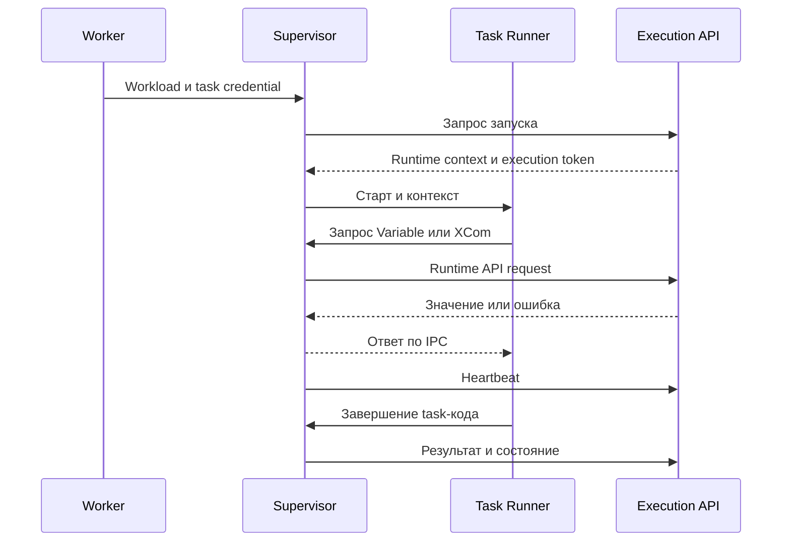
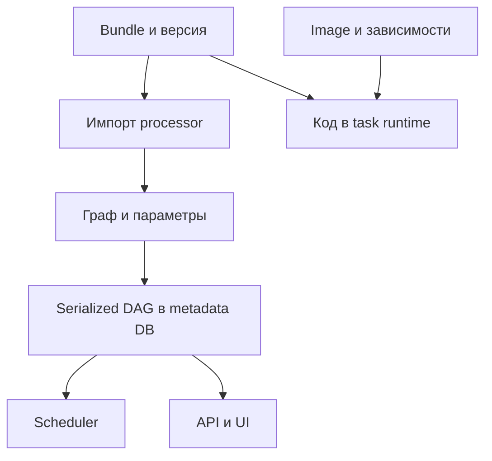
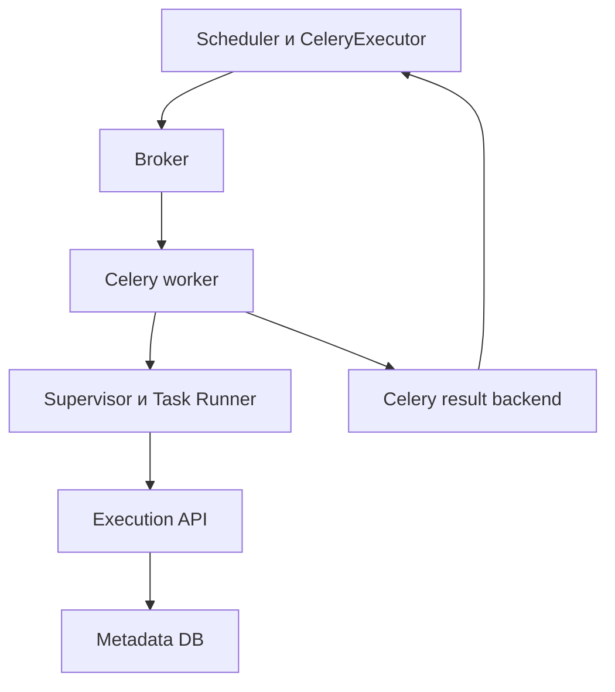
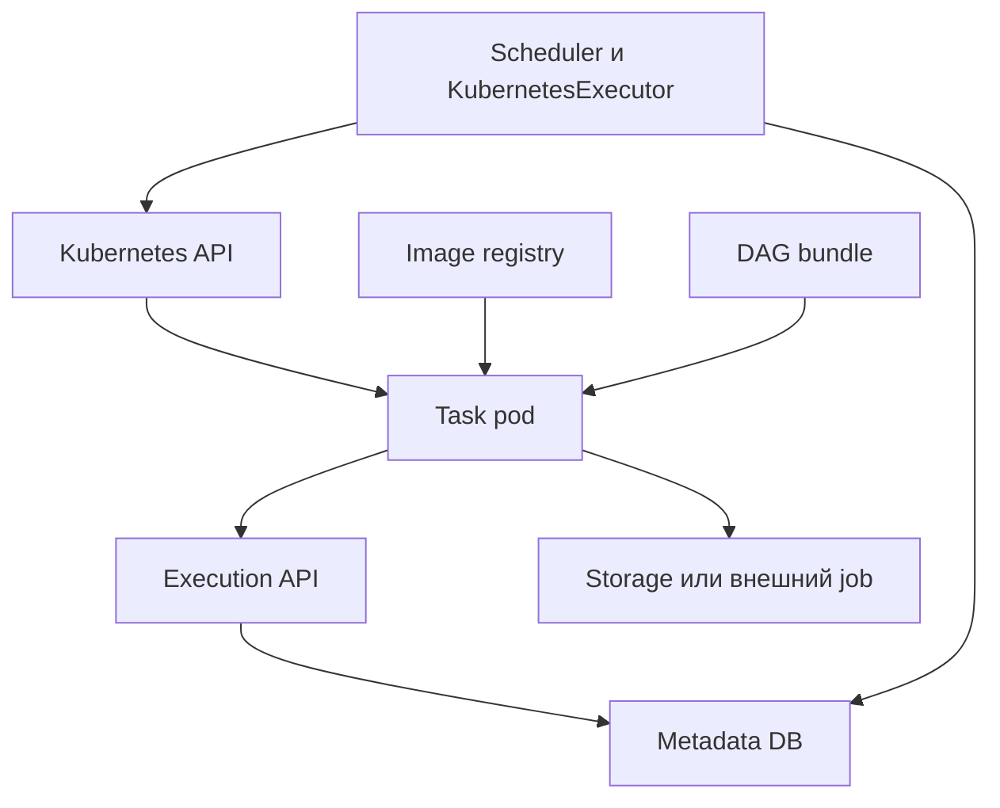
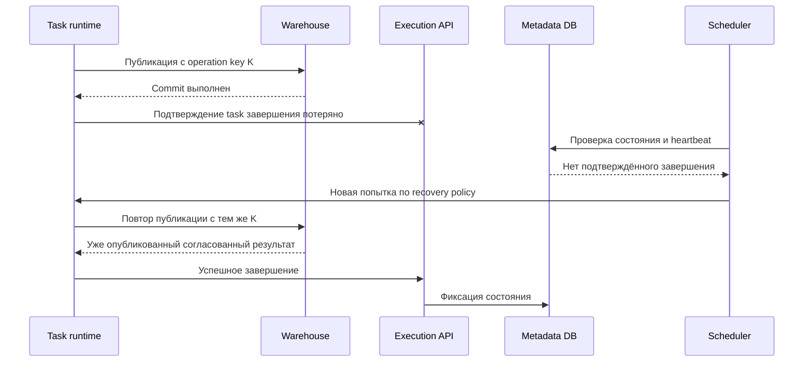

# 3. Архитектура Airflow 3 и распределённая модель выполнения

**Apache Airflow Zero to Hero · Профессиональный справочник**

| Параметр | Значение |
| --- | --- |
| Базовая линия | Apache Airflow 3.3.2, Python Task SDK 1.3.2, примеры для Python 3.12 |
| Дата проверки | 18 октября 2026 года |
| Покрытие README | Все 8 тем и 40 пунктов третьего раздела, в исходном порядке |
| Предварительная практика | Рабочий стенд и первый DAG из главы 2 |
| Сквозной сценарий | Обработка заказов за бизнес-день, внешний вычислительный job, проверка и публикация результата |
| Практический результат | Умение восстановить путь TaskInstance по компонентам, определить границу сбоя и объяснить последствия повторного выполнения |

В распределённом Airflow одна задача существует сразу в нескольких представлениях: Python-описание в DAG, запись TaskInstance в метабазе, workload у executor, процесс с пользовательским кодом и, возможно, внешний Spark job. Они связаны, но не совпадают. Именно на границах между ними возникают задержки, потерянные подтверждения и повторные действия.

Например, задача отправила Spark application, дождалась публикации таблицы и потеряла соединение с Airflow до фиксации `success`. Внешний результат уже существует, а orchestrator может повторить задачу. Чтобы объяснить и исправить такой случай, недостаточно знать синтаксис `@task`: нужна модель процессов, каналов связи и владельцев состояния.

Глава строится вокруг четырёх вопросов: **кто принимает решение; кто выполняет код; где хранится состояние; что произойдёт при потере связи между ними**. Сначала разберём компоненты, затем Task SDK и путь выполнения, после этого — топологии, ограничения и гарантии.

**Как читать:** при первом проходе изучи 3.1–3.4, выполни диагностический DAG из практики, затем вернись к границам процессов, инфраструктуре и отказам. Для собеседований Middle/Senior особенно важны 3.5.4, 3.6.4, 3.7.5 и весь раздел 3.8. Термины состояний здесь используются для объяснения архитектуры; полная модель DAG/DagRun/TaskInstance рассматривается в следующей главе.

## Содержание

1. [Компоненты control plane](#s3-1)
2. [Компоненты выполнения](#s3-2)
3. [Task SDK и Execution API](#s3-3)
4. [Путь от файла до результата](#s3-4)
5. [Границы процессов и машин](#s3-5)
6. [Метабаза и брокер](#s3-6)
7. [Топологии развёртывания](#s3-7)
8. [Модель отказов и гарантий](#s3-8)
9. [Практика: наблюдаемый путь двух задач](#probe)
10. [Практика: результат записан, подтверждение потеряно](#commit-lab)
11. [Разбор архитектурных ситуаций](#cases)
12. [Самопроверка и ориентиры ответов](#questions)
13. [Карта дальнейшего изучения](#next)
14. [Официальные источники](#sources)

Числовые оценки и сценарии отказов в главе — авторские модели, а не результаты нагрузочных измерений. Ссылки `[Sxx]` привязаны к документации и исходникам. Если обзорная документация содержит исторические формулировки Airflow 2.x, описание конкретного runtime здесь опирается на исходники релиза 3.3.2.

<a id="s3-1"></a>
## 3.1. Компоненты control plane

### 3.1.1. API server: UI, публичный API и интерфейсы выполнения

**Control plane** управляет оркестрацией: хранит описание процессов и их состояние, принимает команды, выбирает допустимую работу и отслеживает исполнение. **Execution plane** выполняет задачи. Это логическое разделение ролей: в локальном стенде несколько ролей находятся на одной машине.

В Airflow 3 API server обслуживает пользовательский интерфейс и API. При этом есть разные API-поверхности с разными клиентами и назначением. [S01](#source-01) [S17](#source-17)

| Поверхность | Клиент | Назначение |
| --- | --- | --- |
| UI и public/Core API | Человек, внешний клиент, инструменты управления | Просмотр DAG/runs, запуск, управление доступными ресурсами |
| Execution API | Task runtime через Supervisor/SDK | Контекст выполнения, heartbeat, XCom, runtime-ресурсы, состояние задачи |
| Дополнительные provider endpoints | Например, Edge worker | Операции конкретной интеграции, в том числе получение работы |

URL public API `/api/v2` и путь Execution API `/execution/` не являются взаимозаменяемыми. Пользовательский bearer token и task token также имеют разные назначения. Доступность UI не доказывает доступность Execution API из worker-сети.

В стандартном запуске `airflow api-server` необходимые приложения могут обслуживаться одним процессным deployment. При разделении приложений или reverse proxy нужно отдельно обеспечить маршрутизацию Execution API и передать его адрес runtime. Запуск только Core API способен оставить интерфейс работающим, а задачи — без runtime-сервиса.

У API server есть доступ к metadata database; он представляет её состояние клиентам через проверяемые интерфейсы. Это не означает, что браузеру или каждой task нужно выдавать SQL-доступ к метабазе.

Для обычного отображения графа API server не обязан читать и импортировать исходный DAG-файл: используются сохранённые представления и исходный код из metadata. Зарегистрированные plugins/providers и другие расширения API server остаются отдельным доверенным кодом; утверждение «API server никогда не выполняет Python-код расширений» было бы неверным.

**Диагностическое следствие:** если UI доступен, а задача падает до первого сообщения из своего тела, проверь путь worker → Execution API, а не только страницу в браузере.

### 3.1.2. Scheduler: готовность задач, ограничения и передача executor

Scheduler отвечает на вопрос: **какие TaskInstance сейчас допустимо передать на выполнение**. Он читает состояние запусков и сериализованный граф, оценивает зависимости и ограничения, затем взаимодействует с настроенным executor.

Для обработки заказов scheduler должен отличить «родительские проверки завершились» от «внешний warehouse уже перегружен». Первая зависимость задаётся графом; вторая может быть представлена pool slots и лимитами. Сам scheduler не исполняет распределённый SQL или Spark stages вместо вычислителя.

| Проверяемая область | Пример ограничения | Почему task может ждать |
| --- | --- | --- |
| Зависимости | Нужен успех upstream | Вход ещё не готов |
| Состояние DAG/run | DAG paused; активность конкретного run | Работа пока не должна планироваться |
| Лимиты DAG/tasks | Допустимое число активных instances/runs | Квота уже занята |
| Pools | Свободные слоты внешнего сервиса | Слишком много одновременных обращений |
| Executor | Доступная очередь/вместимость адаптера | Нет возможности принять дополнительную работу |
| Расписание/повтор | Время очередного запуска или retry | Момент допустимости ещё не наступил |

Результат планирования — переходы состояния и передача workload executor. Очередь executor не является доказательством, что пользовательская функция уже начала работу. Между `scheduled`, `queued` и первым сообщением task body могут находиться отдельные процессы, сеть, image pull и получение runtime context.

Несколько schedulers могут работать одновременно. Важная часть координации использует транзакции и row-level locks metadata database; отдельный Raft-кластер schedulers для этого не требуется. Критическая секция защищает выбор задач с учётом pools и concurrency. [S02](#source-02)

Блокировки уменьшают риск противоречивых решений schedulers, но не создают единую транзакцию с внешним warehouse. Также дополнительные schedulers не дают бесконечный линейный рост: они конкурируют за общую БД и ограниченные ресурсы.

**Диагностическое следствие:** при `queued`/`scheduled` сначала найди, какой этап ожидания длится. Увеличение числа workers не исправляет paused DAG, занятый pool или блокирующуюся metadata DB.

### 3.1.3. DAG processor: загрузка кода, discovery и сериализация графов

DAG processor превращает доставленный код в описание workflow, пригодное для платформы. В Python-модели это включает чтение файла, импорт модуля, создание объектов DAG/tasks, обнаружение графов и сериализацию результата.

В Airflow 3 processor запускается отдельно через `airflow dag-processor`. Внутри есть управляющий цикл и процессы обработки файлов. Количество parsing processes и интервалы обработки задаются конфигурацией. [S03](#source-03)

| Шаг | Результат | Типичный сбой |
| --- | --- | --- |
| Получение bundle | Доступна нужная версия файлов | Git/network/auth, недоступный источник |
| Discovery | Найден список Python-файлов | Неверный путь, ignore pattern, permissions |
| Импорт | Модуль выполнил top-level код | ImportError, timeout, дорогой сетевой вызов |
| Построение графа | Созданы DAG/tasks/зависимости | Цикл, коллизия ID, некорректные параметры |
| Сериализация/сохранение | Представление доступно control plane | Ошибка сериализации, DB/network |

Импорт файла — выполнение Python-кода. Открытие соединения, `requests.get()` или чтение большого DataFrame на верхнем уровне повторяются при обработке файла и связывают доступность control plane с внешним сервисом. Тело `@task` выполняется позже; обычный вызов функции вне task-декоратора выполняется сразу при импорте.

Пример неправильного размещения операции: получить из REST API список всех заказов, чтобы затем положить его в `op_kwargs`. Такой DAG требует бизнес-API уже для парсинга и сериализует данные вместо описания работы. Лучше определить задачу получения заказов, а в граф передать её будущий результат или ссылку на артефакт.

Processor исполняет код авторов DAG и входит в доверенную область deployment. Вынос processor в отдельный процесс/контейнер полезен для управления ресурсами и доступом, но сам по себе не делает произвольный DAG безопасным для метабазы. [S18](#source-18)

**Диагностическое следствие:** DAG может отсутствовать при здоровых API server и scheduler. Проверяй processor, источник bundle и import errors в его реальном окружении.

### 3.1.4. Metadata database: состояние, история и координация

Metadata database — долговременная память оркестрации. Она связывает независимые процессы общим состоянием: какой граф известен платформе, какие runs существуют, какие tasks допустимы и что произошло с попытками.

| Вид состояния | Пример | Как используется |
| --- | --- | --- |
| Определение workflow | Сериализованный граф и версия | Планирование и отображение |
| Жизненный цикл | DagRun, TaskInstance, попытки, timestamps | Допустимость работы и история |
| Координация | Pools, сведения о jobs/heartbeat, locks | Ограничения и обнаружение отказов |
| Runtime metadata | XCom по умолчанию, asset events | Связь задач и основание последующих запусков |
| Конфигурационные сущности | Connections/Variables в соответствующем backend | Получение runtime-настроек |

Не всё состояние обязательно физически находится в одной БД: secrets могут жить в secrets backend, XCom payload — в object storage, task logs — в удалённом log backend. В метабазе при этом остаются связанные метаданные/ссылки согласно настройке.

Scheduler и API server не обмениваются единственным общим Python-объектом `DagRun`. Каждый процесс читает и изменяет состояние через свой код и соединения; транзакции БД задают границы согласования.

Из этого следуют требования к production: поддерживаемая СУБД, контролируемые миграции, доступность, connection budget, backup и проверка restore. SQLite учебного стенда не является аналогом внешней production DB с несколькими узлами. [S22](#source-22)

Потеря метабазы означает потерю истории и координации даже при сохранённых DAG-файлах и таблицах warehouse. Обратная ситуация также возможна: вся история Airflow сохранена, но внешние данные повреждены. Эти классы сохранности требуют разных резервных копий.

**Диагностическое следствие:** «в CLI run есть, в UI нет» может означать две разные DB, а не проблему обновления страницы.

### 3.1.5. Triggerer: асинхронные ожидания и обработка triggers

Triggerer обслуживает асинхронные triggers для deferrable-модели и поддерживаемых событийных механизмов. Его задача — эффективно следить за условием, после которого task можно возобновить, не удерживая обычный worker для всего времени ожидания.

Типичный путь: task отправляет внешний job → сохраняет данные для возобновления → переходит в `deferred` → trigger наблюдает job → появляется событие → scheduler снова передаёт task на выполнение.

| До deferral | Во время deferral | После события |
| --- | --- | --- |
| Код operator работает в task runtime | Trigger работает в triggerer | Task runtime вызывает логику возобновления |
| Есть worker-процесс задачи | Обычный worker освобождён | Нужен доступный executor/worker |
| Можно использовать локальные переменные | Сохраняется только предусмотренное состояние | Исходный стек Python не восстанавливается автоматически |

Trigger должен выполнять неблокирующее ожидание. Синхронный долгий вызов в общем async loop способен задержать другие triggers. `async def` сам по себе не гарантирует неблокирующую работу: внутри него можно вызвать блокирующий SDK.

Deferral отличается от `sleep()` на worker и от sensor reschedule. Он также не останавливает внешний Spark job: ресурсы кластера продолжают использоваться. Освобождение Airflow worker и освобождение внешних вычислительных ресурсов — отдельные события. [S20](#source-20)

Несколько triggerers поддерживают отказоустойчивое обслуживание; после обнаружения потери владельца triggers могут быть назначены другому процессу. Мгновенного бесшовного переноса стека нет: нужны сериализуемое состояние trigger, доступные зависимости и корректность повторного наблюдения.

**Контрольная точка 3.1:** можешь для каждого компонента назвать вход, результат, сохраняемое состояние и последствия остановки. API отвечает за интерфейсы, processor — за описание DAG, scheduler — за допустимость выполнения, triggerer — за ожидания, DB — за общую историю и координацию.

<a id="s3-2"></a>
## 3.2. Компоненты выполнения

### 3.2.1. Executor как адаптер запуска, а worker как исполняющая среда

Executor — программная граница между scheduler и конкретным способом исполнения. Он принимает описание работы, workload, отправляет его в локальные процессы, Celery, Kubernetes или поддерживаемую удалённую модель и возвращает сведения о выполнении. Для задачи workload связывает нужный TaskInstance с данными запуска runtime; основные бизнес-данные по этому каналу не передаются.

Worker — среда, где запускается workload. Это может быть долгоживущий Celery worker, локальная инфраструктура процессов или создаваемый для задачи pod. Отдельный постоянно работающий daemon с именем worker существует не во всех топологиях.

| Вопрос | Executor | Worker/runtime |
| --- | --- | --- |
| Как отправить работу? | Знает механизм передачи и учёта | Получает назначенную работу |
| Где исполняется пользовательская функция? | Обычно не в самом объекте адаптера | В task-процессе выбранной среды |
| Где нужны task-библиотеки? | Только необходимые адаптеру/его интеграции | Там, где импортируется и исполняется task |
| Что масштабируется? | Scheduling/dispatch capacity | Количество/ресурсы исполняющих сред |
| Кто ограничивает внешний Spark cluster? | Может косвенно ограничить через pools/dispatch | Job submitter и сам внешний cluster manager |

В обычной архитектуре executor загружается scheduler как Python-компонент; вокруг него могут быть собственные процессы/threads и внешние сервисы. Фраза «запустить ещё один executor» требует уточнения: добавить scheduler, worker capacity или другую executor-конфигурацию — разные действия. [S06](#source-06)

Например, при Celery scheduler использует executor, чтобы отправить сообщение broker. Worker забирает сообщение, а Python task runtime связывается с Execution API. Broker и API выполняют разные роли; подключение к одному не заменяет доступ ко второму.

### 3.2.2. Task runner, supervisor и отдельный процесс пользовательского кода

В штатном supervised Python-пути Airflow 3.3.2 worker запускает Supervisor; тот управляет отдельным процессом Task Runner, в котором работает пользовательский код. Между ними есть IPC-канал. Supervisor взаимодействует с Execution API и следит за жизненным циклом дочернего процесса. [S14](#source-14) [S15](#source-15)



Схема намеренно не показывает детали формата сообщений. IPC и внутренние Python-классы — реализация runtime, а не API для пользовательского DAG. Для обычного task-кода точка доступа — `airflow.sdk`.

| Роль | Ответственность |
| --- | --- |
| Worker | Получить workload и предоставить среду выполнения |
| Supervisor | Управлять task-процессом, API-клиентом, heartbeat и обменом сообщениями |
| Task Runner | Подготовить выполнение operator/function, вызвать код, передать runtime-события |
| Пользовательская функция | Реализовать прикладной шаг и контракт результата |

В этом пути короткоживущий task JWT находится у Supervisor, а не передаётся в обычную функцию как аргумент. Это снижает связанность task-кода с транспортом и внутренними credentials. Однако отдельный процесс не является полной security sandbox: файловые права, контейнерные permissions и доверие авторам DAG всё равно важны.

Supervisor может продолжать посылать heartbeat, пока пользовательский код ждёт медленный внешний сервис. Такой heartbeat говорит о связи runtime с Airflow; он не доказывает прогресс Spark application или отсутствие бизнес-дедлока.

`dag.test()` и некоторые локальные режимы могут использовать in-process путь без того же набора процессов, сокетов и HTTP. Успешный локальный тест не доказывает здоровье реальной supervised/network-топологии. [S34](#source-34)

### 3.2.3. Local, Celery, Kubernetes и Edge-модели выполнения

Все модели реализуют исполнение TaskInstance, но по-разному управляют placement, очередями, изоляцией и стартом runtime.

| Модель | Основная среда | Доставка работы | Существенная зависимость |
| --- | --- | --- | --- |
| LocalExecutor | Процессы на машине scheduler | Локальная инфраструктура executor | Ресурсы и доступность этого узла |
| CeleryExecutor | Долгоживущие Celery workers | Celery broker | Broker, result backend, worker capacity |
| KubernetesExecutor | Отдельный task pod для попытки исполнения | Kubernetes API/control plane | Quotas, admission, image registry, scheduling pods |
| EdgeExecutor | Удалённые Edge workers | Pull через provider API | Edge endpoints, сеть и доставка кода удалённой площадке |

Для версии главы используем описание core 3.3.2; release constraints содержат Celery provider 3.24.0, Kubernetes provider 10.22.0 и Edge3 provider 4.3.2. Номера providers не совпадают с core и не задаются «на глаз». [S33](#source-33)

LocalExecutor не требует Celery broker. KubernetesExecutor не означает создание постоянного Celery worker. EdgeExecutor не является другим именем Celery через VPN: у него собственные endpoints, модель получения работы и ограничения provider. [S07](#source-07) [S08](#source-08) [S09](#source-09) [S10](#source-10)

Скорость старта определяется всем путём: от очереди executor до доступного Python runtime. Тёплый Celery worker может запускать небольшую task быстро, но её зависимости разделяют image и ресурсы worker. Kubernetes даёт явную pod-границу и настройки ресурсов, но добавляет pod scheduling и возможную загрузку image. Числа сравнивают измерениями на конкретной платформе.

Выбор executor не делает код автоматически идемпотентным. При любой модели остаются внешний результат, подтверждения и возможность повторной попытки.

### 3.2.4. Внешний job, контейнер и TaskInstance как разные сущности

TaskInstance — экземпляр задачи внутри конкретного DagRun и, при mapping, индекса. Внешний job — работа в другой системе: Spark application, запрос warehouse, dbt invocation или cloud job. Контейнер/pod — вычислительная оболочка, которая может запускать task, внешний job или оба по цепочке.

| Идентификатор | Что идентифицирует | Пример |
| --- | --- | --- |
| `dag_id`, `run_id` | Workflow и его запуск | `orders_daily`, manual/scheduled run |
| `task_id`, `map_index` | Узел/его mapped instance | `build_mart`, индекс 12 |
| TaskInstance UUID | Экземпляр в runtime/API | UUID из task context |
| `try_number` | Попытку выполнения | 1, затем 2 после retry |
| Worker hostname, pod UID, PID | Место и процесс | Узел диагностики, не ключ бизнес-данных |
| External job ID | Работу внешнего вычислителя | Spark application ID |
| Business operation key | Логическую операцию над данными | Дата + snapshot + версия преобразования |

Одна task может отправить несколько jobs. Один job может пережить task-процесс и быть подхвачен следующей попыткой. Отдельная task может только наблюдать ранее отправленный job. Поэтому универсального равенства «одна TaskInstance = один Spark job = один pod» нет.

KubernetesExecutor создаёт pod для выполнения Airflow task. Если внутри такой task вызывается `KubernetesPodOperator`, появляется дополнительный pod прикладной работы. Это допустимая архитектура, но lifecycle, ресурсы и журналы двух уровней нужно объяснить отдельно. [S31](#source-31)

`TaskInstance=success` означает, что настроенный task-код/оператор сообщил успешное завершение. Если оператор только отправил job и не проверил его окончание, успех task не означает готовность витрины. Контракт должен явно определить, требуется ли submit, завершение вычислений, validation или публикация.

### 3.2.5. Где находятся код, временные файлы, данные и credentials

Для каждой категории состояния нужно определить владельца, место хранения и срок жизни. Общее слово «окружение Airflow» не отвечает на эти вопросы.

| Категория | Где нужна/хранится | Основной риск |
| --- | --- | --- |
| DAG source/bundle | У processor и исполняющего runtime в нужной версии | Граф разобран по одному коду, выполняется другой |
| Установленные Python-пакеты | В соответствующих images/venv | Bundle не содержит нужную зависимость |
| Временные файлы | Локальный диск конкретного runtime | Исчезли после завершения pod/recreate |
| Основные данные | Object storage, lakehouse, warehouse, прикладная DB | Неатомарная публикация, неверная версия |
| Маленькие runtime-результаты | XCom через выбранный backend | Использование как большого/вечного хранилища |
| Task logs | Local/remote logging backend | Потеря после удаления worker; секреты в выводе |
| Credentials | Secrets backend, workload identity, защищённая конфигурация | Избыточный доступ и случайная утечка |

Versioned bundle решает доставку определённой версии файлов, но не фиксирует автоматически system packages, wheel dependencies, версию удалённого API и snapshot входных данных. Для воспроизводимости нужен составной паспорт выполнения.

Credential должен быть доступен процессу, который реально обращается к ресурсу. Git credential для получения bundle, warehouse credential task и JWT для Execution API относятся к разным механизмам. Передача одного общего набора секретов каждому контейнеру упрощает quickstart, но расширяет область доступа.

Наличие файла `s3://…` в строке XCom не означает, что consumer имеет сеть, разрешение на чтение и совместимый формат данных. Эти свойства являются частью контракта артефакта и deployment.

**Контрольная точка 3.2:** можешь отличить scheduler/executor, worker/Supervisor/task-процесс и внешний job; умеешь связать их по идентификаторам и указать владельца каждого вида состояния.

<a id="s3-3"></a>
## 3.3. Task SDK и Execution API

### 3.3.1. Стабильная поверхность `airflow.sdk` для авторов DAG

Task SDK предоставляет публичные конструкции для описания и выполнения задач. Для нового кода используем `DAG`, `dag`, `task`, `Asset`, `Variable`, `Connection` и runtime context из `airflow.sdk`, а не внутренние ORM-модели scheduler.

```python
# example: sdk_imports
from airflow.sdk import Asset, Connection, DAG, Variable, dag, get_current_context, task
```

Это справочная строка импортов, не отдельный DAG. В реальном файле оставляй только используемые имена.

Публичная поверхность означает поддерживаемый контракт для авторов DAG. Она не обещает неизменность всех классов внутри `airflow.sdk.execution_time`, транспорта IPC и атрибутов внутренних ORM-моделей. Путь импорта, встреченный в исходниках Supervisor, не становится пользовательским API автоматически. [S12](#source-12) [S13](#source-13)

| Действие автора DAG | Подходящий уровень |
| --- | --- |
| Определить задачи и зависимости | `airflow.sdk` и публичные provider operators |
| Получить данные текущего выполнения | `get_current_context()` внутри task |
| Получить Connection/Variable | SDK, hooks и настроенный secrets resolution |
| Управлять платформой извне | Public REST API/официальный клиент |
| Понять механизм heartbeat | Изучить runtime source, не копировать private calls в DAG |

Legacy-импорты могут какое-то время работать через совместимость, но для нового учебного проекта закрепляем SDK-интерфейс. При переносе старого кода нужно проверить не только `from … import`, но и обращения к metadatabase, session, глобальному config и устаревшим provider API.

### 3.3.2. Отделение task runtime от внутренних моделей scheduler

В прежнем тесно связанном подходе task-код мог импортировать внутренний `TaskInstance`, открывать SQLAlchemy Session и изменять metadata tables. Архитектура Airflow 3 переносит runtime-взаимодействия за Execution API. У задачи появляется контракт, не зависящий от прямого SQL-доступа к таблицам scheduler.

| Было бы нарушением границы | Поддерживаемая модель |
| --- | --- |
| Открыть session метабазы, изменить строку TaskInstance | Вернуть результат/исключение; runtime передаст состояние |
| Прочитать Variable через ORM-модель | Использовать `Variable` из SDK |
| Вставить XCom SQL-запросом | TaskFlow return или runtime XCom API |
| Считать внутреннюю DB schema частью контракта DAG | Использовать документированную API-поверхность |

Смысл разделения — уменьшить зависимость среды выполнения от внутренностей control plane и ограничить прямой доступ к метабазе. Сам user task при этом может работать с **прикладной** PostgreSQL/Oracle/warehouse: запрет обходить metadata ORM не является запретом SQL в pipeline.

Не превращай task в дополнительный scheduler: прямое изменение состояний соседних задач ради «починки графа» обходит нормальную модель зависимостей и усложняет восстановление. Если нужен отдельный процесс, опиши его зависимостью, явным API-действием или подходящим оператором.

Граница не универсальна для каждого процесса installation: DAG processor и triggerer исполняют авторский код и могут иметь прямой доступ к метабазе/in-process API. Они относятся к control-plane trust boundary. Default/local Compose также может раздавать общие environment values шире, чем требуется промышленной изоляции. [S18](#source-18) [S19](#source-19)

### 3.3.3. Доступ к Variables, Connections и XCom через runtime API

Из task-кода SDK обращается к runtime-механизмам. В supervised-пути запрос к metadata-backed ресурсу проходит через Supervisor и Execution API. При этом secrets backend, environment и поддерживаемые caches могут обслужить часть запросов иначе; нельзя считать, что каждый `Connection.get()` обязательно означает отдельный HTTP round trip.

Дополнительный пример task, **требующий заранее созданной Connection `warehouse`**:

```python
# example: runtime_resources
from airflow.sdk import Connection, Variable, task


@task(multiple_outputs=False)
def describe_runtime_resources() -> dict[str, str]:
    region = Variable.get("analytics_region", default="local")
    connection = Connection.get("warehouse")
    # Реальный клиент БД создаётся по connection внутри этой task.
    # В ответ не включаем password, URI и extras с credentials.
    return {"region": region, "connection_type": connection.conn_type}
```

Один этот фрагмент не создаёт новый DAG; его добавляют в фабрику workflow при изучении runtime-ресурсов. Для основного диагностического DAG такие credentials не нужны.

| Механизм | Назначение | Чего от него не ожидать |
| --- | --- | --- |
| Variable | Конфигурационное значение deployment/приложения | Автоматического snapshot на весь DagRun |
| Connection | Настройки интеграции и разрешение credentials | Универсального контроля нагрузки внешней БД |
| XCom | Небольшой результат/ссылка, связанная с task/run | Большого общего dataset или вечного журнала повторов |

Если Variable изменяется во время долгого DagRun, две задачи могут прочитать разные значения. Для воспроизводимости значимые настройки нужно фиксировать в конфигурации запуска, manifest или версии кода, учитывая права и конфиденциальность.

SDK Context/TaskFlow передаёт значения, а не Python-объект по общей ссылке. Consumer получает сериализуемый результат через XCom backend. При custom/object-storage backend большая часть payload может лежать вне metadata DB, но это всё ещё не общая память между задачами. [S26](#source-26) [S27](#source-27)

Проверка подключения к warehouse включает несколько независимых доступов: Connection resolution, network к БД, driver, TLS и права пользователя. Успешное получение `conn_type` подтверждает только часть пути.

### 3.3.4. Аутентификация, срок действия токенов и доступность API server

Execution API использует JWT, связанный с workload/TaskInstance. Не нужно получать task credential через обычную форму login или переносить пользовательский пароль в task-код.

В 3.3.2 различаются `workload` token для доставки и начала исполнения и `execution` token для выполняющейся задачи. При штатном переходе к запуску и дальнейших API-обменах runtime получает соответствующие токены/обновления. [S17](#source-17)

| Участок | Что важно |
| --- | --- |
| Ожидание в очереди | Workload token должен оставаться действительным до начала разрешённого исполнения |
| Начало выполнения | API проверяет task/workload и предоставляет runtime context |
| Долгая task | Работают heartbeat и обновление execution token |
| Разрыв сети | API-запросы могут повторяться, а heartbeat — перестать подтверждаться |
| Изменение/отмена состояния | API может отклонить runtime, который больше не должен работать |

В базовой конфигурации релиза `execution_api.jwt_expiration_time` — 600 секунд. Это не означает, что любая task должна завершиться за десять минут: Supervisor/клиент поддерживают обновление execution token в штатном обмене. Public API token lifetime относится к другой конфигурационной роли. [S16](#source-16) [S21](#source-21)

Проверяй безопасные значения:

```bash
airflow config get-value core execution_api_server_url
airflow config get-value execution_api jwt_expiration_time
airflow config get-value workers min_heartbeat_interval
airflow config get-value workers max_failed_heartbeats
airflow config get-value scheduler task_instance_heartbeat_timeout
```

Для проверки signing key не выводи сам ключ в общий лог. Нужно согласовать signing/verification, issuer/audience, доверенный TLS и время узлов. Наличие подписи JWT подтверждает проверяемое происхождение токена в выбранной схеме; оно не является само по себе полным доказательством изоляции всех DAG/команд друг от друга.

В исходниках Supervisor 3.3.2 ошибки heartbeat учитываются, а при превышении допустимого числа неудач task-процесс может быть остановлен. Поэтому предположение «API server нужен только на старте task, дальше можно выключить» неверно. Остановка локального процесса также не гарантирует отмену внешнего job, который уже принят Spark/warehouse.

Не сохраняй полный workload JSON ради диагностики: в нём может находиться credential доставки. Достаточно идентификаторов, версии runtime, класса/кода ошибки и адреса endpoint без секретов.

### 3.3.5. Версионирование протокола и совместимость worker/control plane

Airflow 3 разделяет несколько независимых версий. Одна строка «везде Airflow 3» недостаточна для гарантии совместимости.

| Версия | Что описывает | Типичная ошибка смешения |
| --- | --- | --- |
| Core Airflow | Control-plane код и schema migrations | Старый core работает с неподготовленной DB |
| Task SDK | Runtime/client и authoring API | Worker использует неподдерживаемую комбинацию SDK/core |
| Execution API protocol | Формат runtime requests/responses | Ожидаемые клиентом поля/операции отсутствуют |
| Serialized DAG schema | Представление графа | Путаница с Git commit исходного кода |
| Provider | Конкретные operators/executors/hooks | Одинаковый core, разные integration API |
| Bundle version | Версия исходных файлов | Code replay выполняет другую checkout |
| Image/package version | Зависимости и окружение | Нужный commit запускается с другой библиотекой |
| Input/data version | Snapshot обрабатываемых данных | Повтор на изменившемся входе даёт другой результат |

SDK-клиент 1.3.2 передаёт версию API в заголовке `airflow-api-version`; server реализует versioned execution interface. Это механизм развития протокола, а не приглашение вручную подменять заголовок, чтобы обойти несовместимость. [S16](#source-16) [S34](#source-34)

Для базовой линии главы сохраняем проверенную пару core 3.3.2 / SDK 1.3.2 и согласованные providers. Независимая доставка worker/control plane требует проверки поддерживаемых комбинаций, миграций, сериализации и реального smoke DAG. Стабильный authoring API не обещает, что произвольные версии всех компонентов можно смешивать.

При rolling update важно проверить долгоживущие runs: task могла быть запланирована старой версией, а исполняться после обновления части инфраструктуры. Сохраняй доступность нужного bundle и runtime image на период выполнения, retries и согласованного срока повторной обработки.

**Контрольная точка 3.3:** знаешь публичный SDK, путь runtime-запроса, роли токенов и независимые версии. Можешь объяснить, почему прямой SQL к метабазе и пользовательский API token не являются нормальной заменой Execution API.

<a id="s3-4"></a>
## 3.4. Путь от файла до результата

### 3.4.1. Доставка DAG bundle и обнаружение Python-файла

Жизненный цикл начинается до scheduler. Код должен попасть в источник, доступный processor, и затем в исполнение с согласованной версией. Bundle объединяет DAG-файлы и связанные ресурсы; разные реализации поддерживают разные возможности версионирования.

| Источник | Версия исполнения | Практическое свойство |
| --- | --- | --- |
| `LocalDagBundle` | Последнее доступное содержимое локального каталога | Сам по себе не обеспечивает исторический code replay |
| `GitDagBundle` | Поддерживает версию Git commit | Позволяет run использовать согласованную версию bundle |
| Другие provider bundles | Зависит от реализации | Нужно читать возможности конкретного provider |
| DAG внутри image | Версия файлов определяется image | Нужно согласовать доставку image/bundle с control plane |

Даже versioned bucket не делает автоматически versioned конкретный Airflow bundle. Например, наличие версий object storage и поддержка bundle version — разные механизмы. Проверяй реализацию, не делай вывод по названию хранилища. [S04](#source-04)

Пример значения `dag_processor.dag_bundle_config_list` для установленного Git provider:

```json
[
  {
    "name": "orders",
    "classpath": "airflow.providers.git.bundles.git.GitDagBundle",
    "kwargs": {
      "git_conn_id": "dags_repository",
      "tracking_ref": "main",
      "subdir": "dags"
    }
  }
]
```

Это значение конфигурационной опции, не самостоятельный полный `airflow.cfg`. Connection `dags_repository` и provider должны быть подготовлены. Не включай Git token в URL/kwargs: конфигурация может быть доступна через интерфейсы просмотра.

Tracking branch определяет, откуда обнаруживать обновления; фиксируемая bundle version позволяет связать выполнение с конкретным commit. При clear/backfill поддерживаемые настройки могут выбрать исходную или актуальную версию. Нельзя обещать, что любой повтор всегда выполняет исходный код независимо от выбранного режима.

Для LocalDagBundle изменение файла между задачами может повлиять на дальнейшее исполнение. Этот quickstart удобен, но не эквивалентен immutable release.

### 3.4.2. Импорт, построение графа и запись сериализованного представления

Processor импортирует модуль и обнаруживает объекты DAG. Вызов `@task` во время построения графа создаёт task description и ссылку на будущий результат; сами три миллиона заказов в этот момент обрабатываться не должны.

Сериализованный DAG содержит представление графа и значимых свойств для планирования/отображения. Он не является универсальным исполняемым архивом Python-пакетов и не заменяет доступ к нужному source/runtime для выполнения callable. [S05](#source-05)



Успешный parse подтверждает, что **processor** смог построить описание. Он не доказывает, что worker имеет совместимый пакет, может скачать bundle, подключиться к warehouse и выполнить task.

Изменение файла распространяется не мгновенно. Между commit и видимым графом находятся получение source, discovery, очереди parsing, обработка и сохранение. Если нужен SLO доставки DAG, измеряй эти участки отдельно.

Для повторяемого графа избегай зависимости от непредсказуемого порядка коллекций/внешнего API и генерации новых IDs на каждом импорте. Если IDs меняются случайно, платформа видит изменение workflow, а не «тот же процесс с другим результатом».

### 3.4.3. Создание DagRun и определение готовых TaskInstance

DagRun может появиться из расписания, ручного trigger, backfill, asset-driven или другого поддерживаемого механизма. После этого task instances связываются с конкретным run; для mapping набор instances может уточняться по runtime-результатам.

Для заказов за день D нужно отличить как минимум три времени: когда пользователь нажал trigger, какой период данных обрабатывается и когда задача реально начала работу. Совпадение этих времён — частный случай, а не общий закон.

| Объект/факт | Что означает |
| --- | --- |
| Definition DAG | Как должен быть устроен процесс |
| DagRun | Конкретный экземпляр процесса |
| Logical date/data interval | Логическая временная привязка согласно timetable/run type |
| TaskInstance | Исполнение узла в выбранном run/map index |
| Task attempt | Отдельная попытка этого исполнения |

Scheduler проверяет готовность с учётом trigger rules, состояний upstream и лимитов. «Родитель завершился» не всегда означает «родитель success»; конкретное правило задаётся workflow. Полная таблица trigger rules будет рассмотрена отдельно.

Обычный ручной trigger paused DAG способен создать queued run, который не дойдёт до task execution до unpause. Создать запись о намерении выполнить работу и фактически выдать работу — разные действия. [S35](#source-35)

Повторный DagRun и retry task — разные единицы истории. Идентификатор бизнес-операции должен позволять понять, являются ли они повтором тех же данных или новой обработкой.

### 3.4.4. Постановка в очередь, запуск, heartbeat и завершение

Дальнейший путь зависит от executor, но сохраняет основные границы: допустимость → dispatch → запуск runtime → выполнение → фиксация результата.

| Участок | Владелец наблюдения | Возможная задержка |
| --- | --- | --- |
| Готовность → queued | Scheduler/executor | Лимиты, DB locks, dispatch |
| Queued → получение workload | Broker/worker или Kubernetes/Edge infrastructure | Очередь, нехватка workers, pod Pending |
| Получение → начало task | Worker/Supervisor/API | Bundle/image, импорты, runtime context |
| Начало → прикладной результат | Task и внешний вычислитель | SQL/Spark/API, входные данные |
| Результат → отражение завершения | Runtime/API/DB/executor reconciliation | Сеть, фиксация состояния, завершающие операции |

Heartbeat — периодический сигнал живости, а не коммит результата. Потеря heartbeat означает подозрение на отказ или потерю связи, а не математическое доказательство отсутствия внешнего job.

Supervisor проверяет связь с Execution API и сообщает runtime-состояние; scheduler и executor также ведут свои циклы наблюдения и восстановления. У разных executor есть собственные events/status. Эти наблюдения нужно согласовать, а не считать одно сообщение broker единственной истиной.

Продолжительность обнаружения отказа зависит от heartbeat policy, таймаутов, периодов проверки и задержек системы. Неверно обещать, что при worker crash retry начнётся точно через N секунд по одному параметру.

При анализе сохраняй timestamps и IDs с обеих сторон. Логи разных узлов могут иметь clock skew; сортировка строк по локальному wall clock без идентификаторов способна создать ложную последовательность.

### 3.4.5. Публикация XCom, asset events, логов и итогового состояния

Завершение task наблюдается через несколько каналов. Они отвечают на разные вопросы и не должны подменять друг друга.

| Канал | Что сообщает | Чего не доказывает |
| --- | --- | --- |
| XCom | Небольшое значение/ссылку от task | Вечную сохранность внешнего артефакта |
| Asset event | Логическое обновление asset | Автоматическую проверку содержимого по URI |
| Task log | Сообщения о действиях и ошибках | Сам по себе согласованное состояние DB |
| TaskInstance state | Состояние исполнения в orchestrator | Корректность всех бизнес-данных без проверок |
| DagRun state | Итог по правилам графа | Всегдашнюю эквивалентность готовой витрине |

При обычной TaskFlow-передаче return value публикуется через XCom. Явный XCom можно записать и раньше завершения task; наличие значения не следует считать универсальным доказательством её успеха. Кроме того, retry может очищать XCom предыдущей неудачной попытки. [S26](#source-26)

`outlets=[Asset(...)]` связывает успешное выполнение producer с логическим событием обновления. Asset URI — идентификатор, а не инструкция Airflow скачать файл и проверить его. Корректная последовательность прикладного publisher: завершить запись → проверить результат → сделать его доступным потребителям → успешно завершить task. [S24](#source-24)

Для логов отдельно учитываются buffering, remote upload и срок хранения. Удалённый pod может исчезнуть раньше, чем оператор откроет его локальный log. Поэтому в распределённой платформе нужен устойчивый доступ к task logs, а не только stdout живого worker. [S25](#source-25)

Какие внутренние metadata-изменения объединены одной транзакцией, определяется конкретным endpoint и реализацией релиза. Внешняя запись warehouse/object storage в такую транзакцию Airflow не включается автоматически. Самое важное окно отказа — внешний результат уже опубликован, а task success ещё не подтверждён.

**Контрольная точка 3.4:** можешь восстановить путь run по этапам, назвать владельца каждой задержки и отличить факт данных, XCom, event, log и состояние orchestrator.

<a id="s3-5"></a>
## 3.5. Границы процессов и машин

### 3.5.1. Parse time, schedule time и execution time

Один Python-файл участвует в нескольких фазах. Ошибка размещения кода меняет не только производительность, но и смысл исполнения.

| Фаза | Где выполняется основная работа | Что допустимо делать |
| --- | --- | --- |
| Parse time | DAG processor | Дёшево и предсказуемо построить описание workflow |
| Schedule time | Scheduler/executor | Выбрать готовые instances, применить limits, передать workload |
| Execution time | Task runtime/внешний вычислитель | Читать данные, преобразовывать, вызывать сервисы, публиковать результат |
| Trigger wait | Triggerer | Асинхронно наблюдать сериализуемое условие |

Например, запрос `SELECT COUNT(*) FROM orders` на уровне модуля выполняется при импорте. Он не становится task только потому, что находится в DAG-файле. Если parser регулярно импортирует модуль, запрос будет повторяться вне ожидаемого DagRun.

Конструктор operator также выполняется во время построения графа. Если custom operator открывает сеть в `__init__`, это становится parse-time зависимостью. Подключение к сервису следует создавать в предусмотренной фазе выполнения/ожидания согласно API оператора. [S36](#source-36)

Schedule time не означает вызов тел всех Python-функций. Scheduler работает с состояниями и описанием, а выполнение передаёт runtime. Поддерживаемые расширения вроде custom timetable могут исполняться в control plane; их устанавливают и проверяют как доверенную часть платформы.

Код должен явно выражать фазу. Тот факт, что локальный `python dag.py` вывел ожидаемую строку, может доказывать лишь выполнение top-level, а не запуск task через scheduler.

### 3.5.2. Отсутствие общей Python-памяти между задачами

Обычный глобальный словарь модуля не является каналом межзадачной связи. Задачи могут попасть на разные машины, а даже на одном worker выполняются в независимых процессах с отдельным адресным пространством.

Антипаттерн, **не использовать как рабочий DAG**:

```python
# example: global_memory_antipattern
CACHE: dict[str, int] = {}


def extract_bad() -> None:
    CACHE["row_count"] = 3


def consume_bad() -> int:
    return CACHE["row_count"]
```

В обычном последовательном Python-вызове это может работать. В двух task runtime изменения глобального словаря одного процесса не становятся автоматически изменениями другого. Если значения случайно совпали из-за порядка импорта, это не поддерживаемый контракт связи.

| Нужно передать | Подходящий механизм |
| --- | --- |
| Небольшое число/словарь | TaskFlow/XCom |
| Миллионы строк | Внешнее хранилище плюс manifest/URI |
| Конфигурацию запуска | Validated run parameters/зафиксированный manifest |
| Долговременный статус внешней операции | Прикладной registry с определённым контрактом |
| Credential | Secrets resolution/identity, не XCom payload |

Python позволяет явно организовать shared memory/IPC, но это не превращает произвольные Airflow tasks в единый процесс. Такое решение привязывает workflow к размещению и не заменяет переносимый контракт DAG.

Объекты клиента БД, открытые sockets и DataFrame также нельзя передавать между задачами как живую Python-ссылку. Возвращаемый результат должен удовлетворять сериализации и назначению выбранного backend.

### 3.5.3. Локальный диск worker и доступность файлов другим задачам

Путь `/tmp/orders.parquet` имеет смысл относительно конкретной файловой системы. Consumer на другой машине не получает файл вместе с текстом пути. Kubernetes pod может исчезнуть вместе со своим ephemeral storage, а Celery worker — быть пересоздан с чистым writable layer.

| Хранилище | Область доступности | Срок жизни/особенность |
| --- | --- | --- |
| `/tmp` task container | Обычно конкретный container/pod | Не использовать как устойчивый межзадачный контракт |
| Диск host | Процессы с доступом к host path | Привязка к узлу и его lifecycle |
| Shared filesystem | Только подключённые clients с правами | Нужны согласованные mount paths и доступность сервиса |
| Object storage | Клиенты с сетью/credentials | URI, versioning, публикация и retention задаются отдельно |
| Warehouse/table format | Клиенты с соответствующим protocol | Видимость определяется commit/snapshot/transaction semantics |

Если в учебном Compose обе задачи видят один bind mount, это свойство стенда. Перенос на два worker без общего mount изменит поведение. Чтобы исключить скрытую зависимость, специально проверяй выполнение consumer в другой среде.

Полезный контракт артефакта передаёт не только путь. Пример **условного** manifest; он не создаёт реальный объект:

```json
{
  "schema_version": 1,
  "artifact_uri": "s3://training-data/orders/business_date=2026-10-17/snapshot-42/data/",
  "format": "parquet",
  "business_date": "2026-10-17",
  "snapshot_id": "orders-snapshot-42",
  "producer_logic_version": "orders-aggregation-v1",
  "row_count": 3
}
```

В production можно добавить schema fingerprint, checksum/manifest version, commit ID и договорённость о retention. Consumer должен проверять, что читает нужный опубликованный snapshot, а не случайно текущее содержимое изменяемого каталога.

Shared storage решает доступность пути, но не атомарность результата. Если producer частично записал файлы и упал, consumer нужен критерий готовности: committed table snapshot, атомарно опубликованный manifest или другой механизм конкретного storage.

### 3.5.4. Потери соединения и неоднозначный результат удалённой операции

Потеря ответа не говорит, была ли операция выполнена. Это центральная проблема любой task, которая отправляет job, пишет данные или вызывает side-effect API.

| Момент сбоя | Что могло произойти на сервере | Что знает клиент |
| --- | --- | --- |
| До доставки запроса | Операция не началась | В некоторых случаях можно подтвердить отсутствие доставки, но не по любому timeout |
| После принятия, до ответа | Job создан, клиент не получил ID | Результат неоднозначен |
| После commit результата, до подтверждения | Данные уже опубликованы | Клиент видит ошибку/разрыв |
| После успешного ответа, до task success | Сервер завершил работу | Airflow ещё может считать task незавершённой |

Слепой retry `submit_job()` способен создать второй Spark application. Чтобы избежать этого, нужен контракт внешней операции, а не только настройка `retries`.

| Стратегия | Условие корректности | Ограничение |
| --- | --- | --- |
| Idempotency key в API | Сервис гарантирует дедупликацию по стабильному ключу | Важно знать scope и срок хранения ключа |
| Повторное получение по operation ID | ID заранее известен/надёжно восстанавливается | Не каждый сервис позволяет задавать собственный job ID |
| Поиск по уникальной метке | Внешняя система гарантирует однозначное обнаружение | Нечёткий поиск по имени не обеспечивает уникальность |
| Registry операций | Согласован протокол registry ↔ внешний сервис | Одна запись job ID после submit не закрывает окно потерянного ответа |
| Идемпотентная публикация | Sink отклоняет/объединяет повтор той же операции | Не отменяет стоимость повторного вычисления |

Для заказов логический ключ можно строить из dataset, business date, input snapshot и версии преобразования. `try_number` меняется при retry, а новый `run_id` — при новом DagRun, поэтому они неудобны как единственные ключи дедупликации одной бизнес-операции.

После timeout полезный вопрос — «как выяснить, принят ли этот конкретный запрос», а не только «сколько раз его повторить». Там, где внешний API не поддерживает однозначный запрос/идемпотентность, требуется явный протокол reconcile или ручное решение по сохранённым доказательствам.

### 3.5.5. Управление ресурсами на уровне Airflow и внешнего вычислителя

Airflow ограничивает оркестрационную конкуренцию, а вычислитель — реальное потребление своего CPU, RAM, GPU и IO. Эти ограничения связаны, но измеряют разные вещи.

| Уровень | Механизм | Что ограничивает |
| --- | --- | --- |
| DAG/run | Лимиты активных runs/tasks | Допустимое количество исполнения workflow |
| Airflow pool | `slots`, `pool_slots` | Условную ёмкость интеграции/сервиса |
| Executor/worker | Очереди, worker concurrency, ресурсы task pod | Среду, выполняющую Airflow task |
| Spark | Driver/executors, cluster quotas | Вычисления Spark application |
| Warehouse | Workload management/quotas | SQL concurrency и вычислительную ёмкость |
| Source API | Rate limit/concurrency limit | Частоту запросов и одновременно обслуживаемую работу |

Для pool P ограничение можно записать как:

$$
\sum_{i \in \text{учитываемые instances pool P}} \text{pool\_slots}_i
\leq \text{slots}_P.
$$

Slot — абстрактная единица, не автоматически CPU core или гигабайт RAM. Если задача занимает два slots, это имеет смысл только при договорённости о весе нагрузки и корректной настройке исполнения.

Deferrable task освобождает обычный worker, но внешний job продолжает использовать cluster capacity. В pool можно настроить учёт deferred tasks; это существенно, если pool представляет число **активных внешних jobs**, а не только число занятых worker-процессов. [S23](#source-23)

`execution_timeout` ограничивает попытку task. Автоматическая остановка удалённого job зависит от конкретного оператора и механизма cancel; разрыв сети может сделать cancel неоднозначным. Для долгих jobs нужны также server-side timeouts, resource quotas и последующая уборка потерянных операций.

Термин executor в Spark означает вычислительный процесс Spark, а executor в Airflow — адаптер оркестрационного запуска. Увеличение Airflow parallelism не выделяет автоматически новые Spark executors.

**Контрольная точка 3.5:** task корректна при смене процесса и узла; результат публикуется через явный контракт; потеря ответа не превращается автоматически в повтор side effect; ресурсы ограничиваются на обоих уровнях.

<a id="s3-6"></a>
## 3.6. Метабаза и брокер

### 3.6.1. Состояние оркестрации и данные прикладного конвейера

В платформе данных часто несколько БД с разными ролями. Airflow metadata database, исходная operational DB и целевой warehouse могут использовать одинаковую СУБД, но не становятся одной системой состояния.

| Роль | Владелец данных | Пример содержимого |
| --- | --- | --- |
| Metadata DB Airflow | Платформа оркестрации | Task states, run history, сериализованный DAG |
| Source DB | Приложение/источник | Заказы и изменения заказов |
| Staging/lake | Pipeline/platform | Выгрузка snapshot/CDC |
| Target warehouse | Аналитическая платформа | Проверенная витрина |
| Прикладной operation registry | Владелец pipeline | Связь business key ↔ external job/commit |

Task может хранить в XCom `snapshot_id` и число записей. Основные parquet-файлы остаются в storage, а данные витрины — в warehouse. Перенос миллионов строк через metadata tables увеличивает DB нагрузку и смешивает lifecycle бизнес-данных с retention оркестрации.

Удаление старых DagRun не должно незаметно удалять единственный источник бизнес-аудита. Если потребителям нужен постоянный lineage/commit registry, его контракт и хранение определяют отдельно от удобства UI.

Доступ к прикладному registry из task — обычная интеграция, которую нужно сделать идемпотентной. Это не повод выдавать task универсальный доступ к внутренним таблицам Airflow.

### 3.6.2. Metadata database и Celery result backend как разные роли

Celery result backend хранит результаты/состояния исполнения, необходимые Celery и executor-интеграции. Metadata DB хранит семантику Airflow. Эти роли могут физически использовать один PostgreSQL server, но запросы и смысл данных различаются. [S08](#source-08)

| Роль | Главный вопрос |
| --- | --- |
| Metadata DB | В каком состоянии TaskInstance и что scheduler должен сделать дальше? |
| Celery result backend | Что сообщает Celery об исполнении переданной работы? |
| Broker | Как доставить работу подходящему worker? |

В официальном учебном Compose broker — Redis, а PostgreSQL используется и для метабазы, и для DB result backend. Это частная конфигурация; «Redis в Airflow» не означает, что Redis всегда result backend или metadata DB.

Worker может иметь отдельный DB credential для Celery result backend. Из этого не следует, что пользовательскому task-коду разрешено обращаться через ORM к metadata tables. При усилении изоляции анализируют конкретные соединения и credentials, а не только название контейнера worker.

Если обе роли находятся на одной СУБД, её отказ затрагивает обе, а нагрузка суммируется. Если они разделены, появляются дополнительные сервисы, мониторинг и сценарии рассогласования. Разделять роли физически стоит ради измеримой цели, а не только ради более сложной схемы.

### 3.6.3. Message broker и доставка задания worker

В Celery-модели broker хранит/передаёт сообщения work queue. Worker резервирует сообщение и исполняет работу согласно Celery/provider configuration. Доставленное сообщение не содержит готовые бизнес-данные целого pipeline и не заменяет доступ к DAG bundle/image.



Схема выделяет роли; при размещении metadata и result backend в одном PostgreSQL это всё равно два логических назначения. Между broker и metadata DB нет общей транзакции с любым внешним sink.

На доставку влияют acknowledgements, prefetch, transport-specific timeouts, persistence/replication broker и реакция worker на потерю связи. Late acknowledgement уменьшает часть окон потери работы, но не гарантирует повторную доставку при каждом варианте аварийного завершения. [S29](#source-29) [S37](#source-37)

Для транспорта с visibility timeout неверный timeout способен сделать ещё выполняющуюся работу снова доступной для доставки. При этом увеличение timeout может замедлить восстановление после реального worker loss. Нельзя переносить настройки Redis/SQS transport на RabbitMQ без проверки семантики. [S38](#source-38)

Durability broker определяется конфигурацией хранения, подтверждений и репликации. Само наличие Redis/RabbitMQ не гарантирует сохранность очереди после любого падения. Даже при сохранной metadata DB task может оставаться queued, пока orchestrator не обнаружит проблему доставки и не выполнит допустимое восстановление.

Отправка задачи, резервирование сообщения и прикладной commit — три разных факта. Бизнес-дедупликация требуется независимо от того, какую delivery policy выбрали для broker.

### 3.6.4. DB connection pools и конкуренция компонентов за соединения

В Airflow много процессов, способных обращаться к DB. Каждый engine/pool создаёт свою область соединений. Поэтому настройка `pool_size=5` не означает «вся платформа использует максимум пять DB connections».

При конечных лимитах приблизительная верхняя оценка клиентских соединений выглядит так:

$$
C_{\text{potential}} \approx
\sum_j P_j\,(S_j + O_j) + C_{\text{other}},
$$

где $P_j$ — число процессов с одним учитываемым pool типа j, $S_j$ — его pool size, $O_j$ — max overflow, $C_{\text{other}}$ — другие соединения. Если в процессе несколько sync/async engines, каждый pool нужно учесть отдельно. Это оценка потенциальной ёмкости, не измерение фактически открытых соединений.

Условный пример: 12 процессов с pool size 5 и overflow 10 потенциально дают до 180 соединений только в этой группе. Scheduler, processor, triggerer, migrations, monitoring и result backend нужно добавить отдельно. Нагрузка не обязана постоянно достигать верхней оценки.

| Изменение | Возможный выигрыш | Возможная цена |
| --- | --- | --- |
| Больше API workers | Больше параллельных HTTP-запросов | Дополнительные pools, DB queries и память |
| Больше parsing processes | Быстрее обработка DAG | CPU/RAM и записи/соединения DB |
| Больше schedulers | Scheduling capacity/HA | Lock contention и общая DB нагрузка |
| Больше task concurrency | Больше одновременной работы | Больше runtime API, backend и sink нагрузки |
| Больше pool size | Меньше ожидание свободного client connection | Риск исчерпать лимит/ресурсы DB |

В PostgreSQL-инсталляциях может быть полезен PgBouncer, но он не делает DB бесконечной: число транзакций, CPU, IO и lock contention остаются. Режим pooling, timeouts и совместимость клиентов выбирают осознанно. [S28](#source-28)

Наблюдай активные/ожидающие соединения, длительность транзакций, DB locks, latency запросов и API. Если все API replicas ждут DB connection, добавление новых replicas может ухудшить ситуацию. Исправление выбирают по bottleneck, а не по одному общему правилу масштабирования.

### 3.6.5. Критические зависимости и влияние их недоступности

Платформа может деградировать частично. Уже отправленная внешняя работа иногда продолжает вычисляться, пока control plane больше не способен уверенно наблюдать её.

| Недоступно | Что страдает первым | Что может продолжаться |
| --- | --- | --- |
| Metadata DB | Планирование, запись состояний, runtime API | Уже принятые внешние jobs; затем возникает окно неопределённости |
| Execution API | Context/resource calls, heartbeat, фиксация завершения | Внешний job до собственного завершения/отмены |
| Broker Celery | Передача/резервирование новой работы | Часть уже запущенных tasks, с учётом Celery policy |
| Celery result backend | Наблюдение Celery/executor за результатами | Сам task-код может успеть выполнить side effect |
| Bundle source | Доставка/обновление кода | Уже доступная нужная версия при корректном cache/retention |
| Secrets backend | Получение новых credentials/configuration | Часть операций с уже полученными credential; зависит от TTL |
| Log storage | Устойчивый доступ к журналам | Task может завершиться, но диагностика станет неполной |
| Внешний compute/storage | Полезная работа pipeline | UI, scheduling и другие независимые DAG |

Таблица показывает возможные последствия, а не гарантию продолжения работы при любом отказе. Например, Supervisor может остановить task после ошибок heartbeat; remote job при этом способен остаться живым.

Health endpoint отражает часть состояния компонентов. Проверка HTTP 200 без разбора JSON не оценивает здоровье scheduler, а healthy broker не доказывает доступность warehouse. Нужны компонентные проверки плюс end-to-end smoke workflow. [S30](#source-30)

Для каждой зависимости определи поведение: сколько ждём, какие retries допустимы, когда прекращаем попытку, что сохраняем для reconcile и кто убирает внешнюю работу. Без этого автоматические рестарты создают видимость восстановления при накоплении незавершённых операций.

**Контрольная точка 3.6:** умеешь развести metadata DB, broker, result backend и data sink; оценить connection budget; объяснить, какая часть системы деградирует при потере каждого сервиса.

<a id="s3-7"></a>
## 3.7. Топологии развёртывания

### 3.7.1. Один узел и LocalExecutor

В одноузловой топологии API server, scheduler, processor, triggerer и локальные task-процессы размещены на одной машине либо рядом в контейнерах одного host. Metadata DB может быть внешней; выбор LocalExecutor не требует SQLite.

LocalExecutor запускает работу локально относительно scheduler. Ресурсы task и scheduler конкурируют на этом узле. Непредсказуемый Python-код с большим потреблением памяти способен ухудшить планирование остальных DAG. [S07](#source-07)

| Свойство | Следствие |
| --- | --- |
| Меньше внешних компонентов | Проще начальная установка и диагностика |
| Локальные task-процессы | Нет обязательного Celery broker |
| Общая машина | Ограниченная независимость scaling и отказов |
| Author code рядом со scheduler | Важны доверие, OS/container permissions и ограничения ресурсов |
| Несколько schedulers с LocalExecutor | У каждого собственная локальная execution capacity и узловые риски |

Эта модель может быть подходящей для определённого production workload, если обоснованы нагрузка, допустимые отказы и границы доверия. Переход на Celery/Kubernetes полезен при конкретной потребности — например, независимом scaling workers или разнообразии ресурсов — и одновременно добавляет новые зависимости.

Для локального воспроизведения ошибки LocalExecutor удобен: меньше сетевых переходов. Но успешный run на одном узле ещё не проверяет доставку кода и credentials в удалённую execution plane.

### 3.7.2. Распределённые Celery workers

Celery отделяет долгоживущую worker capacity от scheduler. Workers можно распределять по узлам и queues, выделять разные images/ресурсы и масштабировать независимо от API server.

| Элемент deployment | Что нужно согласовать |
| --- | --- |
| Worker queues | Какие tasks попадают в очередь и кто её обслуживает |
| Worker image | SDK, providers и прикладной пакет |
| Bundle access | Нужная версия кода на каждом worker |
| Broker/backend | URL, transport policy, доступность, credentials |
| Execution API | Адрес из worker-сети, auth/TLS/time |
| Log/data access | Устойчивый log backend и доступ к внешним артефактам |

Отдельная queue может использоваться для CPU-intensive задач или интеграций с особой сетью. Однако имя queue не является security boundary: администратор worker и deployment policy определяют, какие workloads действительно могут исполняться и к каким ресурсам имеют доступ.

При prefetch часть работы может быть зарезервирована worker заранее. Поэтому «в broker есть задачи» и «все workers получают равную долю» не эквивалентны. Долгие и короткие задачи в одной конфигурации могут влиять друг на друга; менять prefetch/concurrency нужно по наблюдаемой нагрузке.

Worker scale-down должен учитывать running work, acknowledgements и graceful shutdown. Простое удаление контейнера может оставить внешнюю работу без наблюдателя и запустить процедуру retry/reconcile. Управляемое завершение уменьшает риск, но не заменяет идемпотентность.

### 3.7.3. KubernetesExecutor с отдельным pod на TaskInstance

KubernetesExecutor создаёт task pod, в котором выполняется workload попытки. После retry появляется новое исполнение, и нельзя предполагать сохранение памяти/локального диска прежнего pod. Сам Kubernetes cluster управляет размещением pod, а не бизнес-зависимостями DAG. [S09](#source-09)



| Этап | Возможная проблема | Где искать |
| --- | --- | --- |
| Создание pod | Неверные права/API недоступен | Executor logs, Kubernetes API/RBAC |
| Admission/scheduling | Quota, affinity, нехватка подходящих nodes | Pod events, scheduler events |
| Получение image | Нет image/credentials/доверенного CA | `ImagePullBackOff`, registry |
| Запуск runtime | Не тот SDK, bundle или endpoint | Container/task logs |
| Выполнение | OOM, timeout, внешний service error | Pod status и task/external logs |
| Завершение/удаление | Логи/временные данные потеряны | Remote logs, artifact storage |

Resource requests и limits pod задают ресурсы Airflow task pod. Если он только отправляет Spark job, память Spark executors нужно настроить отдельно. При KubernetesPodOperator внутри такой task также различай pod Airflow и pod прикладной нагрузки.

Kubernetes улучшает возможности ресурсной и сетевой изоляции, но требует реальной настройки service accounts, network policy, volumes и admission. Наличие отдельного pod не доказывает, что он не получает cluster-admin token или общий набор секретов.

### 3.7.4. Удалённые и гибридные workers через поддерживаемые executors

EdgeExecutor позволяет размещать workers вне центральной площадки. Edge worker получает работу через provider API; для его задач отдельно нужны code/dependencies, доступ к Execution API и локальным данным. В provider 4.3.2 есть собственные ограничения authentication, логов и масштаба. [S10](#source-10) [S11](#source-11)

| Топология | Зачем используется | Что нельзя предполагать автоматически |
| --- | --- | --- |
| Worker рядом с источником | Уменьшить перемещение больших данных | Что metadata/logs/XCom не покинут площадку |
| Worker за NAT | Использовать исходящие HTTP-соединения | Полностью автономное исполнение без API |
| Разные runtime images | Разделить зависимости/архитектуры | Совместимость любого OS/SDK/provider |
| Несколько executors | Направлять разные classes workload подходящему runtime | Один общий unlimited pool ресурсов |

В Airflow поддерживается одновременная конфигурация нескольких executors. Например, **фрагмент**, требующий отдельной настройки каждого адаптера:

```ini
[core]
executor = celery:CeleryExecutor,k8s:KubernetesExecutor,edge:airflow.providers.edge3.executors.EdgeExecutor
```

Первый executor становится default; task может выбрать настроенный alias через параметр `executor`, например `"k8s"`. Нужные providers, конфигурации и aliases должны быть согласованы в компонентах, которым они требуются. Этот фрагмент не создаёт broker, Kubernetes credentials или Edge endpoints. [S06](#source-06)

Старые составные executors из Airflow 2.x не следует переносить как универсальный рецепт: для Airflow 3 используй документированную multi-executor модель и ограничения конкретного релиза.

Гибридная topology увеличивает число способов отказа. Для каждой task должно быть понятно, где её queue/executor, какие файлы и secrets доступны и как выполняются cancel/reconcile внешнего job.

### 3.7.5. Разделение контуров по средам, регионам и границам доверия

Разделение development/staging/production защищает не только данные, но и оркестрационное состояние. Тест миграции или destructive clear не должен случайно обращаться к production DB из-за общей environment variable.

| Граница | Обычно разделяется | Почему одного label недостаточно |
| --- | --- | --- |
| Dev/staging/prod | Metadata DB, credentials, endpoints, artifacts/config | Одинаковый DB URI связывает среды фактически |
| Регионы | Compute/data placement, допустимые каналы metadata | XCom/log может содержать чувствительные данные |
| Разные команды | Права, queues, runtime images, governance | Airflow task code требует доверия; RBAC UI не sandbox |
| Разные уровни доверия | Deployments/аккаунты/сети при необходимости | Namespace/queue не запрещают доступ к общему API/secret |

Airflow 3 ограничивает прямое обращение task runtime к метабазе, но это не означает полной multi-tenant изоляции авторского кода. Processor и triggerer остаются доверенными execution contexts; наличие task JWT также нельзя трактовать как универсальную per-DAG границу. Экспериментальные multi-team возможности имеют ограничения, которые нужно читать для своего релиза. [S18](#source-18) [S19](#source-19)

Для независимых недоверенных tenant решение может требовать отдельных deployments с отдельными metadata DB, ключами и секретами. Для доверенных команд в общей организации может быть достаточна более лёгкая модель, но она должна быть сформулирована явно.

При центральном control plane и удалённом data plane оценивай latency, кратковременные разрывы, token refresh, API reachability и содержимое telemetry. «Данные остаются в регионе» не следует только из размещения вычислителя в этом регионе.

**Контрольная точка 3.7:** можешь выбрать topology по нагрузке, latency, ресурсам, доступу к данным и trust boundaries; умеешь назвать новую инфраструктурную стоимость каждого варианта.

<a id="s3-8"></a>
## 3.8. Модель отказов и гарантий

### 3.8.1. Сбой scheduler, worker, triggerer, API server и метабазы

Отказ компонента влияет на разные фазы жизненного цикла. Не всякая остановка означает немедленную потерю данных; не всякий автоматический restart означает восстановление корректности.

| Сбой | Непосредственное влияние | Что проверить при восстановлении |
| --- | --- | --- |
| Scheduler | Останавливается часть scheduling/reconciliation | Другой scheduler, зависшие состояния, ownership, limits |
| Worker/task process | Попытка может оборваться | Существование внешнего job/result и возможность безопасного retry |
| Triggerer | Задерживается обнаружение событий/возобновление | Переназначение triggers, dependencies, API/source access |
| API server | Runtime/public API недоступны по затронутому endpoint | Replicas/LB, DB, signing/verification, task heartbeat |
| Metadata DB | Теряется общая координация и запись состояния | Failover/restore, schema, целостность и реальность внешней работы |

Если scheduler исчез, уже исполняющаяся удалённая task может продолжить работу и обращаться к Execution API. При LocalExecutor остановка узла scheduler одновременно затрагивает локальное исполнение. Поведение зависит от топологии и конкретного способа завершения процессов.

Если API server недоступен, внешний SQL/Spark job способен продолжать вычисления. Task runtime при этом может потерять context/resource calls или heartbeat и быть остановлен. Восстановление API ещё не отвечает на вопрос, какие внешние операции успели завершиться.

Если triggerer потерян, deferrable task не должна требовать восстановления прежнего in-memory стека. Другой triggerer должен уметь воссоздать ожидание из сохранённого состояния. Trigger-код проектируется с учётом повторного запуска наблюдения.

Промышленный runbook должен включать диагностику, безопасное ограничение новой работы, reconcile, возобновление и проверку данных. Один универсальный `restart all` не описывает эти действия.

### 3.8.2. Повторная доставка, orphaned tasks и восстановление состояния

Повтор возможен по нескольким причинам: retry policy, clear, повторный DagRun, redelivery broker, потеря владельца и recovery executor. Разные механизмы могут взаимодействовать.

| Ситуация | Что известно | Чего ещё нельзя заключить |
| --- | --- | --- |
| Heartbeat отсутствует | Нет свежего подтверждения живости | Что внешний job остановлен |
| Broker redelivery | Сообщение снова выдано | Что предыдущий side effect не произошёл |
| Scheduler потерял ownership | Нужна adoption/reconciliation | Что работа обязательно должна быть отправлена заново |
| API отклонил старое исполнение | Этот runtime больше не должен менять соответствующее состояние | Что он не успел изменить внешнюю систему |
| Task cleared | Orchestrator разрешает переисполнение выбранного instance | Что данные автоматически откатились |

Orphaned work — работа без ожидаемого живого владельца/наблюдателя в механизме управления. Термин «zombie» часто используют для tasks, которые числятся running при утраченном runtime heartbeat. При разборе важнее конкретные поля и процессы, чем название.

Executor может поддерживать принятие под наблюдение уже запущенных задач; где-то требуется обнаружить отсутствие реального исполнения и вернуть работу в допустимое состояние. Точный механизм зависит от executor/provider и релиза. Не следует обещать единую процедуру adoption для Local/Celery/Kubernetes/Edge.

После сетевого разделения старое исполнение может какое-то время существовать рядом с новой попыткой. Для защиты sink полезны уникальные business keys, атомарные commits и, при необходимости, fencing: внешняя система принимает запись только от актуального владельца/поколения операции. Airflow не выдаёт универсальный прикладной fencing token любому warehouse автоматически.

**Практический вывод:** проектируй прикладную операцию с учётом повторного исполнения. Это не утверждение, что Airflow гарантирует доставку абсолютно любой task «хотя бы один раз» при любых отказах и конфигурациях. Без корректной инфраструктуры, retries и восстановления работа может так и не завершиться.

### 3.8.3. Запись внешнего результата до фиксации task success

Самое важное окно отказа выглядит так: внешняя система уже подтвердила commit, но task success в Airflow ещё не сохранён или не подтверждён runtime.



Схема иллюстрирует один допустимый сценарий восстановления; retry не обязан происходить немедленно или при любой ошибке. Важное свойство — повтор sink-операции с тем же ключом безопасен.

| Поведение publisher | После повторной попытки |
| --- | --- |
| Обычный append без dedup | Возможны дубликаты |
| Удалить всё, затем записать | Возможна временная пустота/частичная публикация |
| Прямой overwrite без контракта snapshot | Возможна потеря/неоднозначность версии |
| Уникальный ключ + проверка согласованности | Повтор той же операции распознаётся |
| Transactional merge по бизнес-ключу | Корректность зависит от условий merge и isolation |
| Immutable snapshot + атомарный publish pointer | Можно отделить создание версии от её видимости |

Даже корректный upsert не является универсальным решением: если в каждой попытке используется текущее время или другой input snapshot, результат меняется. Идемпотентность формулируется относительно конкретной операции и входа.

Если после публикации данные подтверждены самим sink, но task state неизвестно, сначала проведи reconcile. Нельзя автоматически считать ошибку Airflow доказательством отсутствия результата. В практикуме ниже это окно воспроизводится без запуска Airflow.

### 3.8.4. Отсутствие общей транзакции Airflow и внешней системы

Транзакция metadata DB не охватывает автоматически warehouse, object storage, Kafka, почтовый сервис и Spark cluster. Коммит в одном месте и коммит в другом могут разделяться сетевым сбоем или падением процесса.

Из этого следует ограничение гарантий: «task успешно завершилась» и «внешний эффект применён ровно один раз при всех повторных действиях» — разные свойства. Airflow не предоставляет общую exactly-once транзакцию для произвольного task-кода.

| Паттерн | Как помогает | Что остаётся решить |
| --- | --- | --- |
| Идемпотентная sink-операция | Повтор не дублирует логический результат | Стабильный ключ, вход, concurrency и retention dedup |
| Transactional publication | Данные становятся видимыми целиком | Границы транзакции конкретного sink |
| Outbox | Результат и намерение отправки записываются одной прикладной транзакцией | Relay может повторять отправку; receiver требует dedup |
| Saga/компенсации | Определяет восстановительные действия нескольких систем | Компенсация не всегда точный rollback |
| Reconciliation job | Находит различия между фактами систем | Критерий истины, владение исправлением, аудит |

Например, публикацию таблицы и отправку письма нельзя сделать «одной Airflow-транзакцией». Письмо может быть отправлено перед ошибкой task и повториться после retry. Лучше определить событие публикации с устойчивым ID и получателя, который умеет обработать повтор, либо принять и документировать допускаемую семантику.

Outbox не делает внешнюю доставку exactly-once сам по себе. Он устраняет окно между прикладной записью и регистрацией намерения в одной DB, но повтор relay/ACK всё ещё требует протокола получателя.

Mark success меняет оркестрационное состояние. Он не создаёт потерянные файлы, не проверяет строку warehouse и не подтверждает внешний job автоматически. Такую операцию выполняют по доказательству прикладного результата и согласованному runbook.

### 3.8.5. High availability компонентов и независимая отказоустойчивость данных

HA уменьшает простой конкретной службы. Сохранность бизнес-данных, metadata history, credentials и логов обеспечивается отдельными механизмами.

| Слой | Механизм доступности | Независимая проверка сохранности/корректности |
| --- | --- | --- |
| API server | Несколько replicas, LB, корректные probes | Согласованные keys/config, доступ к logs/DB |
| Scheduler | Несколько schedulers, DB coordination | Reconciliation и корректность повторов |
| Triggerer | Несколько экземпляров, переназначение ожиданий | Сериализуемое состояние и повторяемость trigger |
| DAG processor | Управляемый restart/стратегия для источников и bundles | Доступность нужной версии source |
| Metadata DB | Поддерживаемый failover/replication | Backup, PITR/restore и проверка schema/state |
| Broker/backend | Подходящие persistence/HA mechanisms | Реальное поведение при redelivery/потере подтверждений |
| Artifact storage | Репликация/durability платформы | Snapshot/commit integrity, retention, restore |
| Credentials | Доступный secrets service | Контроль доступа, rotation и восстановление keys |

Несколько API replicas должны согласовывать конфигурацию аутентификации и иметь корректный доступ к журналам. В Edge provider 4.3.2 есть особенность chunked log upload: без согласованного общего log storage журналы могут оказаться разбросанными между API replicas. Нельзя считать provider-specific путь логирования автоматически stateless. [S11](#source-11)

Несколько schedulers используют общую DB и не защищают от её недоступности. Replicated DB не заменяет backup: ошибочное удаление данных также может реплицироваться. Для processor стратегия работы с несколькими экземплярами и bundle ownership рассматривается отдельно; механическое клонирование любого компонента не гарантирует правильную координацию.

Определи RTO — допустимое время восстановления — и RPO — допустимое окно потери данных — отдельно для metadata и прикладного результата. Это цели архитектуры, а не свойства, автоматически появляющиеся при запуске второй replica.

После restore метабазы на более раннюю точку внешние данные могут остаться новее её истории. Старый TaskInstance снова выглядит незавершённым, хотя результат уже опубликован. Нужны business operation keys и reconcile, иначе восстановление платформы способно повторить уже выполненные side effects.

**Контрольная точка 3.8:** объясняешь сбои через конкретные окна состояния; различаешь retries, redelivery, adoption и reconcile; не обещаешь общей exactly-once гарантии; проверяешь HA, backup и корректность данных отдельно.

<a id="probe"></a>
## Практика: наблюдаемый путь двух задач

### Полный диагностический DAG

Сохрани пример в `dags/architecture_probe.py` стенда главы 2. Он использует только SDK, стандартную библиотеку и маленький XCom. Для него не нужны warehouse Connection, Spark cluster или дополнительный provider.

```python
# example: architecture_probe
import json
import logging
import os
import socket
from datetime import UTC, datetime

from airflow.sdk import Asset, dag, get_current_context, task

logger = logging.getLogger(__name__)
verified_probe = Asset("x-training://airflow/architecture-probe")


def runtime_identity() -> dict:
    """Вызывать только во время исполнения task, не при импорте DAG."""
    instance = get_current_context()["ti"]
    return {
        "dag_id": instance.dag_id,
        "task_id": instance.task_id,
        "run_id": instance.run_id,
        "map_index": instance.map_index,
        "try_number": instance.try_number,
        "hostname": socket.gethostname(),
        "pid": os.getpid(),
    }


def summarize_probe(payload: dict) -> dict[str, int]:
    if not isinstance(payload, dict):
        raise TypeError("payload должен быть словарём")
    if type(payload.get("schema_version")) is not int or payload["schema_version"] != 1:
        raise ValueError("Неизвестная версия payload")
    numbers = payload.get("numbers")
    if not isinstance(numbers, list) or not numbers:
        raise ValueError("Нужен непустой список numbers")
    if any(type(value) is not int for value in numbers):
        raise TypeError("numbers должен содержать только int")
    metrics = {"row_count": len(numbers), "total": sum(numbers)}
    if metrics != {"row_count": 3, "total": 60}:
        raise ValueError(f"Неверные метрики: {metrics}")
    return metrics


@dag(
    dag_id="architecture_probe",
    schedule=None,
    start_date=datetime(2025, 1, 1, tzinfo=UTC),
    catchup=False,
    max_active_runs=1,
    default_args={"retries": 0},
    tags=["zero-to-hero", "chapter-03"],
)
def architecture_probe():
    @task(multiple_outputs=False)
    def build_payload() -> dict:
        payload = {
            "schema_version": 1,
            "numbers": [10, 20, 30],
            "producer": runtime_identity(),
        }
        logger.info("producer=%s", json.dumps(payload["producer"], sort_keys=True))
        return payload

    @task(multiple_outputs=False, outlets=[verified_probe])
    def verify_payload(payload: dict) -> dict:
        result = {
            "metrics": summarize_probe(payload),
            "producer": payload["producer"],
            "consumer": runtime_identity(),
        }
        logger.info("architecture_probe=%s", json.dumps(result, sort_keys=True))
        return result

    verify_payload(build_payload())


probe_dag = architecture_probe()
```

Asset с `x-training` — логический учебный идентификатор, допустимый без storage-provider semantics. Его event обозначает успешную проверку этого probe. Он не свидетельствует о создании S3-файла или промышленной витрины.

Наблюдаемый результат `verify_payload` содержит `metrics={"row_count": 3, "total": 60}` и identities двух task executions. TaskFlow переносит payload через XCom, а не через переменную модуля.

### Запуск и сбор свидетельств

В маршруте A активируй `.venv`, подключи сохранённый native profile и оставь `standalone` либо ручные компоненты работающими. Затем:

```bash
source .venv/bin/activate
source .runtime/native.env
airflow dags list-import-errors --local
airflow dags unpause architecture_probe
AF_PROBE_RUN_ID="architecture_probe_$(date -u +%Y%m%dT%H%M%SZ)"
airflow dags trigger architecture_probe --run-id "$AF_PROBE_RUN_ID"
airflow dags state architecture_probe "$AF_PROBE_RUN_ID"
```

В маршруте B выполняй из каталога Compose:

```bash
docker compose exec airflow-dag-processor airflow dags list-import-errors --local
docker compose exec airflow-scheduler airflow dags unpause architecture_probe
AF_PROBE_RUN_ID="architecture_probe_$(date -u +%Y%m%dT%H%M%SZ)"
docker compose exec airflow-scheduler airflow dags trigger architecture_probe \
  --run-id "$AF_PROBE_RUN_ID"
docker compose exec airflow-scheduler airflow dags state architecture_probe "$AF_PROBE_RUN_ID"
```

Сразу после trigger нормально увидеть `queued`/`running`. Конечное ожидаемое состояние — `success`. Для повторного trigger нужен новый run ID; при повторе в ту же секунду добавь уникальный суффикс.

| Свидетельство | Где посмотреть | Что подтверждает |
| --- | --- | --- |
| DAG разобран | Import errors и DAG list | Processor построил описание |
| Конкретный run | UI/CLI по точному run ID | Есть нужный экземпляр процесса |
| Две task instances | Grid/graph выбранного run | Исполнялась нужная структура |
| Producer/consumer identity | Task logs/XCom | Runtime context и место выполнения |
| Метрики 3/60 | Consumer log/return XCom | Payload передан и проверен |
| Asset update | События учебного asset | Успешный producer event по outlet |
| Task log после остановки worker | Настроенный logging backend | Доступность журналов по принятому retention |

Сравни hostname и PID, но интерпретируй их корректно. Разные hostnames указывают на разные среды; одинаковый hostname ещё не доказывает общую память. Одинаковые номера PID в разных PID namespaces/pods также не означают один процесс. Runtime identity — диагностическая корреляция, не бизнес-ключ.

Не добавляй обязательное условие «PID должен отличаться»: локальный test mode может исполнять код иначе. Успех probe определяется контрактом данных и штатным исполнением выбранного scheduler-run.

### Четыре управляемых эксперимента

| Эксперимент в личном стенде | Что наблюдать | Вывод |
| --- | --- | --- |
| Остановить Celery worker B и создать run | Queued work без строк producer body | UI/API не заменяют execution capacity |
| Возобновить worker через `docker compose up -d airflow-worker` | Переход к исполнению и результату | Путь delivery/runtime восстановлен |
| Изменить numbers на `[10, 20, 31]` и создать новый run | Consumer failed, нет нормального успешного outlet update | Успех требует проверки результата |
| Выполнить `dag.test()` отдельно, затем scheduler-run | Различия process/network path | Локальная логика и deployed execution проверяются отдельно |

Для третьего эксперимента верни исходный код после наблюдения. Не изменяй его посреди значимого run с LocalDagBundle: сначала дождись завершения, затем запусти новый run. Для четвёртого при необходимости добавь стандартный `if __name__ == "__main__": probe_dag.test()` и учти prerequisites главы 2.

Не выключай общую production-инфраструктуру ради упражнения. Здесь подразумевается твой отдельный учебный стенд без чужих workload.

<a id="commit-lab"></a>
## Практика: результат записан, подтверждение потеряно

### Воспроизводимый пример прикладной публикации

Этот скрипт запускается обычным Python без Airflow. Он моделирует **прикладной sink**, не metadata database. SQLite используется в памяти, чтобы проверить логику ключа и повторной записи. Никакой настоящий task state он не меняет.

Сохрани как `scripts/commit_ack_demo.py`:

```python
# example: commit_ack_demo
import json
import sqlite3
from contextlib import closing

OperationKey = tuple[str, str, str, str]


def create_schema(connection: sqlite3.Connection) -> None:
    connection.execute(
        """
        CREATE TABLE publication (
            dataset TEXT NOT NULL,
            business_date TEXT NOT NULL,
            snapshot_id TEXT NOT NULL,
            logic_version TEXT NOT NULL,
            row_count INTEGER NOT NULL CHECK (row_count >= 0),
            total INTEGER NOT NULL,
            PRIMARY KEY (dataset, business_date, snapshot_id, logic_version)
        )
        """
    )


def publish(
    connection: sqlite3.Connection,
    operation_key: OperationKey,
    metrics: dict[str, int],
) -> None:
    # Транзакция находится только в прикладной DB.
    with connection:
        connection.execute(
            """
            INSERT INTO publication
                (dataset, business_date, snapshot_id, logic_version, row_count, total)
            VALUES (?, ?, ?, ?, ?, ?)
            ON CONFLICT (dataset, business_date, snapshot_id, logic_version) DO NOTHING
            """,
            (*operation_key, metrics["row_count"], metrics["total"]),
        )
        stored = connection.execute(
            """
            SELECT row_count, total FROM publication
            WHERE dataset = ? AND business_date = ?
              AND snapshot_id = ? AND logic_version = ?
            """,
            operation_key,
        ).fetchone()
        if stored != (metrics["row_count"], metrics["total"]):
            raise ValueError("Один operation key соответствует разным результатам")


def demo() -> dict:
    operation_key = (
        "orders_daily",
        "2026-10-17",
        "orders-snapshot-42",
        "aggregation-v1",
    )
    expected = {"row_count": 3, "total": 60}
    with closing(sqlite3.connect(":memory:")) as connection:
        create_schema(connection)
        try:
            publish(connection, operation_key, expected)
            # Sink commit уже завершён; имитируем потерянное подтверждение.
            raise ConnectionError("Commit выполнен, подтверждение завершения потеряно")
        except ConnectionError:
            publish(connection, operation_key, expected)

        conflict_detected = False
        try:
            publish(connection, operation_key, {"row_count": 3, "total": 61})
        except ValueError:
            conflict_detected = True

        rows = connection.execute("SELECT COUNT(*) FROM publication").fetchone()[0]
        if rows != 1 or not conflict_detected:
            raise AssertionError("Нарушен контракт идемпотентной публикации")
        result = {"published_rows": rows, "conflict_detected": conflict_detected}
    return result


if __name__ == "__main__":
    print(json.dumps(demo(), sort_keys=True))
```

```bash
python scripts/commit_ack_demo.py
```

Ожидаемый вывод:

```json
{"conflict_detected": true, "published_rows": 1}
```

Повтор того же результата не создаёт вторую строку. Попытка опубликовать другой результат под тем же operation key завершается ошибкой. Это помогает заметить изменившийся вход/логику вместо тихого перезаписывания якобы той же операции. SQLite `ON CONFLICT` работает по объявленному unique/primary key; placeholder `?` относится к используемому Python SQLite driver. [S32](#source-32)

### Что доказывает упражнение и где его граница

| Свойство | Результат |
| --- | --- |
| Стабильная идентичность операции | Зафиксированы dataset, дата, snapshot и версия логики |
| Повтор после commit | Одна логическая публикация |
| Противоречивый повтор | Обнаруживается ошибкой |
| Повтор под новым `run_id` Airflow | При том же business key не должен создавать новый логический результат |
| Новый snapshot/logic version | Другая операция, допустима новая строка |
| Поведение PostgreSQL/warehouse при concurrency | Нужно отдельно проверить в конкретном sink |
| Отказ API server и настоящий scheduler retry | Этим скриптом не проверяются |

Упражнение показывает идемпотентный эффект публикации при заданном контракте. Оно не доказывает exactly-once исполнения Python-функции: `publish()` вызывается повторно. Также оно не покрывает побочные эффекты вне этой DB, например отправку email или создание Spark job.

Если result key включает только `run_id` или `try_number`, новая попытка/новый run может получить другой ключ и записать дубликат тех же бизнес-данных. Выбор ключа должен следовать смыслу операции.

### Дополнительные задания

1. Выполни публикацию с теми же данными десять раз: число строк должно остаться 1.
2. Добавь новую `logic_version`: появится отдельная версия результата.
3. Попробуй другой `total` с исходным ключом: исходная публикация должна сохраниться.
4. Разработай правило выбора актуальной версии для потребителей. Таблица версий сама по себе ещё не определяет publish pointer.
5. Опиши, как отличить «предыдущий job ещё работает» от «результат уже готов» и «job точно не был создан» после потерянного submit-ответа.

<a id="cases"></a>
## Разбор архитектурных ситуаций

### Ситуация 1. Новый граф в UI, старый результат на worker

**Наблюдение:** processor обновил DAG, но runtime использует старую функцию из установленного wheel. Bundle содержит только orchestration file, а business package зашит в image.

**Разбор:** сравни bundle version, image digest и package/provider versions. Обновление одной Git checkout не обновляет wheel в worker. Для LocalDagBundle дополнительно проверь, не менялся ли файл между этапами run.

**Исправление:** согласовать release manifest «bundle + image + пакеты», применить его к нужным runtime и повторить smoke DAG. Доказательство — нужная версия в execution context и корректный результат нового run, а не только свежая картинка графа.

### Ситуация 2. Все компоненты healthy, task долго остаётся queued

**Наблюдение:** API и scheduler healthy, worker имеет heartbeat, но producer log не появляется.

**Разбор:** проверь alias executor, queue задачи, подписки worker, limits, backlog, резервирование сообщений и `task_queued_timeout`. Для Kubernetes проверь pod creation/admission/Pending/image pull. Worker heartbeat не означает, что он обслуживает нужную очередь.

**Исправление:** устранить конкретную задержку, затем проверить начало task и данные. Простое увеличение execution token TTL не исправляет отсутствие подходящей execution capacity.

### Ситуация 3. Короткие tasks работают, длинные завершаются из-за heartbeat

**Наблюдение:** task успевает отправить внешний job, но через некоторое время runtime сообщает об API/heartbeat failure. Внешний job продолжает работу.

**Разбор:** сеть worker → Execution API, API/LB timeouts, DB saturation, совместимость SDK, обновление token, clocks и настоящий код ошибки. Длительность внешнего job не равна длине допустимого разрыва связи с orchestrator.

**Исправление:** восстановить runtime API path и reconcile существующий job перед повторным submit. После исправления проверить долгую task в штатном режиме, включая обновление token; `dag.test()` этого не доказывает.

### Ситуация 4. Добавили API replicas — DB стало хуже

**Наблюдение:** больше HTTP capacity, но растут DB connections, timeouts и scheduling latency.

**Разбор:** каждый новый process/engine добавляет потенциальный pool. Сравни client/DB connection budget, активные транзакции и locks; отдельно учти result backend, processor и sync/async pools.

**Исправление:** подобрать concurrency/pool limits и DB capacity по измерениям, при необходимости внедрить корректный pooling. Добавление очередных replicas без устранения DB bottleneck не является гарантией ускорения.

### Ситуация 5. Worker упал после commit — витрина задублировалась

**Наблюдение:** первая попытка записала данные, вторая повторила append. Task history показывает ошибку и последующий success.

**Разбор:** orchestrator повторил незавершённое исполнение; sink не распознал тот же business operation. Retry работает технически, но contract публикации не выдерживает повтор.

**Исправление:** определить operation key и snapshot, сделать запись идемпотентной/атомарной, разработать reconcile. Затем проверить сбой после commit, а не только исключение до первой записи.

### Ситуация 6. Deferrable tasks не занимают workers, но перегрузили Spark

**Наблюдение:** worker capacity свободна, а сотни внешних jobs конкурируют за cluster resources.

**Разбор:** освобождение worker не означает освобождение внешнего вычислителя. Pool мог перестать учитывать deferred tasks, хотя его slots интерпретируются как число активных Spark applications.

**Исправление:** согласовать смысл pool, учёт deferred instances и quotas внешней платформы. Измерять число активных jobs и их ресурсную стоимость отдельно от числа running Airflow task-процессов.

### Ситуация 7. Восстановили metadata backup — старые операции выполняются снова

**Наблюдение:** metadatabase восстановлена на более раннее время; таблицы warehouse сохранили поздние публикации. Orchestrator видит часть работы незавершённой.

**Разбор:** восстановлены разные системы на разные точки истории. Это нормальная граница независимых backups, а не доказательство, что backup плохой.

**Исправление:** сверить business commit registry/snapshots с восстановленным состоянием Airflow, остановить опасные повторные side effects, выполнить согласованный reconcile. После этого проверить новый run и процедуру повторного восстановления.

<a id="questions"></a>
## Самопроверка и ориентиры ответов

1. **Почему UI может работать, а task runtime — нет?** Browser/public API и Execution API worker path имеют разные сеть, routing и authentication. Дополнительно worker может не иметь кода/зависимостей даже при здоровом API.

2. **Кто исполняет top-level Python-код DAG?** DAG processor при импорте; позднее исходный код может загружаться task runtime. Прикладные side effects на уровне модуля поэтому недопустимы как способ «однократной обработки».

3. **Нужны ли scheduler исходные DAG-файлы для обычного планирования?** Он принимает решения по сериализованному представлению. Это не отменяет установки доверенных расширений и правильной bundle-конфигурации.

4. **Чем executor отличается от worker?** Executor адаптирует dispatch/наблюдение для выбранного backend; worker/runtime предоставляет среду исполнения. Отдельный постоянный worker daemon нужен не каждой модели.

5. **Что делает Supervisor?** Управляет task-процессом, API-клиентом, runtime-обменом и heartbeat. В supervised Python-пути у него находятся task credentials.

6. **Почему два `@task` не используют один словарь Python?** Они не получают общий адресный объект; исполнение может происходить в независимых процессах/машинах. Для связи нужны XCom или внешнее хранилище.

7. **Одинаковый hostname/PID доказывает общую память?** Нет. Возможны разные процессы, namespaces и специальные локальные test modes. Нужно учитывать среду и полный execution identity.

8. **Почему сериализованный граф не заменяет worker image?** Он описывает workflow, но не является полным архивом callable, системных библиотек, providers и всех зависимостей.

9. **Что фиксирует versioned Git bundle?** Версию source bundle для исполнения по поддерживаемому механизму. Он не фиксирует автоматически input snapshot и независимо установленные wheels.

10. **Почему LocalDagBundle не обеспечивает исторический code replay?** Он использует текущее доступное содержимое local source и не поддерживает bundle versioning.

11. **Можно ли считать каждое чтение Variable HTTP-запросом?** Нет. Runtime abstraction учитывает backend/environment/cache. Metadata-backed runtime interactions проходят через предусмотренный SDK/API-механизм, но фактическое resolution зависит от настройки.

12. **Почему Variable не лучший способ передать неизменный параметр одного DagRun?** Это конфигурация, которая может измениться между чтениями. Важный snapshot параметров нужно явно закрепить.

13. **Почему нельзя вернуть объект DB connection из task?** Consumer не получает живой socket/клиент по общей ссылке. Нужен сериализуемый результат, а клиент создаётся в runtime потребителя.

14. **Чем task token отличается от user token?** Другим authentication flow, audience/scope/lifetime и идентичностью workload. Он не получается обычным логином пользователя как универсальная замена.

15. **Означает ли TTL 600 секунд, что task не может длиться час?** Нет. Штатный runtime обновляет execution token; долгий разрыв связи или неправильная configuration могут нарушить этот механизм.

16. **Гарантирует ли heartbeat, что Spark job прогрессирует?** Нет. Он относится к наблюдаемому runtime/control-plane взаимодействию, а Spark progress проверяется отдельно.

17. **Почему результат `dag.test()` не закрывает distributed smoke test?** Локальный режим может обходить обычный executor/network/supervision path и не проверяет нужный remote worker.

18. **Metadata DB, broker и result backend — это три сервера?** Это три роли; их физическое размещение зависит от deployment. Совместное размещение объединяет ресурсы/отказы, но не смысл данных.

19. **Гарантирует ли late acknowledgement повтор при любом worker crash?** Нет. Поведение зависит от Celery/transport policy и вида аварии; бизнес-операция всё равно должна переносить повтор и неопределённость.

20. **Что ограничивает Airflow pool?** Условную ёмкость по согласованным weights/slots. Он не выделяет CPU/RAM и не заменяет quotas внешнего вычислителя.

21. **Почему deferral способен перегрузить внешний cluster?** Worker освобождается, а внешний job продолжает потреблять ресурсы. Если pool не учитывает такие ожидания, новых jobs может стать больше допустимого.

22. **Чем KubernetesExecutor отличается от KubernetesPodOperator?** Первый выбирает pod как среду Airflow task; второй запускает прикладной pod как действие task. Они могут использоваться совместно с двумя уровнями исполнения.

23. **Почему scale-out API может исчерпать DB connections?** Каждый process/engine имеет свои pools; потенциальная ёмкость суммируется. Расширение HTTP concurrency не расширяет DB автоматически.

24. **Что делать после timeout submit внешнего job?** По устойчивому operation key/ID выяснить, был ли job принят/завершён, затем применить idempotent submit/reconcile. Слепой повтор опасен дублем.

25. **Почему task failed не доказывает отсутствие опубликованных данных?** Commit sink мог произойти раньше ошибки runtime или фиксации task success.

26. **Даёт ли Airflow exactly-once для произвольного pipeline?** Нет общей транзакции с любыми внешними системами. Идемпотентный эффект строится на контракте sink, ключах, snapshot и согласовании повторов.

27. **Что даёт outbox и чего он не даёт?** Атомарность прикладной записи и намерения отправки в одной DB; relay/receiver всё равно должны обрабатывать повторы и подтверждения.

28. **Почему второй scheduler не защищает от падения DB?** Обе копии зависят от общей metadata coordination. HA нужно строить и проверять по слоям.

29. **Почему restore metadata способен вызвать повтор старых side effects?** Внешние системы могут находиться на более новой точке истории, чем восстановленная DB. Нужны operation registry и reconcile.

30. **Достаточно ли queue/namespace/UI RBAC для недоверенных авторов DAG?** Нет. Нужно оценить реальные execution contexts, доступ к API/secrets, processor/triggerer и ограничения workload isolation выбранного релиза.

<a id="next"></a>
## Карта дальнейшего изучения

### Что нужно уметь предъявить после главы

| Навык | Наблюдаемое доказательство |
| --- | --- |
| Объяснить архитектуру | Своя схема со стрелками code, state, work delivery и data |
| Разобрать execution path | Один run ID связан с task attempts, runtime и внешним job ID при его наличии |
| Проверить границы процессов | Probe даёт корректный результат через XCom независимо от предположений о памяти |
| Оценить deployment | Выбраны executor, DB, bundle/image policy и resource limits |
| Разобрать отказ | Есть причина, подтверждающее наблюдение и безопасный порядок восстановления |
| Обеспечить повторяемую публикацию | Проверен сбой после commit и повтор того же business operation |
| Сформулировать гарантии | Отдельно описаны delivery, execution, data commit и orchestration state |

Паспорт конкретного исполнения полезно хранить как связь: **DAG/bundle version + runtime image/пакеты + run/task attempt IDs + input snapshot + external job/commit IDs**. Это позволяет ответить на вопрос «какой код обработал какие данные», даже если инфраструктура с тех пор изменилась.

### Где углублять знания дальше

| Тема следующего изучения | Что уточняет |
| --- | --- |
| DAG, tasks, runs и states | Полный state machine, trigger rules и итог DagRun |
| TaskFlow и operators | Контракты функций, XCom и выбор integration abstraction |
| Scheduling | Logical date, data intervals, timetables, catchup/backfill |
| Sensors/deferral | Сериализация ожиданий, reschedule, trigger lifecycle |
| Executors и deployment | Celery/Kubernetes/Edge, настройка и scaling |
| Безопасность | Auth manager, secrets, workload isolation и trust boundaries |
| Надёжность pipeline | Idempotency, transactions, dedup, cancellation и reconcile |
| Эксплуатация | Метрики, SLO, runbooks, backup/restore и controlled upgrades |

При следующем знакомстве с оператором задавай одни и те же вопросы: где запускается код; какой внешний эффект возможен; как определяется готовность; где сохраняется job ID; что происходит после timeout; безопасен ли повтор; какая часть результата подтверждается `success`.

<a id="sources"></a>
## Официальные источники

Основные исходники привязаны к tag `3.3.2`. Для provider-specific свойств использована документация соответствующего provider и release constraints. Страницы `stable` внешних инструментов могут обновляться; numeric defaults и точная протокольная реализация в главе относятся к выбранной базовой линии.

<a id="source-01"></a>

**S01.** [Architecture Overview, исходник Airflow 3.3.2](https://github.com/apache/airflow/blob/3.3.2/airflow-core/docs/core-concepts/overview.rst). Компоненты, DAG source и task execution architecture.

<a id="source-02"></a>

**S02.** [Scheduler, исходник Airflow 3.3.2](https://github.com/apache/airflow/blob/3.3.2/airflow-core/docs/administration-and-deployment/scheduler.rst). Scheduling loop, HA и row-level coordination. Поддерживаемые версии СУБД выбираются по prerequisites релиза, а не историческим минимальным версиям в объяснении HA.

<a id="source-03"></a>

**S03.** [Airflow 3.3.2 — DAG File Processing](https://airflow.apache.org/docs/apache-airflow/3.3.2/administration-and-deployment/dagfile-processing.html). Manager, file processors, parsing и нагрузка.

<a id="source-04"></a>

**S04.** [DAG Bundles, исходник Airflow 3.3.2](https://github.com/apache/airflow/blob/3.3.2/airflow-core/docs/administration-and-deployment/dag-bundles.rst). Версионирование, Local/Git bundles и rerun policy.

<a id="source-05"></a>

**S05.** [DAG Serialization, исходник Airflow 3.3.2](https://github.com/apache/airflow/blob/3.3.2/airflow-core/docs/administration-and-deployment/dag-serialization.rst). Serialized graph и независимая доставка authoring/runtime.

<a id="source-06"></a>

**S06.** [Executors, исходник Airflow 3.3.2](https://github.com/apache/airflow/blob/3.3.2/airflow-core/docs/core-concepts/executor/index.rst). Контракт executor, несколько executors и aliases.

<a id="source-07"></a>

**S07.** [LocalExecutor, исходник Airflow 3.3.2](https://github.com/apache/airflow/blob/3.3.2/airflow-core/docs/core-concepts/executor/local.rst). Локальная execution capacity и связь с scheduler.

<a id="source-08"></a>

**S08.** [CeleryExecutor, исходник Airflow 3.3.2](https://github.com/apache/airflow/blob/3.3.2/providers/celery/docs/celery_executor.rst). Workers, broker, result backend и recovery.

<a id="source-09"></a>

**S09.** [KubernetesExecutor, исходник Airflow 3.3.2](https://github.com/apache/airflow/blob/3.3.2/providers/cncf/kubernetes/docs/kubernetes_executor.rst). Task pods, image и инфраструктура Kubernetes.

<a id="source-10"></a>

**S10.** [Edge3 provider 4.3.2 — Architecture](https://airflow.apache.org/docs/apache-airflow-providers-edge3/4.3.2/architecture.html). Remote worker, pull API и provider components.

<a id="source-11"></a>

**S11.** [Edge3 provider 4.3.2 — Edge Executor](https://airflow.apache.org/docs/apache-airflow-providers-edge3/4.3.2/edge_executor.html). Queues, ограничения и особенности log upload.

<a id="source-12"></a>

**S12.** [Task SDK documentation, проверенная версия 1.3.2](https://airflow.apache.org/docs/task-sdk/stable/index.html). Публичная поверхность SDK и отделение runtime.

<a id="source-13"></a>

**S13.** [Airflow 3.3.2 — Public Interface](https://airflow.apache.org/docs/apache-airflow/3.3.2/public-airflow-interface.html). `airflow.sdk`, task context и границы внутренних API.

<a id="source-14"></a>

**S14.** [Task execution architecture, ref 3.3.2](https://github.com/apache/airflow/blob/3.3.2/contributing-docs/31_task_execution_architecture.rst). Supervisor, Task Runner, IPC и отдельный local/in-process путь.

<a id="source-15"></a>

**S15.** [Python Supervisor, ref 3.3.2](https://github.com/apache/airflow/blob/3.3.2/task-sdk/src/airflow/sdk/execution_time/supervisor.py). Heartbeat, API proxy и управление дочерним процессом.

<a id="source-16"></a>

**S16.** [Task SDK API client, ref 3.3.2](https://github.com/apache/airflow/blob/3.3.2/task-sdk/src/airflow/sdk/api/client.py). API-version header, повтор запросов и refreshed tokens.

<a id="source-17"></a>

**S17.** [JWT authentication, исходник Airflow 3.3.2](https://github.com/apache/airflow/blob/3.3.2/airflow-core/docs/security/jwt_token_authentication.rst). Public/execution flows, workload/execution scopes, lifetime и refresh.

<a id="source-18"></a>

**S18.** [Security Model, исходник Airflow 3.3.2](https://github.com/apache/airflow/blob/3.3.2/airflow-core/docs/security/security_model.rst). Доверие авторам, control-plane execution contexts и ограничения изоляции.

<a id="source-19"></a>

**S19.** [Workload security, исходник Airflow 3.3.2](https://github.com/apache/airflow/blob/3.3.2/airflow-core/docs/security/workload.rst). Текущие границы task-level/workload isolation.

<a id="source-20"></a>

**S20.** [Deferrable Operators and Triggers, ref 3.3.2](https://github.com/apache/airflow/blob/3.3.2/airflow-core/docs/authoring-and-scheduling/deferring.rst). Ожидание, сериализация, возобновление и HA triggerers.

<a id="source-21"></a>

**S21.** [Airflow 3.3.2 — Configuration Reference](https://airflow.apache.org/docs/apache-airflow/3.3.2/configurations-ref.html). Точные имена опций token lifetime, heartbeat, pools и executors.

<a id="source-22"></a>

**S22.** [Airflow 3.3.2 — Database Backend](https://airflow.apache.org/docs/apache-airflow/3.3.2/howto/set-up-database.html). Metadata DB и требования к промышленной СУБД.

<a id="source-23"></a>

**S23.** [Airflow 3.3.2 — Pools](https://airflow.apache.org/docs/apache-airflow/3.3.2/administration-and-deployment/pools.html). Slots, task weights и учёт deferred tasks.

<a id="source-24"></a>

**S24.** [Airflow 3.3.2 — Asset Definitions](https://airflow.apache.org/docs/apache-airflow/3.3.2/authoring-and-scheduling/assets.html). Asset URI, outlets и логические события обновления.

<a id="source-25"></a>

**S25.** [Airflow 3.3.2 — Logging for Tasks](https://airflow.apache.org/docs/apache-airflow/3.3.2/administration-and-deployment/logging-monitoring/logging-tasks.html). Task logs, локальное и удалённое хранение.

<a id="source-26"></a>

**S26.** [Airflow 3.3.2 — XComs](https://airflow.apache.org/docs/apache-airflow/3.3.2/core-concepts/xcoms.html). Task communication, payload size, backends и retry cleanup.

<a id="source-27"></a>

**S27.** [Airflow 3.3.2 — Secrets Backend](https://airflow.apache.org/docs/apache-airflow/3.3.2/security/secrets/secrets-backend/index.html). Resolution Connections/Variables и worker-specific backend.

<a id="source-28"></a>

**S28.** [Airflow 3.3.2 — Production Deployment](https://airflow.apache.org/docs/apache-airflow/3.3.2/administration-and-deployment/production-deployment.html). Доставка кода, PgBouncer и эксплуатационная topology.

<a id="source-29"></a>

**S29.** [Celery defaults, ref 3.3.2](https://github.com/apache/airflow/blob/3.3.2/providers/celery/src/airflow/providers/celery/executors/default_celery.py). Конфигурация ack/prefetch и integration defaults.

<a id="source-30"></a>

**S30.** [Airflow 3.3.2 — Health Checks](https://airflow.apache.org/docs/apache-airflow/3.3.2/administration-and-deployment/logging-monitoring/check-health.html). JSON health и независимые проверки компонентов.

<a id="source-31"></a>

**S31.** [Kubernetes provider — KubernetesPodOperator](https://airflow.apache.org/docs/apache-airflow-providers-cncf-kubernetes/stable/operators.html). Запуск прикладного pod как действие оператора.

<a id="source-32"></a>

**S32.** [SQLite — UPSERT](https://www.sqlite.org/lang_upsert.html). Unique conflict handling в прикладном практикуме.

<a id="source-33"></a>

**S33.** [Airflow 3.3.2 — Constraints для Python 3.12](https://raw.githubusercontent.com/apache/airflow/constraints-3.3.2/constraints-3.12.txt). Базовые версии SDK dependencies/providers.

<a id="source-34"></a>

**S34.** [Execution API application, ref 3.3.2](https://github.com/apache/airflow/blob/3.3.2/airflow-core/src/airflow/api_fastapi/execution_api/app.py). Versioned app и in-process API transport.

<a id="source-35"></a>

**S35.** [Airflow 3.3.2 — CLI Reference](https://airflow.apache.org/docs/apache-airflow/3.3.2/cli-and-env-variables-ref.html). Trigger, pause/unpause, import checks и state lookup.

<a id="source-36"></a>

**S36.** [Airflow 3.3.2 — Best Practices](https://airflow.apache.org/docs/apache-airflow/3.3.2/best-practices.html). Top-level code, task design и независимые тесты.

<a id="source-37"></a>

**S37.** [Celery — Tasks](https://docs.celeryq.dev/en/stable/userguide/tasks.html). Acknowledgements, idempotency и границы поведения при worker loss.

<a id="source-38"></a>

**S38.** [Celery — Using Redis](https://docs.celeryq.dev/en/stable/getting-started/backends-and-brokers/redis.html). Visibility timeout и redelivery транспорта Redis.

## Проверка примеров и её границы

При подготовке главы проверены точное покрытие 8 тем/40 пунктов README, структура таблиц и внутренних ссылок, синтаксис 5 Python-блоков и 4 Bash-блоков, три JSON-примера и INI-конфигурация. Публичные SDK imports и имена конфигурационных опций сверены с исходниками выбранного релиза.

Выполнены девять проверок контракта probe, тела двух задач с подставленным context и JSON-передачей payload, полный SQLite-практикум и дополнительные проверки повторной публикации. Десять одинаковых записей сохранили одну строку; противоречивый повтор отклонён без изменения исходного результата. Отсутствие общей обычной Python-памяти проверено отдельными subprocesses.

Полноценный запуск Airflow/Docker в среде подготовки не выполнялся. Проверки тел функций не подтверждают работу scheduler, executor, task JWT, настоящих XCom или asset events; эти свойства проверяются запуском диагностического DAG в выбранной topology по протоколу практикума.
