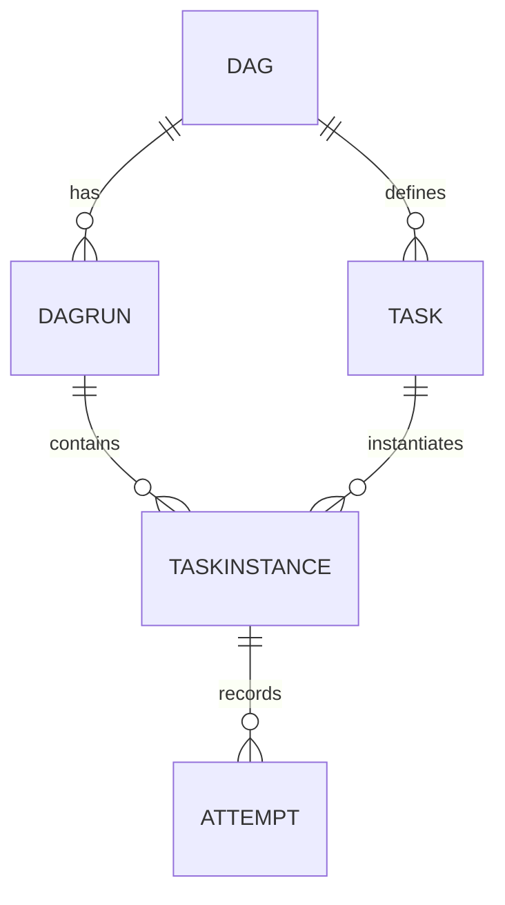
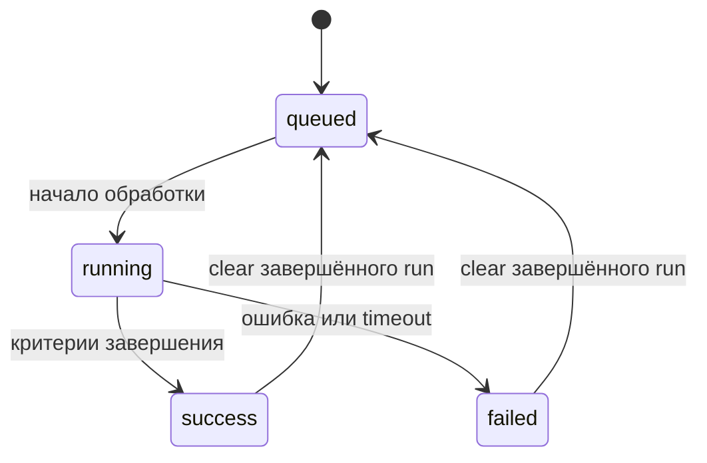
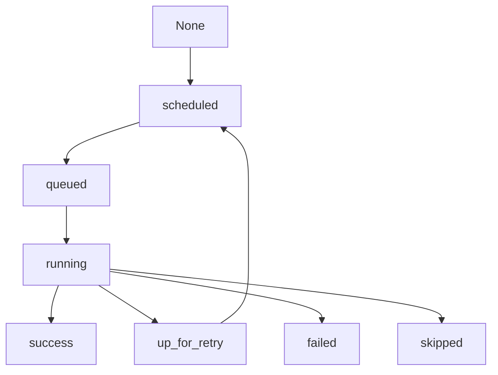
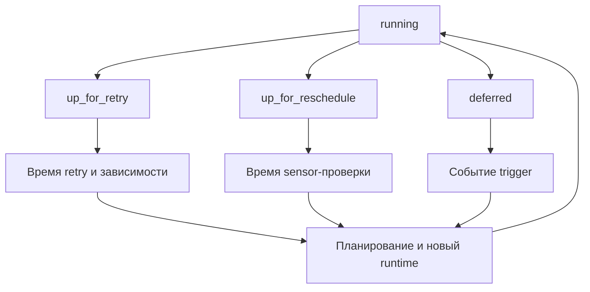
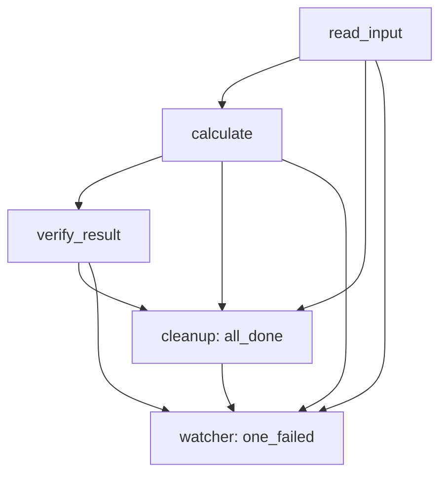

# 4. DAG, задачи, запуски и состояния

**Apache Airflow Zero to Hero · Профессиональный справочник**

| Параметр | Значение |
| --- | --- |
| Базовая линия | Apache Airflow 3.3.2, Python Task SDK 1.3.2, Python 3.12 |
| Дата проверки | 18 октября 2026 года |
| Покрытие README | Все 8 тем и 42 пункта четвёртого раздела, в исходном порядке |
| Предварительная практика | Стенд из главы 2; понимание компонентов из главы 3 |
| Сквозной сценарий | Получение набора заказов, вычисление метрик, проверка результата, cleanup и контроль ошибок |
| Практический результат | Умение определить сущность, восстановить переходы состояний и выбрать корректную область повторного выполнения |

На дежурстве приходит сообщение: «DAG зелёный, но таблица не обновилась». Открываешь граф: загрузка красная, её потомок оранжевый, cleanup зелёный, весь запуск — успешный. В другой ситуации задача уже записала данные, но отмечена `failed`. В третьей после `clear` сохранился тот же `run_id`, а номер попытки и внутренний идентификатор изменились.

Это не набор исключений из правила «зелёное работает». У Airflow есть несколько разных объектов и несколько способов менять их состояние. **DAG описывает процесс; DagRun представляет конкретный запуск; Task описывает узел графа; TaskInstance представляет этот узел внутри запуска, с учётом mapping. Попытка — отдельный эпизод его выполнения.**

Эта глава учит читать состояние как свидетельство оркестрации. Затем к нему нужно добавить свидетельство работы с данными: какой артефакт опубликован, за какой период, какой версией кода и какие проверки он прошёл. Senior умеет связать эти свидетельства и объяснить их расхождения.

**Как читать:** сначала пройди 4.1–4.5 и запусти лабораторный DAG. Затем изучи вычисление результата в 4.6 и повтори эксперименты с `clear` и ручными отметками в UI. Разделы 4.7–4.8 полезны как рабочая инструкция при изменении workflow и расследовании инцидента.

## Содержание

1. [Определение DAG](#s4-1)
2. [Параметры DAG и задач](#s4-2)
3. [DAG и DagRun](#s4-3)
4. [Task и TaskInstance](#s4-4)
5. [Жизненный цикл задачи](#s4-5)
6. [Завершение запуска](#s4-6)
7. [Изменение и удаление DAG](#s4-7)
8. [Работа в UI](#s4-8)
9. [Практика: четыре сценария одного графа](#lab)
10. [Практика: clear, ручные отметки и история](#operations-lab)
11. [Разбор ситуаций](#cases)
12. [Самопроверка с ориентирами ответов](#questions)
13. [Критерии освоения и дальнейшее изучение](#next)
14. [Проверка материала](#verification)
15. [Официальные источники](#sources)

Описание привязано к указанному релизу. Некоторые обзорные страницы документации сохраняют формулировки старых версий; точные утверждения о лимитах, `clear` и завершении run здесь сверены с исходниками 3.3.2. Диаграммы показывают значимые пути, а не исчерпывающий автомат всех внутренних событий.

<a id="s4-1"></a>
## 4.1. Определение DAG

### 4.1.1. `@dag`, контекстный менеджер `DAG` и явное связывание объектов

**Directed Acyclic Graph** — ориентированный ациклический граф. Вершины задают задачи, направленные рёбра задают зависимости. Ацикличность означает, что внутри одного графа нельзя построить путь, возвращающийся в исходную вершину.

Для заказов можно определить: получить исходные записи → вычислить метрики → проверить их. Зависимость означает, что scheduler должен оценить допустимость следующего узла относительно предыдущего. Она сама по себе не перемещает файл, не открывает общую Python-память и не создаёт транзакцию warehouse.

Три способа построения DAG создают одну модель объектов. Выбор синтаксиса влияет на удобство авторства, а не на базовую семантику выполнения. Для Airflow 3 публичные объекты авторства импортируются из `airflow.sdk`. Конкретные готовые operators обычно поставляются providers. [S01](#source-01) [S02](#source-02)

```python
# example: decorator_definition
from datetime import datetime, timezone

from airflow.sdk import dag, task


@dag(
    dag_id="definition_decorator_demo",
    schedule=None,
    start_date=datetime(2026, 1, 1, tzinfo=timezone.utc),
    catchup=False,
)
def build_workflow():
    @task
    def read_count():
        return 3

    @task
    def validate_count(count):
        if count <= 0:
            raise ValueError("Expected at least one order")

    validate_count(read_count())


workflow = build_workflow()
```

Здесь последняя строка вызывает **фабрику графа**. Она создаёт описание workflow. Вызов `read_count()` внутри фабрики создаёт task и ссылку на будущий результат, а не получает число `3` при импорте. Airflow выполнит тело task в runtime.

У обычной Python-функции без `@task` иная семантика: её вызов при построении графа исполняется немедленно. Декоратор меняет смысл именно вызова декорированной задачи, а не всего кода файла.

Вариант с контекстным менеджером:

```python
# example: context_definition
from datetime import datetime, timezone

from airflow.providers.standard.operators.empty import EmptyOperator
from airflow.sdk import DAG


with DAG(
    dag_id="definition_context_demo",
    schedule=None,
    start_date=datetime(2026, 1, 1, tzinfo=timezone.utc),
    catchup=False,
) as workflow:
    begin = EmptyOperator(task_id="begin")
    finish = EmptyOperator(task_id="finish")

    begin >> finish
```

Контекст назначает создаваемым tasks текущий DAG. `EmptyOperator` подходит для пустых узлов и организации зависимостей; он не проверяет наличие данных. Его успешное состояние нельзя считать подтверждением бизнес-результата.

Явное связывание полезно, когда библиотека строит объекты без текущего контекста:

```python
# example: explicit_definition
from datetime import datetime, timezone

from airflow.providers.standard.operators.empty import EmptyOperator
from airflow.sdk import DAG


workflow = DAG(
    dag_id="definition_explicit_demo",
    schedule=None,
    start_date=datetime(2026, 1, 1, tzinfo=timezone.utc),
    catchup=False,
)
begin = EmptyOperator(task_id="begin", dag=workflow)
finish = EmptyOperator(task_id="finish", dag=workflow)
begin.set_downstream(finish)
```

| Запись | Что создаётся или меняется | Чего запись не гарантирует |
| --- | --- | --- |
| `workflow = build_workflow()` | DAG из фабрики `@dag` | Запуск пользовательской обработки |
| `a >> b` | Зависимость `a` перед `b` | Передачу всех локальных переменных `a` |
| `b(a())` в TaskFlow | Task-зависимость и ссылку на результат upstream | Неограниченный канал передачи больших данных |
| `task_id="load"` | Стабильное имя узла внутри DAG | Глобальную уникальность во всём deployment |
| `EmptyOperator(...)` | Узел графа без бизнес-вычисления | Готовность внешней таблицы |

Рёбра выражают требования workflow, а фактическую допустимость выполнения определяют также trigger rules, состояние run, время и ограничения ресурсов. Поэтому фраза «`A >> B` означает, что B выполнится после успеха A» верна для обычного `all_success`, но требует уточнения при `all_done`, ветвлении или watcher.

### 4.1.2. `dag_id`, описание, tags, owner, owner links и `doc_md`

Идентификаторы связывают код с долговременной историей. Для production их проектируют как стабильный интерфейс: понятный домен, назначение, отсутствие случайных суффиксов и дат текущего запуска.

Например, `orders_daily_publish` подходит для процесса ежедневной публикации. `orders_daily_publish_20261018` каждый день создавал бы другой DAG и дробил историю. Бизнес-дата относится к запуску или partition, а не к имени определения.

| Поле | Где задаётся | Практическое назначение |
| --- | --- | --- |
| `dag_id` | DAG | Стабильная идентичность workflow |
| `description` | DAG | Короткое назначение в списке и деталях |
| `tags` | DAG | Фильтрация по домену, команде, классу процесса |
| `owner` | Task или `default_args` | Ответственный за задачи |
| `owner_links` | DAG, словарь owner → URL | Переход к контакту или странице команды |
| `doc_md` | DAG; также поддерживается у tasks | Контракт данных и инструкция сопровождения |
| `dag_display_name` | DAG | Человекочитаемое имя без смены `dag_id` |
| `task_display_name` | Task | Подпись узла без смены `task_id` |

**Owner — параметр задач.** У DAG список владельцев получается из его tasks. Типичная запись — `default_args={"owner": "data-platform"}`. Передавать `owner=...` прямо в конструктор DAG вместо task defaults не следует. [S01](#source-01) [S03](#source-03)

Owner label и ссылка на команду не предоставляют доступ и не задают RBAC. Разрешения определяются auth manager и политиками deployment. Адрес в `owner_links` помогает найти ответственного, но не доказывает, что этот человек единственный автор изменений.

Минимально полезная документация рабочего DAG отвечает на вопросы:

1. Какой продукт данных создаётся и кто его использует?
2. Что обозначает обрабатываемый период?
3. Где находятся вход, выход и проверка качества?
4. Какие side effects возможны при повторе?
5. Когда допустим пустой результат?
6. Как проверить публикацию и куда идти при сбое?
7. Кто принимает решение о повторной обработке исторических периодов?

Документацию полезно хранить рядом с кодом. `doc_md` поддерживает Markdown; при использовании файла нужно обеспечить его доставку в bundle и корректный путь в окружении parsing. Для переносимых учебных примеров ниже используется строка.

`tags` лучше выбирать из небольшого словаря: `domain:orders`, `team:data-platform`, `purpose:training`. Тысячи уникальных тегов с ID клиентов ухудшат навигацию и не заменят runtime metadata.

### 4.1.3. Создание объекта DAG при импорте и правила discovery

DAG processor находит подходящие файлы, импортирует их и получает объекты DAG. Файл с корректной Python-функцией ещё не обязательно содержит обнаруживаемый workflow.

Здесь важны три разные проверки:

| Проверка | Пример успешного результата | Пример проблемы |
| --- | --- | --- |
| Файл найден | Файл попал в обрабатываемый bundle | Ignore pattern, неверный mount |
| Импорт завершился | Выполнился top-level Python-код | ImportError, timeout, исключение |
| DAG зарегистрирован | Создан и обнаружен нужный объект | Фабрика объявлена, но не вызвана |

В Airflow 3.3.2 контекст `with DAG(...)` и фабрика `@dag` используют механизм автоматической регистрации. Поэтому историческое правило «DAG обязательно должен лежать в глобальной переменной модуля» неполно: современные конструкции могут регистрироваться и без присваивания результату глобального имени, если включён `auto_register`. При этом **декорированную фабрику всё равно нужно вызвать**. [S04](#source-04) [S05](#source-05)

В примерах используется явное `workflow = build_workflow()`: это удобно для чтения и локального импорта. Не нужно превращать удобную договорённость в утверждение, что иной поддерживаемый способ discovery невозможен.

| Фрагмент модуля | Ожидаемый эффект |
| --- | --- |
| Только `@dag(...) def factory(): ...` | Фабрика объявлена; её граф ещё не создан |
| `workflow = factory()` на верхнем уровне | Граф создан; удобная явная точка экспорта |
| `factory()` на верхнем уровне при обычной autoregistration | Граф может быть зарегистрирован через контекст |
| `with DAG(...)` в вызванной функции при autoregistration | Регистрация возможна; глобальное присваивание не обязательно |
| Локальный `DAG(...)` без контекста, без экспорта и без регистрации | Не следует рассчитывать на его обнаружение |
| `if __name__ == "__main__": factory()` | При импорте processor эта ветка не создаёт DAG |

Discovery также зависит от `.airflowignore`, правил bundle и настроек импортёра. В стандартном Python-пути safe mode использует эвристику содержимого файла; wrapper с необычной структурой может потребовать проверки этой настройки. `.airflowignore` фильтрует пути, а не запрещает конкретный `dag_id` уже импортированного файла. [S33](#source-33)

Успешное `python -m py_compile` подтверждает синтаксис, но не discovery, сериализацию и доставку в платформу. Практическая цепочка проверки: файл в bundle → импорт в окружении processor → import errors → наличие DAG в metadata/UI.

Сеть и бизнес-данные на верхнем уровне особенно опасны. Если фабрика при каждом импорте читает список сегодняшних клиентов из API, одна временная ошибка API может убрать граф из актуальной обработки. По возможности конфигурация структуры должна быть небольшой, доставленной вместе с кодом и детерминированной.

### 4.1.4. Уникальность идентификаторов и коллизии между файлами

`dag_id` уникален в deployment Airflow, а не только внутри одного Python-файла. Два файла с одним ID не представляют две независимые версии рабочего процесса.

Плохой способ rollout: оставить `orders_old.py` и добавить `orders_new.py`, если оба создают `dag_id="orders_daily_publish"`. Порядок обработки файлов не должен служить механизмом выбора версии. Processor обнаруживает конфликты; нужно разбирать import errors и источники определения. [S05](#source-05)

`task_id` уникален внутри DAG. В разных DAG может быть задача `validate`. В одном DAG её полное имя должно различаться. TaskGroup обычно добавляет префикс группы: `extract.validate` и `publish.validate` — разные полные IDs.

| Область | Требование | Пример корректного различия |
| --- | --- | --- |
| DAG в deployment | Разные `dag_id` для разных workflow | `orders_daily`, `payments_daily` |
| Tasks одного DAG | Разные полные `task_id` | `raw.validate`, `mart.validate` |
| DagRuns одного DAG | Разные `run_id` | `manual__incident_42`, `manual__incident_43` |
| Mapped instances одной task в run | Разные `map_index` | `0`, `1`, `2` |
| Попытки одной логической task instance | Различимые номера попыток и история | Первая попытка и повтор после ошибки |

Автоматические суффиксы TaskFlow могут помочь при нескольких вызовах одного декоратора, но для важных узлов лучше задавать ID осознанно через `override(task_id=...)`. Читатель графа и эксплуатационный скрипт должны понимать, какой именно узел выбран.

При генерации DAG из конфигураций сортируй входные коллекции и делай IDs стабильными. Если задача сегодня называется `load_0` для клиента A, а завтра `load_0` для клиента B, формально ID сохранён, но история потеряла смысл.

Для mapped tasks индекс также не является бизнес-ключом. При перестановке входного списка `map_index=0` может соответствовать другому заказу или partition. Сохраняй устойчивый ключ элемента в логах и артефакте; UI display label может улучшить читаемость, но не изменит идентичность mapping.

### 4.1.5. Python-модуль как фабрика описания процесса

Python-модуль DAG — исполняемая программа, создающая **описание** другой программы. Отсюда следуют две временные области: построение графа и выполнение task.

| Код | Когда обычно выполняется | Что допустимо делать |
| --- | --- | --- |
| Импорты модуля и top-level выражения | При parsing/import | Загружать небольшие локальные определения |
| Тело фабрики `@dag` при её вызове | При построении графа | Создавать tasks, связывать зависимости |
| Тело функции `@task` | При выполнении task instance | Читать вход, обращаться к API, записывать результат |
| Создание списка `[a(), b()]` из tasks | При построении графа | Создать два узла и будущие ссылки |
| `get_current_context()` | В runtime task | Получить контекст конкретного выполнения |
| `datetime.now()` на верхнем уровне | При каждом импорте | Обычно плохой источник структуры и бизнес-периода |

DAG-фабрика должна давать предсказуемый граф при одинаковых коде и конфигурации. Это важно для сериализации, версионирования, повторяемости и расследования: иначе «та же версия файла» ещё не объясняет, почему tasks оказались другими.

Ацикличность не запрещает ежедневные запуски. Повторение процесса во времени представлено разными DagRuns. Retry повторяет task instance по правилам Airflow. Цикл Python, создающий десять tasks при импорте, создаёт десять узлов; он не описывает runtime-петлю, которая сама решает, сколько раз повторяться.

Runtime-зависимый список элементов обычно относится к dynamic task mapping. Статическая генерация нескольких DAG из стабильной конфигурации относится к dynamic DAG generation. Эти механизмы решают разные задачи, хотя оба используют Python.

**Контрольная точка 4.1:** можешь показать строку создания DAG, место вызова фабрики, полные IDs tasks и границу, после которой начинается прикладная работа. Умеешь объяснить отсутствие DAG без предположения, что scheduler обязан выполнить каждую функцию в файле.

<a id="s4-2"></a>
## 4.2. Параметры DAG и задач

### 4.2.1. `schedule`, `start_date`, `end_date` и `catchup`

Эти параметры описывают правила появления плановых запусков и временную область процесса. Они не являются простым таймером «включить функцию в момент X».

| Параметр | Значение | Частая ошибка |
| --- | --- | --- |
| `schedule` | Timetable, cron/интервал, asset-based или иной поддерживаемый способ планирования | Считать любой schedule одним cron |
| `schedule=None` | Нет обычного автоматического расписания | Считать, что manual trigger запрещён |
| `start_date` | Нижняя временная граница для планирования согласно timetable | Ожидать немедленный запуск в эту секунду |
| `end_date` | Верхняя граница планирования согласно модели расписания | Ожидать остановку уже работающего внешнего job |
| `catchup` | Нужно ли догонять пропущенные интервалы расписания | Считать это запретом backfill или ручного запуска |

Для стандартного ежедневного data-interval расписания run за `[2026-10-17 00:00 UTC, 2026-10-18 00:00 UTC)` становится планируемым после завершения интервала. Фактический старт может быть позже из-за pause, лимитов и загрузки системы.

Это пример **конкретной модели timetable**, а не универсальное свойство каждого custom timetable. Cron trigger timetable, asset schedule и partitioned scheduling требуют своих правил. Подробный календарный расчёт относится к следующим главам. [S01](#source-01) [S06](#source-06)

Используй фиксированную timezone-aware дату. `start_date=datetime.now()` при каждом parsing сдвигает границу и затрудняет объяснение первого run. На стенде удобно хранить примеры в UTC; бизнес-календарь затем задаётся явно с учётом переходов времени.

`catchup=False` не делает обработку корректной сама по себе. Если task пишет «всё до текущего времени», поздний запуск может обработать иной диапазон, чем ожидает потребитель. Обрабатываемый период нужно определять через контракт run, а не через настенные часы worker.

`end_date` не заменяет процедуру вывода из эксплуатации. Исторические запуски, ручные операции и уже запущенные внешние вычисления требуют отдельного рассмотрения.

### 4.2.2. `default_args`, явные параметры и приоритет переопределений

`default_args` задаёт значения по умолчанию для tasks. Это удобный способ не повторять `owner`, `retries` и `retry_delay`, но не место для произвольных DAG-level настроек.

Для базового случая приоритет таков: **явный параметр task выше значения в `default_args`; значение в defaults выше fallback operator/config**. TaskGroup, decorator и cluster policy добавляют свои уровни; для production нужно смотреть итоговый сериализованный объект и настройки платформы. [S03](#source-03)

```python
# example: parameter_precedence
from datetime import datetime, timedelta, timezone

from airflow.sdk import DAG, task


with DAG(
    dag_id="parameter_precedence_demo",
    schedule=None,
    start_date=datetime(2026, 1, 1, tzinfo=timezone.utc),
    catchup=False,
    default_args={
        "owner": "data-platform",
        "retries": 2,
        "retry_delay": timedelta(seconds=30),
    },
) as workflow:
    @task
    def inherited():
        return "uses retries=2"

    @task(retries=0)
    def explicitly_disabled():
        return "uses retries=0"

    inherited() >> explicitly_disabled()
```

Ноль — явное значение. `retries=0` действительно отключает автоматические повторы этой task; его нельзя трактовать как «значение не передано, возьми default». Всего при обычной политике `retries=2` доступно до трёх попыток: исходная и два повтора.

Различай три пространства параметров:

| Пространство | Пример | Кто интерпретирует |
| --- | --- | --- |
| DAG configuration | `schedule`, `max_active_runs` | Планирование и управление run |
| Task/operator configuration | `retries`, `execution_timeout`, `pool` | Выполнение конкретных task instances |
| Бизнес-параметры | `country`, `scenario`, `publish_mode` | Твой прикладной код и schema validation |

`params` с `Param` — именованные runtime-настройки с проверкой схемы. `dag_run.conf` — конфигурация конкретного запуска. Их объединение зависит от `core.dag_run_conf_overrides_params`; в лаборатории ниже явно требуется значение `True`, установленное в главе 2.

Не называй `params` секретным хранилищем. Значения могут отображаться в UI, конфигурации запуска и логах. Credentials должны поступать через предусмотренные Connections/secrets mechanisms.

Параметры функций тоже имеют Python-defaults, но это ещё один уровень. При `@task(retries=1) def load(batch_size=1000): ...` число `1` относится к оркестрации, а `1000` — к входу вычисления.

### 4.2.3. `max_active_runs`, `max_active_tasks` и версия семантики лимитов

Эта тема требует привязки к версии. В **Airflow 3.3.2 `max_active_tasks` ограничивает активные tasks внутри одного DagRun**. Переносить без проверки объяснение Airflow 2.x «общий лимит tasks DAG по всем runs» неправильно. Текущий scheduler считает ключ `(dag_id, run_id)`. [S01](#source-01) [S07](#source-07)

| Ограничение | Область в рассматриваемой версии | Пример |
| --- | --- | --- |
| DAG `max_active_runs` | Одновременно выполняющиеся runs DAG; backfill имеет отдельные механизмы ограничения | Не более 2 обычных активных runs |
| DAG `max_active_tasks` | Активные tasks одного DagRun | До 4 одновременно обслуживаемых tasks в каждом run |
| Task `max_active_tis_per_dag` | Instances одной task по runs DAG | Не больше 3 экземпляров `publish` суммарно |
| Task `max_active_tis_per_dagrun` | Instances одной task в одном run | Не больше 2 mapped instances `load` в одном run |
| Pool slots | Общая квота для задач, использующих pool | До 5 слотов запросов к warehouse |
| Executor/worker limits | Возможности среды выполнения | Подготовленных tasks больше, чем доступных workers |

Если `max_active_runs=3` и `max_active_tasks=4`, то потенциальная одновременность этих трёх runs — до `12` tasks при отсутствии более строгих ограничений. Это верхняя оценка для модели, а не обещание scheduler выделить двенадцать процессов.

Для общего лимита нагрузки на внешнюю систему удобен pool. Он выражает shared resource и может ограничить tasks из разных DAG. `max_active_tasks` не заменяет такой глобальный бюджет.

В исходниках 3.3.2 счётчик run учитывает состояния, занимающие соответствующие активные слоты, включая queued/running. Parked состояния `deferred` и `awaiting_input` исключены из этого счётчика; при этом task-level concurrency учитывает их как in-flight instances. Учёт deferred tasks в pools регулируется настройкой самого pool; `awaiting_input` в этом релизе не занимает pool slots и при включённом учёте deferred. Поэтому «deferred не занимает worker» не означает «deferred нигде не участвует в лимитах». [S34](#source-34)

`max_active_runs` также не означает «в metadata не может существовать больше N runs». Запуски могут ждать в `queued`. Отдельно учитывай backfill concurrency и правила постановки в конкретном релизе.

При расследовании фиксируй имя лимита, область счёта, учитываемые состояния и текущее значение. Формулировка «у нас concurrency равен 4» без этих четырёх уточнений почти бесполезна.

### 4.2.4. `dagrun_timeout`, task timeout и настройки повторов

У запуска и task разные бюджеты времени. Один ограничивает длительность orchestration run, другой — работу конкретной попытки. Ожидание внешнего условия и срок готовности продукта данных добавляют ещё две отдельные задачи.

| Настройка/механизм | На что распространяется | Что нужно учитывать |
| --- | --- | --- |
| `dagrun_timeout` | Продолжительность работающего DagRun | Включает время жизни run, а не только CPU task |
| `execution_timeout` | Ограничение исполнения task attempt | Timeout может участвовать в retry policy |
| Sensor `timeout` | Предельное ожидание условия по правилам sensor | В reschedule-модели не равен времени одного poke |
| `retry_delay` | Минимальная задержка перед допустимым повтором | Фактический старт зависит от scheduler и ресурсов |
| `max_retry_delay` | Верхний предел вычисляемой задержки | Имеет смысл вместе с backoff |
| `retries` | Число автоматических повторов | Не гарантирует, что любая ошибка будет повторяться |
| Deadline alert | Сигнал о нарушении ожидаемого срока | Уведомление само по себе не равно остановке работы |

В 3.3.2 проверка `dagrun_timeout` в scheduler не ограничена только типом `scheduled`. При превышении run становится `failed`, а его незавершённые task instances в этом пути переводятся в `skipped`. Поэтому утверждение «при failed DagRun все tasks обязаны быть failed» неверно. [S07](#source-07)

Отсчёт по `start_date` run также означает, что долгое ожидание в `queued` до начала run и долгое выполнение работающего run — разные интервалы. Для срока готовности данных может потребоваться отдельное измерение от конца data interval или от внешнего события.

Повторы должны отражать природу ошибки:

| Ошибка | Разумная политика | Причина |
| --- | --- | --- |
| Кратковременный network timeout | Ограниченный retry с задержкой | Внешний сервис может восстановиться |
| Неверная схема входа | Fail без бессмысленных повторов | Те же данные снова нарушат контракт |
| Rate limit | Повтор с уважением к ограничениям сервиса | Мгновенные повторы увеличат проблему |
| Уже завершённая внешняя операция | Найти существующий результат по ключу | Повторная отправка может дублировать side effect |
| Невозможная бизнес-дата | Отказ с понятным сообщением | Это ошибка запроса, а не transient failure |

`AirflowFailException` позволяет явно завершить task без дальнейших retries; `AirflowSkipException` обозначает skip. Они есть в `airflow.sdk.exceptions`. Не перехватывай все исключения и не возвращай `None` как универсальную обработку ошибки: нормальный возврат функции обычно приводит к успеху task, даже если публикация не состоялась. [S08](#source-08)

В текущем SDK также есть механизм `retry_policy` для классификации исключений. Он уточняет решение о повторе, но не превращает `retries` в бесконечный бюджет. Детальную политику нужно тестировать на конкретном operator и релизе.

Backoff, jitter и верхняя граница задержки уменьшают синхронный поток повторов. В 3.3.2 `retry_exponential_backoff` поддерживает числовой множитель; не стоит механически переносить во все версии одну булеву интерпретацию. Для лаборатории достаточно фиксированных `10` секунд.

Timeout Airflow не является распределённой транзакцией с внешним Spark/warehouse job. Убедись, что operator действительно отменяет внешнюю работу, либо реализуй наблюдение и cleanup по сохранённому external job ID.

### 4.2.5. `is_paused_upon_creation` и управление начальным состоянием

`is_paused_upon_creation` задаёт начальное pause-состояние **при создании DAG в metadata**. Это не команда, которая при каждом parsing перезаписывает решение оператора в UI.

Если DAG уже зарегистрирован и его вручную unpause, последующее изменение строки на `is_paused_upon_creation=True` не следует считать надёжным способом остановки этого существующего DAG. Нужна явная операция pause. При `None` применяется deployment default. [S01](#source-01) [S09](#source-09)

Для учебного файла удобно указать `True`: сначала посмотреть граф, затем осознанно разрешить работу. Для production выбор зависит от deployment policy и готовности внешних зависимостей.

| Ситуация | Что проверить |
| --- | --- |
| Новый DAG сразу запланировал исторические интервалы | Начальное pause, `catchup`, timetable и start date |
| Новый manual run остаётся `queued` | DAG всё ещё paused; затем лимиты и scheduler |
| Код содержит `is_paused_upon_creation=False`, UI показывает paused | DAG уже существовал; это не повторная команда unpause |
| После удаления metadata DAG вернулся с иным pause | Объект создан заново, применилось начальное правило |

Pause — отдельное состояние определения DAG. Оно не входит в enum состояний DagRun и не записывается как task state. Говори точно: «DAG paused, его run queued», а не «run находится в состоянии paused».

### 4.2.6. `allowed_run_types` и ограничение допустимых оснований запуска

`allowed_run_types` определяет, какие типы запуска допускаются для DAG. Это полезно, когда автор хочет закрепить основания появления run, а не только отсутствие обычного расписания.

Для manual-only лаборатории используется `allowed_run_types=["manual"]` вместе с `schedule=None`. Передавай коллекцию значений, а не строку `"manual"` вместо списка. В SDK также поддерживается соответствующий enum; для примеров не нужен импорт внутренней сгенерированной модели.

В 3.3.2 SDK проверяет согласованность ограничения с расписанием. Поэтому нельзя произвольно указать `schedule="@daily"` и разрешить только `manual`: такое определение противоречит поддерживаемой validation. [S01](#source-01) [S10](#source-10)

| Замысел | Пример настройки | Комментарий |
| --- | --- | --- |
| Только ручные запуски | `schedule=None`, `["manual"]` | Подходит лаборатории |
| Плановые и ручные | Временной schedule, `["scheduled", "manual"]` | Оба основания разрешены |
| Плановые без ручных | Временной schedule, `["scheduled"]` | Не отменяет необходимость прав доступа |
| Asset-based процесс | Asset schedule и включённый `"asset_triggered"` | Требуется согласованность с timetable |
| Не задавать дополнительный фильтр | `allowed_run_types=None` | Действуют остальные правила платформы |

Enum 3.3.2 включает не только четыре учебных типа: в нём также есть `operator_triggered` и `asset_materialization`. Сценарии использования зависят от поддерживаемых механизмов; не выводи фактический `run_type` только по названию внешнего инструмента. Например, важно смотреть сохранённые `run_type` и `triggered_by`, а не угадывать их по факту вызова operator. [S11](#source-11)

Фильтр типов и авторизация решают разные задачи. Пользователю всё ещё нужны разрешения на trigger и изменение DAG. Также изменение `allowed_run_types` не следует трактовать как отмену уже созданных runs или внешних jobs.

### 4.2.7. Display names, owner links и документирование без изменения стабильных IDs

Технический ID должен переживать улучшения интерфейса. Если бизнес переименовал витрину «Orders v2» в «Продажи по каналам», часто достаточно изменить display name, описание и документацию.

| Изменение | Что сохраняется | Что нужно проверить |
| --- | --- | --- |
| `dag_display_name` | `dag_id` и связь с историей DAG | Скрипты должны продолжать использовать ID |
| `task_display_name` | `task_id` и логическая идентичность узла | Понятность подписи конкретной функции |
| `description` или `doc_md` | IDs | Актуальность контракта и инструкции |
| `owner_links` | IDs и механизм прав | Доступность ссылки и точность owner |
| Переименование `dag_id` | Код можно переиспользовать | Для Airflow это другой workflow |
| Переименование полного `task_id` | Остальной граф может остаться | История старого узла не становится историей нового автоматически |

Подпись «Проверить результат» полезна в графе, а `verify_result` удобен для CLI, логов и поиска. Оба имени нужны; не пытайся включить в стабильный task ID весь текст операционной инструкции.

Документация должна уточнять статус пустого результата. Если `skipped` допустим только в выходные, это нужно выразить проверяемым правилом, а не оставлять дежурному догадку «наверное, сегодня не было данных».

Для важного DAG полезно явно написать: «Успешная публикация подтверждается manifest с business date, row count, schema version и producer run ID». Тогда display name остаётся удобной навигацией, а артефакт — проверяемым свидетельством результата.

**Контрольная точка 4.2:** для каждого параметра можешь назвать владельца — DAG, task или бизнес-логика. Объясняешь лимит в единицах runs/instances/slots и отличаешь начальную настройку pause от команды управления существующим DAG.

<a id="s4-3"></a>
## 4.3. DAG и DagRun

### 4.3.1. Определение процесса и отдельный экземпляр выполнения

Один DAG может иметь множество runs: вчерашний плановый, сегодняшний плановый и ручной диагностический. Они используют определение процесса, но имеют разные идентичность, входную конфигурацию, timestamps и результат.

| Сущность | На какой вопрос отвечает | Пример |
| --- | --- | --- |
| DAG | Как устроен процесс? | `orders_daily_publish` |
| DagRun | Какой именно запуск рассматриваем? | `manual__incident_42` |
| Task | Какой шаг процесса? | `verify_result` |
| TaskInstance | Как этот шаг представлен в данном run? | `verify_result` в `manual__incident_42`, `map_index=-1` |
| Attempt | Какой эпизод выполнения instance? | Попытка 2 после timeout |
| External job | Какую работу приняла внешняя система? | Spark application с отдельным ID |
| Data artifact | Что доступно потребителю? | Partition таблицы и manifest публикации |

Нельзя отвечать на вопрос «что сломалось?» только словом DAG. Нужно назвать run и затем конкретный узел/попытку. У вчерашнего run может быть `success`, у сегодняшнего `failed`, а определение DAG при этом совершенно одинаково.



Диаграмма показывает логические связи, а не физическую схему metadata database. В частности, исторические попытки и текущий TI могут иметь отдельные записи и изменяемые внутренние IDs.

Новый manual run не «повторяет вчерашнюю task» в смысле идентичности: он создаёт другой контейнер выполнения. `clear` задачи вчерашнего run сохраняет связь с прежним run. Эти операции могут прочитать те же данные, но их последствия для истории и downstream различаются.

Полезная форма ссылки в инциденте: deployment + `dag_id` + `run_id` + полный `task_id` + `map_index` + `try_number`. Без deployment одинаковые IDs из dev и production легко перепутать.

### 4.3.2. Scheduled, manual, backfill и asset-triggered запуски

Основание запуска объясняет, **почему появился run**. Оно не определяет автоматически бизнес-смысл его данных.

| Тип | Основание | На что смотреть при расследовании |
| --- | --- | --- |
| `scheduled` | Решение timetable/scheduler | Интервал, `run_after`, задержка от ожидаемого времени |
| `manual` | Явный trigger через поддерживаемый интерфейс | Кто/что инициировало, `conf`, заданные временные поля |
| `backfill` | Управляемая обработка исторической области | Backfill ID, политика reprocessing, concurrency, версия кода |
| `asset_triggered` | Условие по asset events | Какие события потреблены, producer run, URI/alias asset |

Backfill и catchup не являются синонимами. Catchup относится к созданию пропущенных плановых интервалов обычным scheduler. Backfill — отдельная операция обработки выбранной исторической области со своей политикой и ограничениями.

Ручной запуск может быть частью автоматизации: внешний сервис вызвал public API, и человек кнопку не нажимал. Поэтому `manual` не означает «оператор лично сидел в UI». В поле `triggered_by` и audit event может быть дополнительная информация.

Asset event сообщает, что producer опубликовал событие согласно контракту Airflow. Потребителю ещё нужно проверить существование нужного артефакта и его качество. Сам факт события не создаёт транзакционную согласованность всех внешних систем.

Не привязывай обработку к проверке строкового префикса `run_id`. Для типа есть поле `run_type`; для периода — временные поля и бизнес-параметры; для инициатора — отдельные metadata. Пользовательский run ID может быть читаемым, но не должен заменять модель.

### 4.3.3. `run_id`, logical date и интервал данных

`run_id` — строковый идентификатор запуска внутри DAG. Логический ключ run — `(dag_id, run_id)`. В модели 3.3.2 есть соответствующее ограничение уникальности. [S12](#source-12)

`logical_date` — логическая дата запуска по правилам его создания. Для обычного data-interval расписания она часто совпадает с началом интервала. Это не универсальная фактическая дата начала task и не автоматически «дата файла».

`data_interval_start` и `data_interval_end` задают интервал данных, когда он определён соответствующим механизмом. Обычно рассматривают полуоткрытую область `[start, end)`: начало включено, конец относится к следующему интервалу.

| Поле/величина | Пример | Смысл |
| --- | --- | --- |
| `logical_date` | `2026-10-17T00:00:00Z` | Логическая привязка стандартного daily run |
| `data_interval_start` | `2026-10-17T00:00:00Z` | Начало обрабатываемого интервала |
| `data_interval_end` | `2026-10-18T00:00:00Z` | Исключённая верхняя граница |
| `run_after` | Не раньше `2026-10-18T00:00:00Z` | Момент допустимости run по планированию |
| `start_date` DagRun | `2026-10-18T00:04:12Z` | Фактическое начало run |
| `start_date` TaskInstance | `2026-10-18T00:04:35Z` | Начало конкретного выполнения task |
| Время появления данных | `2026-10-18T00:12:01Z` | Событие внешней системы, проверяется отдельно |

У современных запусков `logical_date` может отсутствовать. В текущем manual trigger пути без переданной logical date она может оставаться `None`; при этом run имеет `run_id` и `run_after`. Не делай форматирование `logical_date.strftime(...)` без проверки контракта своего DAG. [S10](#source-10)

Для manual run нельзя считать интервал автоматически равным переданной logical date. Интервал зависит от timetable и пути trigger; в текущем общем trigger-коде manual interval вычисляется через timetable от `run_after` при наличии logical date, а без неё может отсутствовать. Для ручной обработки business date часто полезнее отдельный валидируемый параметр. [S06](#source-06)

В 3.3.2 модель также содержит уникальность `(dag_id, logical_date)`. Поэтому утверждение «можно свободно создавать несколько runs одного DAG с одинаковой ненулевой logical date» неверно. Nullable logical date требует отдельного понимания; не используй её как единственный универсальный ключ.

Связанные, но разные временные показатели:

- **Scheduling delay:** насколько поздно run/task начал работу относительно своей допустимости.
- **Execution duration:** сколько длилось выполнение.
- **Data freshness:** насколько свеж опубликованный продукт относительно времени потребителя.
- **Business lateness:** нарушен ли согласованный срок готовности.

Быстрый run может опубликовать вчерашнюю partition и иметь плохую freshness. Долгий run может корректно обработать исторический backfill и не нарушить никаких текущих обязательств.

### 4.3.4. Состояния queued, running, success и failed

У DagRun в рассматриваемом релизе четыре состояния. `paused` относится к DAG; `skipped`, `deferred` и `up_for_retry` относятся к task instance. [S13](#source-13)

| Состояние DagRun | Что означает | Чего нельзя заключать |
| --- | --- | --- |
| `queued` | Run создан и ждёт начала обработки | Что все tasks уже переданы executor |
| `running` | Run обслуживается; выполнение ещё не завершено | Что каждый worker сейчас занят его кодом |
| `success` | Run завершён по правилам оркестрации | Что все tasks реально выполнялись и данные корректны |
| `failed` | Run завершился с неуспехом | Что каждая task имеет `failed` |



Это основные пути. Ручное изменение состояния, API-команды и специальные механизмы могут добавлять другие переходы; диаграмма не задаёт разрешения API.

Run с retrying task остаётся `running`. Run с задачей, ожидающей человека, также может долго оставаться `running` без занятых обычных workers. Сумма «running DagRuns» не равна сумме процессов Python.

Когда финальная task завершилась, scheduler ещё должен обработать изменение и обновить итог run. UI, task log и запрос API, сделанные в близкие моменты, могут показывать соседние стадии этого процесса. Сначала сопоставь timestamps, затем делай вывод о несогласованности.

### 4.3.5. Исторические запуски и версия определения DAG

В Airflow 3 нужно различать текущий DAG, версию сериализованного определения и версию исходного bundle. Они связаны, но отвечают на разные вопросы. [S12](#source-12) [S14](#source-14)

| Объект версии | Вопрос | Ограничение |
| --- | --- | --- |
| Git commit/release | Какой исходный код поставлен? | Сам по себе не доказывает, что его получил runtime |
| Bundle version | Какая версия доставленного набора файлов доступна? | Возможности фиксации зависят от bundle |
| DAG version | Какое сериализованное определение используется? | Не заменяет версию внешних Python packages |
| TaskInstance history | Какие атрибуты были у попыток? | Не является полным архивом всех внешних inputs |
| Image/package lock | Какие зависимости исполняли код? | Не фиксирует внешние данные |

DagRun связан с версией определения при создании; task instances также имеют информацию о версии. Исправление сегодняшнего файла не означает, что вчерашний run автоматически должен получить новую структуру.

При `clear` особенно важно, будет ли использоваться исходная или последняя версия. В 3.3.2 на поведение влияют настройки повторного выполнения, путь операции и `run_on_latest_version` в core-механизме. Не полагайся на один общий совет «clear всегда запускает последний код».

Source bundle может не поддерживать воспроизводимое закрепление кода так, как versioned Git bundle. Тогда сохранённый граф и доступность прежнего Python-файла — разные гарантии. Также внешние библиотеки, конфигурация и входы могли измениться.

Перед историческим повтором фиксируй:

1. Выбранные `dag_id`, `run_id` и задачи.
2. Версию графа и код, который реально получит worker.
3. Совместимость входного и выходного формата.
4. Ключ идемпотентности и режим публикации.
5. Ожидаемое влияние на downstream и asset events.

**Контрольная точка 4.3:** по записи run можешь назвать основание, логический ключ, временную область, фактическое время и используемую версию. Не выводишь business date только из времени старта.

<a id="s4-4"></a>
## 4.4. Task и TaskInstance

### 4.4.1. Operator как описание задачи и TaskInstance как выполнение

Operator задаёт тип операции и её параметры. Объект task внутри DAG — конкретный узел с ID и зависимостями. TaskInstance представляет этот узел для одного run и, если применимо, одного mapped element.

`PythonOperator` и TaskFlow `@task` отличаются удобством авторства, но оба приводят к task instances с runtime-состоянием. Sensor — специализированная task ожидания; deferrable operator может освобождать worker во время внешнего ожидания. [S02](#source-02)

| Уровень | Пример информации | Как часто создаётся |
| --- | --- | --- |
| Класс operator | Правила выполнения и поддерживаемые параметры | Определён в коде библиотеки |
| Объект task | `task_id`, retries, upstream IDs | При построении определения DAG |
| TaskInstance | State, run, map index, timestamps | Для task внутри конкретного запуска |
| Attempt | Start/end, результат эпизода, logs | При исполнении/повторе |
| Worker process | PID, hostname, runtime environment | Согласно executor и жизненному циклу попытки |

Перезапуск scheduler не требует воссоздать все business tasks с нуля: координационное состояние сохранено в metadata. Однако потеря worker может привести к повтору работы, если результат выполнения не был надёжно подтверждён.

TaskInstance — не обязательно один непрерывный процесс. Reschedule/deferral и retries разбивают работу на эпизоды. Также одна task может инициировать множество процессов во внешнем Spark job; это не превращает Spark executors в отдельные Airflow task instances.

Границу task выбирают так, чтобы шаг имел понятные вход, результат, критерий успеха и способ безопасного повтора. Если одна task загружает данные, публикует отчёт и отправляет сообщение, после сбоя третьего действия повтор первых двух может оказаться сложным.

### 4.4.2. `task_id`, `run_id`, `map_index` и идентичность экземпляра

Для эксплуатации полезна логическая идентичность:

```text
TaskInstance = (dag_id, task_id, run_id, map_index)
Attempt      = TaskInstance + номер попытки и её metadata
```

`map_index=-1` обычно используется для немаппированной task и для служебного представления mapped task до раскрытия. Реальные mapped elements получают индексы `0, 1, 2, ...`.

| `dag_id` | `task_id` | `run_id` | `map_index` | Значение |
| --- | --- | --- | --- | --- |
| `orders_daily` | `load_partition` | `manual__case_1` | `-1` | Обычная task |
| `orders_daily` | `load_partition` | `manual__case_2` | `0` | Первый mapped element |
| `orders_daily` | `load_partition` | `manual__case_2` | `1` | Второй mapped element |
| `orders_daily` | `load_partition` | `manual__case_3` | `0` | Другой instance, потому что другой run |
| `orders_daily` | `quality.validate` | `manual__case_2` | `-1` | Полный task ID с группой |

В базе и API также используется внутренний UUID task instance. Важно: **в 3.3.2 при подготовке следующего выполнения core может сохранять history и назначать текущему TI новый UUID**. Метод `prepare_db_for_next_try` явно обновляет `id`, а `clear` вызывает этот путь. Не обещай, что UUID неизменен при любом retry/clear. [S15](#source-15)

Для ссылки на конкретную попытку одного UUID или одного `try_number` без контекста может быть недостаточно. Сохраняй полный логический ключ, attempt и внешние IDs. Для API используй ID, который относится к выбранной записи и моменту операции.

Если mapped input — список клиентов, индекс `7` не заменяет `customer_id`. При новом run порядок списка может измениться. Для данных и идемпотентности ключом должен служить бизнес-идентификатор и partition, а не позиция в массиве.

### 4.4.3. Попытки, retry history и повторный запуск после clear

Retry и clear могут снова привести к выполнению кода, но основания и область вмешательства различаются.

| Операция | Кто инициирует | Сохраняется ли `run_id` | Типичный смысл |
| --- | --- | --- | --- |
| Автоматический retry | Политика task после ошибки | Да | Повтор transient failure |
| `clear` выбранной TaskInstance | Оператор/API/CLI | Да | Снова сделать instance допустимым к обработке |
| `clear` выбранного DagRun | Оператор/API/CLI | Да | Повторить выбранные tasks прежнего run |
| Новый manual trigger | Пользователь/сервис | Нет, создаётся новый ID | Независимый запуск с собственным conf |
| Reschedule/deferral resume | Механизм ожидания | Да | Продолжить ожидание/работу, не обязательно ошибка |

`retries=1` означает один автоматический повтор после первой неудачной попытки. Это не «всего одна попытка». Некоторые исключения явно запрещают retry; ручной mark failed не обязан воспроизводить тот же путь, что исключение в task runtime.

История attempts сохраняется при retries и clear. В UI можно выбрать попытку и открыть соответствующий log. Однако история TaskInstance не сохраняет автоматически все связанные XCom и rendered templates как полный snapshot каждой попытки. [S06](#source-06) [S16](#source-16)

В core 3.3.2 при clear завершённой task выполняется подготовка history, обновляются поля для следующего выполнения, состояние обычно становится `None`. Для running task при разрешённом вмешательстве используется `restarting`. Завершённый DagRun с очищенными tasks обычно возвращается в `queued`. [S15](#source-15)

Точное обновление retry budget важно: текущий код может устанавливать `max_tries = try_number + task.retries`. Поэтому фразы «clear всегда обнуляет попытки» и «после clear max_tries всегда 0» нельзя использовать как правило этого релиза.

Clear также не означает:

- откат записанных строк warehouse;
- удаление отправленного письма или сообщения;
- отмену уже завершённой транзакции;
- новый бизнес-запрос с другим `conf`;
- автоматическое доказательство, что downstream следует повторить.

Если после успешного `calculate` очистить только upstream `read_input`, downstream может остаться успешным со старым результатом. Смена upstream не переписывает уже опубликованный артефакт. Область clear выбирают по lineage данных и контракту повтора, а не только по цвету красной клетки.

Для проверки retry используй новый run, если логика зависит от `try_number == 1`. После clear исторический номер может уже быть больше единицы, и искусственная ошибка «только при первой попытке» больше не воспроизведётся.

### 4.4.4. Параметры определения и runtime context

Определение task существует до появления конкретного run. Контекст выполнения появляется тогда, когда Airflow обрабатывает определённую task instance.

| Источник | Пример | Когда доступен |
| --- | --- | --- |
| Конструктор task | `retries=1`, `task_id="read_input"` | При построении графа |
| Аргумент TaskFlow | `calculate(read_input())` | Ссылка задаётся при parsing; значение разрешается в runtime |
| `context["run_id"]` | ID конкретного запуска | В runtime |
| `context["ti"].try_number` | Номер текущей попытки | В runtime |
| `context["params"]` | Эффективные параметры run | В runtime после предусмотренного объединения |
| `context["dag_run"].conf` | Конфигурация запуска | При наличии соответствующего run context |
| Template fields | Отрендеренная строка SQL/path | Согласно rendering operator в runtime |

`get_current_context()` вызывают внутри исполняемой task, а не на верхнем уровне модуля. Тест чистой функции также не создаёт Airflow runtime context автоматически.

В `airflow.sdk` доступны публичные средства работы с контекстом. Runtime-модель `ti` не нужно считать полной ORM-моделью `airflow.models.taskinstance.TaskInstance` с прямым доступом к метабазе. В Airflow 3 Task SDK взаимодействует с platform services через Execution API. [S17](#source-17)

В следующих главах важно отдельно изучить Jinja и template fields. Строка с `{{ ... }}` не обязана рендериться в любом произвольном параметре Python-объекта. Operator определяет, какие поля являются шаблонами.

Не клади в global variable «текущий run». Один файл описывает процесс для множества запусков, а tasks могут исполняться в разных процессах и машинах. Параметры определения не превращаются в общую mutable runtime-память.

### 4.4.5. Изменение состояния без выполнения прикладного кода

Состояние может измениться без вызова тела task. Это принципиально для понимания UI и audit.

| Причина | Возможный результат | Выполнялся ли прикладной код? |
| --- | --- | --- |
| Trigger rule не допускает task из-за upstream | `upstream_failed` или `skipped` | Обычно нет |
| Branch исключил ветку | `skipped` | Тело исключённой task не выполнялось |
| Пользователь выбрал mark success | `success` | Операция сама тело не запускает |
| Пользователь выбрал mark failed | `failed` | Исключение из тела не требуется |
| Удалён узел в используемом определении | `removed` при соответствующей сверке | Удаление не является выполнением |
| Scheduler обнаружил timeout run | Незавершённые tasks могут стать `skipped` | Код мог не начаться или ещё выполняться |
| Worker потерян/heartbeat отсутствует | Решение о fail/retry после обнаружения | Код мог частично выполнить side effects |

Отсюда следует: **`success` — запись состояния оркестрации, а не криптографическое доказательство корректной публикации**. Даже обычный успешный возврат task может быть логической ошибкой, если код не проверил ответ внешнего сервиса.

Ручная отметка не создаёт недостающий XCom, файл, partition или asset event так, как это сделал бы соответствующий runtime-код. Downstream может получить разрешение на запуск и затем обнаружить отсутствие входа.

Task/DAG callbacks также нельзя считать универсальным журналом любых изменений. Документация явно указывает, что ручные state changes через UI/CLI не запускают callbacks тем же способом, что изменения из выполнения worker. Для аудита операций нужен соответствующий audit/event механизм. [S18](#source-18)

Внешнее изменение состояния running task может быть замечено runtime не мгновенно. Прекращение процесса Airflow и отмена удалённого job — ещё два разных события. После mark failed нужно проверять фактическую внешнюю работу.

**Контрольная точка 4.4:** можешь выбрать правильный ключ instance, объяснить сохранение run при retry/clear и перечислить состояния, которые task получила без выполнения своей Python-функции.

<a id="s4-5"></a>
## 4.5. Жизненный цикл задачи

### 4.5.1. Состояния scheduled, queued и running

Обычный путь TaskInstance начинается с отсутствия установленного состояния, затем проходит подготовку scheduler, очередь executor и выполнение. Эти этапы полезно наблюдать отдельно.

| Состояние | Что уже произошло | Что проверить при долгом ожидании |
| --- | --- | --- |
| `None` | Instance существует, но ещё не готов к передаче | Upstream, trigger rule, время, depends-on-past, mapping |
| `scheduled` | Scheduler признал task допустимой к дальнейшему планированию | Pools, concurrency, pause, executor capacity |
| `queued` | Task передана в путь executor и ждёт запуска | Worker, broker/pod, routing, startup, queued timeout |
| `running` | Runtime начал обслуживать выполнение | Heartbeat, task log, внешний job, timeout |

`None` здесь — отсутствие значения, а не строка `"none"`, которую нужно вручную записывать в metadata. UI может показывать такое состояние своим текстом или цветом. Enum состояний не содержит строкового элемента `"none"`. [S13](#source-13)



Стрелка `up_for_retry → scheduled` подразумевает наступление допустимого времени и повторную проверку зависимостей. Диаграмма также опускает остановку runtime и промежуточную обработку ошибок компонентами.

Долгий `queued` не равен «долгий SQL». До первого сообщения task body могут идти image pull, запуск worker child, установка соединения с Execution API и получение контекста. Если лог пользовательской функции отсутствует, начинать с оптимизации её SQL преждевременно.

`running` также не означает постоянную загрузку CPU. Task может блокирующе ожидать HTTP-ответ или спать между sensor pokes. Для эффективности важны способ ожидания и наличие внешних ресурсов.

Практически полезны три timestamps: допустимость/планирование, постановка в очередь и начало выполнения. При сравнении логов разных машин учитывай UTC/timezone и синхронизацию часов. Один снимок UI не показывает всю длительность каждой фазы.

### 4.5.2. `up_for_retry`, `up_for_reschedule` и `deferred`

Все три состояния могут выглядеть как «task сейчас не выполняется», но причины и механизмы возврата различны.

| Состояние | Причина | Кто обеспечивает продолжение | Что происходит с обычным worker |
| --- | --- | --- | --- |
| `up_for_retry` | Неудача с допустимым повтором | Scheduler после retry delay и проверки зависимостей | Не удерживается на весь период между попытками |
| `up_for_reschedule` | Sensor ещё не увидел условие в reschedule mode | Scheduler по времени следующей проверки | Освобождается между проверками |
| `deferred` | Operator передал ожидание trigger | Triggerer наблюдает условие; scheduler возобновляет task | Освобождается во время deferral |

Reschedule не следует считать ошибкой и расходованием retry budget как при неудаче. Sensor говорит: «условие ещё не выполнено, проверь позже». Deferral говорит: «ожидание передано trigger, возобнови меня предусмотренным методом после события».



В deferrable-модели сохраняется предусмотренное сериализуемое состояние, а не произвольный Python-стек. Объект соединения, открытый файл и локальная переменная до deferral не обязаны существовать в новом runtime.

`awaiting_input` — отдельный механизм, описанный ниже. Не нужно диагностировать каждую ожидающую человека task как «потерянный triggerer».

| Наблюдение | Вероятная область проверки |
| --- | --- |
| `up_for_retry` дольше указанной задержки | Лимиты, pause, scheduler, готовность зависимостей |
| `up_for_reschedule` без новых pokes | Scheduler, reschedule time, sensor timeout |
| `deferred` без событий | Triggerer, trigger code, внешнее условие |
| Событие trigger есть, task не возобновляется | Scheduler, executor, лимиты и доступность bundle |
| Worker освободился, Spark всё ещё работает | Ожидание Airflow отделено от внешнего вычисления |

Не реализуй длительное ожидание внешнего процесса через бесконечный `while True: sleep(...)` без анализа worker capacity, timeout и отмены. При большом числе DAG стоимость такого ожидания становится инфраструктурной.

### 4.5.3. `success`, `failed`, `skipped` и `upstream_failed`

Это четыре разных объяснения терминального результата. Смешивать их в одну категорию «task не запустилась» опасно.

| Состояние | Основной смысл | Нужно ли искать ошибку в теле этой task |
| --- | --- | --- |
| `success` | Task завершилась успешно по состоянию Airflow | При неверных данных — да; зелёный статус не исключает баг |
| `failed` | Неуспех самой task либо внешняя установка такого состояния | Проверить logs, runtime, инфраструктуру и audit |
| `skipped` | Task намеренно или по правилам не выполняет обычную работу | Сначала выяснить причину skip |
| `upstream_failed` | Требования к upstream не выполнены из-за неуспеха | Начать с соответствующих upstream |

У `failed` может не быть Python traceback пользовательского кода: worker погиб, task не смогла запуститься либо статус изменили вручную. У `upstream_failed` отсутствие task body log обычно ожидаемо.

`skipped` не имеет единственного бизнес-смысла. Это может быть допустимая ветка, отсутствие работы, каскад от upstream skip, ручное действие или часть обработки timeout. Причину нужно восстанавливать из контекста.

В core `State.failed_states` включает `failed` и `upstream_failed`; `State.success_states` включает `success` и `skipped`. Это технические наборы, используемые алгоритмами, а не заявление, что пропуск равнозначен опубликованным данным. [S13](#source-13)

Краткая карта нескольких trigger rules:

| Rule | Условие по непосредственным upstream | Где полезен |
| --- | --- | --- |
| `all_success` | Все upstream успешны | Обработка обязательного входа |
| `all_done` | Все upstream терминальны | Независимый cleanup после завершения |
| `one_failed` | Есть failed/upstream_failed upstream | Watcher ошибки |
| `none_failed` | Нет failed/upstream_failed | Допустимы пропущенные ветки |
| `none_failed_min_one_success` | Нет failed/upstream_failed и есть хотя бы один success | Join после ветвления |
| `all_skipped` | Все upstream skipped | Специальная ветка отсутствия работы |

Таблица описывает основные условия; конкретные переходы ещё зависят от готовности upstream и правил scheduler. В частности, `one_failed` может сработать до завершения всех остальных upstream. Он не является барьером «дождаться каждого». [S19](#source-19)

Trigger rule анализирует непосредственных upstream, а не автоматически весь произвольный предшествующий граф. Если watcher должен видеть любой сбой, подключи к нему каждый нужный узел.

### 4.5.4. `removed`, `restarting` и `awaiting_input` в поддерживаемых версиях

Для Airflow 3.3.2 все три состояния существуют. Их редко показывают в начальных tutorial, но они важны при сопровождении. [S02](#source-02) [S13](#source-13)

| Состояние | Что означает | Неправильный вывод |
| --- | --- | --- |
| `removed` | Instance больше не соответствует task/индексу в используемом определении или mapping | Внешние данные удалены |
| `restarting` | Для running task запрошен перезапуск через внешний механизм | Код уже точно остановился и начал новую попытку |
| `awaiting_input` | Human-in-the-loop task ожидает человеческого ответа | Нужно обязательно перезапустить triggerer |

`removed` — терминальное состояние task instance. Оно может появляться при согласовании структуры или числа mapped instances. Старую запись можно видеть в истории, хотя в текущем графе соответствующего узла больше нет.

Версионирование делает картину сложнее: удаление task из сегодняшнего файла не означает немедленное исчезновение этой task из каждого исторического run. Сначала установи, какую версию графа использует выбранный run.

`restarting` — промежуточное состояние. В core путь clear running task при разрешённой операции переводит instance в это состояние для прекращения текущей работы и возможности повтора. Если установлен запрет clear running task, операция может быть отклонена. [S15](#source-15)

У HITL `awaiting_input` в рассматриваемом релизе ожидание обслуживается scheduler; task не занимает обычный worker slot и не требует triggerer только из-за этого состояния. При этом нужны корректный доступ ответственного пользователя, допустимый ответ и дальнейшая обработка. Человеческое решение — runtime input, который также должен иметь audit.

Нельзя переносить список состояний одной версии на любую установку. Перед API-интеграцией проверяй enum и schema именно своего релиза; consumer, который считает неизвестный state успехом, опасен.

### 4.5.5. Допустимые переходы, внешнее вмешательство и state mismatch

Управление состояниями — распределённый процесс. Scheduler, executor, API server, task runtime и пользователь видят события в разное время. Обычный путь может прерваться или получить внешнее решение.

**State mismatch** означает, что связанные участники сообщают несовместимые состояния. Например, executor сообщает завершение, а metadata уже содержит состояние, заданное clear или ручной отметкой.

Это не всегда повреждение БД. Возможные причины: запоздавший event старой попытки, потеря heartbeat, ручная операция, повторная доставка события, перезапуск компонента, другой TI UUID после подготовки нового выполнения.

| Событие | Что может измениться | Что нужно сопоставить |
| --- | --- | --- |
| Clear во время running | `restarting`, termination, новая попытка | Время clear, runtime ID, external job |
| Mark failed во время выполнения | Metadata уже failed, процесс ещё завершает работу | Audit, heartbeat, worker/supervisor logs |
| Потеря worker | Отсутствие heartbeat; последующий fail/retry | Host/pod, OOM, network, timeout detection |
| Поздний executor event | Сообщение относится к прежнему эпизоду | Логический TI key, UUID, attempt |
| Внешний job завершился после timeout | Данные существуют при неуспехе Airflow | External job ID, commit time, publication key |

Не исправляй mismatch произвольным SQL `UPDATE task_instance ...`. Такое изменение обходит проверяемые интерфейсы и связанные сущности. Используй поддерживаемые UI/API/CLI operations и изучай их область действия.

Практическая последовательность расследования:

1. Зафиксировать полный ключ task instance и текущую попытку.
2. Построить временную линию из scheduler, runtime и audit events.
3. Определить, какое событие относится к текущему выполнению, а какое запоздало.
4. Проверить состояние внешней работы и уже записанные результаты.
5. Выбрать отмену, наблюдение, retry, clear или новый run.
6. После вмешательства убедиться, что одновременно не работают старый и новый внешние jobs.

Не делай общую бесконечную state machine в своём приложении поверх Airflow. Лучше определить необходимые бизнес-инварианты: не более одной публикации partition; существующий manifest принадлежит нужной версии; повторное подтверждение не дублирует запись.

**Контрольная точка 4.5:** по каждому состоянию можешь сказать, кто владеет следующим действием и нужна ли работа worker, scheduler, triggerer или человека. При mismatch сначала строишь timeline, затем меняешь состояние.

<a id="s4-6"></a>
## 4.6. Завершение запуска

### 4.6.1. Leaf tasks и вычисление итогового состояния DagRun

**Leaf task** — задача без downstream, если рассматривать обычный граф. Airflow использует состояние конечных задач, чтобы вычислить результат run, когда незавершённая работа исчерпана.

Для обычного графа без специальных teardown-правил основная модель такова:

| Условие | Итог DagRun |
| --- | --- |
| Остались незавершённые tasks | Обычно `running`; нужно продолжать обработку |
| Все tasks завершены, хотя бы один учитываемый leaf в `failed` или `upstream_failed` | `failed` |
| Все tasks завершены, все учитываемые leaves в `success` или `skipped` | `success` |
| Ни одной task больше нельзя исполнить при обнаруженной блокировке | Возможен `failed` по deadlock-пути |
| Сработал run timeout или внешняя terminal operation | Применяется соответствующий отдельный путь |

Точная реализация в `DagRun.update_state` сначала определяет незавершённые instances и набор instances для итогового состояния. Поэтому «watcher уже failed» не означает, что run мгновенно завершится, пока другие tasks ещё работают. [S12](#source-12)

Важно уточнение для Airflow с setup/teardown: runtime выбирает **эффективные leaves**, а не просто последние нарисованные прямоугольники. Teardown по умолчанию не определяет результат run; `on_failure_fail_dagrun=True` меняет его участие. Состояние `removed` исключается из набора leaf instances для этой проверки. [S20](#source-20)

Например, `create_resource → transform → teardown` с корректным setup/teardown scope может сохранять `transform` значимым для результата, хотя визуально после него есть teardown. Обычная task с `trigger_rule="all_done"` таких специальных свойств не получает.

Нельзя вычислять итог как логическое AND цветов всех узлов. Внутренняя неуспешная task может не быть leaf, а пропущенный leaf может считаться допустимым для технического успеха run.

При анализе сначала нарисуй зависимости, затем выдели эффективные terminal узлы и особые teardown-механизмы. Последний прямоугольник на экране и последняя по времени завершившаяся task не обязательно являются единственным критерием результата.

### 4.6.2. Влияние `all_done` cleanup-задачи на видимый успех процесса

Рассмотрим граф: `business_step → cleanup`. У `business_step` состояние `failed`. У `cleanup` стоит `all_done`, поэтому она успешно выполняет свой код после завершения upstream. Cleanup — единственный обычный leaf.

| Task | State | Почему |
| --- | --- | --- |
| `business_step` | `failed` | Прикладная обработка завершилась ошибкой |
| `cleanup` | `success` | Cleanup успешно выполнилась после terminal upstream |
| DagRun | `success` | Все учитываемые leaves успешны |

Такой итог соответствует модели leaf tasks. Ошибка заключается в дизайне критерия успеха, если бизнес ожидал обязательного результата `business_step`.

```python
# example: cleanup_masks_failure
from datetime import datetime, timezone

from airflow.sdk import dag, task
from airflow.sdk.exceptions import AirflowFailException


@dag(
    dag_id="cleanup_masks_failure_demo",
    schedule=None,
    start_date=datetime(2026, 1, 1, tzinfo=timezone.utc),
    catchup=False,
    is_paused_upon_creation=True,
)
def build_demo():
    @task(retries=0)
    def business_step():
        raise AirflowFailException("Required publication did not happen")

    @task(trigger_rule="all_done", retries=0)
    def cleanup():
        print("Cleanup completed; publication is still absent")

    business_step() >> cleanup()


workflow = build_demo()
```

Это специально ошибочная модель критерия результата для учебного стенда. Она позволяет увидеть, почему успешный cleanup не подтверждает публикацию.

Один из способов исправления — **watcher pattern**: добавить leaf, зависящий напрямую от каждой наблюдаемой task, с `one_failed`. При возникновении failure watcher сам завершается ошибкой; если ошибок нет, он пропускается. Полный пример приведён в практике. [S21](#source-21)

| Вариант | Когда подходит | Что продумать |
| --- | --- | --- |
| Watcher `one_failed` | Нужно сохранить неуспех любой наблюдаемой task | Подключить все нужные непосредственные upstream |
| Явная business validation | Есть проверяемый артефакт/manifest | Поведение при skipped и отсутствии результата |
| Настоящий setup/teardown | Есть жизненный цикл временного ресурса | Scope и `on_failure_fail_dagrun` |
| Изменить расположение конечных задач | Можно сохранить бизнес-проверку leaf | Cleanup всё равно должен быть надёжным |

Watcher не обязан считать skip ошибкой. Если все business tasks пропущены и cleanup успешен, watcher также может быть skipped, а run успешен. Обязательное наличие результата нужно проверять отдельно.

Не включай `fail_fast=True` в граф с произвольными `all_done`/`one_failed`: в рассматриваемом SDK этот режим требует совместимых default trigger rules и не является простым универсальным переключателем для watcher-графа.

### 4.6.3. Failed, skipped и upstream_failed как разные причины результата

Три неуспешных на вид цвета отвечают на разные вопросы: «сломалась сама task», «работа не требовалась/была исключена», «работа заблокирована неуспехом upstream».

| Сценарий | Последовательность | Возможный итог run |
| --- | --- | --- |
| Основная task ошиблась, downstream требует success | `failed → upstream_failed` | `failed` при значимом terminal failure |
| Ветка штатно не выбрана | `skipped` в исключённой ветке | `success` при корректном join |
| Нет входных данных, это допустимо | Явный skip и соответствующая обработка | `success` как no-op |
| Нет обязательных данных, код ошибочно делает skip | `skipped` вместо validation failure | Технический `success` при нарушенном бизнес-контракте |
| Истёк `dagrun_timeout` | DagRun failed, незавершённые tasks skipped | `failed` по timeout-пути |
| Состояние изменено вручную | Возможно любое разрешённое terminal изменение | Нужно смотреть audit и наличие данных |

Пропуск — часть контракта. Если отсутствие заказов ожидаемо, задача может вернуть явный пустой результат и записать manifest `row_count=0`. Это иногда лучше skip: потребитель получает доказательство, что период действительно проверен.

Если вход обязателен к определённому сроку, следует завершиться ошибкой или продолжать ограниченное ожидание. Skip в такой ситуации скрывает нарушение срока.

`upstream_failed` обычно означает, что локальный код ещё нечего отлаживать: проблема в предшествующем шаге или правиле join. Однако после исправления upstream нужно выбрать правильный downstream clear, чтобы связанные tasks снова стали допустимыми.

При сборе метрик разделяй собственные failures, propagated upstream failures, ожидаемые skips и неожиданные skips. Иначе один root cause превратится в сотню одинаковых alerts, а отсутствие обязательной публикации вообще не попадёт в сигнализацию.

### 4.6.4. Завершение mapped tasks и групп задач

Mapped task — одно определение task, создающее несколько task instances для элементов входа. TaskGroup — средство организации графа. У них разная runtime-природа.

| Объект | Имеет ли отдельные task instances | Как читать результат |
| --- | --- | --- |
| Обычная task | Да, обычно `map_index=-1` | State выбранного instance |
| Mapped task | Да, по элементам с `map_index>=0` | Смотреть каждый relevant index |
| TaskGroup | Сам по себе не является выполняемой task | UI показывает агрегат внутренних tasks |
| Mapped TaskGroup | Создаёт mapped instances внутренних tasks | Сопоставлять task ID и map index |

Один зелёный свёрнутый узел или агрегированный показатель не заменяет список mapped instances. Нужны количество элементов, их состояния и бизнес-ключи.

Если mapped task является учитываемым leaf, её relevant instances участвуют в вычислении результата. Например, `load[0]=success`, `load[1]=failed` и `load[2]=success` дают failure при отсутствии маскирующей terminal схемы.

```python
# example: mapping_identity
from datetime import datetime, timezone

from airflow.sdk import dag, task


@dag(
    dag_id="mapping_identity_demo",
    schedule=None,
    start_date=datetime(2026, 1, 1, tzinfo=timezone.utc),
    catchup=False,
    is_paused_upon_creation=True,
)
def build_demo():
    @task
    def double(value):
        return value * 2

    double.expand(value=[10, 20, 30])


workflow = build_demo()
```

Три результата относятся к одному `task_id="double"`, одному run и трём map indices. Повтор `map_index=1` не обязан повторять остальные элементы; область операции должна быть выбрана явно.

Пустой mapped input не создаёт ноль молчаливо успешных вычислений: в Airflow предусмотрен skip mapped task при zero-length map. Это может быть правильным no-op либо ошибкой бизнес-контракта. [S22](#source-22)

При смене длины mapping старые индексы могут стать `removed`. При повторе с изменившимся порядком элементов тот же индекс может означать другой бизнес-объект. Сохраняй входной manifest, если нужна воспроизводимая обработка списка.

Для TaskGroup учитывай полные IDs: переименование `group_id` обычно меняет префиксы внутренних task IDs. Изменение визуальной организации может затронуть идентичность гораздо сильнее, чем кажется по коду.

### 4.6.5. Явные критерии бизнес-успеха и технического успеха оркестрации

Технический результат отвечает на вопрос: «как Airflow завершил данный run по своим правилам?» Бизнес-результат отвечает: «получил ли потребитель корректный продукт для нужного периода?»

Полезно определить contract публикации до того, как выбирать trigger rules.

| Условие бизнес-успеха | Возможное свидетельство |
| --- | --- |
| Обработан правильный период | Явные `interval_start/end` или business date в manifest |
| Прочитан согласованный вход | Source snapshot/version, watermark, input manifest |
| Выход существует | Проверяемая partition/object/table transaction |
| Структура соответствует контракту | Schema version и validation report |
| Данные полны и непротиворечивы | Counts, контрольные суммы, business assertions |
| Повтор безопасен | Идемпотентный publication key и фиксируемый commit |
| Потребитель может читать результат | Atomic publish marker или транзакционная доступность |
| Известен производитель | `dag_id`, `run_id`, code version, external job ID |

Пример записи свидетельства, которую может создавать реальная публикация:

```json
{
  "dataset": "orders_daily",
  "business_date": "2026-10-17",
  "schema_version": 3,
  "row_count": 12540,
  "producer_dag_id": "orders_daily_publish",
  "producer_run_id": "manual__incident_42",
  "publication_key": "orders_daily:2026-10-17:v3",
  "quality_status": "passed"
}
```

Числа и поля здесь иллюстративные. Manifest полезен, только если создаётся согласованно с публикацией и проверяется потребителем; произвольный JSON в logs не даёт такой гарантии.

Ключ идемпотентности обычно строится вокруг бизнес-результата. Один `run_id` различает попытки запуска процесса, но две разные manual runs могут пытаться опубликовать одну partition. Поэтому уникальность run не защищает от дублирования бизнес-данных.

Отдельная quality task должна проверять фактический результат, а не только то, что upstream state равен `success`. Для publish-after-validation важен порядок: проверить временную область → атомарно открыть её потребителю → зафиксировать свидетельство.

**Контрольная точка 4.6:** можешь вручную предсказать результат обычного графа по leaves, увидеть cleanup-маскировку, объяснить teardown-исключение и назвать внешнее доказательство корректной публикации.

<a id="s4-7"></a>
## 4.7. Изменение и удаление DAG

### 4.7.1. Pause, unpause, deactivate и удаление метаданных

Эти операции действуют на разные слои lifecycle. Их нельзя использовать как взаимозаменяемые команды «выключить всё».

| Действие | Что меняет | Что остаётся отдельной задачей |
| --- | --- | --- |
| Pause | Флаг, ограничивающий дальнейшее планирование | Проверка уже работающих задач и внешних jobs |
| Unpause | Разрешает дальнейшую обработку по правилам scheduler | Готовность внешних зависимостей и backlog |
| Убрать определение из bundle | Processor больше не получает текущий DAG | Выдержать обнаружение изменения и сохранить историю |
| Deactivate/stale | DAG помечен как отсутствующий/неактуальный в текущем источнике | Политика хранения исторических metadata |
| Удалить metadata DAG | Удаляет связанные записи согласно core operation | Удалить исходное определение и внешние артефакты отдельно |

В модели 3.3.2 используется поле `is_stale`; совместимый метод `get_is_active` возвращает его отрицание. Старые инструкции, предлагающие напрямую менять `is_active` SQL-запросом, не следует переносить на текущую схему. [S23](#source-23)

После удаления файла processor не обязан мгновенно заметить исчезновение DAG. Есть интервалы обновления bundle, discovery и обработки. «Я удалил файл, но ещё вижу историю» — нормальная ситуация, пока понимаешь, какой слой наблюдаешь.

Если metadata удалить, а определение оставить доступным processor, DAG может снова появиться. Это будет повторная регистрация из источника, а не восстановление прежней полной истории.

Операция delete в core проверяет наличие running task instances и может отказать; public API возвращает конфликт при соответствующей ситуации. Такой отказ нельзя обходить произвольным удалением строк. [S24](#source-24) [S25](#source-25)

Удаление metadata также не является удалением таблиц warehouse, remote logs или объектов storage. Некоторые audit records core сохраняет согласно настройкам; это не заменяет заранее согласованную retention policy.

### 4.7.2. Pause ограничивает планирование и не заменяет отмену внешнего job

В scheduler 3.3.2 выбор `scheduled` task instances для передачи в очередь фильтрует paused DAG. Поэтому pause влияет не только на появление будущих плановых runs, но и на дальнейшую выдачу работы. [S07](#source-07)

При этом уже запущенная task или уже переданный executor workload не исчезают по факту переключения флага. Между решением scheduler, очередью и стартом runtime есть гонки и задержки.

| На момент pause | Чего ожидать |
| --- | --- |
| Будущий ещё не созданный плановый run | Обычное дальнейшее планирование ограничено |
| Manual run создан при paused DAG | Может оставаться queued |
| Task ещё не передана executor | Проверить влияние pause на дальнейшее планирование |
| Task уже queued | Workload мог быть принят и стартовать позже |
| Task running | Pause не равен синхронному kill |
| Remote job уже принят Spark/warehouse | Требуется отдельная политика cancel/observe |

Не обещай «pause даёт всем runs полностью закончиться» для произвольного графа: downstream ещё может требовать нового планирования. Также не обещай «после pause ни одна строка кода больше не выполнится».

Если нужно прекратить ошибочную публикацию, правильная последовательность определяется ситуацией: ограничить новые запуски → найти текущие external jobs → отменить или дождаться их → проверить side effects → решать вопрос о clear/restart.

Для паузы перед rollout учитывай backlog при unpause. Сочетание старой start date, catchup и свободных ресурсов способно создать больше работы, чем ожидал оператор. Сначала посмотри планируемые интервалы и quotas.

### 4.7.3. Переименование DAG/task и влияние на историю

Изменение `dag_id` создаёт для Airflow другую идентичность процесса. Изменение `task_id` создаёт другой узел. Это не косметическая операция переименования подписей.

| Изменение кода | Последствие |
| --- | --- |
| `dag_id="orders_v1"` → `"orders_v2"` | Новый DAG; старый может остаться историческим/stale |
| `task_id="publish"` → `"publish_table"` | Новый task ID; прежняя история не склеивается автоматически |
| `group_id="quality"` → `"checks"` при обычных префиксах | Меняются полные IDs внутренних tasks |
| `dag_display_name` | Обновляется подпись, stable ID сохраняется |
| Переименование Python-файла при прежнем DAG ID | Может сохранить идентичность, но нужно избежать одновременно доступных дублей |

Исторические URL, automation scripts, monitoring labels и правила доступа могут ссылаться на IDs. Перед переименованием проверь эти связи, а не только Python imports.

Для DAG с существующими runs обычно безопаснее сохранить IDs и поменять display names. Если новый процесс действительно имеет другой контракт, выделение нового DAG может быть правильным решением, но это требует явной миграции потребителей и расписания.

При изменении структуры избегай окна, в котором оба файла с одинаковым DAG ID одновременно доступны в bundle. Deployment должен доставлять согласованный набор файлов.

Не переименовывай tasks только для того, чтобы «сбросить красную историю». Цвет истории — свидетельство реального события; исправление кода и документированная повторная обработка лучше сохраняют объяснимость.

### 4.7.4. Удалённые задачи в уже созданных запусках

Task из текущего файла и task, связанная с историческим run, могут относиться к разным версиям. Поэтому удаление строки из Python-файла нельзя считать универсальной командой «убрать task из всех runs».

Core сверяет task instances с соответствующим определением, обрабатывает отсутствующие/восстановленные tasks и изменение mapping. Для некоторых путей несоответствующие instances получают `removed`. Условия включают состояние run и используемую версию графа. [S12](#source-12)

| Ситуация | Что нужно установить |
| --- | --- |
| В UI текущего DAG нет task, в старом run она есть | Выбранная версия run и исторический граф |
| После clear с latest version появились новые узлы | Какой режим версии применён к повтору |
| Старый mapped index стал removed | Изменение длины/структуры mapping и входного списка |
| Возвращённый task ID снова стал допустимым | Сверка restored task и состояние прежней instance |
| Ранее выполненная task исчезла из текущего кода | Где сохранены её logs, outputs и история |

Удаление узла особенно опасно для незавершённого run. Его downstream мог ожидать результат, который больше никто не создаст. Прежде чем менять структуру, реши: текущие runs заканчивают старым кодом или согласованно переводятся на новую версию.

Если старую task заменили двумя новыми, автоматической семантической миграции её XCom и external artifacts не произойдёт. Новый граф должен получить корректные inputs через предусмотренный контракт.

В production полезна практика «expand–migrate–remove»: сначала добавить совместимую новую логику, затем перевести потребителей/запуски, после этого удалить старую. Конкретный rollout зависит от bundle/versioning и свойств внешнего продукта данных.

### 4.7.5. Сохранение аудита и безопасный вывод процесса из эксплуатации

Вывод DAG из эксплуатации — отдельный управляемый процесс. Его цель: прекратить новые side effects, завершить или объяснимо остановить текущую работу и сохранить необходимую историю.

Рабочая последовательность:

1. Найти потребителей, producer/consumer asset dependencies, внешние triggers и расписания.
2. Зафиксировать владельца решения и дату прекращения.
3. Ограничить новые запуски; при необходимости изменить внешние trigger sources.
4. Проверить queued/running/deferred/awaiting-input instances и связанные внешние jobs.
5. Принять решение по каждому незавершённому run.
6. Убрать определение из актуального bundle согласованным изменением.
7. Убедиться, что processor признал DAG неактуальным.
8. Сохранить нужные metadata, logs, версии, manifests и audit evidence.
9. Удалять историю только в рамках принятой retention policy.

| Вид истории | Для чего нужен | Где может находиться |
| --- | --- | --- |
| DagRuns и TaskInstances | Состояния и timestamps | Metadata database |
| Attempts и logs | Причина сбоя, параметры выполнения | Metadata + local/remote log backend |
| Исходный код и dependencies | Воспроизведение логики | Git, bundle storage, image registry |
| External job history | Фактическое вычисление и отмена | Spark/warehouse platform |
| Publication manifests | Доказательство продукта данных | Data storage/catalog |
| Audit actions | Кто изменил состояние и когда | Airflow audit/event и внешняя система |

Сохранение только скриншота графа недостаточно: он не фиксирует входные данные, код и side effects. При экспорте конфигурации и logs также учитывай секреты и персональные данные согласно правилам команды.

Unpause после долгой остановки рассматривай как возобновление сервиса: проверка доступности источников, совместимости схем, объёма backlog и допустимой скорости нагрузки. Флаг в UI занимает секунду; последствия могут длиться часы.

**Контрольная точка 4.7:** можешь выбрать между pause, остановкой внешнего job, удалением определения и удалением истории. Объясняешь, почему rename ID и rename display name имеют разную стоимость.

<a id="s4-8"></a>
## 4.8. Работа в UI

### 4.8.1. Список DAG и фильтрация по владельцам и tags

Список DAG — точка поиска процесса, а не окончательное доказательство его здоровья. Читай ID, pause/актуальность, владельца, tags, последний run и import errors совместно.

При сотнях DAG фильтры должны отвечать на рабочие вопросы: какие процессы домена orders принадлежат команде data-platform, какие paused, где последний запуск неуспешен, какие definitions имеют import errors.

| Что видишь | Следующее действие |
| --- | --- |
| DAG не находится по display name | Поиск по стабильному `dag_id`, фильтры и scope доступа |
| Тег совпал, процесс не тот | Проверить domain, описание и owners |
| DAG paused | Понять причину, затем смотреть queued/running runs |
| Import error | Открыть ошибку processor; новый run не исправит импорт |
| Последний run зелёный | Посмотреть период, тип и business evidence |
| Owner есть, связаться не получается | Проверить `owner_links` и действительную ownership команды |

Owner здесь — помощь в навигации. Факт видимости DAG и доступность кнопок определяются правами. Отсутствие кнопки не всегда означает отсутствие функции в Airflow: возможны ограничения пользователя.

Список может показывать последний run, а бизнес-проблема относится к другому историческому интервалу. Всегда переходи к нужному `run_id`. [S28](#source-28)

### 4.8.2. Grid, graph, календарь и детали запуска

Разные представления отвечают на разные вопросы.

| Представление | Лучший вопрос | Типичная ловушка |
| --- | --- | --- |
| Grid | Повторяется ли сбой одного узла между runs? | Перепутать колонку run или агрегат mapping |
| Graph | Какие зависимости и terminal узлы определяют поведение? | Считать расположение слева направо полной временной шкалой |
| Calendar | Как распределены запуски/результаты по дням? | Приравнять календарную клетку к одной бизнес-partition |
| Runs / run details | Какой это run, почему создан, какой интервал и версия? | Смотреть latest run вместо проблемного |
| Task instance details | Какая попытка, map index и runtime metadata? | Смешать definition-level task и конкретный instance |

В Grid строка соответствует task, колонка — run, клетка — состоянию конкретного instance или представлению группы mapped instances. Перед сравнением убедись, что выбранные runs относятся к нужному типу и периоду.

Graph показывает topology. Горизонтальная близость узлов не доказывает одновременное выполнение, а длинное ребро не означает сетевую задержку. Для времени нужны timestamps и logs.

В 3.3.2 отдельный route Calendar присутствует в UI. Даже если обзорная документация не перечисляет его отдельным разделом, он есть в маршрутах релиза. Календарь полезен для обзора; детали конкретного run всё равно нужно раскрывать. [S29](#source-29) [S30](#source-30)

День в UI зависит от выбранной временной интерпретации и фильтров. У одного дня могут быть несколько manual/asset runs. У manual run может не быть logical date. Поэтому календарь не заменяет query по explicit run ID и полям периода.

Минимальная последовательность при разборе красного запуска: run details → graph → root failure instance → нужная попытка log → external evidence. После этого возвращайся к graph и оценивай последствия для downstream.

### 4.8.3. Просмотр попыток, mapped instances, XCom и rendered templates

Открыв task, сначала проверь её контекст: DAG, run, полный task ID, map index и try selector. Правильный task ID в неправильном run даст убедительный, но нерелевантный log.

| Экран/данные | Что ищем | Ограничение |
| --- | --- | --- |
| Logs выбранной попытки | Первый сбой, external job ID, подтверждение записи | Последние строки не всегда root cause |
| Attempt history | State/timestamps прежних попыток | Не полный snapshot всех связанных сущностей |
| Mapped instances | Какие индексы неуспешны | Индекс не равен бизнес-ключу |
| XCom | Небольшой результат/ссылка между tasks | Наличие записи не доказывает доступность внешнего объекта |
| Rendered templates | Фактический SQL/path/arguments после rendering | Поля и история зависят от retention и operator |
| Code/version | Какое определение рассматривается | Нужна связь с версией выбранного run |

Исторические task attributes и logs можно изучать по попыткам. При этом документация прямо предупреждает: XCom и rendered template fields не сохраняются как соответствующие полные history snapshots. Не приписывай старой попытке нынешнее значение XCom без дополнительного доказательства. [S06](#source-06) [S16](#source-16)

Если upstream вручную отметили успешным, downstream может не получить ожидаемый XCom. Тогда ошибка разрешения аргумента TaskFlow — следствие ручного изменения состояния, а не обязательно баг функции downstream.

Rendered SQL полезен для обнаружения неверного периода: шаблон мог сформировать сегодняшнюю partition вместо business date run. Проверяй, что поле действительно шаблонизируется этим operator, и что выбран нужный instance.

UI и logs могут содержать чувствительные значения. Маскирование секретов не превращает произвольный бизнес-payload в безопасный для публикации материал. Для инцидента обычно достаточно IDs, временных полей и минимального диагностического фрагмента.

### 4.8.4. Clear, mark success/failed и область действия операции

Эти действия меняют историю исполнения. Их нужно выбирать по цели.

| Действие | Цель | Главный вопрос перед выполнением |
| --- | --- | --- |
| Clear task | Дать выбранному instance снова пройти обработку | Можно ли повторять side effects? |
| Clear с downstream | Пересчитать зависимые результаты | Не останутся ли stale outputs у других потребителей? |
| Clear run | Повторить выбранную область прежнего run | Версия, conf и область tasks соответствуют намерению? |
| Mark success | Зафиксировать административное решение о прохождении | Есть ли фактический вход для downstream? |
| Mark failed | Признать неуспех/остановить по предусмотренному пути | Что происходит с текущим runtime и remote job? |
| Новый trigger | Создать независимый run | Не дублирует ли он уже работающую обработку? |

Public API 3.3.2 содержит операции с task instances и проверки их scope. UI может предоставлять флаги upstream/downstream, past/future, selected mapped instances, only failed и другие варианты в зависимости от операции. Читай итоговое подтверждение: какие именно instances будут затронуты. [S31](#source-31)

Перед clear полезно составить короткую запись:

```text
DAG:           states_and_runs_lab
Run:           manual__chosen_run
Tasks:         read_input, calculate, verify_result, cleanup, watcher
Map indices:   -1
Version mode:  исходная версия / latest — выбрать осознанно
Side effects:  только logs и небольшие XCom в этой лаборатории
Expected:      повторная обработка того же run
```

В реальном DAG строка side effects должна содержать таблицы, partitions, сообщения и external jobs. Один и тот же набор красных states может требовать разного решения в зависимости от уже совершённых записей.

`Only failed` не означает «всё, что надо пересчитать». Успешная downstream-публикация может содержать stale результат, а skipped join — нуждаться в повторной оценке. Область определяется зависимостью данных.

Ручной mark success может быть разумным административным решением, когда результат создан и проверен вне Airflow. Тогда нужно записать основание, artifact ID, автора и влияние на callbacks/XCom. Использовать его как универсальное «убрать красный цвет» нельзя.

В CLI 3.3.2 есть `airflow dags clear --run-id` для явного выбора run; код команды выбирает его по `dag_id/run_id`. Старый `airflow tasks clear` ориентирован на task/date selectors и имеет другую поверхность параметров. Не добавляй флаг `--run-id` произвольно к любой команде clear. [S26](#source-26) [S27](#source-27)

### 4.8.5. Различие текущей структуры и исторической версии графа

Открытый DAG без выбранного run обычно отвечает на вопрос о текущем определении. Выбранный исторический run требует его связанной версии. Совпадение DAG ID ещё не гарантирует совпадение topology.

| Что сравниваем | Возможное различие |
| --- | --- |
| Current graph и graph старого run | Старые/новые tasks, зависимости, display labels |
| Current source и прежний runtime | Bundle/code version |
| History task и current task settings | Retries, timeout, trigger rule |
| Old mapped input и current input | Количество элементов и соответствие индексов |
| Clear original и clear latest | Используемая версия определения и доступного кода |

Если в историческом run красный узел отсутствует на текущем графе, не делай вывод, что metadata сломана. Сначала посмотри run/version selection и историю deployment.

Для репорта полезно указывать обе версии: «В run X использовано определение V7; сейчас актуально V9, где узел заменён». Это позволяет ревьюеру понять, почему воспроизведение последним файлом даёт иной результат.

Повтор на latest version может быть осознанным исправлением, но требует проверки совместимости. Изменение сигнатуры task, формата XCom или output schema способно сделать частичный clear старого run некорректным.

**Контрольная точка 4.8:** умеешь перейти от общего списка к точной попытке, различить агрегат mapping и отдельный instance, выбрать scope операции и объяснить расхождение historical/current graph.

<a id="lab"></a>
## Практика: четыре сценария одного графа

### Цель и ограничения стенда

Лаборатория показывает четыре разных результата одного определения. Она не обращается к реальным sources, warehouse, Spark, почте или платёжным системам. Side effects ограничены logs и небольшими XCom.

Работай в стенде Airflow 3.3.2 из главы 2. Scheduler, DAG processor и API server должны быть запущены. Для маршрута A используется тот же `.venv` и `.runtime/native.env`. Для маршрута B — официальный Compose-профиль той главы.

Сохрани следующий файл как `dags/states_and_runs_lab.py` в корне выбранного проекта. Если файлы примеров из основной части также сохраняешь в DAG folder, их IDs уже различаются.

### Полный DAG лаборатории

```python
# example: states_and_runs_lab
import logging
from datetime import datetime, timedelta, timezone

from airflow.sdk import Param, dag, get_current_context, task
from airflow.sdk.exceptions import AirflowFailException, AirflowSkipException


logger = logging.getLogger(__name__)


def summarize_values(values: list[int]) -> dict[str, int]:
    if not isinstance(values, list):
        raise TypeError("values must be a list")
    if not values:
        raise ValueError("This calculation requires a non-empty input")
    if any(type(value) is not int for value in values):
        raise TypeError("Every value must be an integer")
    if any(value < 0 for value in values):
        raise ValueError("Order values must be non-negative")
    return {"row_count": len(values), "total": sum(values)}


@dag(
    dag_id="states_and_runs_lab",
    dag_display_name="Состояния задач и запуски: лаборатория",
    description="Success, retry, failure, skip and a failure watcher",
    schedule=None,
    allowed_run_types=["manual"],
    start_date=datetime(2026, 1, 1, tzinfo=timezone.utc),
    catchup=False,
    max_active_runs=1,
    max_active_tasks=4,
    dagrun_timeout=timedelta(minutes=5),
    is_paused_upon_creation=True,
    default_args={"owner": "data-platform", "retries": 0},
    owner_links={"data-platform": "mailto:data-platform@example.com"},
    tags=["domain:orders", "purpose:training"],
    params={
        "scenario": Param(
            "ok",
            type="string",
            enum=["ok", "retry_once", "fail", "skip"],
            description="Choose the intended execution scenario",
        )
    },
    doc_md="""
## Контракт лаборатории

Вход при успешном чтении: [10, 20, 30].
Проверяемый результат: row_count=3, total=60.
Сценарий skip специально допускает отсутствие вычисленного результата.
Cleanup пишет только log; watcher сохраняет неуспех наблюдаемых tasks.
Внешние продукты данных этот DAG не публикует.
""",
)
def build_workflow():
    @task(
        task_id="read_input",
        task_display_name="Прочитать вход",
        retries=1,
        retry_delay=timedelta(seconds=10),
        execution_timeout=timedelta(seconds=30),
    )
    def read_input():
        context = get_current_context()
        ti = context["ti"]
        scenario = context["params"]["scenario"]
        logger.info(
            "scenario=%s run_id=%s map_index=%s try_number=%s",
            scenario,
            context["run_id"],
            ti.map_index,
            ti.try_number,
        )
        if scenario == "retry_once" and ti.try_number == 1:
            raise TimeoutError("Synthetic transient failure on the first try")
        if scenario == "fail":
            raise AirflowFailException("Synthetic permanent input failure")
        if scenario == "skip":
            raise AirflowSkipException("Synthetic allowed absence of work")
        return [10, 20, 30]

    @task(task_id="calculate", task_display_name="Вычислить метрики")
    def calculate(values):
        return summarize_values(values)

    @task(task_id="verify_result", task_display_name="Проверить результат")
    def verify_result(metrics):
        expected = {"row_count": 3, "total": 60}
        if metrics != expected:
            raise AirflowFailException(
                f"Unexpected metrics: {metrics!r}; expected {expected!r}"
            )
        logger.info("Verified metrics=%s", metrics)
        return {"quality_status": "passed", "metrics": metrics}

    @task(task_id="cleanup", trigger_rule="all_done")
    def cleanup():
        logger.info(
            "Cleanup finished for run_id=%s; no external resources were created",
            get_current_context()["run_id"],
        )

    @task(task_id="watcher", trigger_rule="one_failed", retries=0)
    def watcher():
        raise AirflowFailException("At least one observed upstream task failed")

    values = read_input()
    metrics = calculate(values)
    verified = verify_result(metrics)
    cleanup_result = cleanup()
    watch_result = watcher()

    [values, metrics, verified] >> cleanup_result
    [values, metrics, verified, cleanup_result] >> watch_result


workflow = build_workflow()
```

`Param` проверяет допустимый сценарий. При trigger через `--conf` лаборатория использует `core.dag_run_conf_overrides_params=True`, чтобы переданный `scenario` переопределял default в runtime `params`. Если это значение в твоём deployment отключено, одно только `--conf` не обязано изменить эффективный `params`. [S32](#source-32)

Cleanup имеет прямые зависимости от всех трёх business tasks. Watcher зависит от каждой business task и от cleanup. Он должен видеть даже тот failure, который иначе оказался бы скрыт успешным cleanup.



В графе пять tasks. `watcher` — единственный обычный leaf; при отсутствии failures он пропускается, что допустимо для успеха run. Если один из наблюдаемых узлов failed/upstream_failed, watcher падает. Он может начать работу раньше завершения всех остальных upstream; run всё равно ждёт завершения оставшихся задач.

### Подключение CLI к своему стенду

Для маршрута A из корня `airflow-lab`:

```bash
source .venv/bin/activate
source .runtime/native.env

af() {
    airflow "$@"
}

af version
af config get-value core dag_run_conf_overrides_params
af dags list-import-errors
```

Для маршрута B из корня `airflow-compose-lab`:

```bash
af() {
    docker compose exec airflow-scheduler airflow "$@"
}

af version
af config get-value core dag_run_conf_overrides_params
docker compose logs --tail=100 airflow-dag-processor
af dags list-import-errors
```

Выбери один вариант определения функции `af`. Дальнейшие команды используют его. Функция только добавляет правильный способ вызова CLI, а параметры остаются параметрами Airflow.

Ожидаемые версии и настройки: core `3.3.2`, overrides `True`. Отсутствие import errors нужно оценивать для текущего файла и реального processor environment. Сам по себе пустой список ошибок ещё не доказывает, что файл уже доставлен и обработан.

Для проверки чисто локального построения графа в маршруте A можно выполнить следующее из корня проекта:

```python
# example: inspect_lab_graph
import importlib.util
import sys
from pathlib import Path


path = Path("dags/states_and_runs_lab.py")
spec = importlib.util.spec_from_file_location("states_lab_inspection", path)
if spec is None or spec.loader is None:
    raise RuntimeError("Cannot load the lab module")
module = importlib.util.module_from_spec(spec)
sys.modules[spec.name] = module
spec.loader.exec_module(module)

workflow = module.workflow
assert workflow.dag_id == "states_and_runs_lab"
assert set(workflow.task_dict) == {
    "read_input", "calculate", "verify_result", "cleanup", "watcher"
}
assert workflow.get_task("watcher").upstream_task_ids == {
    "read_input", "calculate", "verify_result", "cleanup"
}
assert workflow.get_task("cleanup").upstream_task_ids == {
    "read_input", "calculate", "verify_result"
}
assert workflow.get_task("read_input").retries == 1
assert workflow.get_task("watcher").trigger_rule == "one_failed"
print("Graph structure checked; no task bodies were executed")
```

Это Python-проверка построения определения, которую нужно запустить в окружении с Airflow/SDK. Она не прогоняет scheduler, callbacks и retries. Для Compose эквивалентную import-проверку выполняют в DAG processor container с корректным путём файла.

### Четыре запуска

Сначала найди DAG в UI, проверь пять tasks и зависимости, затем unpause:

```bash
af dags unpause states_and_runs_lab

AF_STATE_RUN_PREFIX="states_$(date -u +%Y%m%dT%H%M%SZ)"
AF_STATE_OK_ID="$AF_STATE_RUN_PREFIX-ok"
AF_STATE_RETRY_ID="$AF_STATE_RUN_PREFIX-retry_once"
AF_STATE_FAIL_ID="$AF_STATE_RUN_PREFIX-fail"
AF_STATE_SKIP_ID="$AF_STATE_RUN_PREFIX-skip"

af dags trigger states_and_runs_lab \
    --run-id "$AF_STATE_OK_ID" \
    --conf '{"scenario":"ok"}'

af dags trigger states_and_runs_lab \
    --run-id "$AF_STATE_RETRY_ID" \
    --conf '{"scenario":"retry_once"}'

af dags trigger states_and_runs_lab \
    --run-id "$AF_STATE_FAIL_ID" \
    --conf '{"scenario":"fail"}'

af dags trigger states_and_runs_lab \
    --run-id "$AF_STATE_SKIP_ID" \
    --conf '{"scenario":"skip"}'
```

Сохрани значения IDs или оставь терминал открытым. При повторном выполнении этого блока получи новый prefix: один `run_id` нельзя создавать повторно для того же DAG. Если запускаешь блок несколько раз в одну секунду, задай различающийся суффикс.

`max_active_runs=1` позволяет увидеть очередь: четыре runs могут существовать одновременно, но обычная обработка будет ограничена. Порядок фактического обслуживания проверяй по timestamps; не строи логику приложения на ожидании строгого FIFO.

После завершения посмотри состояния:

```bash
af dags state states_and_runs_lab "$AF_STATE_OK_ID"
af tasks states-for-dag-run states_and_runs_lab \
    "$AF_STATE_OK_ID" --output json

af dags state states_and_runs_lab "$AF_STATE_RETRY_ID"
af tasks states-for-dag-run states_and_runs_lab \
    "$AF_STATE_RETRY_ID" --output json

af dags state states_and_runs_lab "$AF_STATE_FAIL_ID"
af tasks states-for-dag-run states_and_runs_lab \
    "$AF_STATE_FAIL_ID" --output json

af dags state states_and_runs_lab "$AF_STATE_SKIP_ID"
af tasks states-for-dag-run states_and_runs_lab \
    "$AF_STATE_SKIP_ID" --output json
```

Это запросы, а не ожидание завершения: если run ещё выполняется, увидишь промежуточное состояние. Перезапроси после наблюдаемого завершения в UI. Синтаксис команд сверён с CLI config 3.3.2. [S26](#source-26)

### Ожидаемые terminal states

| Scenario | `read_input` | `calculate` | `verify_result` | `cleanup` | `watcher` | DagRun |
| --- | --- | --- | --- | --- | --- | --- |
| `ok` | success | success | success | success | skipped | success |
| `retry_once` | success после retry | success | success | success | skipped | success |
| `fail` | failed | upstream_failed | upstream_failed | success | failed | failed |
| `skip` | skipped | skipped | skipped | success | skipped | success |

Таблица предполагает исправный стенд, отсутствие ручных операций и инфраструктурных failures. Она задаёт ожидаемую семантику учебного графа, а не заранее измеренный результат твоей установки.

Для `retry_once` найди две попытки `read_input`: первая содержит synthetic timeout, следующая возвращает список. `up_for_retry` может быть коротким, и ты не обязан успеть увидеть его в Grid; история и logs надёжнее одного визуального снимка.

Для `fail` проверь отсутствие второй автоматической попытки `read_input`: task имеет `retries=1`, но `AirflowFailException` явно запрещает дальнейший retry. Это демонстрирует различие retry budget и конкретного решения о повторе.

Для `skip` открой XCom `verify_result`: quality result не создавался. Run при этом успешен по контракту этой лаборатории, где synthetic отсутствие работы разрешено. В DAG обязательной публикации так поступать без явной проверки нельзя.

### Проверка прикладной функции отдельно от Airflow

Следующий фрагмент запускается в маршруте A после сохранения файла. Он импортирует определение, затем проверяет чистую функцию без запуска task instances:

```python
# example: test_lab_business_logic
import importlib.util
import sys
from pathlib import Path


path = Path("dags/states_and_runs_lab.py")
spec = importlib.util.spec_from_file_location("states_lab_business_test", path)
if spec is None or spec.loader is None:
    raise RuntimeError("Cannot load the lab module")
module = importlib.util.module_from_spec(spec)
sys.modules[spec.name] = module
spec.loader.exec_module(module)

assert module.summarize_values([10, 20, 30]) == {
    "row_count": 3,
    "total": 60,
}
assert module.summarize_values([0]) == {"row_count": 1, "total": 0}

for value, error_type in [
    ([], ValueError),
    ([10, -1], ValueError),
    ([True, 20], TypeError),
    ([10, "20"], TypeError),
    ((10, 20), TypeError),
]:
    try:
        module.summarize_values(value)
    except error_type:
        pass
    else:
        raise AssertionError(f"Accepted invalid value: {value!r}")

print("Business logic checks passed")
```

Проверка контракта данных и проверка состояний решают разные задачи. Корректная функция может быть соединена неправильным графом; правильный граф может запускать некорректную функцию.

<a id="operations-lab"></a>
## Практика: clear, ручные отметки и история

### Эксперимент 1. Clear завершённого успешного run

Дождись завершения всех четырёх сценариев. Выбери `ok` run и запиши его `run_id`, timestamps и номера попыток. Для целого run в 3.3.2 можно использовать:

```bash
af dags clear states_and_runs_lab --run-id "$AF_STATE_OK_ID"
```

Команда показывает выбранный run и запрашивает подтверждение. В учебном стенде подтверди после проверки ID. Флаг автоматического согласия здесь не нужен: цель — увидеть область операции.

Ожидай повторную обработку того же run, а не новый run ID. Task attempts/history обновятся, но значения метрик останутся `3` и `60`. Если DAG paused, после clear работа может ждать unpause.

Сравни до/после:

| Признак | Что ожидается |
| --- | --- |
| `dag_id/run_id` | Сохранились |
| Терминальное состояние run | Снова прошло через очередь/обработку и завершение |
| History tasks | Содержит прежние эпизоды |
| Номер попытки | Не обязан вернуться к `1` |
| Внутренний TI UUID | Может измениться |
| Бизнес-side effects | В лаборатории только повторные logs/XCom |

Это команда текущего релиза; проверь `af dags clear --help` на другой версии. В старых руководствах может быть только `tasks clear` с датами. Не подставляй временной диапазон наугад, если намерение — один конкретный run.

### Эксперимент 2. Повтор fail без изменения причины

Очисти `fail` run через UI, выбрав только этот run и нужные tasks, либо используй аналогичный явный run selector. Конфигурация `scenario="fail"` остаётся прежней.

Результат снова должен быть неуспешным: `clear` не меняет business input и не исправляет код. Это важный диагностический эксперимент. Бесконечные ручные повторы permanent failure увеличивают шум, а не вероятность успеха.

Если нужен успешный независимый сценарий, создай новый run с `scenario="ok"`. Если исправляешь реальную ошибку кода и повторяешь исторический run, отдельно выбери version mode и scope downstream.

### Эксперимент 3. Mark success без результата

Создай ещё один `fail` run с новым ID и дождись завершения. В UI отметь `read_input` успешной, не исполняя её код. Зафиксируй, что это административная отметка.

Если затем сделать допустимыми `calculate` и downstream, ожидаемый вход `read_input` всё равно отсутствует: synthetic permanent failure не возвращал список. Ошибка разрешения XCom/аргумента либо другая ошибка входа будет закономерной.

Этот эксперимент иллюстрирует ограничение ручной отметки; конкретные тексты ошибок зависят от пути разрешения XCom и версии SDK. Оценивай отсутствие результата, а не запоминай одну строку traceback.

После опыта восстанови этот учебный run полным согласованным clear или оставь его с документированным неуспехом. Не применяй приём к production-публикации без фактической проверки внешнего результата.

### Эксперимент 4. Успешный cleanup скрыл failure

Сохрани пример `cleanup_masks_failure_demo` из 4.6.2 отдельным файлом, дождись discovery, unpause и создай manual run. Наблюдай `business_step=failed`, `cleanup=success` и `DagRun=success`.

Сравни его с основным DAG:

| Пример | Последний учитываемый leaf | Почему различается итог |
| --- | --- | --- |
| `cleanup_masks_failure_demo` | Успешный обычный cleanup | Failure business step скрыт terminal topology |
| `states_and_runs_lab`, scenario fail | Failed watcher | Failure явно доведён до leaf |
| Настоящий setup/teardown | Effective leaves по специальным правилам | Teardown не равен обычному `all_done` узлу |

Результат нужно объяснить до нажатия кнопок. Если объяснение строится только после взгляда на итоговый цвет, повтори упражнение на бумаге с другим расположением зависимостей.

### Что сохранить в учебном отчёте

Для каждого опыта запиши: run ID, scenario, итог run, task states, номера попыток, причину пропуска/failure, наличие quality XCom и объяснение выбранной области clear.

Достаточно небольшой таблицы. Цель — доказать понимание модели и причин, а не собрать много скриншотов.

<a id="cases"></a>
## Разбор ситуаций

### Ситуация 1. Вся строка DAG зелёная, а обязательная таблица старая

**Наблюдение:** бизнес-task failed, cleanup success, DagRun success. **Причина:** cleanup — единственный обычный leaf с `all_done`. Проверка результата не участвует в финальном критерии.

**Действие:** восстановить фактическое состояние публикации, исправить topology/validation, выбрать согласованный повтор. Watcher сохранит failure оркестрации; manifest/quality check подтвердит продукт данных.

**Senior-вопрос:** как обнаружить такую маскировку ещё при review? Проверить leaves и trigger rules, смоделировать failure каждого обязательного узла, отдельно проверить сценарий skip.

### Ситуация 2. После clear run ID прежний, а UUID TaskInstance другой

**Наблюдение:** внешняя система корреляции считает, что появилась другая task. **Причина:** она использовала внутренний UUID как неизменную бизнес-идентичность через все повторы.

**Действие:** различить логический instance key и attempt/runtime ID. Сохранять `dag_id/task_id/run_id/map_index`, номер попытки и external job ID. При работе с API использовать актуальную запись.

**Senior-вопрос:** нужно ли external publication key строить из TI UUID? Обычно нужен стабильный business key, чтобы другой run той же partition не создал дубль.

### Ситуация 3. Paused DAG продолжает записывать данные

**Наблюдение:** после pause внешний Spark job ещё публикует output. **Причина:** pause ограничил дальнейшее планирование, но уже принятый удалённый job продолжает работу.

**Действие:** найти external job по ID, определить текущую фазу и применить предусмотренную отмену/наблюдение. После завершения проверить, что опубликовано и будет ли будущий retry дублировать результат.

**Senior-вопрос:** где хранить связь Airflow attempt → external job? В доступных для диагностики logs/metadata и в manifest, с учётом рестартов и повторного присоединения к существующей работе.

### Ситуация 4. Настроен max_active_tasks=4, одновременно видно 12 tasks

**Наблюдение:** три runs исполняют по четыре task. **Причина:** для Airflow 3.3.2 лимит относится к одному run, а не ко всему DAG суммарно.

**Действие:** проверить версию, точные счётчики и остальные ограничения. Если нужен общий бюджет запросов к warehouse, выделить pool/slots; если ограничивается одна task по runs, рассмотреть task-level limit.

**Senior-вопрос:** deferred instances занимают тот же бюджет? Ответ зависит от конкретного счётчика; отсутствие worker slot не означает отсутствие учёта во всех квотах.

### Ситуация 5. Manual run упал на форматировании logical_date

**Наблюдение:** код вызывает `strftime` у `None`. **Причина:** предполагалось, что logical date всегда задана и всегда равна business date.

**Действие:** уточнить контракт ручного запуска. Передавать валидируемую business date или требовать нужное временное поле; при отсутствии возвращать понятную validation error.

**Senior-вопрос:** почему нельзя заменить всё на `datetime.now()`? Такой fallback незаметно меняет обрабатываемый период при позднем запуске и историческом повторе.

### Ситуация 6. Upstream исправили, downstream осталась зелёной со старыми данными

**Наблюдение:** после partial clear новый upstream результат не отражён в витрине. **Причина:** успешная downstream task не была повторена, а внешний артефакт остался прежним.

**Действие:** построить lineage затронутых результатов, выбрать downstream scope, проверить external idempotency и затем выполнить согласованный повтор.

**Senior-вопрос:** достаточно ли UI Downstream? Он следует DAG-зависимостям, но внешние потребители и межпроцессные публикации могут требовать дополнительных действий.

### Ситуация 7. Mapped index 3 раньше был клиентом A, теперь стал клиентом B

**Наблюдение:** повтор индекса обработал неожиданного клиента. **Причина:** список строился из меняющегося источника без фиксированного manifest и устойчивого порядка.

**Действие:** сохранять входной список/версию, логировать business key, отделять индекс Airflow от ключа внешней операции. Согласовать правила повторной обработки списка.

**Senior-вопрос:** помогает ли красивый map index label? Он улучшает чтение, но не создаёт неизменный snapshot входа.

### Ситуация 8. После удаления файла старый run показывает задачи, которых больше нет

**Наблюдение:** current graph и historical graph различаются. **Причина:** разные версии определения или retained history, а не обязательно ошибка.

**Действие:** проверить selected run, DAG version, bundle version, режим повторов и появление removed instances. Не удалять history только ради совпадения двух экранов.

**Senior-вопрос:** когда можно повторить старый run последним кодом? Когда явно проверены совместимость входов/выходов, задачи, dependencies и бизнес-эффект повторной публикации.

<a id="questions"></a>
## Самопроверка с ориентирами ответов

Ответь сначала без подсказок. Для сильного ответа недостаточно назвать термин: укажи сущность, область действия и последствие для данных.

1. **Чем DAG отличается от DagRun?** DAG описывает workflow, DagRun представляет один конкретный запуск с идентичностью, временными полями, конфигурацией и состоянием.

2. **Почему объявленной фабрики `@dag` недостаточно?** Нужно вызвать фабрику, чтобы создать граф. При импорте ветка `__main__` обычно не исполняется.

3. **Всегда ли DAG обязан лежать в глобальной переменной?** Нет: современные контексты поддерживают autoregistration. Явная глобальная переменная остаётся удобной практикой, а не единственным механизмом.

4. **Где задаётся owner?** На tasks, часто через DAG `default_args`. Owner и owner links не назначают права доступа.

5. **Что произойдёт при двух файлах с одинаковым dag_id?** Это конфликт определений, а не поддерживаемый rollout двух версий. Нужно устранить одновременные источники и проверить import errors.

6. **Выполняется ли тело task от вызова TaskFlow при parsing?** В обычном построении графа вызов создаёт task/ссылку. Обычная недекорированная функция исполняется по правилам Python сразу.

7. **Почему фиксированный start_date лучше datetime.now()?** Граница планирования стабильна и объяснима; повторные parsing не сдвигают её.

8. **Запрещает ли catchup=False backfill или manual trigger?** Нет. Catchup относится к обычной догоняющей генерации плановых интервалов.

9. **Что сильнее: default_args retries=2 или явный retries=0?** Явное значение task. Ноль не означает отсутствие параметра.

10. **Сколько попыток означает retries=2?** При обычной политике до трёх, включая исходную; отдельные исключения/policy могут остановить повторы раньше.

11. **К чему относится max_active_tasks в 3.3.2?** К одному DagRun. Для суммарной нагрузки нужны соответствующие pools и другие scoped limits.

12. **Почему max_active_runs=1 не означает одну запись run?** Другие runs могут существовать и ждать в queued. Это не ограничение общего количества истории.

13. **Повторяет ли is_paused_upon_creation=True команду pause при каждом parsing?** Нет, это настройка начального создания metadata DAG.

14. **Заменяет ли allowed_run_types авторизацию?** Нет. Он ограничивает основания запуска, а права пользователя проверяются отдельно.

15. **Можно ли считать logical_date временем фактического старта?** Нет. Это логическая привязка; у некоторых runs поле может отсутствовать.

16. **Всегда ли manual data interval определяется переданной logical date?** Нет. Нужны правила timetable и trigger path; бизнес-период лучше задавать явным контрактом.

17. **Какой логический ключ у TaskInstance?** `dag_id, task_id, run_id, map_index`. Для конкретного эпизода нужны ещё attempt/runtime metadata.

18. **Является ли TI UUID вечным ID через clear?** Нет: подготовка следующего выполнения в 3.3.2 может назначить новый UUID, сохраняя history.

19. **Чем retry отличается от clear?** Retry следует политике после ошибки; clear — внешняя операция повторной допустимости прежнего instance/run. Оба требуют идемпотентности side effects.

20. **Какие четыре состояния есть у DagRun?** Queued, running, success, failed. Paused относится к DAG, skipped/deferred — к TaskInstance.

21. **Почему queued task ещё не обязательно выполняет код?** Workload ждёт worker/runtime startup и связанных обменов; смотрят timestamps и первые logs.

22. **Чем отличаются retry, reschedule и deferral?** Повтор после неуспеха, очередная проверка sensor и ожидание trigger соответственно. У них разные причины и владельцы продолжения.

23. **Нужен ли triggerer для awaiting_input в 3.3.2?** Само это HITL-состояние обслуживается scheduler и не использует обычный worker/triggerer для ожидания.

24. **Чем failed отличается от upstream_failed?** Первое относится к неуспеху самой task или внешнему назначению state, второе — к невозможности пройти зависимости из-за upstream failure.

25. **Почему all_done cleanup может дать успешный run при failure?** Успешный cleanup становится единственным учитываемым обычным leaf и скрывает внутренний failure.

26. **Почему watcher должен зависеть от всех наблюдаемых tasks?** Trigger rule оценивает непосредственные upstream. Косвенная связь не обеспечивает наблюдение любого failure.

27. **Определяет ли обычный teardown результат как all_done task?** Нет. Setup/teardown имеет специальную семантику effective leaves; влияние failure teardown на run настраивается отдельно.

28. **Создаёт ли mark success недостающий XCom и артефакт?** Нет. Это изменение состояния; downstream может остаться без требуемого входа.

29. **Что остаётся после pause?** Уже работающие процессы и принятые external jobs могут продолжать side effects; новые планирования и queued ситуации нужно анализировать отдельно.

30. **Какие свидетельства нужны помимо success DagRun?** Правильный период, входная версия, опубликованный артефакт, quality result, idempotent publication key и связь с producer/code version.

<a id="next"></a>
## Критерии освоения и дальнейшее изучение

| Уровень | Что должен уметь без подсказки |
| --- | --- |
| Начальный | Написать manual DAG, различить DAG/run/task/instance, найти свой log и итог |
| Junior | Объяснить параметры, retries, basic states и область clear в одном run |
| Middle | Разобрать mapping, skip/trigger rules, cleanup masking и partial rerun с данными |
| Senior | Проектировать критерий успеха, versioned rerun, audit/retirement и восстановление после несовпадения состояния с внешним side effect |

Глава освоена практически, если ты можешь предсказать таблицу четырёх сценариев, подтвердить её на стенде, объяснить историю после clear и показать, почему ручной зелёный статус не создаёт quality result.

Дальше последовательно углубляй расписания и timetables; runtime context и templating; operators/TaskFlow; XCom и большие артефакты; trigger rules и branching; dynamic mapping; sensors/deferral/HITL; идемпотентность; versioning/testing; observability и incident recovery. Эта глава даёт общую модель сущностей, к которой будут привязываться остальные механизмы.

<a id="verification"></a>
## Проверка материала

Покрытие сверено с разделом README: восемь тем и 42 пункта сохранены в исходном порядке. Python-примеры проверены на синтаксис; отдельно проверяются чистая бизнес-функция, тела сценариев, зависимости учебного графа, схемы JSON, Bash-синтаксис команд и внутренние ссылки.

Версионные утверждения сверены с документацией и исходниками ref `3.3.2`: SDK DAG/operator, scheduler concurrency/timeout, state enums, DagRun finalization, TaskInstance clear/history, UI routes и CLI argument definitions.

**Граница проверки:** в среде подготовки материала нет установленного Airflow и Docker. Полный scheduler/executor прогон лабораторных DAG здесь не выполнялся. Таблица состояний — ожидаемый результат, который нужно подтвердить на рабочем стенде из главы 2; статические и изолированные проверки не заменяют этот прогон.

<a id="sources"></a>
## Официальные источники

В основных ссылках на исходники закреплён tag `3.3.2`. Внутренние классы/методы приведены как свидетельство реализации; это не рекомендация импортировать их в пользовательский DAG или напрямую изменять ORM.

<a id="source-01"></a>

**S01.** [Task SDK: DAG и декоратор dag, ref 3.3.2](https://github.com/apache/airflow/blob/3.3.2/task-sdk/src/airflow/sdk/definitions/dag.py). Параметры, validation allowed run types, display name, auto-registration и семантика max_active_tasks.

<a id="source-02"></a>

**S02.** [Tasks, исходная документация 3.3.2](https://github.com/apache/airflow/blob/3.3.2/airflow-core/docs/core-concepts/tasks.rst). Task/operator, зависимости, states, retries, timeouts и HITL waiting.

<a id="source-03"></a>

**S03.** [Task SDK: BaseOperator, ref 3.3.2](https://github.com/apache/airflow/blob/3.3.2/task-sdk/src/airflow/sdk/bases/operator.py). Task defaults, retries, timeout, task_display_name и task-level concurrency.

<a id="source-04"></a>

**S04.** [Task SDK: DagContext, ref 3.3.2](https://github.com/apache/airflow/blob/3.3.2/task-sdk/src/airflow/sdk/definitions/_internal/contextmanager.py). Автоматическая регистрация DAG при выходе из контекста.

<a id="source-05"></a>

**S05.** [DAG processing DagBag, ref 3.3.2](https://github.com/apache/airflow/blob/3.3.2/airflow-core/src/airflow/dag_processing/dagbag.py). Обработка файлов через importers, обнаружение и проверка определений.

<a id="source-06"></a>

**S06.** [Dag Runs, исходная документация 3.3.2](https://github.com/apache/airflow/blob/3.3.2/airflow-core/docs/core-concepts/dag-run.rst). Runs, data intervals, manual interval caveat, history; детали clear сопоставлены с S15.

<a id="source-07"></a>

**S07.** [SchedulerJobRunner, ref 3.3.2](https://github.com/apache/airflow/blob/3.3.2/airflow-core/src/airflow/jobs/scheduler_job_runner.py). Счётчики по run, parked states, фильтрация paused DAG и dagrun timeout.

<a id="source-08"></a>

**S08.** [Task SDK exceptions, ref 3.3.2](https://github.com/apache/airflow/blob/3.3.2/task-sdk/src/airflow/sdk/exceptions.py). AirflowFailException, AirflowSkipException и runtime exceptions.

<a id="source-09"></a>

**S09.** [Bulk DAG metadata collection, ref 3.3.2](https://github.com/apache/airflow/blob/3.3.2/airflow-core/src/airflow/dag_processing/collection.py). Начальное создание metadata и is_paused_upon_creation.

<a id="source-10"></a>

**S10.** [Common trigger_dag implementation, ref 3.3.2](https://github.com/apache/airflow/blob/3.3.2/airflow-core/src/airflow/api/common/trigger_dag.py). Nullable logical date, manual interval inference и проверка разрешённых run types.

<a id="source-11"></a>

**S11.** [DagRunType enum, ref 3.3.2](https://github.com/apache/airflow/blob/3.3.2/airflow-core/src/airflow/utils/types.py). Значения типов запуска; отделение типа от способа инициирования.

<a id="source-12"></a>

**S12.** [DagRun model и update_state, ref 3.3.2](https://github.com/apache/airflow/blob/3.3.2/airflow-core/src/airflow/models/dagrun.py). Уникальные ключи, версия, effective leaves, завершение, removed/restored tasks и mapping.

<a id="source-13"></a>

**S13.** [State enums и наборы состояний, ref 3.3.2](https://github.com/apache/airflow/blob/3.3.2/airflow-core/src/airflow/utils/state.py). DagRunState, TaskInstanceState, finished/unfinished и success/failed sets.

<a id="source-14"></a>

**S14.** [DAG bundles, исходная документация 3.3.2](https://github.com/apache/airflow/blob/3.3.2/airflow-core/docs/administration-and-deployment/dag-bundles.rst). Доставка, versioned bundles и повтор с исходным кодом.

<a id="source-15"></a>

**S15.** [TaskInstance и clear_task_instances, ref 3.3.2](https://github.com/apache/airflow/blob/3.3.2/airflow-core/src/airflow/models/taskinstance.py). Logical identity, preparation for next try, UUID, clear running/finished tasks и retry budget.

<a id="source-16"></a>

**S16.** [TaskInstanceHistory, ref 3.3.2](https://github.com/apache/airflow/blob/3.3.2/airflow-core/src/airflow/models/taskinstancehistory.py). Сохранение атрибутов прежнего выполнения.

<a id="source-17"></a>

**S17.** [Публичные exports Task SDK, ref 3.3.2](https://github.com/apache/airflow/blob/3.3.2/task-sdk/src/airflow/sdk/__init__.py). DAG, task, Param, get_current_context и публичная поверхность авторства.

<a id="source-18"></a>

**S18.** [Callbacks, исходная документация 3.3.2](https://github.com/apache/airflow/blob/3.3.2/airflow-core/docs/administration-and-deployment/logging-monitoring/callbacks.rst). Callback execution и ручные изменения state через UI/CLI.

<a id="source-19"></a>

**S19.** [TriggerRuleDep, ref 3.3.2](https://github.com/apache/airflow/blob/3.3.2/airflow-core/src/airflow/ti_deps/deps/trigger_rule_dep.py). Проверка непосредственных upstream, one_failed, all_done и propagation.

<a id="source-20"></a>

**S20.** [Setup and Teardown, исходная документация 3.3.2](https://github.com/apache/airflow/blob/3.3.2/airflow-core/docs/howto/setup-and-teardown.rst). Scope, effective completion и on_failure_fail_dagrun.

<a id="source-21"></a>

**S21.** [Best Practices, исходная документация 3.3.2](https://github.com/apache/airflow/blob/3.3.2/airflow-core/docs/best-practices.rst). Watcher pattern, top-level code, удаление tasks и проверка графов.

<a id="source-22"></a>

**S22.** [Dynamic Task Mapping, исходная документация 3.3.2](https://github.com/apache/airflow/blob/3.3.2/airflow-core/docs/authoring-and-scheduling/dynamic-task-mapping.rst). Mapped instances, concurrency и zero-length maps.

<a id="source-23"></a>

**S23.** [DagModel, ref 3.3.2](https://github.com/apache/airflow/blob/3.3.2/airflow-core/src/airflow/models/dag.py). Pause, is_stale, compatible active interface и выявление удалённых определений.

<a id="source-24"></a>

**S24.** [Common delete_dag implementation, ref 3.3.2](https://github.com/apache/airflow/blob/3.3.2/airflow-core/src/airflow/api/common/delete_dag.py). Проверка running tasks, удаление связанных metadata и сохранение audit logs по настройке.

<a id="source-25"></a>

**S25.** [Public DAG routes, ref 3.3.2](https://github.com/apache/airflow/blob/3.3.2/airflow-core/src/airflow/api_fastapi/core_api/routes/public/dags.py). Управление DAG через Core API и conflict при delete.

<a id="source-26"></a>

**S26.** [CLI argument definitions, ref 3.3.2](https://github.com/apache/airflow/blob/3.3.2/airflow-core/src/airflow/cli/cli_config.py). Trigger, state, states-for-dag-run, clear selectors, pause/unpause и output.

<a id="source-27"></a>

**S27.** [DAG CLI commands, ref 3.3.2](https://github.com/apache/airflow/blob/3.3.2/airflow-core/src/airflow/cli/commands/dag_command.py). Clear по run_id, подтверждение и выбор task instances.

<a id="source-28"></a>

**S28.** [UI Overview, исходная документация 3.3.2](https://github.com/apache/airflow/blob/3.3.2/airflow-core/docs/ui.rst). DAG list, grid, graph и details.

<a id="source-29"></a>

**S29.** [UI router, ref 3.3.2](https://github.com/apache/airflow/blob/3.3.2/airflow-core/src/airflow/ui/src/router.tsx). Отдельные routes calendar, runs, task details, XCom и rendered templates.

<a id="source-30"></a>

**S30.** [UI Calendar implementation, ref 3.3.2](https://github.com/apache/airflow/blob/3.3.2/airflow-core/src/airflow/ui/src/pages/Dag/Calendar/Calendar.tsx). Календарное представление DAG и фильтрация дат.

<a id="source-31"></a>

**S31.** [Public TaskInstance routes, ref 3.3.2](https://github.com/apache/airflow/blob/3.3.2/airflow-core/src/airflow/api_fastapi/core_api/routes/public/task_instances.py). Instance details, state changes и операции clear.

<a id="source-32"></a>

**S32.** [Task SDK Params, ref 3.3.2](https://github.com/apache/airflow/blob/3.3.2/task-sdk/src/airflow/sdk/definitions/param.py). Schema validation, ParamsDict и объединение runtime params.

<a id="source-33"></a>

**S33.** [DAGs, исходная документация 3.3.2](https://github.com/apache/airflow/blob/3.3.2/airflow-core/docs/core-concepts/dags.rst). Discovery safe mode, ignore patterns и способы определения; auto-registration уточнена по S04.

<a id="source-34"></a>

**S34.** [Dependency state sets, ref 3.3.2](https://github.com/apache/airflow/blob/3.3.2/airflow-core/src/airflow/ti_deps/dependencies_states.py). EXECUTION_STATES и ACTIVE_STATES: разные области учёта worker slots, deferred и awaiting_input.
