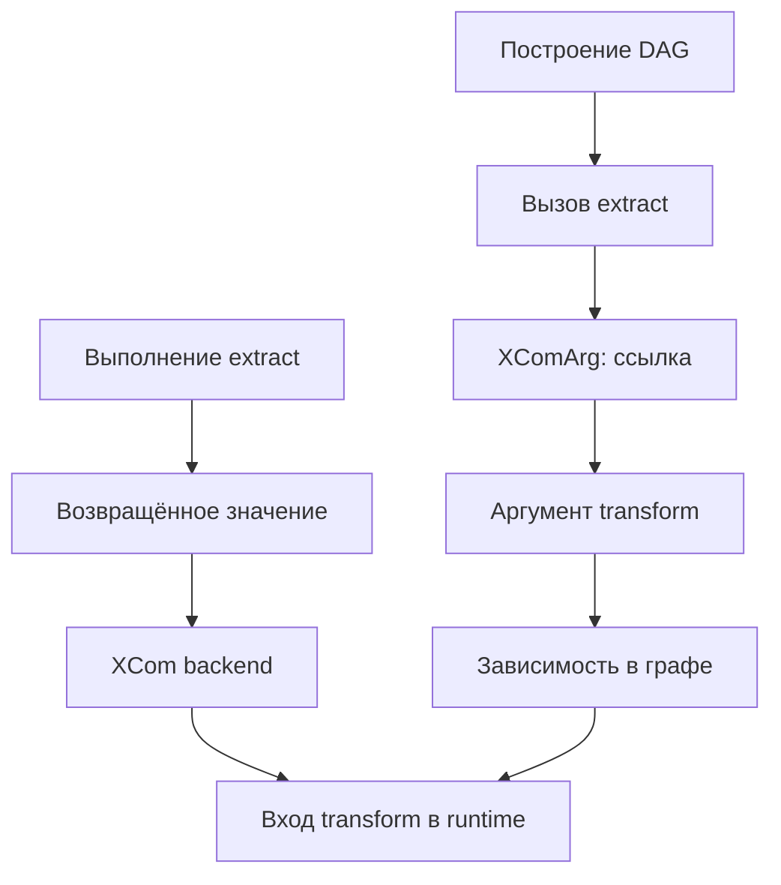
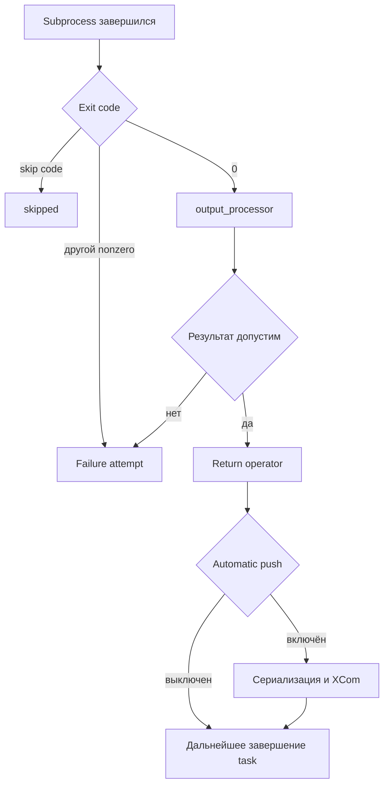
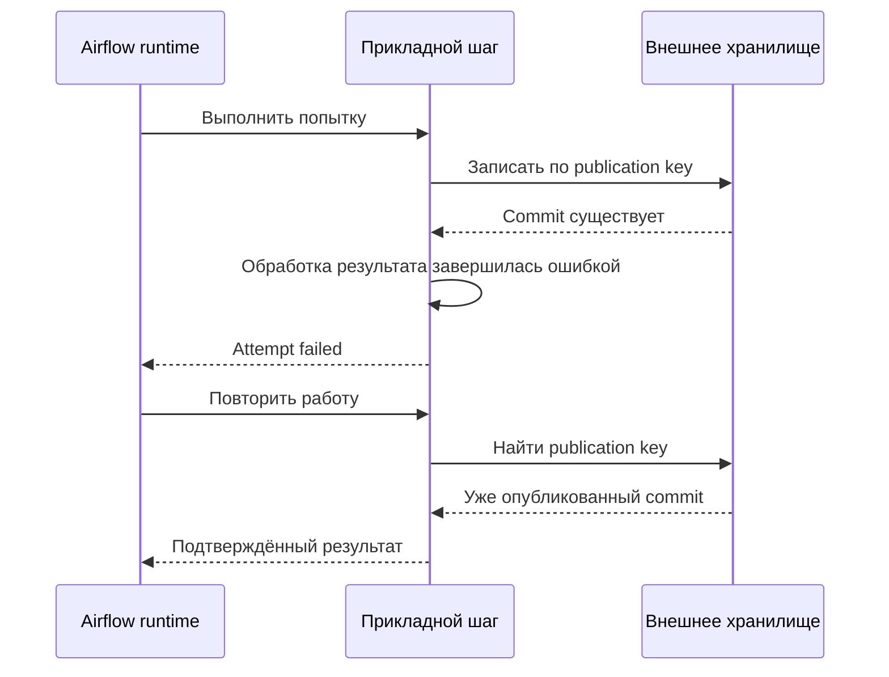
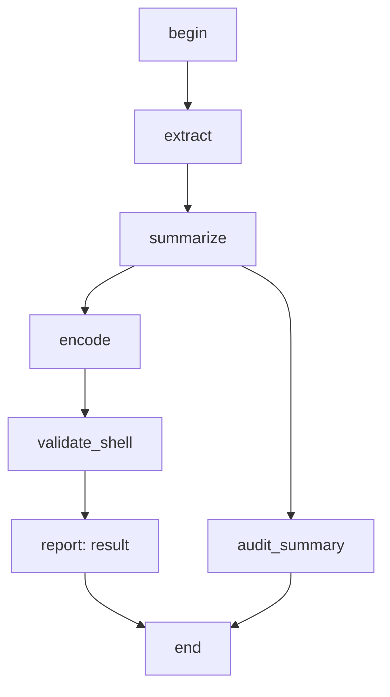

# 5. TaskFlow API и базовые операторы

**Apache Airflow Zero to Hero · Профессиональный справочник**

| Параметр | Значение |
| --- | --- |
| Базовая линия | Apache Airflow 3.3.2, Python Task SDK 1.3.2, Standard provider 1.19.0, Python 3.12 |
| Дата проверки | 19 октября 2026 года |
| Покрытие README | Все 8 тем и 41 пункт пятого раздела, в исходном порядке |
| Предварительная практика | Стенд из главы 2 и модель DAG/DagRun/TaskInstance из глав 3–4 |
| Сквозной сценарий | Небольшой набор заказов, метрики, Python-обёртка, проверка через shell и объявленный результат DAG |
| Практический результат | Умение строить смешанные DAG, объяснять передачу значений и проектировать корректную границу выполнения и retry |

Код `result = transform(extract())` выглядит как обычная программа Python. В DAG-файле его смысл иной: создаются две задачи, зависимость между ними и ссылки на будущие результаты. В этот момент заказов может ещё не существовать, worker не выбран, а функция `extract` не открывала соединение.

Отсюда происходят характерные ошибки: попытка перебрать `XComArg` при parsing; передача уже вызванной функции в `PythonOperator`; запись большого DataFrame в XCom; успешный shell с ошибкой внутри pipeline; импорт клиента, который начал обращаться к API ещё при построении графа.

Глава связывает удобный синтаксис с реальным контрактом. **Что создаётся сейчас? Что выполнится позже? Какой результат получит downstream? Какие действия повторятся после сбоя?** Эти вопросы одинаково важны для `@task`, классического operator и запуска внешнего вычислителя.

В практической части построим один DAG, где соседствуют TaskFlow, `PythonOperator`, `BashOperator` и `EmptyOperator`. Проверим успешный путь, некорректный вход и случай, когда shell завершился с кодом `0`, но обработка его результата завершилась ошибкой.

## Содержание

1. [Модель TaskFlow](#s5-1)
2. [Композиция Python-задач](#s5-2)
3. [PythonOperator](#s5-3)
4. [BashOperator и shell-задачи](#s5-4)
5. [EmptyOperator и служебные задачи](#s5-5)
6. [Context и выполнение функции](#s5-6)
7. [Providers и расположение классов](#s5-7)
8. [Проектирование единицы работы](#s5-8)
9. [Практика: смешанный DAG с проверяемым результатом](#lab)
10. [Эксперименты с shell и контрактами](#experiments)
11. [Разбор ситуаций](#cases)
12. [Самопроверка с ориентирами ответов](#questions)
13. [Критерии освоения и дальнейшее изучение](#next)
14. [Проверка материала](#verification)
15. [Официальные источники](#sources)

Ссылки на реализацию закреплены к core/SDK `3.3.2` и provider tags. Версия provider — самостоятельная часть окружения: страница `stable` может уже описывать более новый релиз. Примеры предназначены для указанной базовой линии.

<a id="s5-1"></a>
## 5.1. Модель TaskFlow

### 5.1.1. Декораторы `@dag` и `@task` из публичного SDK

`@dag` превращает Python-функцию в фабрику DAG. `@task` превращает функцию в определение задачи, вызов которого создаёт operator и ссылку на будущий результат. В Airflow 3 публичные объекты авторства импортируются из `airflow.sdk`. [S01](#source-01)

```python
# example: first_taskflow
from datetime import datetime, timezone

from airflow.sdk import dag, task


@dag(
    dag_id="taskflow_first_demo",
    schedule=None,
    start_date=datetime(2026, 1, 1, tzinfo=timezone.utc),
    catchup=False,
    is_paused_upon_creation=True,
)
def build_workflow():
    @task
    def extract():
        return [10, 20, 30]

    @task
    def total(values):
        return sum(values)

    @task
    def verify(value):
        if value != 60:
            raise ValueError(f"Unexpected total: {value}")

    verify(total(extract()))


workflow = build_workflow()
```

Этот файл создаёт один DAG и три tasks. Вызов `build_workflow()` выполняет тело фабрики, а вызовы `extract()`, `total(...)` и `verify(...)` внутри неё создают описание вычислений.

`@task` не превращает Airflow в distributed Python interpreter с общей памятью. Каждая task instance выполняется в собственном runtime по правилам executor; возвращаемые значения пересекают границу через механизм Airflow.

| Конструкция | Роль | Когда работает прикладное тело |
| --- | --- | --- |
| `@dag(...)` | Настройка фабрики графа | Тело фабрики выполняется при её вызове для построения DAG |
| `@task` или `@task(...)` | Настройка определения task | Тело task выполняется при исполнении instance |
| `workflow = build_workflow()` | Создание DAG | Не запускает обычную обработку tasks |
| `task_definition(...)` внутри DAG | Создание operator/XComArg | Передаёт будущую работу Airflow |
| Обычная функция `helper(...)` | Python-вызов | Выполняется немедленно в месте вызова |

В текущем SDK `task` — коллекция декораторов. Её обычный вызов разрешает provider-декоратор `python`; `task.bash` разрешает зарегистрированный `bash`. Поэтому наличие импорта `from airflow.sdk import task` само по себе не доказывает установку нужной реализации. Для примеров нужен Standard provider. [S03](#source-03) [S17](#source-17)

Публичный namespace и физический пакет реализации — разные уровни. Используй SDK для авторства и фиксируй providers в окружении processor и execution runtime.

### 5.1.2. Вызов decorated function создаёт задачу при построении DAG

Вызов декорированной функции — декларация отдельного узла. Два вызова одного определения обычно создают две tasks, а не два обращения к одному уже вычисленному значению.

Рассмотрим фрагмент внутри фабрики:

```python
# example: repeated_definition_fragment
from airflow.sdk import task


@task
def read_count(source_name):
    return {"alpha": 3, "beta": 5}[source_name]


# Эти строки размещаются внутри фабрики DAG.
def wire_counts():
    alpha = read_count.override(task_id="read_alpha")("alpha")
    beta = read_count.override(task_id="read_beta")("beta")
    return alpha, beta
```

`wire_counts` здесь — вспомогательная функция построения, которую вызывают из DAG scope. Её результат — две будущие ссылки. Это не два словаря с уже полученными данными.

| Запись при построении | Что означает |
| --- | --- |
| `a = extract()` | Создать task и сохранить ссылку `a` |
| `b = transform(a)` | Создать downstream task с зависимостью от producer `a` |
| `print(a)` | Напечатать представление ссылки, а не будущий dataset |
| `for row in a` | Попытка перебрать ссылку при parsing; так делать нельзя |
| `if a` | Проверка Python-объекта при parsing; не ветвление по будущему результату |
| `helper(a)` для обычной функции | Немедленный вызов helper с объектом ссылки |

Особенно неприятен `if a`: не следует ожидать, что такая строка обязательно вызовет защитное исключение. Обычная Python truthiness ссылки не проверяет будущую пустоту данных. Для runtime-ветвления нужны предусмотренные механизмы branching/short-circuit либо проверка внутри task.

Список, известный при parsing, можно использовать для создания фиксированного числа узлов. Список, который появится после выполнения upstream, требует dynamic task mapping. Эти механизмы будут разобраны отдельно; здесь важно не пытаться подменять второй обычным циклом Python.

Не вызывай operator через `execute(...)` внутри другой task ради создания «дочерней задачи». Такой вызов не создаёт самостоятельную TaskInstance с собственными retries, UI, pools и lifecycle. Если нужен второй шаг оркестрации, опиши его отдельным узлом.

### 5.1.3. Сигнатуры, аргументы и проверяемые контракты функций

TaskFlow проверяет возможность связать переданные аргументы с сигнатурой функции. Отсутствующий обязательный аргумент, дублирование и неизвестное имя часто выявляются уже при построении operator. Это полезно, но не равно проверке бизнес-схемы входа. [S02](#source-02)

| Вид проверки | Пример | Что она не проверяет |
| --- | --- | --- |
| Python signature binding | Передан обязательный `values` | Что внутри списка именно заказы |
| Type annotations | `values: list[int]` | Runtime-типы каждого элемента автоматически |
| `Param` JSON Schema | Допустимый режим запуска | Полную схему полученного внешнего dataset |
| Бизнес-validation | IDs уникальны, суммы неотрицательны | Доступность внешнего commit без отдельной проверки |
| Serialization contract | Значение можно передать runtime | Правильность его бизнес-смысла |

Аннотации улучшают IDE, статический анализ и иногда влияют на поведение Airflow, например inference `multiple_outputs`. Они не запускают универсальную runtime-validation каждого аргумента.

Для важных параметров предпочитай понятные имена и keyword-only сигнатуры: `def summarize(*, orders, expected_currency): ...`. Так сложнее перепутать два строковых аргумента при wiring.

Контекстные имена вроде `ti`, `run_id`, `params` имеют специальное назначение. TaskFlow умеет подставлять известные context arguments при выполнении. Не используй их для несвязанного бизнес-поля, не пытайся вручную map/override их как обычные данные.

В текущем DecoratedOperator defaults для известных context parameters допускаются как `None` либо отсутствуют; произвольный default для `run_id` создаёт неоднозначность и отклоняется. Явный `get_current_context()` внутри тонкой обёртки часто проще.

`**kwargs` не делает контракт надёжнее. Он уменьшает строгость сигнатуры и способен пропустить опечатку в бизнес-аргументе. Передавай чистой функции только нужные значения, а не весь контекст Airflow.

### 5.1.4. Возвращаемое значение как XCom и зависимость через XComArg

Обычный return task при включённом `do_xcom_push` сохраняется через XCom под ключом `return_value`. `XComArg` описывает, какой будущий XCom нужен downstream, и позволяет установить зависимость.



Диаграмма отделяет декларацию зависимости от передачи фактического значения. Будущая ссылка не переносит данные в момент импорта файла.

Если task возвращает `{"uri": "...", "row_count": 12540}`, downstream может получить этот небольшой объект. Если task возвращает соединение с БД, iterator с открытым cursor или Spark session, это плохой межзадачный контракт.

| Значение | Подходящий способ передачи |
| --- | --- |
| Несколько счётчиков и ID | Небольшой сериализуемый XCom |
| URI артефакта с версией/checksum | XCom со ссылкой; данные во внешнем storage |
| Большой DataFrame | Сохранить dataset и передать адрес/manifest |
| DB/client/session | Создать заново внутри execution runtime |
| Локальный путь worker | Использовать только при доказанном shared storage contract |
| Генератор | Материализовать небольшой результат либо записать внешний артефакт |

В 3.3.2 return `None` обычно не создаёт обычный return XCom. Отсутствующий `return_value` при разрешении ссылки может дать `None`; не строй контракт на ожидании обязательного «XCom not found» во всех случаях. Для downstream-generated mapping существуют дополнительные проверки наличия и типа результата. [S04](#source-04) [S13](#source-13)

XCom не создаёт транзакцию с warehouse. Публикация может состояться, а последующая сериализация return — завершиться ошибкой. Тогда task может быть повторена при уже существующем внешнем результате.

### 5.1.5. `@result` для явно объявленного результата DAG в Airflow 3.3+

С Airflow 3.3 появилась возможность обозначить одну или несколько tasks как возвращающие результат DAG. В 3.3.2 механизм документирован как experimental. Он полезен для клиента, которому нужно дождаться run и получить небольшой ответ. [S12](#source-12)

`@result` применяется **над `@task`**:

```python
# example: declared_dag_result
from datetime import datetime, timezone

from airflow.sdk import dag, result, task


@dag(
    dag_id="declared_result_demo",
    schedule=None,
    start_date=datetime(2026, 1, 1, tzinfo=timezone.utc),
    catchup=False,
    is_paused_upon_creation=True,
)
def build_workflow():
    @task
    def answer():
        return 42

    @result
    @task(multiple_outputs=False)
    def response(value):
        return {"answer": value, "schema_version": 1}

    response(answer())


workflow = build_workflow()
```

Декораторы применяются снизу вверх: сначала получается TaskFlow definition, затем `result` помечает его как result task. Применять `@result` к обычной недекорированной Python-функции нельзя. [S03](#source-03)

Есть и автоматический вариант: если тело фабрики `@dag` возвращает **прямой `XComArg` task**, эта task объявляется результатом. Например, `return response(answer())`. Фабрика при этом по-прежнему возвращает вызывающему коду объект DAG, а не число `42` или готовый JSON. [S11](#source-11)

| Запись | Эффект |
| --- | --- |
| `@result` над `@task` | Пометить вызываемые tasks этого определения как result tasks |
| `return response(...)` из фабрики `@dag` | Автоматически объявить прямой return XCom task результатом DAG |
| `return {"answer": 42}` из фабрики | Обычный Python-объект не становится DAG result этим способом |
| `dag.add_result(task.output)` | Явный imperative вариант для прямого return XCom |
| `dag.add_result(task.output["field"])` | Именованный XCom key не является допустимым plain return result |

Для простого API-контракта явно укажи `multiple_outputs=False` на result task и верни один небольшой объект. Именованные outputs и целый `return_value` нужно различать.

Документированный endpoint — `GET /api/v2/dags/{dag_id}/dagRuns/{dag_run_id}/wait`. Он выдаёт NDJSON: отдельные JSON-объекты по строкам, а не один JSON-массив. Финальная строка может содержать:

```json
{
  "state": "success",
  "results": {
    "response": {
      "answer": 42,
      "schema_version": 1
    }
  }
}
```

В реальном NDJSON это один объект на одной строке; здесь он отформатирован для чтения. Ключ в `results` — task ID. Для mapped result task API возвращает коллекцию по instances согласно документации. Параметр `result` endpoint позволяет выбрать другие task IDs или отключить сбор результатов.

Авторизация и сетевой timeout клиента остаются отдельными требованиями API. Само объявление `@result` не делает DAG публичным endpoint и не означает, что пользовательский запрос выдержит многочасовое выполнение.

Result task не заменяет критерий terminal state DagRun из главы 4. Можно объявить JSON-ответ, а позже получить failure другой task. Бизнес-успех, состояние run и API-response contract нужно согласовать.

### 5.1.6. Отделение бизнес-функции от инфраструктурной обёртки

Хорошая task-обёртка получает runtime-параметры, читает нужный вход, вызывает бизнес-функцию и фиксирует наблюдаемый результат. Проверку математического правила не стоит связывать с наличием scheduler context.

| Чистая бизнес-функция | Обёртка Airflow |
| --- | --- |
| Получает явные аргументы | Читает Params/context/Connections |
| Возвращает обычный результат | Подготавливает XCom/manifest |
| Проверяет контракт данных | Назначает retries/timeouts/pool |
| Тестируется без Airflow | Проверяется как часть workflow |
| Не знает `dag_id/run_id` без необходимости | Добавляет correlation metadata |

Например, `summarize_orders(records)` проверяет ID, валюту и суммы. `@task def summarize(records)` вызывает её и переводит permanent input error в понятный failure Airflow. Полная реализация есть в лаборатории.

Не помещай `get_current_context()` в глубину универсальной функции суммирования. Это делает её зависимой от Airflow и усложняет unit tests, CLI и повторное использование.

Также не нужно превращать каждую маленькую helper-функцию в task. Сама по себе декомпозиция Python-кода ещё не является декомпозицией orchestration. Отдельный узел нужен, когда важны самостоятельные retries, наблюдаемость, ресурсная среда или артефакт.

**Контрольная точка 5.1:** можешь объяснить, что хранится в переменной после вызова `@task`, где появляется значение и чем объявленный DAG result отличается от return фабрики как обычного Python-вызова.

<a id="s5-2"></a>
## 5.2. Композиция Python-задач

### 5.2.1. Передача результатов между extract, transform и load

В маленьком ETL TaskFlow позволяет выразить data dependencies через аргументы: `raw = extract()`, `metrics = transform(raw)`, `load(metrics)`. Airflow видит producer будущего значения и связывает задачи. [S21](#source-21)

Но название `load` ничего не гарантирует. Если функция только делает `print`, данные никуда не опубликованы. Контракт должен уточнять, что именно считается результатом.

| Шаг | Хороший вход | Хороший выход |
| --- | --- | --- |
| Extract небольшой демонстрации | Явная synthetic-конфигурация | Короткий список записей |
| Extract production | Snapshot/interval/источник | URI входного артефакта и manifest |
| Transform | Данные или версия артефакта | Метрики либо URI нового dataset |
| Load/publish | Проверенный результат и publication key | Подтверждённый commit/manifest |
| Verify | Фактический выход | Quality report либо failure |

Передавай объект между tasks только потому, что он является межзадачным контрактом. Не переносить огромный dataset через XCom — это архитектурное решение, а не косметическая оптимизация.

Producer должен завершиться и сохранить результат, прежде чем downstream получит его. При retry consumer получает значение согласно текущей истории run/XCom и конфигурации; это не замороженная копия всех внешних inputs на вечное время.

Если функция получает несколько future arguments, у неё возникают зависимости от их producers. Сами producers могут выполняться параллельно, если между ними нет других рёбер и хватает ресурсов.

Не используй возвращённый URI без проверки доступности в execution environment consumer. `/tmp/orders.json` на worker A не является общим storage для worker B.

### 5.2.2. `multiple_outputs` и именованные результаты

`multiple_outputs=True` разворачивает возвращённый mapping в именованные XCom keys. В SDK runtime 3.3.2 помимо отдельных ключей сохраняется и целый `return_value`. Ключи mapping должны быть строками. [S13](#source-13)

```python
# example: named_outputs
from datetime import datetime, timezone

from airflow.sdk import dag, task


@dag(
    dag_id="named_outputs_demo",
    schedule=None,
    start_date=datetime(2026, 1, 1, tzinfo=timezone.utc),
    catchup=False,
    is_paused_upon_creation=True,
)
def build_workflow():
    @task(multiple_outputs=True)
    def summarize():
        return {"row_count": 3, "total_minor": 6000}

    @task
    def verify(row_count, total_minor):
        if row_count != 3 or total_minor != 6000:
            raise ValueError("Unexpected metrics")

    metrics = summarize()
    verify(metrics["row_count"], metrics["total_minor"])


workflow = build_workflow()
```

`metrics["row_count"]` здесь означает «XCom producer под ключом `row_count`». Это **не произвольная операция индексирования словаря будущего значения в Python**. Если producer возвращает словарь при `multiple_outputs=False`, такой named key сам по себе не появляется.

| Definition | Return | Что передать consumer |
| --- | --- | --- |
| `multiple_outputs=True` | `{"count": 3}` | `future["count"]` либо целый `future` |
| `multiple_outputs=False` | `{"count": 3}` | Целый `future`; читать `value["count"]` внутри consumer |
| Inference от `-> dict[str, int]` | Mapping | Именованные outputs могут включиться автоматически |
| `multiple_outputs=True` | `[1, 2, 3]` | Runtime contract нарушен |
| `multiple_outputs=True` | `{1: "value"}` | Нестрочный key нарушает контракт |
| `do_xcom_push=False` | Любое обычное return | Автоматическая передача результата отключена |

**Важное уточнение:** `@task` без явно переданного `multiple_outputs` не всегда означает `False`. SDK анализирует return annotation и может включить режим для `dict`/`Mapping`. Явное `multiple_outputs=False` отключает inference для этого определения. [S02](#source-02)

Именно поэтому аннотация типа иногда меняет runtime-поведение, хотя не добавляет проверку содержимого каждого значения. Для устойчивого межзадачного API задавай режим явно, если downstream зависит от named keys.

У `XComArg` поддерживается строковый key lookup. `future[0]` не означает «первый элемент будущего списка»; вложенные выражения вроде `future["metrics"]["count"]` также не являются общим способом читать вложенный JSON. Передай целый объект в task и разбери его там.

Не раскладывай десятки тысяч полей dataset на отдельные XCom keys. Именованные outputs удобны для нескольких осмысленных значений, а не замены табличного storage.

### 5.2.3. `.override()` для повторного использования определения

`.override(...)` создаёт вариант определения с другими operator settings. Это не выполнение функции и не редактирование уже существующей TaskInstance. [S02](#source-02)

| Что меняем | Где передавать |
| --- | --- |
| `task_id`, `retries`, `pool`, `execution_timeout` | `definition.override(...)` |
| `source_name`, `business_date`, `currency` | В аргументы вызова task |
| Фиксированные параметры для последующего mapping | Соответствующая `partial(...)` композиция |
| Результат уже созданного run | Новая операция запуска/clear, а не override |

Правильная идея: `extract.override(task_id="extract_orders", retries=2)(source_name="orders")`. Здесь settings и бизнес-аргументы находятся в разных местах.

Неправильная идея: менять `extract.kwargs` из нескольких модулей вручную. Общая mutable-конфигурация делает результат зависимым от порядка импорта и повторного использования.

При повторных вызовах могут появляться автоматические суффиксы task IDs. Для стабильных внешних ссылок, logs и monitoring лучше задавать явные IDs. Не строить эксплуатационные команды вокруг случайного порядка генерации — полезная привычка с самого начала.

Переиспользование definition не означает переиспользование runtime memory, DB connection или кэша между tasks. Каждый вызов создаёт отдельную задачу, а её instances получают свои execution contexts.

Для общих бизнес-правил предпочтителен обычный Python-пакет. Decorated definitions можно переиспользовать поверх него, если их operational defaults действительно подходят разным DAG.

### 5.2.4. Совмещение TaskFlow и классических operators через `.output`

У классического operator `.output` представляет XComArg для его результата. Это позволяет включить его в TaskFlow-композицию без ручного `xcom_pull` в каждом consumer.

Два направления взаимодействия:

| Направление | Пример | Условие |
| --- | --- | --- |
| Operator → TaskFlow | `consume(python_operator.output)` | Producer возвращает и сохраняет нужный результат |
| TaskFlow → Operator | `PythonOperator(op_kwargs={"payload": task_result})` | Поле operator поддерживает templating/resolution |
| Bash → TaskFlow | `parse(bash_operator.output)` | Понятен контракт shell output |
| Named output → consumer | `consume(operator.output["count"])` | Producer действительно создал XCom key `count` |

Для автоматического разрешения входа в классическом operator важны `template_fields`. В `PythonOperator` это `templates_dict`, `op_args` и `op_kwargs`; в `BashOperator` — `bash_command`, `env` и `cwd`. Не любой произвольный атрибут класса получает такую обработку. [S05](#source-05) [S07](#source-07)

Одна лишь строка Jinja с ручным `xcom_pull` не является надёжной декларацией dependency. При таком ручном wiring нужно явно задать нужное ребро. Передача настоящего XComArg в поддерживаемое поле позволяет Airflow найти producer.

`.output` существует как ссылка независимо от того, имеет ли выполнение полезное return. Если `do_xcom_push=False` или producer не вернул значение, появление свойства не создаёт данные из ничего.

Не оборачивай future в произвольный `str(...)` или JSON при parsing, ожидая получить готовый runtime-object. Это может превратить ссылку в шаблон/представление и потерять ожидаемую семантику зависимости. Для перехода dict → JSON создай явный runtime-шаг, как в лаборатории.

### 5.2.5. Явные зависимости при отсутствии передачи значения

Не всякая связь в DAG является передачей XCom. Перед удалением временного ресурса нужно дождаться работы; перед запуском запросов — проверки доступности; после двух публикаций — завершения обеих.

`a >> b` означает control dependency. Он не передаёт return `a` в аргумент `b`.

| Ситуация | Подходящий способ |
| --- | --- |
| Consumer вычисляет по output producer | Передать XComArg аргументом |
| Нужно дождаться проверки, но значение не нужно | Явное `>>` |
| Служебный start/end marker | EmptyOperator с понятными зависимостями |
| Нужен cleanup при неуспехе | Специальная terminal/teardown схема из главы 4 |
| Работа находится в другом DAG | Явный межпроцессный контракт, assets/другой подход |

В лаборатории `begin >> extract_result` ограничивает начало, а `[report_result, audit_result] >> end` требует завершения двух веток. При этом `audit_result` не является полезным data payload: task пишет log и имеет отключённый automatic XCom push.

Используй data dependency, когда значение реально нужно. Пустой фиктивный аргумент `unused_upstream_result` только ради порядка скрывает смысл API функции.

Повторный clear upstream не пересчитывает автоматически уже завершившийся внешний результат consumer. Control/data wiring объясняет область зависимости, но область recovery всё равно нужно выбрать осознанно.

**Контрольная точка 5.2:** можешь предсказать набор XCom keys, отличить named key от вложенного dictionary lookup, соединить TaskFlow с operator и объяснить, почему `>>` не переносит значение.

<a id="s5-3"></a>
## 5.3. PythonOperator

### 5.3.1. `python_callable`, `op_args`, `op_kwargs` и context

`PythonOperator` выполняет Python callable в task runtime. `op_args` задаёт позиционные аргументы, `op_kwargs` — именованные. Нужные context kwargs Airflow подбирает с учётом сигнатуры. [S05](#source-05)

```python
# example: classic_python_operator
from datetime import datetime, timezone

from airflow.providers.standard.operators.python import PythonOperator
from airflow.sdk import DAG, task


def scaled_total(values, *, factor, run_id):
    return {
        "total": sum(values) * factor,
        "producer_run_id": run_id,
    }


with DAG(
    dag_id="classic_python_demo",
    schedule=None,
    start_date=datetime(2026, 1, 1, tzinfo=timezone.utc),
    catchup=False,
    is_paused_upon_creation=True,
) as workflow:
    calculate = PythonOperator(
        task_id="scaled_total",
        python_callable=scaled_total,
        op_args=[[10, 20, 30]],
        op_kwargs={"factor": 2},
        multiple_outputs=False,
        show_return_value_in_logs=False,
    )

    @task
    def verify(payload):
        if payload["total"] != 120:
            raise ValueError("Unexpected scaled total")
        if not payload["producer_run_id"]:
            raise ValueError("Missing run identity")

    verify(calculate.output)
```

`run_id` не указан в `op_kwargs`: его подставляет runtime context. `factor` — бизнес-аргумент, переданный явно. Список внутри `op_args` является одним позиционным аргументом, а не тремя отдельными числами.

| Параметр | Пример | Типичная ошибка |
| --- | --- | --- |
| `python_callable` | `scaled_total` | Передать `scaled_total(...)` |
| `op_args` | `[[10, 20, 30]]` | Неверно развернуть список аргументов |
| `op_kwargs` | `{"factor": 2}` | Опечатка имени или конфликт с positional args |
| `templates_dict` | Шаблонизируемые значения | Считать любой параметр шаблоном |
| `show_return_value_in_logs` | `False` | Считать это отключением XCom |
| `do_xcom_push` | `False` для action-only task | Считать это отключением логирования return |

В современных примерах не нужен `provide_context=True`. Это исторический интерфейс, который нельзя переносить в новую версию по памяти.

Не делай массовый dump всего `**kwargs` в logs. Контекст содержит больше сведений, чем требуется для корреляции, а бизнес-параметры могут оказаться чувствительными.

### 5.3.2. Различие ссылки на функцию и её преждевременного вызова

`python_callable=load_orders` передаёт объект функции. `python_callable=load_orders()` сначала выполняет её в текущем процессе, затем передаёт результат.

Если это происходит в DAG-файле, сеть, запись и ошибки возникают при parsing. Следующий retry task не будет повторять уже совершённое действие так, как ожидал автор.

| Запись | Когда выполняется операция |
| --- | --- |
| `python_callable=load_orders` | При исполнении operator |
| `python_callable=load_orders()` | Немедленно при построении выражения |
| `op_kwargs={"client": make_client()}` | Клиент создаётся при построении графа |
| `def run(): client = make_client(); ...` | Клиент создаётся при вызове runtime wrapper |
| `python_callable=lambda: load_orders(...)` | Обычно позже, но хуже для читаемости/переносимости, чем именованная функция |

Иногда ошибка маскируется: вызванная фабрика возвращает другой callable, и базовая проверка `callable(...)` проходит. Поэтому «DAG импортировался» ещё не доказывает правильное размещение side effects.

Предпочитай именованные функции верхнего уровня и явные kwargs. Они проще для code review, тестов, диагностики и совместимости с различными runtimes.

Не путай это с вызовом TaskFlow definition: у декорированного определения `task_definition(...)` имеет специальную декларативную семантику. У обычной `load_orders(...)` её нет.

### 5.3.3. Возврат результатов и управление `do_xcom_push`

Возврат `PythonOperator` обрабатывается общим task runtime. Если automatic push включён, результат может стать XCom; при `multiple_outputs=True` действуют требования mapping/string keys.

`do_xcom_push=False` нужен, если межзадачный payload не требуется. Например, задача проверяет наличие индекса и завершается либо пишет небольшой audit log, а downstream нужен только контроль завершения.

| Настройка | XCom | Logs |
| --- | --- | --- |
| `do_xcom_push=True` | Автоматический return push включён | Return может логироваться operator |
| `do_xcom_push=False` | Автоматический return push отключён | Return всё ещё может логироваться |
| `show_return_value_in_logs=False` | Не меняет automatic push | Operator не печатает возвращённое значение своим обычным сообщением |
| Return `None` | Обычно нет обычного return payload | Состояние определяется выполнением, а не наличием полезного return |
| Ручной `ti.xcom_push(...)` | Отдельное явное действие | Не отключается одним запретом automatic return push |

Нельзя скрыть секрет, просто выключив XCom. Он может остаться в return log, exception, шаблоне, command line или обычном `logger.info`. Для секретов нужен корректный способ получения и обращения с ними.

Большое возвращаемое значение дорого не только в metadata backend. Оно занимает память процесса, сериализуется, проходит API и может раздувать logs. Внешний XCom backend меняет хранение, но не отменяет весь этот путь.

Сериализация результата находится после прикладной работы. Если отправка запроса уже успешно изменила внешний сервис, а return оказался несериализуемым, retry должен распознать ранее выполненную операцию.

### 5.3.4. Импорты и создание клиентов внутри execution time

Не все imports плохи на верхнем уровне. Маленькие стандартные модули и чистые определения обычно уместны. Проблему создают дорогая инициализация, сеть и объекты, чьё состояние связано с конкретным процессом.

| На верхнем уровне модуля | В runtime task |
| --- | --- |
| `import json`, определения функций | Открытие DB/client connection |
| Небольшие константы и schema | Вызов бизнес-API |
| Импорты SDK/operator для построения графа | Получение конкретных runtime credentials |
| Стабильная локальная конфигурация структуры | Создание/закрытие cursor/session |
| Бизнес-код без внешних действий при import | Чтение dataset и публикация результата |

Если тяжёлая библиотека нужна только task body, локальный import может уменьшить parsing cost. Но он **не устанавливает пакет**. Зависимость должна заранее существовать в соответствующем execution environment.

Для DB-клиента закрывай соединение через context manager/`finally`, проверяй transaction boundaries и не передавай открытый client в следующую task.

Credentials и соединения получай через предусмотренные Connections/hooks/secrets mechanisms. Не создавай универсальный client при импорте, рассчитывая, что он будет общим для всех worker attempts.

Не превращай отсутствие зависимости в молчаливый fallback, который возвращает пустые данные. Если требуемый runtime package не установлен, понятный failure лучше ложного успешного no-op.

### 5.3.5. Выбор между `PythonOperator`, `@task` и внешним runtime

TaskFlow и PythonOperator — способы описания Python-задачи, а не разные гарантии корректности данных. Оба нуждаются в idempotency, resource limits, schema validation и наблюдаемости. [S06](#source-06) [S19](#source-19)

| Вариант | Когда удобен | Чего не даёт сам по себе |
| --- | --- | --- |
| `@task` | Python-композиция с явными входами/return | Отдельного virtualenv или общей памяти |
| `PythonOperator` | Существующий callable, config-driven создание tasks, явный operator API | Автоматической изоляции Python-зависимостей |
| `PythonVirtualenvOperator` / `@task.virtualenv` | Отдельная Python-среда по поддерживаемой модели | Удалённого вычислительного кластера |
| `ExternalPythonOperator` / `@task.external_python` | Заранее подготовленный interpreter | Автоматической установки interpreter на каждом worker |
| Container/pod operator | Образ с нужными системными библиотеками | Гарантии транзакции с data storage |
| Spark/warehouse job operator | Тяжёлая обработка во внешнем движке | Safe retry без контракта внешнего job |

External Python — это не произвольный «Python на другой машине» по названию. Нужно понимать, где находится binary и как запускается процесс конкретным operator.

Python tasks подходят для небольшой обработки control metadata, validation и вызова API. Большие joins/aggregations по dataset обычно выполняются в Spark, warehouse или другой подходящей вычислительной системе, а Airflow управляет их жизненным циклом.

Не переписывай работающий PythonOperator на `@task` только ради количества строк. Выигрыш должен выражаться в ясности контрактов, composition, тестировании и сопровождении.

**Контрольная точка 5.3:** умеешь передать функцию без раннего вызова, разделить XCom/logging settings, создать client в правильной фазе и объяснить, где фактически исполняется выбранный Python runtime.

<a id="s5-4"></a>
## 5.4. BashOperator и shell-задачи

### 5.4.1. `bash_command`, `env`, рабочий каталог и exit code

`BashOperator` запускает Bash в execution environment task. Это не автоматическое подключение к твоему ноутбуку, не SSH на data cluster и не перенос всех локальных файлов в worker.

| Параметр | Назначение | Что проверить |
| --- | --- | --- |
| `bash_command` | Команда или поддерживаемый файл shell script | Синтаксис, наличие binary и script |
| `env` | Переменные окружения subprocess | Типы значений и правила наследования |
| `append_env` | Добавлять переданный env к окружению процесса | PATH и отсутствие случайной потери нужных настроек |
| `cwd` | Рабочий каталог | Наличие и права в runtime |
| `output_encoding` | Декодирование output | Согласованность кодировки программы |
| `skip_on_exit_code` | Коды, трактуемые как skip | Совпадение с контрактом программы |
| `output_processor` | Обработка захваченного результата | Возможная ошибка после успешного shell |

В Standard provider 1.19.0 различаются три случая:

- `env=None`: subprocess наследует окружение процесса.
- `env={...}, append_env=False`: переданный env используется вместо обычного наследования; operator добавляет свои context variables.
- `env={...}, append_env=True`: переданные значения дополняют/переопределяют унаследованные.

Пустой словарь `env={}` и отсутствие `env` — не одно и то же. Не рассчитывай, что явный пустой env автоматически сохранит весь PATH и другие переменные. [S07](#source-07) [S09](#source-09)

При `cwd=None` subprocess запускается во временном каталоге. Относительный путь вроде `scripts/job.py` не обязан относиться к DAG folder. Файл должен быть доставлен и доступен там, где operator его ищет.

Команда, оканчивающаяся на `.sh` или `.bash`, может интерпретироваться как template file. Нужны корректный template search path и права на рабочий каталог, куда provider создаёт отрендеренный script. Не путай source-файл в read-only bundle с writable runtime directory.

Exit code — программный контракт. Код `0` обычно означает успех shell; остальные коды становятся failure или skip согласно настройке. Но код shell нужно интерпретировать совместно с содержимым pipeline и последующей обработкой output. [S20](#source-20)

### 5.4.2. Шаблоны команд и безопасная передача пользовательских параметров

Jinja подставляет текст. Bash затем интерпретирует полученный текст как программу. Если вставить пользовательский `message` прямо в исходный код команды, кавычки, `$()` и другие shell-конструкции могут изменить её смысл.

Безопасный базовый подход: **текст команды фиксирован, пользовательские значения передаются как данные через env и читаются в кавычках**.

```python
# example: safe_bash_environment
from datetime import datetime, timezone

from airflow.providers.standard.operators.bash import BashOperator
from airflow.sdk import DAG, Param


with DAG(
    dag_id="safe_bash_environment_demo",
    schedule=None,
    start_date=datetime(2026, 1, 1, tzinfo=timezone.utc),
    catchup=False,
    is_paused_upon_creation=True,
    params={"message": Param("hello", type="string", maxLength=200)},
) as workflow:
    print_message = BashOperator(
        task_id="print_message",
        bash_command=r"""
set -euo pipefail
printf '%s\n' "$MESSAGE"
""",
        env={"MESSAGE": "{{ params.message }}"},
        append_env=True,
        do_xcom_push=False,
    )
```

В этом случае `$(...)` внутри значения `MESSAGE` остаётся текстом при обычном `"$MESSAGE"` expansion. Shell не должен повторно интерпретировать содержимое переменной как программу. Не добавляй `eval` или новый `bash -c "$MESSAGE"` поверх этого подхода.

| Данные | Правильная граница |
| --- | --- |
| Свободный пользовательский текст | Env/stdin/файл и явное quoted чтение |
| Ограниченный режим `full/incremental` | Validation/whitelist до выбора поведения |
| Имя таблицы | Отдельная политика допустимых identifiers |
| Большой JSON/dataset | Файл/object storage, а не огромный env |
| Пароль/API token | Connection/secrets mechanism без печати в команду и logs |

Quoting и validation решают разные задачи. Кавычки помогают сохранить один аргумент; они не делают любое имя таблицы допустимым и не проверяют business date.

Для передачи JSON через env сначала сериализуй его в строку в runtime. Python dict, переданный как значение env без согласованного преобразования, не становится автоматически корректным OS environment value.

Не выводи весь env для диагностики. Он может содержать inherited credentials. В примерах message — специально несекретный учебный текст.

### 5.4.3. Quoting, pipelines, `set -e` и поведение shell

По умолчанию Bash оценивает exit status команды/последнего шага. Ошибка внутри последовательности или pipeline может потеряться.

```bash
bash -c 'false; printf "done\n"'
printf 'status of sequence: %s\n' "$?"

bash -c 'false | cat'
printf 'status of pipeline: %s\n' "$?"

bash -o pipefail -c 'false | cat'
printf 'status with pipefail: %s\n' "$?"
```

Ожидаемые коды: `0`, `0` и `1`. В первых двух случаях вывод `done` либо успешный последний элемент pipeline скрывает неуспех `false`.

Для контролируемого script часто подходит `set -euo pipefail`:

| Часть | Назначение | Ограничение |
| --- | --- | --- |
| `-e` | Завершаться при многих необработанных nonzero statuses | Есть исключения в условиях, списках и других конструкциях |
| `-u` | Ошибка при обращении к неустановленной переменной | Опциональные переменные требуют явного default |
| `pipefail` | Не терять nonzero статус внутри pipeline | Не исправляет логику самой программы |
| Кавычки `"$VALUE"` | Сохранить значение одним аргументом | Не валидируют его бизнес-смысл |

`set -e` не является универсальным exception handler. Например, неуспех команды в условии `if` может быть ожидаемой частью control flow и не прекращать script. Shell-функции, substitution и логические списки тоже требуют понимания контекста.

Утилита `grep` возвращает `1`, если совпадений нет, и другой nonzero status при ошибке. Если «ничего не найдено» допустимо, обработай этот конкретный случай. `|| true` в конце каждой команды стирает различие между штатным отсутствием данных и поломанным входом.

Используй `printf` с фиксированным format string для произвольных строк. `echo` имеет разные особенности обработки options/escape sequences, которые не нужны межзадачному контракту.

BashOperator оценивает итог subprocess, а не анализирует текст каждой строки log. Сообщение `ERROR` не делает task failed, если программа вернула `0`; слово `success` не спасает command с exit code `1`.

### 5.4.4. stdout/stderr, XCom output и обработка skip-кодов

В текущем Standard provider subprocess hook объединяет `stderr` с `stdout` и сохраняет последнюю прочитанную строку как `SubprocessResult.output`. Поэтому упрощение «BashOperator всегда возвращает только последнюю строку stdout» неточно. [S09](#source-09)

| Поведение команды | Результат для task |
| --- | --- |
| Exit `0` и последняя строка `{"count":3}` | Может быть передана в XCom/processor |
| Exit `0` и после JSON диагностическая stderr-строка | Последним output может стать диагностика |
| Exit `99` при настройке по умолчанию | `skipped` |
| Exit `7` при обычной настройке | Failure; далее действует retry policy |
| Exit `99` при `skip_on_exit_code=None` | Failure |
| Exit `0` и некорректный JSON при `output_processor=json.loads` | Failure обработки результата |

Hook удаляет trailing whitespace у захватываемых строк. XCom-output — не byte-perfect архив всего stdout; для полного артефакта нужен отдельный файл/storage.

Если downstream нужен JSON, задай протокол: одна компактная JSON-строка как окончательный output, без последующей диагностики; проверь её schema. Для серьёзной интеграции часто надёжнее записать manifest отдельно и передать URI.

`output_processor` получает захваченный output после проверки exit code. Например, `json.loads` преобразует строку в dict. Если parsing упал, shell уже мог совершить side effect, но task станет failed. Именно этот случай воспроизводится в лаборатории.



Диаграмма показывает ключевые развилки, а не все post-execution hooks runtime. Даже после processor возможны другие причины failure.

`do_xcom_push=False` отключает автоматический push результата, но не означает, что сам operator перестанет выполнять `output_processor`. В текущем коде processor вызывается в `execute`, а automatic push делает общий task runtime. Поэтому неверный processor может сломать action-only task. [S07](#source-07) [S13](#source-13)

Skip code — часть API запускаемой программы. Если `99` означает настоящую ошибку твоего CLI, настрой `skip_on_exit_code=None` или согласуй иной код; иначе обязательная работа превратится в пропуск.

Не используй skip как общий способ подавить любые failures. Как показано в главе 4, skipped leaves могут дать успешный DagRun без обязательного продукта данных.

### 5.4.5. Декоратор `@task.bash` и зависимости от standard provider

`@task.bash` превращает Python-функцию в задачу, чьё тело **в runtime возвращает shell command**. Затем operator исполняет эту команду. Возвращённая строка Python здесь является программой, а не конечным XCom payload. [S08](#source-08)

```python
# example: decorated_bash
from datetime import datetime, timezone

from airflow.sdk import Param, dag, task


@dag(
    dag_id="decorated_bash_demo",
    schedule=None,
    start_date=datetime(2026, 1, 1, tzinfo=timezone.utc),
    catchup=False,
    is_paused_upon_creation=True,
    params={"message": Param("hello", type="string", maxLength=200)},
)
def build_workflow():
    @task.bash(
        env={"MESSAGE": "{{ params.message }}"},
        append_env=True,
    )
    def emit_message() -> str:
        return r"""set -euo pipefail
printf '%s\n' "$MESSAGE"
"""

    @task
    def verify(output):
        if not isinstance(output, str):
            raise TypeError("Expected captured shell output")

    verify(emit_message())


workflow = build_workflow()
```

| Этап | Что возвращается |
| --- | --- |
| Вызов `emit_message()` при построении | XComArg задачи |
| Тело Python-функции при execution | Непустая строка Bash command |
| Исполнение shell | Exit code и захваченный output |
| `output_processor` при наличии | Преобразованный результат команды |
| Downstream TaskFlow | Результат operator через XCom |

Пустая строка или dict вместо command string нарушают контракт декоратора. Если Python-функция должна просто вернуть dict для downstream, используй обычный `@task`.

Не формируй command через f-string с непроверенным пользовательским текстом. То, что текст сначала прошёл через Python, не экранирует его для Bash. Env и fixed command остаются предпочтительным базовым способом.

`@task.bash` поставляет Standard provider; другие варианты вроде `@task.docker` требуют своих providers. Import `task` может пройти, а обращение к отсутствующему decorator — завершиться ошибкой регистрации.

**Контрольная точка 5.4:** умеешь объяснить наследование env, выбрать cwd, не потерять pipeline failure и назвать результат каждой стадии `@task.bash`. Понимаешь, почему exit `0` ещё не гарантирует успех всей task.

<a id="s5-5"></a>
## 5.5. EmptyOperator и служебные задачи

### 5.5.1. Пустые узлы для явных границ и объединения веток

`EmptyOperator` — узел без прикладного вычисления. Он может обозначать начало, завершение или явный join, если такая граница помогает читать workflow. [S10](#source-10)

Его смысл задают зависимости и trigger rule. Например, `[publish_orders, publish_payments] >> complete` при обычном `all_success` означает, что boundary допустим после успеха обеих публикаций.

| Использование | Польза | Ограничение |
| --- | --- | --- |
| `begin` перед несколькими ветками | Видимая общая граница | Не проверяет доступность входа |
| `complete` после нескольких веток | Явный join | Trigger rule должен соответствовать branching |
| Пустая ветка «ничего не делать» | Документированный no-op | Не заменяет бизнес-валидацию |
| Граница группы | Упрощает чтение некоторых графов | TaskGroup часто решает организацию без лишнего runtime-узла |

После ветвления default `all_success` может не подходить: пропущенная ветка способна привести к skip join. Для join с хотя бы одним успехом часто рассматривают `none_failed_min_one_success`. Подробная семантика разобрана в главе 4 и будет развиваться дальше.

Empty boundary не должен скрывать failure предыдущей обязательной работы. Особенно внимательно проверяй terminal `all_done` markers: они подчиняются той же leaf-модели, что и обычные tasks.

### 5.5.2. Стоимость служебных узлов и читаемость графа

У EmptyOperator есть оптимизированный путь. В 3.3.2 подходящие instances могут быть отмечены успешными scheduler без передачи executor. Наличие callbacks, inlets/outlets и других свойств влияет на допустимость такого пути; нельзя считать любой расширенный EmptyOperator всегда «бесплатным». [S23](#source-23)

Даже без worker-процесса остаются graph parsing, serialization, metadata, scheduler decisions, UI и история runs. Стоимость одного пустого узла невелика, но сотни тысяч ненужных узлов увеличивают объём состояния.

| Решение | Когда оправдано |
| --- | --- |
| Один begin/end для сложного графа | Помогает понять контракт и общий join |
| Empty до и после каждой task | Обычно добавляет шум |
| TaskGroup для логического блока | Нужна организация отображения без отдельного вычисления |
| Реальная validation task вместо Empty | Нужен проверяемый бизнес-инвариант |
| Специальный setup/teardown | Есть жизненный цикл временного ресурса |

Если task нужна только для красивой подписи, сначала подумай о display names, документации и TaskGroup. Отдельный runtime-узел должен помогать объяснить dependency или operational boundary.

Не измеряй качество DAG количеством строк и узлов. Удобный для дежурного граф показывает значимые результаты, а не каждую строку бизнес-функции.

### 5.5.3. `EmptyOperator` как современный вариант прежнего `DummyOperator`

В старых примерах часто встречается `DummyOperator`. Для текущего baseline используй:

```python
# example: canonical_operator_imports
from airflow.providers.standard.operators.bash import BashOperator
from airflow.providers.standard.operators.empty import EmptyOperator
from airflow.providers.standard.operators.python import PythonOperator
from airflow.sdk import DAG, dag, get_current_context, result, task
```

Это канонические imports для главы. Существование compatibility alias в определённом окружении не делает его рекомендуемым стабильным путём для нового кода.

При чтении старого tutorial сначала установи его версию. Старый import path может перестать работать из-за разделения core/providers, удаления aliases или изменения самого класса.

Переименование import не исправляет семантические ошибки. Если прежний DummyOperator маскировал failure из-за trigger rule, замена на EmptyOperator сохранит проблему topology.

### 5.5.4. Документирование task, ссылки и operator extra links

Документация task объясняет её контракт на уровне узла. В TaskFlow docstring может автоматически стать `doc_md`, если отдельные doc-поля не заданы. [S02](#source-02)

Полезная запись для `publish` содержит входную версию, выходной артефакт, критерий успеха, idempotency key и способ проверить уже выполненную публикацию.

| Средство | Что объясняет |
| --- | --- |
| `task_display_name` | Человекочитаемое действие |
| `doc_md`/docstring | Контракт, примеры входа, инструкция восстановления |
| Owner/owner links DAG | К кому обратиться |
| Logs с correlation IDs | Как найти конкретную внешнюю работу |
| Operator extra links | Переход к связанному job/сервису из instance |
| Manifest URI | Где проверить фактический результат |

Extra links — механизм operator/provider/plugin, а не просто произвольная строка в `op_kwargs`. Если интеграция предоставляет ссылку на Spark application или cloud job, проверь, что она соответствует выбранным run и attempt. [S22](#source-22)

Не помещай bearer tokens и signed credentials в долговременные UI URLs. Внешний UI должен предоставлять собственную авторизацию, а Airflow — достаточно metadata для корреляции.

Документация не заменяет enforcement. Если повтор запрещён при уже опубликованном contract version, это правило должно проверяться кодом или внешним transaction/locking mechanism.

### 5.5.5. Отсутствие вычислений в задаче и бизнес-смысл её статуса

`success` EmptyOperator подтверждает прохождение соответствующего узла оркестрации. Он не подтверждает schema, row count или свежесть таблицы.

| Узел | Что может подтверждать |
| --- | --- |
| Empty `begin` | Выполнены условия допуска к этой границе |
| Empty `end` с `all_success` | Его непосредственные upstream прошли требуемое состояние |
| Реальный quality check | Проверенный бизнес-инвариант по фактическому артефакту |
| Publish task | Только то, что реально проверяет её код |
| `@result` task | Сформированный ответ, если она действительно выполнилась |

Особенно важно различать Empty boundary и quality gate. Для gate нужен код, который обращается к результату и проверяет его свойства. Название `quality_passed` у пустого узла такую проверку не создаёт.

Если business tasks могли быть skipped, понимай propagation до terminal marker. Зелёный общий boundary после разрешённого no-op может быть корректным, но потребитель должен знать, что публикации не было.

**Контрольная точка 5.5:** используешь Empty для понятной структуры, знаешь об оптимизированном пути и не приписываешь его статусу проверку внешних данных.

<a id="s5-6"></a>
## 5.6. Context и выполнение функции

### 5.6.1. Runtime context и `get_current_context()`

Runtime context — набор сведений о конкретном выполнении. Он связывает определение task с run, instance, параметрами и временной областью.

`get_current_context()` позволяет получить его внутри task body или helper, вызванного из поддерживаемой execution context. На верхнем уровне модуля или в обычном unit test такого контекста нет. [S14](#source-14) [S15](#source-15)

| Что логировать для корреляции | Зачем |
| --- | --- |
| `dag_id` | Определить workflow |
| Полный `task_id` | Найти узел с учётом TaskGroup |
| `run_id` | Отличить конкретный запуск |
| `map_index` | Отличить mapped element |
| `try_number` | Найти попытку |
| External job/publication ID | Сопоставить с внешним результатом |

Не печатай context целиком. Даже если framework маскирует известные secret values, произвольный business payload может не подпасть под маскирование.

Контекст не является общим mutable state всех tasks. Изменение Python-словаря в одной функции не обновляет другую task в другом процессе.

Для чистых функций вытащи из контекста минимальные значения и передай их явными аргументами. Это делает поведение воспроизводимым в тестах.

### 5.6.2. Доступ к task instance, DagRun, Params и интервалу данных

В Airflow 3 task runtime получает SDK-представления. Объект `context["ti"]` не следует считать приглашением напрямую работать с ORM метабазы. Runtime services доступны через поддерживаемый SDK/Execution API.

| Поле | Пример применения | Что уточнить |
| --- | --- | --- |
| `context["ti"]` | Attempt/map index, XCom methods | Это runtime-модель, не произвольная SQLAlchemy session |
| `context["run_id"]` | Correlation ID | Не business partition key по умолчанию |
| `context["dag_run"]` | Metadata/conf конкретного run | Доступные поля зависят от модели и версии |
| `context["params"]` | Эффективные валидированные параметры | Правила объединения с conf |
| `logical_date` | Логическая привязка при наличии | Может быть `None` |
| `data_interval_start/end` | Интервал процесса | Не гарантирован для каждого типа запуска |

`params` определения и runtime `params` различаются. Итоговые значения могут объединять DAG params, task params и run conf согласно `core.dag_run_conf_overrides_params`. В лаборатории требуется `True`. [S16](#source-16)

Не выбирай business date как `datetime.now().date()` только потому, что manual run не имеет logical date. Если процесс обрабатывает конкретный период, он должен быть задан и проверен явно.

Не подставляй отсутствие interval текущей датой молча. Такой fallback меняет смысл historical rerun и может записать данные в неправильную partition.

Если логика не зависит от Airflow context, не передавай туда `ti` «на всякий случай». Это загрязняет интерфейс и затрудняет unit testing.

### 5.6.3. Контекст внутри функции и недоступность при построении графа

При parsing известны описание DAG, config и future references. Конкретного execution context будущего run ещё нет.

| Фаза | Что известно | Что делать |
| --- | --- | --- |
| Import DAG-модуля | Код, небольшая статическая конфигурация | Создать definition |
| Вызов фабрики | Зависимости и operator settings | Связать tasks |
| Runtime task | Run/instance/context и разрешённые inputs | Читать Params, выполнять работу |
| Unit test helper | Только переданные тестом inputs | Не требовать неявный Airflow context |
| Local DAG test | Специальная тестовая среда исполнения | Не путать её с обычным import |

Вызов `get_current_context()` в `default_args` или при вычислении аргумента конструктора обычно означает неправильную фазу.

Даже тело `@dag` выполняется при построении графа. То, что функция имеет декоратор Airflow, ещё не означает, что любой код внутри неё относится к task execution.

В некоторых случаях context kwargs можно принимать прямо в сигнатуре task. Это удобство injection, а не способ получить фактический run при parsing. Для минимального бизнес-контракта лучше отделять контекстную обёртку.

### 5.6.4. Сериализуемые входы и выходы задачи

Между parsing, scheduler и runtime существуют границы процессов. Между tasks значения проходят сериализацию и backend. Поэтому контракт должен быть понятен вне памяти текущего интерпретатора.

В SDK есть поддержка различных зарегистрированных сериализуемых типов; это шире буквального JSON. Для переносимой основы удобны primitives, небольшие lists/dicts, явные строки дат и versioned manifests. [S28](#source-28)

| Хороший базовый контракт | Проблемный контракт |
| --- | --- |
| `{"schema_version": 1, "row_count": 3}` | Открытый DB cursor |
| URI + checksum + format | SparkSession или HTTP session |
| ISO timestamp с timezone | Неявный локальный timezone объекта |
| Business key + partition | Только локальный путь без shared-storage contract |
| Небольшой список IDs | Огромный DataFrame/миллионы строк |
| Явные schema validation rules | Надежда, что annotation `dict` проверит всё |

Сериализуемость и безопасность не совпадают. Значение может прекрасно сериализоваться и содержать секреты; другое может быть безопасным, но слишком большим для control plane.

Для custom types проверь зарегистрированные serializers, importability и совместимость версий обеих сторон. Не полагайся на произвольное pickle-поведение как на универсальный API передачи объектов.

Env subprocess и XCom тоже разные границы: dict в XCom может быть допустим, а OS environment требует строковые значения. Лабораторный `encode_envelope` делает это преобразование явно.

Наконец, даже доступный по URI объект может измениться. Для воспроизводимого повторения нужны immutable/versioned location либо manifest, фиксирующий вход.

### 5.6.5. Исключения, skip, fail и предсказуемое завершение

Успех обычной Python-task чаще всего означает нормальное завершение callable и успешную последующую runtime-обработку. Поэтому ловить всё через `except Exception: return None` — опасный способ «устойчивости».

| Сигнал | Смысл |
| --- | --- |
| Нормальный return | Шаг завершён по своему коду; результат ещё обрабатывается runtime |
| Обычное исключение | Failure attempt; возможен retry |
| `AirflowFailException` | Явный failure без дальнейших обычных retries |
| `AirflowSkipException` | Явный skip согласно контракту |
| Ошибка serialization/output processing | Task может fail после выполненного side effect |
| Внешний termination/timeout | Код мог не дойти до своего exception handler |

Используй exceptions из публичного SDK namespace `airflow.sdk.exceptions` для этой базовой линии. Не кодируй ошибку только как `{"status":"error"}`, если downstream и orchestration должны остановиться: нормальный return сам по себе не означает failed state. [S24](#source-24)

Ограниченный retry подходит transient failures. Для некорректной schema входа повтор тех же bytes обычно не помогает; укажи причину, business key и допустимый recovery path.

В `finally` закрывай локальные ресурсы. Ошибка cleanup не должна незаметно подменить исходную причину failure; logs и exception chaining должны сохранять объяснение.

Не включай в exception полный секретный payload. Для диагностики обычно достаточно invalid field, schema version и безопасного correlation ID.

**Контрольная точка 5.6:** знаешь, какие сведения относятся к runtime, передаёшь чистой функции явные inputs и отличаешь нормальный return от бизнес-подтверждения результата.

<a id="s5-7"></a>
## 5.7. Providers и расположение классов

### 5.7.1. Standard provider для базовых Python/Bash operators

Providers поставляют operators, hooks, sensors, decorators и metadata интеграций. Они выпускаются отдельно от core Airflow.

Для этой главы нужен `apache-airflow-providers-standard==1.19.0`. Он содержит PythonOperator, BashOperator, EmptyOperator и зарегистрированные `python`/`bash` TaskFlow decorators. [S17](#source-17)

| Python-имя | Где находится реализация |
| --- | --- |
| `PythonOperator` | `airflow.providers.standard.operators.python` |
| `BashOperator` | `airflow.providers.standard.operators.bash` |
| `EmptyOperator` | `airflow.providers.standard.operators.empty` |
| `@task` / `@task.python` | SDK collection → registered standard Python decorator |
| `@task.bash` | SDK collection → registered standard Bash decorator |

Установка только Task SDK не должна интерпретироваться как автоматическое наличие любого provider decorator. Ошибка разрешения `task.bash` может возникнуть на parsing ещё до создания run.

Проверяй окружения processor и workers. Библиотека, установленная только на ноутбуке автора, не помогает production import; установка только на scheduler не создаёт её в отдельном worker image.

### 5.7.2. Common SQL, HTTP, SMTP и специализированные providers

Выбирай интеграцию по её контракту и возможностям. Общий Python callable может вызвать почти любой SDK, но готовый provider часто уже решает connections, templating, external links и polling.

| Назначение | Provider package | Пример класса и module |
| --- | --- | --- |
| Выполнение SQL | `apache-airflow-providers-common-sql` | `SQLExecuteQueryOperator` в `airflow.providers.common.sql.operators.sql` |
| HTTP request | `apache-airflow-providers-http` | `HttpOperator` в `airflow.providers.http.operators.http` |
| SMTP mail | `apache-airflow-providers-smtp` | `EmailOperator` в `airflow.providers.smtp.operators.smtp` |
| Конкретная СУБД | Например, Postgres provider | DB-specific hook/connection |
| Pods/containers | Kubernetes/Docker provider | Управление отдельной execution средой |
| Spark/cloud jobs | Соответствующий provider | Submit/observe/cancel внешнего вычисления |

Первые три mapping сверены с provider releases из constraints базовой линии: Common SQL `2.1.1`, HTTP `6.1.0`, SMTP `3.0.4`. Они приведены как карта экосистемы; для лаборатории устанавливать все эти интеграции не требуется. [S25](#source-25) [S26](#source-26) [S27](#source-27)

Common SQL не устанавливает автоматически все DB drivers и не отменяет необходимость конкретного hook/provider. Способ параметризации SQL, transaction handling и return result нужно проверять по своей СУБД.

HTTP `200` не обязательно означает бизнес-успех операции. SMTP retry может повторно отправить письмо. Provider упрощает транспорт, но не проектирует за тебя идемпотентный бизнес-протокол.

Не заменяй provider shell-вызовом случайной утилиты без причины. Если же зрелый CLI уже является стабильным интерфейсом команды, BashOperator может быть разумным выбором при ясных exit/output contracts.

### 5.7.3. Импорт по документации установленной версии

Рабочая последовательность: узнать фактические package versions → открыть документацию именно этих releases → проверить import path и signature → выполнить smoke import в нужном окружении.

```python
# example: inspect_installed_api
import inspect
from importlib.metadata import version

from airflow.providers.standard.operators.bash import BashOperator
from airflow.providers.standard.operators.python import PythonOperator
from airflow.sdk import task


for package in [
    "apache-airflow",
    "apache-airflow-task-sdk",
    "apache-airflow-providers-standard",
]:
    print(package, version(package))

print("PythonOperator:", inspect.signature(PythonOperator.__init__))
print("BashOperator:", inspect.signature(BashOperator.__init__))
print("task.bash available:", callable(task.bash))
```

Этот код требует установленных пакетов. Он показывает API текущего interpreter; отдельно проверь, что это interpreter processor/worker, а не случайный global Python.

`pip check` помогает найти несовместимые installed requirements, но не гарантирует корректность DAG и наличие системного binary вроде Bash. Import smoke test и runtime test проверяют разные уровни.

Constraints ограничивают допустимые версии зависимостей, но не устанавливают каждый пакет, перечисленный в файле. Наличие SMTP provider в constraints не доказывает его установку. [S31](#source-31)

Обновляя provider, удерживай совместимую версию core. Команда без фиксации core может изменить больше пакетов, чем предполагал автор. Для рабочего проекта используй воспроизводимый build из главы 2.

### 5.7.4. Переезды классов, удалённые aliases и changelog provider

Встречая `ImportError`, сначала проверь package/version/path. Не устанавливай случайный одноимённый PyPI package и не возвращай удалённый alias через monkey patch.

| Симптом | Что проверить |
| --- | --- |
| Старый `airflow.operators...` import | Canonical provider namespace текущего релиза |
| Нет class в module | Переезд/удаление класса, installed version |
| Неизвестный constructor argument | Signature выбранного operator/provider |
| Deprecated warning | Changelog и рекомендуемый путь миграции |
| Работает локально, не работает worker | Различие images/venv/dependencies |
| Provider требует более новый core | Совместимость и constraints |

Changelog нужен не только для breaking changes. Fix в output processing, context handling или deferrable path может изменить наблюдаемое поведение без переименования класса. [S18](#source-18)

При upgrade воспроизведи реальные contracts: return value, XCom keys, template fields, exit codes, retry/cancel и external links. Проверка «import прошёл» не покрывает эти изменения.

Сохраняй код DAG, requirements/constraints и image version как согласованный release. Версия одного Python-файла недостаточна для объяснения runtime.

### 5.7.5. Возможности декораторов, зависящие от установки provider

`task` предоставляет динамическую регистрацию. Это удобно, но автодополнение IDE и import SDK не должны создавать ложное чувство, что все варианты гарантированно доступны.

| Decorator family | Что требуется уточнить |
| --- | --- |
| `@task` / `@task.python` | Standard Python implementation |
| `@task.bash` | Standard Bash implementation и binary |
| `@task.virtualenv` | Standard provider, поддерживаемый инструмент создания venv и зависимости |
| `@task.external_python` | Подготовленный interpreter в execution environment |
| `@task.docker` | Docker provider и доступный container runtime |
| SQL/cloud/custom decorators | Provider registration и возможности конкретной версии |

Регистрация декоратора не делает доступным внешний сервис. `task.docker` может разрешаться, но Docker socket будет недоступен; `task.bash` существует, но нужный CLI не установлен.

Не используй `hasattr(task, "...")` как единственную production-проверку интеграции. Нужны контрактный smoke test и доступность среды исполнения.

**Контрольная точка 5.7:** умеешь найти реализацию класса, доказать фактическую версию и отличить отсутствие provider от ошибки business code.

<a id="s5-8"></a>
## 5.8. Проектирование единицы работы

### 5.8.1. Один наблюдаемый результат и понятная граница retry

Task — удобная единица, когда у неё есть понятные input, observable result и recovery policy. Не обязательно ограничивать её одной строкой кода или одним SQL statement.

| Хорошая граница | Что можно объяснить |
| --- | --- |
| Получить входной manifest | Какая версия источника выбрана |
| Выполнить transform job | Какой external job ID и output он создал |
| Проверить quality | Какие инварианты прошли/не прошли |
| Опубликовать артефакт | Какой commit доступен потребителю |
| Отправить уведомление | По какому ключу не допустить дублирование |

Плохая граница: «загрузить данные, опубликовать таблицу, отправить письмо и удалить временные файлы» без правил частичного завершения. Если письмо упало, retry может снова переписать данные и отправить повторный запрос.

Но и разделение каждого DB statement на task может разрушить transaction boundary. Не дроби единую транзакцию только ради красивого графа. Граница Airflow должна соответствовать границе внешнего протокола.

Два главных вопроса перед `retries=3`: **что уже могло произойти до exception и как повтор обнаружит это?** Успешная внешняя запись с потерянным подтверждением — обязательный сценарий проектирования. [S29](#source-29)



Это логическая последовательность восстановления, а не схема сетевых каналов компонентов Airflow. Идемпотентность обеспечивается протоколом внешней операции.

### 5.8.2. Гранулярность задач и накладные расходы оркестрации

Каждая обычная task требует parsing/metadata/scheduling/runtime setup/logging и передачи результатов. Если полезная работа длится миллисекунды, эти расходы могут доминировать.

Для иллюстрации возьмём `T_work=0.1 s` и условные `T_overhead=5 s`. Доля полезного времени — около `2%`. Это учебная арифметика, а не benchmark Airflow и не норматив задержки.

| Признак | Возможное решение |
| --- | --- |
| Тысячи микрозадач с крошечной работой | Объединить в разумные batch units |
| Одна многочасовая task с независимыми частями | Выделить наблюдаемые external stages/partitions |
| Нужны разные resource profiles | Разделить execution units |
| Отдельный шаг стоит повторять независимо | Рассмотреть самостоятельную task |
| Только helper-декомпозиция кода | Оставить обычные функции внутри одной task |
| Mapping на каждый элемент огромного dataset | Передать batch/partition внешнему движку |

У крупной task больше область повтора и меньше детализация. У мелких — больше координационных расходов и межзадачных contracts. Выбор зависит от объёма, длительности, стоимости failure и независимости элементов.

Не делай performance-выводы только из количества DAG nodes. Измеряй parsing time, scheduling/queue delay, startup, полезное выполнение, serialization и внешние сервисы отдельно.

### 5.8.3. Обработка небольших данных в Python и вынос тяжёлой работы

Python worker подходит для control metadata, лёгкой validation и ограниченного преобразования. Он не должен незаметно становиться единственным узлом для гигабайтной обработки, если платформа уже имеет подходящий distributed engine.

| Работа | Подходящий основной исполнитель |
| --- | --- |
| Проверить schema короткого manifest | Python task |
| Подготовить небольшой API request | Python/provider operator |
| Большой join/aggregation | Warehouse/Spark/другой data engine |
| Передать большой файл | Storage-native/server-side механизм по возможности |
| Дождаться долгого external job | Поддерживаемый sensor/deferrable механизм |
| Опубликовать transaction/manifest | Система хранения с явным commit contract |

Airflow при этом управляет внешним job: submit, correlation ID, наблюдение, timeout/cancel и повторное присоединение к уже существующей работе. Простое вынесение вычисления не отменяет оркестрационные задачи.

Большой XCom не должен становиться скрытым transport layer data platform. Передай адрес, format, schema/version и проверяемые metadata.

### 5.8.4. Минимальные входные зависимости и явные побочные эффекты

Чем меньше неявных inputs, тем легче воспроизвести task. Неявными могут быть текущая дата worker, изменяемый config, global client, содержимое локального каталога и latest-версия внешней таблицы.

| Неявная зависимость | Более явный контракт |
| --- | --- |
| `today()` | Business date/data interval |
| `latest.csv` | Versioned object URI и checksum |
| Случайный порядок API response | Input manifest с business keys |
| Global DB client | Connection ID и runtime lifecycle |
| Запись в фиксированный output path | Publication key/version и atomic commit |
| Статус из logs | Проверяемый external artifact/job state |

Указывай side effects в документации task: таблица, partition, external request, notification, deletion. Это помогает выбрать recovery scope после partial failure.

Не передавай весь customer object, если task нужен только account ID. Это уменьшает coupling, serialization и распространение чувствительных данных.

Стабильный `run_id` полезен для traceability, но business idempotency key часто строится из dataset/partition/version. Два разных runs могут пытаться создать один и тот же продукт.

### 5.8.5. Повторное использование Python-пакетов вместо копирования DAG-кода

Бизнес-логика должна иметь собственные tests и versioned release. DAG является клиентом этого пакета и добавляет orchestration settings.

| Артефакт проекта | Назначение |
| --- | --- |
| `orders_core/metrics.py` | Чистые расчёты и validation |
| `orders_core/contracts.py` | Schema/versioned contracts при необходимости |
| `tests/test_metrics.py` | Unit tests без scheduler context |
| `dags/orders_workflow.py` | Тонкая обёртка Airflow |
| Build/lock/image metadata | Воспроизводимые зависимости |

Импорт другого DAG-модуля ради одной функции может создать посторонние DAG при parsing и связать проекты неожиданными side effects. Общий пакет лучше отдельной копии `helpers.py` в каждом workflow.

Пакет должен быть доступен там, где импортируется: processor для top-level imports и workers для выполнения. Версионированный wheel/image и согласованный rollout надёжнее ручного `pip install` на одном узле.

В лаборатории helpers оставлены в одном файле для запуска без дополнительной упаковки. После первого успешного прогона вынеси чистую функцию в отдельный модуль и запусти unit tests из практики. Смысл проверки должен сохраниться без Airflow context.

**Контрольная точка 5.8:** можешь обосновать размер task, назвать её результат и side effects, объяснить безопасный retry и вынести бизнес-правило в независимо тестируемый модуль.

<a id="lab"></a>
## Практика: смешанный DAG с проверяемым результатом

### Контракт и структура

Лаборатория использует только небольшой synthetic dataset. Она не вызывает реальные business APIs, не отправляет сообщения и не публикует таблицы. Результат — проверенные метрики и JSON-ответ DAG.

Восемь tasks демонстрируют разные границы:

| Task | Реализация | Вход/результат |
| --- | --- | --- |
| `begin` | EmptyOperator | Control boundary |
| `extract` | `@task` | Небольшой список заказов |
| `summarize` | `@task(multiple_outputs=True)` | Count, total в minor units, currency |
| `encode` | PythonOperator | Mapping → JSON string для env |
| `validate_shell` | BashOperator | JSON через env; validated JSON через output processor |
| `report` | `@result` над `@task` | Объявленный ответ DAG |
| `audit_summary` | Переиспользованная `@task` с override | Только log, automatic XCom отключён |
| `end` | EmptyOperator | Join report и audit |



Все dependencies — обычные `all_success`. Здесь нет terminal `all_done` cleanup, который мог бы скрыть failure. Audit ветка может завершиться независимо от последующего shell failure.

### Полный файл `dags/taskflow_operators_lab.py`

```python
# example: taskflow_operators_lab
import json
import logging
from datetime import datetime, timedelta, timezone

from airflow.providers.standard.operators.bash import BashOperator
from airflow.providers.standard.operators.empty import EmptyOperator
from airflow.providers.standard.operators.python import PythonOperator
from airflow.sdk import Param, dag, get_current_context, result, task
from airflow.sdk.exceptions import AirflowFailException


logger = logging.getLogger(__name__)


def summarize_orders(records: list[dict]) -> dict:
    if not isinstance(records, list):
        raise TypeError("records must be a list")
    if not records:
        raise ValueError("At least one order is required")

    seen = set()
    total_minor = 0
    for record in records:
        if not isinstance(record, dict):
            raise TypeError("Every record must be a dictionary")
        if set(record) != {"order_id", "amount_minor", "currency"}:
            raise ValueError("Unexpected order schema")
        order_id = record["order_id"]
        if not isinstance(order_id, str) or not order_id.strip():
            raise ValueError("order_id must be a non-empty string")
        if order_id in seen:
            raise ValueError(f"Duplicate order_id: {order_id}")
        if record["currency"] != "RUB":
            raise ValueError("Only RUB is supported by this lab")
        amount = record["amount_minor"]
        if type(amount) is not int:
            raise TypeError("amount_minor must be an integer")
        if amount < 0:
            raise ValueError("amount_minor must be non-negative")
        seen.add(order_id)
        total_minor += amount

    return {
        "row_count": len(records),
        "total_minor": total_minor,
        "currency": "RUB",
    }


def encode_envelope(*, metrics, message, scenario) -> str:
    if not isinstance(metrics, dict):
        raise TypeError("metrics must be a dictionary")
    if not isinstance(message, str) or len(message) > 200:
        raise ValueError("message must be a string of at most 200 characters")
    if scenario not in {"ok", "bad_input", "bad_shell_output"}:
        raise ValueError("Unknown scenario")
    return json.dumps(
        {"metrics": metrics, "message": message, "scenario": scenario},
        ensure_ascii=False,
        separators=(",", ":"),
        sort_keys=True,
    )


VALIDATE_COMMAND = r"""set -euo pipefail
python3 - <<'PY'
import json
import os
import sys

envelope = json.loads(os.environ["ENVELOPE"])
metrics = envelope["metrics"]
expected = {"row_count": 3, "total_minor": 6000, "currency": "RUB"}
if metrics != expected:
    raise ValueError("Shell-side validation rejected the metrics")

response = {
    "quality_status": "passed",
    "row_count": metrics["row_count"],
    "total_minor": metrics["total_minor"],
    "currency": metrics["currency"],
    "message": envelope["message"],
}
print(json.dumps(response, ensure_ascii=False), flush=True)
if envelope["scenario"] == "bad_shell_output":
    print("synthetic diagnostic after JSON", file=sys.stderr, flush=True)
PY
"""


@dag(
    dag_id="taskflow_operators_lab",
    dag_display_name="TaskFlow и базовые операторы: лаборатория",
    description="Small contracts across TaskFlow, PythonOperator and BashOperator",
    schedule=None,
    allowed_run_types=["manual"],
    start_date=datetime(2026, 1, 1, tzinfo=timezone.utc),
    catchup=False,
    is_paused_upon_creation=True,
    max_active_runs=1,
    max_active_tasks=4,
    dagrun_timeout=timedelta(minutes=5),
    default_args={"owner": "data-platform", "retries": 0},
    tags=["purpose:training", "domain:orders"],
    params={
        "scenario": Param(
            "ok",
            type="string",
            enum=["ok", "bad_input", "bad_shell_output"],
        ),
        "message": Param("orders lab", type="string", maxLength=200),
    },
    doc_md="""
## Контракт лаборатории

Три заказа в RUB, суммы в minor units: 1000, 2000, 3000.
Ожидаемый результат: row_count=3, total_minor=6000.
Данные передаются небольшими XCom; в env передаётся JSON string.
Message — несекретный текст и не интерпретируется как shell program.
Внешние таблицы и уведомления этот DAG не создаёт.
""",
)
def build_workflow():
    @task(task_id="extract", multiple_outputs=False)
    def extract():
        records = [
            {"order_id": "O-1", "amount_minor": 1000, "currency": "RUB"},
            {"order_id": "O-2", "amount_minor": 2000, "currency": "RUB"},
            {"order_id": "O-3", "amount_minor": 3000, "currency": "RUB"},
        ]
        if get_current_context()["params"]["scenario"] == "bad_input":
            records[1]["amount_minor"] = "not-an-integer"
        return records

    @task(task_id="summarize", multiple_outputs=True)
    def summarize(records):
        try:
            return summarize_orders(records)
        except (TypeError, ValueError) as error:
            raise AirflowFailException(f"Invalid order input: {error}") from error

    @result
    @task(task_id="report", multiple_outputs=False)
    def report(payload):
        if payload.get("quality_status") != "passed":
            raise AirflowFailException("Missing quality confirmation")
        return {
            "dataset": "orders_demo",
            "quality_status": payload["quality_status"],
            "row_count": payload["row_count"],
            "total_minor": payload["total_minor"],
            "currency": payload["currency"],
            "message": payload["message"],
            "producer_run_id": get_current_context()["run_id"],
        }

    @task(do_xcom_push=False)
    def log_summary(metrics):
        logger.info(
            "run_id=%s row_count=%s total_minor=%s currency=%s",
            get_current_context()["run_id"],
            metrics["row_count"],
            metrics["total_minor"],
            metrics["currency"],
        )

    begin = EmptyOperator(task_id="begin")
    records = extract()
    metrics = summarize(records)
    encoded = PythonOperator(
        task_id="encode",
        python_callable=encode_envelope,
        op_kwargs={
            "metrics": metrics,
            "message": "{{ params.message }}",
            "scenario": "{{ params.scenario }}",
        },
        multiple_outputs=False,
        show_return_value_in_logs=False,
    )
    validated = BashOperator(
        task_id="validate_shell",
        bash_command=VALIDATE_COMMAND,
        env={"ENVELOPE": encoded.output},
        append_env=True,
        skip_on_exit_code=None,
        output_processor=json.loads,
        multiple_outputs=False,
    )
    response = report(validated.output)
    audit = log_summary.override(task_id="audit_summary", retries=0)(metrics)
    end = EmptyOperator(task_id="end")

    begin >> records
    [response, audit] >> end


workflow = build_workflow()
```

Суммы представлены целыми minor units, чтобы учебный расчёт не зависел от ошибок двоичной floating point арифметики. Отрицательные значения, bool вместо int, другая валюта и дубли IDs отвергаются явным контрактом.

`encode` получает metrics через XComArg в шаблонизируемом `op_kwargs`. Он создаёт JSON **в runtime**, а `validate_shell` получает эту строку через поддерживаемое поле `env`. Никакие значения пользователя не вставляются в исходный Python/Bash code.

`report` помечена result task, но весь DAG имеет ещё terminal join `end`. Это позволяет различить объявленный API-ответ и правила завершения workflow.

### Подготовка и проверка версии

Сохрани файл в DAG folder выбранного стенда. Для маршрута A из главы 2:

```bash
source .venv/bin/activate
source .runtime/native.env

af() {
    airflow "$@"
}

af version
af providers list
af config get-value core dag_run_conf_overrides_params
af dags list-import-errors
```

Для маршрута B:

```bash
af() {
    docker compose exec airflow-scheduler airflow "$@"
}

af version
af providers list
af config get-value core dag_run_conf_overrides_params
docker compose logs --tail=100 airflow-dag-processor
af dags list-import-errors
```

Выбери один wrapper `af`. Нужны core `3.3.2`, SDK `1.3.2` и Standard provider `1.19.0`. Версию SDK можно проверить кодом из 5.7.3 в соответствующем interpreter.

`core.dag_run_conf_overrides_params` требуется `True` для сценариев, передаваемых через `--conf`. Если deployment запрещает такое переопределение, используй согласованный способ задания runtime params и не ожидай автоматического изменения defaults.

Проверь наличие `python3` и `bash` в execution image. В Compose не устанавливай нужный пакет вручную только в scheduler: общий image должен содержать зависимости processor и worker.

### Три запуска одного определения

Сначала открой DAG в UI, проверь восемь tasks и dependencies, затем:

```bash
af dags unpause taskflow_operators_lab

AF_TASKFLOW_PREFIX="taskflow_$(date -u +%Y%m%dT%H%M%SZ)"
AF_TASKFLOW_OK_ID="$AF_TASKFLOW_PREFIX-ok"
AF_TASKFLOW_INPUT_ID="$AF_TASKFLOW_PREFIX-bad_input"
AF_TASKFLOW_SHELL_ID="$AF_TASKFLOW_PREFIX-bad_shell_output"

af dags trigger taskflow_operators_lab \
    --run-id "$AF_TASKFLOW_OK_ID" \
    --conf '{"scenario":"ok","message":"orders lab"}'

af dags trigger taskflow_operators_lab \
    --run-id "$AF_TASKFLOW_INPUT_ID" \
    --conf '{"scenario":"bad_input","message":"orders lab"}'

af dags trigger taskflow_operators_lab \
    --run-id "$AF_TASKFLOW_SHELL_ID" \
    --conf '{"scenario":"bad_shell_output","message":"orders lab"}'
```

Используй уникальные IDs; повтор блока в ту же секунду требует другого prefix/suffix. `max_active_runs=1` позволяет наблюдать очередь других runs. Перед сравнением результатов дождись их terminal states.

```bash
af dags state taskflow_operators_lab "$AF_TASKFLOW_OK_ID"
af tasks states-for-dag-run taskflow_operators_lab \
    "$AF_TASKFLOW_OK_ID" --output json

af dags state taskflow_operators_lab "$AF_TASKFLOW_INPUT_ID"
af tasks states-for-dag-run taskflow_operators_lab \
    "$AF_TASKFLOW_INPUT_ID" --output json

af dags state taskflow_operators_lab "$AF_TASKFLOW_SHELL_ID"
af tasks states-for-dag-run taskflow_operators_lab \
    "$AF_TASKFLOW_SHELL_ID" --output json
```

Эти команды читают состояние, а не блокируют до завершения. Их синтаксис сверён с CLI 3.3.2. [S30](#source-30)

### Ожидаемые состояния

`begin` и `extract` успешны во всех трёх сценариях при исправной инфраструктуре.

| Scenario | `summarize` | `encode` | `validate_shell` | `report` | `audit_summary` | `end` | DagRun |
| --- | --- | --- | --- | --- | --- | --- | --- |
| `ok` | success | success | success | success | success | success | success |
| `bad_input` | failed | upstream_failed | upstream_failed | upstream_failed | upstream_failed | upstream_failed | failed |
| `bad_shell_output` | success | success | failed | upstream_failed | success | upstream_failed | failed |

Для `bad_shell_output` shell специально возвращает код `0`. Последней строкой объединённого output становится diagnostic, поэтому `json.loads` в `output_processor` падает. Код команды завершился, а operator не завершил свой контракт.

Таблица предполагает отсутствие ручных state changes, timeout и инфраструктурных failures. Это ожидаемая семантика, которую следует подтвердить на своём стенде.

### Что посмотреть в XCom и logs

| Task | Ожидаемый контракт |
| --- | --- |
| `extract` | Целый небольшой список под return value |
| `summarize` | `row_count`, `total_minor`, `currency` и целый return value |
| `encode` | JSON string, не Python dict |
| `validate_shell` в `ok` | Python dict после `json.loads` |
| `report` в `ok` | Единый dict API-ответа |
| `audit_summary` | Обычный automatic return XCom не нужен и отключён |

У `report` явно `multiple_outputs=False`. Поэтому `response["row_count"]` у ссылки, возвращённой `report(...)`, не читает поле целого dict: такой named XCom key не объявлен. Если downstream нужны поля ответа, передай целый result и прочитай dict внутри task.

В `bad_shell_output` найди log `Command exited with return code 0`, а затем ошибку JSON parsing. Эта последовательность доказывает, что неуспех возник после subprocess.

В `bad_input` ошибка появляется в `summarize`. Не нужно искать traceback бизнес-кода `report`: она получила upstream_failed и не выполняла своё тело.

### Получение объявленного результата

Для `ok` run в `report` ожидаются `row_count=3`, `total_minor=6000`, `currency="RUB"` и тот же `producer_run_id`. Фактический run ID подставляется runtime.

Авторизованный клиент может использовать wait endpoint из 5.1.5. В финальном NDJSON-object результат будет под `results.report`. Для обычного обучения достаточно сначала проверить XCom конкретного report instance.

Не делай HTTP-вызов без credentials по примеру URL из документации, ожидая отключённой авторизации. Используй auth setup своего стенда и учитывай experimental status API.

Result JSON остаётся учебным ответом. В production к нему добавляют реальный publication/manifest ID, а не объявляют успешной публикацию только потому, что сформирован dict.

<a id="experiments"></a>
## Эксперименты с shell и контрактами

### Эксперимент 1. Пользовательский текст остаётся данными

Через UI trigger успешный сценарий с сообщением, содержащим кавычки, пробелы и `$(printf injected)`. Ожидай буквальное сохранение текста в поле `message`.

В лаборатории command string неизменен. Message сначала кодируется в JSON, затем читается Python из env. Ни одна стадия не должна интерпретировать его как shell program.

Проверяй значение, а не только отсутствие failure. Повреждение кавычек или потеря Unicode тоже нарушают контракт.

### Эксперимент 2. Ошибка после успешного shell

Повтори `bad_shell_output` и объясни:

1. Почему Bash вернул `0`?
2. Какая строка стала output?
3. Почему объединение stderr/stdout имеет значение?
4. В какой фазе сработал exception?
5. Что произошло бы с внешней записью, если бы shell уже выполнил её?

Не «исправляй» случай простым `do_xcom_push=False`. Если processor остался прежним, он всё ещё выполняется внутри operator. Исправить нужно сам output protocol либо убрать ненужный processor осознанно.

### Эксперимент 3. Именованный output и целый mapping

В успешном run сравни XCom keys `summarize` и `report`. Затем на копии учебного DAG измени `summarize` на `multiple_outputs=False`.

Основной граф передаёт whole mapping, поэтому он может продолжить работать. Но отдельный consumer вида `consume(metrics["row_count"])` зависел бы от named key и потребовал бы изменения.

После этого добавь return annotation `-> dict` при отсутствии явного `multiple_outputs` и проверь inference. Это показывает, почему API-контракт нужно фиксировать, а не выводить только из внешнего вида функции.

### Эксперимент 4. Unit tests чистого правила

Создай `orders_core/__init__.py` и `orders_core/metrics.py` в корне учебного проекта. В `metrics.py` перенеси только `summarize_orders` из лаборатории. В этом модуле не должно быть imports Airflow или runtime context.

Сохрани следующий файл как `tests/test_metrics.py`:

```python
# example: business_unit_tests
import unittest

from orders_core.metrics import summarize_orders


class MetricsTests(unittest.TestCase):
    def make_record(self, order_id="O-1", amount=1000, currency="RUB"):
        return {
            "order_id": order_id,
            "amount_minor": amount,
            "currency": currency,
        }

    def test_valid_orders(self):
        records = [
            self.make_record("O-1", 1000),
            self.make_record("O-2", 2000),
            self.make_record("O-3", 3000),
        ]
        self.assertEqual(
            summarize_orders(records),
            {"row_count": 3, "total_minor": 6000, "currency": "RUB"},
        )

    def test_zero_is_valid(self):
        self.assertEqual(
            summarize_orders([self.make_record(amount=0)])["total_minor"],
            0,
        )

    def test_duplicate_id_is_rejected(self):
        with self.assertRaises(ValueError):
            summarize_orders([self.make_record(), self.make_record()])

    def test_invalid_amounts_are_rejected(self):
        for amount, error in [
            (True, TypeError),
            ("1000", TypeError),
            (-1, ValueError),
        ]:
            with self.subTest(amount=amount):
                with self.assertRaises(error):
                    summarize_orders([self.make_record(amount=amount)])

    def test_wrong_currency_is_rejected(self):
        with self.assertRaises(ValueError):
            summarize_orders([self.make_record(currency="USD")])

    def test_empty_input_is_rejected(self):
        with self.assertRaises(ValueError):
            summarize_orders([])


if __name__ == "__main__":
    unittest.main()
```

Из корня проекта:

```bash
python -m unittest discover -s tests -p 'test_metrics.py' -v
```

Эти tests не запускают Airflow и не проверяют scheduler. Они проверяют бизнес-правило, которое должно сохранять смысл и вне оркестратора. Затем DAG может импортировать `summarize_orders` из пакета вместо локальной копии.

### Артефакты учебного отчёта

Для каждого сценария сохрани run ID, таблицу task states, набор XCom keys и объяснение места failure. Отдельно запиши, какие inputs проходят как Python objects, какие — как JSON string, а какие являются только control dependencies.

Для `ok` укажи проверенные числовые метрики и значение message. Для failure — последнее успешно совершённое действие и то, что повторится после retry/clear.

<a id="cases"></a>
## Разбор ситуаций

### Ситуация 1. DAG падает при попытке перебрать результат extract

**Наблюдение:** в фабрике написано `for item in extract(): ...`. **Причина:** вызов возвращает XComArg при parsing, а не уже полученный список.

**Действие:** если список известен заранее, используй стабильную parsing-конфигурацию. Если список появляется в runtime, выбери dynamic mapping или обработку внутри task/external engine.

**Senior-вопрос:** сколько элементов допустимо превращать в instances и где хранится версия входного списка? Корректный синтаксис mapping ещё не определяет разумную гранулярность и воспроизводимость.

### Ситуация 2. После добавления аннотации dict появились новые XCom keys

**Наблюдение:** функция не менялась, но return annotation повлияла на результат. **Причина:** inference multiple_outputs от Mapping-compatible return type.

**Действие:** зафиксировать `multiple_outputs` явно, проверить consumers и named keys. Отдельно проверить, не читает ли consumer named key у task, где сохранён только whole return object.

**Senior-вопрос:** являются ли type annotations частью runtime ABI библиотеки tasks? Иногда да, если framework интерпретирует их. Изменения должны попадать в review и contract tests.

### Ситуация 3. API вызывается каждые несколько parsing cycles

**Наблюдение:** запросы идут даже без новых runs. **Причина:** `python_callable=load()`, создание client/data при module import либо обычная функция, вызванная в фабрике.

**Действие:** найти точное место side effect, передать callable вместо результата, перенести внешнюю работу в execution body. Проверить уже совершённые действия.

**Senior-вопрос:** почему подавление import exception не решает проблему? Оно может оставить неполный граф и скрыть нестабильность control plane, а ранние side effects уже произошли.

### Ситуация 4. Shell log содержит ошибку, task успешна

**Наблюдение:** первая программа pipeline failed, последняя вернула `0`. **Причина:** итоговый status без pipefail не отражает failure всей работы.

**Действие:** задать shell error policy, явные checks и контракт допустимых nonzero statuses. Не определять успех по словам в logs.

**Senior-вопрос:** всегда ли `set -euo pipefail` достаточно? Нет. Нужно понимать условные конструкции и business semantics exit codes, например отсутствие совпадений.

### Ситуация 5. Внешняя запись есть, но task failed на JSON parsing

**Наблюдение:** command завершилась `0`, output processor получил diagnostic вместо JSON. **Причина:** side effect и обработка task result — разные стадии.

**Действие:** проверить существующий external commit, исправить output protocol, повторять через idempotency key. Отключение automatic XCom не отменяет выполнение processor.

**Senior-вопрос:** что произойдёт, если retry снова выполнит запись? Нужны deduplication, overwrite/merge policy, transaction или присоединение к существующему результату.

### Ситуация 6. task.bash работает локально и отсутствует в processor

**Наблюдение:** import SDK проходит, attribute resolution decorator падает. **Причина:** Standard provider не установлен/не зарегистрирован в нужном окружении либо версии различаются.

**Действие:** сопоставить package versions и images, проверить registry и canonical imports, выполнить smoke test в processor и worker. Не устанавливать пакет вручную только в один контейнер.

**Senior-вопрос:** доказал ли smoke import готовность выполнения? Нет: binary, permissions, cwd, network и runtime credentials проверяются отдельно.

### Ситуация 7. Узел quality_passed зелёный, плохие данные ушли потребителю

**Наблюдение:** узел является EmptyOperator и ничего не проверяет. **Причина:** название task приняли за enforcement бизнес-инварианта.

**Действие:** добавить реальную validation по фактическому артефакту и согласовать publish order. Empty оставить организационной границей при необходимости.

**Senior-вопрос:** какие свойства нельзя доказать состояниями upstream? Например, корректность периода, полноту, schema compatibility и доступность committed результата без внешнего свидетельства.

### Ситуация 8. Result task объявлена, но клиент не получил ожидаемый ответ

**Наблюдение:** `@result` есть, однако payload отсутствует или run завершился неуспешно. **Причина:** annotation не заставляет task выполниться/вернуть данные; возможны skip, disabled push, failure или другая terminal task.

**Действие:** проверить decorator order, task instance, whole return key, параметры wait endpoint, auth и итог всего run. Уточнить, какую версию API использует клиент.

**Senior-вопрос:** может ли корректный JSON одной task доказывать успех workflow? Нет. Response contract и orchestration/business completion должны быть согласованы отдельно.

<a id="questions"></a>
## Самопроверка с ориентирами ответов

Ответь без подсказок, затем сопоставь объяснение с ориентиром. Сильный ответ называет фазу, сущность и последствие для downstream.

1. **Что возвращает вызов обычной TaskFlow definition при построении?** XComArg, представляющий будущий результат созданной task, а не уже вычисленные данные.

2. **Когда выполняется тело фабрики @dag?** При её вызове для построения графа. Это не то же время, когда выполняются тела tasks.

3. **Почему import task из SDK не доказывает наличие task.bash?** Конкретный decorator разрешается через provider registry; нужна установленная совместимая реализация.

4. **Проверяет ли annotation list[int] тип каждого элемента?** Автоматически — нет. Нужны явная validation или выбранная runtime schema system.

5. **Что дополнительно проверяет signature binding?** Возможность передать arguments в callable: обязательные параметры, имена и конфликты. Бизнес-содержимое не проверяется этим механизмом.

6. **Почему if result при parsing не является runtime branch?** Проверяется Python-объект ссылки до появления данных. Будущая пустота/истинность результата ещё не известна.

7. **Что означает future["count"]?** Ссылку на XCom key `count` producer. Это не универсальный lookup внутри будущего словаря.

8. **Что меняет multiple_outputs=True?** Mapping разворачивается по строковым keys; в текущем runtime сохраняется и whole return value.

9. **Может ли multiple_outputs включиться без явного True?** Да, по return annotation dict/Mapping. Для стабильного контракта режим часто лучше указать явно.

10. **Что делает override?** Создаёт вариант definition с другими operator settings; не запускает функцию и не меняет бизнес-inputs существующей instance.

11. **Как передать результат PythonOperator в @task?** Через `operator.output` при наличии корректного return/XCom contract.

12. **Любое ли поле operator разрешает XComArg автоматически?** Нет. Важны поддержка resolution и template_fields конкретного класса.

13. **Передаёт ли a >> b возвращаемое значение a?** Нет. Это control dependency; inputs нужно выразить отдельно.

14. **В чём разница python_callable=load и load()?** Первый вариант передаёт callable; второй выполняет обычную функцию немедленно и передаёт её return.

15. **Зачем различать do_xcom_push и show_return_value_in_logs?** Один управляет automatic return push, другой — соответствующим логированием. Они не заменяют друг друга.

16. **Можно ли передать DB client в downstream XCom?** Это плохой контракт: client связан с процессом и ресурсами. Передай connection ID/inputs, а client создай в runtime.

17. **Создаёт ли @task отдельный virtualenv?** Нет. Для другой Python-среды нужен отдельный поддерживаемый operator/decorator и доступная среда.

18. **Чем env=None отличается от env={} при append_env=False?** В первом случае обычное окружение наследуется; во втором передан явный env без полного обычного наследования, с добавлением context variables operator.

19. **Почему пользовательский текст лучше передавать через env?** Он остаётся данными при корректном quoted чтении, а не становится частью исходного shell code.

20. **Гарантирует ли set -e обнаружение любой ошибки?** Нет. Есть контексты, где nonzero ожидаем; pipelines дополнительно требуют правильного status policy.

21. **Какой output использует BashOperator 1.19.0?** Последнюю захваченную строку объединённого stdout/stderr, затем применяет output_processor.

22. **Когда exit 99 означает skipped?** При стандартной skip-on-exit настройке. При None nonzero codes считаются failures.

23. **Может ли task fail после exit 0?** Да: parsing/output processing, serialization и другие runtime-этапы могут завершиться ошибкой после команды.

24. **Что возвращает Python-body task.bash?** Непустую строку command. Downstream получает результат её исполнения, а не просто исходный script.

25. **Всегда ли EmptyOperator запускается на worker?** Нет, для обычных подходящих узлов есть scheduler fast path. Metadata/scheduling cost при этом остаётся.

26. **Почему EmptyOperator нельзя считать quality gate?** Он не проверяет внешний артефакт. Название и зелёное состояние не создают validation.

27. **Где доступен get_current_context?** В поддерживаемом runtime context, обычно внутри task body; не при обычном parsing и не автоматически в unit test.

28. **Как применять @result и что он не меняет?** Над @task; он объявляет ответ DAG, но не заменяет terminal-state/business rules и не гарантирует наличие payload.

29. **Какая единица работы удобна для retry?** Та, у которой понятны observable result, частичные side effects и способ распознать ранее выполненную операцию.

30. **Почему общий Python-пакет лучше копирования кода между DAG?** Он даёт единое бизнес-правило, tests/versioning и независимость от parsing другого DAG-модуля.

<a id="next"></a>
## Критерии освоения и дальнейшее изучение

| Уровень | Практическое умение |
| --- | --- |
| Начальный | Собрать простой TaskFlow DAG и найти return XCom |
| Junior | Использовать Python/Bash operators, context, overrides и explicit dependencies |
| Middle | Проектировать contracts, безопасный shell, смешанные DAG и независимые business tests |
| Senior | Обосновывать task boundaries, versions, idempotent retries и связь результата оркестрации с external commit |

Глава освоена, если можешь объяснить каждое ребро лаборатории, предсказать XCom keys и terminal states, воспроизвести post-shell failure и безопасно повторить работу после уже совершённого side effect.

Дальше углубляй время/intervals и scheduling, Jinja templates, XCom/backends, branching/trigger rules, dynamic mapping, sensors/deferral, external runtimes и custom operators. В каждом следующем механизме сохраняй разделение definition, execution и result contract.

<a id="verification"></a>
## Проверка материала

Структура сверена с актуальным README: все восемь тем и 41 пункт сохранены в исходном порядке. Проверки включают Python/Bash syntax, JSON, ссылки, Markdown tables, чистые бизнес-правила, структуру учебного графа и управляемые shell-сценарии.

Выполнены шесть unit tests бизнес-правила; в изолированном окружении проверены оригинальные методы BashOperator/SubprocessHook, SDK XCom push и multiple_outputs inference. Подтверждена буквальная передача кавычек, Unicode, перевода строки и shell-синтаксиса в message, а также failure JSON parsing после exit code 0.

Версионные утверждения проверены по core/SDK ref `3.3.2`, Standard provider `1.19.0` и указанным releases дополнительных providers. Особое внимание уделено multiple_outputs inference, DAG result, output_processor, объединению stdout/stderr, provider registration и EmptyOperator fast path.

**Граница проверки:** в среде подготовки нет установленного Airflow и Docker. Полный scheduler/executor прогон DAG здесь не выполнялся. Изолированные проверки логики и subprocess не заменяют runtime test на стенде из главы 2; ожидаемая матрица состояний приведена именно для такого прогона.

<a id="sources"></a>
## Официальные источники

Внутренние классы и методы используются для проверки поведения релиза. В пользовательском коде следует опираться на публичные SDK/provider interfaces, а не вызывать приватные runtime/ORM-методы.

<a id="source-01"></a>

**S01.** [Публичные exports Task SDK, ref 3.3.2](https://github.com/apache/airflow/blob/3.3.2/task-sdk/src/airflow/sdk/__init__.py). DAG, task, result, Param, context и публичный namespace.

<a id="source-02"></a>

**S02.** [SDK DecoratedOperator и TaskDecorator, ref 3.3.2](https://github.com/apache/airflow/blob/3.3.2/task-sdk/src/airflow/sdk/bases/decorator.py). Signature binding, context names, multiple_outputs inference, task creation, override и docstrings.

<a id="source-03"></a>

**S03.** [TaskDecoratorCollection и result, ref 3.3.2](https://github.com/apache/airflow/blob/3.3.2/task-sdk/src/airflow/sdk/definitions/decorators/__init__.py). Provider lookup, alias обычного task к Python implementation и порядок @result.

<a id="source-04"></a>

**S04.** [XComArg, ref 3.3.2](https://github.com/apache/airflow/blob/3.3.2/task-sdk/src/airflow/sdk/definitions/xcom_arg.py). Ссылки, named key lookup, запрет iteration, upstream wiring и разрешение отсутствующих значений.

<a id="source-05"></a>

**S05.** [PythonOperator, Standard 1.19.0](https://github.com/apache/airflow/blob/providers-standard/1.19.0/providers/standard/src/airflow/providers/standard/operators/python.py). Callable, args/kwargs, template fields, context filtering и return logging.

<a id="source-06"></a>

**S06.** [Python TaskFlow decorator, Standard 1.19.0](https://github.com/apache/airflow/blob/providers-standard/1.19.0/providers/standard/src/airflow/providers/standard/decorators/python.py). Связь TaskFlow с Python operator и фабрикой decorators.

<a id="source-07"></a>

**S07.** [BashOperator, Standard 1.19.0](https://github.com/apache/airflow/blob/providers-standard/1.19.0/providers/standard/src/airflow/providers/standard/operators/bash.py). Env/cwd, shell invocation, exit codes, template files и output_processor.

<a id="source-08"></a>

**S08.** [Bash TaskFlow decorator, Standard 1.19.0](https://github.com/apache/airflow/blob/providers-standard/1.19.0/providers/standard/src/airflow/providers/standard/decorators/bash.py). Возврат command string, runtime validation и последующее shell execution.

<a id="source-09"></a>

**S09.** [SubprocessHook, Standard 1.19.0](https://github.com/apache/airflow/blob/providers-standard/1.19.0/providers/standard/src/airflow/providers/standard/hooks/subprocess.py). Реальный захват stdout/stderr, последняя строка, env и process lifecycle.

<a id="source-10"></a>

**S10.** [EmptyOperator, Standard 1.19.0](https://github.com/apache/airflow/blob/providers-standard/1.19.0/providers/standard/src/airflow/providers/standard/operators/empty.py). Пустое исполнение и marker для scheduler optimization.

<a id="source-11"></a>

**S11.** [SDK DAG и фабрика dag, ref 3.3.2](https://github.com/apache/airflow/blob/3.3.2/task-sdk/src/airflow/sdk/definitions/dag.py). Definition building, add_result и автоматическое объявление возвращённого XComArg.

<a id="source-12"></a>

**S12.** [DAG Result, исходная документация 3.3.2](https://github.com/apache/airflow/blob/3.3.2/airflow-core/docs/authoring-and-scheduling/dag-result.rst). Добавление в 3.3, experimental status, wait endpoint, NDJSON и выбор результатов.

<a id="source-13"></a>

**S13.** [Task Runner, ref 3.3.2](https://github.com/apache/airflow/blob/3.3.2/task-sdk/src/airflow/sdk/execution_time/task_runner.py). Порядок post-execution обработки, automatic XCom push, None и multiple outputs.

<a id="source-14"></a>

**S14.** [Runtime context, ref 3.3.2](https://github.com/apache/airflow/blob/3.3.2/task-sdk/src/airflow/sdk/execution_time/context.py). Контекст выполнения и разрешение runtime values.

<a id="source-15"></a>

**S15.** [Context definition и get_current_context, ref 3.3.2](https://github.com/apache/airflow/blob/3.3.2/task-sdk/src/airflow/sdk/definitions/context.py). Публичная функция доступа к execution context.

<a id="source-16"></a>

**S16.** [Params, ref 3.3.2](https://github.com/apache/airflow/blob/3.3.2/task-sdk/src/airflow/sdk/definitions/param.py). Schema validation и правила объединения runtime parameters.

<a id="source-17"></a>

**S17.** [Standard provider metadata, 1.19.0](https://github.com/apache/airflow/blob/providers-standard/1.19.0/providers/standard/src/airflow/providers/standard/get_provider_info.py). Registered task decorators и import paths.

<a id="source-18"></a>

**S18.** [Standard provider changelog, 1.19.0](https://github.com/apache/airflow/blob/providers-standard/1.19.0/providers/standard/docs/changelog.rst). Изменения, fixes и compatibility context.

<a id="source-19"></a>

**S19.** [Python operators guide, Standard 1.19.0](https://github.com/apache/airflow/blob/providers-standard/1.19.0/providers/standard/docs/operators/python.rst). Python callable, templating и варианты Python runtime.

<a id="source-20"></a>

**S20.** [Bash operators guide, Standard 1.19.0](https://github.com/apache/airflow/blob/providers-standard/1.19.0/providers/standard/docs/operators/bash.rst). BashOperator, task.bash, env и handling output.

<a id="source-21"></a>

**S21.** [TaskFlow tutorial, исходная документация 3.3.2](https://github.com/apache/airflow/blob/3.3.2/airflow-core/docs/tutorial/taskflow.rst). Композиция Python tasks и традиционных operators.

<a id="source-22"></a>

**S22.** [SDK BaseOperator, ref 3.3.2](https://github.com/apache/airflow/blob/3.3.2/task-sdk/src/airflow/sdk/bases/operator.py). Общие task settings, output, documentation и operator interfaces.

<a id="source-23"></a>

**S23.** [TaskInstance scheduling checks, ref 3.3.2](https://github.com/apache/airflow/blob/3.3.2/airflow-core/src/airflow/models/taskinstance.py). Условия EmptyOperator fast path; фактическая terminal marking выполняется DagRun scheduling.

<a id="source-24"></a>

**S24.** [SDK exceptions, ref 3.3.2](https://github.com/apache/airflow/blob/3.3.2/task-sdk/src/airflow/sdk/exceptions.py). Fail, skip, validation и runtime exceptions.

<a id="source-25"></a>

**S25.** [Common SQL operators, 2.1.1](https://github.com/apache/airflow/blob/providers-common-sql/2.1.1/providers/common/sql/src/airflow/providers/common/sql/operators/sql.py). SQLExecuteQueryOperator и общий SQL interface.

<a id="source-26"></a>

**S26.** [HTTP operator, 6.1.0](https://github.com/apache/airflow/blob/providers-http/6.1.0/providers/http/src/airflow/providers/http/operators/http.py). HttpOperator и HTTP integration.

<a id="source-27"></a>

**S27.** [SMTP operator, 3.0.4](https://github.com/apache/airflow/blob/providers-smtp/3.0.4/providers/smtp/src/airflow/providers/smtp/operators/smtp.py). EmailOperator и provider namespace.

<a id="source-28"></a>

**S28.** [SDK serialization, ref 3.3.2](https://github.com/apache/airflow/blob/3.3.2/task-sdk/src/airflow/sdk/serde/__init__.py). Преобразование runtime values и зарегистрированные serializers.

<a id="source-29"></a>

**S29.** [Best Practices, исходная документация 3.3.2](https://github.com/apache/airflow/blob/3.3.2/airflow-core/docs/best-practices.rst). Task boundaries, top-level code, testing и зависимости.

<a id="source-30"></a>

**S30.** [CLI definitions, ref 3.3.2](https://github.com/apache/airflow/blob/3.3.2/airflow-core/src/airflow/cli/cli_config.py). Providers list, trigger/state и task states для конкретного run.

<a id="source-31"></a>

**S31.** [Constraints Python 3.12 для Airflow 3.3.2](https://github.com/apache/airflow/blob/constraints-3.3.2/constraints-3.12.txt). Зафиксированные версии SDK/providers базовой линии; список constraints не равен списку установленного.
