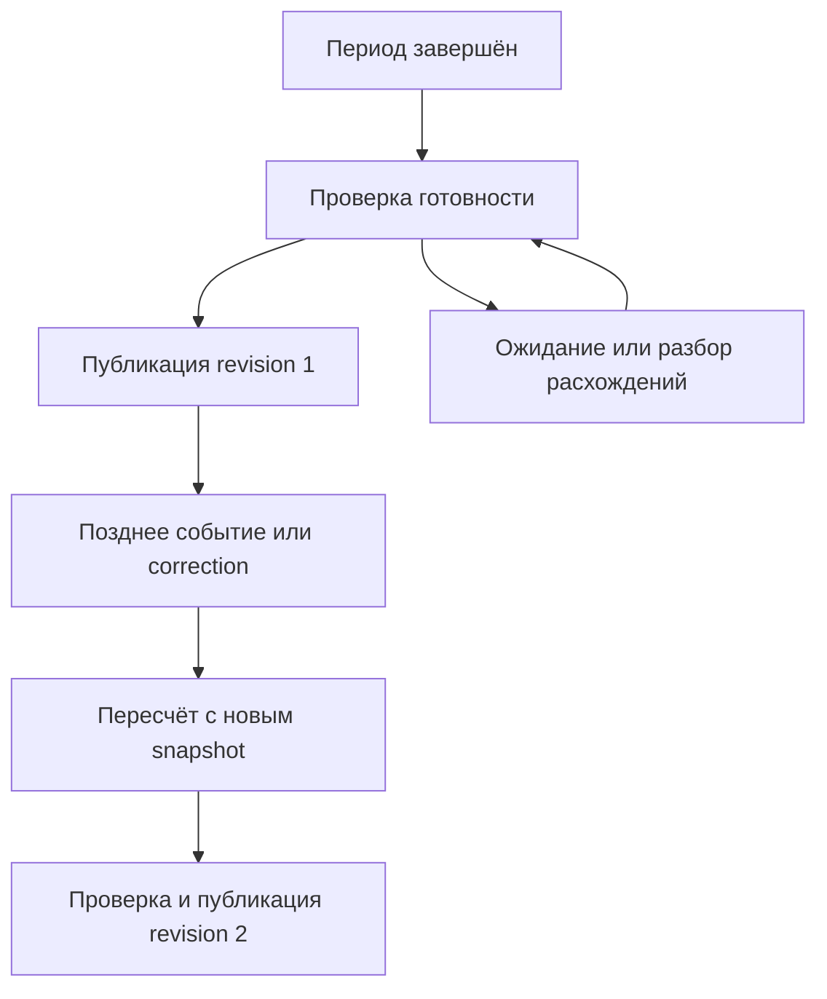
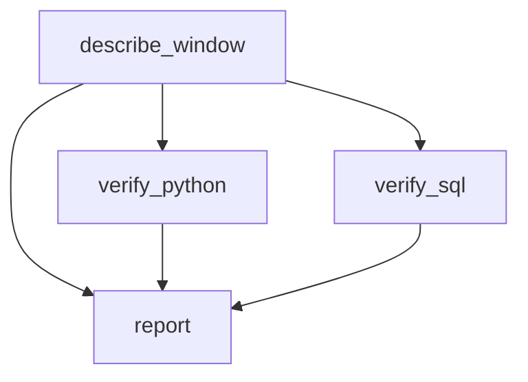

# 6. Время, логические даты и интервалы данных

**Apache Airflow Zero to Hero · Профессиональный справочник**

| Параметр | Значение |
| --- | --- |
| Базовая линия | Apache Airflow 3.3.2, Task SDK 1.3.2, Standard provider 1.19.0, Python 3.12, Pendulum 3.2.0 |
| Дата проверки | 19 октября 2026 года |
| Покрытие README | Все 8 тем и 40 пунктов шестого раздела, в исходном порядке |
| Предварительная практика | Стенд главы 2, сущности и состояния главы 4, TaskFlow главы 5 |
| Сквозной сценарий | Обработка заказов за явно заданное окно, проверка границ в Python/SQL, календарные дни Berlin/Moscow и поздние события |
| Практический результат | Умение определить правильный диапазон данных, сохранить его при повторе и проверить поведение на временных границах |

Задача стартовала 19 октября, но должна обработать 17 октября. Logical date её run не совпадает со временем старта. Соседний manual run вообще не имеет logical date. Входной источник хранит время в UTC, отчёт построен по московскому дню, а UI открыт в другой зоне. Все эти различия допустимы, пока контракт задан явно.

Проблемы начинаются, когда один timestamp используют сразу для идентичности запуска, фильтра SQL, имени partition и оценки свежести. Тогда retry после полуночи читает другие данные, запись ровно на границе попадает в два окна, а «сутки» вокруг DST неожиданно имеют 23 или 25 часов.

**Время запуска, время данных и календарь бизнеса — разные координаты.** Airflow предоставляет metadata и механизмы планирования; смысл продукта данных задаёт его контракт. Эта глава учит связывать эти координаты, не подменяя одну другой.

Для DAG-примеров используется timezone-aware `start_date` через Pendulum. Для чистой бизнес-логики — стандартные `datetime`/`zoneinfo`, UTC-нормализация и проверяемые интервалы. Сложные алгоритмы scheduling относятся к следующей главе; здесь разбирается их временной контракт.

## Содержание

1. [Временные понятия Airflow](#s6-1)
2. [Границы интервала](#s6-2)
3. [Logical date и тип запуска](#s6-3)
4. [Временные зоны](#s6-4)
5. [Источники времени в коде](#s6-5)
6. [Календарь и event time](#s6-6)
7. [Шаблонные представления дат](#s6-7)
8. [Временные граничные случаи](#s6-8)
9. [Практика: явное окно и две независимые проверки](#lab)
10. [Практика: DST и фиксированная шкала расписания](#calendar-lab)
11. [Разбор ситуаций](#cases)
12. [Самопроверка с ориентирами ответов](#questions)
13. [Критерии освоения и дальнейшее изучение](#next)
14. [Проверка материала](#verification)
15. [Официальные источники](#sources)

Важная версионная оговорка: обычная cron-строка не во всех версиях и конфигурациях означает data-interval timetable. В 3.3.2 default `scheduler.create_cron_data_intervals=False` выбирает trigger-модель. Все примеры «run после завершения суток» ниже явно относятся к **CronDataIntervalTimetable**, а не к произвольному `schedule="@daily"`. [S19](#source-19)

<a id="s6-1"></a>
## 6.1. Временные понятия Airflow

### 6.1.1. Logical date как идентификатор семантического времени запуска

`logical_date` — логическая временная привязка DagRun. Она помогает идентифицировать запуск в модели расписания, но сама по себе не определяет универсальную business date.

Для обычного data-interval run logical date соответствует началу интервала. Для trigger timetable с нулевым interval это момент срабатывания. Для некоторых manual/asset runs поле отсутствует. Нельзя переносить одно объяснение на все эти случаи. [S01](#source-01) [S02](#source-02) [S03](#source-03)

| Утверждение | Когда оно корректно |
| --- | --- |
| Logical date — начало интервала | Для соответствующей data-interval модели |
| Logical date — время cron-срабатывания | Для обычной trigger-модели с interval `0` |
| Logical date — фактический старт run | Не является общим правилом |
| Logical date — дата продукта данных | Только если это явно закреплено контрактом |
| Logical date всегда задана | Неверно для Airflow 3 |
| Logical date заменяет run ID | Неверно как универсальная идентичность |

Слово «семантическое» в названии пункта не означает, что framework сам знает бизнес-смысл даты. Для отчёта по продажам нужен договорённый календарь, timezone и правило выбора диапазона.

В инженерном разговоре полезно говорить полностью: «logical date `2026-10-17T00:00Z` у daily data-interval run» или «manual run с business window из Params». Одна фраза «дата DAG — 17-е» оставляет слишком много неопределённости.

Не разбирай logical date из строкового префикса `run_id`. Для каждого понятия есть отдельные metadata/inputs.

### 6.1.2. Data interval как диапазон обрабатываемых данных

`data_interval_start` и `data_interval_end` описывают временной интервал, связанный с run по правилам timetable. Контракт `DataInterval` требует aware границы; сам NamedTuple-конструктор не выполняет полную бизнес-валидацию окна. Он также может представлять точку, где start равен end. [S01](#source-01)

Различай три объекта:

| Объект | Кто определяет | Пример |
| --- | --- | --- |
| Airflow data interval | Timetable и путь создания run | Период между соседними cron boundaries |
| Бизнес-окно | Контракт продукта данных | День в Europe/Moscow или явно заданный диапазон |
| Диапазон фактического чтения | SQL/код task | Предикат по `event_time` и конкретные bound parameters |

Они могут совпадать, но это совпадение нужно обеспечить. Если Airflow предоставил daily interval, а SQL использовал `current_date`, фактическое чтение уже описывает другой контракт.

Для интервальной обработки обычно используется полуоткрытая область `[start, end)`. Нулевая длина trigger interval `[t,t)` не означает «автоматически выбрать предыдущие сутки». Если задача должна обрабатывать окно, его нужно получить по другой явной политике.

Data interval не гарантирует наличие, полноту или неизменность данных внутри него. Это координаты выбора; source snapshot, lateness policy и quality checks добавляются отдельно.

Для asset run бизнес-окно может приходить из event metadata или manifest, хотя календарного Airflow interval нет.

### 6.1.3. Фактические времена создания, постановки, начала и завершения

Один run имеет несколько timestamps. Они описывают разные события control/execution plane и не должны использоваться взаимозаменяемо.

| Поле/событие | Что означает | Типичное применение |
| --- | --- | --- |
| `run_after` | Не раньше какого момента run допустим по модели | Оценка задержки относительно расписания |
| `created_at` DagRun | Когда появилась запись | Диагностика создания; legacy записи могут иметь `None` |
| `queued_at` DagRun | Когда run оказался в очереди | Время ожидания до обработки |
| `start_date` DagRun | Фактическое начало обработки run | Run duration |
| `end_date` DagRun | Фиксация завершения | Итоговая длительность |
| Task queued/start/end | Этапы конкретной task instance | Queue delay, runtime duration |
| External job start/commit | События вычислительной/хранилищной системы | Фактическая работа и публикация |

В модели 3.3.2 `created_at` nullable для исторической совместимости; не делай безусловный `created_at.isoformat()` над любой записью. `run_after` тоже не является фактическим временем, когда worker начал исполнять функцию. [S06](#source-06)

Для иллюстрации возьмём data-interval daily run в UTC:

| Координата | Пример |
| --- | --- |
| Начало данных / logical date | `2026-10-17T00:00:00Z` |
| Конец данных | `2026-10-18T00:00:00Z` |
| Плановая допустимость run | `2026-10-18T00:00:00Z` |
| Создание/постановка | Около `2026-10-18T00:00:08Z` |
| Фактическое начало run | `2026-10-18T00:03:00Z` |
| Первая task | `2026-10-18T00:03:12Z` |
| Публикация | `2026-10-18T00:10:00Z` |
| Завершение run | `2026-10-18T00:10:04Z` |

Времена иллюстративные, не измеренные на стенде. Здесь logical date на сутки раньше фактического выполнения — нормальное следствие выбранной модели.

Задержка запуска, длительность исполнения и свежесть продукта требуют разных метрик. Быстрый run способен опубликовать старую partition; долгий backfill не обязательно ухудшает freshness текущего продукта.

### 6.1.4. DAG `start_date` и фактический `DagRun.start_date`

Одинаковое имя поля относится к разным сущностям.

| Поле | Назначение |
| --- | --- |
| DAG `start_date` | Нижняя временная граница определения для scheduling согласно timetable |
| Task `start_date` в definition | Ограничение task definition; требует согласования с DAG |
| DagRun `start_date` | Фактическое начало конкретного run |
| TaskInstance `start_date` | Начало конкретного выполнения task |
| Business window start | Нижняя граница выбранных данных |

Указание `start_date=...` в DAG не является приказом выполнить callable в эту секунду. На первый run влияют timetable, catchup, pause, границы и доступность scheduler.

Используй фиксированную aware дату, например `pendulum.datetime(2026, 1, 1, tz="UTC")`. `start_date=pendulum.now("UTC")` на каждом parsing создаёт подвижную нижнюю границу и осложняет объяснение истории.

Изменение start date не переписывает уже опубликованные данные и не мигрирует историю runs. Это изменение определения scheduling, которое нужно отдельно проверять при наличии истории.

Не ставь разные business intervals задачам одного run через случайные task start dates. Для согласованной обработки передавай общий явный contract.

### 6.1.5. `execution_date` как историческое имя logical date

В старых Airflow-примерах `execution_date` часто означает нынешнюю logical date. Название вводило в заблуждение: это не обязательно время исполнения на worker.

| Старое объяснение | Современное уточнение |
| --- | --- |
| «Execution date — дата, когда запустился DAG» | Нужно различить logical date и фактическое start time |
| `execution_date` в старом context | Проверить поддерживаемый интерфейс текущего SDK |
| Фильтр по этой дате | Проверить data interval и business timezone |
| ID по дате | Использовать run ID для идентичности, business key для данных |

При миграции недостаточно заменить имя переменной поиском по файлу. Нужно понять, какую семантику ожидал код: период, timestamp старта, partition label или идентификатор run.

Для нового кода используй поддерживаемые `logical_date`/`data_interval_*`/`run_id` и явные business inputs. Не рассчитывай на исторические aliases в любом месте API.

**Контрольная точка 6.1:** можешь для каждого timestamp назвать сущность, смысл и применение. Не выводишь обрабатываемые сутки из wall-clock времени worker.

<a id="s6-2"></a>
## 6.2. Границы интервала

### 6.2.1. Полуоткрытый диапазон `[data_interval_start, data_interval_end)`

В полуоткрытом окне начало включено, конец исключён:

```text
start <= event_time < end
```

Для соседних окон `A=[a,b)` и `B=[b,c)` событие ровно в `b` принадлежит только B. Не нужно вычитать из конца «одну секунду» или «одну микросекунду».

| Timestamp события | Окно `[10:00,11:00)` | Окно `[11:00,12:00)` |
| --- | --- | --- |
| `09:59:59.999999` | Нет | Нет |
| `10:00:00` | Да | Нет |
| `10:59:59.999999` | Да | Нет |
| `11:00:00` | Нет | Да |
| `12:00:00` | Нет | Нет |

Точность должна соответствовать источнику, но само правило не зависит от размера минимального шага. Оно работает и для миллисекунд, и для микросекунд, и для более точного storage.

Нулевая длина `[t,t)` содержит ноль событий по этому предикату. Point-like Airflow interval — служебная временная привязка; превращение его в полезное бизнес-окно требует явной политики.

Несоседние окна, пропущенное окно или повтор одного окна не исправляются выбором правильных скобок. Полуоткрытость устраняет конкретную проблему общей границы, а покрытие всей области проверяется отдельно.

### 6.2.2. SQL-фильтры без перекрытия соседних интервалов

Для PostgreSQL-источника с `event_time timestamptz` используй bound parameters:

```sql
SELECT order_id, event_time, amount_minor
FROM source_orders
WHERE event_time >= %(window_start)s
  AND event_time < %(window_end)s;
```

Это DB-API/Psycopg-style query template, не строка для непосредственной вставки в SQL console. Python должен передать aware значения через parameters, а не собрать timestamp literals из пользовательского текста.

`BETWEEN start AND end` включает обе границы. Для последовательной interval processing это часто даёт дубль на стыке. [S22](#source-22) [S23](#source-23)

Небольшой исполняемый пример использует отдельную SQLite business-таблицу в памяти. Integer units — микросекунды на условной оси, а не строки разных offsets:

```python
# example: sql_half_open_boundaries
import sqlite3


with sqlite3.connect(":memory:") as connection:
    connection.execute(
        "CREATE TABLE events (event_id INTEGER PRIMARY KEY, event_us INTEGER NOT NULL)"
    )
    connection.executemany(
        "INSERT INTO events VALUES (?, ?)",
        [(1, -1), (2, 0), (3, 9), (4, 10), (5, 19), (6, 20), (7, 21)],
    )

    def read_ids(start, end):
        return {
            row[0]
            for row in connection.execute(
                "SELECT event_id FROM events WHERE event_us >= ? AND event_us < ?",
                (start, end),
            )
        }

    left = read_ids(0, 10)
    right = read_ids(10, 20)
    assert left == {2, 3}
    assert right == {4, 5}
    assert left.isdisjoint(right)
    assert left | right == read_ids(0, 20)

    inclusive_left = {
        row[0] for row in connection.execute(
            "SELECT event_id FROM events WHERE event_us BETWEEN ? AND ?", (0, 10)
        )
    }
    inclusive_right = {
        row[0] for row in connection.execute(
            "SELECT event_id FROM events WHERE event_us BETWEEN ? AND ?", (10, 20)
        )
    }
    assert inclusive_left & inclusive_right == {4}

print("Half-open windows are adjacent; BETWEEN duplicates the shared boundary")
```

Здесь SQLite не является метабазой Airflow: это автономная демонстрация SQL-предиката. У реального источника дополнительно проверяются тип timestamp, timezone/session settings, precision и driver adaptation.

Фильтр `DATE(event_time)=...` может иметь другой календарный смысл, зависеть от timezone и мешать эффективному доступу/partition pruning в конкретном движке. Предпочитай явные typed boundaries, согласованные со storage.

### 6.2.3. Интервал данных и время, когда запуск становится допустимым

Для CronDataIntervalTimetable run становится допустимым после конца соответствующего периода: данные относятся к `[start,end)`, а `run_after=end`. Фактическое выполнение может начаться позже. [S01](#source-01) [S02](#source-02)

Это не универсальный закон любого cron. CronTriggerTimetable определяет момент запуска, а его interval задаётся отдельно; при default `0` границы совпадают. [S03](#source-03)

| Ситуация | Следствие |
| --- | --- |
| Интервал закончился, scheduler занят | Run/task могут стартовать позже |
| Источник доставляет данные с задержкой | Конец интервала не гарантирует completeness |
| DAG paused | Допустимость по времени ещё не означает выдачу работы |
| Backfill старого периода | `run_after`/период и текущий wall clock далеко друг от друга |
| Trigger timetable с interval `0` | Нет автоматически выбранных прошлых суток |

Если бизнес требует подождать 30 минут после конца суток, вырази ожидание через согласованную scheduling/readiness policy. Не подменяй период чтения временем, когда закончился sleep.

У source может быть отдельный сигнал готовности: manifest, partition marker, watermark или подтверждение producer. Sensor/readiness check решает другую задачу, чем вычисление границ.

### 6.2.4. Точность timestamp и преобразование временных типов

Для корректного предиката обе стороны должны сравнивать одну временную шкалу и согласованную точность.

| Представление | Что нужно знать |
| --- | --- |
| Python `datetime` | Микросекундная точность; более точные источники требуют явной политики |
| PostgreSQL timestamp | Поддерживаемая precision и adaptation driver |
| Integer epoch | Единицы: s/ms/us/ns, epoch и допустимый range |
| Строка | Формат, timezone/offset, precision и parser |
| Naive timestamp | Какую зону подразумевает источник |
| Локальное время + IANA zone | Политика для gap/fold |

Не определяй units epoch по длине числа без контрактной проверки. Не умножай float timestamp на миллион и не считай это автоматически точным integer microseconds для всех значений.

Точное преобразование aware datetime в microseconds можно делать через integer-компоненты timedelta относительно UTC epoch. Реализация `epoch_us` есть в лаборатории.

Python parser может принимать строку с более чем шестью дробными цифрами, хотя datetime не сохранит наносекундную точность. Если это недопустимо, отклоняй такой вход явной validation. Лабораторный parser принимает максимум шесть цифр. [S13](#source-13)

ISO-строки с разными offsets нельзя безусловно сравнивать лексикографически. Сначала получи instants или единый canonical UTC format. Например, `00:30+01:00` и `23:45Z` соседних календарных дат требуют сравнения по UTC, а не по тексту.

Изменение precision на границе storage/driver может сдвинуть запись к boundary. Не исправляй это добавлением случайного epsilon; зафиксируй rounding/truncation и проверь конкретный source type.

### 6.2.5. Тестирование отсутствия пропусков и двойной обработки границ

Для соседних окон проверяй два независимых свойства:

1. Пересечение выбранных событий пусто.
2. Объединение совпадает с результатом чтения общего диапазона.

Первое обнаруживает дубли, второе — пропуски. Только сравнения row counts недостаточно: один потерянный и один лишний event могут компенсироваться.

| Test case | Что должен доказать |
| --- | --- |
| Event ровно в start | Попадает в текущее окно |
| Event за микросекунду до start | Не попадает |
| Event ровно в end | Относится к следующему окну |
| Event перед end | Не теряется |
| Два соседних интервала | Нет overlap и gap |
| Retry того же окна | Тот же набор входных координат |
| Другой offset того же instant | Тот же результат отбора |
| DST boundary | Правильные UTC boundaries и elapsed duration |

Отдельно проверяй источник дубликатов: пересечение окон, duplicate source event и повторная публикация — разные проблемы. Правильный time predicate не заменяет deduplication по business/event ID.

Для исторических datasets полезен manifest покрытия: ожидаемые интервалы, source snapshot, counts/IDs и committed output version.

**Контрольная точка 6.2:** умеешь написать параметризованный полуоткрытый фильтр и доказать его свойства на общей границе, а не только на случайных timestamps.

<a id="s6-3"></a>
## 6.3. Logical date и тип запуска

### 6.3.1. Семантика scheduled run согласно выбранному Timetable

Временную модель run определяет timetable. Слово scheduled описывает способ создания запуска, но не обещает конкретную длину окна.

| Модель | Что запускает run | Airflow interval | Logical date |
| --- | --- | --- | --- |
| CronDataIntervalTimetable | Завершение очередного cron-периода | Между границами календарного расписания | Начало interval |
| CronTriggerTimetable, interval = 0 | Cron-срабатывание | Точечный: start = end | Момент срабатывания |
| CronTriggerTimetable, interval задан | Cron-срабатывание | Окно заданной длительности перед trigger | Начало этого окна |
| DeltaDataIntervalTimetable | Завершение последовательного delta-interval | Определяется delta и историей | Начало interval |
| Custom timetable | Пользовательское правило | По реализации timetable | По возвращённой временной информации |

Точечный интервал — допустимые metadata timetable. Для отбора данных полуоткрытый `[t,t)` пуст. Если бизнес требует «сутки до trigger», это нужно задать через timetable или отдельный контракт, а не выводить из названия cron. [S01](#source-01) [S02](#source-02) [S03](#source-03)

**Изменение, которое легко пропустить при чтении старых статей.** В базовой конфигурации Airflow 3.3.2 `schedule="@daily"` использует trigger-модель: `scheduler.create_cron_data_intervals=False`. Для модели завершившихся календарных периодов задай её явно. [S05](#source-05) [S19](#source-19)

```python
# example: explicit_daily_interval_dag
import pendulum

from airflow.sdk import dag, get_current_context, task
from airflow.sdk.definitions.timetables.interval import CronDataIntervalTimetable


@dag(
    dag_id="time_daily_interval_example",
    schedule=CronDataIntervalTimetable(
        expression="0 0 * * *",
        timezone="Europe/Berlin",
    ),
    start_date=pendulum.datetime(2026, 3, 28, tz="Europe/Berlin"),
    catchup=True,
    is_paused_upon_creation=True,
    max_active_runs=1,
    tags=["chapter-06", "time"],
)
def time_daily_interval_example():
    @task
    def inspect_window() -> dict[str, str]:
        context = get_current_context()
        start = context["data_interval_start"]
        end = context["data_interval_end"]
        if start is None or end is None or end <= start:
            raise ValueError("A non-empty scheduled data interval is required")
        return {
            "run_id": context["run_id"],
            "logical_date": context["logical_date"].isoformat(),
            "window_start": start.isoformat(),
            "window_end": end.isoformat(),
        }

    inspect_window()


time_daily_interval_example()
```

Это пример для полной установки Airflow 3.3.2/SDK 1.3.2. SDK-класс описывает timetable в DAG; серверная реализация вычисляет расписание. У SDK-класса используется аргумент `expression`, а у серверного класса для календарного preview — позиционный cron. Не смешивай сигнатуры разных слоёв. [S02](#source-02) [S20](#source-20) [S34](#source-34)

Поскольку `catchup=True` и start date историческая, включение этого DAG на стенде создаст историческую очередь. Здесь он изначально paused; для preview включать его не требуется.

Пример относится к scheduled interval run. Manual trigger того же DAG может иметь другой временной контракт, который разбирается ниже.

### 6.3.2. Ручной запуск и явно заданный диапазон обработки

Manual run отвечает на вопрос «пользователь запросил запуск». Он не отвечает автоматически на вопрос «какую partition пользователь хотел пересчитать».

Для контролируемого replay нужны явные входы:

| Вход | Пример | Зачем нужен |
| --- | --- | --- |
| `window_start` | `2026-03-28T23:00:00Z` | Включённая нижняя граница |
| `window_end` | `2026-03-29T22:00:00Z` | Исключённая верхняя граница |
| `calendar_timezone` | `Europe/Berlin` | Объяснение бизнес-календаря |
| `source_snapshot` | Версия таблицы или manifest | Воспроизводимость входа |
| `output_revision` | Версия исправления | Управляемая публикация |
| `reason` | Исправление поздних заказов | Аудит решения |

В лаборатории обязательны первые две границы; snapshot и revision рассматриваются как следующий production-шаг.

В общем пути manual trigger 3.3.2 при отсутствующей logical date Airflow оставляет `logical_date=None` и `data_interval=None`. Если logical date передана, timetable может вычислить manual interval относительно `run_after`. **Передать logical date и выбрать диапазон бизнес-данных — разные действия.** Для cron data-interval timetable manual inference ориентируется на завершённый период перед соответствующим моментом inference. [S08](#source-08) [S09](#source-09) [S02](#source-02)

Практические следствия:

1. Не вычисляй окно из строки `run_id`.
2. Не считай `--logical-date` универсальным параметром «пересчитать эти сутки».
3. Не подставляй текущую дату, если interval отсутствует.
4. Проверяй format, awareness и `start < end` до чтения источника.
5. Записывай принятый business window в audit/manifest независимо от metadata Airflow.

У local testing есть отдельная особенность: `dag.test(logical_date=...)` использует собственный путь определения временных аргументов; в 3.3.2 manual interval там выводится с опорой на переданную logical date. Это полезный тестовый инструмент, но не доказательство, что UI/API/CLI trigger выводит те же границы из тех же аргументов. Для integration-проверки воспроизведи нужный production-путь. [S05](#source-05) [S08](#source-08)

### 6.3.3. Asset/event-triggered run и отсутствие календарного интервала

Asset event сообщает о событии: обновился объект, появилась partition, опубликован manifest. Это другая модель, чем «закончился очередной день».

В asset-путях scheduler 3.3.2 run создаётся с `logical_date=None` и `data_interval=None`. Если модель использует отдельные partition metadata, их нужно читать как отдельный контракт; наличие partition не превращает logical date в обязательное поле. [S18](#source-18)

Пусть producer опубликовал:

```json
{
  "dataset": "orders",
  "partition": "business_date=2026-10-18",
  "calendar_timezone": "Europe/Moscow",
  "window_start": "2026-10-17T21:00:00Z",
  "window_end": "2026-10-18T21:00:00Z",
  "snapshot_id": "orders-snapshot-1842",
  "revision": 2,
  "completeness": "verified"
}
```

Это пример **собственного manifest**, а не универсальная схема Airflow asset event. Producer и consumer должны договориться о полях, проверять их и сохранять связь с asset event.

| Что consumer узнал | Чего пока не знает |
| --- | --- |
| Пришло событие обновления | Все ли upstream partitions готовы |
| Есть URI или dataset name | Какой time window покрыт |
| Указана business date | В какой зоне и с каким cutoff |
| Указана snapshot version | Прошла ли она quality/completeness checks |
| Событие доставлено повторно | Нужно ли повторно публиковать ту же revision |

Для нескольких producers может требоваться совпадение окон, покрытие полного диапазона или отдельная join-policy. Сам факт поступления двух событий не доказывает их календарную совместимость.

### 6.3.4. Возможность `logical_date=None` в Airflow 3

Код, который работал только с scheduled interval runs, часто содержит скрытое предположение:

```python
# example: nullable_context_contract
from datetime import UTC, datetime


def optional_iso(value: datetime | None) -> str | None:
    if value is None:
        return None
    if value.tzinfo is None or value.utcoffset() is None:
        raise ValueError("An aware datetime is required")
    return value.astimezone(UTC).isoformat()


def extract_time_audit(context: dict) -> dict:
    return {
        "run_id": context["run_id"],
        "logical_date": optional_iso(context.get("logical_date")),
        "airflow_interval_start": optional_iso(context.get("data_interval_start")),
        "airflow_interval_end": optional_iso(context.get("data_interval_end")),
    }


assert extract_time_audit({"run_id": "manual__example"}) == {
    "run_id": "manual__example",
    "logical_date": None,
    "airflow_interval_start": None,
    "airflow_interval_end": None,
}
```

Здесь используется `get` сознательно. В Task SDK 1.3.2 некоторые context keys — включая `logical_date`, `ds`, `ts` и interval keys — добавляются в ветке, где logical date присутствует. Для run без неё ключ может **отсутствовать**, а не просто содержать `None`. [S10](#source-10)

| Небезопасное предположение | Явная политика |
| --- | --- |
| `context["ds"]` всегда есть | Использовать business date из validated inputs |
| `logical_date.isoformat()` всегда допустим | Разрешить None в audit или потребовать scheduled interval |
| Если поля нет, взять вчера | Завершиться с понятной ошибкой либо читать явный manifest |
| Любой run имеет непустой interval | Проверить границы и поддерживаемый тип запуска |

Есть два корректных варианта дизайна:

- DAG принимает только interval-based processing и отказывает при отсутствии корректного interval.
- DAG принимает явный business contract и использует Airflow time metadata для аудита.

Выбери один осознанно. Скрытый fallback на текущее время делает ошибку входа незаметной и меняет данные.

### 6.3.5. `run_id` для идентичности запуска при nullable logical date

Для адресации DagRun используй пару `(dag_id, run_id)`. Для task instance дополнительно нужны `task_id` и, при mapping, `map_index`; номер попытки относится к выполнению этой task instance. [S06](#source-06)

Однако идентичность run и идентичность публикации различаются.

| Идентичность | Возможный состав |
| --- | --- |
| DagRun | dag_id + run_id |
| Business window | dataset + UTC start + UTC end + calendar policy |
| Input snapshot | source + snapshot/version ID |
| Published result | business window + transform version + input revision |
| Attempt audit | run ID + task ID + attempt + timestamps |

Два manual runs могут обрабатывать одно окно. Один run может пересчитывать несколько partitions. Retry одной task не должен автоматически создавать новую business revision.

`run_id` удобен для трассировки, но схема «записывать output только в каталог run ID» ещё не решает выбор актуальной partition. Нужен manifest или иной указатель на опубликованную версию.

При заданной logical date учитывай ограничения её уникальности в модели DAG. Nullable date не означает разрешение свободно создавать несколько runs с одинаковой **непустой** logical date.

**Контрольная точка 6.3:** умеешь объяснить временной контракт отдельно для scheduled interval, cron trigger, manual и asset run; не используешь отсутствие metadata как повод выбрать «сегодня».

<a id="s6-4"></a>
## 6.4. Временные зоны

### 6.4.1. Aware и naive datetime, UTC и локальная бизнес-зона

`2026-10-19 09:00:00` без offset и timezone — локальная запись часов. Она не определяет единственный instant.

| Представление | Что известно | Чего не хватает |
| --- | --- | --- |
| `2026-10-19 09:00:00` | Локальные компоненты | Правило интерпретации |
| `2026-10-19T09:00:00+03:00` | Конкретный instant | Название бизнес-календаря и история zone rules |
| `2026-10-19T06:00:00Z` | Тот же instant в UTC | Бизнес-правило формирования периода |
| `Europe/Moscow` | IANA-набор правил | Дата/время и требуемая calendar policy |

**Aware** datetime имеет действующий offset; **naive** — не имеет. Проверяй не только `tzinfo is not None`, но и `utcoffset() is not None`. [S13](#source-13)

Различай операции:

- `replace(tzinfo=zone)` прикрепляет интерпретацию к локальным компонентам; это не перевод известного instant в другую зону.
- `astimezone(zone)` переводит aware instant, сохраняя его момент на UTC-шкале.
- Вызов `astimezone` над naive значением может использовать локальную timezone окружения. Это плохой скрытый контракт для данных.
- ISO offset `+03:00` и IANA zone `Europe/Moscow` не взаимозаменяемы для расчёта исторических или будущих календарных границ.

Для сравнения instants, длительности и ключей нормализуй значения в UTC. Для вывода и календарных границ используй явно заданную IANA zone.

Нельзя предполагать, что `end - start` всегда показывает elapsed duration, если оба стандартных Python datetime используют один и тот же timezone object. При переходе DST такая арифметика может отражать wall-time разницу. В повторяющемся часу локальные datetime с разными `fold` могут даже сравниваться равными. Перевод обоих значений в UTC устраняет эту неоднозначность для instant comparisons. [S13](#source-13) [S15](#source-15)

### 6.4.2. Pendulum и timezone-aware `start_date`

Для DAG definitions удобно явно создавать Pendulum datetime:

```python
# example: aware_start_date
import pendulum

START_DATE = pendulum.datetime(2026, 1, 1, 0, 0, tz="Europe/Moscow")
assert START_DATE.utcoffset().total_seconds() == 3 * 3600

# При строгом разборе локального wall time:
def parse_strict_local(year: int, month: int, day: int, hour: int, minute: int):
    return pendulum.datetime(
        year, month, day, hour, minute,
        tz="Europe/Berlin",
        raise_on_unknown_times=True,
    )
```

Последний параметр важен: не все конструкторы по умолчанию отказываются от несуществующего или неоднозначного локального времени. В Pendulum 3.2.0 default допускает нормализацию; strict policy нужно задавать явно. При strict mode неоднозначность тоже считается ошибкой. Если бизнес разрешает выбор первого/второго вхождения, это отдельная политика, а не strict parsing. [S16](#source-16) [S17](#source-17)

Правила для definitions:

1. Фиксированная дата задаётся в коде или контролируемой конфигурации.
2. Timezone принадлежит контракту DAG/расписания, а не окружению parser.
3. Исторические даты проверяются по действующим для этих дат IANA rules.
4. Одна и та же дата в UTC и в бизнес-зоне может лежать в разных календарных днях.
5. Обновление timezone database рассматривается как зависимость, способная изменить будущие границы.

Не переноси на Pendulum 3 старые советы о внутренней базе timezone без проверки версии. В 3.2.0 реализация timezone опирается на стандартный `zoneinfo.ZoneInfo`; доступная tzdb и способ её поставки важны для воспроизводимости. [S17](#source-17)

### 6.4.3. Хранение времени, вычисление расписания и отображение UI

У системы есть минимум три независимых уровня.

| Уровень | Основной вопрос | Пример |
| --- | --- | --- |
| Хранение instant | Как однозначно сохранить момент? | UTC-aware timestamp |
| Расписание | Где проходит календарная граница? | Полночь Europe/Berlin |
| Отображение | Как показать момент пользователю? | Выбранная timezone UI |
| Business partition | Как назвать продуктовый период? | business_date=2026-03-29 |

Airflow использует UTC-нормализацию своих временных metadata; timetable сохраняет смысл своей timezone. Изменение timezone отображения не переносит календарные границы расписания.

В UI 3.3.2 timezone берётся из сохранённого пользовательского выбора, а при его отсутствии — из timezone браузера. Поэтому описание «Airflow UI всегда показывает UTC» не подходит для этой версии. Уточняй настройку UI при сопоставлении скриншотов с UTC logs. [S29](#source-29)

Для каждого важного timestamp в audit полезно хранить:

| Поле | Пример |
| --- | --- |
| UTC instant | 2026-03-28T23:00:00Z |
| Business zone | Europe/Berlin |
| Business label | 2026-03-29 |
| Calendar policy version | berlin-midnight-v1 |
| Источник timezone rules | IANA 2026e для проверяемого расчёта |

Не обязательно дублировать всё в каждой строке fact table. Это может быть contract/manifest уровня dataset или partition.

В переписке и incident notes указывай offset либо `Z`. Формулировка «run задержался до 03:10» без timezone не позволяет сравнить несколько систем.

### 6.4.4. DST: пропущенные и повторяющиеся локальные часы

Для Europe/Berlin по IANA 2026e:

| Ситуация | Локальные границы дня | UTC-границы | Elapsed duration |
| --- | --- | --- | --- |
| Обычный день | 19.10 00:00 +02 → 20.10 00:00 +02 | 18.10 22:00Z → 19.10 22:00Z | 24 ч |
| Весенний переход | 29.03 00:00 +01 → 30.03 00:00 +02 | 28.03 23:00Z → 29.03 22:00Z | 23 ч |
| Осенний переход | 25.10 00:00 +02 → 26.10 00:00 +01 | 24.10 22:00Z → 25.10 23:00Z | 25 ч |

Все даты в таблице относятся к 2026 году. Это календарные дни между локальными полуночами, а не fixed-duration окна по 24 часа. [S28](#source-28)

Два других случая нельзя скрывать за фразой «поменялся offset»:

- `2026-03-29 02:30 Europe/Berlin` не существует: часы перешли вперёд.
- `2026-10-25 02:30 Europe/Berlin` встречается дважды: `00:30Z` с `+02` и `01:30Z` с `+01`.

Для ambiguous времени нужны offset, `fold` или правило источника. Для nonexistent времени нужна политика отказа/коррекции. Если источник прислал только naive wall time, восстановить потерянную информацию произвольно и достоверно нельзя.

Ниже чистый Python resolver, который проверяет round trip и возвращает UTC instant. Он не принимает автоматически нормализованное время за исходное.

```python
# example: strict_wall_time_resolver
from datetime import UTC, datetime
from zoneinfo import ZoneInfo


def resolve_wall_time(
    local: datetime,
    zone_name: str,
    *,
    fold: int | None = None,
) -> datetime:
    if local.tzinfo is not None:
        raise ValueError("Supply a naive local wall time")
    if fold is not None and (type(fold) is not int or fold not in (0, 1)):
        raise ValueError("fold must be 0, 1, or None")

    zone = ZoneInfo(zone_name)
    candidates: dict[datetime, int] = {}
    for candidate_fold in (0, 1):
        attached = local.replace(tzinfo=zone, fold=candidate_fold)
        instant = attached.astimezone(UTC)
        restored = instant.astimezone(zone)
        if restored.replace(tzinfo=None) == local:
            # UTC keys distinguish instants in a repeated local hour.
            candidates.setdefault(instant, candidate_fold)

    if not candidates:
        raise ValueError("Nonexistent local wall time")
    if len(candidates) == 1:
        return next(iter(candidates))
    if fold is None:
        raise ValueError("Ambiguous local wall time; explicit fold is required")
    for instant, candidate_fold in candidates.items():
        if candidate_fold == fold:
            return instant
    raise ValueError("No valid candidate for the requested fold")


first = resolve_wall_time(
    datetime(2026, 10, 25, 2, 30), "Europe/Berlin", fold=0
)
second = resolve_wall_time(
    datetime(2026, 10, 25, 2, 30), "Europe/Berlin", fold=1
)
assert first.isoformat() == "2026-10-25T00:30:00+00:00"
assert second.isoformat() == "2026-10-25T01:30:00+00:00"
assert (second - first).total_seconds() == 3600

try:
    resolve_wall_time(datetime(2026, 3, 29, 2, 30), "Europe/Berlin")
except ValueError as error:
    assert "Nonexistent" in str(error)
else:
    raise AssertionError("A missing local hour must be rejected")
```

`fold` — средство различения вхождений локального времени, а не универсальный флаг «DST включён». UTC round trip проверяет существование wall time; простое присваивание `tzinfo=ZoneInfo(...)` само по себе этого не доказывает. [S14](#source-14) [S15](#source-15)

Для cron на `02:30` в DST-зоне отдельно проверяй timetable и конкретную версию cron-логики: «несуществующий час» не определяет сам по себе, что сделает scheduler. Для ежедневных бизнес-периодов сначала сформулируй границы и протестируй расписание. [S04](#source-04)

### 6.4.5. Согласование временных зон Airflow, SQL и исходных данных

Начни с контракта каждой колонки.

| Тип источника | Что проверить перед сравнением |
| --- | --- |
| Aware timestamp | Что offset соответствует истинному instant |
| Naive timestamp | В какой зоне он записан; возможны ли gap/fold |
| Epoch integer | Единицу: seconds, milliseconds, microseconds, nanoseconds |
| Строка ISO | Наличие offset, точность, допустимый формат |
| DATE | Какой business calendar породил дату |
| Partition directory | Политику label, а не только формат YYYY-MM-DD |

В PostgreSQL `timestamptz` хранит instant и выводит его в session timezone; исходное название зоны/offset отдельно не сохраняется. `timestamp without time zone` не становится UTC от того, что разработчик так решил в приложении. [S22](#source-22)

```sql
-- Диагностика и представление в PostgreSQL.
-- Конкретный driver использует свои bound-parameter placeholders.
SHOW TIME ZONE;

SELECT
    event_time,
    event_time AT TIME ZONE 'Europe/Moscow' AS business_wall_time
FROM source_orders;

-- Если source_local_time действительно хранит naive Moscow wall time:
SELECT source_local_time AT TIME ZONE 'Europe/Moscow' AS event_instant
FROM legacy_orders;
```

Одна конструкция `AT TIME ZONE` выполняет разные преобразования в зависимости от входного типа: переводит instant в wall time либо интерпретирует wall time как instant. Не меняй тип колонки незаметно посередине pipeline. [S24](#source-24)

Для основного отбора предпочтителен прямой range predicate по timestamp column с bound parameters. Применение `::date`, timezone conversion или функции к каждой строке может изменить семантику и план доступа; обоснованность индексирования проверяется на конкретной схеме.

Сверка нескольких систем должна включать один и тот же контрольный instant, бизнес-день, точность, session timezone и реальные границы окна. Совпадение красиво отформатированной даты недостаточно.

**Контрольная точка 6.4:** различаешь instant и wall time, умеешь отвергнуть gap, разрешить fold по политике и доказать длительность business day через UTC boundaries.

<a id="s6-5"></a>
## 6.5. Источники времени в коде

### 6.5.1. `now()` и `today()` как источник невоспроизводимой обработки

Вызов текущего времени не является ошибкой сам по себе. Ошибка появляется, когда wall clock незаметно определяет входные данные для повторяемой обработки.

| Использование текущего времени | Оценка |
| --- | --- |
| `observed_at` в audit | Корректно: это время наблюдения |
| Timestamp отправки метрики | Корректно |
| Расчёт истечения runtime lease | Допустимо по явному протоколу |
| `WHERE date = today() - 1` для backfill | Выбирает день worker, а не период run |
| Новый `start_date=now()` на каждом parse | Делает нижнюю границу подвижной |
| Output partition из даты retry | Может публиковать в другую partition |
| Измерение длительности через wall clock | Уязвимо к коррекции системных часов |

Представь задачу для 17 октября, которая стартовала 19-го. Вызов `today() - 1` выберет 18-е. Retry после полуночи выберет уже 19-е. Один run обработает разные входы без изменения business contract.

Подобная ошибка бывает менее заметной: `now()` используется только для имени временной таблицы, но затем именно эта дата становится именем финальной partition. Проследи весь путь от clock до publish.

Вместо глобального запрета формулируй правило: **текущее время может описывать выполнение; границы воспроизводимой обработки приходят из явного входа.** [S32](#source-32)

### 6.5.2. Параметры интервала вместо текущего времени worker

У временного контракта есть три слоя:

| Слой | Что делает |
| --- | --- |
| Получение | Читает timetable interval, Params либо manifest |
| Нормализация | Проверяет формат, awareness, precision, порядок; переводит в UTC |
| Использование | Передаёт те же границы всем readers, validators и publishers |

Нормализацию желательно выполнить один раз и передать компактный JSON-compatible contract. Он может включать две ISO-границы, business zone, schema version и source snapshot.

Не передавай в XCom тяжёлые данные только ради сохранения периода. Передавай reference/manifest и небольшой набор проверенных metadata.

Для readers разных систем должны сохраняться общие правила:

- start включён;
- end исключён;
- точность соответствует контракту;
- сравниваются instants;
- источник и timestamp column названы явно;
- revision входа зафиксирована там, где это требуется воспроизводимостью.

Явное окно само по себе не делает mutable source неизменным. Повторное чтение того же диапазона через сутки может вернуть поздние или исправленные записи. Для точного replay нужен snapshot либо политика обработки изменений.

Ни logical date, ни run ID не заменяют versioned input.

### 6.5.3. Заморозка времени в тестах и инъекция clock

Начинай с малого: чистая бизнес-функция получает границы как аргументы; audit helper получает clock отдельно.

```python
# example: injected_clock
from collections.abc import Callable
from datetime import UTC, datetime

Clock = Callable[[], datetime]


def as_utc(value: datetime) -> datetime:
    if value.tzinfo is None or value.utcoffset() is None:
        raise ValueError("An aware timestamp is required")
    return value.astimezone(UTC)


def select_with_audit(
    rows: list[tuple[str, datetime]],
    start: datetime,
    end: datetime,
    *,
    clock: Clock,
) -> dict:
    start, end = as_utc(start), as_utc(end)
    if start >= end:
        raise ValueError("start must be earlier than end")
    selected = sorted(
        event_id for event_id, event_time in rows
        if start <= as_utc(event_time) < end
    )
    return {
        "selected_ids": selected,
        "window_start": start.isoformat(),
        "window_end": end.isoformat(),
        "observed_at": as_utc(clock()).isoformat(),
    }


start = datetime(2026, 10, 17, tzinfo=UTC)
end = datetime(2026, 10, 18, tzinfo=UTC)
rows = [("at-start", start), ("at-end", end)]
early = select_with_audit(
    rows, start, end,
    clock=lambda: datetime(2026, 10, 19, 23, 59, tzinfo=UTC),
)
retry = select_with_audit(
    rows, start, end,
    clock=lambda: datetime(2026, 10, 20, 0, 1, tzinfo=UTC),
)
assert early["selected_ids"] == retry["selected_ids"] == ["at-start"]
assert early["window_start"] == retry["window_start"]
assert early["window_end"] == retry["window_end"]
assert early["observed_at"] != retry["observed_at"]
```

Такой тест проверяет нужное свойство: переход полуночи меняет audit time, но не selection.

Если legacy-код сам вызывает `datetime.now`, patch делается там, где имя используется, либо через поддерживаемую библиотеку заморозки времени. Глобальное замораживание всего окружения Airflow может затронуть сроки токенов и служебные таймеры; ограничивай scope бизнес-модулем.

Тестовая матрица должна разделять:

| Что меняется | Что ожидается |
| --- | --- |
| Wall clock выполнения | Те же IDs для immutable snapshot/window |
| Offset представления границ | Тот же instant и selection |
| Business timezone | Другие границы, если другой календарь |
| Source snapshot | Допустимо другое содержимое при том же окне |
| Code/transform version | Возможна новая output revision |

Для latency внутри одного процесса используй `time.monotonic()` или `time.perf_counter()`; такие значения не являются датами и не сравниваются между машинами. Для persisted UTC audit timestamps нужен wall clock. [S25](#source-25)

### 6.5.4. Timestamp источника, момент доставки и момент обработки

Разделяй минимум четыре времени.

| Поле | Пример | Что означает |
| --- | --- | --- |
| `event_time` | 17.10 23:58Z | Когда произошло бизнес-событие |
| `source_updated_at` | 18.10 00:12Z | Когда источник изменил запись |
| `ingested_at` | 18.10 00:15Z | Когда pipeline получил данные |
| `processed_at` | 19.10 03:10Z | Когда текущая обработка их прочитала |

Все значения иллюстративные. Из `processed_at` нельзя восстановить истинное event time, если оно потеряно.

Выбор timestamp определяет смысл результата:

- Отчёт по фактическим продажам может группироваться по event time.
- Инкрементальный extract может выбирать по source change time или CDC position.
- Метрика доставки измеряет разницу ingest/event при известной семантике часов.
- Аудит pipeline использует processing time.
- Исправленная транзакция может относиться к старому business day и иметь новый source update time.

Фильтрация только по `event_time` не гарантирует захват поздней коррекции уже прочитанного события. Для mutable sources нужны CDC, changed-since extract, периодическое reconciliation или другая явно выбранная стратегия.

Одна запись может иметь event time вне обрабатываемого ingest window. Это не обязательно ошибка: значит, pipeline движется по оси доставки/изменений, а публикует по оси бизнеса.

### 6.5.5. Clock skew между компонентами и срок действия токенов

Компоненты распределённой системы наблюдают wall time на разных машинах. Ошибка синхронизации влияет не только на красивый timestamp в логах.

| Симптом | Что проверить |
| --- | --- |
| Token выглядит просроченным сразу после выдачи | Часы issuer/validator, exp, допустимый skew |
| Token «ещё не действует» | nbf и разницу часов |
| Отрицательная ingest latency | Семантику timestamps и clock skew |
| Логи выглядят переставленными | UTC offsets, буферизацию и часы узлов |
| Нестабильный lease timeout | Clock model протокола и синхронизацию |

Для Airflow 3 Task Execution API/JWT это часть работоспособности execution path. Разбор токенов, claims и конфигурации относится к архитектуре/безопасности; здесь важно понимать связь с реальными часами. [S26](#source-26)

Рабочая последовательность диагностики:

1. Привести timestamps из разных logs к UTC.
2. Проверить синхронизацию времени узлов и drift monitoring.
3. Сопоставить момент выдачи/проверки с claims.
4. Проверить документацию конкретного механизма о допустимом skew.
5. Устранить причину, а не скрывать её неограниченным увеличением срока действия.

Не используй logical date старого backfill как «текущее время» для проверки runtime credentials. Время данных может быть историческим; срок токена относится к текущему исполнению.

**Контрольная точка 6.5:** retry в другое wall-clock время не меняет business window; event, ingest и processing time имеют разные поля и определения.

<a id="s6-6"></a>
## 6.6. Календарь и event time

### 6.6.1. Бизнес-день и календарный день в разных часовых поясах

Дата `2026-10-19` — label. Чтобы получить interval, нужны timezone и правила календаря.

| Правило | UTC-окно для примера |
| --- | --- |
| UTC day, 19 октября 2026 | 19.10 00:00Z → 20.10 00:00Z |
| Moscow day, 19 октября 2026 | 18.10 21:00Z → 19.10 21:00Z |
| Berlin day, 19 октября 2026 | 18.10 22:00Z → 19.10 22:00Z |

Принадлежность записи к дню меняется вместе с календарём. Заказ `2026-10-18T22:30Z` относится к московскому и берлинскому 19 октября, но к UTC 18 октября.

Для полного calendar contract укажи:

| Поле | Пример |
| --- | --- |
| Единица | День |
| Zone | Europe/Moscow |
| Cutoff | 00:00 local |
| Выходные/праздники | Все calendar days либо business calendar |
| Label policy | Дата локального начала периода |
| Закрытие периода | После end + readiness checks |
| Коррекция | Новая revision с manifest |
| Версия | moscow-calendar-v1 |

Бизнес-день может начинаться в 06:00, торговая сессия — пересекать полночь, финансовый месяц — отличаться от календарного. Это предметные правила; cron сам их не определяет.

Получать локальный день нужно из двух календарных границ, преобразованных в UTC по отдельности. Формула `utc_start + timedelta(days=1)` означает ровно 24 часа и неверна для некоторых локальных дней при DST.

Не каждая IANA zone гарантирует существование/однозначность любой локальной полуночи за всю историю. Для общего календарного сервиса требуется политика gap/fold на cutoff. В лаборатории проверяются конкретные даты Berlin/Moscow, а не даётся обещание для всех исторических зон.

### 6.6.2. Поздние события и изменение уже обработанного периода

Граница окна и момент окончательной полноты — разные вещи.

Пример:

| Момент | Событие |
| --- | --- |
| 18.10 21:00Z | Завершился московский день 18 октября |
| 18.10 21:10Z | Опубликована предварительная partition |
| 19.10 00:20Z | Пришёл заказ с event time 18.10 20:59Z |
| 19.10 02:00Z | Reconciliation обнаружил позднее событие |
| 19.10 02:15Z | Опубликована revision 2 того же business day |

Поздний заказ находится внутри старого interval. Он не должен становиться продажей следующего дня только потому, что доставлен позже.

Стратегии отличаются ценой и гарантиями.

| Стратегия | Подходит, когда | Ограничение |
| --- | --- | --- |
| Отложить initial publish | Есть предсказуемый delivery lag | Не покрывает произвольную позднюю коррекцию |
| Rolling reprocess последних N дней | Объём умеренный, lateness ограничена практикой | Нужна политика для событий старше окна |
| CDC/change feed + routing по event date | Источник сообщает изменения | Требуется корректный change ordering/dedup |
| Полный reconciliation | Важна проверка итоговой полноты | Стоимость и latency |
| Версионная публикация | Потребители должны видеть исправления | Нужен контракт выбора revision |

Retry технически восстанавливает неуспешное исполнение. Исправление уже опубликованного периода — бизнес-операция; она требует решения о версии результата и видимости для consumers.

### 6.6.3. Completeness, lateness и допустимое окно ожидания

Фраза «все данные пришли» должна иметь проверяемый критерий.

Возможные доказательства readiness:

- producer опубликовал commit manifest за точный window;
- source partition закрыта по протоколу;
- получены ожидаемые files/shards;
- ingest достиг согласованной CDC position;
- counts/control totals совпали с upstream;
- проверен набор обязательных источников и partitions.

`now >= data_interval_end` доказывает только наступление wall-clock момента. `DagRun success` доказывает успех задач по их состояниям. Ни одно из них само по себе не доказывает полноту источника.

Различай метрики:

| Метрика | Пример определения |
| --- | --- |
| Delivery lateness | ingested_at − event_time |
| Processing delay | processed_at − ingested_at |
| Publish freshness | observed_now − конец последнего опубликованного периода |
| Coverage lag | expected coverage frontier − verified coverage frontier |
| Correction delay | committed correction − source change |

Каждое определение требует согласованных часов и timestamp semantics. Event time из будущего либо clock skew может сделать простую разность бессмысленной без дополнительной валидации.

Допустимое ожидание — часть product SLA/SLO:

1. Что публикуется в T+10 минут?
2. Насколько результат предварительный?
3. До какого момента принимаются автоматические corrections?
4. Как обрабатывается событие после этого срока?
5. Кто видит статус incomplete/provisional/final?

Числа должны вытекать из потребностей продукта и измеренной lateness distribution. Пример «ждать два часа» — policy, а не гарантия Airflow.

### 6.6.4. Watermark конвейера и watermark потокового движка

Слово watermark используется в разных моделях. Без определения оно опасно.

| Объект | Что может означать | Что не следует предполагать |
| --- | --- | --- |
| Airflow interval end | Конец временной области run | Что источник полон до этой точки |
| Последний successful run | Успешное исполнение | Что покрыты все более ранние окна |
| Pipeline checkpoint | Достигнутая позиция ingest/processing | Что это event-time completeness |
| Verified coverage frontier | До какой границы доказано покрытие по контракту | Что новая поздняя correction невозможна |
| Spark event-time watermark | Правило продвижения event-time/state processing | Что все бизнес-события доставлены |

Для собственного pipeline watermark определи точную семантику: по какому timestamp/offset он движется, по каким partitions, после каких checks и commit. Если источников несколько, агрегирование границ требует явно сформулированного правила; часто дальнейшая публикация ограничивается отстающим обязательным источником.

В Spark Structured Streaming watermark участвует в event-time обработке и управлении состоянием/поздними данными. Он не является подтверждением полноты внешней бизнес-системы. Гарантии зависят от операции, режима и политики конкретного streaming query; переносить их на Airflow run нельзя. [S27](#source-27)

Не продвигай checkpoint до успешной публикации, если после crash это заставит пропустить неопубликованные данные. Согласованность checkpoint и data commit — отдельная задача протокола публикации.

### 6.6.5. Повторное открытие периода и политика исправления данных

Политика correction должна объяснять жизненный цикл **dataset partition**, а не копировать task states Airflow.



Эта схема — пример продуктового протокола. Airflow может оркестрировать его шаги, но статусы provisional/final/reopened нужно хранить в подходящих metadata продукта.

Минимальный correction contract:

| Решение | Практический вопрос |
| --- | --- |
| Идентификация окна | Как доказать, что revision относится к тому же периоду? |
| Input lineage | Из какого snapshot/CDC frontier она построена? |
| Идемпотентность | Что произойдёт при повторе publish? |
| Атомарность видимости | Может ли consumer увидеть частичный результат? |
| Версионирование | Сохраняется ли старая revision? |
| Consumer policy | Читать latest, pinned или только final? |
| Аудит | Кто/что инициировал correction и почему? |
| Reconciliation | Как доказать исправление расхождения? |

Если output partition уже используется downstream, «очистить task и запустить ещё раз» не является полным планом. Нужно учитывать snapshot, overwrite/upsert semantics, readers и повторное обновление зависимых результатов.

В финансовых и аналитических продуктах period close может быть предметным процессом. Техническая успешность run не должна самовольно объявлять period final.

**Контрольная точка 6.6:** можешь сформулировать, что означает «период готов», чем подтверждается completeness и как позднее событие изменит опубликованный результат.

<a id="s6-7"></a>
## 6.7. Шаблонные представления дат

### 6.7.1. `ds`, `ts` и форматы без потери исходной семантики

`ds` и `ts` — удобные представления logical date в context, когда она есть. Они не создают новый бизнес-календарь и не заменяют interval. [S10](#source-10) [S11](#source-11)

| Представление | Пример | Что теряется/ограничивается |
| --- | --- | --- |
| Aware datetime | 2026-10-18T21:00:00+00:00 | Сохраняет instant, но не весь business contract |
| `ts` | ISO datetime logical date | Не является гарантированным window end/start для всех run types |
| `ds` | 2026-10-18 | Теряются time и offset |
| `ds_nodash` | 20261018 | Те же потери, другой формат |
| `ts_nodash` | 20261018T210000 | Нельзя считать universal instant key без timezone semantics |
| Business date | 2026-10-19 | Корректна только с указанным календарём |

Если две hourly tasks имеют logical dates в один день, их `ds` совпадает. Если несколько manual runs обрабатывают один период, их business date тоже совпадает. Форматирование даты не обеспечивает уникальность.

Для folder label допускается специально потерять детали, если рядом сохраняется точный contract. Для передачи границ между задачами используй ISO datetime с offset или иной явно стандартизованный instant format.

Не восстанавливай time window из `ds` без заданной зоны и календаря.

### 6.7.2. Фильтры Jinja для даты и timezone

В Airflow есть date-format filters, в том числе `ds` и `ts`. Пример ниже предполагает run, где соответствующие datetime доступны.

```jinja
Logical date, date only: {{ logical_date | ds }}
Logical date, timestamp: {{ logical_date | ts }}
Interval start in UTC representation: {{ data_interval_start | ts }}
Business label in Moscow:
{{ data_interval_start.in_timezone("Europe/Moscow").strftime("%Y-%m-%d") }}
```

Последняя строка вызывает метод Pendulum datetime; это не встроенный Jinja filter с названием «timezone». Если в своём приложении используешь standard datetime или собственный template context, доступные методы могут отличаться.

Три разных действия нельзя сворачивать в одно:

| Действие | Результат |
| --- | --- |
| Форматирование | Меняет строковое представление |
| Timezone conversion | Меняет local components, сохраняя instant |
| Calendar window inference | Вычисляет start/end по правилам календаря |

`ds` выполняет первое. Вызов `in_timezone` выполняет второе. Для третьего нужна отдельная logic/policy.

Для SQL безопаснее передать aware границы в driver parameters из кода task. Jinja полезен для templated fields оператора, но простая вставка строки в SQL не обеспечивает корректные типы и не заменяет binding.

Не выбирай source table/partition path из непроверенных пользовательских строк. Значения и SQL identifiers требуют разных механизмов проверки.

При отсутствии временного контракта шаблон должен отказаться от исполнения либо использовать другой явно заданный источник границ. `default` над `ds` не восстанавливает утраченный business window.

### 6.7.3. Предыдущие успешные интервалы и отсутствие успешной истории

Context может предоставлять `prev_data_interval_start_success` и `prev_data_interval_end_success`. Это metadata о предыдущем successful run, когда такая история и соответствующий context доступны. Это не универсальный курсор полноты. [S10](#source-10) [S11](#source-11)

| Ситуация | Что предусмотреть |
| --- | --- |
| Первый запуск | Previous successful interval может отсутствовать |
| Manual run без logical date | Context keys могут отсутствовать |
| Предыдущий success имел другой контракт | Его interval нельзя автоматически использовать как cursor |
| Есть gap в истории | Последний success не доказывает заполнение gap |
| Пришёл late correction | Она может относиться к уже успешному периоду |
| Изменились schedule/timezone | Нужна проверка совместимости history |

Явные first-run policies:

1. **Bootstrap boundary** из конфигурации: читаем от утверждённой даты.
2. **Source checkpoint**: продолжаем от сохранённой подтверждённой позиции.
3. **Полный initial snapshot** с отдельной процедурой.
4. **Fail with explanation**: оператор обязан указать начальный диапазон.

Скрытый fallback `previous_end or now()` пропускает данные, если первый run должен был начать с прошлого. Fallback на epoch может прочитать неоправданно большой объём.

Если используешь `prev_*_success`, документируй scope: «для этой последовательности interval runs с такой policy». Уточняй lookup по исходникам своей версии при backfill, manual и out-of-order execution. Не приравнивай слово previous к «соседний календарный день уже полностью опубликован».

Долговечный ingest checkpoint лучше хранить в metadata, предназначенных для input/publish protocol, вместе с версией источника и подтверждённым commit.

### 6.7.4. Имена партиций и согласование UTC с бизнес-календарём

Пусть московский день 19 октября начинается `2026-10-18T21:00Z`.

| Label expression | Результат | Оценка |
| --- | --- | --- |
| UTC date от start | 2026-10-18 | Не московская business date |
| Moscow date от start | 2026-10-19 | Соответствует midnight-Moscow contract |
| `ds` от совпавшей UTC logical date | 2026-10-18 | Может называться иначе, чем business period |
| Дата worker | Дата исполнения | Не определяет input partition |

Имена должны отражать контракт:

```text
orders/calendar=moscow-midnight-v1/business_date=2026-10-19/revision=2/
orders/calendar=utc-hour-v1/window_start=2026-10-18T21-00-00Z/revision=2/
```

Это две разные схемы. Не смешивай их в одном dataset без migration policy.

Минимальный partition manifest хранит точные UTC start/end, business label/zone, input snapshot и опубликованную revision. Тогда folder name остаётся удобным индексом, а не единственным носителем временной семантики.

Для hourly local partitions в осенний повторяющийся час `date=2026-10-25/hour=02` недостаточно. Нужны различающие UTC boundary/offset/fold или стабильный interval ID. Иначе два разных часа запишутся в один путь.

### 6.7.5. Ограничения использования `ds` для событийных запусков

У event-triggered run может не быть logical date; следовательно, не нужно ожидать наличия `ds`. Даже если event содержит дату, она относится к event contract, а не автоматически к logical date Airflow.

Правильный путь:

1. Получить event/manifest metadata.
2. Проверить schema version и dataset identity.
3. Нормализовать window start/end.
4. Проверить calendar/partition policy.
5. Определить destination по принятому контракту.
6. Сохранить event ID и run ID как lineage/audit.

Если event не сообщает обрабатываемый период, consumer должен иметь другое явное правило: например, читать конкретный immutable object по URI. Генерировать `ds` из текущего времени только ради удобного path — изменение смысла входа.

**Контрольная точка 6.7:** понимаешь, что формат даты не создаёт interval; сохраняешь точные границы рядом с human-readable partition label.

<a id="s6-8"></a>
## 6.8. Временные граничные случаи

### 6.8.1. Месяцы разной длины, високосный год и конец квартала

Месяц — календарная единица, а не фиксированное число секунд или 30 дней.

| Период | Длина/граница | Частая ошибка |
| --- | --- | --- |
| Февраль 2024 | 29 дней | Не учесть leap day |
| Февраль 2026 | 28 дней | Всегда ожидать 29 |
| Апрель | 30 дней | Добавить 31 день |
| Январь | 31 день | Считать month = 30 days |
| Q1 | До 1 апреля, end exclusive | Использовать 31 марта 23:59:59 |
| Local month с DST | UTC duration зависит от offset change | Предположить days × 24h |

Для month window удобно вычислить первое число месяца и первое число следующего месяца в нужном календаре, затем преобразовать обе границы в UTC. Для quarters — первое число квартала и следующего квартала.

```python
# example: calendar_month_boundaries
from datetime import date


def month_date_boundaries(year: int, month: int) -> tuple[date, date]:
    start = date(year, month, 1)
    next_year = year + (month == 12)
    next_month = 1 if month == 12 else month + 1
    return start, date(next_year, next_month, 1)


assert (month_date_boundaries(2024, 2)[1] -
        month_date_boundaries(2024, 2)[0]).days == 29
assert (month_date_boundaries(2026, 2)[1] -
        month_date_boundaries(2026, 2)[0]).days == 28
assert month_date_boundaries(2026, 12) == (
    date(2026, 12, 1), date(2027, 1, 1)
)
```

Это **границы date**, а не готовые UTC instants. Для источника timestamps следующий шаг — локальный cutoff, политика gap/fold и UTC conversion.

Проверяй край поддерживаемого диапазона дат: вычислить следующий месяц после декабря 9999 в стандартном datetime нельзя. В реальном contract обычно задаётся разумный диапазон history/future.

Операции «прибавить месяц к 31 января» неоднозначны без library policy: результат может корректироваться до конца февраля. Для построения partitions проще оперировать границами месяцев, а не двигать произвольный день.

### 6.8.2. Переход расписания на другую периодичность

Daily → hourly — изменение календарной модели продукта и расписания, а не только cron-строки.

Нужно решить:

| Решение | Пример |
| --- | --- |
| Cutover instant | Новая модель начинается с 1 ноября 00:00Z |
| Старое покрытие | Daily partitions до cutover |
| Новое покрытие | Hourly intervals после cutover |
| Consumer contract | Как объединяются разные granularities |
| Исторический replay | Старым либо новым определением |
| Output version | Смена schema/calendar policy |
| История runs | Существующие metadata сохраняются |

Серверный interval timetable использует previous interval и новые cron boundaries для определения следующего run. В 3.3.2 код также защищается от недопустимого возврата к logical date не позже предыдущего начала. Это правило scheduler, но оно не является автоматической migration completeness для продукта. [S02](#source-02)

Не предполагай, что изменение cron автоматически создаст именно тот набор historical windows, который нужен consumers. Доказательство должно включать таблицу старых/новых intervals около cutover и анализ gap/overlap.

Для крупного изменения может быть проще отдельная версия DAG или явный migration/backfill, сохранив стабильность existing outputs. Выбор зависит от требований к lineage и эксплуатации.

### 6.8.3. Перенос `start_date` после появления истории

`start_date` — часть definition, а не команда «удалить прошлое» или «переиграть всё с новой даты».

| Изменение | Что проверить |
| --- | --- |
| Перенести назад | Появятся ли новые planned intervals при данной истории/catchup |
| Перенести вперёд | Как изменится earliest boundary; нет ли пропуска |
| Изменить timezone | Изменились ли UTC boundaries того же local label |
| Изменить timetable | Совместима ли прошлая история |
| Оставить динамическую дату | Не движется ли earliest при каждом parse |

Имеющиеся DagRuns и внешние опубликованные partitions не переписываются автоматически. История scheduler и история продукта — разные системы.

Перед изменением:

1. Зафиксируй текущие serialized definition/version и историю relevant runs.
2. Вычисли несколько следующих windows с новой конфигурацией.
3. Сравни их с фактически опубликованным покрытием.
4. Определи replay/correction plan для расхождений.
5. После rollout проверь реальные next runs и output manifests.

Удаление DagRuns ради «починки времени» может повредить audit и зависимости. Сначала найди конкретный разрыв модели, а затем выбирай управляемую migration.

### 6.8.4. Пересечение временных окон разных upstream DAG

Consumer за один день может зависеть от 24 UTC-hour partitions, 23/25 local-hour partitions на DST-дне либо от другого набора. Число tasks/runs само по себе не доказывает покрытие.

Проверять нужно intervals как множества instants:

- нет ли gap внутри нужного consumer window;
- допустимы ли overlap и дубли;
- совпадает ли business/calendar policy;
- каждая ли покрывающая revision опубликована и прошла checks;
- согласованы ли source snapshots и transform versions.

Простой coverage checker может помочь, но он не проверяет качество данных или корректность revision.

```python
# example: interval_coverage
from datetime import UTC, datetime, timedelta


def utc(value: datetime) -> datetime:
    if value.tzinfo is None or value.utcoffset() is None:
        raise ValueError("An aware datetime is required")
    return value.astimezone(UTC)


def covers(
    required: tuple[datetime, datetime],
    supplied: list[tuple[datetime, datetime]],
) -> bool:
    start, end = map(utc, required)
    if start >= end:
        raise ValueError("Required interval must be non-empty")

    normalized = []
    for left, right in supplied:
        left, right = utc(left), utc(right)
        if left >= right:
            raise ValueError("Supplied intervals must be non-empty")
        normalized.append((left, right))

    cursor = start
    for left, right in sorted(normalized):
        if right <= cursor:
            continue
        if left > cursor:
            return False
        cursor = max(cursor, right)
        if cursor >= end:
            return True
    return False


base = datetime(2026, 10, 19, tzinfo=UTC)
hour = timedelta(hours=1)
required = (base, base + 3 * hour)
assert covers(required, [
    (base, base + hour),
    (base + hour, base + 2 * hour),
    (base + 2 * hour, base + 3 * hour),
])
assert not covers(required, [
    (base, base + hour),
    (base + 2 * hour, base + 3 * hour),
])
assert covers(required, [
    (base, base + 2 * hour),
    (base + hour, base + 3 * hour),
])
```

Последний assert демонстрирует: overlap не мешает **покрытию**, но может мешать однократной агрегации. Если нужна точная непересекающаяся partitioning, добавь отдельную проверку overlap.

Зависимость по «одинаковой logical date» корректна только при доказанной совместимости timetable semantics. Для разных zones и granularities удобнее опираться на intervals/manifests.

### 6.8.5. Проверка расписаний на фиксированной временной шкале

Календарную логику проверяй как детерминированную функцию входных правил и истории.

Матрица для daily/monthly timetable:

| Сценарий | Что проверяется |
| --- | --- |
| Обычная неделя | Непрерывность adjacent intervals |
| Весенний DST | Правильные UTC boundaries и 23h local day |
| Осенний DST | Различение повторяющихся часов и 25h local day |
| Конец месяца | Следующая calendar boundary |
| Leap year | Наличие 29 февраля |
| Cutover schedule | Gap/overlap относительно existing interval |
| Earliest/start date внутри периода | Alignment policy |
| Нет истории / есть история | Оба пути next interval |
| catchup true / false | Разные правила продвижения по времени |
| Manual inference | Отдельный путь, не scheduled next-run |

В preview задавай fixed earliest, latest/history и ожидаемые results. Для catchup=false может потребоваться контролировать текущий clock, потому что алгоритм сознательно учитывает «сейчас». Не делай такой тест случайно зависящим от даты CI.

В календарной практике ниже используется `catchup=True` и фиксированная шкала марта 2026. Это позволяет показать последовательность без зависимости от wall clock.

Успешный parsing DAG доказывает только корректность определения. Он не доказывает правильность интервалов. Успешный один manual run тоже не проверяет scheduler semantics.

**Контрольная точка 6.8:** умеешь составить таблицу временных границ около перехода календаря/расписания и доказать полноту требуемого покрытия.

<a id="lab"></a>
## Практика: явное окно и две независимые проверки

### Цель и границы лаборатории

Соберём manual DAG, которому не требуется logical date для определения входа. Он:

1. Принимает две ISO-границы с offset.
2. Строго проверяет формат и precision.
3. Нормализует window в UTC.
4. Создаёт небольшой набор событий на границах.
5. Независимо проверяет отбор в Python и SQLite.
6. Сравнивает результаты и выводит календарное представление окна.

SQLite здесь — **временная in-memory бизнес-таблица для упражнения**, а не metadata database Airflow. DAG ничего не пишет во внешние источники.



Все четыре задачи используют один нормализованный contract. Текущее время worker попадает только в audit.

### Полный файл DAG

Сохрани как `dags/time_interval_lab.py` в стенде главы 2. Пример рассчитан на Python 3.12 и полную установленную базовую линию Airflow.

```python
# example: time_interval_lab_dag
import re
import sqlite3
from dataclasses import dataclass
from datetime import UTC, datetime, timedelta
from zoneinfo import ZoneInfo

import pendulum

from airflow.sdk import Param, dag, get_current_context, task
from airflow.sdk.exceptions import AirflowFailException


INSTANT_PATTERN = re.compile(
    r"\d{4}-\d{2}-\d{2}T\d{2}:\d{2}:\d{2}"
    r"(?:\.\d{1,6})?(?:Z|[+-]\d{2}:\d{2})"
)
EPOCH = datetime(1970, 1, 1, tzinfo=UTC)


def as_utc(value: datetime) -> datetime:
    if value.tzinfo is None or value.utcoffset() is None:
        raise ValueError("An aware datetime is required")
    return value.astimezone(UTC)


def parse_instant(value: str) -> datetime:
    if not isinstance(value, str) or INSTANT_PATTERN.fullmatch(value) is None:
        raise ValueError(
            "Use YYYY-MM-DDTHH:MM:SS[.ffffff]Z or an explicit ±HH:MM offset"
        )
    return as_utc(datetime.fromisoformat(value))


@dataclass(frozen=True)
class Window:
    start: datetime
    end: datetime

    def __post_init__(self) -> None:
        object.__setattr__(self, "start", as_utc(self.start))
        object.__setattr__(self, "end", as_utc(self.end))
        if self.start >= self.end:
            raise ValueError("window_start must be earlier than window_end")

    @property
    def duration_seconds(self) -> float:
        return (self.end - self.start).total_seconds()


def epoch_us(value: datetime) -> int:
    delta = as_utc(value) - EPOCH
    return (
        delta.days * 86_400_000_000
        + delta.seconds * 1_000_000
        + delta.microseconds
    )


def load_window(contract: dict) -> Window:
    return Window(
        parse_instant(contract["window_start"]),
        parse_instant(contract["window_end"]),
    )


def boundary_events(window: Window) -> list[tuple[str, datetime]]:
    microsecond = timedelta(microseconds=1)
    return [
        ("before_start", window.start - microsecond),
        ("at_start", window.start),
        ("middle", window.start + (window.end - window.start) / 2),
        ("before_end", window.end - microsecond),
        ("at_end", window.end),
        ("after_end", window.end + microsecond),
    ]


def select_ids(
    window: Window,
    events: list[tuple[str, datetime]],
) -> list[str]:
    return sorted(
        event_id for event_id, event_time in events
        if window.start <= as_utc(event_time) < window.end
    )


def check_python(window: Window) -> dict:
    events = boundary_events(window)
    following = Window(window.end, window.end + timedelta(hours=2))
    current_ids = select_ids(window, events)
    next_ids = select_ids(following, events)
    assert current_ids == ["at_start", "before_end", "middle"]
    assert next_ids == ["after_end", "at_end"]
    assert set(current_ids).isdisjoint(next_ids)
    assert set(current_ids) | set(next_ids) == set(
        select_ids(Window(window.start, following.end), events)
    )
    return {
        "selected_ids": current_ids,
        "next_ids": next_ids,
        "duration_seconds": window.duration_seconds,
    }


def check_sql(window: Window) -> dict:
    events = boundary_events(window)
    following = Window(window.end, window.end + timedelta(hours=2))
    connection = sqlite3.connect(":memory:")
    try:
        connection.execute(
            "CREATE TABLE events (event_id TEXT PRIMARY KEY, event_us INTEGER)"
        )
        connection.executemany(
            "INSERT INTO events VALUES (?, ?)",
            [(event_id, epoch_us(event_time)) for event_id, event_time in events],
        )

        def query(selected_window: Window) -> list[str]:
            return [
                row[0] for row in connection.execute(
                    "SELECT event_id FROM events "
                    "WHERE event_us >= ? AND event_us < ? ORDER BY event_id",
                    (
                        epoch_us(selected_window.start),
                        epoch_us(selected_window.end),
                    ),
                )
            ]

        current_ids = query(window)
        next_ids = query(following)
        combined_ids = query(Window(window.start, following.end))
        assert current_ids == ["at_start", "before_end", "middle"]
        assert next_ids == ["after_end", "at_end"]
        assert set(current_ids).isdisjoint(next_ids)
        assert set(current_ids) | set(next_ids) == set(combined_ids)
        return {
            "selected_ids": current_ids,
            "next_ids": next_ids,
            "duration_seconds": window.duration_seconds,
        }
    finally:
        connection.close()


def optional_iso(value: datetime | None) -> str | None:
    return None if value is None else as_utc(value).isoformat()


@dag(
    dag_id="time_interval_lab",
    schedule=None,
    start_date=pendulum.datetime(2026, 1, 1, tz="UTC"),
    catchup=False,
    is_paused_upon_creation=True,
    max_active_runs=1,
    max_active_tasks=2,
    default_args={
        "retries": 0,
        "execution_timeout": timedelta(minutes=5),
    },
    params={
        "window_start": Param("2026-03-28T23:00:00Z", type="string"),
        "window_end": Param("2026-03-29T22:00:00Z", type="string"),
        "display_zone": Param(
            "Europe/Berlin",
            enum=["UTC", "Europe/Berlin", "Europe/Moscow"],
        ),
    },
    tags=["chapter-06", "time", "manual"],
)
def time_interval_lab():
    @task(multiple_outputs=False)
    def describe_window() -> dict:
        context = get_current_context()
        params = context["params"]
        try:
            window = Window(
                parse_instant(params["window_start"]),
                parse_instant(params["window_end"]),
            )
            display_zone = params["display_zone"]
            if display_zone not in {"UTC", "Europe/Berlin", "Europe/Moscow"}:
                raise ValueError("Unsupported display_zone")
            ZoneInfo(display_zone)
        except (ValueError, TypeError, KeyError) as error:
            raise AirflowFailException(f"Invalid time contract: {error}") from error

        return {
            "schema_version": 1,
            "window_start": window.start.isoformat(),
            "window_end": window.end.isoformat(),
            "display_zone": display_zone,
            "run_id": context["run_id"],
            "logical_date": optional_iso(context.get("logical_date")),
            "airflow_data_interval_start": optional_iso(
                context.get("data_interval_start")
            ),
            "airflow_data_interval_end": optional_iso(
                context.get("data_interval_end")
            ),
            "observed_at": datetime.now(UTC).isoformat(),
        }

    @task(multiple_outputs=False)
    def verify_python(contract: dict) -> dict:
        return check_python(load_window(contract))

    @task(multiple_outputs=False)
    def verify_sql(contract: dict) -> dict:
        return check_sql(load_window(contract))

    @task(multiple_outputs=False)
    def report(contract: dict, python_result: dict, sql_result: dict) -> dict:
        if python_result != sql_result:
            raise ValueError("Python and SQL selections disagree")
        window = load_window(contract)
        zone = ZoneInfo(contract["display_zone"])
        result = {
            "run_id": contract["run_id"],
            "window_start": window.start.isoformat(),
            "window_end": window.end.isoformat(),
            "local_start": window.start.astimezone(zone).isoformat(),
            "local_end": window.end.astimezone(zone).isoformat(),
            "duration_hours": window.duration_seconds / 3600,
            "selected_ids": python_result["selected_ids"],
            "next_ids": python_result["next_ids"],
            "logical_date": contract["logical_date"],
            "airflow_data_interval_start": contract["airflow_data_interval_start"],
            "airflow_data_interval_end": contract["airflow_data_interval_end"],
        }
        print(result)
        return result

    contract = describe_window()
    python_result = verify_python(contract)
    sql_result = verify_sql(contract)
    report(contract, python_result, sql_result)


time_interval_lab()
```

Почему код устроен именно так:

| Решение | Проверяемое свойство |
| --- | --- |
| Strict format до `fromisoformat` | Не принимаем naive/date-only и не теряем лишние дробные знаки |
| UTC в `Window` | Instant comparisons и duration не зависят от wall-time DST arithmetic |
| `start < end` | Manual business window непустой |
| Integer microseconds | SQL не зависит от float roundoff или строкового сравнения offsets |
| Два readers | Проверяем эквивалентность Python и SQL |
| Events на start/end | Проверяем включённость общей границы |
| Отдельный following window | Проверяем disjoint union adjacent selections |
| `multiple_outputs=False` | Возвращаем contract/result целиком |
| Context через `get` | Поддерживаем отсутствующие temporal keys |
| Текущее время только в audit | Retry не меняет business input |

Для учебной выборки используются `assert`. Запускай её без Python optimization `-O`. В production критические проверки данных должны иметь явный exception/check-result механизм и сохраняемые результаты.

Fixture рассчитывается для обычного поддерживаемого диапазона дат, например сценариев 2026 года. Он добавляет microsecond с обеих сторон и два часа к end, поэтому не предназначен для крайних значений `datetime.min/max`.

`schema_version` описывает наш contract. Передача Params не изменяет `DagRun.data_interval`: поля `airflow_*` в report — только наблюдаемые metadata. В UI может быть пустая logical date, а business window при этом полностью определён.

### Подготовка стенда

Для native-маршрута главы 2:

```bash
source .venv/bin/activate
source .runtime/native.env

af() {
    airflow "$@"
}

af version
af config get-value core dag_run_conf_overrides_params
af dags list-import-errors
```

Для Compose-маршрута из каталога проекта:

```bash
af() {
    docker compose exec airflow-scheduler airflow "$@"
}

af version
af config get-value core dag_run_conf_overrides_params
docker compose logs --tail=100 airflow-dag-processor
af dags list-import-errors
```

Выбери один wrapper. Убедись, что processor увидел новый DAG; исправь import errors до запуска. Для `--conf` в этой лаборатории требуется `core.dag_run_conf_overrides_params=True`. Если policy deployment иная, ввод runtime params должен быть адаптирован явно. [S30](#source-30)

Все execution images должны иметь timezone data для используемых IANA zones. Отсутствие tzdb — ошибка окружения, которую не нужно превращать в fallback на UTC.

### Четыре контролируемых запуска

```bash
af dags unpause time_interval_lab

AF_TIME_PREFIX="time_$(date -u +%Y%m%dT%H%M%SZ)"
AF_TIME_SPRING_ID="$AF_TIME_PREFIX-spring"
AF_TIME_FALL_ID="$AF_TIME_PREFIX-fall"
AF_TIME_MOSCOW_ID="$AF_TIME_PREFIX-moscow"
AF_TIME_BAD_ID="$AF_TIME_PREFIX-invalid"

af dags trigger time_interval_lab \
    --run-id "$AF_TIME_SPRING_ID" \
    --conf '{"window_start":"2026-03-28T23:00:00Z","window_end":"2026-03-29T22:00:00Z","display_zone":"Europe/Berlin"}'

af dags trigger time_interval_lab \
    --run-id "$AF_TIME_FALL_ID" \
    --conf '{"window_start":"2026-10-24T22:00:00Z","window_end":"2026-10-25T23:00:00Z","display_zone":"Europe/Berlin"}'

af dags trigger time_interval_lab \
    --run-id "$AF_TIME_MOSCOW_ID" \
    --conf '{"window_start":"2026-10-18T21:00:00Z","window_end":"2026-10-19T21:00:00Z","display_zone":"Europe/Moscow"}'

af dags trigger time_interval_lab \
    --run-id "$AF_TIME_BAD_ID" \
    --conf '{"window_start":"2026-10-19T21:00:00Z","window_end":"2026-10-18T21:00:00Z","display_zone":"Europe/Moscow"}'
```

Повтору блока назначь новый prefix, если IDs могут совпасть. `max_active_runs=1` ограничивает одновременную обработку; остальные runs могут ждать.

В этих командах logical date намеренно не передаётся. Они проверяют, что business window не нуждается в ней. Это не тест календарного scheduler.

### Ожидаемые результаты

| Scenario | local start → end | Duration | Итог |
| --- | --- | --- | --- |
| spring | 29.03 00:00 +01 → 30.03 00:00 +02 | 23h | Все четыре tasks success |
| fall | 25.10 00:00 +02 → 26.10 00:00 +01 | 25h | Все четыре tasks success |
| moscow | 19.10 00:00 +03 → 20.10 00:00 +03 | 24h | Все четыре tasks success |
| invalid | start позже end | Не вычисляется | describe_window failed; downstream upstream_failed |

Для трёх успешных сценариев:

- `selected_ids = ["at_start", "before_end", "middle"]`;
- `next_ids = ["after_end", "at_end"]`;
- между списками нет пересечения;
- `before_start` не выбран;
- одинаковый contract даёт одинаковые IDs в Python и SQL;
- run ID различается, календарные границы остаются входами.

Эта таблица описывает ожидаемые результаты при исправном runtime; инфраструктурная ошибка может дать другой failure path.

```bash
af dags state time_interval_lab "$AF_TIME_SPRING_ID"
af tasks states-for-dag-run time_interval_lab \
    "$AF_TIME_SPRING_ID" --output json

af dags state time_interval_lab "$AF_TIME_FALL_ID"
af tasks states-for-dag-run time_interval_lab \
    "$AF_TIME_FALL_ID" --output json

af dags state time_interval_lab "$AF_TIME_MOSCOW_ID"
af tasks states-for-dag-run time_interval_lab \
    "$AF_TIME_MOSCOW_ID" --output json

af dags state time_interval_lab "$AF_TIME_BAD_ID"
af tasks states-for-dag-run time_interval_lab \
    "$AF_TIME_BAD_ID" --output json
```

Команды читают текущее состояние и не ждут завершения автоматически. Сравнивай terminal states, logs `describe_window`/`report` и XCom результата. Синтаксис сверён с CLI 3.3.2. [S31](#source-31)

### Дополнительные эксперименты

| Изменение | Ожидаемое наблюдение |
| --- | --- |
| `window_start="2026-10-19T00:00:00+03:00"` вместо соответствующего UTC start | Тот же instant и selection |
| Убрать offset | Отказ в describe_window |
| Передать 9 дробных знаков | Отказ до потери precision |
| Сделать start = end | Отказ как от пустого business window |
| Повторить окно с новым run ID | Те же synthetic IDs; другой execution audit |
| Изменить только display_zone | Другие local labels; те же UTC boundaries/IDs |
| Удалить `<` и использовать `<=` в SQL | Проверка Python/SQL или ожидаемых IDs обнаружит ошибку |
| Переименовать `event_us` в тип TEXT и смешать offsets | Нужно заново доказать сравнение; integer-инвариант потерян |

Смена display zone здесь **не меняет окно**, потому что границы уже заданы как instants. Это отличается от команды «построй бизнес-день 19 октября в другой зоне», где границы нужно вычислять заново.

Не публикуй production-результаты из synthetic fixture. Лаборатория проверяет временные свойства отбора, а не готовую интеграцию с источником.

<a id="calendar-lab"></a>
## Практика: DST и фиксированная шкала расписания

### Чистая проверка календарных дней

Этот пример не импортирует Airflow и может выполняться отдельно. Он ограничен конкретными зонами/датами, для которых проверены midnight boundaries.

```python
# example: calendar_day_checks
from datetime import UTC, date, datetime, time, timedelta
from zoneinfo import ZoneInfo


def local_day_bounds(day: date, zone_name: str) -> tuple[datetime, datetime]:
    zone = ZoneInfo(zone_name)
    next_day = day + timedelta(days=1)
    start_local = datetime.combine(day, time.min, tzinfo=zone)
    end_local = datetime.combine(next_day, time.min, tzinfo=zone)
    return start_local.astimezone(UTC), end_local.astimezone(UTC)


cases = [
    (
        date(2026, 3, 29), "Europe/Berlin",
        "2026-03-28T23:00:00+00:00",
        "2026-03-29T22:00:00+00:00", 23,
    ),
    (
        date(2026, 10, 25), "Europe/Berlin",
        "2026-10-24T22:00:00+00:00",
        "2026-10-25T23:00:00+00:00", 25,
    ),
    (
        date(2026, 10, 19), "Europe/Moscow",
        "2026-10-18T21:00:00+00:00",
        "2026-10-19T21:00:00+00:00", 24,
    ),
]

for day, zone_name, expected_start, expected_end, hours in cases:
    start, end = local_day_bounds(day, zone_name)
    assert start.isoformat() == expected_start
    assert end.isoformat() == expected_end
    assert (end - start).total_seconds() == hours * 3600
    print(day, zone_name, start.isoformat(), end.isoformat(), hours)

# Same-zone arithmetic is not the UTC elapsed-duration check:
berlin = ZoneInfo("Europe/Berlin")
spring_start = datetime(2026, 3, 29, tzinfo=berlin)
spring_end = datetime(2026, 3, 30, tzinfo=berlin)
assert (spring_end - spring_start).total_seconds() == 24 * 3600
assert (
    spring_end.astimezone(UTC) - spring_start.astimezone(UTC)
).total_seconds() == 23 * 3600

# Two wall-clock representations in a fold can compare equal:
a = datetime(2026, 10, 25, 2, 30, tzinfo=berlin, fold=0)
b = a.replace(fold=1)
assert a == b
assert a.astimezone(UTC) != b.astimezone(UTC)
```

Для универсального calendar service используй resolver с gap/fold policy из 6.4.4 на каждой локальной границе. Данный компактный `local_day_bounds` не проверяет все исторические midnight transitions.

### Preview серверного timetable без запуска DAG

Следующий скрипт требует **полной установленной Airflow 3.3.2**, Pendulum и её runtime dependencies. Он импортирует server timetable; это отдельный инструмент preview, а не worker-only Task SDK API.

```python
# example: scheduled_interval_preview
from datetime import UTC

import pendulum

from airflow.timetables.base import TimeRestriction
from airflow.timetables.interval import CronDataIntervalTimetable


timetable = CronDataIntervalTimetable(
    "0 0 * * *", timezone="Europe/Berlin"
)
timetable.validate()
restriction = TimeRestriction(
    earliest=pendulum.datetime(2026, 3, 28, tz="Europe/Berlin"),
    latest=None,
    catchup=True,
)
last_interval = None
rows = []

for _ in range(4):
    info = timetable.next_dagrun_info(
        last_automated_data_interval=last_interval,
        restriction=restriction,
    )
    if info is None:
        raise AssertionError("Expected another interval")
    interval = info.data_interval
    if interval is None:
        raise AssertionError("Expected a data interval")

    start = interval.start.astimezone(UTC)
    end = interval.end.astimezone(UTC)
    assert info.logical_date == interval.start
    assert info.run_after == interval.end
    rows.append((
        start.isoformat(),
        end.isoformat(),
        (end - start).total_seconds() / 3600,
    ))
    last_interval = interval

expected = [
    ("2026-03-27T23:00:00+00:00", "2026-03-28T23:00:00+00:00", 24),
    ("2026-03-28T23:00:00+00:00", "2026-03-29T22:00:00+00:00", 23),
    ("2026-03-29T22:00:00+00:00", "2026-03-30T22:00:00+00:00", 24),
    ("2026-03-30T22:00:00+00:00", "2026-03-31T22:00:00+00:00", 24),
]
assert rows == expected
for row in rows:
    print(*row)
```

Здесь нет текущей даты как входа, потому что `catchup=True` и earliest фиксирован. Код проверяет конкретную серверную реализацию с конкретной history sequence. Повторение fixed UTC bounds через calendar helper подтверждает ожидаемые значения, но не заменяет выполнение этого скрипта с установленным Airflow.

Для сравнения trigger-модели используй её server timetable отдельно и проверь `start=end` при default interval. Не меняй только название в словесном объяснении, оставив старые ожидания intervals.

### Набор unit-проверок для временного контракта

Чтобы чистые tests не импортировали DAG и Airflow, вынеси **без изменений** helpers `as_utc`, `parse_instant`, `Window`, `epoch_us`, `load_window`, `boundary_events`, `select_ids`, `check_python`, `check_sql` вместе с imports/constants в `time_contracts.py`. В DAG импортируй их из этого модуля. Путь модуля должен быть доступен processor и workers.

Ниже самостоятельный unittest file для вынесенного модуля:

```python
# example: time_contract_unit_tests
import unittest
from datetime import UTC, datetime, timedelta

from time_contracts import Window, check_python, check_sql, epoch_us, parse_instant


class TimeContractTests(unittest.TestCase):
    def test_offset_equivalence(self):
        self.assertEqual(
            parse_instant("2026-10-19T00:00:00+03:00"),
            parse_instant("2026-10-18T21:00:00Z"),
        )

    def test_naive_and_date_only_are_rejected(self):
        for value in ["2026-10-19", "2026-10-19T00:00:00"]:
            with self.subTest(value=value), self.assertRaises(ValueError):
                parse_instant(value)

    def test_precision_is_not_silently_truncated(self):
        self.assertEqual(
            parse_instant("2026-10-19T00:00:00.123456Z").microsecond,
            123456,
        )
        with self.assertRaises(ValueError):
            parse_instant("2026-10-19T00:00:00.123456789Z")

    def test_empty_and_reversed_windows(self):
        t = datetime(2026, 10, 19, tzinfo=UTC)
        for end in [t, t - timedelta(seconds=1)]:
            with self.subTest(end=end), self.assertRaises(ValueError):
                Window(t, end)

    def test_epoch_microseconds_are_exact(self):
        self.assertEqual(epoch_us(datetime(1970, 1, 1, tzinfo=UTC)), 0)
        self.assertEqual(
            epoch_us(datetime(1969, 12, 31, 23, 59, 59, 999999, tzinfo=UTC)),
            -1,
        )

    def test_python_sql_boundary_agreement(self):
        scenarios = [
            ("2026-03-28T23:00:00Z", "2026-03-29T22:00:00Z", 23),
            ("2026-10-24T22:00:00Z", "2026-10-25T23:00:00Z", 25),
            ("2026-10-18T21:00:00Z", "2026-10-19T21:00:00Z", 24),
        ]
        for start, end, hours in scenarios:
            with self.subTest(start=start):
                window = Window(parse_instant(start), parse_instant(end))
                python_result = check_python(window)
                sql_result = check_sql(window)
                self.assertEqual(python_result, sql_result)
                self.assertEqual(window.duration_seconds, hours * 3600)


if __name__ == "__main__":
    unittest.main()
```

Сохрани как `test_time_contracts.py` рядом с helper module:

```bash
python3 -m unittest -v test_time_contracts.py
```

Отдельные unit tests доказывают свойства contract/selection. Они не проверяют scheduler, сериализацию DAG, Task Execution API и deployment timezone database.

### Задания с усложнением

1. Добавь scenario с hourly boundaries, где два local labels «02:00» относятся к разным UTC hours.
2. Перепиши mutation с `<= end` и проверь, что тесты обнаруживают double counting.
3. Добавь events с другим offset того же instant.
4. Добавь source snapshot/revision в contract и убедись, что audit их сохраняет.
5. Реализуй business day с cutoff 06:00 через strict wall-time resolver.
6. Проверь полный месяц, включающий DST: calendar days и elapsed hours должны проверяться отдельно.
7. Построй daily consumer, который требует покрытие hourly manifests; добавь один gap.
8. Смоделируй позднее событие и revision 2 без изменения исходных window boundaries.
9. Сравни реальный manual CLI trigger и `dag.test`; сохрани metadata и объясни различия путей.
10. Подготовь cutover daily → hourly на фиксированном instant и докажи отсутствие gap/overlap в publication plan.

<a id="cases"></a>
## Разбор ситуаций

### Ситуация 1. Retry после полуночи выбрал другой день

**Наблюдение:** первый attempt прочитал 18 октября; второй — 19 октября, хотя это та же task instance.

**Причина:** SQL использовал `current_date - 1` либо Python `today()`. Input определялся runtime clock, а не contract.

**Исправление:** принять UTC start/end до чтения, передавать их в bound parameters и сохранять вместе со snapshot. Audit time хранить отдельно.

**Проверка:** выполнить тот же reader с двумя clocks по разные стороны полуночи. Selection для immutable input должен совпасть. Если source mutable, дополнительно зафиксировать snapshot — иначе различие может быть вызвано уже данными.

### Ситуация 2. Manual run упал на `context["ds"]`

**Наблюдение:** scheduled runs работали, ручной run падает до чтения источника.

**Причина:** код считал temporal context keys обязательными для любого run. При logical date None они могут отсутствовать.

**Исправление:** выбрать supported contract. Для manual replay потребовать явные boundaries; для DAG, принимающего только interval runs, выдать понятный отказ. Audit извлекать через optional access.

**Проверка:** manual run без logical date либо корректно обрабатывает explicit window, либо отказывает с описанием нужного input. Подмена на «вчера» не допускается.

### Ситуация 3. Берлинский daily отчёт потерял час

**Наблюдение:** после осеннего перехода один local hour отсутствует в расчёте.

**Причина:** конец business day получен как `UTC start + 24 hours`; фактически local day имел 25 часов.

**Исправление:** вычислить обе локальные calendar boundaries и перевести в UTC отдельно. Для repeated hour различать instants.

**Проверка:** 25 октября 2026 Berlin day имеет окно `24.10 22:00Z → 25.10 23:00Z`. Проверить оба вхождения `02:30` и selection на end.

### Ситуация 4. Две hourly partitions записались в один каталог

**Наблюдение:** при осеннем переходе часов созданы два runs для разных instants, но output path совпал.

**Причина:** path состоял только из local `date/hour`. Оба repeated hours получили `hour=02`.

**Исправление:** добавить UTC boundary/offset или стабильный interval ID; сохранить human-readable local label как metadata. Продумать consumer lookup и migration существующей схемы.

**Проверка:** `2026-10-25T00:30Z` и `2026-10-25T01:30Z` имеют разные partition identities, хотя оба отображаются как local 02:30.

### Ситуация 5. `--logical-date` не выбрала ожидаемые сутки

**Наблюдение:** оператор передал историческую logical date, а manual interval оказался связан с другим периодом.

**Причина:** предположение, что logical date — универсальный параметр data selection. Общий manual trigger выводит interval через timetable с опорой на run_after; это отдельный механизм.

**Исправление:** отделить run metadata от параметров replay. Историческое окно задавать явно; сохранить его в report/manifest.

**Проверка:** сравнить `logical_date`, Airflow interval, business window и фактический SQL predicate. Объяснить каждое поле отдельно. Результат `dag.test` не использовать как единственное доказательство поведения UI/API.

### Ситуация 6. Success есть, но totals утром изменились

**Наблюдение:** период успешно опубликован вечером, а источник утром показывает больше продаж.

**Причина:** event-time window корректен, но источник получил поздние записи/изменения. Success не гарантировал окончательную полноту.

**Исправление:** readiness/completeness contract, lateness policy и управляемая correction revision. Для exact replay — исходный snapshot; для актуализации — новый snapshot с тем же business window.

**Проверка:** reconciliation по control totals/IDs, lineage обеих revisions и consumer visibility. Не переносить late events в следующий day без предметного основания.

### Ситуация 7. Consumer получил 24 upstream success, но день покрыт неверно

**Наблюдение:** количество upstream runs ожидаемое, однако часть временной области отсутствует или задвоена.

**Причина:** проверяли count или logical dates, а не объединение intervals; business zones могли различаться.

**Исправление:** сопоставить UTC start/end и calendar policy, проверить coverage и overlap, затем revision readiness.

**Проверка:** искусственно удалить один hourly manifest и добавить duplicate другого. Count останется прежним, coverage check обязан обнаружить gap.

### Ситуация 8. Смена cron дала пропуск около cutover

**Наблюдение:** после daily → hourly отсутствует часть данных, хотя scheduler создаёт новые runs.

**Причина:** изменение timetable приняли за автоматическую migration истории продукта.

**Исправление:** фиксированный cutover, comparison старых/новых intervals, отдельный replay недостающего покрытия и согласование downstream granularities.

**Проверка:** таблица опубликованных windows до/после cutover, отсутствие gap/overlap по contract, metadata о версиях календаря/трансформации. Наличие новых runs — лишь часть доказательства.

<a id="questions"></a>
## Самопроверка с ориентирами ответов

Отвечай сначала самостоятельно, затем сверяй с ориентиром. Сильный ответ содержит условия применимости, конкретный interval и способ проверки.

1. **Чем logical date отличается от фактического начала DagRun?**  
   Logical date — временная привязка модели run; start_date DagRun — событие выполнения. Для daily data-interval run они естественно могут различаться на сутки и больше.

2. **Можно ли считать logical date всегда business date?**  
   Только по явно заданному контракту. Нужны timezone, calendar policy и supported run type; одного имени поля недостаточно.

3. **Что означает Airflow interval с start = end?**  
   Допустимый точечный interval, например у trigger timetable с нулевым interval. Как полуоткрытое множество данных он пуст и не задаёт предыдущие сутки.

4. **Почему для соседних окон используется `[start,end)`?**  
   Общая граница принадлежит только следующему окну. Это позволяет складывать adjacent selections без double counting на endpoint.

5. **Чем опасен `BETWEEN` для adjacent windows?**  
   Его обычная SQL-семантика включает обе границы. Запись на общей границе попадает в обе выборки.

6. **Нужно ли вычитать microsecond из end?**  
   Нет. `< end` не зависит от искусственной «последней точки» и работает при согласованной точности типов.

7. **Когда run становится допустимым для interval timetable?**  
   По возвращённому timetable run_after; для стандартной continuous interval модели это конец interval. Фактический start может быть позже.

8. **Что делает `schedule="@daily"` в базовой конфигурации 3.3.2?**  
   При default create_cron_data_intervals=False выбирает cron trigger-модель. Для завершившихся календарных периодов задавай CronDataIntervalTimetable явно и проверяй deployment config.

9. **Обязательна ли logical date для manual/asset run в Airflow 3?**  
   Нет. Возможны None и отсутствие соответствующих context keys; business window должен приходить из поддерживаемого контракта.

10. **Почему `--logical-date` не является универсальным replay window?**  
    Metadata identity и manual interval inference разделены. В общем trigger path inference может использовать run_after; explicit start/end снимают неоднозначность.

11. **Как идентифицировать DagRun при nullable logical date?**  
    Парой dag_id/run_id. Business publication имеет собственный ключ и может объединять несколько runs/retries.

12. **Чем aware datetime отличается от naive?**  
    Aware имеет действующий offset и может обозначать instant. Naive — wall components без достаточного правила привязки к UTC.

13. **Почему `replace(tzinfo=...)` не заменяет `astimezone(...)`?**  
    Replace задаёт интерпретацию компонентов; astimezone переводит известный aware instant. Неверное прикрепление timezone меняет смысл данных.

14. **Какой UTC interval у московского 19 октября 2026?**  
    `2026-10-18T21:00Z ≤ t < 2026-10-19T21:00Z` для midnight-Moscow contract. Label — 19 октября, хотя UTC start приходится на 18-е.

15. **Почему local day может иметь 23 или 25 часов?**  
    Между локальными calendar boundaries меняется UTC offset. Elapsed duration определяется разницей UTC instants, а не количеством нарисованных часов.

16. **Что такое gap и fold?**  
    Gap — отсутствующее wall time при переводе часов вперёд; fold — повторяющееся время при переводе назад. Нужны отказ/коррекция либо явный выбор вхождения.

17. **Всегда ли standard Python datetime автоматически отвергает nonexistent local time?**  
    Нет. Прикрепление ZoneInfo само по себе не является strict validation. Нужен round-trip check или явно выбранный строгий parser.

18. **Почему две local datetime в repeated hour способны сравниваться равными?**  
    При одном timezone object comparison учитывает правила Python wall-time semantics, а fold не делает его универсальным instant comparator. Сравни UTC-normalized values.

19. **Меняет ли timezone UI расписание DAG?**  
    Нет. Display zone и timetable zone относятся к разным слоям. Для диагностики сопоставляй точные instants и настройку UI.

20. **Когда допустимо использовать now()?**  
    Для audit/observability и explicit runtime protocols. Для воспроизводимого выбора исторических данных нужны принятые boundaries/snapshot.

21. **Как доказать, что retry после полуночи не изменит вход?**  
    Зафиксировать window и immutable snapshot, подставить разные clocks, сравнить выбранные IDs. Audit timestamps могут различаться.

22. **Чем event time отличается от ingest/processing time?**  
    Это времена предметного события, доставки и обработки. Поздняя доставка может относиться к старому business interval.

23. **Доказывает ли завершение interval полноту данных?**  
    Нет. Нужны source readiness, manifests, offsets/control totals и согласованная lateness policy.

24. **Можно ли использовать последний successful run как watermark полноты?**  
    Только при дополнительно доказанном протоколе. Сам по себе success не исключает gaps, out-of-order runs и поздние corrections.

25. **Чем Spark watermark отличается от Airflow data interval?**  
    Первый участвует в event-time/state processing streaming query; второй задаёт временные metadata run. Ни один термин без контракта не доказывает полноту бизнес-источника.

26. **Почему ds не подходит для unique hourly partition key?**  
    Он содержит только дату logical date и объединяет разные часы. Для local repeated hour даже date/hour может быть недостаточно.

27. **Что делать при отсутствии prev_data_interval_end_success?**  
    Использовать явную bootstrap/checkpoint/initial snapshot policy либо отказ. Fallback на now() способен пропустить нужную историю.

28. **Почему monthly window нельзя получить как start + 30 days?**  
    Месяцы имеют разную календарную длину; local offset может меняться. Нужны первое число текущего и следующего месяца с отдельной UTC conversion.

29. **Что проверять при переходе daily → hourly?**  
    Cutover, фактическое old/new coverage, gap/overlap, versions, downstream contract и replay. Изменение cron не мигрирует продукт автоматически.

30. **Какие проверки нужны сверх успешного parsing DAG?**  
    Чистые boundary/DST tests, actual timetable preview, integration trigger по нужному пути, runtime states, source/publish contracts и reconciliation результата.

<a id="next"></a>
## Критерии освоения и дальнейшее изучение

### Что должен уметь начинающий

- Назвать отдельно logical date, interval, run_after и actual execution timestamps.
- Использовать aware start date и ISO boundaries с offset.
- Написать фильтр `>= start AND < end`.
- Передать явное окно manual DAG и увидеть его в report.
- Объяснить, почему «вчера» worker и business day run могут различаться.

### Что ожидается от уверенного middle

- Поддержать nullable temporal metadata без скрытых fallback.
- Нормализовать timestamps, precision и timezone на границе системы.
- Протестировать gap/fold, 23/25h day, month/leap boundaries.
- Разделить input clock, event time, ingest time и audit clock.
- Спроектировать partition labels и manifests с точными boundaries.
- Сформулировать late-event/reprocess policy и first-run checkpoint policy.
- Проверить интервальное покрытие между DAG с разной granularities.

### Что отличает senior-подход

Senior объясняет временные гарантии системы целиком:

| Область | Проверяемый результат |
| --- | --- |
| Контракт | Непротиворечивое определение window, calendar, precision, lateness |
| Replay | Известны immutable inputs либо правила новой revision |
| Расписание | Выбран timetable, проверены history/cutover/DST cases |
| Публикация | Атомарная видимость, idempotency и revision policy |
| Зависимости | Доказано interval coverage обязательных upstream |
| Наблюдаемость | Раздельные delay/freshness/completeness метрики |
| Инциденты | По metadata можно объяснить, какие данные выбраны и почему |
| Эволюция | Изменение timezone/schedule не создаёт незаметных gaps |

Полезный итоговый документ для своего pipeline — одностраничный time contract: dataset, timestamp column, window origin, UTC boundaries, business calendar, source version, late policy, publication key и способ доказать readiness.

### Связь со следующими темами

Следующая глава о scheduling углубит cron/delta, timetable alignment, catchup и выбор следующего run. Последующие темы replay/backfill, assets, SQL, data quality и observability опираются на контракт этой главы.

Ключевой практический переход: сначала определить, **какие данные** принадлежат запуску, затем выбирать, **когда и как** их оркестрировать.

<a id="verification"></a>
## Проверка материала

Материал проверяется в двух разных контурах:

| Контур | Что подтверждает |
| --- | --- |
| Структура и локальная execution-проверка | Покрытие README, syntax, pure Python/SQLite invariants, fixed calendar expectations |
| Полный стенд Airflow | DAG parsing/serialization, настоящий context, scheduler timetable, task execution и terminal states |

При подготовке главы выполнены:

- Сопоставление всех 8 тем и 40 пунктов с README, включая формулировки и порядок; проверка anchors, 34 источников и нумерации.
- Syntax-проверка 12 Python blocks и 5 Bash blocks; проверка JSON manifest и аргументов `--conf`.
- Исполнение 7 автономных Python-примеров, включая SQLite boundary predicate, strict gap/fold resolver, clock injection и coverage.
- Исполнение всех 6 unit-test methods из лаборатории, включая вложенные сценарии.
- Исполнение настоящих тел четырёх task-функций на context fixtures для spring/fall/Moscow и отказа при reversed window. Это проверка business-кода, без SDK execution.
- Mutation-проверка: ошибочное включение SQL end через `<=` обнаруживается проверками.
- Календарные проверки на скомпилированных правилах IANA 2026e для Europe/Berlin и Europe/Moscow.
- Изолированные проверки закреплённого исходного кода: DataInterval/DagRunInfo, interval/trigger methods на UTC fixtures, защита от непродвигающегося расписания, SDK CronMixin constructor и context guard при nullable logical date.

**Граница проверки:** в среде подготовки нет установленного Airflow, Pendulum, croniter, Jinja runtime и Docker. Поэтому полный DAG, реальная сериализация/XCom, Task Execution API, настоящий scheduler/cron preview и Jinja rendering здесь не запускались. PostgreSQL statements сверены по документации, но не выполнялись в PostgreSQL. Проверенные Python/SQLite и source-fixture результаты не заменяют запуск приведённого протокола на стенде главы 2.

Ожидания timetable preview проверены независимо по фиксированным календарным границам; само исполнение preview с Airflow остаётся отдельной integration-проверкой. Mermaid-схемы и структура Markdown проверены отдельно от runtime pipeline.

<a id="sources"></a>
## Официальные источники

Приоритет для версии этой главы: закреплённый код **Apache Airflow 3.3.2** и соответствующих зависимостей. Документация помогает с понятийной моделью; при версионном расхождении поведение уточнялось по implementation.

Ссылки на `stable/latest` не используются для определения pinned runtime. IANA 2026e фиксирует календарную проверку Berlin/Moscow; конкретный deployment должен отдельно проверить свою tzdb. Примеры contract, fixture, policy и publication design — учебные решения этой главы, а не обещания framework.

<a id="source-01"></a>
**S01.** [Timetable base, ref 3.3.2](https://github.com/apache/airflow/blob/3.3.2/airflow-core/src/airflow/timetables/base.py). DataInterval, TimeRestriction, DagRunInfo, logical date и точечные интервалы.

<a id="source-02"></a>
**S02.** [Server interval timetables, ref 3.3.2](https://github.com/apache/airflow/blob/3.3.2/airflow-core/src/airflow/timetables/interval.py). Scheduled boundaries, next_dagrun_info, manual inference и реакция на изменение расписания.

<a id="source-03"></a>
**S03.** [Server trigger timetables, ref 3.3.2](https://github.com/apache/airflow/blob/3.3.2/airflow-core/src/airflow/timetables/trigger.py). Trigger semantics, default zero interval и run information.

<a id="source-04"></a>
**S04.** [Server cron logic, ref 3.3.2](https://github.com/apache/airflow/blob/3.3.2/airflow-core/src/airflow/timetables/_cron.py). Alignment, timezone conversion и обработка DST в cron calculations.

<a id="source-05"></a>
**S05.** [Task SDK DAG definition, ref 3.3.2](https://github.com/apache/airflow/blob/3.3.2/task-sdk/src/airflow/sdk/definitions/dag.py). Выбор timetable из schedule/config, start-date timezone и отдельный путь dag.test.

<a id="source-06"></a>
**S06.** [DagRun model, ref 3.3.2](https://github.com/apache/airflow/blob/3.3.2/airflow-core/src/airflow/models/dagrun.py). Nullable logical date/created_at, run_after, actual timestamps и uniqueness constraints.

<a id="source-07"></a>
**S07.** [Dag Runs, исходная документация 3.3.2](https://github.com/apache/airflow/blob/3.3.2/airflow-core/docs/core-concepts/dag-run.rst). Понятийная модель runs/data intervals; конкретные manual/trigger details сопоставлены с кодом.

<a id="source-08"></a>
**S08.** [Common manual trigger, ref 3.3.2](https://github.com/apache/airflow/blob/3.3.2/airflow-core/src/airflow/api/common/trigger_dag.py). Nullable logical date, run_after и manual data-interval inference.

<a id="source-09"></a>
**S09.** [Local API client, ref 3.3.2](https://github.com/apache/airflow/blob/3.3.2/airflow-core/src/airflow/api/client/local_client.py). Передача аргументов из CLI/client в общий manual trigger path.

<a id="source-10"></a>
**S10.** [Task SDK task runner/context construction, ref 3.3.2](https://github.com/apache/airflow/blob/3.3.2/task-sdk/src/airflow/sdk/execution_time/task_runner.py). Условное добавление logical date, interval keys, ds/ts и previous-success metadata.

<a id="source-11"></a>
**S11.** [Templates reference, исходная документация 3.3.2](https://github.com/apache/airflow/blob/3.3.2/airflow-core/docs/templates-ref.rst). Context variables, date-format filters и ограничения logical date.

<a id="source-12"></a>
**S12.** [Time zones, исходная документация 3.3.2](https://github.com/apache/airflow/blob/3.3.2/airflow-core/docs/authoring-and-scheduling/timezone.rst). Aware/naive model и timezone-aware scheduling. Утверждения об UI/Pendulum сопоставлены с фактической реализацией S17/S29.

<a id="source-13"></a>
**S13.** [Python datetime documentation source, v3.12.14](https://github.com/python/cpython/blob/v3.12.14/Doc/library/datetime.rst). Awareness, arithmetic/comparison, timezone conversion и microsecond precision.

<a id="source-14"></a>
**S14.** [Python zoneinfo documentation source, v3.12.14](https://github.com/python/cpython/blob/v3.12.14/Doc/library/zoneinfo.rst). IANA zones, fold, data sources и TZPATH.

<a id="source-15"></a>
**S15.** [PEP 495: Local Time Disambiguation](https://github.com/python/peps/blob/main/peps/pep-0495.rst). Fold/gap semantics и особенности arithmetic/comparison. Содержимое сверено 19 октября 2026.

<a id="source-16"></a>
**S16.** [Pendulum datetime constructor, 3.2.0](https://github.com/python-pendulum/pendulum/blob/3.2.0/src/pendulum/__init__.py). fold, raise_on_unknown_times и параметры создания datetime.

<a id="source-17"></a>
**S17.** [Pendulum timezone implementation, 3.2.0](https://github.com/python-pendulum/pendulum/blob/3.2.0/src/pendulum/tz/timezone.py). ZoneInfo inheritance, ambiguous/nonexistent handling и strict conversion.

<a id="source-18"></a>
**S18.** [SchedulerJobRunner, ref 3.3.2](https://github.com/apache/airflow/blob/3.3.2/airflow-core/src/airflow/jobs/scheduler_job_runner.py). Создание asset-triggered runs и временные metadata.

<a id="source-19"></a>
**S19.** [Configuration definitions, ref 3.3.2](https://github.com/apache/airflow/blob/3.3.2/airflow-core/src/airflow/config_templates/config.yml). Default scheduler.create_cron_data_intervals и runtime configuration.

<a id="source-20"></a>
**S20.** [Task SDK interval timetable definitions, ref 3.3.2](https://github.com/apache/airflow/blob/3.3.2/task-sdk/src/airflow/sdk/definitions/timetables/interval.py). Authoring classes, отличающиеся от server calculation layer.

<a id="source-21"></a>
**S21.** [Task SDK trigger timetable definitions, ref 3.3.2](https://github.com/apache/airflow/blob/3.3.2/task-sdk/src/airflow/sdk/definitions/timetables/trigger.py). Authoring representation trigger intervals.

<a id="source-22"></a>
**S22.** [PostgreSQL 16: Date/Time Types](https://www.postgresql.org/docs/16/datatype-datetime.html). timestamp/timestamptz, precision, storage/display timezone и исходный offset.

<a id="source-23"></a>
**S23.** [PostgreSQL 16: Comparison Functions and Operators](https://www.postgresql.org/docs/16/functions-comparison.html). Inclusive semantics BETWEEN и range comparisons.

<a id="source-24"></a>
**S24.** [PostgreSQL 16: Date/Time Functions and Operators](https://www.postgresql.org/docs/16/functions-datetime.html). AT TIME ZONE и различие instant/wall-time преобразований.

<a id="source-25"></a>
**S25.** [Python time documentation source, v3.12.14](https://github.com/python/cpython/blob/v3.12.14/Doc/library/time.rst). Wall clock, monotonic clock и perf_counter.

<a id="source-26"></a>
**S26.** [JWT authentication, исходная документация Airflow 3.3.2](https://github.com/apache/airflow/blob/3.3.2/airflow-core/docs/security/jwt_token_authentication.rst). Runtime authentication, token lifecycle и требования согласованного времени.

<a id="source-27"></a>
**S27.** [Spark 4.0.1: Structured Streaming Programming Guide](https://spark.apache.org/docs/4.0.1/streaming/apis-on-dataframes-and-datasets.html). Event-time watermark и late-data/state semantics; сопоставление терминов ограничено моделью времени.

<a id="source-28"></a>
**S28.** [IANA tzdb 2026e: Europe rules](https://github.com/eggert/tz/blob/2026e/europe). Правила Europe/Berlin/Europe/Moscow, использованные для фиксированных календарных проверок.

<a id="source-29"></a>
**S29.** [UI TimezoneProvider, ref 3.3.2](https://github.com/apache/airflow/blob/3.3.2/airflow-core/src/airflow/ui/src/context/timezone/TimezoneProvider.tsx). Local-storage choice и system/browser timezone default.

<a id="source-30"></a>
**S30.** [Task SDK Params, ref 3.3.2](https://github.com/apache/airflow/blob/3.3.2/task-sdk/src/airflow/sdk/definitions/param.py). Schema validation и объединение runtime inputs.

<a id="source-31"></a>
**S31.** [CLI definitions, ref 3.3.2](https://github.com/apache/airflow/blob/3.3.2/airflow-core/src/airflow/cli/cli_config.py). Trigger flags, run ID lookup и task states-for-dag-run.

<a id="source-32"></a>
**S32.** [Best Practices, исходная документация 3.3.2](https://github.com/apache/airflow/blob/3.3.2/airflow-core/docs/best-practices.rst). Повторяемые tasks, корректные partitions и запрет зависимости business calculation от now.

<a id="source-33"></a>
**S33.** [Python 3.12 constraints для Airflow 3.3.2](https://github.com/apache/airflow/blob/constraints-3.3.2/constraints-3.12.txt). Версии зависимостей базовой линии; constraints не являются отчётом об установленном окружении.

<a id="source-34"></a>
**S34.** [Task SDK CronMixin, ref 3.3.2](https://github.com/apache/airflow/blob/3.3.2/task-sdk/src/airflow/sdk/definitions/timetables/_cron.py). Поля expression/timezone и normalizing cron presets.


