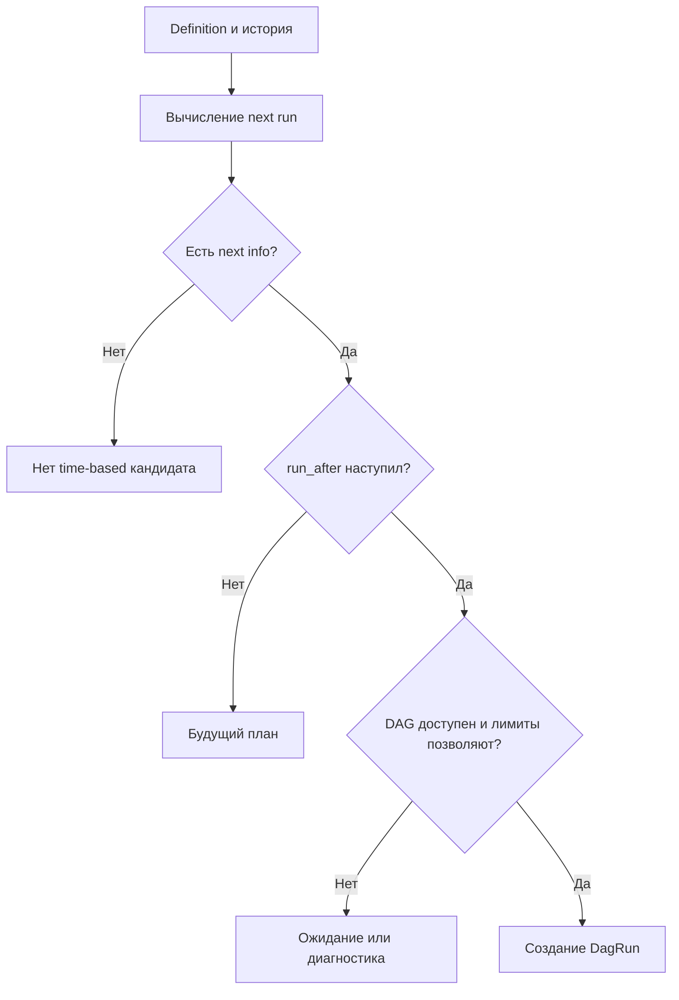

# 7. Планирование, Timetables и бизнес-календари

**Apache Airflow Zero to Hero · Профессиональный справочник**

| Параметр | Значение |
| --- | --- |
| Базовая линия | Apache Airflow 3.3.2, Task SDK 1.3.2, Standard provider 1.19.0, Python 3.12 |
| Дополнительные зависимости | croniter 6.2.4, Pendulum 3.2.0; календарные проверки по IANA 2026e |
| Дата проверки | 19 октября 2026 года |
| Покрытие README | Все 8 тем и 40 пунктов раздела, с сохранением формулировок и порядка |
| Предварительные знания | DAG/Task/DagRun из главы 4, TaskFlow из главы 5, временной контракт из главы 6 |
| Сквозной пример | Обработка утверждённых бизнес-дней после их завершения и дополнительной задержки |
| Практический результат | Выбор timetable, объяснение next run, проверка календаря и реализация собственного расписания |

«Запускать по будням» может означать несколько разных требований:

- создавать run в 09:00 с понедельника по пятницу;
- обрабатывать каждый рабочий день после его завершения;
- публиковать данные в следующий рабочий день;
- исключать праздники и учитывать рабочие субботы;
- запускаться после готовности upstream, но иметь календарный fallback.

Эти требования нельзя без проверки переводить в одну cron-строку. У них различаются **моменты запуска**, **интервалы данных**, **правила готовности** и **бизнес-календарь**.

В главе 6 мы отделили logical date, data interval и фактическое выполнение. Теперь разберём функцию, которая связывает definition и историю с будущими запусками: Timetable.

Критическое версионное уточнение: в стандартной конфигурации 3.3.2 `scheduler.create_cron_data_intervals=False`. Bare cron в `schedule` выбирает trigger-модель, а не автоматически модель завершённых периодов. В примерах, где семантика важна, класс timetable задаётся явно. [S01](#source-01) [S11](#source-11)

## Содержание

1. [Способы задания расписания](#s7-1)
2. [CRON и интервальное планирование](#s7-2)
3. [Относительные интервалы](#s7-3)
4. [Решения scheduler о создании запуска](#s7-4)
5. [Бизнес-календари](#s7-5)
6. [Собственный Timetable](#s7-6)
7. [Составные и специальные расписания](#s7-7)
8. [Тестирование расписаний](#s7-8)
9. [Практика: сравнение встроенных моделей](#builtin-lab)
10. [Практика: версионируемый бизнес-календарь](#calendar-lab)
11. [Тесты календаря и собственного Timetable](#test-lab)
12. [Разбор ситуаций](#cases)
13. [Самопроверка](#questions)
14. [Критерии освоения](#next)
15. [Проверка материала](#verification)
16. [Официальные источники](#sources)

<a id="s7-1"></a>
## 7.1. Способы задания расписания

### 7.1.1. Параметр `schedule` и замена прежнего `schedule_interval`

В современном DAG расписание задаётся через `schedule`. Он объединяет несколько способов описания scheduling: строки/presets, delta, timetable instance и asset expressions. Старые примеры с `schedule_interval` нужно проверять и переносить на поддерживаемый API. [S01](#source-01)

Для нового кода используй namespace `airflow.sdk` для DAG и tasks:

```python
# example: explicit_schedule_definition
import pendulum

from airflow.sdk import dag, task
from airflow.sdk.definitions.timetables.interval import CronDataIntervalTimetable


@dag(
    dag_id="schedule_definition_example",
    schedule=CronDataIntervalTimetable(
        expression="0 0 * * *",
        timezone="Europe/Moscow",
    ),
    start_date=pendulum.datetime(2026, 10, 1, tz="Europe/Moscow"),
    catchup=False,
    max_active_runs=1,
    is_paused_upon_creation=True,
    tags=["chapter-07"],
)
def schedule_definition_example():
    @task
    def report():
        print("The timetable defines the temporal model of this DAG.")

    report()


schedule_definition_example()
```

Этот DAG изначально paused. Он показывает definition, а не доказывает, что источник готов или обработка соответствует интервалу. Реальная task должна прочитать и проверить временной контракт из главы 6.

Нужно различать четыре настройки:

| Настройка | Что определяет |
| --- | --- |
| `schedule` | Основание для автоматического создания runs |
| `catchup` | Как timetable/планирование относятся к пропущенной истории |
| `max_active_runs` | Допустимое число активных runs в соответствующем контуре |
| `max_active_tasks` | Лимит одновременно исполняемых task instances внутри одного DagRun в 3.3.2 |

Параметры взаимосвязаны, но не заменяют друг друга. `max_active_runs=1` не означает «запускать раз в сутки», а `schedule=None` не означает запрет manual trigger.

### 7.1.2. `None`, `@once`, `@continuous` и presets `@hourly`, `@daily`, `@weekly`, `@monthly`, `@yearly`

| Значение | Смысл | Что проверить |
| --- | --- | --- |
| `None` | Нет автоматического time-based расписания | Как передаётся business window внешнего/manual run |
| `@once` | Один автоматический запуск по правилам OnceTimetable | Историю, start/end restrictions и повтор через manual/clear |
| `@continuous` | Последовательное непрерывное создание runs | Ограничение одного active run, длительность и error loop |
| `@hourly` | Cron preset `0 * * * *` | Выбранную trigger/interval модель |
| `@daily` | `0 0 * * *` | Timezone и смысл периода |
| `@weekly` | `0 0 * * 0` | Границу недели; это не автоматически ISO-неделя с понедельника |
| `@monthly` | `0 0 1 * *` | Календарные месяцы и тип timetable |
| `@yearly` | `0 0 1 1 *` | Годовой календарь и историческую границу |

Presets — сокращения выражений, а не отдельные гарантии готовности данных. `@daily` не означает «каждые 24 elapsed hours» в любой timezone. [S07](#source-07) [S14](#source-14)

`@once` не запрещает последующий ручной запуск. Clear повторяет исполнение существующих task instances; manual trigger создаёт другой run. Это разные операции, подробно рассматриваемые в следующей главе.

`None` и asset schedule — тоже разные вещи: в первом случае automatic time scheduling отсутствует; во втором есть event-based основание для scheduler.

### 7.1.3. CRON-выражение, `timedelta` и объект Timetable

| Форма | Пример | Подходящая задача |
| --- | --- | --- |
| Cron | `"0 9 * * 1-5"` | Регулярные моменты локального календаря |
| Delta | `timedelta(hours=6)` | Последовательность относительных шагов |
| Explicit interval timetable | CronDataIntervalTimetable | Обработка календарных периодов |
| Explicit trigger timetable | CronTriggerTimetable | Срабатывание по часам с отдельно заданным interval |
| Custom timetable | BusinessDatesTimetable из практики | Версионируемые рабочие даты и особый run_after |

Timetable можно мыслить как контракт:

```text
definition + time restrictions + relevant history + controlled "now"
    -> next run information or no next run
```

Здесь «no next run» может означать конец конечного календаря, отсутствие earliest, выход за latest или отсутствие будущего события. Это не всегда неисправность scheduler.

Для встроенных расписаний различай два слоя 3.3.2:

| Слой | Namespace | Назначение |
| --- | --- | --- |
| DAG authoring | `airflow.sdk.definitions.timetables.*` | Описание/параметры timetable |
| Server scheduling | `airflow.timetables.*` | Вычисление next run и manual interval |
| Serialization | Airflow server encoders/decoders | Преобразование SDK description в server implementation |

У built-in SDK timetable не нужно ожидать серверных методов вычисления расписания. Preview ниже импортирует server classes из полной установки Airflow. [S21](#source-21) [S22](#source-22) [S24](#source-24)

Собственный timetable в этой главе реализован через зарегистрированный core `Timetable` по официальному custom scheduling interface. SDK DAG 3.3.2 принимает такие объекты; для этого учебного маршрута нужна полная установка Airflow, а не изолированный пакет SDK. [S01](#source-01) [S09](#source-09)

### 7.1.4. Asset-based, event-driven и смешанные расписания

| Модель | Основание | Основной вопрос к контракту |
| --- | --- | --- |
| Time-based | Календарь/период | Какие данные соответствуют этому времени? |
| Asset-based | Условие обновления assets | Какое окно/revision подтвердил producer? |
| Event-driven | Внешнее событие через поддерживаемую интеграцию | Что означает событие и как исключается повтор? |
| Asset OR time | Независимое asset-условие либо timetable | Как согласуются два основания публикации? |
| Внешний manual/API trigger | Команда инициатора | Где явно задан business input? |

Asset event и заранее запланированный момент в `EventsTimetable` — разные сущности. Первый приходит в runtime; второй заранее включён в конечный календарь.

Airflow не превращает cron в проверку upstream readiness. Если данные публикуются непредсказуемо, нужно отдельное readiness/event решение, а не всё более поздний cron.

Смешанное расписание не означает «подождать asset и наступления времени одновременно». В `AssetOrTimeSchedule` используется OR: time-based и asset-based основания независимы. [S19](#source-19) [S20](#source-20)

Семантика event delivery, asset expressions, watchers и partition events будет углубляться в соответствующих главах; здесь важно правильно выбрать тип основания.

### 7.1.5. Явная конфигурация вместо зависимости от значений по умолчанию

Расписание должно объясняться по definition и deployment config, без угадывания версии статьи.

Фиксируй:

- тип timetable;
- cron/delta/approved business dates;
- timezone;
- fixed aware start date;
- catchup policy;
- active run/task limits;
- delay/readiness policy;
- calendar version и период её действия.

При миграции configuration drift может изменить модель без изменения cron-строки. Два окружения с одинаковым `schedule="@daily"` способны использовать разные timetable classes.

В 3.3.2 helper SDK `_create_timetable` проверяет `create_cron_data_intervals` не только в cron-ветке, но и в ветке bare delta. Поэтому выводить класс delta только из названия настройки ненадёжно. Для интервального сравнения этой главы обе delta-модели создаются явно. Это описание закреплённого исходного кода, а не обещание для будущих версий. [S01](#source-01)

Не меняй глобальную настройку ради одного DAG, не оценив все definitions с bare schedules. Explicit timetable делает локальное намерение понятнее и уменьшает зависимость от такого переключения.

**Контрольная точка 7.1:** можешь выбрать time/asset/manual модель и назвать конкретный timetable, не сводя всё к cron-строке.

<a id="s7-2"></a>
## 7.2. CRON и интервальное планирование

### 7.2.1. Пять полей CRON и проверка последовательности запусков

Базовая форма:

| Позиция | Значение | Пример |
| --- | --- | --- |
| 1 | Minute | `0`, `15`, `*/10` |
| 2 | Hour | `0`, `9`, `9,18` |
| 3 | Day of month | `*`, `1`, `15` |
| 4 | Month | `*`, `1`, `1,4,7,10` |
| 5 | Day of week | `*`, `1-5`, `MON-FRI` |

Airflow использует croniter; его extensions и правила нужно проверять по закреплённой версии. Не переносить автоматически syntax Quartz, Kubernetes или чужой библиотеки. [S06](#source-06) [S10](#source-10)

| Expression | Смысл моментов | Ловушка |
| --- | --- | --- |
| `*/15 * * * *` | Каждые четверть часа календарной сетки | Не «15 минут после завершения task» |
| `0 9,18 * * 1-5` | 09:00 и 18:00 по будням | Праздники не исключены |
| `30 8 * * 1-5` | 08:30 Mon–Fri | Не производственный календарь |
| `0 0 1 * *` | Полночь первого числа | Не готовность итогов прошлого месяца |
| `0 0 1 1 *` | Первое января | Не дата закрытия финансового года |

Комбинация minute/hour lists задаёт декартово сочетание. `0,30 8,17 * * *` создаёт четыре момента: 08:00, 08:30, 17:00, 17:30. Если нужны только 08:30 и 17:00, потребуются отдельные выражения или другая модель.

Ограниченные day-of-month и day-of-week в стандартном croniter соединяются через OR. `0 9 1 * MON` — не «первый понедельник»: это соответствующие понедельники либо первое число. `day_or=False` — параметр croniter API, не произвольный аргумент `DAG(schedule=...)`. [S10](#source-10)

У extensions вроде nth weekday/last weekday есть library semantics, но они не знают корпоративные holidays. Проверяй результаты, а не только валидность строки.

Для безопасного разбора:

1. Запиши timezone.
2. Сгенерируй конкретные ближайшие моменты.
3. Проверь месяц/год/DST.
4. Отдельно вычисли intervals выбранным timetable.
5. Сопоставь их с business requirement.

### 7.2.2. `CronDataIntervalTimetable` и `CronTriggerTimetable`

Один и тот же cron задаёт разные временные модели.

| Характеристика | CronDataIntervalTimetable | CronTriggerTimetable |
| --- | --- | --- |
| Основная роль cron | Границы последовательных data intervals | Моменты срабатывания |
| Default interval | Между соседними cron boundaries | Нулевой interval |
| Scheduled run_after | Конец interval | Trigger instant |
| Logical date | Начало interval | Начало отдельно заданного interval; при нуле trigger instant |
| Подходящая модель | Периодическая обработка данных | Команда/срабатывание по календарю |

Пример в UTC для `0 0 * * *`:

| Run | Data interval | Logical date | run_after |
| --- | --- | --- | --- |
| Data-interval | 18.10 00:00 → 19.10 00:00 | 18.10 00:00 | 19.10 00:00 |
| Trigger, interval=0 | 19.10 00:00 → 19.10 00:00 | 19.10 00:00 | 19.10 00:00 |
| Trigger, interval=6h | 18.10 18:00 → 19.10 00:00 | 18.10 18:00 | 19.10 00:00 |

Даты в таблице — 2026 год. Фактическое начало tasks может быть позже run_after. [S02](#source-02) [S03](#source-03) [S04](#source-04)

```python
# example: explicit_cron_models
from datetime import timedelta

from airflow.sdk.definitions.timetables.interval import CronDataIntervalTimetable
from airflow.sdk.definitions.timetables.trigger import CronTriggerTimetable

CALENDAR_DAY = CronDataIntervalTimetable(
    expression="0 0 * * *", timezone="UTC"
)
POINT_TRIGGER = CronTriggerTimetable(
    expression="0 0 * * *", timezone="UTC"
)
TRIGGER_WITH_WINDOW = CronTriggerTimetable(
    expression="0 0 * * *",
    timezone="UTC",
    interval=timedelta(hours=6),
)
```

Эти objects предназначены для `schedule=...`. Пример не запускает DAG. Нулевой interval не следует «исправлять» в task без документированного бизнес-правила.

### 7.2.3. Время срабатывания и диапазон данных как отдельные характеристики

Пусть task должна запускаться каждый понедельник в 06:00, но читать пятничные данные.

Сначала сформулируй два независимых требования:

| Требование | Возможное решение |
| --- | --- |
| Run разрешён в Monday 06:00 | Trigger timetable |
| Обрабатывается Friday business day | Explicit contract/custom timetable/manifest |
| Friday может быть holiday | Versioned business calendar |
| Источник ещё не готов | Readiness check |
| Retry должен читать то же | Сохранённые window/snapshot |

Cron `0 6 * * MON` сам по себе не означает «пятница». Data-interval модель между понедельниками дала бы недельный interval; trigger-модель с interval=0 — точку. Нужный business day должен быть задан отдельно.

В custom timetable можно вернуть:

- data interval — конец/начало бизнес-периода;
- run_after — конец плюс технологическая задержка;
- summary — описание policy.

`DagRunInfo.interval(start,end)` является shortcut, где run_after=end. Если нужна задержка, конструируй `DagRunInfo` с отдельным run_after. [S02](#source-02)

Не путай scheduled delay с задержкой доставки данных. Фиксированная пауза может быть частью policy, но не доказывает completeness.

### 7.2.4. Влияние timezone, паузы DAG и исторических запусков

Timezone определяет calendar boundaries. Pause разрешает/запрещает выдачу scheduling-работы. History определяет точку продолжения. Catchup влияет на пропущенные периоды.

| Изменение | Что может измениться |
| --- | --- |
| UTC → Europe/Berlin | UTC-моменты локального cron и DST-поведение |
| Pause на неделю | Набор runs после unpause зависит от timetable/catchup/history |
| Manual run | Может не продвинуть history, используемую для time scheduling |
| Изменение start_date | Earliest boundary с учётом существующей истории |
| Изменение cron | Alignment следующего interval относительно старого |

Для CronDataIntervalTimetable с catchup=false применяется skip-to-latest policy по завершённым календарным периодам. Для CronTriggerTimetable выбор past/next trigger зависит от history, restrictions и first-run policy. Правила нужно воспроизводить на конкретных входах. [S03](#source-03) [S04](#source-04)

У CronTriggerTimetable `run_immediately` относится к выбору первого run без соответствующей start/history опоры; это не команда «исполнять tasks немедленно несмотря на pause и limits». При явно заданном earliest влияние этого параметра ограничено алгоритмом next-run. Не используй его как замену осознанному start_date.

Не считай queued run доказательством нарушения pause: run мог быть создан до паузы либо внешним trigger. Проверяй время создания, тип и фактические task states.

### 7.2.5. Настройка `create_cron_data_intervals` и совместимость при миграции

В 3.3.2 default false выбирает CronTriggerTimetable для bare cron. Значение true выбирает CronDataIntervalTimetable. [S01](#source-01) [S11](#source-11)

При переключении меняются не только UI labels:

- logical-date anchoring;
- interval boundaries;
- поведение next-run относительно history;
- используемые `ds`/partition labels;
- возможная collision с existing logical date.

Конкретный пример trigger → interval:

| Шаг | Metadata в UTC |
| --- | --- |
| Последний trigger run | interval [19.10 00:00,19.10 00:00], logical date 19.10 |
| Наивное ожидание после смены | interval [19.10,20.10], logical date 19.10 |
| Проблема | Такая non-null logical date уже занята |
| Защита interval implementation 3.3.2 | Продвинуть candidate start вперёд; проверить строгое продвижение |

В типовом daily случае следующий interval может начаться 20 октября, то есть старое ожидание [19,20) не реализуется автоматически. Это защита scheduler от collision, а не migration coverage продукта. [S03](#source-03) [S08](#source-08)

План миграции:

1. Инвентаризировать bare schedules и actual timetable classes.
2. Зафиксировать старую семантику явно.
3. Построить old/new preview вокруг cutover.
4. Сравнить business coverage, а не только run count.
5. Запланировать отдельную переобработку расхождений.
6. Проверить downstream date/partition assumptions.
7. После rollout сопоставить реальные runs с preview.

**Контрольная точка 7.2:** можешь объяснить, какие intervals получатся у одной cron-строки в двух моделях и что произойдёт при смене модели с существующей историей.

<a id="s7-3"></a>
## 7.3. Относительные интервалы

### 7.3.1. `DeltaDataIntervalTimetable` и `DeltaTriggerTimetable`

Delta задаёт относительный шаг. Две delta-модели разделяют interval semantics так же, как cron-модели.

| Модель | Шаг расписания | Data interval |
| --- | --- | --- |
| DeltaDataIntervalTimetable(6h) | Следующие interval boundaries | Последовательные окна по delta |
| DeltaTriggerTimetable(6h), interval=0 | Trigger через delta | Точечный interval |
| DeltaTriggerTimetable(6h), interval=2h | Trigger через delta | Окно 2h перед trigger |
| DeltaTriggerTimetable(6h), interval=8h | Trigger через delta | Окна перекрываются на 2h |

```python
# example: explicit_delta_models
from datetime import timedelta

from airflow.sdk.definitions.timetables.interval import DeltaDataIntervalTimetable
from airflow.sdk.definitions.timetables.trigger import DeltaTriggerTimetable

SIX_HOUR_PERIODS = DeltaDataIntervalTimetable(timedelta(hours=6))
SIX_HOUR_TRIGGERS = DeltaTriggerTimetable(timedelta(hours=6))
TRIGGERS_WITH_TWO_HOUR_WINDOW = DeltaTriggerTimetable(
    timedelta(hours=6),
    interval=timedelta(hours=2),
)
```

Explicit classes устраняют зависимость сравнения от bare schedule configuration. [S04](#source-04) [S05](#source-05) [S15](#source-15) [S16](#source-16)

Шаг запуска и ширина окна не обязаны совпадать. Если interval меньше шага, между окнами есть пробелы; если больше — overlap. Это может быть намеренной rolling-window policy, но требует соответствующей агрегации и публикации.

### 7.3.2. Интервал от начальной точки и календарное выравнивание

Cron привязан к calendar grid. Delta data intervals при catchup=true могут последовательно двигаться от earliest.

Возьмём UTC, fixed earliest `2026-10-19T00:10Z` и шаг 30 минут:

| Модель | Первое окно | Следующее окно |
| --- | --- | --- |
| CronDataIntervalTimetable `*/30 * * * *` | 00:30 → 01:00 | 01:00 → 01:30 |
| DeltaDataIntervalTimetable 30m, catchup=true | 00:10 → 00:40 | 00:40 → 01:10 |

Cron пропускает часть до следующей допустимой границы. Delta сохраняет начальную фазу. Не нужно ожидать, что все получасовые расписания совпадут.

При catchup=false конкретный алгоритм может сдвигать earliest к актуальной сетке. В 3.3.2 server DeltaDataIntervalTimetable для fixed delta использует epoch-based rounding в skip-to-latest; для month/year relativedelta — последовательное продвижение от anchor. Поэтому старую документационную таблицу «окно всегда заканчивается точно в now» нельзя принимать за универсальную реализацию этой версии. [S03](#source-03)

Практически:

- для calendar boundaries выбирай cron или custom calendar;
- для relative cadence явно задай anchor и catchup policy;
- для месячной periodicity не заменяй calendar month на 30 days;
- проверяй первый run и продолжение после истории отдельно;
- тестируй именно Airflow timetable, а не только арифметику Python.

`relativedelta(months=1)` тоже не означает «каждое первое число месяца». При стартовой дате 31 января последовательное прибавление может дать 28 февраля, затем 28 марта. Path-dependent day clamping не равен сетке month boundaries. [S03](#source-03)

### 7.3.3. `timedelta(days=1)` и ежедневный CRON при DST

Для fixed elapsed 24h и локальных суток результат вокруг DST различается.

Пример: UTC-опора соответствует полуночи Berlin 29 марта 2026.

| Модель | Start UTC | End UTC | Local end |
| --- | --- | --- | --- |
| Calendar day Berlin | 28.03 23:00Z | 29.03 22:00Z | 30.03 00:00 +02 |
| Fixed 24h from UTC anchor | 28.03 23:00Z | 29.03 23:00Z | 30.03 01:00 +02 |

В первом случае длина дня 23h. Во втором прошло ровно 24h, и локальная граница сдвинулась. Осенью local calendar day может иметь 25h. [S29](#source-29)

Для честного сравнения fixed delta задавай/проверяй UTC-normalized anchor. Не пытайся доказать elapsed duration вычитанием двух standard datetime в одной DST zone: особенности wall-time arithmetic разобраны в главе 6. [S30](#source-30) [S31](#source-31)

Слово «ежедневный» уточняй:

- каждый local calendar day;
- каждые 24 elapsed hours;
- каждый approved business day;
- после завершения предыдущего run.

Это четыре разных контракта.

### 7.3.4. Задержка обработки и отставание от расписания

У периодического pipeline есть несколько видов задержки:

| Метрика | Что измеряет |
| --- | --- |
| Scheduling delay | От run_after до создания/старта соответствующей работы |
| Queue delay | Ожидание task после постановки |
| Runtime | Время исполнения |
| Coverage backlog | Необработанные требуемые windows |
| Data readiness lag | Ожидание подтверждения upstream |
| Product freshness | Отставание опубликованного результата |

Если interval создаётся каждые 10 минут, а обработка занимает 15 минут при одном active run, система может накапливать очередь. При выбранной catchup=false policy часть промежуточных окон может вообще не создаваться. Это не тождественно ускорению обработки.

Условная модель capacity:

- arrival rate: 6 обязательных окон в час;
- средняя обработка: 15 минут;
- одна полностью последовательная линия: около 4 окон в час без учёта overhead;
- backlog растёт примерно на 2 окна в час при сохранении всех windows.

Это иллюстрация при независимых одинаковых runs, не формула производительности любого DAG. Увеличение max_active_runs помогает только при наличии вычислительных ресурсов и безопасной конкурентной записи.

Отдельно проверь, что lagging run читает свой interval, а не «последние 10 минут от now». Иначе очередь меняет фактический input и делает recovery труднообъяснимым.

Retry не меняет календарный шаг timetable. Он относится к попытке исполнения конкретной task instance.

### 7.3.5. Непрерывное последовательное выполнение через `@continuous`

`@continuous` не является очень частым cron. Он организует непрерывную последовательность runs с ограничением одного active run.

В 3.3.2 ContinuousTimetable имеет `active_runs_limit=1`; DAG definition проверяет совместимость explicit max_active_runs с этим ограничением. Указывать `max_active_runs=5` и ожидать пять параллельных continuous runs некорректно. [S01](#source-01) [S07](#source-07)

Особенности:

| Свойство | Следствие |
| --- | --- |
| Нет фиксированной календарной сетки | Длительность периода зависит от progression/execution |
| Последовательный режим | Удобен для batch polling с контролируемой нагрузкой |
| Предыдущий run завершён | Не означает автоматически его success |
| Run быстро падает | Возможна частая последовательность новых failures |
| Внешняя система имеет собственный cursor | Cursor должен сохраняться независимо от run timestamp |

Не заменяй continuous workflow бесконечным `while True` внутри обычной task без продуманного lifecycle. Долгая task и последовательные короткие runs имеют разные retry, monitoring и release свойства.

Для idle input предусмотри контролируемое ожидание, event-driven решение либо другой режим cadence. Непрерывный пустой polling может создавать лишние runs и нагрузку на metadata plane.

**Контрольная точка 7.3:** различаешь relative step, calendar boundary и continuous progression; можешь объяснить последствия перегрузки и DST.

<a id="s7-4"></a>
## 7.4. Решения scheduler о создании запуска

### 7.4.1. `start_date`, `end_date`, текущая дата и завершённые интервалы

Scheduler не выполняет простое условие «текущее время равно start_date». Он работает с definition, timetable, вычисленными next-run metadata, history и ограничениями.



Первое вычисление может выполняться уже при обработке definition и сохраняться в DagModel. Не ожидай, что ветка первого запуска обязательно появится именно в scheduler logs после unpause. При этом собственный timetable должен корректно обрабатывать вход без previous interval: это часть API. [S09](#source-09) [S13](#source-13)

`TimeRestriction` предоставляет:

| Поле | Значение |
| --- | --- |
| `earliest` | Нижняя допустимая временная граница |
| `latest` | Верхняя допустимая граница |
| `catchup` | Policy отношения к пропущенной истории |

Для обычной interval-модели earliest/latest ограничивают logical-date/start boundary, а не фактическое время старта задачи. Run, interval start которого допустим, может иметь end/run_after позже latest. Конкретный timetable обязан описать собственные детали применения restrictions. [S02](#source-02)

`start_date` внутри calendar period часто требует alignment к следующей допустимой границе. Если указать daily start в 12:00, нельзя автоматически ожидать неполный период 12:00→00:00 от CronDataIntervalTimetable.

Будущий data interval не означает, что run уже пора исполнять. `next info` — план; `run_after` — допустимость его создания.

### 7.4.2. Catchup и ограничение активных DagRun

Catchup отвечает за historical scheduling policy. Max-active-runs ограничивает одновременно активную работу. Они решают разные задачи.

| Настройки | Ожидание |
| --- | --- |
| catchup=true, max_active_runs=1 | Исторические windows обрабатываются ограниченно и последовательно |
| catchup=true, max_active_runs=4 | Допускается конкуренция нескольких runs при остальных ограничениях |
| catchup=false, max_active_runs=1 | Ограничение конкуренции не восстанавливает skipped history |
| schedule=None | Catchup сам по себе не создаёт cron-runs |

В 3.3.2 default catchup отключён; production DAG полезно объявлять policy явно. У конкретного timetable поведение catchup=false реализуется его алгоритмом. Это не абстрактная команда «обработать вчера для любого расписания». [S03](#source-03) [S04](#source-04) [S11](#source-11)

Активные runs и task slots — разные уровни. Run может быть активным без работающего worker process, например в ожидании ресурсов или внешнего события. Детальные parked/deferred состояния и подсчёт slots разбирались в главе 4.

В Airflow 3 управляемый backfill имеет собственный контур и ограничения concurrency; в scheduler source ordinary run accounting исключает соответствующие backfill runs. Не считай DAG max_active_runs универсальным единственным лимитом всей исторической работы. [S12](#source-12)

Глубокий разбор catchup/backfill/clear — следующая глава. Здесь главное: создание нужного множества windows и скорость его обработки проверяются отдельно.

### 7.4.3. Pause/unpause и момент появления следующего запуска

Pause не останавливает время и не переписывает calendar history.

После unpause набор кандидатов зависит от:

- типа timetable;
- catchup policy;
- earliest/latest;
- previous automated run;
- календаря/его версии;
- active run limits;
- доступности serialized definition.

Для interval catchup=true возможен backlog. Для catchup=false timetable может перескочить к актуальному eligible period. Для конечного EventsTimetable прошлые события могут быть пропущены, а после последнего события next run будет отсутствовать.

Не обещай точное выполнение в первую секунду после unpause. Есть scheduler loop, metadata updates, executor queue и task scheduling.

Полезная таблица наблюдения:

| Проверка | Что фиксировать |
| --- | --- |
| До pause | Последний run и опубликованное покрытие |
| Во время pause | Неизменный либо обновлённый definition/calendar |
| Перед unpause | Expected next intervals на fixed clock |
| После unpause | Created runs, logical dates, run_after |
| После выполнения | Реальные partitions/revisions |

Наличие старых running tasks не означает, что pause не применился. Pause scheduling и остановка уже исполняющейся внешней работы — разные операции.

### 7.4.4. Наличие предыдущих запусков и изменение расписания

Для `next_dagrun_info` важна переданная previous automated data interval. Это не обязательно «последняя строка в списке UI».

Manual runs, scheduled runs, backfill и asset events имеют разные роли в history selection. Не пытайся управлять future time scheduling случайным manual trigger: сначала проверь, какой reference run выбирает твоя версия. [S12](#source-12) [S13](#source-13)

При изменении cron old interval может перестать совпадать с новой grid. Interval timetable выполняет alignment и защиту от non-advancing logical date.

Правильная проверка имеет два входных состояния:

| Состояние | Что тестируется |
| --- | --- |
| History отсутствует | Earliest alignment и первый interval |
| History присутствует | Продолжение именно от existing interval |
| История от другой модели | Cutover/collision/gap behavior |
| Previous run failed | Разделение scheduling history и успешной публикации |
| Calendar revision изменилась | Совместимость периодов и output identity |

Успешный preview нового DAG «с нуля» не доказывает правильность rollout на DAG с историей.

При публикации календаря revision 2 не нужно незаметно пересчитать intervals already published revision 1. Сначала определи, это schedule update, correction существующих данных или отдельная migration.

### 7.4.5. Просмотр next run и диагностика отсутствующего запуска

Начинай с простых проверок, затем переходи к внутреннему состоянию.

| Уровень | Вопрос |
| --- | --- |
| Definition | Файл импортируется? DAG обнаружен? Выбрана нужная версия? |
| Schedule | Какой actual timetable? Он вообще создаёт time runs? |
| Restrictions | Earliest/latest/catchup допускают нужный кандидат? |
| Time | run_after уже наступил? Какие timezone UI и timetable? |
| History | Кандидат не совпал с existing run? |
| Limits | Не достигнут max_active_runs? |
| Components | Processor/scheduler/API работают и видят необходимые plugins? |
| Finite calendar | Есть ли будущие approved dates? |

Для стенда используем wrapper `af` из практики:

```bash
af version
af dags list-import-errors
af dags details schedule_definition_example
af dags next-execution schedule_definition_example --num-executions 5 --table
af dags next-execution schedule_definition_example \
    --num-executions 5 --field run_after
af config get-value scheduler create_cron_data_intervals
af config get-value scheduler catchup_by_default
```

Команды и поля `--field`/`--table` сверены с CLI 3.3.2. Смотри `logical_date`, `data_interval.start`, `data_interval.end` и `run_after` отдельно. [S27](#source-27)

CLI next-execution вычисляет ожидаемую последовательность в своём контексте; он не обещает, что run уже создан или task получила worker. Сопоставляй preview с UI, metadata и logs. Не лечи любое отсутствие run удалением history.

**Контрольная точка 7.4:** умеешь пройти цепочку от definition до eligibility, history и concurrency и объяснить конкретную причину отсутствия run.

<a id="s7-5"></a>
## 7.5. Бизнес-календари

### 7.5.1. Рабочие дни, праздники и переносы выходных

`weekday() < 5` описывает обычный Mon–Fri week pattern. Полноценный business calendar дополнительно может учитывать:

- фиксированные и плавающие holidays;
- переносы выходных;
- рабочие субботы/воскресенья;
- regional/market calendars;
- сокращённые торговые сессии;
- исключительные даты закрытия;
- cutoff и timezone.

Для обучения используем **условный календарь**, не официальный производственный календарь какой-либо страны:

| Дата 2026 | День недели | Наше правило |
| --- | --- | --- |
| 16 октября | Пятница | Рабочий |
| 17 октября | Суббота | Рабочий по override |
| 18 октября | Воскресенье | Нерабочий |
| 19 октября | Понедельник | Нерабочий по override |
| 20 октября | Вторник | Рабочий |
| 21 октября | Среда | Рабочий |

Эта таблица специально показывает, что `MON-FRI` недостаточно.

Раздели два вопроса:

| Вопрос | Пример |
| --- | --- |
| День входит в calendar? | 17 октября — да по override |
| Что покрывает period? | Local midnight 17-го → midnight 18-го |
| Когда processing eligible? | После end + 60 elapsed minutes |
| Когда source ready? | После независимого commit/manifest |
| Когда output final? | По policy продукта |

Официальный holiday calendar также не знает всех внутренних settlement/close rules организации. Calendar owner должен подтвердить именно нужную семантику.

Если календарь недоступен или не покрывает дату, не подменяй его автоматически Mon–Fri. Явный отказ или сигнал исчерпания лучше молчаливого изменения расписания.

### 7.5.2. Последний рабочий день месяца и расчётные периоды

«Последний рабочий день месяца» требует calendar membership, а не только последней пятницы.

```python
# example: last_business_day
from datetime import date, timedelta


def is_business_day(day: date, overrides: dict[date, bool]) -> bool:
    return overrides.get(day, day.weekday() < 5)


def last_business_day(
    year: int,
    month: int,
    overrides: dict[date, bool],
) -> date:
    if month == 12:
        next_month = date(year + 1, 1, 1)
    else:
        next_month = date(year, month + 1, 1)
    candidate = next_month - timedelta(days=1)
    while candidate.month == month:
        if is_business_day(candidate, overrides):
            return candidate
        candidate -= timedelta(days=1)
    raise ValueError("This calendar has no business day in the month")


overrides = {
    date(2026, 10, 17): True,
    date(2026, 10, 19): False,
    date(2026, 10, 30): False,
}
assert last_business_day(2026, 10, overrides) == date(2026, 10, 29)
assert is_business_day(date(2026, 10, 17), overrides)
assert not is_business_day(date(2026, 10, 19), overrides)
```

Пример ограничен заданным условным calendar contract. Для внешних holidays нужен зафиксированный input, а не текущий сетевой ответ.

Далее необходимо решить, что обрабатывается:

| Требование | Interval |
| --- | --- |
| Отчёт за последний business day | Только соответствующий day |
| Закрытие календарного месяца | Первое число месяца → первое следующего |
| Период между расчётными датами | Предыдущая settlement boundary → текущая |
| Rolling 30 elapsed days | Fixed-duration window |
| Финансовый период 4–4–5 | Специальный fiscal calendar |

Дата запуска может быть последним рабочим днём, а interval — целым месяцем. Либо запуск происходит в следующем месяце после готовности источников. Calendar trigger и data period снова нужно описать отдельно.

Для последнего рабочего дня с публикацией вечером учитывай cutoff: «пятница в 18:00» ещё не означает, что весь Friday day закончился.

### 7.5.3. Несколько запусков в сутки и составные CRON-условия

Один cron подходит для регулярной прямоугольной сетки. Для разных weekday/weekend times или несимметричных сочетаний удобнее несколько выражений.

| Требование | Представление |
| --- | --- |
| 09:00 и 18:00 Mon–Fri | Один cron с hour list |
| 08:30 и 17:00 | Два выражения либо custom timetable |
| 08:30 Mon–Fri, 10:00 Saturday | MultipleCronTriggerTimetable |
| Рабочая суббота из утверждённого списка | Business calendar |
| Несколько intraday sessions с разными окнами | Session calendar/custom timetable |

Не генерируй длинную cron-строку для каждой исключительной даты, если более прямой моделью является конечный список sessions.

Для нескольких daily triggers отдельно проверь windows. Два triggers с одинаковой 24h interval создают перекрытие; два interval runs между 08:30 и 17:00 дадут разную ширину дневного и ночного периодов.

Полезно сначала составить таблицу:

| Trigger | Window start | Window end | Почему именно так |
| --- | --- | --- | --- |
| 08:30 | Предыдущий cutoff | Текущий cutoff | Утренний settlement |
| 17:00 | Утренний cutoff | Вечерний cutoff | Дневная сессия |

Если смысл intervals трудно объяснить словами, усложнение cron обычно не помогает.

### 7.5.4. Публикация календаря как версионируемой зависимости

Calendar — часть вычислительного input.

Минимальная версия календаря должна сообщать:

| Поле | Назначение |
| --- | --- |
| calendar_id | Какому рынку/процессу относится |
| calendar_version | Какая неизменная revision использована |
| timezone | Где определены локальные даты/cutoffs |
| coverage/horizon | На какие даты рассчитан список |
| approved dates/sessions | Собственно план |
| exceptions | Рабочие/нерабочие overrides либо их materialized результат |
| policy version | Как из day строятся interval и run_after |
| checksum | Проверка неизменности опубликованного artifact |

Способ поставки может быть package resource, versioned JSON в bundle или generated Python constant. Ключевое свойство — контролируемая неизменность, а не формат файла.

Протокол:

1. Calendar owner утверждает source.
2. Offline build вычисляет approved dates/sessions.
3. Tests проверяют exceptions и горизонт.
4. Результат публикуется как immutable version.
5. DAG ссылается на конкретную version.
6. Serialization сохраняет необходимые значения для scheduler.
7. Monitoring предупреждает об окончании горизонта.

Вызов корпоративного API из `next_dagrun_info` на каждом scheduler loop делает расписание зависимым от latency, availability и изменяемого ответа. Получать calendar online можно отдельным управляемым процессом, но scheduler должен потреблять уже подготовленную версию.

### 7.5.5. Воспроизводимость исторического календаря при backfill

Для исторического пересчёта нужно ответить: использовать календарь, действовавший тогда, или актуальную исправленную revision?

| Цель | Calendar policy |
| --- | --- |
| Воспроизвести прежнюю публикацию | Исходная pinned version |
| Исправить ошибку календаря | Новая version + correction plan |
| Пересчитать по новым правилам продукта | Явная новая business policy |
| Заполнить отсутствующие outputs | Совместимая version с проверкой coverage |

Versioned code не гарантирует воспроизводимость, если он при исполнении загружает `calendar/latest.json`. Аналогично старый DAG с новым plugin implementation способен получить другую трактовку тех же параметров.

Сохраняй отдельно:

- DAG/transform version;
- calendar version и checksum;
- source snapshot;
- business window;
- output revision;
- run/attempt audit.

Если calendar revision меняет membership даты, нужны решения по существующим output partitions: сохранить, исправить, удалить по процедуре либо пометить superseded. Простая смена schedule не реализует эти решения.

**Контрольная точка 7.5:** умеешь отделить weekday pattern от утверждённого business calendar, зафиксировать version и объяснить policy исторического replay.

<a id="s7-6"></a>
## 7.6. Собственный Timetable

### 7.6.1. `next_dagrun_info()` и ограничения `TimeRestriction`

Custom timetable нужен, когда built-in model не выражает временной контракт достаточно прямо.

Основной метод принимает history/restrictions и возвращает `DagRunInfo` либо `None`. [S02](#source-02) [S09](#source-09)

| Input/output | Что реализовать |
| --- | --- |
| `last_automated_data_interval=None` | Корректный first-run path |
| Previous interval | Строгое продвижение по своей модели |
| `restriction.earliest` | Нижнюю границу |
| `restriction.latest` | Верхнюю границу |
| `restriction.catchup` | Собственную объяснимую skip/replay policy |
| `DagRunInfo.data_interval` | Точное выбранное окно |
| `DagRunInfo.run_after` | Момент eligibility, отдельно от interval |
| `None` | Осмысленное отсутствие будущего кандидата |

Для нашей практики policy такая:

1. Approved business dates — конечный неизменный список.
2. Один day означает local midnight → next local midnight.
3. Run eligible через 60 elapsed minutes после UTC end.
4. Earliest/latest применяются к interval start.
5. Previous interval исключает уже пройденные/перекрывающиеся окна.
6. Catchup=true выбирает первый оставшийся допустимый interval.
7. Catchup=false выбирает последний уже eligible; если такого нет — ближайший будущий.
8. После исчерпания списка возвращается None.

Это **наша** policy. Она не объявляется универсальной реализацией catchup для всех timetable.

Для interval start/end и run_after возвращаем aware Pendulum values. Business helpers могут использовать standard datetime, но на границе custom scheduling API выполняется явное преобразование. [S09](#source-09)

Проверяй не только happy path. Непродвигающийся timetable может снова возвращать тот же logical date, создавая collision или повторяющуюся диагностику. Бесконечный поиск следующего рабочего дня без конечного горизонта тоже опасен.

### 7.6.2. `infer_manual_data_interval()` для ручных запусков

Manual inference — отдельный метод, не сокращённый вызов `next_dagrun_info`.

Нужно выбрать одно правило:

| Policy | Что означает |
| --- | --- |
| Последний завершённый period | End не позже reference time |
| Последний eligible period | run_after не позже reference time |
| Period по явным inputs | Business window передаётся отдельно |
| Отказ от inference | Требуется поддерживаемый другой способ запуска |

В нашей практике выбран последний **eligible** approved day. Технологическая задержка учитывается. До первого eligible period метод выдаёт объяснимый отказ.

Важно: в общем manual trigger path Airflow 3.3.2 этот метод не обязан вызываться для любого manual run. Без logical date создаётся run с отсутствующим data interval. Добавление метода не делает все manual triggers автоматически interval-based. [S25](#source-25)

Поэтому практический DAG требует interval в runtime и отказывает, если temporal context его не предоставляет. Для arbitrary replay лучше explicit-window DAG из главы 6.

В тестах проверь:

- reference до первого period;
- ровно на end;
- между end и run_after;
- ровно на run_after;
- weekend/holiday;
- после последней calendar date;
- actual trigger path отдельно от прямого вызова inference.

### 7.6.3. `validate()`, сериализация и десериализация

`validate` проверяет definition, а не запускает data quality checks источника.

Для календаря проверяются:

| Проверка | Причина |
| --- | --- |
| Непустой version ID | Историческая объяснимость |
| Strict date format | Отсутствие неявного parsing |
| Даты отсортированы и уникальны | Стабильное progression |
| Конечный размер | Контроль стоимости/размера serialized DAG |
| Valid timezone | Правильные calendar boundaries |
| Допустимый delay | Отсутствие случайного отрицательного/огромного сдвига |
| Strict midnight conversion | Отказ от неявного gap/fold normalization |
| Schema version | Совместимость decoder |

Serialization должна возвращать JSON-compatible values: строки, числа, bool, lists, dicts. Не сериализуй открытый database connection, clock lambda, mutable client или объект holiday API.

Round trip проверяется не только равенством dict:

1. Serialize.
2. JSON encode/decode.
3. Deserialize.
4. Сравнить configuration/version.
5. Сгенерировать последовательность intervals на тех же restrictions/history.
6. Сравнить boundaries и run_after.

Собственный timetable сериализуется через его methods и registered import path. В 3.3.2 encoder/decoder отдельно обрабатывает built-in SDK classes и custom core timetables. Нельзя считать, что наследование только от thin SDK BaseTimetable автоматически добавляет custom scheduling/serialization support. [S21](#source-21) [S22](#source-22) [S24](#source-24)

Не переопределяй `generate_run_id` ради косметики без необходимости. В практике используется inherited implementation; business label/calendar version сохраняются отдельными metadata.

### 7.6.4. Регистрация, доступность класса и доставка на компоненты

Для custom timetable через официальный interface нужен plugin с `timetables=[YourClass]`. [S09](#source-09) [S23](#source-23)

| Компонент | Зачем нужен класс/пакет |
| --- | --- |
| DAG processor | Импорт definition, validation, serialization |
| Scheduler | Deserialization и next-run calculation |
| API/служебные процессы | Операции, читающие serialized timetable, preview/details |
| Worker/task interpreter | Если DAG/module импортирует timetable или task helpers |
| CI/test environment | Preview, unit/integration tests |

Доставка в один scheduler container недостаточна. При full-Airflow учебном image используем одинаковые package/plugin files на всех relevant компонентах. Для разделённых SDK-only workers потребуется отдельный packaging design; эта лаборатория его не имитирует.

Используй стабильный import path. Перемещение класса из одного модуля в другой может сломать десериализацию уже сохранённых definitions. Совместимость payload и import path — часть rollout.

Plugins кэшируются процессами; изменение файла не означает немедленное обновление всех компонентов. После rollout проверяй загруженную version и перезапускай соответствующие процессы по своему deployment protocol. Не копируй старые webserver/fork инструкции на новую topology без проверки. [S23](#source-23)

### 7.6.5. Отсутствие сетевых обращений и тяжёлой работы в вычислении расписания

Timetable выполняется в control plane. Его latency влияет на планирование.

| Антипаттерн | Последствие |
| --- | --- |
| HTTP holiday lookup на каждый next-run | Зависимость scheduler от сети и изменяемого ответа |
| Чтение огромной source table | Scheduling блокируется data workload |
| Sleep до готовности источника | Задержка control plane |
| Тяжёлый pandas import только ради нескольких dates | Parsing/scheduling overhead |
| Бесконечный поиск даты | Возможное зависание planning |
| Random/worker-local date в policy | Непредсказуемые результаты |

Вынеси тяжёлую работу в offline calendar build или отдельный ingestion process. Scheduler получает небольшой validated snapshot.

Граница ответственности:

- timetable вычисляет eligibility;
- sensor/event/readiness mechanism проверяет внешний prerequisite;
- task исполняет data work;
- publish protocol отвечает за атомарность и revision.

Фиксированный now разрешён как input controlled test. Реальный clock нужен для catchup=false policy, но должен иметь понятное место вызова и не менять сам approved calendar.

**Контрольная точка 7.6:** можешь реализовать и протестировать custom progression, manual policy и serialization, не превращая scheduler в источник сетевых вычислений.

<a id="s7-7"></a>
## 7.7. Составные и специальные расписания

### 7.7.1. `EventsTimetable` и заранее известные моменты запуска

EventsTimetable подходит для конечного списка заранее известных instants: даты закрытия этапов, утверждённые публикации, нерегулярные мероприятия.

Это не подписка на runtime asset events. Список целиком находится в definition/serialized timetable и должен быть разумного размера.

```python
# example: predefined_events_definition
import pendulum

from airflow.sdk import dag, get_current_context, task
from airflow.timetables.events import EventsTimetable

KNOWN_INSTANTS = [
    pendulum.datetime(2026, 10, 20, 9, tz="UTC"),
    pendulum.datetime(2026, 10, 23, 13, 30, tz="UTC"),
    pendulum.datetime(2026, 11, 2, 8, tz="UTC"),
]


@dag(
    dag_id="predefined_events_example",
    schedule=EventsTimetable(
        event_dates=KNOWN_INSTANTS,
        restrict_to_events=True,
        description="Approved release instants, revision 1",
    ),
    start_date=pendulum.datetime(2026, 10, 1, tz="UTC"),
    catchup=True,
    max_active_runs=1,
    is_paused_upon_creation=True,
)
def predefined_events_example():
    @task
    def inspect():
        context = get_current_context()
        print({
            "run_id": context["run_id"],
            "logical_date": str(context.get("logical_date")),
            "interval_start": str(context.get("data_interval_start")),
            "interval_end": str(context.get("data_interval_end")),
        })

    inspect()


predefined_events_example()
```

В этом примере намеренно используется server/core EventsTimetable из полной установки Airflow. У него доступен собственный serialization round trip; DAG SDK 3.3.2 принимает core timetable instance. Не запускай этот пример в worker environment, где установлен только SDK. [S01](#source-01) [S18](#source-18)

Вычисленные scheduled intervals точечные: start=end=event instant. Это календарь моментов, а не готовых бизнес-окон.

`restrict_to_events=True` влияет на **manual interval inference**, когда такой путь вызывается: выбирается наиболее позднее событие не позже reference time; если все события впереди — первое. При false inference возвращает точку reference time. Но общий manual trigger без logical date может вообще не вызывать inference. [S18](#source-18) [S25](#source-25)

При catchup=false events раньше текущей допустимой границы могут быть пропущены. После последнего event метод возвращает None — ожидаемое исчерпание списка.

Версионная деталь для углублённого чтения: в закреплённых SDK EventsTimetable/encoder и core EventsTimetable.deserialize набор serialization fields различается, включая `_summary`. Поэтому нельзя доказывать совместимость только сходством имён классов; для своего authoring path проверь реальный round trip. Здесь используется согласованный core path, а не непроверенная замена класса. [S17](#source-17) [S18](#source-18) [S21](#source-21)

### 7.7.2. `MultipleCronTriggerTimetable` в поддерживаемой версии

В Airflow 3.3.2 этот timetable объединяет несколько cron trigger expressions в одном DAG.

```python
# example: multiple_cron_definition
from datetime import timedelta

from airflow.sdk.definitions.timetables.trigger import MultipleCronTriggerTimetable

MULTI_TRIGGER = MultipleCronTriggerTimetable(
    "30 8 * * 1-5",
    "0 10 * * 6",
    timezone="Europe/Moscow",
    interval=timedelta(hours=1),
    run_immediately=False,
)
```

Пример создаёт triggers в 08:30 Mon–Fri и 10:00 Saturday, каждый с отдельно заданным 1h interval. Он не учитывает holidays. [S04](#source-04) [S16](#source-16)

У нескольких expressions, совпавших в один instant, создаётся не более одного trigger для этого timetable в этот момент. Это локальное свойство объединения cron rules.

Оно не гарантирует:

- отсутствие duplicate business publication;
- объединение manual run с scheduled;
- объединение asset event с time run;
- отсутствие overlap интервалов;
- идентичность revision источника.

При catchup=false выбор кандидата имеет отдельные правила относительно now. Тестируй эту ветку отдельно от простой отсортированной union дат с catchup=true.

Если нужно объединять разные timezone или calendar-specific interval policies, один common-timezone MultipleCronTriggerTimetable может не соответствовать требованию. Иногда нужны отдельные DAG/period contracts либо custom timetable.

### 7.7.3. `AssetOrTimeSchedule` и независимые основания для запуска

```python
# example: asset_or_time_definition
from datetime import timedelta

from airflow.sdk import Asset
from airflow.sdk.definitions.timetables.assets import AssetOrTimeSchedule
from airflow.sdk.definitions.timetables.trigger import CronTriggerTimetable

ORDERS_ASSET = Asset("s3://training/orders")

HYBRID_SCHEDULE = AssetOrTimeSchedule(
    timetable=CronTriggerTimetable(
        expression="0 * * * *",
        timezone="UTC",
        interval=timedelta(hours=1),
    ),
    assets=[ORDERS_ASSET],
)
```

Это definition для `schedule=HYBRID_SCHEDULE`; код не создаёт внешнюю bucket и не подключается к S3.

Time branch и asset branch независимы. Asset updates не превращаются в cron boundaries; cron продолжает своё расписание. [S19](#source-19) [S20](#source-20)

| Основание | Возможный contract |
| --- | --- |
| Time run | Период из timetable |
| Asset run | Window/snapshot из event manifest |
| Manual run | Explicit boundaries либо поддерживаемая inference policy |

Такой DAG обязан иметь policy согласования inputs. Например:

- time branch выполняет reconciliation ожидаемых windows;
- asset branch обрабатывает конкретную опубликованную revision;
- обе ветки публикуют через общий idempotent protocol.

Если обработчик без проверки вызывает `context["ds"]`, asset path может упасть. В 3.3.2 logical-date-dependent keys могут отсутствовать. [S26](#source-26)

Не используй hybrid schedule, если на самом деле требуется AND «и clock, и asset». Сформулируй отдельное readiness/eligibility решение.

### 7.7.4. Взаимодействие manual, scheduled и asset-triggered runs

У одного DAG могут сосуществовать разные основания запуска, но это не делает их временные inputs одинаковыми.

| Тип | Logical date | Data interval | Нужная runtime policy |
| --- | --- | --- | --- |
| Scheduled interval | Обычно interval start | Calendar/delta window | Проверить window и source readiness |
| Scheduled trigger | По trigger/explicit interval | Может быть point | Определить бизнес-обработку |
| Manual без logical date | None | Может отсутствовать | Принять explicit business input либо отказать |
| Manual с logical date | Задана | По применённому inference path | Не путать logical date с arbitrary replay |
| Asset-triggered | Может быть None | Может отсутствовать | Читать event/partition manifest |

Manual trigger не «добавляет пропущенный scheduled run» автоматически. Clear тоже не создаёт такой же новый run, как manual trigger. Следующая глава разберёт операции recovery подробно.

Для runtime processing полезна единая нормализованная схема:

```json
{
  "dataset": "orders",
  "window_start": "2026-10-18T21:00:00Z",
  "window_end": "2026-10-19T21:00:00Z",
  "calendar_version": "training-v1",
  "source_snapshot": "orders-1842",
  "transform_version": "orders-v3",
  "revision": 1
}
```

Это наша business schema, не встроенный универсальный Airflow context object. Способ получения может различаться по run type; дальше одинаковые validators/readers/publishers работают с принятым contract.

Сохраняй event/run IDs в lineage. Не включай channel запуска в business key только ради обхода конфликтов: это способно скрыть duplicate publication одного результата.

### 7.7.5. Ограничение дублирующей обработки при нескольких источниках запуска

Два основания запуска могут относиться к одному window. Это нужно решить на уровне обработки/публикации.

| Механизм | Что решает | Чего не решает |
| --- | --- | --- |
| max_active_runs=1 | Последовательность runs | Не исключает два последовательных пересчёта |
| Unique DagRun ID | Дубликат run identity | Не совпадение business window разных runs |
| MultipleCron union | Coincident cron triggers | Другие источники запуска |
| Source snapshot/version | Идентичность входа | Атомарность output visibility |
| Business publication key | Идентичность результата | Сам по себе не реализует commit protocol |
| Idempotent sink/manifest | Повтор publish по одному контракту | Не заменяет validation и revision policy |

Пример ключа: dataset + canonical UTC boundaries + calendar/transform versions + source revision. Его точный состав зависит от продукта. Если поздние данные означают новую revision, они не должны отбрасываться как повтор старого результата.

Демонстрация unique publication key в одной SQLite transaction:

```python
# example: publication_identity_demo
import sqlite3

connection = sqlite3.connect(":memory:")
try:
    connection.execute("""
        CREATE TABLE publication (
            dataset TEXT NOT NULL,
            window_start TEXT NOT NULL,
            window_end TEXT NOT NULL,
            revision INTEGER NOT NULL,
            run_id TEXT NOT NULL,
            PRIMARY KEY (dataset, window_start, window_end, revision)
        )
    """)
    key = (
        "orders", "2026-10-18T21:00:00Z",
        "2026-10-19T21:00:00Z", 1,
    )

    def commit_once(run_id: str) -> bool:
        with connection:
            result = connection.execute(
                "INSERT OR IGNORE INTO publication VALUES (?, ?, ?, ?, ?)",
                (*key, run_id),
            )
        return result.rowcount == 1

    assert commit_once("scheduled__example")
    assert not commit_once("asset__example")
    assert connection.execute(
        "SELECT COUNT(*) FROM publication"
    ).fetchone()[0] == 1
finally:
    connection.close()
```

Для компактности calendar/transform versions не включены в эту учебную таблицу; в production key нельзя упрощать вопреки принятому контракту. Она демонстрирует локальную уникальность в одной БД, а не exactly-once guarantee записи во внешний объектный storage.

Для S3/warehouse/external jobs потребуется соответствующий publish protocol: staging, deterministic destination, atomic manifest/commit, version check, recovery. Airflow scheduling alone такой протокол не предоставляет.

**Контрольная точка 7.7:** умеешь использовать специальные timetable и объяснить, как два разных основания запуска согласуются через один business contract.

<a id="s7-8"></a>
## 7.8. Тестирование расписаний

### 7.8.1. Таблицы ожидаемых дат и интервалов

Тест расписания должен сравнивать **конкретные expected results**.

| Поле expected row | Пример |
| --- | --- |
| Business label | 2026-10-17 |
| Calendar version | training-v1 |
| Start UTC | 16.10 21:00Z |
| End UTC | 17.10 21:00Z |
| run_after UTC | 17.10 22:00Z |
| Logical date | Start UTC |
| Почему выбран | Рабочая суббота по override |

Не ограничивайся assert «next date больше previous»: неправильный timetable тоже способен монотонно двигаться по неверным датам.

Минимальные свойства:

- результат соответствует expected table;
- все datetime aware;
- interval start/end согласованы;
- progression не возвращает тот же interval;
- restrictions применены к нужной координате;
- catchup policy проверяется отдельно;
- serialization round trip сохраняет sequence;
- при исчерпании конечного calendar возвращается None.

Для point schedules не навязывай `start < end`. Для бизнес-дневных intervals это требование уместно. Тесты должны отражать модель, а не универсально запрещать допустимые metadata.

### 7.8.2. Границы праздников, месяца, года и DST

| Case | Что должно обнаружиться |
| --- | --- |
| Friday → weekend → Monday | Правильные membership и day windows |
| Рабочая суббота | Override имеет приоритет над weekday |
| Праздничный понедельник | Approved calendar исключает обычный weekday |
| Последний рабочий день | Calendar lookup, не last Friday |
| December → January | Правильный year rollover |
| Leap year | 29 февраля при нужном calendar |
| Spring DST | 23h calendar day, корректные UTC boundaries |
| Autumn DST | 25h day и различение повторяющихся local hours |
| Local midnight gap/fold | Явная policy вместо silently normalized boundary |
| Calendar horizon | Предсказуемое исчерпание и monitoring signal |

Golden table хранит UTC instants и business labels. Если сохранять только дату без timezone, тест может пропустить calendar regression.

Используй fixed version tzdb для воспроизводимой подготовки expected values. При обновлении timezone rules сравни затронутые будущие boundaries, а не просто перезапиши snapshots тестов.

### 7.8.3. Catchup включён/выключен и первое включение DAG

Нужны минимум четыре комбинации:

| History | Catchup | Вопрос |
| --- | --- | --- |
| Нет | true | Как выравнивается earliest? |
| Есть | true | Какой следующий historical interval? |
| Нет | false | Какая актуальная/будущая точка выбирается? |
| Есть | false | Что происходит после паузы/отставания? |

Для catchup=false фиксируй now. Иначе сегодня и завтра тест может давать разные результаты при одном code commit.

Точное совпадение с eligibility boundary обязательно: now = run_after должно быть протестировано отдельно от now на microsecond раньше.

Не переносить policy нашего custom timetable на встроенные. У них отличаются algorithms и first-run decisions.

UI/CLI preview полезны, но unit table нужна для самостоятельного доказательства. В CLI 3.3.2 первый next result читается через saved DagModel state; дальнейшие preview steps вызываются с catchup=true и без исходных earliest/latest restrictions. Поэтому многострочный CLI output не заменяет restricted deterministic test. [S28](#source-28)

### 7.8.4. Проверка manual interval и переключения расписания

Проверяй две разных оси:

| Ось | Test |
| --- | --- |
| Manual inference method | Выбран правильный interval для given reference |
| Реальный manual trigger path | Метод действительно вызван и получены ожидаемые metadata |
| Новый timetable без истории | First-run alignment |
| Новый timetable со старой историей | Collision/progression/coverage |
| Serialization old payload | Совместимость decoder |
| Изменённый calendar version | Управляемое изменение output contract |

Прямой вызов `infer_manual_data_interval` не доказывает metadata каждого manual run. `dag.test` тоже имеет собственный путь определения интервала. Реальный UI/API/CLI route проверяется отдельно. [S01](#source-01) [S25](#source-25)

Для schedule switch сохраняй old previous interval буквально. Если вместо него подставить новое ожидаемое окно, тест не проверит реальный cutover.

При исправлении календаря нужны expected differences: какая дата добавилась/исчезла, какие windows перепубликуются, какие consumers будут обновлены.

### 7.8.5. Изменение Timetable как изменение контракта данных

Изменения могут затрагивать:

- набор periods;
- границы и labels;
- timezone;
- eligibility delay;
- catchup skip policy;
- manual inference;
- serialization schema/import path;
- publication identity.

Review timetable change должен отвечать на практические вопросы:

1. Какие новые/исчезнувшие runs ожидаются?
2. Какие старые outputs остаются корректными?
3. Есть ли gap/overlap относительно published coverage?
4. Нужен ли replay/correction?
5. Совместим ли payload старых definitions?
6. Доставлен ли plugin всем нужным компонентам?
7. Что будет после следующего calendar horizon?
8. Как проверить результат после rollout?

Обновить cron одной строкой технически легко. Доказать корректность изменения — самостоятельная инженерная работа.

**Контрольная точка 7.8:** умеешь построить expected sequence, проверить first/history/catchup/manual branches и оценить изменение timetable как изменение продукта данных.

<a id="builtin-lab"></a>
## Практика: сравнение встроенных моделей

### Детерминированный preview четырёх timetable

Скрипт выполняется в **полной установленной Airflow 3.3.2**. Он использует server classes, fixed earliest и catchup=true.

```python
# example: builtin_timetable_preview
from datetime import UTC, timedelta

import pendulum

from airflow.timetables.base import TimeRestriction
from airflow.timetables.interval import (
    CronDataIntervalTimetable,
    DeltaDataIntervalTimetable,
)
from airflow.timetables.trigger import (
    CronTriggerTimetable,
    DeltaTriggerTimetable,
)


def preview(timetable, *, earliest, count=3):
    restriction = TimeRestriction(
        earliest=earliest, latest=None, catchup=True
    )
    previous = None
    rows = []
    for _ in range(count):
        info = timetable.next_dagrun_info(
            last_automated_data_interval=previous,
            restriction=restriction,
        )
        if info is None:
            break
        interval = info.data_interval
        if interval is None:
            raise AssertionError("This comparison requires a data interval")
        rows.append((
            interval.start.astimezone(UTC).isoformat(),
            interval.end.astimezone(UTC).isoformat(),
            info.run_after.astimezone(UTC).isoformat(),
        ))
        previous = interval
    return rows


earliest = pendulum.datetime(2026, 10, 19, 0, 10, tz="UTC")
models = {
    "cron_interval": CronDataIntervalTimetable("*/30 * * * *", timezone="UTC"),
    "cron_trigger": CronTriggerTimetable("*/30 * * * *", timezone="UTC"),
    "delta_interval": DeltaDataIntervalTimetable(timedelta(minutes=30)),
    "delta_trigger": DeltaTriggerTimetable(timedelta(minutes=30)),
}
results = {
    name: preview(timetable, earliest=earliest)
    for name, timetable in models.items()
}

assert results["cron_interval"][0] == (
    "2026-10-19T00:30:00+00:00",
    "2026-10-19T01:00:00+00:00",
    "2026-10-19T01:00:00+00:00",
)
assert results["cron_trigger"][0] == (
    "2026-10-19T00:30:00+00:00",
    "2026-10-19T00:30:00+00:00",
    "2026-10-19T00:30:00+00:00",
)
assert results["delta_interval"][0] == (
    "2026-10-19T00:10:00+00:00",
    "2026-10-19T00:40:00+00:00",
    "2026-10-19T00:40:00+00:00",
)
assert results["delta_trigger"][0] == (
    "2026-10-19T00:10:00+00:00",
    "2026-10-19T00:10:00+00:00",
    "2026-10-19T00:10:00+00:00",
)

for name, rows in results.items():
    print(name)
    for start, end, run_after in rows:
        print(" ", start, end, run_after)
```

Не меняй этот тест на catchup=false, сохранив те же expectations: тогда появится зависимость от now и другой skip policy.

Дополнительные опыты:

1. Поменяй earliest на 00:00 и сравни фазу.
2. Установи trigger interval=2h при шаге 30m и проверь overlap.
3. Подставь last interval от другой модели.
4. Для Berlin повтори daily interval вокруг 29 марта/25 октября.
5. Проверь latest на exact start boundary.
6. Сравни returned run_after с фактическим queued/start после интеграционного запуска.

### Почему weekday cron не равен one-workday interval

Для `CronDataIntervalTimetable("0 0 * * MON-FRI")` соседние границы вокруг weekend:

| Boundary pair | Interval |
| --- | --- |
| Thursday midnight → Friday midnight | Один calendar day |
| Friday midnight → Monday midnight | Три calendar days |
| Monday midnight → Tuesday midnight | Один calendar day |

Friday data не создаёт отдельный Friday→Saturday interval по такой сетке. Следующая cron boundary находится в Monday.

Если требование — обработать Friday сразу после его окончания, custom workday timetable должен вернуть Friday→Saturday и eligible time в Saturday, хотя Saturday не является обрабатываемым business day. Это центральное различие **даты данных** и **даты запуска**.

<a id="calendar-lab"></a>
## Практика: версионируемый бизнес-календарь

### Структура учебного решения

| Файл | Назначение |
| --- | --- |
| `plugins/corp_calendars/__init__.py` | Пустой package marker |
| `plugins/corp_calendars/domain.py` | Чистая calendar/selection logic без Airflow |
| `plugins/corp_calendars/business_dates.py` | Adapter к custom Timetable API |
| `plugins/calendar_plugin.py` | Регистрация класса |
| `dags/business_calendar_lab.py` | Учебный DAG |
| `tests/test_business_calendar.py` | Unit tests |

Используй собственный уникальный package name в реальном проекте. В учебном стенде `plugins` должен попадать в Python path/PLUGINS_FOLDER соответствующих процессов.

Все примеры ниже — полные содержательные файлы; `__init__.py` оставь пустым. Нет обращения к внешнему holiday API или загрузки `latest`.

### Чистая календарная логика

`plugins/corp_calendars/domain.py`:

```python
# example: business_calendar_domain
from dataclasses import dataclass
from datetime import UTC, date, datetime, time, timedelta
import re
from zoneinfo import ZoneInfo, ZoneInfoNotFoundError

DATE_PATTERN = re.compile(r"\d{4}-\d{2}-\d{2}")


@dataclass(frozen=True)
class Session:
    label: str
    start: datetime
    end: datetime
    run_after: datetime


def as_utc(value: datetime) -> datetime:
    if value.tzinfo is None or value.utcoffset() is None:
        raise ValueError("An aware datetime is required")
    return value.astimezone(UTC)


def strict_midnight(day: date, zone: ZoneInfo) -> datetime:
    wall = datetime.combine(day, time.min)
    candidates = set()
    for fold in (0, 1):
        attached = wall.replace(tzinfo=zone, fold=fold)
        instant = attached.astimezone(UTC)
        if instant.astimezone(zone).replace(tzinfo=None) == wall:
            candidates.add(instant)
    if len(candidates) != 1:
        raise ValueError("Midnight is missing or ambiguous in this timezone")
    return next(iter(candidates))


def build_sessions(
    business_dates: list[str] | tuple[str, ...],
    zone_name: str,
    delay_minutes: int,
) -> tuple[Session, ...]:
    if not isinstance(business_dates, (list, tuple)):
        raise ValueError("business_dates must be a finite list or tuple")
    if not 1 <= len(business_dates) <= 1000:
        raise ValueError("Supply between 1 and 1000 approved dates")
    if any(
        not isinstance(value, str) or DATE_PATTERN.fullmatch(value) is None
        for value in business_dates
    ):
        raise ValueError("Dates must use strict YYYY-MM-DD format")
    if list(business_dates) != sorted(set(business_dates)):
        raise ValueError("Dates must be sorted and unique")
    if type(delay_minutes) is not int or not 0 <= delay_minutes <= 10080:
        raise ValueError("delay_minutes must be an integer from 0 to 10080")
    try:
        zone = ZoneInfo(zone_name)
    except (ZoneInfoNotFoundError, TypeError, ValueError) as error:
        raise ValueError("A valid IANA timezone is required") from error

    sessions = []
    for value in business_dates:
        day = date.fromisoformat(value)
        start = strict_midnight(day, zone)
        end = strict_midnight(day + timedelta(days=1), zone)
        if start >= end:
            raise ValueError("Business day must have a positive elapsed duration")
        sessions.append(Session(
            label=value,
            start=start,
            end=end,
            run_after=end + timedelta(minutes=delay_minutes),
        ))
    return tuple(sessions)


def select_next_session(
    sessions: tuple[Session, ...],
    *,
    earliest: datetime | None,
    latest: datetime | None,
    previous: tuple[datetime, datetime] | None,
    catchup: bool,
    now: datetime | None = None,
) -> Session | None:
    if earliest is None and previous is None:
        return None
    earliest = None if earliest is None else as_utc(earliest)
    latest = None if latest is None else as_utc(latest)
    previous = None if previous is None else (
        as_utc(previous[0]), as_utc(previous[1])
    )
    if previous is not None and previous[0] > previous[1]:
        raise ValueError("Previous interval is reversed")

    candidates = [
        session for session in sessions
        if (earliest is None or session.start >= earliest)
        and (latest is None or session.start <= latest)
        and (
            previous is None
            or (
                session.start >= previous[1]
                and session.start > previous[0]
            )
        )
    ]
    if not candidates:
        return None
    if catchup:
        return candidates[0]
    if now is None:
        raise ValueError("Explicit now is required for catchup=False")
    current = as_utc(now)
    ready = [session for session in candidates if session.run_after <= current]
    return ready[-1] if ready else candidates[0]


def infer_last_ready_session(
    sessions: tuple[Session, ...],
    reference: datetime,
) -> Session:
    current = as_utc(reference)
    ready = [session for session in sessions if session.run_after <= current]
    if not ready:
        raise ValueError("No approved period is eligible by this reference time")
    return ready[-1]
```

Свойства этого файла:

- не импортирует Airflow/Pendulum;
- не обращается к сети/БД;
- вычисляет обе local midnight boundaries отдельно;
- сравнивает UTC instants;
- отказывает при ambiguous/nonexistent midnight;
- имеет конечные inputs и bounded processing;
- получает now явно только для skip policy;
- не включает business dates, которых нет в approved list.

Limit 1000 dates и delay до 10080 минут — учебные configuration constraints, не ограничения Airflow. Для многолетнего или session-based календаря потребуется другой размер/формат и оценка стоимости.

Утверждённый список должен быть результатом отдельного calendar build/review. Функция не проверяет официальные праздники: она исполняет supplied calendar.

### Adapter к Timetable API

`plugins/corp_calendars/business_dates.py`:

```python
# example: business_dates_timetable
from datetime import UTC, datetime

import pendulum

from airflow.exceptions import AirflowTimetableInvalid
from airflow.timetables.base import (
    DagRunInfo,
    DataInterval,
    Timetable,
    TimeRestriction,
)

from corp_calendars.domain import (
    build_sessions,
    infer_last_ready_session,
    select_next_session,
)


def current_utc() -> datetime:
    return datetime.now(UTC)


class BusinessDatesTimetable(Timetable):
    description = "Approved business dates with a separate eligibility delay"

    def __init__(
        self,
        *,
        calendar_id: str,
        calendar_version: str,
        business_dates: list[str] | tuple[str, ...],
        timezone_name: str = "Europe/Moscow",
        delay_minutes: int = 60,
    ) -> None:
        self.calendar_id = calendar_id
        self.calendar_version = calendar_version
        self.business_dates = business_dates
        self.timezone_name = timezone_name
        self.delay_minutes = delay_minutes
        self.validate()

    def validate(self) -> None:
        for name, value in [
            ("calendar_id", self.calendar_id),
            ("calendar_version", self.calendar_version),
        ]:
            if not isinstance(value, str) or not 1 <= len(value) <= 64:
                raise AirflowTimetableInvalid(f"{name} must be a non-empty string")
            if value != value.strip():
                raise AirflowTimetableInvalid(f"{name} has surrounding whitespace")
        try:
            self._sessions = build_sessions(
                self.business_dates, self.timezone_name, self.delay_minutes
            )
        except (ValueError, TypeError, OverflowError) as error:
            raise AirflowTimetableInvalid(str(error)) from error
        self.business_dates = tuple(session.label for session in self._sessions)

    @property
    def summary(self) -> str:
        return (
            f"{self.calendar_id}@{self.calendar_version}: "
            f"{len(self.business_dates)} days, "
            f"{self.timezone_name}, end+{self.delay_minutes}m"
        )

    def next_dagrun_info(
        self,
        *,
        last_automated_data_interval: DataInterval | None,
        restriction: TimeRestriction,
    ) -> DagRunInfo | None:
        previous = None
        if last_automated_data_interval is not None:
            previous = (
                last_automated_data_interval.start,
                last_automated_data_interval.end,
            )
        session = select_next_session(
            self._sessions,
            earliest=restriction.earliest,
            latest=restriction.latest,
            previous=previous,
            catchup=restriction.catchup,
            now=None if restriction.catchup else current_utc(),
        )
        if session is None:
            return None
        return DagRunInfo(
            data_interval=DataInterval(
                start=pendulum.instance(session.start),
                end=pendulum.instance(session.end),
            ),
            run_after=pendulum.instance(session.run_after),
        )

    def infer_manual_data_interval(self, *, run_after) -> DataInterval:
        session = infer_last_ready_session(self._sessions, run_after)
        return DataInterval(
            start=pendulum.instance(session.start),
            end=pendulum.instance(session.end),
        )

    def serialize(self) -> dict:
        return {
            "schema_version": 1,
            "calendar_id": self.calendar_id,
            "calendar_version": self.calendar_version,
            "business_dates": list(self.business_dates),
            "timezone_name": self.timezone_name,
            "delay_minutes": self.delay_minutes,
        }

    @classmethod
    def deserialize(cls, value: dict):
        expected = {
            "schema_version", "calendar_id", "calendar_version",
            "business_dates", "timezone_name", "delay_minutes",
        }
        if not isinstance(value, dict) or set(value) != expected:
            raise AirflowTimetableInvalid("Unsupported calendar payload fields")
        if type(value["schema_version"]) is not int or value["schema_version"] != 1:
            raise AirflowTimetableInvalid("Unsupported calendar payload version")
        return cls(
            calendar_id=value["calendar_id"],
            calendar_version=value["calendar_version"],
            business_dates=value["business_dates"],
            timezone_name=value["timezone_name"],
            delay_minutes=value["delay_minutes"],
        )
```

Здесь не используется shortcut `DagRunInfo.interval`: run_after отделён от end дополнительным delay.

Previous interval проверяется по двум координатам: следующий start не раньше previous end и строго позже previous start. Это также исключает повтор той же logical date при point-like previous history. Такая policy требует review при переходе с другой модели: она не обещает автоматически закрыть migration gaps.

Payload schema version относится к формату сериализации. Calendar version относится к содержанию утверждённого календаря. Это разные версии.

### Регистрация plugin

`plugins/calendar_plugin.py`:

```python
# example: calendar_plugin_registration
from airflow.plugins_manager import AirflowPlugin

from corp_calendars.business_dates import BusinessDatesTimetable


class CorporateCalendarPlugin(AirflowPlugin):
    name = "corporate_calendar_plugin"
    timetables = [BusinessDatesTimetable]
```

Не объявляй сам timetable локальным классом внутри DAG factory: нужен стабильный importable class path.

### DAG, использующий календарь

`dags/business_calendar_lab.py`:

```python
# example: business_calendar_dag
import pendulum

from airflow.sdk import dag, get_current_context, task
from airflow.sdk.exceptions import AirflowFailException

from corp_calendars.business_dates import BusinessDatesTimetable

CALENDAR_VERSION = "training-v1"
APPROVED_DATES = (
    "2026-10-16",
    "2026-10-17",
    "2026-10-20",
    "2026-10-21",
)


@dag(
    dag_id="business_calendar_lab",
    schedule=BusinessDatesTimetable(
        calendar_id="training-business-days",
        calendar_version=CALENDAR_VERSION,
        business_dates=APPROVED_DATES,
        timezone_name="Europe/Moscow",
        delay_minutes=60,
    ),
    start_date=pendulum.datetime(2026, 10, 16, tz="Europe/Moscow"),
    catchup=True,
    max_active_runs=1,
    is_paused_upon_creation=True,
    tags=["chapter-07", "calendar"],
)
def business_calendar_lab():
    @task(multiple_outputs=False, retries=0)
    def inspect_period() -> dict:
        context = get_current_context()
        start = context.get("data_interval_start")
        end = context.get("data_interval_end")
        if start is None or end is None or end <= start:
            raise AirflowFailException(
                "This DAG requires a scheduled calendar interval. "
                "Use the explicit-window replay DAG for arbitrary manual input."
            )
        report = {
            "run_id": context["run_id"],
            "calendar_version": CALENDAR_VERSION,
            "business_date": start.in_timezone("Europe/Moscow").to_date_string(),
            "window_start": start.isoformat(),
            "window_end": end.isoformat(),
            "duration_hours": (
                end.in_timezone("UTC") - start.in_timezone("UTC")
            ).total_seconds() / 3600,
        }
        print(report)
        return report

    inspect_period()


business_calendar_lab()
```

В DAG одна task: она показывает contract, не читает и не публикует production data. Friday и working Saturday появляются в списке; Sunday и условный Monday holiday отсутствуют.

Для snapshot-based replay не копируй эту task как полноценный reader. Добавь source/transform/publication contract из главы 6.

### Ожидаемая последовательность

Все UTC-времена в таблице относятся к 2026 году.

| Business date | Start UTC | End UTC | run_after UTC |
| --- | --- | --- | --- |
| 16.10 | 15.10 21:00Z | 16.10 21:00Z | 16.10 22:00Z |
| 17.10 | 16.10 21:00Z | 17.10 21:00Z | 17.10 22:00Z |
| 20.10 | 19.10 21:00Z | 20.10 21:00Z | 20.10 22:00Z |
| 21.10 | 20.10 21:00Z | 21.10 21:00Z | 21.10 22:00Z |

Logical date каждого run — соответствующий UTC start. Между periods есть календарные промежутки: это **намеренно исключённые business dates**, а не доказательство покрытия всех событий за выходные. Если продукт должен учитывать продажи каждого calendar day, такая policy ему не подходит.

По состоянию на 19 октября первые два periods уже eligible, следующие два — будущие. После unpause нельзя ожидать мгновенного выполнения всех четырёх: scheduler уважает run_after.

Для проверки всей последовательности без ожидания будущих дат используй fixed preview и tests ниже.

После исчерпания автоматическое расписание возвращает None. Manual inference после последней даты по выбранной policy всё ещё может вернуть последний eligible period; это отдельное правило, проверяемое unit test. Такой вывод метода не следует путать с metadata manual run без logical date.

### Preview собственного календаря и serialization probe

Сохрани как `preview_business_calendar.py` в корне стенда. Требуется полный Airflow и доставленные files из таблицы.

```python
# example: business_calendar_preview
import json
from datetime import UTC
from unittest.mock import patch

import pendulum

from airflow.serialization.decoders import decode_timetable
from airflow.serialization.encoders import encode_timetable
from airflow.timetables.base import TimeRestriction

from corp_calendars.business_dates import BusinessDatesTimetable

CONFIG = {
    "calendar_id": "training-business-days",
    "calendar_version": "training-v1",
    "business_dates": [
        "2026-10-16", "2026-10-17", "2026-10-20", "2026-10-21",
    ],
    "timezone_name": "Europe/Moscow",
    "delay_minutes": 60,
}
EARLIEST = pendulum.datetime(2026, 10, 16, tz="Europe/Moscow")


def collect(timetable):
    restriction = TimeRestriction(EARLIEST, None, True)
    previous = None
    rows = []
    for _ in range(8):
        info = timetable.next_dagrun_info(
            last_automated_data_interval=previous,
            restriction=restriction,
        )
        if info is None:
            return rows
        interval = info.data_interval
        assert interval is not None
        assert info.logical_date == interval.start
        rows.append((
            interval.start.astimezone(UTC).isoformat(),
            interval.end.astimezone(UTC).isoformat(),
            info.run_after.astimezone(UTC).isoformat(),
        ))
        previous = interval
    raise AssertionError("Expected the finite calendar to be exhausted")


timetable = BusinessDatesTimetable(**CONFIG)
expected = [
    ("2026-10-15T21:00:00+00:00", "2026-10-16T21:00:00+00:00",
     "2026-10-16T22:00:00+00:00"),
    ("2026-10-16T21:00:00+00:00", "2026-10-17T21:00:00+00:00",
     "2026-10-17T22:00:00+00:00"),
    ("2026-10-19T21:00:00+00:00", "2026-10-20T21:00:00+00:00",
     "2026-10-20T22:00:00+00:00"),
    ("2026-10-20T21:00:00+00:00", "2026-10-21T21:00:00+00:00",
     "2026-10-21T22:00:00+00:00"),
]
assert collect(timetable) == expected

# Round trip the custom JSON payload.
payload = json.loads(json.dumps(timetable.serialize()))
restored = BusinessDatesTimetable.deserialize(payload)
assert restored.serialize() == timetable.serialize()
assert collect(restored) == expected

# Integration probe for the registered class path in pinned Airflow 3.3.2.
encoded = encode_timetable(timetable)
decoded = decode_timetable(json.loads(json.dumps(encoded)))
assert collect(decoded) == expected

fixed_now = pendulum.datetime(2026, 10, 19, 12, tz="UTC")
with patch(
    "corp_calendars.business_dates.current_utc",
    return_value=fixed_now,
):
    latest_ready = timetable.next_dagrun_info(
        last_automated_data_interval=None,
        restriction=TimeRestriction(EARLIEST, None, False),
    )
assert latest_ready is not None
assert latest_ready.data_interval.start.isoformat() == "2026-10-16T21:00:00+00:00"

manual = timetable.infer_manual_data_interval(run_after=fixed_now)
assert manual.start.isoformat() == "2026-10-16T21:00:00+00:00"

for row in expected:
    print(*row)
print("Calendar sequence, JSON round trip, registry probe and policies passed")
```

Первые две serialization-проверки относятся к custom payload. Третья проверяет framework registry/import path и использует server encoder/decoder как инструмент диагностики закреплённой версии. Эти внутренние функции не предлагаются как новый публичный API бизнес-кода.

Если третья проверка не проходит, не убирай её ради зелёного теста. Проверь PLUGINS_FOLDER, stable import path и наличие registration module в том interpreter, где выполняется probe.

### Подготовка native/Compose и проверка загрузки

Для native-маршрута главы 2:

```bash
source .venv/bin/activate
source .runtime/native.env

af() {
    airflow "$@"
}

af version
af plugins
af dags list-import-errors
af dags details business_calendar_lab
python3 preview_business_calendar.py
```

Для Compose-маршрута:

```bash
af() {
    docker compose exec airflow-scheduler airflow "$@"
}

af version
af plugins
af dags list-import-errors
af dags details business_calendar_lab

docker compose exec airflow-scheduler \
    python /opt/airflow/preview_business_calendar.py
```

Последняя команда предполагает, что script доставлен именно по `/opt/airflow/preview_business_calendar.py`. Добавь соответствующий mount/package artifact либо используй фактический путь проекта. Остальные plugin/domain files должны находиться в одинаковой совместимой версии у relevant компонентов.

После изменения plugins выполни rollout/restart по правилам своего стенда и проверь loaded version. `af plugins` в одном контейнере не доказывает доставку во все процессы.

### Наблюдение настоящих scheduled runs

```bash
af dags next-execution business_calendar_lab --num-executions 5 --table
af dags unpause business_calendar_lab
af dags list-runs business_calendar_lab --output json
```

Не используй manual trigger как замену этому наблюдению. Цель — увидеть созданные timetable-based runs и сравнить interval/start/run_after с expected table.

При текущем wall clock 19 октября 2026 eligible первые два calendar periods. Будущие periods останутся planned до своих run_after.

В logs `inspect_period` проверь business date, version и UTC boundaries. Затем повтори чтение next-execution и объясни его progression относительно уже созданной history.

После упражнения DAG можно вернуть в paused state:

```bash
af dags pause business_calendar_lab
```

Пауза не отменяет уже запущенную работу.

### Намеренный negative case manual trigger

```bash
AF_CALENDAR_MANUAL_ID="calendar_manual_$(date -u +%Y%m%dT%H%M%SZ)"
af dags trigger business_calendar_lab --run-id "$AF_CALENDAR_MANUAL_ID"
af tasks states-for-dag-run business_calendar_lab \
    "$AF_CALENDAR_MANUAL_ID" --output json
```

Без logical date в common trigger path interval может отсутствовать. Task в этом DAG должна отказать с сообщением о required calendar interval; это ожидаемая защита от неявного выбора данных. Команды читают текущее состояние и не блокируют до terminal state.

Если DAG paused, unpause потребуется для выполнения manual run. Для произвольной ручной обработки используй explicit-window DAG главы 6.

<a id="test-lab"></a>
## Тесты календаря и собственного Timetable

### Чистые unit tests без Airflow

`tests/test_business_calendar.py`:

```python
# example: business_calendar_unit_tests
import unittest
from datetime import UTC, datetime, timedelta

from corp_calendars.domain import (
    build_sessions,
    infer_last_ready_session,
    select_next_session,
)


class BusinessCalendarTests(unittest.TestCase):
    def setUp(self):
        self.sessions = build_sessions(
            ["2026-10-16", "2026-10-17", "2026-10-20", "2026-10-21"],
            "Europe/Moscow",
            60,
        )
        self.first = self.sessions[0]

    def choose(self, **overrides):
        arguments = {
            "earliest": self.first.start,
            "latest": None,
            "previous": None,
            "catchup": True,
        }
        arguments.update(overrides)
        return select_next_session(self.sessions, **arguments)

    def test_approved_membership_and_exact_bounds(self):
        self.assertEqual(
            [session.label for session in self.sessions],
            ["2026-10-16", "2026-10-17", "2026-10-20", "2026-10-21"],
        )
        self.assertEqual(
            self.first.start.isoformat(), "2026-10-15T21:00:00+00:00"
        )
        self.assertEqual(
            self.first.end.isoformat(), "2026-10-16T21:00:00+00:00"
        )
        self.assertEqual(
            self.first.run_after.isoformat(), "2026-10-16T22:00:00+00:00"
        )

    def test_first_run_requires_anchor(self):
        self.assertIsNone(self.choose(earliest=None))

    def test_progression_and_exhaustion(self):
        current = self.choose()
        selected = []
        while current is not None:
            self.assertLess(
                len(selected), len(self.sessions),
                "The finite calendar must progress and be exhausted",
            )
            selected.append(current.label)
            current = self.choose(previous=(current.start, current.end))
        self.assertEqual(
            selected, ["2026-10-16", "2026-10-17", "2026-10-20", "2026-10-21"]
        )

    def test_earliest_inside_day_skips_partial_period(self):
        self.assertEqual(
            self.choose(
                earliest=datetime(2026, 10, 16, 10, tzinfo=UTC)
            ).label,
            "2026-10-17",
        )

    def test_latest_restricts_start_not_run_after(self):
        selected = self.choose(latest=self.first.start)
        self.assertEqual(selected, self.first)
        self.assertGreater(selected.run_after, self.first.start)

    def test_catchup_false_selects_latest_ready(self):
        selected = self.choose(
            catchup=False, now=datetime(2026, 10, 19, 12, tzinfo=UTC)
        )
        self.assertEqual(selected.label, "2026-10-17")

    def test_exact_eligibility_and_future_candidate(self):
        before = self.first.run_after - timedelta(microseconds=1)
        future = self.choose(catchup=False, now=before)
        self.assertEqual(future.label, "2026-10-16")
        with self.assertRaises(ValueError):
            infer_last_ready_session(self.sessions, before)
        self.assertEqual(
            infer_last_ready_session(
                self.sessions, self.first.run_after
            ).label,
            "2026-10-16",
        )

    def test_no_repeat_from_point_history(self):
        previous = (self.sessions[1].start, self.sessions[1].start)
        self.assertEqual(
            self.choose(previous=previous).label, "2026-10-20"
        )

    def test_manual_last_ready_and_after_horizon(self):
        self.assertEqual(
            infer_last_ready_session(
                self.sessions, datetime(2026, 10, 19, 12, tzinfo=UTC)
            ).label,
            "2026-10-17",
        )
        self.assertEqual(
            infer_last_ready_session(
                self.sessions, datetime(2026, 11, 1, tzinfo=UTC)
            ).label,
            "2026-10-21",
        )

    def test_invalid_calendar_inputs(self):
        for dates, delay in [
            (["2026-10-17", "2026-10-16"], 60),
            (["2026-10-16", "2026-10-16"], 60),
            (["20261016"], 60),
            (["2026-02-30"], 60),
            ([], 60),
            (["2026-10-16"], -1),
            (["2026-10-16"], True),
        ]:
            with self.subTest(dates=dates, delay=delay):
                with self.assertRaises(ValueError):
                    build_sessions(dates, "Europe/Moscow", delay)

    def test_naive_restriction_is_rejected(self):
        with self.assertRaises(ValueError):
            self.choose(earliest=datetime(2026, 10, 16))

    def test_berlin_dst_utc_boundaries(self):
        for day, expected_start, expected_end, hours in [
            (
                "2026-03-29", "2026-03-28T23:00:00+00:00",
                "2026-03-29T22:00:00+00:00", 23,
            ),
            (
                "2026-10-25", "2026-10-24T22:00:00+00:00",
                "2026-10-25T23:00:00+00:00", 25,
            ),
        ]:
            with self.subTest(day=day):
                session = build_sessions([day], "Europe/Berlin", 60)[0]
                self.assertEqual(session.start.isoformat(), expected_start)
                self.assertEqual(session.end.isoformat(), expected_end)
                self.assertEqual(
                    (session.end - session.start).total_seconds(),
                    hours * 3600,
                )
                self.assertEqual(
                    (session.run_after - session.end).total_seconds(),
                    3600,
                )


if __name__ == "__main__":
    unittest.main()
```

Для pure tests добавь локальный plugins package в import path:

```bash
PYTHONPATH="$PWD/plugins" python3 -m unittest discover \
    -s tests -p test_business_calendar.py -v
```

Tests не определяют, какие дни официально рабочие. Они доказывают исполнение supplied policy, progression, boundaries и supported errors. Source calendar approval проверяется отдельным процессом.

### Mutation tests и integration checklist

Полезные изменения, которые tests должны обнаружить:

| Mutation | Ожидаемый failure |
| --- | --- |
| Возвращать все Mon–Fri вместо approved dates | Membership/sequence mismatch |
| Удалить delay из run_after | Exact ready-time test |
| Использовать UTC start + 24h для Berlin day | DST boundary mismatch |
| Убрать strict advancement относительно point history | Повтор logical date |
| Сравнивать latest с run_after вместо start | Latest-boundary test |
| На catchup=false брать первый historical interval | Latest-ready test |
| Разрешить schema version 2 без миграции | Serialization validation |

Pure tests необходимо дополнить integration-проверками:

- реальная загрузка plugin в processor и scheduler;
- JSON + framework serialization round trip;
- DAG discovery/validation;
- actual time-based run creation;
- runtime temporal context;
- deliberate manual run без interval;
- same package/calendar version во всех interpreters;
- monitoring finite calendar horizon.

Не делай full scheduler test единственным доказательством: он дороже и хуже локализует calendar bug. Но и набор чистых helpers не подтверждает доставку/serialization/control-plane behavior.

### Упражнения от junior до senior

1. Добавь ещё одну approved working Saturday и отдельный holiday.
2. Задай latest ровно на start последнего нужного периода.
3. Проверь first-run earliest внутри business day.
4. Добавь delay=0 и объясни run_after=end.
5. Измени delay на 90m и покажи его elapsed, а не calendar смысл.
6. Сделай month-end calendar для последнего approved workday месяца.
7. Построй «данные Friday, eligible Monday 08:00» как отдельную policy.
8. Добавь разные session cutoffs и strict gap/fold policy.
9. Реализуй horizon metric: сколько approved periods/дней осталось.
10. Создай payload schema version 2 с явным backward-compatible decoder.
11. Сравни calendar revisions и сгенерируй список затронутых outputs.
12. Спроектируй publish identity для time+asset paths одного business window.

<a id="cases"></a>
## Разбор ситуаций

### Ситуация 1. «По будням» прочитало данные за три дня

**Наблюдение:** Monday run обработал Friday→Monday вместо одного рабочего дня.

**Причина:** CronDataIntervalTimetable с weekday boundaries соединяет соседние cron moments; между Friday и Monday нет Saturday/Sunday boundaries.

**Решение:** сформулировать approved business-day intervals и отдельные eligible instants. Friday→Saturday может быть interval даже при выполнении в Saturday.

**Проверка:** expected table должна содержать точные start/end, а не только weekday trigger.

### Ситуация 2. Первый daily run не появился сразу после start_date

**Наблюдение:** start_date указана сегодня в 12:00, DAG включён, run не появился.

**Причина:** start_date приняли за execution timestamp. Calendar alignment мог выбрать следующую границу, а interval должен ещё завершиться.

**Решение:** проверить actual timetable, earliest alignment и run_after; использовать fixed aware boundary, соответствующую period contract.

**Проверка:** вывести первые несколько intervals на тех же restrictions и сопоставить с текущим UTC time.

### Ситуация 3. После смены configuration потерялось ожидаемое окно

**Наблюдение:** cron не менялся, а logical dates и next intervals изменились.

**Причина:** изменился create_cron_data_intervals либо runtime version с другим default; bare schedule стал другой моделью.

**Решение:** explicit timetable, controlled cutover и replay нужного coverage. Не пытаться обойти unique logical date случайным run ID.

**Проверка:** old/new preview с буквальным last interval из history и анализ published windows.

### Ситуация 4. Catchup=false скрывает нарастающее отставание

**Наблюдение:** pipeline создаёт мало runs и кажется «успевающим», но промежуточные periods отсутствуют.

**Причина:** skip policy приняли за capacity scaling. Ограниченная processing rate сочетается с пропуском исторических кандидатов.

**Решение:** решить, нужны ли все windows, добавить coverage/freshness monitoring, оценить capacity и выделить controlled backfill при необходимости.

**Проверка:** expected coverage сравнивается с manifests, а не с количеством successful runs за сегодня.

### Ситуация 5. Рабочая суббота пропущена

**Наблюдение:** в approved calendar Saturday рабочая, но DAG не запустился.

**Причина:** weekday cron или `weekday()<5` подменил versioned calendar.

**Решение:** materialized approved dates/sessions с overrides и pinned version. Недоступный calendar source не должен молча превращаться в Mon–Fri.

**Проверка:** отдельный test на working Saturday и на holiday Monday; обе даты должны отличаться от обычного week pattern.

### Ситуация 6. Plugin виден в scheduler, DAG не сериализуется

**Наблюдение:** CLI в одном контейнере показывает plugin, processor/API выдаёт import/registration error.

**Причина:** неравномерная доставка package, другой import path или разные versions.

**Решение:** доставить совместимые domain/timetable/registration files всем relevant interpreters, проверить stable qualified class name, выполнить rollout процессов.

**Проверка:** framework encoder/decoder probe в нужных environments и actual DAG parse; один `airflow plugins` не доказывает полную доставку.

### Ситуация 7. Time и asset runs дважды опубликовали одно окно

**Наблюдение:** два runs успешно записали одинаковую partition.

**Причина:** OR schedule создаёт независимые основания; unique run ID не является unique business publication key.

**Решение:** единый validated contract, snapshot/revision policy и idempotent atomic publish. Max-active-runs можно использовать для concurrency, но он не устраняет последовательный дубль.

**Проверка:** повтор одного publication key не создаёт второй видимый результат; новая source revision обрабатывается по correction policy.

### Ситуация 8. После последней даты runs перестали появляться

**Наблюдение:** scheduler исправен, DAG unpaused, ошибок нет, next run отсутствует.

**Причина:** конечный calendar/EventsTimetable исчерпан.

**Решение:** опубликовать следующую approved version с понятным cutover, добавить monitoring горизонта. Не возвращать now как бесконечный fallback.

**Проверка:** preview исчерпания возвращает None, alert заранее сообщает об остатке календаря; прошлые periods сохраняют свою version.

<a id="questions"></a>
## Самопроверка с ориентирами ответов

Сначала сформулируй ответ самостоятельно. Затем сверься с ориентиром и приведи собственный interval example.

1. **Что задаёт schedule и чего он не задаёт?**  
   Основание для automatic scheduling. Сам по себе не доказывает readiness, полноту данных, business partition policy или доступность worker.

2. **Почему в новом DAG используется schedule вместо schedule_interval?**  
   Современный API объединяет time/timetable/asset forms через schedule. Старый пример требует проверки совместимости и переноса семантики.

3. **Чем None отличается от @once?**  
   None не создаёт automatic time runs. OnceTimetable планирует один автоматический run по своим restrictions/history; manual/clear остаются отдельными операциями.

4. **Чем @continuous отличается от частого cron?**  
   Это последовательное непрерывное progression с одним active run, а не fixed calendar grid.

5. **Почему bare @daily нельзя без проверки назвать обработкой вчерашних суток?**  
   Класс зависит от версии/config; в default 3.3.2 выбирается trigger-модель. Кроме того, business day требует timezone/calendar contract.

6. **Что дают пять полей cron?**  
   Множество моментов по minute/hour/day/month/weekday. Они не задают сами по себе holidays, completeness и произвольные business windows.

7. **Почему 0,30 8,17 создаёт четыре, а не два момента?**  
   Комбинации minute/hour образуют декартово произведение. Для только 08:30 и 17:00 нужны отдельные expressions/модель.

8. **Как соединяются ограниченные day-of-month и day-of-week в default croniter?**  
   Через OR. Нельзя незаметно считать это AND или передавать library option как несуществующий DAG parameter.

9. **Чем CronDataIntervalTimetable отличается от CronTriggerTimetable?**  
   В первом cron задаёт boundaries последовательных periods; во втором — triggers с отдельно заданным interval, по умолчанию нулевым.

10. **Что означает zero-length trigger interval?**  
    Точечные metadata. Как полуоткрытый data range он пуст; предыдущие сутки не появляются автоматически.

11. **Как выразить end+60m без изменения data interval?**  
    В custom DagRunInfo задать data_interval отдельно, а run_after=end+delay. Shortcut interval(start,end) привязывает run_after к end.

12. **Почему weekday interval cron даёт Friday→Monday?**  
    Между cron boundaries Friday/Monday нет других границ. Это не one-approved-day calendar.

13. **Как различаются cron и delta при earliest=00:10, step=30m?**  
    Cron выравнивает к calendar grid 00:30; delta с catchup=true может начать в 00:10. Trigger и interval варианты дополнительно различаются шириной окна.

14. **Почему fixed 24h не равны любым local calendar days?**  
    При DST меняется offset между календарными границами. Berlin day может иметь 23/25 elapsed hours.

15. **Как месячная relativedelta может отличаться от monthly cron?**  
    Она двигается от anchor с library day-clamping policy. Monthly cron привязан к calendar boundaries, например первому числу.

16. **Почему start_date не является командой исполнить callable в указанную секунду?**  
    На candidate влияют alignment, interval completion, run_after, pause, history и limits; дальше есть очередь исполнения.

17. **Что ограничивает latest в нашей interval policy?**  
    Start/logical-date boundary. End и run_after допустимого period могут быть позже latest.

18. **Разрешает ли max_active_runs=1 проблему duplicate publication?**  
    Нет. Два последовательных runs могут записать один результат; нужен business identity/publish protocol.

19. **Чем catchup policy отличается от performance capacity?**  
    Первая выбирает historical candidates, вторая определяет скорость обработки. Skip не увеличивает throughput сохранения всех periods.

20. **Как влияет существующая history на тест нового timetable?**  
    Next-run вычисляется относительно переданного previous interval. First-run test без истории не покрывает migration/collision cases.

21. **Почему calendar version нужна для backfill?**  
    Изменение holidays/overrides/cutoffs способно поменять набор и границы periods. Для replay требуется выбранная историческая policy.

22. **Что должен делать scheduler при недоступном holiday API?**  
    В правильно спроектированной модели он использует подготовленный immutable calendar. Отсутствие approved input требует явного сигнала, а не silent Mon–Fri fallback.

23. **Какие два метода отвечают за ordinary next run и manual inference?**  
    next_dagrun_info и infer_manual_data_interval. У них разные inputs/policies; второй вызывается не в любом manual trigger path.

24. **Зачем serialize/deserialize, если объект уже есть в DAG-файле?**  
    Scheduler/API работают с serialized definition и должны восстановить configuration/class. Import path и JSON payload становятся частью контракта.

25. **Почему thin SDK BaseTimetable недостаточно для произвольного custom scheduler?**  
    SDK built-ins описывают authoring metadata. Custom core scheduling и registry/serialization должны быть реализованы через поддерживаемый interface.

26. **Чем EventsTimetable отличается от asset schedule?**  
    Первый хранит заранее известные calendar instants; второй реагирует на runtime asset events/conditions.

27. **Что дедуплицирует MultipleCronTriggerTimetable?**  
    Совпавшие cron triggers внутри этой модели в один instant. Это не общая дедупликация time/manual/asset business processing.

28. **Почему AssetOrTimeSchedule не означает AND?**  
    Time и asset основания независимы. Для требования «данные готовы и наступило время» нужна отдельная eligibility/readiness policy.

29. **Что должен содержать хороший schedule test?**  
    Fixed inputs/history/clock, exact expected UTC intervals/run_after, restrictions, first/history branches, manual policy и round trip; для deployment — отдельные integration checks.

30. **Почему timetable change рассматривается как изменение data contract?**  
    Оно может поменять coverage, labels, identity и доступность outputs. Нужны old/new comparison, migration/correction и rollout validation.

<a id="next"></a>
## Критерии освоения

### Junior: объяснить и проверить простое расписание

- Использовать schedule, aware fixed start date и explicit catchup.
- Читать пять cron fields и проверять конкретную последовательность.
- Различать trigger instant и data interval.
- Найти next execution и import errors.
- Запустить paused учебный DAG и объяснить eligibility будущего run.

### Middle: связывать расписание с временным контрактом

- Выбирать cron/delta/asset/continuous модель.
- Проверять alignment, history и pause/unpause.
- Обрабатывать nullable temporal context по поддерживаемой policy.
- Строить expected tables на month/year/DST boundaries.
- Использовать versioned calendar и testing clocks.
- Согласовать scheduling и idempotent publication.

### Senior: проектировать и изменять календарную модель платформы

| Область | Проверяемый навык |
| --- | --- |
| Требования | Разделить business period, eligibility и readiness |
| Timetable | Реализовать bounded deterministic progression |
| История | Обосновать catchup/cutover/point-history behavior |
| Версии | Сохранить calendar/payload/import-path compatibility |
| Delivery | Обеспечить согласованные packages на компонентах |
| Корректность | Доказать coverage, no unintended overlap и publish identity |
| Эксплуатация | Наблюдать lag, backlog, horizon и registration errors |
| Изменения | Подготовить migration/replay и проверить результат |

Хороший артефакт review — таблица expected runs до/после изменения с UTC start/end/run_after, business label, calendar version и описанием затронутых outputs.

Следующая глава **«Catchup, backfill и управляемая переобработка»** рассмотрит, как создавать и исполнять историческую работу, восстанавливать tasks и управлять конкуренцией с текущей нагрузкой. Она опирается на временную модель главы 6 и scheduling contract этой главы.

<a id="verification"></a>
## Проверка материала

Проверки разделены на pure logic, изолированное выполнение исходного кода и полноценный Airflow runtime. Результат одного уровня не выдаётся за проверку другого.

При подготовке выполнены:

- Точное сопоставление всех 8 тем и 40 пунктов README, включая порядок; проверка headings, anchors, 34 источников, 8 ситуаций и 30 вопросов.
- Syntax-проверка 15 Python blocks и 7 Bash blocks; проверка JSON contract и табличной структуры.
- Исполнение автономных примеров month-end business day и SQLite publication identity.
- Все 12 unit-test methods чистого calendar module, включая nested scenarios для Berlin DST, working Saturday, holiday, restrictions, history и manual readiness.
- Четыре mutation-проверки: удаление eligibility delay, fixed-24h вместо local day, повтор point-history logical date и применение latest к run_after вместо interval start. Все изменения обнаруживаются тестами.
- Календарные проверки на скомпилированных правилах IANA 2026e для Europe/Berlin и Europe/Moscow.
- Исполнение custom adapter и preview с явными заменителями внешних зависимостей: exact sequence, JSON payload round trip, fixed-clock catchup=false, manual policy и validation отказов. Реальная framework registry probe в этот тест не подменялась.
- Изолированное выполнение закреплённых core/SDK фрагментов: time value classes, EventsTimetable progression/manual/round trip, cron/multiple-cron authoring constructors, bare-schedule configuration selector и interval collision guard. Отдельно сопоставлены поля Events serialization в SDK/core.

**Что не выполнялось:** в среде подготовки отсутствуют установленные Airflow, Pendulum, croniter и Docker. Поэтому полный DAG/runtime, настоящий framework registry encode/decode, actual scheduler run creation, built-in preview с реальными croniter/Pendulum, Task Execution API/XCom и доставка plugin по компонентам здесь не проверялись. Для них приведён воспроизводимый протокол на стенде главы 2.

Подмены зависимостей подтверждают business logic и вызовы методов, но не совместимость deployment целиком. Перед использованием в своём окружении выполни integration probe и scheduled-run наблюдение с закреплённой версией.

<a id="sources"></a>
## Официальные источники

Базовая линия — **Apache Airflow 3.3.2**, а не текущие stable/latest pages. Для поведения, где docs и implementation расходятся, приоритет отдаётся закреплённому исходному коду и отдельно обозначается маршрут проверки.

Business calendar, его учебные holidays, schema и publication policies придуманы для объяснения инженерных свойств. Они не являются официальным производственным календарём или встроенной универсальной гарантией Airflow.

<a id="source-01"></a>
**S01.** [Task SDK DAG definition, ref 3.3.2](https://github.com/apache/airflow/blob/3.3.2/task-sdk/src/airflow/sdk/definitions/dag.py). Schedule forms, timetable selection, core compatibility, active-run validation и dag.test path.

<a id="source-02"></a>
**S02.** [Core Timetable interface, ref 3.3.2](https://github.com/apache/airflow/blob/3.3.2/airflow-core/src/airflow/timetables/base.py). DataInterval, TimeRestriction, DagRunInfo, ordinary/v2 scheduling bridge и serialization contract.

<a id="source-03"></a>
**S03.** [Interval timetables, ref 3.3.2](https://github.com/apache/airflow/blob/3.3.2/airflow-core/src/airflow/timetables/interval.py). Alignment, catchup, delta rounding, manual inference и collision/progression guard.

<a id="source-04"></a>
**S04.** [Trigger timetables, ref 3.3.2](https://github.com/apache/airflow/blob/3.3.2/airflow-core/src/airflow/timetables/trigger.py). Cron/delta trigger models, interval width, run_immediately и MultipleCronTriggerTimetable.

<a id="source-05"></a>
**S05.** [Core DeltaMixin, ref 3.3.2](https://github.com/apache/airflow/blob/3.3.2/airflow-core/src/airflow/timetables/_delta.py). Delta validation и relative progression.

<a id="source-06"></a>
**S06.** [Core CronMixin, ref 3.3.2](https://github.com/apache/airflow/blob/3.3.2/airflow-core/src/airflow/timetables/_cron.py). Croniter integration, timezone-aware boundaries и DST logic.

<a id="source-07"></a>
**S07.** [Simple timetables, ref 3.3.2](https://github.com/apache/airflow/blob/3.3.2/airflow-core/src/airflow/timetables/simple.py). Null, once, continuous и asset-related scheduling types.

<a id="source-08"></a>
**S08.** [Timetables guide, исходная документация 3.3.2](https://github.com/apache/airflow/blob/3.3.2/airflow-core/docs/authoring-and-scheduling/timetable.rst). Модели расписаний и switching semantics; конкретные примеры сопоставлены с implementation.

<a id="source-09"></a>
**S09.** [Customizing scheduling, исходная документация 3.3.2](https://github.com/apache/airflow/blob/3.3.2/airflow-core/docs/howto/timetable.rst). Custom API, registration, aware Pendulum values, restrictions и parameterized serialization.

<a id="source-10"></a>
**S10.** [croniter README, 6.2.4](https://github.com/pallets-eco/croniter/blob/6.2.4/README.rst). Пять полей, OR/AND day semantics, extensions и timezone-related usage.

<a id="source-11"></a>
**S11.** [Configuration definitions, ref 3.3.2](https://github.com/apache/airflow/blob/3.3.2/airflow-core/src/airflow/config_templates/config.yml). create_cron_data_intervals, catchup defaults и deployment settings.

<a id="source-12"></a>
**S12.** [SchedulerJobRunner, ref 3.3.2](https://github.com/apache/airflow/blob/3.3.2/airflow-core/src/airflow/jobs/scheduler_job_runner.py). Creation eligibility, history/collision checks, ordinary/backfill concurrency и asset runs.

<a id="source-13"></a>
**S13.** [DagModel, ref 3.3.2](https://github.com/apache/airflow/blob/3.3.2/airflow-core/src/airflow/models/dag.py). Saved next-run fields, timetable progression и history reference.

<a id="source-14"></a>
**S14.** [SDK CronMixin, ref 3.3.2](https://github.com/apache/airflow/blob/3.3.2/task-sdk/src/airflow/sdk/definitions/timetables/_cron.py). expression/timezone fields и preset normalization.

<a id="source-15"></a>
**S15.** [SDK interval definitions, ref 3.3.2](https://github.com/apache/airflow/blob/3.3.2/task-sdk/src/airflow/sdk/definitions/timetables/interval.py). Authoring classes для cron/delta interval models.

<a id="source-16"></a>
**S16.** [SDK trigger definitions, ref 3.3.2](https://github.com/apache/airflow/blob/3.3.2/task-sdk/src/airflow/sdk/definitions/timetables/trigger.py). Authoring signatures cron/delta/multiple-cron triggers.

<a id="source-17"></a>
**S17.** [SDK EventsTimetable, ref 3.3.2](https://github.com/apache/airflow/blob/3.3.2/task-sdk/src/airflow/sdk/definitions/timetables/events.py). Authoring event metadata и signature.

<a id="source-18"></a>
**S18.** [Core EventsTimetable, ref 3.3.2](https://github.com/apache/airflow/blob/3.3.2/airflow-core/src/airflow/timetables/events.py). Finite events, catchup, point intervals, manual policy и serialization payload.

<a id="source-19"></a>
**S19.** [SDK asset schedule definitions, ref 3.3.2](https://github.com/apache/airflow/blob/3.3.2/task-sdk/src/airflow/sdk/definitions/timetables/assets.py). AssetOrTimeSchedule authoring и composition.

<a id="source-20"></a>
**S20.** [Core AssetOrTimeSchedule, ref 3.3.2](https://github.com/apache/airflow/blob/3.3.2/airflow-core/src/airflow/timetables/assets.py). Независимая time progression и asset condition.

<a id="source-21"></a>
**S21.** [Serialization encoders, ref 3.3.2](https://github.com/apache/airflow/blob/3.3.2/airflow-core/src/airflow/serialization/encoders.py). Built-in SDK encoding, custom timetable encoding и import-path handling.

<a id="source-22"></a>
**S22.** [Serialization decoders, ref 3.3.2](https://github.com/apache/airflow/blob/3.3.2/airflow-core/src/airflow/serialization/decoders.py). Core reconstruction и registered custom timetable lookup.

<a id="source-23"></a>
**S23.** [Plugins, исходная документация 3.3.2](https://github.com/apache/airflow/blob/3.3.2/airflow-core/docs/administration-and-deployment/plugins.rst). Timetable registration, process loading и plugin management; topology-specific rollout проверяется отдельно.

<a id="source-24"></a>
**S24.** [Task SDK BaseTimetable, ref 3.3.2](https://github.com/apache/airflow/blob/3.3.2/task-sdk/src/airflow/sdk/bases/timetable.py). Thin authoring base и общие limits/validation metadata.

<a id="source-25"></a>
**S25.** [Common manual trigger, ref 3.3.2](https://github.com/apache/airflow/blob/3.3.2/airflow-core/src/airflow/api/common/trigger_dag.py). Nullable logical date и условный manual interval inference.

<a id="source-26"></a>
**S26.** [Task SDK task runner, ref 3.3.2](https://github.com/apache/airflow/blob/3.3.2/task-sdk/src/airflow/sdk/execution_time/task_runner.py). Construction temporal context и отсутствие logical-date-dependent keys при nullable date.

<a id="source-27"></a>
**S27.** [CLI definitions, ref 3.3.2](https://github.com/apache/airflow/blob/3.3.2/airflow-core/src/airflow/cli/cli_config.py). Next-execution fields, details, plugins, list-runs и trigger/state flags.

<a id="source-28"></a>
**S28.** [DAG CLI implementation, ref 3.3.2](https://github.com/apache/airflow/blob/3.3.2/airflow-core/src/airflow/cli/commands/dag_command.py). Saved-state first preview и дальнейшая iteration с catchup=true.

<a id="source-29"></a>
**S29.** [IANA tzdb Europe, 2026e](https://github.com/eggert/tz/blob/2026e/europe). Закреплённые правила Berlin/Moscow для UTC boundaries/DST examples.

<a id="source-30"></a>
**S30.** [Python datetime documentation source, v3.12.14](https://github.com/python/cpython/blob/v3.12.14/Doc/library/datetime.rst). Awareness, arithmetic и instant conversion.

<a id="source-31"></a>
**S31.** [Python zoneinfo documentation source, v3.12.14](https://github.com/python/cpython/blob/v3.12.14/Doc/library/zoneinfo.rst). IANA timezone data, fold и data-source control.

<a id="source-32"></a>
**S32.** [Best Practices, исходная документация 3.3.2](https://github.com/apache/airflow/blob/3.3.2/airflow-core/docs/best-practices.rst). Parsing cost, repeatable tasks, testing и внешние зависимости.

<a id="source-33"></a>
**S33.** [Python 3.12 constraints для Airflow 3.3.2](https://github.com/apache/airflow/blob/constraints-3.3.2/constraints-3.12.txt). Dependency baseline; constraints не доказывают установку пакетов.

<a id="source-34"></a>
**S34.** [Pendulum timezone implementation, 3.2.0](https://github.com/python-pendulum/pendulum/blob/3.2.0/src/pendulum/tz/timezone.py). ZoneInfo-based timezone handling и strict conversion semantics.


