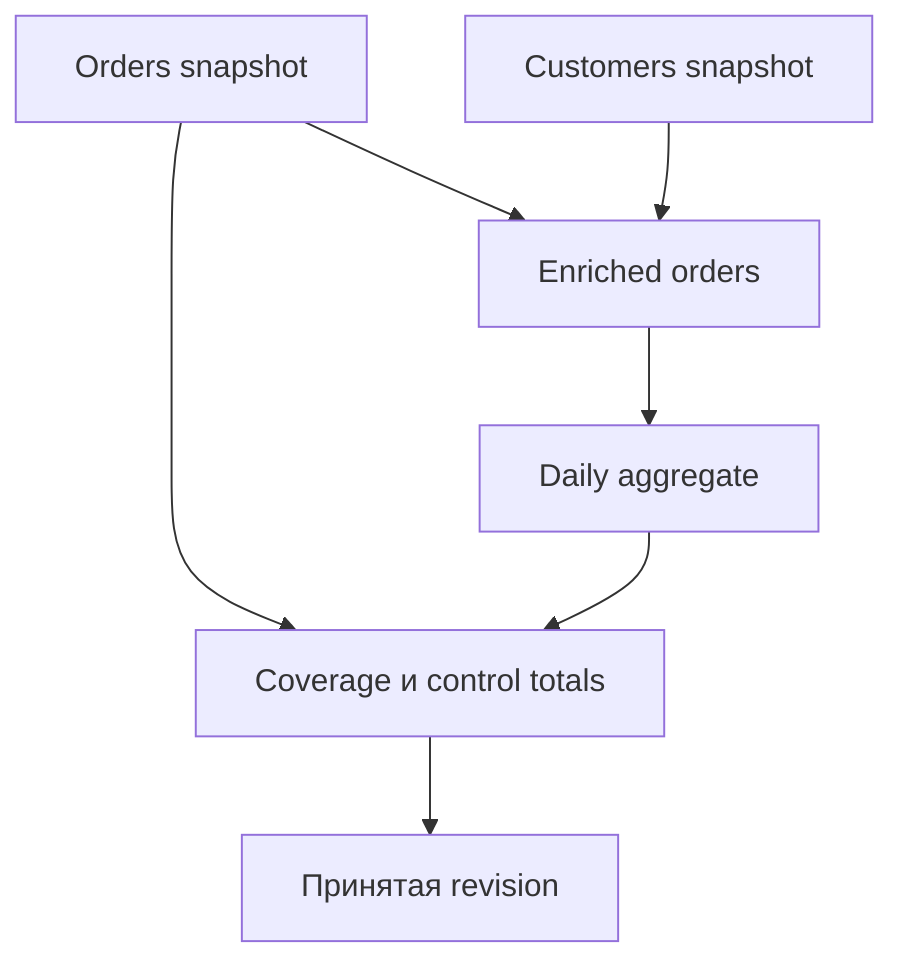
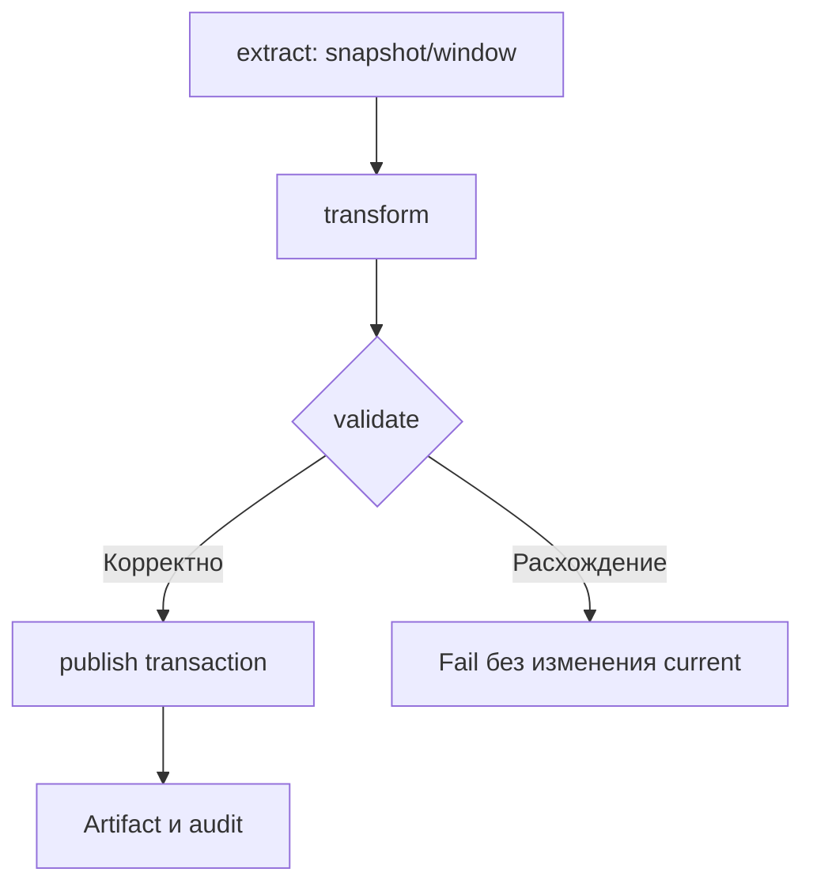

# 8. Catchup, backfill и управляемая переобработка

**Apache Airflow Zero to Hero · Профессиональный справочник**

| Параметр | Значение |
| --- | --- |
| Базовая линия | Apache Airflow 3.3.2, Task SDK 1.3.2, Standard provider 1.19.0, Python 3.12 |
| Дата проверки | 19 октября 2026 года |
| Покрытие README | Все 8 тем и 40 пунктов раздела, в исходном порядке |
| Предварительные знания | Сущности/состояния главы 4, TaskFlow главы 5, временной контракт главы 6, расписания главы 7 |
| Сквозной сценарий | Исправление расчёта за три дня, повтор failed runs, затем новая revision после поздних данных |
| Практический результат | Выбрать операцию восстановления, ограничить её ресурсы, сохранить аудит и доказать корректность результата |

Историческая обработка начинается с вопроса: **какой результат должен измениться и почему?**

«Перезапусти DAG за месяц» недостаточно. Нужно определить периоды, версию кода, snapshot источника, поведение записи, затронутые downstream и критерии приёмки. Иначе успешные tasks способны перезаписать актуальные данные старой revision или смешать разные версии расчёта.

Airflow управляет исполнением. История запусков и история опубликованных данных связаны, но не совпадают. Переобработка завершена для бизнеса после проверки и согласованной публикации данных.

Два важных уточнения закреплённой версии:

- Для обычного DAG с logical-date-based runs backfill 3.3.2 может **clear и переиспользовать существующий DagRun**, а не всегда создать отдельный новый. Partition-based путь реализован иначе.
- Cancel backfill переводит queued runs в failed и завершает управление backfill, но не гарантирует остановку уже running tasks и внешних jobs. [S01](#source-01) [S05](#source-05)

В этой главе эти различия учитываются в CLI/API примерах, аудитах и сценариях восстановления.

## Содержание

1. [Назначение исторических запусков](#s8-1)
2. [Catchup](#s8-2)
3. [Backfill в Airflow 3](#s8-3)
4. [Управление действующим backfill](#s8-4)
5. [Clear и восстановление задач](#s8-5)
6. [Согласованная историческая обработка](#s8-6)
7. [Конкуренция backfill и текущих запусков](#s8-7)
8. [Runbook переобработки](#s8-8)
9. [Практика: расчёт и версионируемая публикация](#lab)
10. [Практика: три управляемых backfill](#backfill-lab)
11. [Тесты и проверки результата](#tests)
12. [Разбор ситуаций](#cases)
13. [Самопроверка](#questions)
14. [Критерии освоения](#next)
15. [Проверка материала](#verification)
16. [Официальные источники](#sources)

<a id="s8-1"></a>
## 8.1. Назначение исторических запусков

### 8.1.1. Catchup, backfill, clear и manual trigger как разные операции

| Операция | Основная цель | Чего сама по себе не гарантирует |
| --- | --- | --- |
| Catchup | Автоматически пройти пропущенную плановую историю по timetable | Исправление ранее успешного результата |
| Backfill | Управляемая обработка указанного historical range | Новую business revision и корректность sink |
| Clear | Снова исполнить выбранные task instances существующих runs | Очистку внешних side effects |
| Manual trigger | Создать run по явной команде | Выбор нужного исторического window |
| Retry | Повторить попытку task при failure | Новый input snapshot или новый бизнес-период |

Выбирай операцию по требуемому изменению, а не по привычной кнопке UI.

Примеры:

- Scheduler был выключен, historical intervals ещё не создавались: рассмотреть catchup/backfill.
- В одном run упала публикация после успешных расчётов: targeted clear либо штатный retry с проверкой side effects.
- Нужно пересчитать уже успешные periods после исправления формулы: controlled backfill/reprocessing и новая output revision.
- Нужно обработать arbitrary range, не совпадающий с timetable: explicit-window manual DAG из главы 6.
- Источник дополнил старый period: correction по новой snapshot, а не молчаливый retry «тех же данных».

Изменение task state на success не выполняет callable и не подтверждает фактическую запись данных. Не используй такую отметку как замену восстановлению результата.

### 8.1.2. Новые DagRun и повторное выполнение существующих TaskInstance

`DagRun` — run-level metadata. `TaskInstance` адресуется DAG/run/task и map index; attempts описывают повторные исполнения. Clear не следует называть созданием нового независимого бизнес-расчёта без уточнений. [S08](#source-08) [S09](#source-09)

| Сценарий | Что происходит с metadata |
| --- | --- |
| Новый scheduled/manual run | Создаётся отдельный DagRun |
| Clear существующего run/task | Переисполняются выбранные task instances |
| Backfill отсутствующего ordinary period | Создаётся backfill DagRun |
| Backfill существующего ordinary period, разрешённого policy | В 3.3.2 возможен clear/reuse этого DagRun |
| Partition-based backfill/reprocess | Отдельный путь, способный создать новый run для partition |

У ordinary reprocessing путь `_handle_clear_run` обновляет backfill association, run type и при переданном input — conf существующего run. Run ID может сохраниться. Поэтому «новый backfill ID» не означает «новый run ID для каждого периода». [S01](#source-01)

При clear сохраняются/обновляются metadata истории попыток по правилам версии; TaskInstanceHistory помогает расследованию. Это не immutable snapshot всех исходных данных, окружения и внешних outputs. [S09](#source-09) [S10](#source-10)

Для независимого аудита сохраняй operation manifest: причина, range, выбранные run IDs, версии и результат сверки до/после. Ссылки старого backfill на переиспользованный run не заменяют такой отчёт.

### 8.1.3. Бизнес-период, диапазон запуска и версия вычисления

Нужно различать минимум три диапазона/идентичности.

| Объект | Пример |
| --- | --- |
| Business window | [1 октября 00:00Z, 2 октября 00:00Z) |
| Range выбора runs | Logical dates 1–3 октября inclusive |
| Input snapshot | orders-v1 либо orders-v2 |
| Transform version | Исправленная формула v2 |
| Publication revision | 1, затем 2 для того же business window |
| Airflow run identity | dag_id + run_id |
| Operation identity | backfill ID / change request / runbook execution ID |

Для daily interval timetable range logical dates 1–3 октября может означать три окна, последнее из которых заканчивается **4 октября**. Это не ошибка: end выбора runs и exclusive end последнего data interval — разные координаты.

Зафиксированная версия кода не фиксирует mutable source. Тот же SQL по тому же window через неделю способен увидеть поздние записи. Для точного replay нужен snapshot/версия входа либо явно выбранная correction policy.

### 8.1.4. Переобработка после ошибки кода и после изменения входных данных

| Причина | Что должно измениться | Что сравнивать |
| --- | --- | --- |
| Ошибка трансформации | Transform version | Результаты на одном snapshot |
| Поздние данные | Source snapshot/revision | Дельту входа и корректный новый output |
| Ошибка календаря | Calendar/window policy | Membership, boundaries и затронутые partitions |
| Ошибка sink/commit | Publish attempt/protocol | Состояние staging/current pointer |
| Изменение схемы | Schema/reader/writer contract | Совместимость и миграцию consumers |

Для сравнения кода удерживай snapshot постоянным. Для оценки поздних данных удерживай transform постоянным. Если поменять обе оси одновременно, объяснить расхождение сложнее.

Не всегда нужен полный recompute. Возможны targeted partitions, CDC replay, correction records или reconciliation. Но выбор должен сохранять требуемую семантику продукта.

«Результат стал другим» ещё не означает «ошибка исправлена». Нужен независимый критерий: totals, expected IDs, бизнес-инварианты, контрольный source report.

### 8.1.5. Выбор операции по требуемому результату и истории выполнения

| Состояние | Предпочтительный первый выбор |
| --- | --- |
| Нет runs за нужный periodic range | Dry run catchup/backfill plan |
| Есть failed task, input и code устраивают | Targeted retry/clear после проверки внешней работы |
| Есть success, code ошибочен | Reprocess completed + version/publish plan |
| Есть success, source изменился | Новая source snapshot и output revision |
| Есть running внешний job | Сначала reconcile его состояние |
| Нужен произвольный explicit range | Отдельный поддерживаемый manual contract |
| Требуется воспроизвести прежний результат | Исходные code/calendar/input versions |

Перед любым действием проверь:

1. Какой набор windows должен получиться?
2. Есть ли уже активная обработка тех же windows?
3. Какой input/code будет использован?
4. Что произойдёт при повторном publish?
5. Как доказать результат и при необходимости отменить его видимость?

**Контрольная точка 8.1:** выбираешь операцию по состоянию и цели, отделяешь identity исполнения от identity данных.

<a id="s8-2"></a>
## 8.2. Catchup

### 8.2.1. Создание недостающих плановых интервалов при `catchup=True`

Catchup управляет плановым прохождением истории timetable. Он полезен, когда каждый historical interval представляет самостоятельный воспроизводимый input.

Для explicit CronDataIntervalTimetable daily UTC и start date 1 октября:

| Logical date | Data interval | Earliest run_after |
| --- | --- | --- |
| 01.10 | [01.10,02.10) | 02.10 |
| 02.10 | [02.10,03.10) | 03.10 |
| 03.10 | [03.10,04.10) | 04.10 |

Фактическое создание/исполнение зависит от scheduler, history, pause и limits. Не ожидай, что включение catchup немедленно запустит все tasks одновременно. [S17](#source-17) [S18](#source-18)

Catchup не является произвольной повторной обработкой всех successful runs. Он не заменяет выбор reprocess policy и output revision.

Слово «недостающие» также требует осторожности: progression использует scheduling history. Для разрыва внутри существующей истории, миграции timetable или исправления already successful output нужен отдельный проверенный план.

### 8.2.2. Поведение `catchup=False` после установки и длительной паузы

Catchup=false не означает «все прошлые данные автоматически собраны в один run». Оно позволяет timetable пропустить historical candidates по его policy.

| Модель | Что проверить после паузы |
| --- | --- |
| Cron data interval | Последний допустимый завершённый calendar period |
| Cron trigger | Выбор trigger относительно now/history/earliest |
| Delta | Phase/rounding и current/history anchor |
| Custom business calendar | Его явно реализованную skip policy |
| Asset schedule | Иную event-driven модель, не календарный catchup |

Bare `schedule="@daily"` в default 3.3.2 использует trigger-модель. Для обсуждения завершённых daily periods здесь используется explicit interval timetable. [S15](#source-15) [S19](#source-19)

Если pipeline должен сохранять все входные изменения, skip period должен компенсироваться source checkpoint/CDC/read range или управляемой исторической загрузкой. Иначе часть данных останется необработанной.

Проверяй coverage опубликованных outputs. Малое количество failure не доказывает отсутствие пропусков: runs могли вовсе не создаваться.

### 8.2.3. Ограничения `start_date`, `end_date` и активных запусков

| Ограничение | Роль |
| --- | --- |
| start_date | Нижняя граница с timetable alignment |
| end_date | Верхняя scheduling restriction по соответствующей модели |
| run_after | Когда кандидат становится eligible |
| DAG max_active_runs | Concurrency ordinary run contour |
| Backfill max_active_runs | Отдельный concurrency contour исторической операции |
| max_active_tasks | В 3.3.2 лимит task instances внутри одного DagRun |
| Pools/executor/external quotas | Дополнительные ресурсные ограничения |

Start/end dates definitions не являются командами остановки уже работающего external job.

При daily interval latest logical date 3 октября может допускать interval до 4 октября. Не уменьшай end_date до «23:59:59» для обхода calendar semantics.

Ресурсные limits не изменяют business windows. Они влияют на скорость обработки и отставание. [S07](#source-07) [S15](#source-15)

### 8.2.4. Значения по умолчанию в Airflow 2 и Airflow 3

В стандартной конфигурации Airflow 2.10.5 catchup по умолчанию был включён; в Airflow 3.3.2 default отключён. Также изменилось default разрешение bare cron в timetable. Миграция без явных настроек способна изменить набор runs. [S19](#source-19) [S31](#source-31) [S32](#source-32)

Практическое правило: объявляй catchup и тип timetable явно.

```python
# example: explicit_catchup_definition
import pendulum

from airflow.sdk import dag, task
from airflow.sdk.definitions.timetables.interval import CronDataIntervalTimetable


@dag(
    dag_id="catchup_contract_example",
    schedule=CronDataIntervalTimetable(
        expression="0 0 * * *", timezone="UTC"
    ),
    start_date=pendulum.datetime(2026, 10, 1, tz="UTC"),
    catchup=True,
    max_active_runs=1,
    is_paused_upon_creation=True,
)
def catchup_contract_example():
    @task
    def inspect():
        print("Inspect interval-based inputs before enabling historical execution.")

    inspect()


catchup_contract_example()
```

Этот DAG изначально paused. При включении он может планировать historical periods; оцени диапазон и ресурсы заранее.

`catchup=True` в definition и default global config — разные источники configuration. Явное значение в DAG делает намерение reviewable.

### 8.2.5. Требование интервал-зависимого и воспроизводимого DAG-кода

Исторический run должен читать свой input.

| Неверная привязка | Явный contract |
| --- | --- |
| today()-1 | data interval либо validated explicit window |
| latest source table | Pinned snapshot или оговорённая latest-correction policy |
| output по wall-clock date | Partition identity по business window |
| append при каждом retry | Idempotent replacement/merge/commit |
| Calendar latest | Pinned calendar version |
| Credentials/token date из logical date | Runtime credentials живут по реальным часам |

Раздели deterministic computation и execution audit. Now подходит для observed_at, но не должен незаметно менять input исторического run. [S20](#source-20)

Воспроизводимость складывается из code, environment, calendar, input snapshot и publish protocol. Airflow metadata alone не фиксируют все эти зависимости.

**Контрольная точка 8.2:** понимаешь, какую историю создаёт выбранная policy и почему interval-based код необходим для безопасного historical execution.

<a id="s8-3"></a>
## 8.3. Backfill в Airflow 3

### 8.3.1. Управляемые scheduler backfills через UI, CLI и API

В Airflow 3 backfill представлен управляемой сущностью с ID, range, conf, reprocess policy, concurrency и association с runs. Исполнение контролирует scheduler; CLI create не требуется держать открытым до завершения всех задач. [S01](#source-01) [S02](#source-02)

| Способ | Подходящая работа |
| --- | --- |
| UI | Выбор range, наблюдение и операционные действия |
| CLI create | Воспроизводимое создание/dry run из shell |
| Public API v2 | Автоматизация, listing, pause/unpause/cancel |
| Собственный runbook | Предварительная оценка и приёмка данных |

Нельзя переносить старую команду `airflow dags backfill` или ожидания старого backfill job без сверки API версии.

В 3.3.2 model проверяет periodic timetable и allowed run types. `schedule=None`, asset-only, once/continuous не становятся backfillable просто потому, что у DAG есть start_date. Custom/hybrid timetable требует проверки поддерживаемого time/partition path. [S01](#source-01)

На один DAG разрешён только один незавершённый backfill. Paused backfill с отсутствующим completed_at продолжает занимать этот слот. Сначала resume/cancel/reconcile текущую операцию, затем создавай следующую.

### 8.3.2. `airflow backfill create` и проверка параметров установленной версии

Для wrapper `af` стенда главы 2:

```bash
af version
af backfill --help
af backfill create --help

af backfill create \
    --dag-id reprocessing_lab \
    --from-date 2026-10-01T00:00:00+00:00 \
    --to-date 2026-10-03T00:00:00+00:00 \
    --reprocess-behavior none \
    --max-active-runs 1 \
    --run-on-latest-version \
    --dry-run
```

В 3.3.2 точное имя флага — `--reprocess-behavior`. Допустимые значения: `none`, `failed`, `completed`. Не `--reprocessing-behavior`. [S03](#source-03) [S04](#source-04)

| Опция | Что фиксирует |
| --- | --- |
| --dag-id | DAG |
| --from-date / --to-date | Inclusive range выбора runs/partitions |
| --dag-run-conf | Runtime JSON configuration |
| --reprocess-behavior | Отношение к existing run state |
| --max-active-runs | Concurrency этого backfill |
| --run-backwards | Обратный порядок |
| --run-on-latest-version | Выбор latest bundle policy |
| --no-run-on-latest-version | Явное отключение latest policy |
| --dry-run | Preview candidates без создания backfill |

CLI uses BooleanOptionalAction для version flag. UI/API/default configuration могут использовать другие формы представления того же решения.

Решение о версии нужно принять по цели:

- исправление code bug может требовать новой transform/bundle version;
- точный replay прежнего результата требует исходной версии и snapshot;
- «latest» не фиксирует конкретную version навсегда: во время операции deployment должен быть контролируемым.

В resolver действует приоритет explicit value → DAG parameter → global config → endpoint fallback. Historical fallback для backfill — true, для clear/rerun — false. Нельзя считать все повторные операции одинаковыми по defaults. [S14](#source-14)


**API-альтернатива CLI.** Для того же backfill сохрани request body как `backfill_request.json`:

```json
{
  "dag_id": "reprocessing_lab",
  "from_date": "2026-10-01T00:00:00Z",
  "to_date": "2026-10-03T00:00:00Z",
  "run_backwards": false,
  "reprocess_behavior": "failed",
  "max_active_runs": 1,
  "run_on_latest_version": true,
  "dag_run_conf": {
    "source_snapshot": "v1",
    "transform_version": "v2",
    "publication_revision": 1,
    "operation_id": "lab-b"
  }
}
```

Используй этот путь **вместо** соответствующего CLI create, когда наступит этап B. API dry run — отдельный endpoint, а не поле dry_run этого body:

```bash
curl --fail-with-body --silent --show-error \
    -X POST \
    -H "Authorization: Bearer $AIRFLOW_API_TOKEN" \
    -H "Content-Type: application/json" \
    --data-binary @backfill_request.json \
    "$AIRFLOW_API_BASE/backfills/dry_run"
```

После сверки результата create использует тот же body и `POST /backfills`. Response содержит actual operation ID. Если backfill уже создан через CLI или ещё выполняется предыдущий, повтор create не нужен. [S05](#source-05) [S06](#source-06)


### 8.3.3. Диапазон дат, dry run и просмотр запланированных запусков

Для daily UTC interval-модели:

| Range logical dates inclusive | Выбранные windows |
| --- | --- |
| 01.10 → 01.10 | [01.10,02.10) |
| 01.10 → 03.10 | [01.10,02.10), [02.10,03.10), [03.10,04.10) |

Data predicate внутри каждого окна остаётся полуоткрытым. Inclusive selection range не делает SQL end inclusive.

Dry run показывает кандидатов с учётом policy и наблюдаемых existing states. В implementation 3.3.2 он фильтрует по non-create reason, но не резервирует эти состояния до настоящего create. Между preview и запуском они способны измениться. [S01](#source-01)

Для ordinary path `_get_info_list` учитывает интервалы, end которых строго раньше now. Не используй future backfill как механизм планового запуска; boundary exactly-now тоже нужно проверять по реальной implementation.

Dry run **не является**:

- прогоном task-кода;
- проверкой source snapshot;
- оценкой стоимости cluster jobs;
- подтверждением idempotent publish;
- блокировкой range от competing work;
- доказательством полного успеха будущей операции.

Сохрани preview в operation manifest и сопоставь actual associations/runs после create.

Для partition-aware DAG from/to интерпретируются по partition-date model. В source идентификация partition опирается на canonical instant, а не только форматированный label. Ordinary logical-date assumptions к этому пути не переносятся автоматически.

### 8.3.4. Reprocessing behavior для отсутствующих, failed и завершённых запусков

| Existing состояние | none | failed | completed |
| --- | --- | --- | --- |
| Run отсутствует | Обрабатывать | Обрабатывать | Обрабатывать |
| failed | Пропустить | Переобработать | Переобработать |
| success | Пропустить | Пропустить | Переобработать |
| queued/running | Пропустить как in flight | Пропустить как in flight | Пропустить как in flight |

`completed` — значение reprocess policy; это не отдельное значение DagRunState. В этой matrix оно допускает existing success и failed. [S01](#source-01)

Для обычных non-partitioned runs в этой версии переобработка existing period может реализоваться clear/reuse. У missing period создаётся run. Для partitioned path разрешённая переобработка создаёт отдельный run.

| Не перепутать | Правильное различие |
| --- | --- |
| Reprocess completed | Разрешить повтор на основании Airflow state |
| New publication revision | Решение data product |
| Completed backfill | Метаданные завершения управляющей операции |
| Successful data correction | Результат business acceptance checks |

Policy failed не найдёт бизнес-ошибку в green run. Если неверная формула раньше завершилась success, нужно осознанно включить такие windows в completed reprocess.

In-flight period нужно reconcile, а не пытаться обойти policy другим run ID.

### 8.3.5. Порядок выполнения и выделенный лимит активных backfill runs

Backfill `max_active_runs` применяется отдельно от DAG ordinary max_active_runs. При DAG limit=1 и backfill limit=2 теоретически возможна одновременная работа ordinary и historical contours; остальные limits всё ещё действуют. [S07](#source-07)

Run ordering — это не строгая гарантия порядка завершения при concurrency>1.

| Режим | Когда полезен |
| --- | --- |
| Вперёд | Последовательное восстановление истории, stateful dependencies |
| Назад | Приоритет свежих historical periods при независимости windows |
| Один active run | Упрощение нагрузки и наблюдения |
| Несколько active runs | Ускорение независимых windows при достаточной capacity |

`--run-backwards` не поддерживается при tasks с depends_on_past. Model также требует подходящую reprocess policy для таких DAG; «включить reverse и игнорировать зависимости» не является безопасным общим решением. [S01](#source-01)

Выделенный лимит backfill не резервирует CPU/warehouse capacity автоматически. Для приоритета production нужны pools, executor/cluster quotas и наблюдение external workloads.

**Контрольная точка 8.3:** можешь составить точную команду, объяснить range/policy/version и предсказать, какие periods будут пропущены или переисполнены.

<a id="s8-4"></a>
## 8.4. Управление действующим backfill

### 8.4.1. Состояние, прогресс и причины отсутствия новых запусков

Управляющий Backfill и составляющие его DagRuns имеют разные metadata.

| Backfill metadata | Что показывает |
| --- | --- |
| id / dag_id | Identity операции |
| from_date / to_date | Запрошенный range |
| reprocess_behavior | Policy отбора existing runs |
| max_active_runs | Лимит operation contour |
| is_paused | Остановлено ли продвижение очереди |
| created_at / completed_at | Lifecycle управляющей записи |
| Associations / exception_reason | Связь с runs и причины пропуска |

В response 3.3.2 нет универсального поля status со значениями success/cancelled, аналогичного task state. Статус UI может быть производным; смотри actual fields и состояния runs. [S01](#source-01) [S06](#source-06)

`completed_at != None` не доказывает:

- success всех runs;
- отсутствие running external jobs после cancel;
- правильность outputs;
- принятие результата consumers.

Scheduler завершает обычную операцию, когда не осталось соответствующих queued/running runs; terminal failed тоже не unfinished. Cancel имеет отдельную процедуру. [S05](#source-05) [S07](#source-07)

| Причина отсутствия progression | Проверка |
| --- | --- |
| Backfill paused | is_paused |
| DAG paused | DagModel/UI state |
| Достигнут operation max_active_runs | Running runs этого backfill |
| Pool заполнен | Runnable tasks и занятые slots |
| Межзапусковая зависимость | Failed-deps/previous run |
| Existing run in flight | Non-create reason |
| Range не дал eligible intervals | Dry run, timetable, current time |
| Operation completed/cancelled | completed_at и аудит действия |
| Processor/runtime issue | Import errors, version, logs |

Записи DagRuns могут создаваться заранее при create. Pause следует понимать как управление дальнейшим запуском из плана/очереди, а не обещание отсутствия всех metadata rows.

### 8.4.2. Pause, unpause и cancel согласно возможностям версии

В CLI 3.3.2 группа backfill предоставляет create. Не выдумывай команды `airflow backfill pause/list/cancel` только по аналогии с другими CLI.

Для управления используй UI или public API:

| Действие | Метод и путь относительно /api/v2 |
| --- | --- |
| Список для DAG | GET /backfills?dag_id=... |
| Одна операция | GET /backfills/{backfill_id} |
| Dry run | POST /backfills/dry_run |
| Создание | POST /backfills |
| Пауза | PUT /backfills/{backfill_id}/pause |
| Продолжение | PUT /backfills/{backfill_id}/unpause |
| Cancel | PUT /backfills/{backfill_id}/cancel |

Пути/методы сверены с routes 3.3.2. Для completed operation pause/unpause/cancel возвращают conflict по правилам endpoint. [S03](#source-03) [S05](#source-05)

Важное различие:

| Операция | Эффект |
| --- | --- |
| Pause backfill | Блокирует дальнейший старт его queued runs; running не «замораживаются» |
| Unpause | Разрешает продолжить очередь с учётом limits |
| Cancel | Сначала pause; queued runs → failed; completed_at заполняется |
| Cancel для running jobs | Не гарантирует их остановку этим endpoint |
| Pause DAG | Более широкое изменение scheduling DAG, другая область |

Cancel не откатывает уже опубликованные partitions. После него нужно отдельно reconcile running tasks, внешние jobs и visible outputs.

Для API примеров используй токен своего учебного стенда из главы 2. Не вставляй его в DAG/conf/operation manifest.

```bash
AIRFLOW_API_BASE="http://localhost:8080/api/v2"

curl --fail-with-body --silent --show-error \
    -H "Authorization: Bearer $AIRFLOW_API_TOKEN" \
    "$AIRFLOW_API_BASE/backfills?dag_id=reprocessing_lab"
```

Возьми **фактический** backfill ID из response/UI и задай `AF_BACKFILL_ID`. Затем выбирай нужное действие, например pause:

```bash
curl --fail-with-body --silent --show-error \
    -X PUT \
    -H "Authorization: Bearer $AIRFLOW_API_TOKEN" \
    "$AIRFLOW_API_BASE/backfills/$AF_BACKFILL_ID/pause"
```

Для unpause/cancel меняется последнее имя пути. Это разные управленческие решения, их не нужно выполнять подряд как обязательный script.

### 8.4.3. Пулы для исторической обработки и разделение с текущей нагрузкой

Pool ограничивает tasks, назначенные в него. Backfill max_active_runs ограничивает runs. Это разные уровни. [S29](#source-29)

| Контур | Пример |
| --- | --- |
| Current source readers | production_io pool |
| Historical readers | history_io pool |
| Warehouse merge | warehouse_publish pool |
| External cluster jobs | Queue/resource quota вычислительной платформы |
| Publisher | Отдельный ограниченный stage |

У create backfill нет универсального флага «назначить все tasks в другой pool». Task pool задаётся definition. Не рассчитывай на Jinja в pool, если поле не поддерживает такую templating semantics.

Для полноценного разделения можно использовать отдельный replay DAG, построенный из общей versioned pipeline logic, с собственными pools/queues/targets. Это требует поддерживать совместимый contract, а не копировать код без контроля версий.

В лаборатории используется отдельный pool учебного historical DAG. Он не имитирует автоматическое переназначение pools у production runs.

Priority weights помогают порядку queued tasks, но не вытесняют уже занятые external ресурсы и не дают жёсткую SLA-reservation.

### 8.4.4. Ограничение запросов к upstream и вычислительным кластерам

Оцени каждый shared bottleneck:

- source connections и queries per second;
- scan bytes/CPU источника;
- warehouse slots/credits;
- Spark/Kubernetes resource quota;
- object-storage requests/throughput;
- API rate limits;
- simultaneous external jobs;
- publish/merge lock contention.

Для однородного stage приблизительный concurrency cap ограничен минимумом run/task limits, pool capacity, executor capacity и внешней quota. Это оценка конкретной topology, а не универсальная формула для всего DAG.

Пример: backfill limit 2 runs, до 4 runnable tasks в каждом — потенциально 8 task executions до прочих ограничений. Pool на 2 weighted slots может сделать фактический reader concurrency меньше.

Дополнительно нужны timeout, bounded retries и backoff. Быстрые массовые retries способны усилить overload источника.

Pool slot освобождён — не всегда значит, что внешний job завершён. Для deferrable/async операторов и detached jobs отдельно проверяй lifecycle и правила учёта slots.

### 8.4.5. Остановка переобработки без потери сведений о выполненной части

Безопасная остановка — процедура, а не одна кнопка.

1. Зафиксировать operation ID, desired range и current manifests.
2. Pause дальнейшее progression.
3. Снять список running tasks/jobs.
4. Дождаться либо управляемо остановить внешние workloads.
5. Сверить committed outputs и staging.
6. При необходимости cancel оставшуюся очередь.
7. Записать completed/failed/skipped/unknown windows.
8. Построить residual plan для продолжения.

Не удаляй history только ради возможности создать новую операцию. Это убирает диагностические связи и не отменяет side effects.

При resume из pause сохраняется текущая операция. После cancel её нельзя просто unpause как незавершённую: нужен новый controlled residual backfill/reprocess plan.

Повтор команды с policy none способен пропустить failed queued runs после cancel. Для ordinary residual range выбирай policy по actual states и data coverage, а не по прежнему намерению команды.

**Контрольная точка 8.4:** различаешь pause/cancel/остановку внешней работы и умеешь восстановить точный residual plan.

<a id="s8-5"></a>
## 8.5. Clear и восстановление задач

### 8.5.1. Область clear: задача, upstream/downstream, диапазон и map index

Scope clear нужно определить до изменения states.

| Координата | Пример |
| --- | --- |
| DAG | reprocessing_lab |
| Run | Конкретный run_id либо проверенный logical-date range |
| Task | transform |
| Mapping | Один map_index либо все indexes |
| Dependencies | Сам task / downstream / upstream |
| State filter | Failed/running/все выбранные |
| Version policy | Original либо latest |
| Running protection | Разрешено ли затрагивать активную работу |

У failure transform downstream validate/publish могли стать upstream_failed. Если расчёт меняется, проверь необходимость повторить зависимые результаты, а не только failed callable.

В CLI 3.3.2 `tasks clear` поддерживает task regex, range, upstream/downstream и state filters, но не предоставляет произвольные `--run-id`/`--map-index` параметры. Для точной адресации используй UI/API нужной версии. [S03](#source-03) [S11](#source-11)

```bash
af tasks clear reprocessing_lab \
    --start-date 2026-10-02T00:00:00+00:00 \
    --end-date 2026-10-02T00:00:00+00:00 \
    --task-regex '^transform$' \
    --downstream
```

Без `--yes` CLI сначала показывает selection и спрашивает о применении. Это встроенный механизм команды. Не добавляй выдуманный `tasks clear --dry-run`; для programmatic preview есть API dry_run.

API `POST /api/v2/dags/{dag_id}/clearTaskInstances` принимает конкретный run ID. Пример body для **mapped** transform с index 7:

```json
{
  "dry_run": true,
  "dag_run_id": "actual_run_id",
  "task_ids": [["transform", 7]],
  "only_failed": false,
  "include_upstream": false,
  "include_downstream": true,
  "include_past": false,
  "include_future": false,
  "reset_dag_runs": true,
  "run_on_latest_version": false,
  "prevent_running_task": true,
  "note": "Review exact selection before recovery"
}
```

Подставь настоящий run ID и task/index своего DAG. В основной лаборатории transform не mapped; для неё task_ids должен быть `["transform"]`. Указание только имени mapped task охватывает все его indexes. [S12](#source-12) [S13](#source-13)

Сначала проверь response preview. Для применения передаётся dry_run=false при том же проверенном scope. Изменившийся history/runtime state требует повторной оценки.

### 8.5.2. Сохранение параметров и влияние текущей версии DAG

Обычный targeted clear не является командой «заменить dag_run.conf новым JSON». Однако неизменный conf ещё не гарантирует прежние inputs: могут измениться defaults, code, external source и calendar.

Backfill reuse existing ordinary run — другой путь: если передан dag_run_conf, implementation может **заменить** conf этой записи. Не считай такую замену автоматически deep merge старого и нового persisted conf. [S01](#source-01)

Версионные решения:

| Цель | Что зафиксировать |
| --- | --- |
| Повтор технически неуспешного шага | Исходные version/snapshot и external job state |
| Исправление формулы | Новая transform version на том же snapshot |
| Обработка late data | Новый snapshot при известной transform |
| Полный historical replay | Code/environment/calendar/input/publish contracts |

Для clear/rerun resolver по умолчанию использует отдельный fallback от backfill. Explicit `run_on_latest_version` снимает неоднозначность API path, но функция experimental и зависит от bundle/version support. [S14](#source-14) [S21](#source-21)

Если у run не было собственной version, «не использовать latest» не может восстановить несуществующую pinning metadata. В source предусмотрены fallback cases. [S09](#source-09)

Также flag старой version не возвращает автоматически старое timetable planning: backfill range строится по current serialized DAG. Исторический calendar contract должен быть восстановлен отдельно.

### 8.5.3. `depends_on_past` и `wait_for_downstream` при восстановлении

Межзапусковые зависимости делают порядок reprocessing частью корректности.

| Настройка | Смысл |
| --- | --- |
| depends_on_past | Учитывается previous instance той же task |
| wait_for_downstream | Дополнительное ожидание downstream предыдущего run |
| First-run policy | Определяет допустимость старта без предшественника |
| Backfill direction | Должна соответствовать temporal dependencies |

В 3.3.2 PrevDagrunDep имеет отдельные paths для first backfill entry, scheduled history и ignore-first policy. Не своди всё к безусловному «предыдущий календарный день должен success». [S22](#source-22)

Успешными в соответствующих dependency checks могут считаться разрешённые terminal states, включая skipped по implementation; unfinished и upstream_failed не следует объявлять эквивалентом success.

Типичный блокирующий сценарий:

- второй historical run ждёт previous task;
- previous task ждёт downstream;
- downstream не получает pool/external resource;
- оператор очищает новые runs, не устранив первоначальную причину.

Начинай с failed-deps и literal previous run/task states. Не отключай межзапусковые зависимости только ради ускорения backfill, если они защищают sequential resource/state.

Reverse backfill с depends_on_past запрещён моделью. Forward order и корректная first-run policy всё равно требуют tests и проверки версии.

### 8.5.4. Оставшийся внешний job и риск повторной отправки

Task failure не доказывает failure external job.

| Ситуация | Риск |
| --- | --- |
| Worker погиб после submit | Job продолжает работать |
| Timeout ожидания | Внешнее выполнение ещё не завершено |
| Clear running task | Новый attempt может повторно отправить workload |
| Cancel backfill | Running jobs сохраняются |
| Потерян job ID/XCom | Сложно найти фактическую работу |
| Retry publish | Повторная запись/уведомление |

Перед resubmit:

1. Найди deterministic job/request ID.
2. Проверь external state и committed side effects.
3. Реши: reattach, wait, cancel либо resubmit.
4. Используй idempotency key поддерживаемого API.
5. Зафиксируй lineage old/new attempts.

Airflow clear может помечать/сбрасывать metadata и инициировать локальную остановку по implementation. Это не транзакционный rollback всех внешних систем.

Храни важный external job reference в долговечной metadata. XCom удобен для передачи ссылки, но не должен быть единственным способом расследовать уже запущенную дорогостоящую работу.

### 8.5.5. Проверка данных после clear вместо оценки только task status

После recovery сравни три слоя:

| Слой | Проверка |
| --- | --- |
| Airflow | Нужные tasks/runs достигли ожидаемых terminal states |
| External execution | Job завершён, отсутствует orphan/duplicate workload |
| Data product | Верные snapshot/window/revision и output values |

Нужны checks:

- expected business IDs и counts;
- totals/control sums;
- schema compatibility;
- duplicate/missing keys;
- range coverage;
- atomic publication/current pointer;
- downstream consistency;
- отсутствие stale revision overwrite.

Если task publish success, но pointer указывает на старый artifact, цель recovery не достигнута. Если output верен, но повторно отправлено уведомление, idempotency внешнего side effect всё ещё нарушена.

**Контрольная точка 8.5:** можешь выбрать точный clear scope, предсказать version/input behavior и проверить внешние последствия.

<a id="s8-6"></a>
## 8.6. Согласованная историческая обработка

### 8.6.1. Manifest входов, snapshot источника и версия схемы

Operation manifest — описание намерения и зафиксированных inputs, а не только копия CLI command.

```json
{
  "operation_id": "orders-correction-2026-10",
  "reason": "Fix refund calculation",
  "dataset": "orders_daily",
  "selection_axis": "logical_date",
  "from_date": "2026-10-01T00:00:00Z",
  "to_date": "2026-10-03T00:00:00Z",
  "data_end_exclusive": "2026-10-04T00:00:00Z",
  "calendar_version": "utc-daily-v1",
  "source_snapshot": "orders-v1",
  "transform_version": "v2",
  "schema_version": 1,
  "target": "training",
  "publication_revision": 1,
  "acceptance": {
    "expected_periods": 3,
    "allow_missing_periods": false
  }
}
```

Это собственная схема примера, не Airflow request body.

На практике добавь:

- конкретную code/bundle version;
- source snapshot identifiers для каждого источника;
- schema и transform versions;
- точный expected window set;
- destination и policy replace/merge;
- resource limits;
- operation owner/reason;
- checkpoints и результаты acceptance.

Snapshot должен быть технически доступен на всё время replay. Имя версии в conf не сохраняет данные, если warehouse retention уже удалил соответствующий snapshot.

Версия схемы и версия содержимого — разные оси. Исторические данные могут требовать старый parser/schema даже при актуальном transform.

### 8.6.2. Переобработка нескольких DAG в топологическом порядке

Если downstream читает результат upstream, недостаточно независимо backfill оба DAG за одинаковые даты.



Это data lineage схема, не инструкция запускать DAG только по совпадению logical date.

Согласуй:

| Область | Вопрос |
| --- | --- |
| Temporal coverage | Upstream windows покрывают downstream period? |
| Snapshot consistency | Sources относятся к совместимому состоянию? |
| Transform/schema | Consumers понимают output revision? |
| Ordering | Downstream ждёт именно исправленный output? |
| Publication | Когда новая цепочка становится видимой? |
| Failure recovery | Как продолжить частично выполненный graph? |

Возможны разные стратегии:

- полностью подготовить upstream historical outputs, затем downstream;
- двигаться window-by-window в топологическом порядке;
- строить shadow revision всего graph, затем переключать consumers;
- публиковать исправления incrementally по согласованному contract.

Совпадение `ds` не доказывает совместимость разных calendar/timezone/granularity. Используй intervals и manifests.

Event/asset propagation может помочь уведомить consumers о новой версии, но оно не заменяет input/version agreement.

### 8.6.3. Замена партиции, merge/upsert и публикация исправлений

| Write strategy | Когда подходит | Что доказать |
| --- | --- | --- |
| Replace partition | Полный пересчёт partition | Полноту replacement и atomic visibility |
| Merge/upsert | Есть stable key и changes | Dedup, ordering, delete/correction semantics |
| Append corrections | Предметная модель поддерживает amendments | Как consumers получают итог |
| Shadow table/version | Нужна независимая проверка | Cost, consistency и переключение |
| Immutable artifacts + pointer | Версионируемый продукт | Commit/pointer policy и recovery |

Append при каждом retry часто создаёт дубли. Но overwrite без проверки scope способен удалить корректные данные. Безопасность определяется выбранным contract и transaction mechanism конкретного sink.

Типовой publish protocol:

1. Вычислить результат для pinned input.
2. Записать isolated immutable candidate.
3. Проверить schema, IDs, totals и coverage.
4. Согласованно обновить visible pointer/partition.
5. Сохранить связь old/new versions и audit.
6. Продвигать checkpoint только после подтверждённого commit.

Если metadata commit и внешний object upload находятся в разных системах, между ними нет автоматической общей транзакции. Требуется протокол восстановления orphan candidates и unknown commit outcomes.

Лаборатория ниже реализует ограниченный вариант в одной SQLite business database. Он показывает atomic pointer update и revision ordering, а не обещает transaction между произвольными storage.

### 8.6.4. Обновление downstream assets и предупреждение потребителей

Новая partition revision должна быть различима для consumers.

| Metadata | Зачем нужно |
| --- | --- |
| Window | Какой период изменился |
| New/previous revision | Что считать актуальным |
| Snapshot/transform | Почему результат отличается |
| Quality/completeness | Готов ли результат к использованию |
| Operation ID | Как расследовать correction |
| Consumer contract version | Совместима ли схема |

Публикация asset event до commit может заставить consumer читать незавершённый результат. Сигнал готовности должен соответствовать принятому publish protocol.

Для уведомлений важна idempotency: retry после успешной публикации не должен бесконтрольно отправлять одинаковое сообщение или повторно запускать неподготовленный downstream graph.

Организационное предупреждение потребителей — отдельная согласованная процедура: какие reports меняются, когда, на сколько и как проверить revision. Airflow success сам по себе эту коммуникацию не выполняет.

Не подменяй исправление данных случайной сменой имени asset. Dataset identity и versioned publication должны оставаться объяснимыми.

### 8.6.5. Совместное существование старого и нового результата

Сохранять обе revisions полезно для:

- сравнения;
- расследования regression;
- pinned consumers;
- controlled rollout;
- возврата прежней семантики.

Но нужно определить **единственный понятный способ выбора видимого результата**.

| Consumer policy | Свойство |
| --- | --- |
| latest accepted | Получает последнюю принятую revision |
| pinned revision | Воспроизводимый downstream input |
| final only | Не читает provisional publication |
| explicit operation branch | Проверяет correction отдельно |

Нельзя заставлять consumer угадывать по timestamp folder, какая version правильная.

Rollback видимости — новый контролируемый commit на сохранённый artifact/его воспроизведённую семантику. Это не обязательно удаление новой версии и не изменение state Airflow.

Если publication revisions возрастают, rollback может получить следующий номер revision, указывающий на прежнее содержимое. Номер показывает порядок принятого решения, а не неизбежно более свежий source snapshot.

**Контрольная точка 8.6:** можешь описать согласованный input→compute→validate→publish contract для одного DAG и цепочки зависимых datasets.

<a id="s8-7"></a>
## 8.7. Конкуренция backfill и текущих запусков

### 8.7.1. Пересекающиеся интервалы и гонки за одну партицию

Опасна не только одновременная запись. Старый job способен завершиться позже нового.

| Время | Событие |
| --- | --- |
| T1 | Backfill начинает старую revision |
| T2 | Current/correction run готовит новую |
| T3 | Новая revision опубликована |
| T4 | Старый backfill завершает overwrite |
| Итог | Актуальный результат заменён устаревшим |

Последовательность по wall-clock completion не равна порядку business revisions.

Простейший lock без fencing тоже недостаточен, если старый worker продолжает работу после истечения lease. Publish должен проверять право обновления visible result по версии/токену выбранного протокола.

При rolling windows overlap может быть намеренным. Тогда необходимо определить aggregation/dedup policy. Для partition replacement случайный overlap обычно означает конфликт владения output.

### 8.7.2. Изолированные префиксы, locks и атомарная публикация

Три механизма решают разные проблемы.

| Механизм | Что обеспечивает |
| --- | --- |
| Isolated staging | Partial output не смешивается с текущим |
| Lock/lease | Координацию concurrent writers |
| Fencing/version check | Отказ устаревшему writer |
| Atomic visible pointer | Consumer видит согласованную revision |
| Immutable history | Сохранение предыдущих результатов |

Пример object layout:

```text
orders/_versions/<artifact_id>/
orders/_manifests/<window_id>/revision=<number>.json
orders/current/<window_id>
```

Конкретная atomicity зависит от системы. Не предполагай atomic directory rename для любого object storage.

В лаборатории trusted operation задаёт publication_revision. Publisher внутри одной write transaction:

- отвергает меньшую revision;
- допускает idempotent повтор того же artifact/revision;
- отвергает different artifact под тем же revision;
- продвигает pointer на большую approved revision.

Allocation revision — ответственность управляющего процесса. Случайно дать старому snapshot очень большой номер не делает его правильным. Policy источника и авторизация изменения должны быть проверены до publish.

### 8.7.3. Приоритет production SLA и отдельная квота ресурсов

Backfill — управляемая нагрузка, которая не должна незаметно съесть весь резерв текущего pipeline.

Зафиксируй:

| Ресурс | Budget |
| --- | --- |
| Источник | Historical connection/query/scan limits |
| Compute | Отдельные queue/quota/capacity ceilings |
| Warehouse | Slots/concurrency/credit budget |
| Storage | Request/throughput budget |
| Airflow control plane | Допустимые creation/task/API rates |
| Operators | On-call capacity и stop conditions |

Отдельные pools не всегда резервируют физические CPU/memory: tasks всё равно могут конкурировать за один executor/cluster. Нужны limits на каждом bottleneck.

Priority queue не прерывает уже running тяжёлый historical job. Для стабильного current SLA может потребоваться отдельный compute contour либо заранее установленный потолок history.

Stop conditions должны быть измеримыми: source saturation, рост current freshness lag, error rate, lock contention, превышение cost/runtime budget.

### 8.7.4. Нагрузка на метабазу, XCom, API и object storage

Десятки тысяч runs имеют control-plane стоимость даже при коротких tasks.

Источники нагрузки:

- создание DagRuns/task instances/associations;
- scheduling queries и state transitions;
- heartbeats и execution API requests;
- log storage;
- XCom writes/reads;
- dynamic mapping expansion;
- retries;
- object listings и manifest checks.

Передавай через XCom компактные references/contracts. Не складывай туда весь historical dataset для удобства промежуточных шагов.

Количество periods × число tasks × attempts — полезная первая оценка, но mapping и downstream fan-out способны резко увеличить объём.

Создание всей многомесячной операции не всегда лучше порций. Window batches упрощают наблюдение и stop/resume, если batch boundaries и coverage ledger заданы явно.

Не очищай metadata вручную ради снижения нагрузки во время незавершённой операции. Retention/cleanup — отдельный operational process с учётом audit requirements.

### 8.7.5. Проверка мощности перед переобработкой нескольких месяцев

Для иллюстрации возьмём 90 periods по 60 GiB чтения: около 5400 GiB первичного scan до retries и дополнительных joins. Это условная оценка, не характеристика Airflow.

Оцени:

- total scan/write bytes;
- p50/p95/max period runtime;
- skew и large partitions;
- source/compute/storage bottleneck;
- retry amplification;
- parallelism, который реально безопасен;
- fixed planning/startup/publish overhead.

Приближённое время `sum(period_runtime)/effective_parallelism` — лишь стартовая модель. Dependency critical path, queueing и serial publish могут доминировать.

Пробный набор должен включать обычный, большой и нестандартный period. Один маленький день не представляет весь квартал.

После canary увеличивай batch/concurrency постепенно и сравнивай измерения с budget. Изменение скорости не должно менять input/window/version contract.

**Контрольная точка 8.7:** умеешь ограничить стоимость historical work и защитить current outputs от stale writers.

<a id="s8-8"></a>
## 8.8. Runbook переобработки

### 8.8.1. Цель, точный диапазон и критерии приёмки

Хорошая цель: «пересчитать daily orders за logical dates 1–3 октября по snapshot v1 и формуле v2; сохранить старые outputs; опубликовать revision 1 в training target после проверки IDs/counts/totals».

Плохая цель: «перезапустить последние дни».

Runbook header:

| Поле | Пример |
| --- | --- |
| Причина | Неверная обработка refunds |
| Dataset/DAG | orders_daily / reprocessing_lab |
| Selection axis | logical_date |
| Range | 01.10–03.10 inclusive |
| Data coverage | [01.10,04.10) UTC |
| Versions | Snapshot v1, transform v2, calendar utc-daily-v1 |
| Destination | Изолированный target |
| Acceptance | 3 windows, expected keys/counts/totals, no stale overwrite |
| Recovery | Residual plan и сохранённые artifacts |

Критерии приёмки определяются до исполнения. Иначе удобно объявить «нормальным» любой полученный результат.

### 8.8.2. Оценка объёма, стоимости и времени выполнения

Составь план с low/high estimates, а не одну оптимистичную цифру.

| Оценка | Вход |
| --- | --- |
| Number of windows | Timetable preview/expected ledger |
| Source bytes | Statistics/representative scan |
| Compute time | Measured canary |
| Concurrency | Budget всех relevant systems |
| Retry factor | Failure history и known risks |
| Publish cost | Merge/replace/validation strategy |
| Operator time | Наблюдение и incident response |

План capacity должен учитывать current production contour. «Все workers свободны сейчас» не означает, что они будут свободны весь historical range.

Если стоимость нельзя заранее точно измерить, задай bounded first batch и критерии расширения. Dry run Airflow такую оценку сам не делает.

### 8.8.3. Пробный период, сравнение данных и контроль качества

Canary должен проверить всю цепочку до publish либо до isolated candidate.

Сравнение:

1. Input snapshot и row selection.
2. IDs/counts и null/key invariants.
3. Значимые business totals.
4. Distribution/outliers, если применимо.
5. Schema/type compatibility.
6. Candidate artifact/checksum.
7. Publish atomicity/retry.
8. Downstream read contract.

Для code correction сравни старый/новый transform на одном snapshot. Для late data сравни snapshots при одном transform. Сохраняй объяснение расхождения, а не только числовую дельту.

Автоматический check не обязан знать правильный итог заранее, как в игрушечном наборе. В production используются upstream control totals, reconciliation и независимые бизнес-инварианты.

### 8.8.4. Возобновление после прерывания и доказательство полноты

Ledger expected periods важнее списка «последних успешных runs».

| Статус window | Действие |
| --- | --- |
| Accepted and committed | Не пересчитывать без причины |
| Failed before commit | Повторить по policy |
| Commit outcome unknown | Reconcile sink/pointer |
| Running external job | Найти/дождаться/остановить |
| Skipped by reprocess policy | Проверить, было ли это намеренно |
| Missing | Включить в residual plan |
| Superseded revision | Сохранить lineage и выбрать accepted current |

Resume plan строится как разность desired accepted set и verified committed set. При unknown states сначала reconciliation, затем решение о повторе.

Counts без IDs/range coverage недостаточны: duplicate одного window и отсутствие другого могут дать правильное общее число.

В source-based replication ещё нужен согласованный checkpoint. Он продвигается после commit, иначе crash способен превратить непубликованные данные в «уже обработанные».

### 8.8.5. Аудит запуска, rollback результата и документирование причины

Audit должен связать:

- operation ID и причину;
- команды/API request без credentials;
- preview и actual selection;
- run IDs/attempts и version policy;
- source/calendar/schema versions;
- accepted artifacts/revisions;
- failures/skips/stop actions;
- итоговую reconciliation;
- решение rollback/accept.

Не хранить секреты в dag_run.conf — часть правильного data contract, а не только logging policy.

Rollback result:

1. Определить accepted предыдущую version.
2. Проверить её доступность и совместимость.
3. Подготовить новый controlled publish decision.
4. Обновить pointer/consumer contract атомарно по sink semantics.
5. Повторить validation и downstream reconciliation.
6. Сохранить обе versions и причину rollback.

Отметить tasks failed, clear или cancel недостаточно для отмены уже видимого результата.

**Контрольная точка 8.8:** можешь подготовить runbook, выполнить bounded canary, продолжить остаток и доказать принятое покрытие.

<a id="lab"></a>
## Практика: расчёт и версионируемая публикация

### Что проверяет лаборатория

Воспроизведём три операции над одними daily windows:

| Этап | Input/transform | Ожидание |
| --- | --- | --- |
| A | snapshot v1, ошибочная формула | Validation fail, ничего не опубликовано |
| B | snapshot v1, исправленная формула | Failed reprocess, revision 1 |
| C | snapshot v2 с late event, та же исправленная формула | Completed reprocess, revision 2 |

Пример использует **отдельную SQLite business database** для маленьких synthetic outputs. Это не metadata database Airflow.

Ограничение стенда: один host, native setup либо Compose с общим **локальным bind mount** для workers. Для разных worker hosts/production используй соответствующий database/warehouse/object-storage publish protocol; этот SQLite file не предлагается размещать на NFS.

Формула намеренно переключается runtime parameter, чтобы упражнение не зависело от deployment нового кода. Это моделирует transform contract, но не заменяет тест bundle-version rollout.

### Файлы примера

| Файл | Назначение |
| --- | --- |
| `dags/corp_replay/__init__.py` | Пустой package marker |
| `dags/corp_replay/core.py` | Pure fixture, checks и transactional publisher |
| `dags/reprocessing_lab.py` | Backfillable DAG |
| `dags/corp_replay/verify.py` | Независимая проверка видимого результата |
| `tests/test_replay_core.py` | Unit tests |

Общий package должен быть доступен всем task interpreters. DB path задаётся через `AIRFLOW_REPLAY_LAB_DB` и должен указывать на один и тот же business store.

### Pure contract и publisher

`dags/corp_replay/core.py`:

```python
# example: replay_core
import hashlib
import json
from pathlib import Path
import sqlite3
from datetime import UTC, datetime, time, timedelta

EXPECTED = {
    "v1": {"count": 3, "total_minor": 1400, "suffixes": ["a", "b", "c"]},
    "v2": {"count": 4, "total_minor": 1700, "suffixes": ["a", "b", "c", "late"]},
}

SCHEMA = """
CREATE TABLE IF NOT EXISTS artifact (
    artifact_id TEXT PRIMARY KEY,
    payload TEXT NOT NULL
);
CREATE TABLE IF NOT EXISTS publication (
    target TEXT NOT NULL,
    window_start TEXT NOT NULL,
    window_end TEXT NOT NULL,
    revision INTEGER NOT NULL,
    artifact_id TEXT NOT NULL REFERENCES artifact(artifact_id),
    PRIMARY KEY (target, window_start, window_end)
);
CREATE TABLE IF NOT EXISTS publish_audit (
    id INTEGER PRIMARY KEY,
    operation_id TEXT NOT NULL,
    run_id TEXT NOT NULL,
    artifact_id TEXT NOT NULL REFERENCES artifact(artifact_id),
    revision INTEGER NOT NULL,
    action TEXT NOT NULL,
    observed_at TEXT NOT NULL
);
"""


class RevisionConflict(RuntimeError):
    pass


def as_utc(value: datetime) -> datetime:
    if value.tzinfo is None or value.utcoffset() is None:
        raise ValueError("An aware datetime is required")
    return value.astimezone(UTC)


def make_contract(start: datetime, end: datetime, params: dict) -> dict:
    start, end = as_utc(start), as_utc(end)
    if start.time() != time.min or end - start != timedelta(days=1):
        raise ValueError("This training dataset requires one complete UTC day")
    snapshot = params["source_snapshot"]
    transform_version = params["transform_version"]
    revision = params["publication_revision"]
    if snapshot not in EXPECTED:
        raise ValueError("Unsupported source snapshot")
    if transform_version not in {"v1_bug", "v2"}:
        raise ValueError("Unsupported transform version")
    if type(revision) is not int or revision < 1:
        raise ValueError("publication_revision must be a positive integer")
    return {
        "dataset": "orders_daily",
        "target": "training",
        "window_start": start.isoformat(),
        "window_end": end.isoformat(),
        "source_snapshot": snapshot,
        "transform_version": transform_version,
        "schema_version": 1,
        "publication_revision": revision,
    }


def read_inputs(contract: dict) -> list[dict]:
    start = datetime.fromisoformat(contract["window_start"])
    end = datetime.fromisoformat(contract["window_end"])
    day = start.date().isoformat()
    specs = [("a", 10, 1000), ("b", 11, -100), ("c", 12, 500)]
    if contract["source_snapshot"] == "v2":
        specs.append(("late", 23, 300))
    rows = [
        {
            "order_id": f"{day}:{suffix}",
            "event_time": (start + timedelta(hours=hour)).isoformat(),
            "amount_minor": amount,
        }
        for suffix, hour, amount in specs
    ]
    return [
        row for row in rows
        if start <= datetime.fromisoformat(row["event_time"]) < end
    ]


def calculate(contract: dict, rows: list[dict]) -> dict:
    amounts = [row["amount_minor"] for row in rows]
    if contract["transform_version"] == "v1_bug":
        # The bug: refunds are incorrectly turned into positive amounts.
        total = sum(abs(amount) for amount in amounts)
    else:
        total = sum(amounts)
    return {
        "contract": contract,
        "order_ids": sorted(row["order_id"] for row in rows),
        "row_count": len(rows),
        "total_minor": total,
    }


def validate_result(result: dict) -> dict:
    contract = result["contract"]
    normalized = make_contract(
        datetime.fromisoformat(contract["window_start"]),
        datetime.fromisoformat(contract["window_end"]),
        contract,
    )
    if normalized != contract:
        raise ValueError("Unexpected or non-canonical business contract")
    expected = EXPECTED[contract["source_snapshot"]]
    day = datetime.fromisoformat(contract["window_start"]).date().isoformat()
    expected_ids = sorted(
        f"{day}:{suffix}" for suffix in expected["suffixes"]
    )
    if result["order_ids"] != expected_ids:
        raise ValueError("Business IDs do not match the independent fixture oracle")
    if result["row_count"] != expected["count"]:
        raise ValueError("Unexpected row count")
    if type(result["total_minor"]) is not int:
        raise ValueError("Money must use integer minor units")
    if result["total_minor"] != expected["total_minor"]:
        raise ValueError("Refund/control-total reconciliation failed")
    return result


def canonical(value: dict) -> str:
    return json.dumps(
        value, sort_keys=True, ensure_ascii=False, separators=(",", ":")
    )


def publish(
    db_path: str | Path,
    result: dict,
    *,
    run_id: str,
    operation_id: str,
) -> dict:
    validate_result(result)
    contract = result["contract"]
    payload = canonical(result)
    artifact_id = hashlib.sha256(payload.encode("utf-8")).hexdigest()
    revision = contract["publication_revision"]
    key = (
        contract["target"], contract["window_start"], contract["window_end"]
    )
    path = Path(db_path)
    if not path.is_absolute():
        raise ValueError("Use an absolute shared business database path")
    path.parent.mkdir(parents=True, exist_ok=True)
    connection = sqlite3.connect(path, timeout=30, isolation_level=None)
    try:
        connection.execute("PRAGMA foreign_keys = ON")
        connection.executescript(SCHEMA)
        connection.execute("BEGIN IMMEDIATE")
        current = connection.execute(
            "SELECT revision, artifact_id FROM publication "
            "WHERE target=? AND window_start=? AND window_end=?",
            key,
        ).fetchone()
        if current is not None:
            if current[0] > revision:
                raise RevisionConflict("A stale revision cannot replace the current result")
            if current[0] == revision and current[1] != artifact_id:
                raise RevisionConflict("Different artifacts cannot share one revision")

        existing = connection.execute(
            "SELECT payload FROM artifact WHERE artifact_id=?",
            (artifact_id,),
        ).fetchone()
        if existing is not None and existing[0] != payload:
            raise RevisionConflict("Immutable artifact content mismatch")
        connection.execute(
            "INSERT OR IGNORE INTO artifact VALUES (?, ?)",
            (artifact_id, payload),
        )

        action = "idempotent" if current == (revision, artifact_id) else "published"
        if action == "published":
            connection.execute(
                "INSERT INTO publication VALUES (?, ?, ?, ?, ?) "
                "ON CONFLICT(target, window_start, window_end) DO UPDATE SET "
                "revision=excluded.revision, artifact_id=excluded.artifact_id",
                (*key, revision, artifact_id),
            )
        connection.execute(
            "INSERT INTO publish_audit "
            "(operation_id, run_id, artifact_id, revision, action, observed_at) "
            "VALUES (?, ?, ?, ?, ?, ?)",
            (
                operation_id, run_id, artifact_id, revision, action,
                datetime.now(UTC).isoformat(),
            ),
        )
        connection.execute("COMMIT")
        return {
            "artifact_id": artifact_id,
            "revision": revision,
            "action": action,
            "window_start": contract["window_start"],
            "window_end": contract["window_end"],
        }
    except Exception:
        if connection.in_transaction:
            connection.execute("ROLLBACK")
        raise
    finally:
        connection.close()


def read_current(db_path: str | Path) -> list[dict]:
    connection = sqlite3.connect(db_path)
    try:
        rows = connection.execute(
            "SELECT p.revision, p.artifact_id, a.payload "
            "FROM publication p JOIN artifact a USING (artifact_id) "
            "WHERE p.target=? ORDER BY p.window_start, p.window_end",
            ("training",),
        ).fetchall()
        return [
            {
                "revision": revision,
                "artifact_id": artifact_id,
                "result": json.loads(payload),
            }
            for revision, artifact_id, payload in rows
        ]
    finally:
        connection.close()
```

Что здесь важно:

| Решение | Свойство |
| --- | --- |
| UTC daily contract | Нет неоднозначности диапазона этой fixture |
| Negative refund | Validation действительно обнаруживает неверную формулу |
| Independent expected IDs/count/total | Не сравниваем transform только с самим собой |
| SHA-256 canonical payload | Deterministic artifact identity |
| Run/operation IDs только в audit | Новый запуск не меняет identity того же результата |
| BEGIN IMMEDIATE + one transaction | Проверка revision и pointer update согласованы в этом SQLite store |
| Reject stale/same-revision-different-artifact | Поздний старый writer не перезаписывает новый результат |
| Immutable artifact table | Предыдущие accepted versions сохраняются |
| Wall clock только в audit | Время исполнения не меняет business result |

Этот SHA-256 — content identifier, а не цифровая подпись. Он не заменяет authentication или source approval.

SQLite допускает одну write transaction одновременно; timeout помогает кратковременной конкуренции, но не превращает файл в распределённый warehouse. [S27](#source-27) [S28](#source-28)

### Backfillable DAG

`dags/reprocessing_lab.py`:

```python
# example: reprocessing_lab_dag
import os
from datetime import timedelta

import pendulum

from airflow.sdk import Param, dag, get_current_context, task
from airflow.sdk.exceptions import AirflowFailException
from airflow.sdk.definitions.timetables.interval import CronDataIntervalTimetable

from corp_replay.core import (
    calculate,
    make_contract,
    publish as publish_result,
    read_inputs,
    validate_result,
)


@dag(
    dag_id="reprocessing_lab",
    schedule=CronDataIntervalTimetable(
        expression="0 0 * * *", timezone="UTC"
    ),
    start_date=pendulum.datetime(2026, 10, 1, tz="UTC"),
    end_date=pendulum.datetime(2026, 10, 3, tz="UTC"),
    catchup=False,
    max_active_runs=1,
    max_active_tasks=2,
    is_paused_upon_creation=True,
    default_args={
        "pool": "history_lab",
        "retries": 0,
        "execution_timeout": timedelta(minutes=5),
    },
    params={
        "source_snapshot": Param("v1", type="string", enum=["v1", "v2"]),
        "transform_version": Param("v1_bug", type="string", enum=["v1_bug", "v2"]),
        "publication_revision": Param(1, type="integer", minimum=1, maximum=1000000),
        "operation_id": Param("lab-a", type="string", minLength=1, maxLength=100),
    },
    tags=["chapter-08", "reprocessing", "training"],
)
def reprocessing_lab():
    @task(multiple_outputs=False)
    def extract() -> dict:
        context = get_current_context()
        start = context.get("data_interval_start")
        end = context.get("data_interval_end")
        if start is None or end is None:
            raise AirflowFailException("This lab requires a timetable interval")
        try:
            contract = make_contract(start, end, context["params"])
        except (ValueError, KeyError, TypeError) as error:
            raise AirflowFailException(str(error)) from error
        return {"contract": contract, "rows": read_inputs(contract)}

    @task(multiple_outputs=False)
    def transform(batch: dict) -> dict:
        return calculate(batch["contract"], batch["rows"])

    @task(multiple_outputs=False)
    def validate(result: dict) -> dict:
        return validate_result(result)

    @task(multiple_outputs=False)
    def publish(result: dict) -> dict:
        context = get_current_context()
        db_path = os.environ.get("AIRFLOW_REPLAY_LAB_DB")
        if not db_path:
            raise AirflowFailException("Set AIRFLOW_REPLAY_LAB_DB on task workers")
        report = publish_result(
            db_path,
            result,
            run_id=context["run_id"],
            operation_id=context["params"]["operation_id"],
        )
        print(report)
        return report

    publish(validate(transform(extract())))


reprocessing_lab()
```



У DAG fixed end_date и catchup=false: на дату подготовки главы обычный scheduler не должен неожиданно догонять весь октябрь. Исторические три окна выбираются backfill command.

Мы передаём в XCom лишь несколько synthetic rows для обучения. Production reader должен передавать reference/manifest, а не большой dataset.

Параметры snapshot/transform — наша fixture policy. Настоящие warehouse snapshots, schema/bundle versions и authorization требуют соответствующей интеграции.

### Настройка business store и pool

Для native-маршрута главы 2:

```bash
source .venv/bin/activate
source .runtime/native.env

mkdir -p replay_data
export AIRFLOW_REPLAY_LAB_DB="$PWD/replay_data/replay-lab.sqlite3"

af() {
    airflow "$@"
}

af version
af pools set history_lab 2 "Historical training workload"
af config get-value core dag_run_conf_overrides_params
af dags list-import-errors
```

Внеси absolute DB path в environment **процессов, выполняющих tasks**. Export в новом terminal не меняет environment уже запущенных scheduler/workers; обнови native.env/service configuration и перезапусти соответствующие процессы стенда.

Для полного повторения упражнения используй новый файл/каталог эксперимента. Не удаляй business history работающей операции для «сброса».

Для Compose добавь к существующей общей конфигурации соответствующих services environment и локальный bind mount:

```yaml
environment:
  AIRFLOW_REPLAY_LAB_DB: /opt/airflow/replay_data/replay-lab.sqlite3
volumes:
  - ./replay_data:/opt/airflow/replay_data
```

Это фрагмент, не полный compose.yaml и не замена остальных mounts/environment. Каталог должен быть доступен UID/GID Airflow по правилам главы 2.

После rollout:

```bash
af() {
    docker compose exec airflow-scheduler airflow "$@"
}

af version
af pools set history_lab 2 "Historical training workload"
af config get-value core dag_run_conf_overrides_params
af dags list-import-errors
```

Для параметров `--dag-run-conf` лаборатории требуется `core.dag_run_conf_overrides_params=True`. Иначе ожидать замены defaults через conf нельзя.

Перед запуском проверь четыре tasks и цепочку dependencies. Сверь, что dataset target — training, а DB file не является Airflow metadata store.

<a id="backfill-lab"></a>
## Практика: три управляемых backfill

### Этап A: обнаружить ошибочную формулу

В учебном DAG фиксирован range 1–3 октября и задан explicit interval timetable.

Сначала preview:

```bash
af backfill create \
    --dag-id reprocessing_lab \
    --from-date 2026-10-01T00:00:00+00:00 \
    --to-date 2026-10-03T00:00:00+00:00 \
    --reprocess-behavior none \
    --max-active-runs 1 \
    --run-on-latest-version \
    --dag-run-conf '{"source_snapshot":"v1","transform_version":"v1_bug","publication_revision":1,"operation_id":"lab-a"}' \
    --dry-run
```

Для свежей history ожидаются три logical dates. Если runs уже существуют, остановись на объяснении selection и выбери отдельный чистый учебный DAG/стенд либо осознанную reprocess policy; повтор none не является reset.

После сверки:

```bash
af dags unpause reprocessing_lab

af backfill create \
    --dag-id reprocessing_lab \
    --from-date 2026-10-01T00:00:00+00:00 \
    --to-date 2026-10-03T00:00:00+00:00 \
    --reprocess-behavior none \
    --max-active-runs 1 \
    --run-on-latest-version \
    --dag-run-conf '{"source_snapshot":"v1","transform_version":"v1_bug","publication_revision":1,"operation_id":"lab-a"}'

af dags list-runs reprocessing_lab --output json
```

Ожидание для каждого period:

| Task | State |
| --- | --- |
| extract | success |
| transform | success: неверный total вычислен |
| validate | failed: expected 1400, получено 1600 |
| publish | upstream_failed |
| DagRun | failed |

Business store ещё не содержит принятой публикации; файл может вообще не появиться, поскольку publisher не запускался.

Дождись terminal states всех runs и **completed_at управляющего backfill**. Manager может обновить завершение позже task transitions. Пока операция незавершена, следующая create для DAG получит conflict.

CLI create не обязан печатать удобный backfill ID. Получай его через UI/API list и записывай actual ID в operation manifest.

### Этап B: исправить расчёт на том же snapshot

Меняется transform parameter; snapshot остаётся v1.

```bash
af backfill create \
    --dag-id reprocessing_lab \
    --from-date 2026-10-01T00:00:00+00:00 \
    --to-date 2026-10-03T00:00:00+00:00 \
    --reprocess-behavior failed \
    --max-active-runs 1 \
    --run-on-latest-version \
    --dag-run-conf '{"source_snapshot":"v1","transform_version":"v2","publication_revision":1,"operation_id":"lab-b"}' \
    --dry-run
```

Ожидаются три failed periods. Затем та же операция без dry run:

```bash
af backfill create \
    --dag-id reprocessing_lab \
    --from-date 2026-10-01T00:00:00+00:00 \
    --to-date 2026-10-03T00:00:00+00:00 \
    --reprocess-behavior failed \
    --max-active-runs 1 \
    --run-on-latest-version \
    --dag-run-conf '{"source_snapshot":"v1","transform_version":"v2","publication_revision":1,"operation_id":"lab-b"}'
```

Для ordinary path 3.3.2 existing DagRuns могут быть clear/reused. Сравни ID до/после, clear/attempt history, backfill associations и актуальный conf. Не требуй появления трёх новых run IDs как критерия успеха.

После завершения ожидается:

- три current windows;
- snapshot v1;
- transform v2;
- publication revision 1;
- 3 rows и total 1400 minor units на period;
- сохранённый audit operation lab-b.

### Этап C: учесть поздние данные новой snapshot

Теперь code/formula contract остаётся v2, а snapshot меняется на v2. Новое late event добавляет 300 minor units.

```bash
af backfill create \
    --dag-id reprocessing_lab \
    --from-date 2026-10-01T00:00:00+00:00 \
    --to-date 2026-10-03T00:00:00+00:00 \
    --reprocess-behavior completed \
    --max-active-runs 1 \
    --run-on-latest-version \
    --dag-run-conf '{"source_snapshot":"v2","transform_version":"v2","publication_revision":2,"operation_id":"lab-c"}' \
    --dry-run
```

После completed_at предыдущей операции и сверки preview:

```bash
af backfill create \
    --dag-id reprocessing_lab \
    --from-date 2026-10-01T00:00:00+00:00 \
    --to-date 2026-10-03T00:00:00+00:00 \
    --reprocess-behavior completed \
    --max-active-runs 1 \
    --run-on-latest-version \
    --dag-run-conf '{"source_snapshot":"v2","transform_version":"v2","publication_revision":2,"operation_id":"lab-c"}'
```

Ожидаются три current windows revision 2, по 4 rows и total 1700. Revision 1 artifacts остаются в business store.

Completed reprocess здесь нужен потому, что после B periods уже success. Policy failed их пропустила бы.

Каждая команда передаёт полный набор наших runtime parameters. Это не демонстрация неявного merge старого persisted conf.

### Дополнительные проверки

| Опыт | Ожидание |
| --- | --- |
| Повторить snapshot v2/transform v2/revision 2 с новым operation ID | Idempotent publish, pointer не дублируется |
| Попытаться опубликовать revision 1 после revision 2 | RevisionConflict; current остаётся 2 |
| Под тем же revision 2 предложить другой validated artifact | Conflict; current не меняется |
| Для controlled rollback принять source v1 как revision 3 | Новое явное решение, старое содержимое становится видимым под новым revision |
| Cancel во время обработки | Проверить queued failed и оставшиеся running jobs отдельно |

Параметры неверной revision не нужно отправлять в production для «проверки защиты». Для таких сценариев ниже есть изолированные unit tests.

<a id="tests"></a>
## Тесты и проверки результата

### Независимая проверка текущей публикации

`dags/corp_replay/verify.py`:

```python
# example: replay_verify
import argparse
from datetime import UTC, datetime, timedelta
import hashlib
import json
import os
from pathlib import Path
import sqlite3

from corp_replay.core import read_current


def main():
    parser = argparse.ArgumentParser()
    parser.add_argument("--snapshot", required=True, choices=["v1", "v2"])
    parser.add_argument("--revision", required=True, type=int)
    args = parser.parse_args()

    path = Path(os.environ["AIRFLOW_REPLAY_LAB_DB"])
    if not path.is_file():
        raise ValueError("Expected a committed business store")
    records = read_current(path)
    expected_starts = {
        datetime(2026, 10, day, tzinfo=UTC).isoformat()
        for day in (1, 2, 3)
    }
    actual_starts = {
        record["result"]["contract"]["window_start"]
        for record in records
    }
    if len(records) != 3 or actual_starts != expected_starts:
        raise ValueError("Published coverage is not exactly the three desired days")

    expected_count, expected_total = {
        "v1": (3, 1400),
        "v2": (4, 1700),
    }[args.snapshot]
    for record in records:
        result = record["result"]
        contract = result["contract"]
        start = datetime.fromisoformat(contract["window_start"])
        end = datetime.fromisoformat(contract["window_end"])
        if end - start != timedelta(days=1):
            raise ValueError("Invalid daily coverage")
        if record["revision"] != args.revision:
            raise ValueError("Current pointer has an unexpected revision")
        if contract["publication_revision"] != args.revision:
            raise ValueError("Pointer and artifact disagree")
        if contract["source_snapshot"] != args.snapshot:
            raise ValueError("Unexpected source snapshot")
        if contract["transform_version"] != "v2":
            raise ValueError("The corrected transform was not used")
        suffixes = ["a", "b", "c"] + (["late"] if args.snapshot == "v2" else [])
        expected_ids = sorted(
            f"{start.date().isoformat()}:{suffix}" for suffix in suffixes
        )
        if result["order_ids"] != expected_ids:
            raise ValueError("Independent business-ID reconciliation failed")
        if result["row_count"] != expected_count or result["total_minor"] != expected_total:
            raise ValueError("Independent totals/counts reconciliation failed")
        payload = json.dumps(
            result, sort_keys=True, ensure_ascii=False, separators=(",", ":")
        )
        if hashlib.sha256(payload.encode("utf-8")).hexdigest() != record["artifact_id"]:
            raise ValueError("Artifact payload and content ID disagree")

    connection = sqlite3.connect(path)
    try:
        artifact_count = connection.execute(
            "SELECT COUNT(*) FROM artifact"
        ).fetchone()[0]
        audit_count = connection.execute(
            "SELECT COUNT(*) FROM publish_audit"
        ).fetchone()[0]
    finally:
        connection.close()
    print({
        "accepted_windows": len(records),
        "snapshot": args.snapshot,
        "revision": args.revision,
        "retained_artifacts": artifact_count,
        "publish_audit_entries": audit_count,
    })


if __name__ == "__main__":
    main()
```

После B в native environment:

```bash
PYTHONPATH="$PWD/dags" python3 -m corp_replay.verify --snapshot v1 --revision 1
```

После C:

```bash
PYTHONPATH="$PWD/dags" python3 -m corp_replay.verify --snapshot v2 --revision 2
```

Для Compose с DAG folder `/opt/airflow/dags`:

```bash
docker compose exec -e PYTHONPATH=/opt/airflow/dags airflow-scheduler \
    python -m corp_replay.verify --snapshot v2 --revision 2
```

В новом store после последовательности B→C ожидается 6 retained artifacts и 3 visible windows. Дополнительные idempotent attempts увеличивают audit count, но не создают новые business artifacts того же результата.

Verifier читает business database, а не Airflow states. Это независимая ось приёмки.

### Unit tests publisher и business logic

`tests/test_replay_core.py`:

```python
# example: replay_unit_tests
import copy
from datetime import UTC, datetime, timedelta
from pathlib import Path
import sqlite3
import tempfile
import unittest

from corp_replay.core import (
    RevisionConflict,
    calculate,
    make_contract,
    publish,
    read_current,
    read_inputs,
    validate_result,
)


class ReplayTests(unittest.TestCase):
    def setUp(self):
        self.folder = tempfile.TemporaryDirectory()
        self.db = Path(self.folder.name) / "business.sqlite3"
        self.start = datetime(2026, 10, 1, tzinfo=UTC)

    def tearDown(self):
        self.folder.cleanup()

    def result(self, snapshot="v1", transform="v2", revision=1, start=None):
        start = self.start if start is None else start
        contract = make_contract(
            start, start + timedelta(days=1),
            {
                "source_snapshot": snapshot,
                "transform_version": transform,
                "publication_revision": revision,
            },
        )
        return calculate(contract, read_inputs(contract))

    def commit(self, result, run="run-a", operation="operation-a"):
        return publish(
            self.db, result, run_id=run, operation_id=operation
        )

    def count(self, table):
        # Only hard-coded test table names are accepted here.
        if table not in {"artifact", "publish_audit", "publication"}:
            raise ValueError("Unsupported test table")
        connection = sqlite3.connect(self.db)
        try:
            return connection.execute(
                f"SELECT COUNT(*) FROM {table}"
            ).fetchone()[0]
        finally:
            connection.close()

    def test_correct_refund_total(self):
        result = validate_result(self.result())
        self.assertEqual(result["total_minor"], 1400)
        self.assertEqual(result["row_count"], 3)
        self.assertEqual(
            result["order_ids"],
            ["2026-10-01:a", "2026-10-01:b", "2026-10-01:c"],
        )

    def test_bug_is_detected(self):
        with self.assertRaises(ValueError):
            validate_result(self.result(transform="v1_bug"))

    def test_late_snapshot_adds_expected_event(self):
        result = validate_result(self.result(snapshot="v2"))
        self.assertEqual(result["total_minor"], 1700)
        self.assertEqual(result["row_count"], 4)

    def test_naive_boundaries_are_rejected(self):
        with self.assertRaises(ValueError):
            self.result(start=datetime(2026, 10, 1))

    def test_partial_day_is_rejected(self):
        with self.assertRaises(ValueError):
            make_contract(
                self.start, self.start + timedelta(hours=23),
                {
                    "source_snapshot": "v1",
                    "transform_version": "v2",
                    "publication_revision": 1,
                },
            )

    def test_float_money_is_rejected(self):
        result = self.result()
        result["total_minor"] = 1400.0
        with self.assertRaises(ValueError):
            validate_result(result)

    def test_initial_publish(self):
        report = self.commit(self.result())
        self.assertEqual(report["action"], "published")
        self.assertEqual(read_current(self.db)[0]["revision"], 1)
        self.assertEqual(self.count("artifact"), 1)

    def test_idempotency_ignores_run_and_operation_identity(self):
        first = self.commit(self.result())
        second = self.commit(
            self.result(), run="run-b", operation="operation-b"
        )
        self.assertEqual(first["artifact_id"], second["artifact_id"])
        self.assertEqual(second["action"], "idempotent")
        self.assertEqual(self.count("artifact"), 1)
        self.assertEqual(self.count("publication"), 1)
        self.assertEqual(self.count("publish_audit"), 2)

    def test_revision_advances_and_preserves_previous_artifact(self):
        self.commit(self.result())
        self.commit(self.result(snapshot="v2", revision=2))
        current = read_current(self.db)[0]
        self.assertEqual(current["revision"], 2)
        self.assertEqual(current["result"]["total_minor"], 1700)
        self.assertEqual(self.count("artifact"), 2)

    def test_stale_writer_is_rejected(self):
        self.commit(self.result(snapshot="v2", revision=2))
        with self.assertRaises(RevisionConflict):
            self.commit(self.result(revision=1))
        self.assertEqual(read_current(self.db)[0]["revision"], 2)
        self.assertEqual(self.count("artifact"), 1)

    def test_conflicting_artifact_at_same_revision_is_rejected(self):
        self.commit(self.result())
        with self.assertRaises(RevisionConflict):
            self.commit(self.result(snapshot="v2", revision=1))
        self.assertEqual(read_current(self.db)[0]["result"]["total_minor"], 1400)
        self.assertEqual(self.count("artifact"), 1)

    def test_semantic_rollback_uses_a_new_revision(self):
        self.commit(self.result())
        self.commit(self.result(snapshot="v2", revision=2))
        self.commit(self.result(snapshot="v1", revision=3))
        current = read_current(self.db)[0]
        self.assertEqual(current["revision"], 3)
        self.assertEqual(current["result"]["total_minor"], 1400)
        self.assertEqual(self.count("artifact"), 3)

    def test_invalid_result_never_reaches_store(self):
        with self.assertRaises(ValueError):
            self.commit(self.result(transform="v1_bug"))
        self.assertFalse(self.db.exists())

    def test_three_day_coverage(self):
        for day in (1, 2, 3):
            self.commit(self.result(start=datetime(2026, 10, day, tzinfo=UTC)))
        records = read_current(self.db)
        self.assertEqual(len(records), 3)
        self.assertEqual(
            {
                record["result"]["contract"]["window_start"]
                for record in records
            },
            {
                datetime(2026, 10, day, tzinfo=UTC).isoformat()
                for day in (1, 2, 3)
            },
        )

    def test_contract_tampering_is_rejected(self):
        result = copy.deepcopy(self.result())
        result["contract"]["target"] = "unexpected-target"
        with self.assertRaises(ValueError):
            self.commit(result)
        self.assertFalse(self.db.exists())

    def test_failure_before_commit_rolls_back_pointer_and_artifact(self):
        # Fault injection: violate the audit NOT NULL constraint after writes.
        with self.assertRaises(sqlite3.IntegrityError):
            publish(
                self.db, self.result(), run_id=None,
                operation_id="fault-injection",
            )
        self.assertEqual(read_current(self.db), [])
        self.assertEqual(self.count("artifact"), 0)
        self.assertEqual(self.count("publish_audit"), 0)


if __name__ == "__main__":
    unittest.main()
```

Запуск pure tests:

```bash
PYTHONPATH="$PWD/dags" python3 -m unittest discover \
    -s tests -p test_replay_core.py -v
```

Fault injection в последнем test намеренно нарушает runtime type contract run_id, чтобы проверить rollback transaction после начала записи. Это не рекомендованный production input.

Вместо production data tests используют временный отдельный business store. Они подтверждают свойства publisher и fixture, но не работу scheduler/API/XCom.

### Упражнения с усложнением

1. Добавь failure после external compute, но до publish, и спроектируй reattach.
2. Повтори completed reprocess с тем же payload/revision и проверь idempotency.
3. Измени один business ID при прежнем count и убедись, что check обнаружит расхождение.
4. Реализуй residual plan для одного принятого, одного failed и одного unknown period.
5. Добавь отдельный upstream dataset со snapshot и version compatibility.
6. Замени SQLite store на transaction-aware warehouse без ослабления publish invariants.
7. Раздели current/replay resource contours и проверь общий bottleneck.
8. Сравни original/latest bundle policies на настоящем versioned DAG bundle.
9. Проверь mapped task clear preview для одного index и downstream relatives.
10. Создай operation report до/после cancel, не считая completed_at доказательством success.
11. Подготовь controlled rollback на новую publication revision.
12. Добавь coverage ledger для нескольких месяцев и ограниченный batch scheduler.

<a id="cases"></a>
## Разбор ситуаций

### Ситуация 1. Backfill завершён, но исправленные данные не появились

**Наблюдение:** completed_at заполнено, итоговые totals прежние.

**Причина:** управляющее завершение приняли за business success. Runs могли failed, policy могла пропустить periods, а publish мог не произойти.

**Решение:** сверить actual associations/states и независимый coverage/output ledger.

**Проверка:** expected window set, source/transform versions, current revision и control totals. Одного зелёного индикатора операции недостаточно.

### Ситуация 2. После completed reprocess не появились новые run IDs

**Наблюдение:** новый backfill ID есть, run IDs прежние.

**Причина:** ordinary path 3.3.2 переиспользует existing DagRuns через clear.

**Решение:** проверять attempts/clear history, актуальный conf, backfill association и business artifacts. Не требовать новый run ID там, где implementation его не обещает.

**Проверка:** revision output и аудит до/после; для partitioned path отдельно проверить другую модель создания runs.

### Ситуация 3. Исправление кода прочитало уже другие данные

**Наблюдение:** сравнение старой и новой формулы дало необъяснимую дельту.

**Причина:** вместе с code изменился mutable source, потому что snapshot не был закреплён.

**Решение:** сравнить transforms на одном snapshot, затем отдельно оценить late/source changes.

**Проверка:** input IDs/checksums/control totals и dataset snapshot identifiers. Одинаковый interval не означает одинаковый input.

### Ситуация 4. Cancel нажат, а warehouse job продолжает работать

**Наблюдение:** backfill отмечен завершённым, external job активен.

**Причина:** cancel endpoint остановил progression и failed queued runs, но не остановил running external workloads.

**Решение:** reconcile task/job states, дождаться или выполнить поддерживаемый external cancel, проверить side effects.

**Проверка:** нет orphan/duplicate jobs; committed outputs известны; residual plan строится после этого.

### Ситуация 5. Targeted clear затронул все mapped indexes

**Наблюдение:** вместо одного shard повторился весь mapped task.

**Причина:** task ID без map_index либо слишком широкий across-runs scope.

**Решение:** exact run ID + marker [task_id,map_index] в поддерживаемом API/UI и preview relatives.

**Проверка:** response содержит только намеренно выбранные task instances; downstream scope проверен отдельно.

### Ситуация 6. Историческая нагрузка ухудшила current freshness

**Наблюдение:** backfill имеет отдельный run limit, но production отстаёт.

**Причина:** independent run contour не резервирует общий executor/warehouse/source budget.

**Решение:** отдельные pools/queues/quotas, bounded batches и measured stop thresholds.

**Проверка:** source/compute saturation и current lag возвращаются в budget; повышать backfill parallelism только по измерениям.

### Ситуация 7. Старый backfill перезаписал свежую correction

**Наблюдение:** правильная revision появилась, затем исчезла.

**Причина:** last-writer-wins по времени completion и отсутствие revision/fencing проверки.

**Решение:** immutable staging, trusted revision allocation и atomic conditional publish.

**Проверка:** поздний старый writer получает conflict, visible pointer остаётся на принятой version.

### Ситуация 8. После прерывания policy none пропустила нужные windows

**Наблюдение:** повторная команда не восстановила failed/uncommitted периоды.

**Причина:** none пропускает existing runs независимо от terminal success/failure.

**Решение:** reconciliation ledger, explicit residual range и подходящая failed/completed policy.

**Проверка:** desired accepted set совпадает с verified committed set, а skipped entries имеют понятное обоснование.

<a id="questions"></a>
## Самопроверка с ориентирами ответов

Отвечай сначала самостоятельно. Хороший ответ содержит конкретные states, window и ожидаемый publish effect.

1. **Чем catchup отличается от backfill?**  
   Catchup — policy планового historical progression; backfill — отдельная управляемая операция над range с reprocess policy/concurrency.

2. **Чем clear отличается от manual trigger?**  
   Clear переисполняет выбранные task instances existing runs; manual trigger создаёт run по отдельной команде и не гарантирует historical interval.

3. **Всегда ли backfill создаёт новые DagRuns?**  
   Нет. Ordinary path 3.3.2 может clear/reuse existing DagRun; missing period и partitioned path имеют другие ветви.

4. **Почему run ID не подходит как единственная identity результата?**  
   Несколько runs/attempts могут вычислять один business window, а один reused run — разные revisions. Publication key задаётся отдельно.

5. **Что означает range 1–3 октября для daily UTC interval timetable?**  
   Выбор logical dates inclusive, то есть windows [1,2), [2,3), [3,4). Последний data end — 4 октября.

6. **Какой фильтр используется внутри каждого окна?**  
   event_time >= start AND event_time < end. Inclusive backfill selection не меняет полуоткрытый data predicate.

7. **Создаёт ли catchup=true повтор для любого successful run?**  
   Нет. Для исправления успешного результата нужна осознанная reprocessing/correction operation.

8. **Что default catchup в Airflow 3 означает для переноса из Airflow 2?**  
   Нужно проверить изменившиеся defaults и объявить policy явно; одинаковая строка schedule не гарантирует прежнюю историю.

9. **Почему код с today()-1 опасен для historical processing?**  
   Он выбирает период worker clock, а не input конкретного run; retry/backfill способны читать другое окно.

10. **Какое точное имя reprocess CLI flag в 3.3.2?**  
    --reprocess-behavior; значения none, failed, completed.

11. **Что policy none делает с existing failed run?**  
    Пропускает. Она означает missing-only behavior, а не «восстановить всё незавершённое».

12. **Что policy completed делает с existing queued/running?**  
    Не переобрабатывает его поверх in-flight работы. Нужен reconciliation активного выполнения.

13. **Почему dry run не является гарантией actual selection?**  
    Он не резервирует run states и не исполняет data pipeline; между preview/create history может измениться.

14. **Как различаются backfill и DAG max_active_runs?**  
    Это независимые contours; суммарную нагрузку всё ещё ограничивают pools/executor/external quotas.

15. **Можно ли считать reverse order гарантией обратного completion order?**  
    Нет при concurrent work. Кроме того, reverse запрещён при depends_on_past.

16. **Можно ли создать второй backfill, пока первый paused?**  
    Пока completed_at отсутствует, первый остаётся незавершённым и блокирует новую операцию для этого DAG.

17. **Почему completed_at не означает success всех данных?**  
    Управляющее завершение допускает failed runs; cancel тоже завершает operation metadata. Нужны business acceptance checks.

18. **Что делает cancel с queued и running?**  
    Queued runs переводятся в failed; running work и внешние jobs требуют отдельного контроля.

19. **Есть ли backfill pause/cancel subcommands в CLI 3.3.2?**  
    В проверенной группе — create. Управление показано через UI/public API, без выдуманных CLI commands.

20. **Какой default version policy у clear и backfill?**  
    Применяется precedence explicit → DAG → global → endpoint fallback; fallback clear/rerun false, backfill true. Лучше задавать решение явно.

21. **Сохраняется ли conf при targeted clear?**  
    Clear не является API замены conf. Но defaults/code/source могут измениться; backfill reuse с supplied dag_run_conf способен заменить persisted conf.

22. **Почему no-run-on-latest не фиксирует всё историческое вычисление?**  
    Нужны существующая code pin, environment/calendar/input versions; range planning может использовать current serialized timetable.

23. **Как выбрать один mapped task instance для clear?**  
    Exact DAG/run + task_id/map_index через поддерживаемый UI/API, сначала preview. Одного task ID недостаточно.

24. **Что проверить перед resubmit external job?**  
    Его настоящий state, deterministic request/job ID, side effects и возможность reattach/cancel. Task failure не доказывает job failure.

25. **Почему same interval при новом snapshot может дать другой output?**  
    Поздние/исправленные события меняют содержимое периода. Это correction, а не обязательно невоспроизводимость кода.

26. **Чем staging отличается от atomic publish?**  
    Staging изолирует candidate; atomic publish согласованно меняет visible result. Одного временного каталога недостаточно.

27. **Как защититься от stale writer?**  
    Trusted version/revision ordering или fencing + conditional atomic commit. Простого completion timestamp недостаточно.

28. **Как доказать полноту после resume?**  
    Сравнить desired window/ID set с verified committed ledger, разобрать unknown/skipped/in-flight cases. Counts без coverage могут скрыть gap.

29. **Как выполнить rollback опубликованного результата?**  
    Подготовить контролируемое решение о видимой version, применить sink-specific atomic protocol и повторить reconciliation. Изменение task state результата не откатывает.

30. **Каков итог профессионального runbook?**  
    Объяснимый принятый результат с range, versions, cost/resource limits, audit, residual/rollback plan и проверенными downstream последствиями.

<a id="next"></a>
## Критерии освоения

### Junior: безопасно повторить ограниченный historical range

- Отличать retry, clear, manual trigger, catchup и backfill.
- Читать logical-date range и data windows.
- Выполнить dry run с правильными flags.
- Проверить task/run states и business totals.
- Понимать, почему publish может быть запрещён после validation failure.

### Middle: спроектировать контролируемую переобработку

- Выбрать reprocess policy по actual states.
- Зафиксировать code/calendar/source/schema versions.
- Сформировать exact clear scope и проверить mapped indices.
- Ограничить history нагрузку pools/quotas.
- Организовать idempotent publish, immutable versions и coverage ledger.
- Выполнить pause/resume/cancel с reconciliation external jobs.

### Senior: гарантировать корректность recovery на уровне платформы

| Область | Проверяемая способность |
| --- | --- |
| Семантика | Разделить execution history и business revisions |
| Планирование | Обосновать range, direction, dependencies и version policy |
| Входы | Зафиксировать multi-source snapshots/calendar/schema |
| Публикация | Обеспечить atomic visibility и stale-writer protection |
| Эксплуатация | Оценить capacity/cost, stop thresholds и current SLA |
| Восстановление | Построить residual plan при unknown outcomes |
| Эволюция | Согласовать correction/rollback и downstream compatibility |
| Аудит | Доказать, какие данные изменились, почему и какой версией |

Следующая глава **«Зависимости, ветвление, TaskGroups и жизненный цикл ресурсов»** углубит правила разрешения tasks, межзапусковые связи, branch/skip semantics и cleanup. Эти механизмы особенно важны при targeted recovery.

<a id="verification"></a>
## Проверка материала

При подготовке главы выполнены следующие проверки:

- Все 8 тем и 40 пунктов сверены с разделом README: сохранены названия, порядок и нумерация. Проверены внутренние ссылки, источники, 42 таблицы, 8 ситуаций и 30 вопросов с ответами.
- Проверен синтаксис всех 5 Python-блоков и 17 Bash-блоков; разобраны 3 JSON-примера и YAML-фрагмент конфигурации.
- Пройдены все 16 unit-тестов учебного Python/SQLite-модуля. Те же тесты обнаруживают четыре намеренно внесённые ошибки: пропуск сверки суммы, разрешение устаревшего writer, конфликт содержимого при одинаковой revision и ошибочный commit вместо rollback.
- Реальные тела учебных tasks и независимый verifier выполнены с явно заданными context fixtures для этапов A → B → C, по три периода на этап. A отклоняет ошибочный расчёт без публикации; B публикует revision 1; C публикует revision 2 с опоздавшим событием. После B и C проверены 6 immutable artifacts, 3 текущих указателя и 6 записей аудита.
- В изоляции выполнены закреплённые исходные методы Airflow 3.3.2 с подставленными зависимостями: 12 комбинаций reprocess matrix, фильтрация интервалов и reverse order, валидация backfill-параметров, ветви clear/reuse/skip/create для ordinary runs и приоритет выбора версии. Дополнительно статически сверены CLI-команды, API-пути, поля запросов и реализация cancel.

**Граница проверки:** полный Airflow runtime здесь не запускался. Context fixtures и подставленные зависимости не проверяют работу scheduler, реальной metadata DB, Task Execution API, XCom, аутентификации API или доставки DAG bundles. Команды, управляющие Airflow, приведены для выполнения на учебном стенде; реальные backfills ими здесь не создавались. SQLite-пример проверен локально и не доказывает корректность распределённого production sink.

<a id="sources"></a>
## Официальные источники

Поведение сверено с **Apache Airflow 3.3.2**. Различия между общим описанием документации и implementation выделены отдельно, особенно ordinary reprocess reuse и cancel semantics.

Лабораторная schema, synthetic snapshots и publication revision protocol — учебный пример. Он не является встроенной гарантией Airflow или production storage design для всех deployment topologies.

<a id="source-01"></a>
**S01.** [Backfill model/implementation, ref 3.3.2](https://github.com/apache/airflow/blob/3.3.2/airflow-core/src/airflow/models/backfill.py). Reprocess matrix, validation, dry run, ordinary clear/reuse, partitioned creation и associations.

<a id="source-02"></a>
**S02.** [Backfill guide, исходная документация 3.3.2](https://github.com/apache/airflow/blob/3.3.2/airflow-core/docs/core-concepts/backfill.rst). UI/CLI concepts, range, concurrency и policy; implementation details уточнены по S01.

<a id="source-03"></a>
**S03.** [CLI definitions, ref 3.3.2](https://github.com/apache/airflow/blob/3.3.2/airflow-core/src/airflow/cli/cli_config.py). Exact backfill flags/subcommands, clear selectors, pools и state inspection.

<a id="source-04"></a>
**S04.** [Backfill CLI implementation, ref 3.3.2](https://github.com/apache/airflow/blob/3.3.2/airflow-core/src/airflow/cli/commands/backfill_command.py). Create/dry-run path, JSON conf и version resolution.

<a id="source-05"></a>
**S05.** [Backfill public routes, ref 3.3.2](https://github.com/apache/airflow/blob/3.3.2/airflow-core/src/airflow/api_fastapi/core_api/routes/public/backfills.py). Listing, request paths, pause/unpause/cancel и conflict handling.

<a id="source-06"></a>
**S06.** [Backfill API datamodels, ref 3.3.2](https://github.com/apache/airflow/blob/3.3.2/airflow-core/src/airflow/api_fastapi/core_api/datamodels/backfills.py). Create/response fields, dry-run rows и version policy input.

<a id="source-07"></a>
**S07.** [SchedulerJobRunner, ref 3.3.2](https://github.com/apache/airflow/blob/3.3.2/airflow-core/src/airflow/jobs/scheduler_job_runner.py). Separate backfill concurrency, queued→running и completion metadata.

<a id="source-08"></a>
**S08.** [DagRun model, ref 3.3.2](https://github.com/apache/airflow/blob/3.3.2/airflow-core/src/airflow/models/dagrun.py). Identity/constraints, queue eligibility, backfill pause и run ordering.

<a id="source-09"></a>
**S09.** [TaskInstance/clear implementation, ref 3.3.2](https://github.com/apache/airflow/blob/3.3.2/airflow-core/src/airflow/models/taskinstance.py). Clear lifecycle, run/task version handling и states.

<a id="source-10"></a>
**S10.** [TaskInstanceHistory, ref 3.3.2](https://github.com/apache/airflow/blob/3.3.2/airflow-core/src/airflow/models/taskinstancehistory.py). Сохранение metadata прежнего исполнения.

<a id="source-11"></a>
**S11.** [Task CLI, ref 3.3.2](https://github.com/apache/airflow/blob/3.3.2/airflow-core/src/airflow/cli/commands/task_command.py). Clear selection, preview/confirmation и применение.

<a id="source-12"></a>
**S12.** [Task instance public routes, ref 3.3.2](https://github.com/apache/airflow/blob/3.3.2/airflow-core/src/airflow/api_fastapi/core_api/routes/public/task_instances.py). Exact run/index clear scope и dependency relatives.

<a id="source-13"></a>
**S13.** [Task instance API datamodels, ref 3.3.2](https://github.com/apache/airflow/blob/3.3.2/airflow-core/src/airflow/api_fastapi/core_api/datamodels/task_instances.py). ClearTaskInstancesBody, task/index markers, dry_run и version flags.

<a id="source-14"></a>
**S14.** [Version policy resolver, ref 3.3.2](https://github.com/apache/airflow/blob/3.3.2/airflow-core/src/airflow/api_fastapi/common/dagbag.py). Explicit/DAG/config/fallback precedence.

<a id="source-15"></a>
**S15.** [Task SDK DAG definition, ref 3.3.2](https://github.com/apache/airflow/blob/3.3.2/task-sdk/src/airflow/sdk/definitions/dag.py). Scheduling, catchup, per-run max_active_tasks и rerun settings.

<a id="source-16"></a>
**S16.** [Task SDK Params, ref 3.3.2](https://github.com/apache/airflow/blob/3.3.2/task-sdk/src/airflow/sdk/definitions/param.py). Validation и runtime configuration merge.

<a id="source-17"></a>
**S17.** [Interval timetables, ref 3.3.2](https://github.com/apache/airflow/blob/3.3.2/airflow-core/src/airflow/timetables/interval.py). Historical progression, skip policy и alignment.

<a id="source-18"></a>
**S18.** [Timetable base, ref 3.3.2](https://github.com/apache/airflow/blob/3.3.2/airflow-core/src/airflow/timetables/base.py). DataInterval, TimeRestriction и DagRunInfo.

<a id="source-19"></a>
**S19.** [Configuration definitions, ref 3.3.2](https://github.com/apache/airflow/blob/3.3.2/airflow-core/src/airflow/config_templates/config.yml). Catchup, cron model selection и runtime settings.

<a id="source-20"></a>
**S20.** [Best Practices, исходная документация 3.3.2](https://github.com/apache/airflow/blob/3.3.2/airflow-core/docs/best-practices.rst). Repeatability, partition-based input, now и testing.

<a id="source-21"></a>
**S21.** [DAG bundles, исходная документация 3.3.2](https://github.com/apache/airflow/blob/3.3.2/airflow-core/docs/administration-and-deployment/dag-bundles.rst). Code delivery/versioning и ограничения historical execution.

<a id="source-22"></a>
**S22.** [PrevDagrunDep, ref 3.3.2](https://github.com/apache/airflow/blob/3.3.2/airflow-core/src/airflow/ti_deps/deps/prev_dagrun_dep.py). depends_on_past, wait_for_downstream и first-backfill policy.

<a id="source-23"></a>
**S23.** [Task SDK BaseOperator, ref 3.3.2](https://github.com/apache/airflow/blob/3.3.2/task-sdk/src/airflow/sdk/bases/operator.py). Pools, retries, timeouts и task settings.

<a id="source-24"></a>
**S24.** [Task SDK task runner, ref 3.3.2](https://github.com/apache/airflow/blob/3.3.2/task-sdk/src/airflow/sdk/execution_time/task_runner.py). Context и execution/XCom lifecycle.

<a id="source-25"></a>
**S25.** [Common manual trigger, ref 3.3.2](https://github.com/apache/airflow/blob/3.3.2/airflow-core/src/airflow/api/common/trigger_dag.py). Nullable logical date и interval inference.

<a id="source-26"></a>
**S26.** [Dag Runs, исходная документация 3.3.2](https://github.com/apache/airflow/blob/3.3.2/airflow-core/docs/core-concepts/dag-run.rst). Runs, data intervals, catchup и recovery concepts.

<a id="source-27"></a>
**S27.** [Python sqlite3 documentation source, v3.12.14](https://github.com/python/cpython/blob/v3.12.14/Doc/library/sqlite3.rst). DB-API, explicit transaction control, connection lifecycle и bound parameters.

<a id="source-28"></a>
**S28.** [SQLite: Transactions](https://www.sqlite.org/lang_transaction.html). BEGIN IMMEDIATE, concurrent writers, COMMIT/ROLLBACK. Содержимое сверено 19 октября 2026.

<a id="source-29"></a>
**S29.** [Pools, исходная документация 3.3.2](https://github.com/apache/airflow/blob/3.3.2/airflow-core/docs/administration-and-deployment/pools.rst). Pool slots, weighted capacity и task assignment.

<a id="source-30"></a>
**S30.** [Python 3.12 constraints для Airflow 3.3.2](https://github.com/apache/airflow/blob/constraints-3.3.2/constraints-3.12.txt). Dependency baseline; список constraints не равен отчёту об установленном runtime.

<a id="source-31"></a>
**S31.** [Timetables guide, исходная документация 3.3.2](https://github.com/apache/airflow/blob/3.3.2/airflow-core/docs/authoring-and-scheduling/timetable.rst). Migration defaults и различия scheduling models.

<a id="source-32"></a>
**S32.** [Airflow 2.10.5: исходная конфигурация](https://github.com/apache/airflow/blob/2.10.5/airflow/config_templates/config.yml). Историческое значение `scheduler.catchup_by_default=True` для сравнения с явно закреплённой конфигурацией Airflow 3.3.2.


