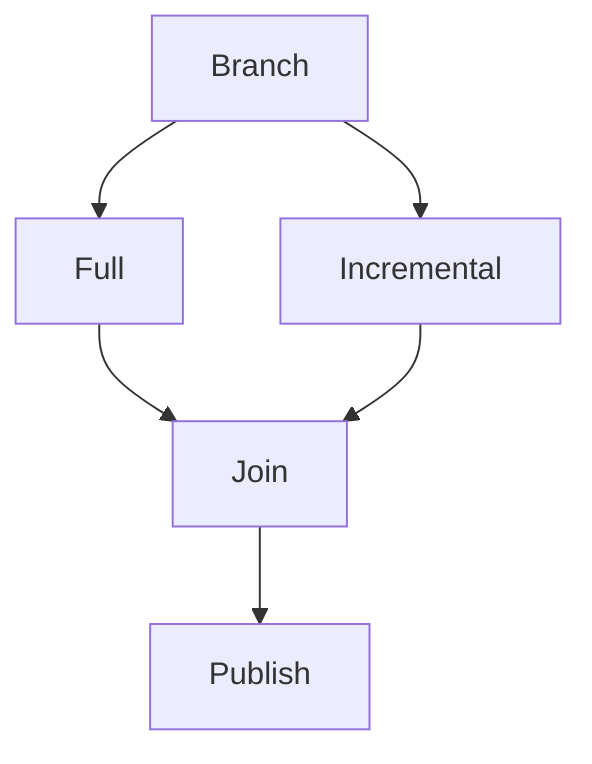
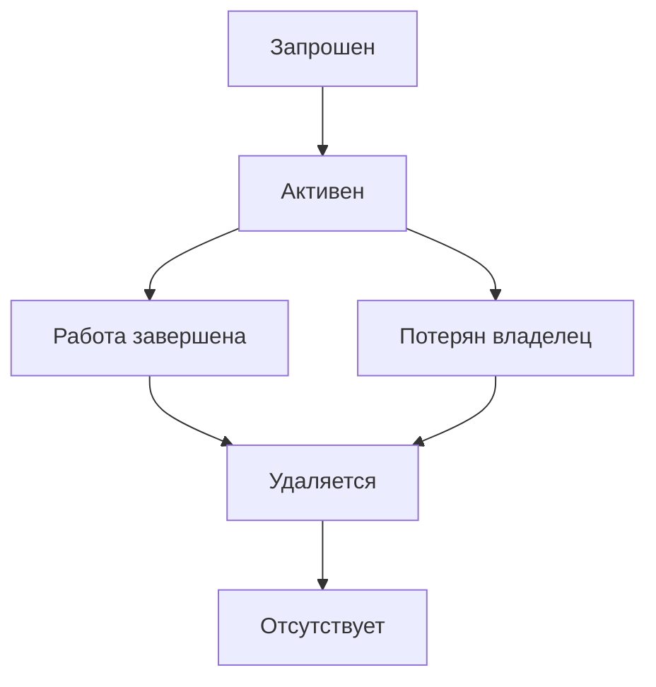
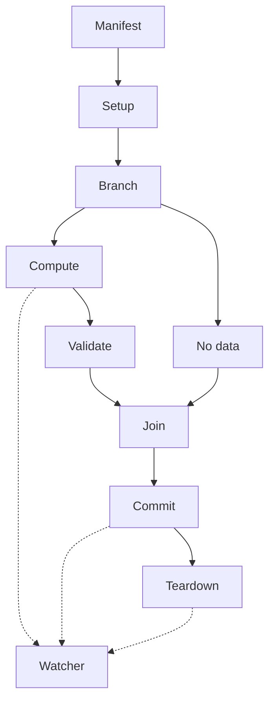

# 9. Зависимости, ветвление, TaskGroups и жизненный цикл ресурсов

**Apache Airflow Zero to Hero · Профессиональный справочник**

| Параметр | Значение |
| --- | --- |
| Базовая линия | Apache Airflow 3.3.2, Task SDK 1.3.2, Standard provider 1.19.0, Common SQL provider 2.1.1, Python 3.12 |
| Дата проверки | 20 октября 2026 года |
| Покрытие README | Все 8 тем и 41 пункт раздела, в исходном порядке |
| Предварительные знания | Состояния из главы 4, TaskFlow из главы 5, временной контракт из глав 6–7, восстановление из главы 8 |
| Сквозной сценарий | Выбрать обработку или явный no-op, использовать временный ресурс, проверить результат и сохранить видимость ошибки |
| Практический результат | Проектировать граф, который правильно ведёт себя при success, failure, skip, retry, clear и потере worker |

Граф Airflow задаёт **условия допустимого выполнения**. Стрелка связывает определения задач; scheduler проверяет состояния конкретных TaskInstance, trigger rule и остальные ограничения перед запуском.

Поэтому `A >> B` не означает «B обязательно запустится после успешного A». Это верно только при подходящем trigger rule, выполненных остальных зависимостях, доступной мощности и отсутствии явного skip.

Удобно разделить четыре контракта:

| Контракт | На какой вопрос отвечает |
| --- | --- |
| Граф | Какие задачи являются непосредственными upstream? |
| Trigger rule | Какие их состояния допускают выполнение этой задачи? |
| Данные | Какой результат должен существовать и где его читать? |
| Ресурсы и восстановление | Кто создаёт ресурс, кто имеет право удалить его и что произойдёт после повтора? |

Правильный граф обязан сохранять и бизнес-ошибку, и возможность очистки. Успешный cleanup не подтверждает успешную обработку данных.

В главе отдельно отмечены особенности **закреплённой версии**, включая поведение `all_done_min_one_success` со skipped upstream, ограничения `fail_fast` и исключение teardown из границ TaskGroup.

## Содержание

1. [Построение зависимостей](#s9-1)
2. [Trigger rules](#s9-2)
3. [Ветвление](#s9-3)
4. [Условное завершение](#s9-4)
5. [TaskGroups](#s9-5)
6. [Зависимости между запусками](#s9-6)
7. [Setup и teardown](#s9-7)
8. [Сложные графы и failure semantics](#s9-8)
9. [Лабораторная: контракт и реестр ресурсов](#lab-core)
10. [Лабораторная: полный DAG](#lab-dag)
11. [Запуск, наблюдение и сценарии отказа](#lab-runs)
12. [Тестирование](#tests)
13. [Разбор ситуаций](#cases)
14. [Самопроверка](#questions)
15. [Критерии освоения](#mastery)
16. [Проверка материала](#verification)
17. [Официальные источники](#sources)

<a id="s9-1"></a>
## 9.1. Построение зависимостей

### 9.1.1. Операторы `>>`, `<<` и методы upstream/downstream

Записи `extract >> transform` и `transform << extract` создают одинаковую зависимость. Эквивалентные методы: `extract.set_downstream(transform)` и `transform.set_upstream(extract)`. [S01](#source-01) [S02](#source-02)

Смысл upstream/downstream всегда относительно выбранной задачи:

- Для transform задача extract — upstream.
- Для extract задача transform — downstream.
- Непосредственные родители отличаются от всех предков графа. Trigger rule обычно оценивает именно непосредственных родителей.

`A >> B >> C` добавляет рёбра A→B и B→C. Ребро A→C автоматически не создаётся. Транзитивная зависимость существует через B, но C не проверяет состояние A напрямую обычным trigger rule.

Это существенно для failure semantics: если B допускает failure A и завершается успешно, C с `all_success` видит успешного непосредственного родителя B.

| Запись | Созданные рёбра |
| --- | --- |
| `a >> b` | a→b |
| `b << a` | a→b |
| `a >> [b, c]` | a→b, a→c |
| `[a, b] >> c` | a→c, b→c |
| `a.set_downstream([b, c])` | a→b, a→c |
| `c.set_upstream([a, b])` | a→c, b→c |

Списки здесь поддерживаются отражёнными операторами объектов Airflow. Обычный Python-список не превращается в объект графа: выражение `[a, b] >> [c, d]` недопустимо.

Отдельная ошибка — создавать новый экземпляр задачи при каждом обращении:

```python
# example: definition_edges
from datetime import datetime, timezone

from airflow.sdk import DAG, chain, cross_downstream
from airflow.providers.standard.operators.empty import EmptyOperator

with DAG(
    dag_id="ch09_dependency_forms",
    schedule=None,
    start_date=datetime(2026, 10, 1, tzinfo=timezone.utc),
    catchup=False,
    is_paused_upon_creation=True,
) as dependency_forms:
    start = EmptyOperator(task_id="start")
    left_a = EmptyOperator(task_id="left_a")
    left_b = EmptyOperator(task_id="left_b")
    right_a = EmptyOperator(task_id="right_a")
    right_b = EmptyOperator(task_id="right_b")
    audit = EmptyOperator(task_id="audit")
    finish = EmptyOperator(task_id="finish")

    chain(start, [left_a, left_b], [right_a, right_b], finish)
    cross_downstream([left_a, left_b], [audit])
    audit >> finish
```

Создай task один раз, сохрани полученный operator/XComArg и используй его в нескольких рёбрах. Повторный вызов decorated function обычно создаёт другую task; одинаковое имя Python-переменной не объединяет определения.

При code review проверь не только направление стрелок, но и фактический набор IDs после построения DAG.

### 9.1.2. `chain()`, `cross_downstream()` и разрешённые формы списков

`chain` из `airflow.sdk` связывает соседние аргументы. Когда оба соседних аргумента — списки, он соединяет элементы **попарно** и требует одинаковую длину. `cross_downstream` создаёт все комбинации между двумя наборами. [S01](#source-01)

| Вызов | Результат |
| --- | --- |
| `chain(a, b, c)` | a→b→c |
| `chain(a, [b, c], d)` | a→b, a→c, b→d, c→d |
| `chain([a, b], [c, d])` | a→c, b→d |
| `cross_downstream([a, b], [c, d])` | a→c, a→d, b→c, b→d |
| `chain([a, b], [c])` | Ошибка из-за разных длин |
| `chain(*tasks)` | Последовательная цепочка элементов |
| `chain(tasks)` | Один аргумент; связи между его элементами не появляются |

Последняя строка — частая ошибка при генерации DAG. Распаковка списка меняет количество аргументов функции и тем самым структуру графа.

Для M задач слева и N задач справа Cartesian fan-out добавляет M×N рёбер. Попарная связь добавляет min(M,N) рёбер при равных длинах. Это разная семантика, а при больших наборах ещё и разная нагрузка на сериализацию и UI.

Выбирай форму по контракту: «каждый отчёт требует все источники» допускает Cartesian связи; «каждая партиция использует свою подготовку» требует попарной связи или mapping.

### 9.1.3. Зависимости по данным через XComArg

В TaskFlow вызов `validated = validate(extracted)` создаёт будущую задачу и связывает её с producer `extracted`. Значение будет разрешено во время выполнения. XComArg на этапе построения графа — ссылка на будущий результат. [S03](#source-03)

Передача вложенного XComArg в поддерживаемую структуру аргументов также может создать зависимость. У традиционного operator автоматическое обнаружение зависит от его templated fields. Произвольный атрибут пользовательского класса не обязан анализироваться Airflow.

Разделяй четыре случая:

| Ситуация | Зависимость |
| --- | --- |
| `consumer(producer())` в TaskFlow | Автоматическая data dependency |
| `consumer(operator.output)` | Data dependency от operator |
| `producer >> consumer` | Только порядок/состояния; значение не передаётся |
| `ti.xcom_pull(task_ids="producer")` внутри тела task | Сам по себе не создаёт ребро при построении DAG |

Последний вариант требует явно объявленного порядка. Scheduler не читает тело Python-функции в поисках строковых task IDs.

Ветвление делает контракты особенно чувствительными: выход пропущенной ветки обычно отсутствует. Передача двух альтернативных XComArg в функцию объединения требует явной обработки отсутствующих значений и подходящего trigger rule. Иначе task либо пропустится, либо получит неожиданный `None`.

Более прозрачный контракт — выбрать ID результата из manifest и прочитать его после явно объявленного join. Именно так устроена лабораторная ниже: зависимости видны в графе, выбранный результат проверяется перед публикацией.

Нельзя использовать `if extracted:` для runtime-решения в теле фабрики DAG. Это Python на этапе parse, а не ожидание результата задачи. Для runtime-выбора используются branch, short circuit или условие внутри выполняемой task.

### 9.1.4. Циклы внутри DAG и циклы на уровне нескольких процессов

Airflow проверяет направленную ацикличность task graph. Прямая либо транзитивная петля вида A→B→C→A недопустима. Проверка выполняется средствами определения/загрузки DAG; `DAG.check_cycle()` полезен в тестах построения. [S04](#source-04)

При этом ацикличный DAG может участвовать в цикле ожиданий внешней платформы:

- DAG A ждёт asset или результат DAG B.
- DAG B ждёт публикацию, которая появится только после завершения A.
- Внешний job держит lock, а cleanup ждёт завершения job.
- Task удерживает pool slot и ждёт задачу, которой нужен тот же единственный slot.

Внутри файла Python цикла нет, но система не продвигается.

Для анализа построй **граф ожиданий**: кто ждёт какое событие и кто способен его произвести. Отметь удерживаемые ресурсы, пределы ожидания, владельца и путь освобождения.

Не вся длительная блокировка — deadlock. Очередь из-за лимита мощности, ожидание ещё не наступившего интервала и зависание из-за потерянного события требуют разных действий.

| Признак | Более вероятная причина |
| --- | --- |
| Есть работающий producer, ETA понятен | Обычное ожидание |
| Все участники ждут друг друга и держат нужные ресурсы | Deadlock |
| Producer завершился, обязательного события нет | Нарушенный контракт |
| Нет свободных slots, но задачи завершаются | Насыщение мощности |
| Задача ждёт исторический TI, который не будет создан | Неразрешимая историческая зависимость |

Timeout ограничивает ущерб от ожидания, но не исправляет ошибочный протокол.

### 9.1.5. Явное объяснение каждой зависимости бизнес-контрактом

Полезная зависимость объясняется конкретным фактом: «publish читает только прошедший проверку immutable artifact» или «удаление кластера разрешено после завершения всех его пользователей».

Фраза «так красивее в Graph View» не доказывает необходимость ребра.

Для критических связей фиксируй:

| Поле | Пример |
| --- | --- |
| Предусловие | Проверены количество строк и контрольная сумма |
| Объект | Manifest версии 2 для окна [start,end) |
| Источник истины | Артефакт и запись о commit в warehouse |
| Условие пропуска | Источник подтвердил отсутствие событий |
| Последствие failure | Публикация запрещена, cleanup разрешён |
| Восстановление | Повтор безопасен по business idempotency key |

Избыточное ребро уменьшает параллелизм. Недостающее допускает чтение незавершённых данных или раннее удаление ресурса. Даже избыточное транзитивное ребро может изменить trigger-rule поведение, потому что добавляет непосредственного родителя.

Обсуждай отдельно *бизнес-порядок*, *доступность данных* и *владение ресурсом*. Тогда изменение графа можно оценить как изменение контракта.

<a id="s9-2"></a>
## 9.2. Trigger rules

### 9.2.1. `all_success`, `all_failed`, `all_done` и `all_skipped`

Trigger rule определяет допустимое сочетание состояний непосредственных upstream TaskInstance. Он не заменяет task dependencies, pools, лимиты, межзапусковые проверки или готовность mapped inputs. [S05](#source-05) [S06](#source-06)

Для начала рассматриваем немаппированные задачи, без изменения состава DAG во время run:

| Правило | Когда допустимо выполнение | Типичное применение |
| --- | --- | --- |
| `all_success` | Все родители success | Проверка/публикация обязательного результата |
| `all_failed` | Все родители failed либо upstream_failed | Специфическая реакция на полный отказ |
| `all_done` | Все родители terminal, независимо от результата | Финальный отчёт о состоянии, обычный cleanup |
| `all_skipped` | Все родители skipped | Специальная обработка отсутствующей работы |

`all_failed` не означает «среди родителей есть ошибка». Смесь success и failed не удовлетворяет этому правилу.

`all_done` не подтверждает существование данных. Если task с таким правилом читает XCom всех родителей, её код должен переживать отсутствие результата и частичное выполнение.

`all_skipped` не подходит для типичного join после выбора одной рабочей ветки: у выбранной ветки должен появиться success.

Состояние `upstream_failed` означает, что тело задачи могло вообще не выполняться. Для правил failure оно всё равно существенно. `skipped` означает разрешённый пропуск по механизму управления, а не подтверждение качества данных.

Корневая задача без upstream проходит проверку trigger rule независимо от выбранного правила. «Пустое множество родителей» не нужно интерпретировать вручную как ошибку; реализация имеет отдельный ранний проход. [S06](#source-06)

### 9.2.2. `one_success`, `one_failed` и `one_done`

Эти правила способны допустить задачу **до завершения остальных родителей**:

| Правило | Достаточное событие |
| --- | --- |
| `one_success` | Есть upstream success |
| `one_failed` | Есть upstream failed или upstream_failed |
| `one_done` | Есть upstream success или failed |

В 3.3.2 `one_done` проверяет именно success/failed. Единственный `upstream_failed` не удовлетворяет ему, хотя удовлетворяет `one_failed`. Один skipped также не удовлетворяет `one_done`. [S06](#source-06)

Ранний запуск полезен для быстрого сигнала об отказе или использования первого приемлемого ответа. Но он опасен для удаления общего ресурса: другие пользователи могут ещё работать.

| Upstream на момент проверки | one_success | one_failed | one_done |
| --- | --- | --- | --- |
| success + running | Допускает | Пока нет | Допускает |
| failed + running | Пока нет | Допускает | Допускает |
| upstream_failed + running | Пока нет | Допускает | Пока нет |
| skipped + running | Пока нет | Пока нет | Пока нет |
| skipped + skipped | Нет; task будет skipped | Нет; task будет skipped | Нет; task будет skipped |

«Допускает» означает проход конкретной проверки. Scheduler ещё должен проверить остальные условия.

Если задача должна дождаться полного результата всех веток, `one_success` обычно слишком слаб. Если watcher сообщает failure, раннее выполнение допустимо; если compensation разрушает данные других running tasks, нужен дополнительный барьер.

### 9.2.3. `none_failed`, `none_failed_min_one_success` и `none_skipped`

Эти правила часто путают из-за отрицательных названий.

| Правило | Success | Skipped | Failed / upstream_failed | Нужно дождаться остальных? |
| --- | --- | --- | --- | --- |
| `none_failed` | Разрешён | Разрешён | Запрещён | Да |
| `none_failed_min_one_success` | Нужен хотя бы один | Разрешён | Запрещён | Да |
| `none_skipped` | Разрешён | Запрещён | Разрешён | Да |

`none_failed_min_one_success` — распространённый выбор для join после branch: выбранная ветка завершается успешно, альтернативная skipped, ошибок нет.

`none_failed` допускает случай «все ветки skipped». Это правильно только если дальнейшая task умеет безопасно выполнить общий no-op либо обязательное завершение без бизнес-результата.

`none_skipped` может запустить задачу после **ошибок** родителей. Слово none относится к skip, а не к failure. Использовать это правило как защиту публикации нельзя. [S06](#source-06)

Важно: «ошибок пока нет» не достаточно для `none_failed`. При running upstream ещё неизвестно, не завершится ли он failure. Для обычных задач реализация требует, чтобы все родители вошли в допускаемые terminal states.

Состояние `removed` учитывается отдельно. В закреплённом коде оно засчитывается в terminal/done, а некоторые правила вычитают его из числа неудовлетворённых родителей. Это не равно успешному вычислению удалённой задачи. При изменении DAG во время run проверяй фактический состав и mapped indexes. [S06](#source-06) [S33](#source-33)

### 9.2.4. `always`, `all_done_min_one_success` и наличие в выбранной версии

`always` пропускает проверку состояний upstream. Поэтому task может стартовать до завершения родителей. Остальные scheduler dependencies и ограничения мощности продолжают действовать. Существующее ребро в графе не превращает `always` в `all_done`. [S06](#source-06)

Этот режим требует особенно ясного контракта: задача не должна предполагать, что upstream успел создать файл, XCom или ресурс.

`all_done_min_one_success` присутствует в enum Airflow 3.3.2. Его назначение отличается от `none_failed_min_one_success`: он допускает failures среди завершённых upstream, если есть success.

**Особенность 3.3.2:** при наличии skipped upstream реализация этого правила не допускает выполнение и помечает downstream skipped при соответствующей scheduler-проверке. Общее текстовое описание документации про «non-skipped upstream» недостаточно для выбора join. [S05](#source-05) [S06](#source-06) [S33](#source-33)

| Завершившиеся upstream | none_failed_min_one_success | all_done_min_one_success в 3.3.2 |
| --- | --- | --- |
| success + success | Допускает | Допускает |
| success + failed | Запрещает | Допускает |
| success + upstream_failed | Запрещает | Допускает |
| success + skipped | Допускает | Запрещает; skipped |
| skipped + skipped | Не допускает; skipped | Не допускает; skipped |
| failed + failed | Не допускает | Не допускает |

Для branch join с пропускаемой альтернативой выбирай правило исходя из этой матрицы. При обновлении Airflow перепроверь её: здесь зафиксировано поведение конкретной реализации, а не обещание для всех будущих версий.

Ещё одно правило — `all_done_setup_success`. Оно назначается teardown: все непосредственные родители должны завершиться, а среди upstream setup нужен хотя бы один success. Для ресурса этого недостаточно без корректно определённого scope; детали ниже.

### 9.2.5. Терминальность upstream и момент, когда правило допускает запуск

Для оценки правил нужно отличать terminal от временного состояния:

| Состояние | Terminal для обычной оценки | Есть результат success? |
| --- | --- | --- |
| success | Да | Да |
| failed | Да | Нет |
| upstream_failed | Да | Нет |
| skipped | Да | Нет |
| removed | Да | Нет |
| running / queued / scheduled | Нет | Нет |
| up_for_retry | Нет | Нет |
| deferred / up_for_reschedule | Нет | Нет |

Не считай task окончательно failed по ошибке одной попытки, если Airflow перевёл её в `up_for_retry`. В таком состоянии `all_done` ещё не должен запускать финальный отчёт о завершившейся ветке. [S07](#source-07)

У проверки есть два разных результата:

1. Правило пока не выполнено: task должна ждать.
2. Из уже известных состояний ясно, что правило больше не выполнится: task может получить skipped/upstream_failed.

Некоторые правила позволяют рано установить невозможность запуска. Например, failed родитель разрушает `all_success` ещё до завершения второго running родителя. Это не означает, что остальные работы остановлены.

Чтобы проверить критическую точку, задай три вопроса:

- Может ли task стартовать, пока часть родителей ещё running?
- Может ли task стать terminal до завершения всех родителей?
- Сохраняется ли failure в итоговом DagRun при выбранных листьях?

Dynamic Task Mapping добавляет измерение map index и правила отбора релевантных upstream TI. Ни одна общая таблица по двум task IDs не заменяет проверку mapped topology. Нулевое расширение также может приводить к skipped. Подробный mapping разбирается отдельно; здесь лабораторная намеренно немаппированная.

<a id="s9-3"></a>
## 9.3. Ветвление

### 9.3.1. `@task.branch` и `BranchPythonOperator`

Branch task во время выполнения выбирает, какие downstream пути следует продолжить. `@task.branch` удобно использовать с TaskFlow; `BranchPythonOperator` — с отдельной Python callable и operator interface. В базовой линии реализация Python branch находится в Standard provider. [S08](#source-08) [S09](#source-09) [S12](#source-12)

Branch выбирает уже существующие узлы графа. Он не создаёт новые tasks по результату Python-функции.

```python
# example: minimal_branch
from datetime import datetime, timezone

from airflow.sdk import DAG, Param, task
from airflow.providers.standard.operators.empty import EmptyOperator

with DAG(
    dag_id="ch09_branch_join",
    schedule=None,
    start_date=datetime(2026, 10, 1, tzinfo=timezone.utc),
    catchup=False,
    is_paused_upon_creation=True,
    params={"route": Param("incremental", enum=["incremental", "full"])},
) as branch_join:
    @task.branch
    def choose_route(params: dict) -> str:
        return "full" if params["route"] == "full" else "incremental"

    decision = choose_route()
    full = EmptyOperator(task_id="full")
    incremental = EmptyOperator(task_id="incremental")
    join = EmptyOperator(
        task_id="join",
        trigger_rule="none_failed_min_one_success",
    )

    decision >> [full, incremental]
    [full, incremental] >> join
```

Когда выбрана full, incremental будет skipped. Join разрешён после success full и skip incremental.

Не возвращай bool по аналогии с short circuit. Branch ожидает идентификаторы пути, а не универсальное «продолжить/остановить».

### 9.3.2. Возврат одного/нескольких task IDs и выбор TaskGroup

Допустимые результаты Python branch:

| Результат | Смысл |
| --- | --- |
| `"load"` | Выбрать task |
| `["load", "audit"]` | Продолжить несколько путей |
| `"compute"` | Выбрать TaskGroup; SDK разворачивает его roots |
| `["compute", "notify"]` | Смешанный выбор группы и task |
| `None` или пустой список | Не выбирать downstream пути |

Используй полные IDs с prefix, например `daily.compute.validate`. Python-имя функции и фактический `task_id` могут различаться после override и группировки. [S09](#source-09)

Выбирай task/group, к которому branch действительно задаёт downstream-доступ. Наличие строки среди всех DAG task IDs не делает произвольный дальний узел корректным входом ветки.

В 3.3.2 расширение TaskGroup выполняется в IDs его корней. Это не означает «отметить все задачи группы выбранными» и не отменяет их внутренних trigger rules.

При нескольких выбранных путях они могут выполняться параллельно. Их успешность и необходимость общего join определяются графом, а не порядком IDs в возвращённом списке.

Тонкость: ветки могут иметь общего потомка, который одновременно является непосредственным downstream branch. SkipMixin учитывает потомков выбранного пути, чтобы не пропустить такой join автоматически. Однако trigger rule join всё равно должен подходить его родителям. Полагаться только на этот специальный случай вместо явного дизайна не стоит. [S10](#source-10)

### 9.3.3. SQL-ветвление и календарные branch operators providers

Готовые operators полезны, если их временной и входной контракт совпадает с задачей.

| Operator | Пакет и import | Ключевой риск |
| --- | --- | --- |
| BranchSQLOperator | `airflow.providers.common.sql.operators.sql` | Запрос читает изменяемое состояние источника |
| BranchDateTimeOperator | `airflow.providers.standard.operators.datetime` | По умолчанию может ориентироваться на wall clock |
| BranchDayOfWeekOperator | `airflow.providers.standard.operators.weekday` | Выбор дня выполнения вместо бизнес-дня |
| BranchPythonOperator | `airflow.providers.standard.operators.python` | Невоспроизводимая произвольная callable |

BranchSQLOperator оценивает скалярный результат SQL и выбирает true/false путь. Пустой результат не является автоматически ожидаемым no-op: реализация сообщает ошибку. Приведение bool, поддерживаемых строк и integer выполняется по правилам provider. [S14](#source-14)

Проверка `SELECT EXISTS(...)` обычно выражает контракт яснее, чем чтение произвольной первой строки. Для historical run добавляй фильтр по согласованному окну и snapshot/версии. Сам факт повторного выполнения того же SQL не делает его результат прежним.

У календарных operators Standard 1.19.0 `use_task_logical_date` по умолчанию False. Для исторической логики явно выбери подходящую дату. При True и отсутствии logical_date реализация использует run_after; это может не совпадать с бизнес-датой, переданной в manifest. [S15](#source-15) [S16](#source-16)

Для банковского календаря «понедельник–пятница» недостаточно. Рабочий день определяется версией календаря, timezone и правилами переносов. Часто надёжнее передать `calendar_version` и `business_date` в manifest, а выбор вычислить чистой функцией.

Проверяй provider отдельно от core: наличие operator в старом tutorial не доказывает его import path и параметры в установленном окружении.

### 9.3.4. Skip propagation и правильное объединение веток

После branch skip появляется двумя путями:

- Branch явно пропускает невыбранные непосредственные downstream.
- Scheduler распространяет последствия через trigger rules последующих tasks.

На типичном графе:



Если join имеет `all_success`, одна skipped ветка препятствует его запуску. При `none_failed_min_one_success` join допускается после завершения выбранной ветки, если ошибок нет.

`all_done` позволяет join даже после failed выбранной ветки. Если затем publish успешно выполнится без проверки данных, ошибка может потеряться в итоговой leaf-оценке DagRun.

Явный skip не «перебивается» сменой trigger rule той же задачи. Если ShortCircuit/Branch уже пометил downstream skipped, `all_done` не заставляет его запуститься поверх этого решения.

При clear невыбранной task Airflow может снова применить ранее сохранённое branch-решение через NotPreviouslySkippedDep. Одна очистка skipped task не означает выбор нового пути. Если бизнес-решение должно быть пересчитано, пересматривай область восстановления вместе с branch task и её входами. [S11](#source-11)

Для диагностики нужны: фактический return branch, сохранённые skip/followed IDs, непосредственные родители join и их terminal states.

### 9.3.5. Branch decision как воспроизводимая функция входных данных

Хорошее решение можно объяснить без обращения к текущему времени и изменяемым глобальным данным:

`decision = f(manifest, business_window, rule_version, calendar_version)`.

| Вход | Почему его фиксируют |
| --- | --- |
| manifest ID/checksum | Повтор должен видеть тот же набор данных |
| business window | Исторический запуск сохраняет семантику периода |
| rule version | Изменение порога не должно незаметно менять старую ветку |
| schema version | Проверяемая интерпретация полей |
| calendar version | Воспроизводимость праздничных/рабочих дней |

Сохраняй выбранный путь и причину в доступном аудите. XCom branch полезен для Airflow, но retention и reset не делают его вечным бизнес-журналом.

Если по задаче допустимо решение на свежем состоянии, зафиксируй это явно: повтор может выбрать другой путь. Тогда восстановление должно учитывать уже выполненные side effects старой ветки.

Типичные плохие источники скрытого изменения: `datetime.now()`, mutable Variable, запрос без snapshot, случайное число, список файлов по изменяемому префиксу.

Чистая функция branch легко тестируется независимо от Airflow. Сам механизм skip затем проверяется отдельно на scheduler/runtime стенде.

<a id="s9-4"></a>
## 9.4. Условное завершение

### 9.4.1. `ShortCircuitOperator` и `@task.short_circuit`

Short circuit отвечает на вопрос «нужно ли продолжать downstream?». Truthy результат разрешает обычное продвижение. Falsy результат приводит к пропуску задач согласно режиму operator. [S08](#source-08) [S13](#source-13)

`False`, `None`, 0 и пустой список являются falsy. Поэтому возвращать произвольную коллекцию вместо явного bool стоит только при ясном контракте.

Сравнение механизмов:

| Механизм | Основной результат |
| --- | --- |
| Branch | Выбран один или несколько путей |
| Short circuit | Пропущена downstream область |
| AirflowSkipException | Пропущена текущая task |
| Успешный явный no-op | Task выполнила контракт «работы нет» и сохранила результат |

ShortCircuit — не отмена всего DagRun. Независимые части DAG, не входящие в область downstream, могут продолжить работу.

### 9.4.2. Управление downstream trigger rules при short circuit

По умолчанию `ignore_downstream_trigger_rules=True`: operator выбирает для skip всех downstream потомков, минуя их обычные trigger rules.

При False явно пропускаются непосредственные downstream; последующие задачи оцениваются по собственным правилам. В реализации Standard 1.19.0 teardown исключаются из списка явно пропускаемых задач в обоих режимах. Это не отменяет остальных setup/teardown constraints. [S08](#source-08)

```python
# example: short_circuit_boundary
from datetime import datetime, timezone

from airflow.sdk import DAG, task
from airflow.providers.standard.operators.empty import EmptyOperator

with DAG(
    dag_id="ch09_short_circuit_boundary",
    schedule=None,
    start_date=datetime(2026, 10, 1, tzinfo=timezone.utc),
    catchup=False,
    is_paused_upon_creation=True,
) as short_circuit_boundary:
    @task.short_circuit(ignore_downstream_trigger_rules=False)
    def has_work() -> bool:
        return False

    gate = has_work()
    work = EmptyOperator(task_id="work")
    final_report = EmptyOperator(task_id="final_report", trigger_rule="all_done")
    gate >> work >> final_report
```

Здесь work skipped, а final_report может выполниться после него. Если связать `gate >> final_report` напрямую, operator явно пропустит final_report, несмотря на `all_done`.

При True обычный final_report в этой цепочке также попадёт в область явного skip. Это объясняет, почему добавление `all_done` иногда «не помогает».

Не используй short circuit для проверки повреждённых данных. Если источник недоступен либо нарушен schema contract, «нет работы» — ложный вывод: такой случай должен завершаться failure или контролируемым retry.

### 9.4.3. `LatestOnlyOperator` и влияние исторических запусков

LatestOnlyOperator выбирает downstream в зависимости от актуальности запуска относительно расписания и текущего времени. Это подходящий инструмент для работ, которые полезны только сейчас, например обновления текущей UI-витрины. Он меняет воспроизводимость исторического исполнения. [S17](#source-17)

Для базовой линии важны детали:

- Manual run разрешается явной проверкой `run_type == MANUAL`.
- Для остальных runs решение зависит от timetable и вычисленного временного окна.
- Возвращаемый путь — непосредственные downstream IDs либо пустой список.
- Point/zero-length intervals требуют проверки поведения конкретного timetable; обычную daily-интуицию переносить на них нельзя.

Не подменяй понятием latest проверку полноты бизнес-периода. Последний scheduled run не гарантирует, что источник полностью закрыл день.

У исторического backfill задачи после LatestOnly могут оказаться skipped, хотя вся история требовалась по заданию. Не ставь этот operator перед обязательной исторической загрузкой без отдельной политики.

Ручной повтор через manual trigger также может пройти gate, который пропустил бы соответствующий automated historical run. Тип запуска — часть наблюдаемой семантики.

### 9.4.4. Явный skip через исключение и различие с fail

Для Airflow 3 используй публичные SDK exceptions:

```python
# example: explicit_skip_or_fail
from airflow.sdk import task
from airflow.sdk.exceptions import AirflowFailException, AirflowSkipException

@task
def require_action(manifest: dict) -> dict:
    if manifest.get("source_status") != "ready":
        raise AirflowFailException("Source readiness contract was not satisfied")
    if manifest.get("row_count") == 0:
        raise AirflowSkipException("Source confirmed an empty business window")
    return manifest
```

`AirflowSkipException` переводит текущую task в skipped. Дальнейшее поведение определяется графом и trigger rules. `AirflowFailException` означает failure без обычного продолжения retry-политики; обычная ошибка вроде RuntimeError может допускать retries согласно настройкам задачи. [S29](#source-29)

Контракт «источник недоступен» нельзя сводить к row_count=0. Ноль — результат успешного чтения, а не отсутствие результата чтения.

Используй отдельные коды причин: `empty_window`, `not_applicable`, `already_committed`. Иначе диагностика skip превращается в чтение произвольных сообщений из логов.

### 9.4.5. Пустой вход, отсутствие обновлений и ожидаемый no-op

Пустой input может быть корректным результатом. Выбор между skip и success зависит от обещания потребителю.

| Ситуация | Предпочтительный контракт |
| --- | --- |
| За окно подтверждено 0 событий | Success с явным receipt no_data либо осмысленный skip |
| API вернул timeout | Failure/retry |
| Файл существует и содержит корректный пустой набор | Проверить schema и записать пустой результат |
| Файл не найден, но обязан появиться | Ожидание или failure по deadline |
| Партиция уже опубликована с тем же checksum | Idempotent success |
| Нет обновлений, но heartbeat обязателен | Успешный heartbeat с идентичностью окна |

Для senior-проектирования важен вопрос: сможет ли downstream отличить «период проверен и пуст» от «период никогда не обрабатывался»?

Если ответ отрицательный, один skipped TI недостаточен. Нужна запись контроля полноты, manifest receipt или другой бизнес-артефакт.

В лабораторной empty путь создаёт успешный no_data receipt. Поэтому join требует хотя бы один success, а проверяющий видит row_count=0 и total_minor=0 как явный результат.

### 9.4.6. `@task.run_if` и `@task.skip_if` для условий по runtime context

Эти SDK-декораторы оборачивают pre_execute task. Условие вычисляется по runtime context; при запрете выполнения выбрасывается AirflowSkipException. Новая branch task при этом не создаётся. [S18](#source-18)

Порядок декораторов имеет значение: `@task` применяется первым, поэтому условный декоратор пишется **над ним**.

```python
# example: runtime_conditions
from datetime import datetime, timezone

from airflow.sdk import DAG, Param, task

with DAG(
    dag_id="ch09_runtime_conditions",
    schedule=None,
    start_date=datetime(2026, 10, 1, tzinfo=timezone.utc),
    catchup=False,
    is_paused_upon_creation=True,
    params={
        "audit_enabled": Param(True, type="boolean"),
        "maintenance": Param(False, type="boolean"),
    },
) as runtime_conditions:
    @task.run_if(
        lambda context: context["params"]["audit_enabled"],
        skip_message="Audit was disabled by validated run parameters",
    )
    @task
    def audit() -> str:
        return "audit_completed"

    @task.skip_if(lambda context: context["params"]["maintenance"])
    @task
    def refresh() -> str:
        return "refresh_completed"

    audit()
    refresh()
```

Условие может вернуть bool либо пару `(bool, message)` по контракту SDK. Предикат должен быть коротким и понятным. Сетевой запрос в pre_execute переносит failure/latency в менее очевидную точку исполнения.

Важные ограничения:

- Это пропуск текущей task; downstream живёт по своим trigger rules.
- Условие не отменяет уже совершённые внешние side effects прошлой попытки.
- Условие с текущей Variable может измениться после clear.
- Наличие нескольких pre_execute hooks требует понимания порядка; в 3.3.2 SDK объединяет существующий hook и проверку условия.

Если решение критично для бизнес-ветки и аудита, отдельная branch task часто делает причину выбора заметнее в графе.

<a id="s9-5"></a>
## 9.5. TaskGroups

### 9.5.1. `TaskGroup` и декоратор `@task_group`

TaskGroup собирает задачи в именованную область графа. Context manager удобен для локальной группировки, декоратор — для фабрики повторяемой структуры. Обе формы создают tasks в том же DAG. [S19](#source-19) [S20](#source-20)

```python
# example: reusable_task_group
from datetime import datetime, timezone

from airflow.sdk import DAG, task, task_group

@task
def extract(source: str) -> dict:
    return {"source": source, "row_count": 3}

@task
def validate(manifest: dict) -> dict:
    if manifest["row_count"] < 0:
        raise ValueError("Negative row_count")
    return manifest

@task_group
def checked_source(source: str):
    return validate(extract(source))

@task
def compare(left: dict, right: dict) -> dict:
    return {
        "left_source": left["source"],
        "right_source": right["source"],
        "total_rows": left["row_count"] + right["row_count"],
    }

with DAG(
    dag_id="ch09_reusable_groups",
    schedule=None,
    start_date=datetime(2026, 10, 1, tzinfo=timezone.utc),
    catchup=False,
    is_paused_upon_creation=True,
) as reusable_groups:
    left = checked_source.override(group_id="orders")("orders")
    right = checked_source.override(group_id="payments")("payments")
    compare(left, right)
```

У результата `checked_source` здесь контракт XComArg последней validate task. Это полезно для передачи данных, но важно для последующих зависимостей: переменная left ссылается на возвращённый объект, а не на абстрактную «всю группу».

Группа без return возвращается фабрикой как TaskGroup. Группа с return передаёт возвращённое значение вызывающему коду. Проверяй фактический тип возвращаемого объекта прежде, чем писать `start >> group_result`.

### 9.5.2. Вложенность, prefixes и уникальность task IDs

По умолчанию group_id включается в task_id. Вложенность накапливает prefix:

| Структура | Полный task_id |
| --- | --- |
| task validate вне группы | `validate` |
| group orders → task validate | `orders.validate` |
| group daily → group orders → task validate | `daily.orders.validate` |

Так разные группы могут содержать локальную task validate без конфликта полных IDs.

`prefix_group_id=False` снимает автоматическую часть namespace. После этого уникальность IDs нужно обеспечить самостоятельно во всём DAG. Для большого проекта это повышает риск коллизий и хрупких строковых ссылок. [S19](#source-19)

При повторном вызове task_group factory возможны автоматически добавленные suffixes. Для production-конфигураций предпочитай явные стабильные group_id через override. Автоматическое переименование может изменить branch IDs, XCom lookups, monitoring и историю восстановления.

Изменение prefix — изменение идентичности task. Это не только косметическая перестановка UI. Historical runs и targeted clear будут опираться на реальные IDs текущей/закреплённой DAG version.

Полезный тест — сравнить точное множество task IDs с ожидаемым. Для групп, создаваемых из конфигурации, сортируй входную конфигурацию и проверяй её уникальные ключи.

### 9.5.3. Передача аргументов и возврат XComArg из группы

Аргументы функции `@task_group` доступны при построении структуры. Переданный XComArg остаётся ссылкой на runtime-значение.

Если в group factory написан Python `if value`, это не runtime branch по значению XComArg. Для такого решения нужна task внутри группы.

Группа может вернуть:

| Возврат | Контракт |
| --- | --- |
| Нет return | Работа с TaskGroup как единым endpoint для рёбер |
| XComArg | Конкретный результат одной task |
| Словарь XComArg | Несколько явно именованных outputs на уровне Python API фабрики |
| Operator | Конкретный operator endpoint |

Словарь, возвращённый group factory, сам по себе не является новым XCom всей группы и не создаёт group-level TaskInstance. Его элементы указывают на результаты обычных tasks. [S20](#source-20)

Контракт группы должен назвать точку «готово»: завершён ли только расчёт, прошла ли проверка, выполнен ли commit, освобождены ли ресурсы?

Особенно внимательно передавай group result дальше, если группа содержит независимые audit/cleanup tasks. Возвращённый XComArg validate не означает завершение всех остальных задач группы.

### 9.5.4. Переиспользуемая группа и границы связности кода

Хорошая группа скрывает связный процесс с небольшим интерфейсом. Например: получить snapshot, проверить schema, сформировать manifest.

| Хорошая граница | Слабая граница |
| --- | --- |
| Входы и outputs документированы | Функция читает десятки глобальных Variables |
| IDs задаются стабильно | Строковые ссылки разбросаны по всему DAG |
| Ошибки и no-op определены | Все исключения превращаются в skipped |
| Требования к pools видны | Группа тайно запускает тяжёлый кластер |
| Cleanup policy ясна | Возвращается result до неявного обязательного cleanup |

Не передавай весь runtime context через десятки слоёв фабрик. Передай именованные параметры и ссылки на небольшие контракты. Runtime context нужен в исполняемых task, а не для сетевых действий при импорте DAG.

Переиспользование группы — переиспользование кода определения. Изменение библиотеки группы может изменить граф всех её пользователей. Поэтому нужны версия пакета, changelog контрактов и graph tests.

Не превращай TaskGroup в отдельную систему workflow поверх Airflow: чрезмерные универсальные настройки скрывают реальные задачи и усложняют восстановление.

### 9.5.5. Визуальная группировка и отсутствие отдельного scheduler/executor

У TaskGroup нет собственного worker, отдельного scheduler, транзакции или единого retry. Исполняются обычные tasks с собственными состояниями, retries, pools и logs.

| Свойство | TaskGroup |
| --- | --- |
| Отдельный DagRun | Нет |
| Единственный task slot на всю группу | Нет |
| Общая атомарная транзакция | Нет |
| Удобная свёртка графа | Да |
| Локальные defaults и namespace | Да |
| Возможность повторно использовать фабрику | Да |

Связь `group >> next_task` строится по границам группы. **Teardown при вычислении downstream-границы исключаются**, чтобы не задерживать независимое продолжение workflow. Next task может начать работу параллельно cleanup. [S19](#source-19) [S22](#source-22)

Если контракт требует именно завершённой очистки, добавь явную зависимость от конкретного teardown либо отдельную проверку освобождения ресурса. Затем выбери подходящее правило барьера с учётом skipped/failed cleanup.

Например, следующий тяжёлый job, использующий ту же внешнюю квоту, может требовать подтверждения удаления предыдущего кластера. Визуальная последовательность двух групп сама по себе этого не гарантирует.

Отдельно помни: pool slot удерживается исполняемой task по настройкам, а не всей группой и не автоматически всем временем жизни внешнего ресурса.

<a id="s9-6"></a>
## 9.6. Зависимости между запусками

### 9.6.1. `depends_on_past` и предыдущий экземпляр той же задачи

`depends_on_past=True` добавляет межзапусковую проверку предыдущих экземпляров **той же task_id**. Это не обычное ребро внутри одного DagRun и не зависимость от всего предыдущего DAG. [S21](#source-21)

В 3.3.2 предыдущий TI должен быть в success или skipped. Running, queued, failed и upstream_failed не удовлетворяют этой проверке.

Предыдущий run определяется по логике реализации, а не по настенным часам старта worker:

- При catchup используется предыдущий scheduled DagRun.
- При другом режиме вызывается соответствующий поиск previous DagRun.
- Существуют отдельные правила первого запуска, новых tasks и backfill.

Не формулируй контракт как «задача ждёт вчера». При timetable с пропущенными датами, manual runs и исторических запусках предыдущий экземпляр может относиться к другому ожидаемому диапазону.

Подходящие случаи — последовательное обновление состояния или инкрементальный расчёт, который действительно требует успешного предыдущего шага. Если задача полностью пересчитывает независимую партицию из immutable snapshot, межзапусковая последовательность часто лишняя.

Наличие `skipped` в допустимых предыдущих состояниях особенно важно после branch. Это не подтверждает, что предыдущая task произвела данные. Если данные нужны, проверяй их отдельно.

### 9.6.2. `wait_for_downstream` и последовательное использование ресурса

`wait_for_downstream=True` усиливает предыдущую зависимость: нужно дождаться допускаемого завершения непосредственных downstream задач предыдущего экземпляра. Настройка предполагает depends_on_past; SDK учитывает эту связь. [S01](#source-01) [S21](#source-21)

Пример контракта: transform следующего периода не должен перезаписывать промежуточную таблицу, пока load предыдущего периода не закончил её читать.

В 3.3.2 проверка downstream также считает success/skipped допустимыми. Она не является произвольной проверкой всех транзитивных потомков, внешних readers или всех DAG платформы.

| Что нужно защитить | Достаточность wait_for_downstream |
| --- | --- |
| Непосредственные downstream прошлого TI | Соответствует области проверки |
| Дальний потомок через несколько tasks | Нужен отдельный анализ графа |
| Читатель в другом DAG | Не покрывается автоматически |
| Внешний сервис без Airflow task | Не покрывается |
| Партиция с конкурентными writers | Нужен storage/lock/fencing протокол |

Если общий изменяемый ресурс можно заменить versioned immutable output, это обычно упрощает граф и восстановление. Межзапусковая зависимость защищает порядок планирования tasks, но не заменяет согласованность внешней системы.

### 9.6.3. Первый запуск, пропущенная история и backfill

Первый run не должен бесконечно ждать несуществующий предыдущий TI. Поэтому implementation имеет специальные проходы. Но «любой первый запускаемый мной run» не означает «первый в истории Airflow». [S21](#source-21)

Учитываются:

- Отсутствие предыдущего DagRun.
- Граница start_date задачи при catchup.
- Отсутствие task в прежнем run и `ignore_first_depends_on_past`.
- Первый элемент управляемого backfill по его sort_ordinal.
- Явно отключённая проверка в dependency context отдельных операций.

В 3.3.2 для первого run в backfill есть отдельное разрешение; обратный порядок backfill несовместим с depends_on_past. Это не даёт оснований игнорировать последовательность для всех последующих периодов.

После добавления новой task в давно работающий DAG протестируй как минимум первый её run и следующий. После переименования task проверь, не изменилась ли история, от которой зависит последовательность.

Если промежуточный период отсутствует, выясни, должна ли его TI вообще существовать по timetable. Создание лишнего manual run «чтобы разблокировать всё» может изменить историю и бизнес-семантику.

Для восстановления сначала выпиши точные run_id, task_id и состояния. Затем выбери минимальную область clear/backfill с учётом главы 8.

### 9.6.4. Глобальная последовательность и ограничения `max_active_runs`

`max_active_runs=1` ограничивает обычные активные runs одного DAG, но не является глобальным mutex платформы. В Airflow 3.3.2 backfill имеет собственный лимит, отдельный от обычного DAG limit. [S04](#source-04) [S24](#source-24)

| Механизм | Что ограничивает |
| --- | --- |
| DAG max_active_runs | Одновременные обычные active runs этого DAG |
| Backfill max_active_runs | Активность конкретной historical операции |
| depends_on_past | Продвижение конкретной task по истории |
| wait_for_downstream | Продвижение с учётом downstream прошлого TI |
| Task concurrency limits | Одновременные TI в области соответствующего параметра |
| Pool | Конкурирующие tasks, назначенные на общий pool |
| Внешний lock/fencing | Владение конкретным ресурсом по протоколу системы |

В 3.3.2 `DAG.max_active_tasks` применяется на DagRun. Не считай его универсальным ограничением суммы задач всех параллельных запусков. Параметры конкурентности нужно проверять по версии. [S04](#source-04)

Даже pool с одним slot не обязательно защищает внешний кластер между submit task и последующим delete: slot submit освобождается по окончании task, а кластер продолжает существовать.

Для последовательной публикации в общую таблицу нужны проверяемый ключ, atomic commit и защита от stale writer. Оркестрационный порядок полезен, но не делает внешний side effect атомарным.

### 9.6.5. Deadlocks при сочетании межзапусковых зависимостей и pools

Pending task, заблокированная `depends_on_past`, сама по себе обычно ещё не удерживает execution slot. Поэтому объяснение «все ожидающие tasks заняли pool» без проверки их фактического состояния неверно.

Реальные опасные сочетания:

| Сочетание | Возможная проблема |
| --- | --- |
| Running sensor в poke mode держит единственный slot и ждёт producer в том же pool | Producer не может стартовать |
| Внешний job держит lock и ждёт callback от task, ожидающей этот lock | Цикл ожидания |
| Поздний active run ждёт исторический run, которому мешает лимит активности/политика порядка | Блокировка продвижения истории |
| Backfill идёт в неправильном порядке при stateful последовательности | Предыдущие состояния недоступны |
| Cleanup помещён в полностью исчерпанный execution contour | Ресурсы не освобождаются вовремя |

Для каждого ожидания собери четыре факта: held resource, requested resource, producer, timeout/escape path.

Практический порядок диагностики:

1. Найди running/queued/scheduled TIs и раздели их.
2. Проверь pool slots и фактически удерживающих их tasks.
3. Проверь previous DagRun/TI, который требуется заблокированной task.
4. Проверь активные обычные runs и отдельные backfill runs.
5. Проверь внешние locks и jobs, которые пережили Airflow task.
6. Устрани цикл либо обеспечь producer/cleanup независимую мощность.

Reschedule/deferrable ожидание может освободить worker, но поведение pool для deferred зависит от pool configuration. Это оптимизация ожидания, а не автоматическое исправление неверной зависимости. [S32](#source-32)

<a id="s9-7"></a>
## 9.7. Setup и teardown

### 9.7.1. Создание временного кластера, окружения или внешнего ресурса

У временного ресурса есть жизненный цикл за пределами одного Python-процесса:



Airflow task state и resource state — разные оси. Setup task может упасть после успешного создания кластера, если потеряла ответ API. Teardown может завершиться success после принятия delete-запроса, хотя физическое удаление ещё продолжается.

Перед разработкой определи:

| Вопрос | Нужный контракт |
| --- | --- |
| Как повторно найти созданный ресурс? | Idempotency key, labels/tags, registry |
| Кто владелец? | DAG/run/business operation identity |
| Как отличить новое поколение? | Generation/fencing token |
| Когда ресурс можно удалить? | Нет активных допустимых пользователей |
| Что значит cleanup success? | Запрос принят либо подтверждено отсутствие — выбрать явно |
| Как долго допустима утечка? | Lease/TTL и независимый janitor |
| Кто оплачивает ресурс? | Cost attribution и quota |

Не включай try_number в ключ единственного логического create: retry должен находить прежний ресурс, а не создавать ещё один. Поколение после намеренного закрытия/повторного создания — отдельное поле.

Ресурсный registry должен жить достаточно долго, чтобы cleanup пережил потерю XCom, worker и сетевого ответа.

### 9.7.2. `as_setup()`, `as_teardown()` и scope использования ресурса

В TaskFlow методы доступны на полученном XComArg. У обычных operators применяются соответствующие методы/признаки operator.

```python
# example: simple_setup_teardown
from datetime import datetime, timezone

from airflow.sdk import DAG, task

with DAG(
    dag_id="ch09_setup_teardown_shape",
    schedule=None,
    start_date=datetime(2026, 10, 1, tzinfo=timezone.utc),
    catchup=False,
    is_paused_upon_creation=True,
) as setup_teardown_shape:
    @task
    def create_resource() -> dict:
        # Только демонстрация формы графа: внешнего кластера здесь нет.
        return {"resource_id": "shape-only"}

    @task
    def use_resource(resource: dict) -> str:
        return resource["resource_id"]

    @task
    def delete_resource(resource: dict) -> None:
        print(f"Shape-only cleanup for {resource['resource_id']}")

    resource = create_resource().as_setup()
    work = use_resource(resource)
    cleanup = delete_resource(resource).as_teardown(setups=resource)
    work >> cleanup
```

`as_teardown(setups=resource)` маркирует setup, связывает его с teardown и назначает `all_done_setup_success`. Одного имени delete в task_id для этого недостаточно. [S03](#source-03) [S22](#source-22) [S23](#source-23)

Scope состоит из задач между setup и соответствующим teardown. Для них действует дополнительное требование успешного setup, включая косвенную зависимость после clear.

Непосредственный downstream setup, который не teardown, в 3.3.2 должен иметь `all_success`. Например, напрямую присоединить `watcher(one_failed)` к setup нельзя: DAG validation отклонит такой граф. В лабораторной watcher наблюдает failure через рабочие задачи и teardown.

Контекстный менеджер teardown может автоматически охватить создаваемые внутри tasks. Уже созданную task нужно явно добавить в context scope по API SDK. Это инструмент построения графа; обычный Python `finally` не становится cleanup другой worker task.

После создания графа проверь: все пользователи ресурса действительно находятся до teardown, а независимые задачи не попали в scope случайно.

### 9.7.3. Поведение cleanup при failure, skip и clear

Для одного setup общая модель следующая:

| Setup | Work | Ожидаемая политика teardown |
| --- | --- | --- |
| success | success | Выполнить |
| success | failed | Выполнить после завершения scope |
| success | skipped | Выполнить, если scope/остальные зависимости завершены |
| skipped | Любое следствие skip | Пропустить teardown |
| failed | Ресурс мог быть создан частично | Автоматический teardown нельзя считать гарантированным; нужен registry/janitor |
| success, но worker lost позже | Work может стать failed | Выполнить при восстановлении управления; отдельно действует внешний cleanup |

При нескольких setup teardown допускается, если хотя бы один upstream setup успешен и выполнены остальные ограничения. Тогда cleanup-код должен учитывать частично созданный набор ресурсов. [S06](#source-06) [S22](#source-22)

Clear рабочей задачи в setup scope может дополнительно очистить связанные setup и teardown. Это полезно для восстановления окружения, но увеличивает область side effects.

Перед clear выясни:

- Будет ли создано новое поколение ресурса?
- Может ли старый teardown ещё выполняться?
- Как он отличит старое поколение от нового?
- Остались ли внешние jobs старой попытки?
- Нужен ли lock или fencing при удалении?

UI-выбор одной work task не означает, что повтор затронет только её. Сначала просмотри фактический набор очищаемых TIs.

Документированная обработка ручного завершения DagRun также учитывает teardown. Но hard shutdown инфраструктуры или недоступный control plane не превращаются в гарантированный удалённый cleanup. [S22](#source-22)

### 9.7.4. Влияние teardown на итоговый DagRun и failure policy

По умолчанию teardown игнорируются при выборе tasks для оценки terminal DagRun. Это позволяет отделить бизнес-обработку от необязательной уборки. Физическое завершение workflow и выбор учитываемых leaf states — разные вопросы. [S24](#source-24)

`on_failure_fail_dagrun=True` включает teardown в значимые задачи при оценке результата. Если teardown failed, такая ошибка должна учитываться политикой DagRun.

Но параметр не проверяет корректность данных и не заменяет анализ остальных эффективных листьев.

| Политика | Когда уместна |
| --- | --- |
| Cleanup error отдельно от бизнес-результата | Ресурс безопасен, стоимость ограничена TTL, есть независимый контроль |
| Cleanup error делает run failed | Утечка дорогая, нарушает квоту или блокирует следующий этап |
| Business failure отслеживается watcher | Успешные terminal tasks способны скрыть upstream failure |
| Независимый resource alert | Очистка должна контролироваться даже при потере Airflow |

В 3.3.2 состав эффективных листьев зависит от `is_teardown` и `on_failure_fail_dagrun`. Включение teardown меняет этот состав. **Не считай включение cleanup в итог достаточной защитой видимости work failure.** Проверь комбинацию «work failed, cleanup success» для реального графа. Лабораторная сохраняет её через watcher. [S24](#source-24)

Если потребителю нужен ответ «данные опубликованы», он должен читать publication receipt. Если оператору нужен ответ «ресурс удалён», он должен читать resource state. Одна зелёная строка DagRun не заменяет оба доказательства.

### 9.7.5. Утечки ресурса после потери worker и внешний механизм очистки

Встроенный teardown исполняется как часть управляемого workflow. Он зависит от способности Airflow обнаружить ситуацию, запланировать cleanup и доставить её worker.

Утечка возможна между любыми двумя внешними действиями:

1. Provider принял create.
2. Worker не успел записать durable resource ID.
3. Setup не получил success.
4. Автоматический teardown не располагает достаточной идентичностью.

Устойчивый production-протокол строится отдельно:

| Механизм | Назначение |
| --- | --- |
| Idempotent create token | Найти ресурс после потери ответа |
| Owner tags | Связать ресурс с операцией |
| Durable registry | Сохранить identity вне памяти worker |
| Lease renewal | Подтверждать, что владелец продолжает работу |
| Generation/fencing | Отклонять устаревшие delete/commit |
| External janitor | Убирать просроченные orphaned resources |
| Provider-side TTL | Ограничивать lifetime независимо от Airflow |

Это инженерная схема, а не встроенная транзакционная гарантия Airflow.

Janitor не должен удалять ресурс только потому, что один status endpoint недоступен. Нужны согласованные lease expiry, fencing и проверка реального состояния по правилам конкретной системы.

Время жизни lease должно учитывать retries, deferral, длительные jobs, паузы и восстановление. Истёкший lease требует остановки/отказа stale writer, иначе одновременно живут новый владелец и старая работа.

`on_kill` и callback полезны как дополнительные попытки, но не исполняются магически после hard kill процесса/узла. Внешний механизм очистки должен иметь независимый путь запуска.

<a id="s9-8"></a>
## 9.8. Сложные графы и failure semantics

### 9.8.1. Fan-out, fan-in и стоимость широкого графа

Широкий граф увеличивает не только количество вычислений. Растут число TIs, scheduler checks, serialized structure, XCom operations, API/log requests и объём отображаемого состояния.

| Рост | Потенциальная стоимость |
| --- | --- |
| N независимых tasks | N TIs на run, retries умножают попытки |
| M×N зависимостей | Большой набор рёбер и upstream checks |
| K mapped inputs | K экземпляров на соответствующую task |
| R historical runs | Умножение task/resource нагрузки на R |
| Большие XCom каждого fan-out | Управляющий канал превращается в канал данных |

При проектировании fan-in задай точное условие полноты: все обязательные shards, хотя бы один допустимый ответ или подтверждённый partial result.

`one_success` реализует ранний допуск, но не доказывает полноту batch. `all_done` доказывает завершение upstream, но не их успешность. Финальный aggregator обязан проверить business manifest: expected shards, checksums, totals и отсутствие дубликатов.

Оцени ограничение мощности до расширения графа. Иногда batch из 100 партиций в одном внешнем job разумнее 10000 мелких tasks; иногда отдельные tasks оправданы независимым восстановлением. Выбор зависит от стоимости оркестрации и требуемой гранулярности retry.

TaskGroups уменьшают визуальный шум, но не число исполняемых TIs.

### 9.8.2. `fail_fast` и совместимость с trigger rules

`DAG(fail_fast=True)` предназначен для быстрого прекращения остальной работы после task failure. Это изменение политики DAG, а не локальный trigger rule.

В 3.3.2 валидатор допускает `all_success` и `all_done_setup_success`. Второе правило обычно назначается teardown. Обычный branch join с `none_failed_min_one_success` и watcher с `one_failed` несовместимы с таким DAG. [S25](#source-25)

Не следуй буквально сообщению исключения «only all_success» без чтения закреплённой реализации: у валидатора есть допустимое правило для cleanup.

При срабатывании fail_fast core переводит другие running non-teardown tasks в failure, а прочие незавершённые non-teardown — в skipped; teardown исключаются из этой остановки. Реальная остановка внешних jobs требует provider/собственного протокола. [S26](#source-26) [S27](#source-27)

| Нужное поведение | Решение |
| --- | --- |
| Отказ одного шага делает остальную обработку бессмысленной | Рассмотреть fail_fast |
| Нужно завершить независимые ветки и собрать диагностику | Обычная failure policy с trigger rules |
| Branch с корректным join | Обычно fail_fast=False |
| Нужен watcher one_failed | Обычный DAG; fail_fast не включать |
| Нужно гарантированно отменить внешний job | Отдельная cancel/reattach policy |

Срабатывание после одной неуспешной попытки зависит от terminal/retry transitions. Не путай исключение в логах с окончательным task failure.

### 9.8.3. Watcher pattern и сохранение видимости upstream failure

DagRun оценивается по эффективным terminal tasks, а не простым правилом «когда-то в графе был failed». Поэтому успешная задача `all_done` в конце цепочки способна скрыть отказ вычисления.

Watcher pattern добавляет terminal task с `one_failed`, которая сама завершается failure, если видит ошибку критического upstream. Если все наблюдаемые задачи успешны либо skipped, watcher обычно skipped. [S24](#source-24) [S28](#source-28)

Критичны три детали:

- Watcher должен иметь **непосредственные** зависимости от всех критических failure points.
- Он должен оставаться значимым terminal узлом, а не быть спрятан за успешным all_done leaf.
- Он не должен нарушать setup constraints или fail_fast validation.

Не ставь watchers только за join: join мог оказаться skipped из-за порядка распространения состояний, а ошибка осталась в более ранней task.

Для setup напрямую `one_failed` запрещён. Наблюдай его failure через подходящие рабочие tasks, которые получают upstream_failed, и teardown. Проверь именно эту failure matrix, а не только happy path.

Watcher сохраняет видимость отказа, но не откатывает опубликованные данные и не удаляет ресурс. Эти действия имеют отдельные tasks и контракты.

Проверь также, не попадает ли сам watcher под явный skip branch/short circuit. Его trigger rule не отменит уже принятое skip-решение. В лабораторной оба допустимых пути сохраняют watcher как своего потомка; вариант branch «не выбрать ничего» намеренно не используется.

### 9.8.4. Уведомления, компенсации и cleanup как самостоятельные задачи

Эти задачи отвечают на разные вопросы:

| Действие | Цель | Что не гарантирует |
| --- | --- | --- |
| Notification | Сообщить о событии | Завершение/откат работ |
| Watcher | Сохранить failure в graph outcome | Доставку уведомления |
| Cleanup | Освободить ресурс | Возврат бизнес-данных в прежнее состояние |
| Compensation | Выполнить обратное бизнес-действие | Полную транзакционную отмену распределённого процесса |
| Reconciliation | Проверить фактическое состояние | Автоматическое исправление |
| Publication rollback | Переключить видимую версию | Удаление внешнего job |

Если компенсация имеет side effects, ей нужны собственные idempotency key, audit и политика повторов. «Отправить обратный платёж» нельзя выполнять без проверки уже совершённой компенсации.

Уведомление как task заметно в графе, управляется retries и может повториться. Callback выполняется по другому lifecycle и не является полноценной заменой cleanup task. Ручное изменение состояния также не обязано вести себя как обычный worker transition для callback. [S36](#source-36)

Планируй failure самого уведомления. Некритичный alert не должен стирать информацию об успешном commit; критичный incident channel требует отдельного контроля доставки.

Автоматическую компенсацию запускай только после достаточного завершения конкурирующих действий. Ранний `one_failed` не означает, что другие writers уже остановлены.

### 9.8.5. Таблица сценариев success/failure/skip для критических участков

Ниже политика лабораторной: бизнес-ветка имеет явный no-op, join — `none_failed_min_one_success`, teardown учитывается в результате, watcher видит критические failures.

| Сценарий | Выбранный путь | Публикация receipt | Ресурс | Ожидаемый итог |
| --- | --- | --- | --- | --- |
| Данные корректны | compute | Success с суммой | Удалён teardown | DagRun success |
| Источник подтверждённо пуст | no_data | Success, count=0 | Удалён teardown | DagRun success |
| Work terminal failed | compute | Отсутствует | Cleanup выполняется | DagRun failed |
| Validation failed | compute | Отсутствует | Cleanup выполняется | DagRun failed |
| Cleanup failed | Любой допустимый | Может уже существовать | Может остаться active | DagRun failed |
| Setup failed после внешнего create | Не гарантирован | Отсутствует | Возможен orphan | Failure и independent cleanup |
| Все ветки skipped без no-op | Никакой | Отсутствует | Зависит от setup | Не считать бизнес-обработкой |
| Clear рабочей task | По восстановленному решению | Проверяется idempotency | Возможно новое поколение | Требует проверки области clear |
| Stale teardown старого поколения | Старый владелец | Новая публикация не затрагивается | Новый ресурс сохраняется | Отказ stale delete |
| Worker lost | Зависит от момента | Неизвестно до reconciliation | Проверить registry/provider | Дождаться обнаружения и восстановить |

Это критерии приёмки. Фактический порядок внутренних переходов skipped/upstream_failed может различаться между scheduler passes; проверяй необходимое итоговое свойство, а не случайный порядок сообщений.

Для каждого production-графа составь собственную таблицу с реальными sink, providers, retries и resource scope.

<a id="lab-core"></a>
## Лабораторная: контракт и реестр ресурсов

### Задача и границы модели

Построим DAG с двумя путями: обработка трёх заказов либо подтверждённый пустой вход. Затем сохраним business receipt и выполним teardown.

Ресурс в этой лабораторной — **запись в отдельной SQLite-базе**, а не настоящий кластер. Это позволяет проверить retry, fencing и janitor без облачного аккаунта. Успешное удаление записи не является доказательством удаления production-ресурса: в реальной интеграции между registry и provider API появляется дополнительный распределённый протокол.

SQLite-файл не связан с metadata DB Airflow. Модель предназначена для одного хоста/учебного окружения с общим локальным bind mount. SQLite на NFS и несколько независимых файлов на разных workers не являются эквивалентным deployment.

| Файл проекта | Назначение |
| --- | --- |
| `src/corp_graph/__init__.py` | Пустой файл Python-пакета |
| `src/corp_graph/core.py` | Чистые функции и локальный registry |
| `src/corp_graph/verify.py` | Независимая проверка результата |
| `src/corp_graph/janitor.py` | Учебная очистка истёкших leases |
| `dags/ch09_resource_lab.py` | Определение Airflow DAG |
| `tests/test_core.py` | Unit-тесты без Airflow |

В исходных данных суммы указаны в минимальных денежных единицах. Корректный результат: 1000 − 100 + 500 = **1400**. Пример не выполняет финансовые операции.

Инварианты модели:

1. Retry create при том же active owner возвращает прежнюю identity.
2. Истёкший lease не разрешает дальнейший commit.
3. После delete новый acquire создаёт следующее поколение.
4. Старый token не может удалить новое поколение.
5. Один owner_run не может опубликовать два различных receipt.
6. Пустой вход имеет явный успешный результат.
7. Registry mutation и её audit event фиксируются одной локальной транзакцией.
8. Janitor обрабатывает только истёкшие active записи.

Это собственный учебный протокол. Airflow не создаёт эти инварианты автоматически.

### Модуль core.py

```python
# example: graph_core
from __future__ import annotations

import hashlib
import json
import sqlite3
import uuid
from contextlib import contextmanager
from pathlib import Path

CASES = {"data", "empty", "work_failure", "cleanup_failure"}
SOURCE = (
    {"event_id": "a", "amount_minor": 1000},
    {"event_id": "b", "amount_minor": -100},
    {"event_id": "c", "amount_minor": 500},
)

class ResourceConflict(RuntimeError):
    pass

class StaleLease(ResourceConflict):
    pass

class LeaseExpired(ResourceConflict):
    pass

def make_manifest(case: str) -> dict:
    if case not in CASES:
        raise ValueError("Unknown training case")
    return {
        "schema_version": 1,
        "snapshot": "orders-demo-v1",
        "case": case,
        "rows": [] if case == "empty" else [dict(row) for row in SOURCE],
    }

def validate_manifest(manifest: dict) -> None:
    if set(manifest) != {"schema_version", "snapshot", "case", "rows"}:
        raise ValueError("Invalid manifest fields")
    if type(manifest["schema_version"]) is not int or manifest["schema_version"] != 1:
        raise ValueError("Unsupported manifest schema")
    if manifest["snapshot"] != "orders-demo-v1" or manifest["case"] not in CASES:
        raise ValueError("Unknown snapshot/case")
    rows = manifest["rows"]
    if not isinstance(rows, list):
        raise ValueError("rows must be a list")
    ids = []
    for row in rows:
        if not isinstance(row, dict) or set(row) != {"event_id", "amount_minor"}:
            raise ValueError("Invalid source row")
        if not isinstance(row["event_id"], str) or not row["event_id"]:
            raise ValueError("Invalid event identity")
        if type(row["amount_minor"]) is not int:
            raise ValueError("Amounts must be integer minor units")
        ids.append(row["event_id"])
    if len(ids) != len(set(ids)):
        raise ValueError("Duplicate source event")
    # Закрытый synthetic snapshot: изменение входов требует новой версии.
    expected_rows = [] if manifest["case"] == "empty" else list(SOURCE)
    if rows != expected_rows:
        raise ValueError("Synthetic snapshot content was changed")

def branch_id(manifest: dict) -> str:
    validate_manifest(manifest)
    return "compute" if manifest["rows"] else "no_data"

def calculate(manifest: dict) -> dict:
    validate_manifest(manifest)
    return {
        "schema_version": 1,
        "dataset": "orders-demo",
        "snapshot": manifest["snapshot"],
        "status": "processed" if manifest["rows"] else "no_data",
        "event_ids": sorted(row["event_id"] for row in manifest["rows"]),
        "row_count": len(manifest["rows"]),
        "total_minor": sum(row["amount_minor"] for row in manifest["rows"]),
    }

def validate_receipt(manifest: dict, receipt: dict) -> None:
    validate_manifest(manifest)
    is_empty = manifest["case"] == "empty"
    expected = {
        "schema_version": 1,
        "dataset": "orders-demo",
        "snapshot": "orders-demo-v1",
        "status": "no_data" if is_empty else "processed",
        "event_ids": [] if is_empty else ["a", "b", "c"],
        "row_count": 0 if is_empty else 3,
        "total_minor": 0 if is_empty else 1400,
    }
    if not isinstance(receipt, dict):
        raise ValueError("Receipt is absent or is not an object")
    for key in ("schema_version", "row_count", "total_minor"):
        if type(receipt.get(key)) is not int:
            raise ValueError(f"{key} must be an integer")
    if receipt != expected:
        raise ValueError("Receipt failed independent reconciliation")

def resource_key(owner: str) -> str:
    if not isinstance(owner, str) or not owner:
        raise ValueError("Owner is required")
    return "ch09-" + hashlib.sha256(owner.encode()).hexdigest()[:24]

SCHEMA = """
CREATE TABLE IF NOT EXISTS resources (
    resource_key TEXT PRIMARY KEY,
    owner_run TEXT NOT NULL,
    generation INTEGER NOT NULL CHECK (generation > 0),
    resource_id TEXT NOT NULL UNIQUE,
    state TEXT NOT NULL CHECK (state IN ('active', 'deleted')),
    lease_expires INTEGER NOT NULL
);
CREATE TABLE IF NOT EXISTS resource_events (
    id INTEGER PRIMARY KEY,
    resource_key TEXT NOT NULL,
    generation INTEGER NOT NULL,
    resource_id TEXT NOT NULL,
    event TEXT NOT NULL,
    at INTEGER NOT NULL
);
CREATE TABLE IF NOT EXISTS results (
    owner_run TEXT PRIMARY KEY,
    digest TEXT NOT NULL,
    payload TEXT NOT NULL
);
"""

@contextmanager
def _transaction(database: str):
    path = Path(database)
    if not path.is_absolute():
        raise ValueError("Registry database path must be absolute")
    path.parent.mkdir(parents=True, exist_ok=True)
    connection = sqlite3.connect(path, isolation_level=None, timeout=10)
    connection.row_factory = sqlite3.Row
    try:
        connection.executescript(SCHEMA)
        connection.execute("BEGIN IMMEDIATE")
        try:
            yield connection
            connection.execute("COMMIT")
        except BaseException:
            connection.execute("ROLLBACK")
            raise
    finally:
        connection.close()

def _row(connection, key: str):
    return connection.execute(
        "SELECT * FROM resources WHERE resource_key = ?", (key,)
    ).fetchone()

def _token(row) -> dict:
    return {
        "resource_key": row["resource_key"],
        "owner_run": row["owner_run"],
        "generation": row["generation"],
        "resource_id": row["resource_id"],
    }

def _event(connection, row, event: str, now: int) -> None:
    connection.execute(
        "INSERT INTO resource_events "
        "(resource_key, generation, resource_id, event, at) VALUES (?, ?, ?, ?, ?)",
        (row["resource_key"], row["generation"], row["resource_id"], event, now),
    )

def _matching_row(connection, lease: dict):
    if type(lease.get("generation")) is not int:
        raise StaleLease("Invalid generation")
    row = _row(connection, lease["resource_key"])
    if row is None or _token(row) != lease:
        raise StaleLease("Resource identity/generation does not match")
    return row

def _live_row(connection, lease: dict, now: int):
    row = _matching_row(connection, lease)
    if row["state"] != "active":
        raise StaleLease("Resource is no longer active")
    if row["lease_expires"] <= now:
        raise LeaseExpired("Resource lease has expired")
    return row

def acquire(database: str, owner: str, now: int, ttl: int = 3600) -> dict:
    if type(now) is not int or type(ttl) is not int or ttl <= 0:
        raise ValueError("Invalid lease clock/TTL")
    key = resource_key(owner)
    with _transaction(database) as connection:
        row = _row(connection, key)
        if row is not None and row["state"] == "active":
            if row["owner_run"] != owner:
                raise ResourceConflict("Another owner holds the resource")
            if row["lease_expires"] <= now:
                raise LeaseExpired("Expired resource requires reconciliation")
            return _token(row)
        generation = 1 if row is None else row["generation"] + 1
        resource_id = "training-" + uuid.uuid4().hex
        connection.execute(
            "INSERT INTO resources VALUES (?, ?, ?, ?, 'active', ?) "
            "ON CONFLICT(resource_key) DO UPDATE SET "
            "owner_run=excluded.owner_run, generation=excluded.generation, "
            "resource_id=excluded.resource_id, state='active', "
            "lease_expires=excluded.lease_expires",
            (key, owner, generation, resource_id, now + ttl),
        )
        created = _row(connection, key)
        _event(connection, created, "create", now)
        return _token(created)

def assert_live(database: str, lease: dict, now: int) -> None:
    with _transaction(database) as connection:
        _live_row(connection, lease, now)

def release(database: str, lease: dict, now: int) -> bool:
    with _transaction(database) as connection:
        row = _matching_row(connection, lease)
        if row["state"] == "deleted":
            return False
        connection.execute(
            "UPDATE resources SET state='deleted' WHERE resource_key=?",
            (lease["resource_key"],),
        )
        _event(connection, row, "teardown", now)
        return True

def sweep_expired(database: str, now: int) -> list[str]:
    removed = []
    with _transaction(database) as connection:
        rows = connection.execute(
            "SELECT * FROM resources WHERE state='active' AND lease_expires <= ?",
            (now,),
        ).fetchall()
        for row in rows:
            connection.execute(
                "UPDATE resources SET state='deleted' WHERE resource_key=?",
                (row["resource_key"],),
            )
            _event(connection, row, "janitor", now)
            removed.append(row["resource_key"])
    return removed

def publish_result(
    database: str, lease: dict, manifest: dict, receipt: dict, now: int
) -> dict:
    validate_receipt(manifest, receipt)
    payload = json.dumps(receipt, sort_keys=True, separators=(",", ":"))
    digest = hashlib.sha256(payload.encode()).hexdigest()
    with _transaction(database) as connection:
        _live_row(connection, lease, now)
        previous = connection.execute(
            "SELECT digest, payload FROM results WHERE owner_run=?",
            (lease["owner_run"],),
        ).fetchone()
        if previous is not None:
            if previous["digest"] != digest or previous["payload"] != payload:
                raise ResourceConflict("Owner already published different content")
            return {"publication": "reused", "digest": digest}
        connection.execute(
            "INSERT INTO results VALUES (?, ?, ?)",
            (lease["owner_run"], digest, payload),
        )
        return {"publication": "created", "digest": digest}
```

`BEGIN IMMEDIATE` и commit/rollback здесь обеспечивают одну локальную SQLite-транзакцию. Они не охватывают внешний cluster API или warehouse. Модуль использует явное transaction control и bound SQL parameters. [S35](#source-35)

Детали, которые нельзя переносить в production без изменений:

- Lease не продлевается; ttl=3600 подходит только для ограниченной учебной работы.
- Время приходит от одного учебного клиента; в распределённой системе нужна согласованная clock/lease policy.
- Registry хранит только текущее поколение ресурса, а историю create/delete — в events.
- Внешнего delete API нет: физическая работа моделируется записью state.
- Один SQLite writer сериализует операции; это не измерение production throughput.
- Один lease check перед долгим внешним job не заменяет fencing на стороне самого sink.
- Snapshot synthetic и закрытый; настоящий manifest должен описывать реальные immutable inputs.

<a id="lab-dag"></a>
## Лабораторная: полный DAG

### Определение ch09_resource_lab.py

```python
# example: resource_lab_dag
from __future__ import annotations

import os
from datetime import datetime, timedelta, timezone

from airflow.sdk import DAG, Param, TaskGroup, get_current_context, task
from airflow.sdk.exceptions import AirflowFailException
from airflow.providers.standard.operators.empty import EmptyOperator

from corp_graph.core import (
    acquire,
    assert_live,
    branch_id,
    calculate,
    make_manifest,
    publish_result,
    release,
    validate_manifest,
    validate_receipt,
)

def database() -> str:
    return os.environ["AIRFLOW_GRAPH_LAB_DB"]

def clock() -> int:
    # Текущее время нужно lease-контролю, а не выбору бизнес-периода.
    return int(datetime.now(timezone.utc).timestamp())

def owner() -> str:
    context = get_current_context()
    return f"{context['ti'].dag_id}|{context['run_id']}"

with DAG(
    dag_id="ch09_resource_lab",
    schedule=None,
    start_date=datetime(2026, 10, 1, tzinfo=timezone.utc),
    catchup=False,
    is_paused_upon_creation=True,
    max_active_runs=1,
    max_active_tasks=4,
    dagrun_timeout=timedelta(minutes=15),
    fail_fast=False,
    default_args={
        "retries": 1,
        "retry_delay": timedelta(seconds=5),
        "execution_timeout": timedelta(minutes=2),
        "pool": "graph_lab",
    },
    params={
        "case": Param(
            "data",
            type="string",
            enum=["data", "empty", "work_failure", "cleanup_failure"],
        ),
    },
    tags=["chapter09", "training"],
) as workflow:
    @task(multiple_outputs=False)
    def inspect_manifest(params: dict) -> dict:
        manifest = make_manifest(params["case"])
        validate_manifest(manifest)
        return manifest

    @task(multiple_outputs=False)
    def allocate(manifest: dict) -> dict:
        validate_manifest(manifest)
        return acquire(database(), owner(), now=clock(), ttl=3600)

    @task.branch
    def choose_route(manifest: dict) -> str:
        return branch_id(manifest)

    @task(multiple_outputs=False)
    def compute_result(manifest: dict, lease: dict) -> dict:
        assert_live(database(), lease, now=clock())
        if manifest["case"] == "work_failure":
            raise RuntimeError("Intentional terminal work failure after retries")
        return calculate(manifest)

    @task(multiple_outputs=False)
    def check_result(manifest: dict, receipt: dict, lease: dict) -> dict:
        assert_live(database(), lease, now=clock())
        validate_receipt(manifest, receipt)
        return receipt

    @task(multiple_outputs=False)
    def no_data(manifest: dict, lease: dict) -> dict:
        assert_live(database(), lease, now=clock())
        if branch_id(manifest) != "no_data":
            raise ValueError("No-op path was selected for nonempty data")
        receipt = calculate(manifest)
        validate_receipt(manifest, receipt)
        return receipt

    @task(multiple_outputs=False)
    def commit_result(manifest: dict, lease: dict) -> dict:
        # Runtime pull не создаёт рёбер: порядок задан через join ниже.
        selected = (
            "compute.validate" if branch_id(manifest) == "compute" else "no_data"
        )
        context = get_current_context()
        receipt = context["ti"].xcom_pull(task_ids=selected)
        validate_receipt(manifest, receipt)
        return publish_result(database(), lease, manifest, receipt, now=clock())

    @task
    def cleanup(lease: dict, manifest: dict) -> None:
        if manifest["case"] == "cleanup_failure":
            raise RuntimeError("Intentional cleanup failure; resource stays active")
        release(database(), lease, now=clock())

    @task(retries=0)
    def watcher() -> None:
        raise AirflowFailException("At least one critical upstream failed")

    manifest = inspect_manifest()
    resource = allocate(manifest).as_setup()
    decision = choose_route(manifest)
    resource >> decision

    with TaskGroup(group_id="compute") as compute:
        calculated = compute_result.override(task_id="calculate")(manifest, resource)
        checked = check_result.override(task_id="validate")(
            manifest, calculated, resource
        )

    empty = no_data(manifest, resource)
    decision >> [compute, empty]

    join = EmptyOperator(
        task_id="join",
        trigger_rule="none_failed_min_one_success",
    )
    [compute, empty] >> join

    committed = commit_result(manifest, resource)
    join >> committed

    cleaned = cleanup(resource, manifest).as_teardown(
        setups=resource,
        on_failure_fail_dagrun=True,
    )
    committed >> cleaned

    failed = watcher.override(trigger_rule="one_failed")()
    [
        manifest,
        decision,
        calculated,
        checked,
        empty,
        join,
        committed,
        cleaned,
    ] >> failed
```

Все операции с SQLite происходят внутри исполняемых tasks. Импорт DAG не создаёт ресурсы и не открывает базу. Большие данные не передаются: synthetic input здесь крошечный; реальная система передавала бы URI/checksum manifest.

Возврат dict намеренно оформлен с `multiple_outputs=False`, чтобы для лабораторного контракта использовать один return_value.

### Почему граф устроен так

Основной путь:



Схема показывает основной control flow и часть watcher-связей. Полный набор data/control edges определён кодом: manifest и resource также передаются нескольким tasks аргументами.

| Решение | Причина |
| --- | --- |
| Ресурс создаётся до выбора ветки | В обеих ветках демонстрируется завершённый resource lifecycle |
| Branch возвращает compute group_id | SDK разворачивает группу в root compute.calculate |
| Validate получает calculate XComArg | Создаётся data dependency и проверка перед публикацией |
| No-data — success с receipt | Пустое окно отличимо от необработанного |
| Join — отдельный EmptyOperator | Нет прямого non-all_success downstream от setup |
| Commit имеет обычный all_success | Нужны успешные join, manifest и setup |
| Commit делает runtime XCom pull | Альтернативные результаты читаются по выбранному пути |
| Teardown зависит от commit и setup | Очистка допускается и после work failure |
| Watcher не соединён напрямую с setup | Это нарушило бы setup validation |
| Watcher наблюдает рабочие задачи и cleanup | Ошибка остаётся видна в эффективном terminal узле |
| fail_fast=False | Нужны branch join и one_failed watcher |

Прямое data edge resource→commit допустимо, потому что commit имеет all_success. Join не получает resource аргументом: правило none_failed_min_one_success у непосредственного downstream setup было бы запрещено.

Ресурсный scope заканчивается на cleanup. Watcher расположен после cleanup по отдельному ребру и не использует ресурс.

### Ожидаемые состояния

| Task | data | empty | work_failure | cleanup_failure |
| --- | --- | --- | --- | --- |
| inspect_manifest | success | success | success | success |
| allocate | success | success | success | success |
| choose_route | success | success | success | success |
| compute.calculate | success | skipped | failed после retries | success |
| compute.validate | success | skipped | upstream_failed | success |
| no_data | skipped | success | skipped | skipped |
| join | success | success | Не запускается успешно | success |
| commit_result | success | success | Не выполняет commit | success |
| cleanup | success | success | success | failed после retries |
| watcher | skipped | skipped | failed | failed |
| Видимый receipt | 3 строки, 1400 | 0 строк, 0 | Отсутствует | Уже существует: 3 строки, 1400 |
| Resource row | deleted | deleted | deleted | active до очистки |

Для work_failure не фиксируем единственное промежуточное состояние join: результат распространения skip/failure может зависеть от scheduler pass. Проверяем необходимые свойства — отсутствие business commit, выполненный cleanup и failed DagRun.

У cleanup_failure уже опубликованный receipt сохраняется. Это специально показывает, почему failed DagRun не означает rollback данных.

<a id="lab-runs"></a>
## Запуск, наблюдение и сценарии отказа

### Подготовка окружения

Используй учебный стенд из главы 2 и закреплённые пакеты. Проверь версии core, SDK и providers, а не только наличие команды airflow:

```bash
airflow version
airflow providers list
python -c 'from importlib.metadata import version; print("SDK", version("apache-airflow-task-sdk")); print("standard", version("apache-airflow-providers-standard")); print("common-sql", version("apache-airflow-providers-common-sql"))'
```

Core/SDK/providers устанавливаются с совместимыми constraints, описанными в главе 2. Не обновляй один provider произвольным latest поверх рабочего окружения. [S30](#source-30) [S31](#source-31)

Для native окружения, из корня созданного учебного проекта:

```bash
GRAPH_LAB_PROJECT="$PWD"
mkdir -p "$GRAPH_LAB_PROJECT/graph_data"
export PYTHONPATH="$GRAPH_LAB_PROJECT/src"
export AIRFLOW_GRAPH_LAB_DB="$GRAPH_LAB_PROJECT/graph_data/resources.sqlite"

af() {
    airflow "$@"
}
```

Здесь PYTHONPATH задаётся для учебного shell. Если окружение уже использует дополнительные пути, добавь src в существующую конфигурацию импорта.

Помести DAG в настроенный DAG bundle стенда. Убедись, что corp_graph импортируется и у DAG processor, и в execution runtime. У native процессов переменные должны быть доступны при их запуске; export в другом shell не меняет окружение уже запущенного worker.

Для локального Compose одинаковые mounts/environment должны быть доступны всем нужным компонентам:

```yaml
environment:
  AIRFLOW_GRAPH_LAB_DB: /opt/airflow/graph_data/resources.sqlite
  PYTHONPATH: /opt/airflow/ch09_src
volumes:
  - ./src:/opt/airflow/ch09_src:ro
  - ./graph_data:/opt/airflow/graph_data
```

Это фрагмент общего блока Compose, а не полный compose.yaml. Объедини его с существующими environment/volumes, сохрани mounts DAGs/logs и остальные настройки. Путь graph_data должен быть доступен для записи нужному UID.

В Compose обёртка CLI может выглядеть так:

```bash
af() {
    docker compose exec -T airflow-scheduler airflow "$@"
}
```

Нативная проверка core/verify на хосте читает тот же файл graph_data/resources.sqlite. Workers на разных хостах без общего локального файла этому условию не соответствуют; для них нужен другой registry backend.

### Проверка загрузки и создание pool

```bash
af dags list-import-errors
af dags list
af pools set graph_lab 4 "Chapter 9 local training tasks"
af dags unpause ch09_resource_lab
```

Проверь, что импортируется ровно один ch09_resource_lab, а фактические IDs включают `compute.calculate` и `compute.validate`.

Pool предназначен только для учебного DAG. Это не ограничение внешней облачной квоты на весь lifetime ресурса. [S32](#source-32)

### Четыре запуска

Запускай следующий сценарий после terminal завершения предыдущего. Используй новый run_id для новой независимой операции; повтор существующего run_id через trigger не создаёт ещё один run.

```bash
af dags trigger --run-id ch09-data --conf '{"case":"data"}' ch09_resource_lab
af dags state ch09_resource_lab ch09-data
af tasks states-for-dag-run ch09_resource_lab ch09-data
```

Первый state-запрос может показать queued/running. Повторяй чтение состояния по мере выполнения; отсутствие мгновенного success нормально.

```bash
af dags trigger --run-id ch09-empty --conf '{"case":"empty"}' ch09_resource_lab
af dags state ch09_resource_lab ch09-empty
af tasks states-for-dag-run ch09_resource_lab ch09-empty
```

```bash
af dags trigger --run-id ch09-work-failure --conf '{"case":"work_failure"}' ch09_resource_lab
af dags state ch09_resource_lab ch09-work-failure
af tasks states-for-dag-run ch09_resource_lab ch09-work-failure
```

```bash
af dags trigger --run-id ch09-cleanup-failure --conf '{"case":"cleanup_failure"}' ch09_resource_lab
af dags state ch09_resource_lab ch09-cleanup-failure
af tasks states-for-dag-run ch09_resource_lab ch09-cleanup-failure
```

Значения case передаются через validated Params. Стандартное поведение `dag_run_conf_overrides_params` должно соответствовать настройкам главы 11; если в стенде override отключён, задай case через принятый интерфейс Params и проверь эффективное значение до запуска.

Для каждого run сохрани observed task states, business receipt и resource state. CLI здесь предназначен для стенда; сам текст команды не является отчётом о выполнении. Имена команд и аргументы сверены с закреплённой CLI-конфигурацией. [S34](#source-34)

### Независимый verifier

Файл `src/corp_graph/verify.py` читает business DB напрямую и не вызывает calculate/validate_receipt. Так ошибка одной и той же вычисляющей функции не становится одновременно ошибкой её проверяющего.

```python
# example: graph_verify
from __future__ import annotations

import argparse
import hashlib
import json
import os
import sqlite3
from pathlib import Path

def main() -> None:
    parser = argparse.ArgumentParser()
    parser.add_argument("--run-id", required=True)
    parser.add_argument(
        "--case",
        required=True,
        choices=["data", "empty", "work_failure", "cleanup_failure"],
    )
    parser.add_argument("--after-janitor", action="store_true")
    args = parser.parse_args()

    path = Path(os.environ["AIRFLOW_GRAPH_LAB_DB"])
    if not path.is_absolute() or not path.is_file():
        raise ValueError("The existing absolute registry database is required")
    owner = "ch09_resource_lab|" + args.run_id
    connection = sqlite3.connect(path)
    connection.row_factory = sqlite3.Row
    try:
        resource = connection.execute(
            "SELECT * FROM resources WHERE owner_run=?", (owner,)
        ).fetchall()
        if len(resource) != 1:
            raise ValueError("Expected exactly one current resource row")
        result = connection.execute(
            "SELECT * FROM results WHERE owner_run=?", (owner,)
        ).fetchall()
        expects_result = args.case != "work_failure"
        if len(result) != int(expects_result):
            raise ValueError("Business publication presence does not match scenario")
        if result:
            row = result[0]
            actual = json.loads(row["payload"])
            empty = args.case == "empty"
            expected = {
                "schema_version": 1,
                "dataset": "orders-demo",
                "snapshot": "orders-demo-v1",
                "status": "no_data" if empty else "processed",
                "event_ids": [] if empty else ["a", "b", "c"],
                "row_count": 0 if empty else 3,
                "total_minor": 0 if empty else 1400,
            }
            if any(type(actual.get(k)) is not int for k in
                   ("schema_version", "row_count", "total_minor")):
                raise ValueError("Invalid numeric field types")
            if actual != expected:
                raise ValueError("Business result does not reconcile")
            digest = hashlib.sha256(row["payload"].encode()).hexdigest()
            if digest != row["digest"]:
                raise ValueError("Stored receipt digest does not match")
        expected_state = (
            "active"
            if args.case == "cleanup_failure" and not args.after_janitor
            else "deleted"
        )
        if resource[0]["state"] != expected_state:
            raise ValueError("Resource lifecycle does not match scenario")
        events = connection.execute(
            "SELECT event FROM resource_events WHERE resource_key=? ORDER BY id",
            (resource[0]["resource_key"],),
        ).fetchall()
        names = [row["event"] for row in events]
        if "create" not in names:
            raise ValueError("Resource create event is missing")
        if expected_state == "deleted" and not any(
            name in {"teardown", "janitor"} for name in names
        ):
            raise ValueError("No deletion event exists")
        print(json.dumps({
            "run_id": args.run_id,
            "case": args.case,
            "receipt_count": len(result),
            "resource_state": resource[0]["state"],
            "generation": resource[0]["generation"],
            "events": names,
            "verification": "passed",
        }, sort_keys=True))
    finally:
        connection.close()

if __name__ == "__main__":
    main()
```

После завершения соответствующих runs:

```bash
python -m corp_graph.verify --run-id ch09-data --case data
python -m corp_graph.verify --run-id ch09-empty --case empty
python -m corp_graph.verify --run-id ch09-work-failure --case work_failure
python -m corp_graph.verify --run-id ch09-cleanup-failure --case cleanup_failure
```

Verifier подтверждает данные и локальный resource registry. Он не получает DagRun state: его нужно проверять независимо через UI/CLI/API.

### Учебный janitor

Файл `src/corp_graph/janitor.py`:

```python
# example: graph_janitor
import json
import os
from datetime import datetime, timezone

from corp_graph.core import sweep_expired

def main() -> None:
    now = int(datetime.now(timezone.utc).timestamp())
    removed = sweep_expired(os.environ["AIRFLOW_GRAPH_LAB_DB"], now=now)
    print(json.dumps({"expired_resources_removed": removed}, sort_keys=True))

if __name__ == "__main__":
    main()
```

```bash
python -m corp_graph.janitor
```

До истечения lease active запись cleanup_failure остаётся active. После expiry janitor должен удалить её; тогда проверка выполняется с другим ожидаемым lifecycle:

```bash
python -m corp_graph.verify --run-id ch09-cleanup-failure --case cleanup_failure --after-janitor
```

Не меняй системные часы ради проверки expiry. В unit-тестах ниже время передаётся явно, поэтому никакого часового ожидания нет.

### Восстановление через clear

Для work_failure намеренная ошибка остаётся в manifest case. Один clear повторит ту же ошибку. Чтобы проверить успешное восстановление, нужна согласованная исправленная версия кода/контракта, а не надежда на другую случайную ветку.

Для cleanup_failure уже существует business receipt. Перед повтором cleanup проверь identity и generation, затем устрани намеренный failure в учебной реализации. Не выполняй всю публикацию заново без анализа scope clear.

Упражнение на fencing:

1. Acquire ресурс и сохрани token поколения 1.
2. Выполни release.
3. Повтори acquire для того же owner — получи поколение 2.
4. Попытайся удалить token поколения 1.
5. Убедись, что операция отклонена, а поколение 2 осталось active.

Упражнение на идемпотентность create:

1. Вызови acquire, как будто provider создал ресурс.
2. «Потеряй» возвращённое значение.
3. Повтори acquire с тем же owner.
4. Проверь прежний resource_id, прежнюю generation и единственный create event.

Эти свойства проверяются без Airflow. Для настоящего provider такой же тест должен моделировать потерю ответа между external create и durable registry update.

<a id="tests"></a>
## Тестирование

### Unit-тесты без Airflow

Файл `tests/test_core.py`:

```python
# example: graph_unit_tests
import copy
import sqlite3
import tempfile
import unittest
from pathlib import Path
from unittest.mock import patch

from corp_graph import core

class GraphCoreTests(unittest.TestCase):
    def setUp(self):
        self.directory = tempfile.TemporaryDirectory()
        self.addCleanup(self.directory.cleanup)
        self.database = str(Path(self.directory.name) / "registry.sqlite")
        self.now = 1000
        self.owner = "ch09_resource_lab|unit-run"

    def allocate(self, ttl=100):
        return core.acquire(self.database, self.owner, self.now, ttl=ttl)

    def scalar(self, sql):
        with sqlite3.connect(self.database) as connection:
            return connection.execute(sql).fetchone()[0]

    def test_data_contract_and_signed_amount(self):
        manifest = core.make_manifest("data")
        self.assertEqual(core.branch_id(manifest), "compute")
        receipt = core.calculate(manifest)
        self.assertEqual(receipt["total_minor"], 1400)
        core.validate_receipt(manifest, receipt)

    def test_empty_is_explicit_success_contract(self):
        manifest = core.make_manifest("empty")
        self.assertEqual(core.branch_id(manifest), "no_data")
        receipt = core.calculate(manifest)
        self.assertEqual(receipt["status"], "no_data")
        self.assertEqual(receipt["row_count"], 0)
        core.validate_receipt(manifest, receipt)

    def test_unknown_case_is_rejected(self):
        with self.assertRaises(ValueError):
            core.make_manifest("unknown")

    def test_duplicate_event_is_rejected(self):
        manifest = core.make_manifest("data")
        manifest["rows"][1]["event_id"] = "a"
        with self.assertRaises(ValueError):
            core.branch_id(manifest)

    def test_boolean_amount_is_rejected(self):
        manifest = core.make_manifest("data")
        manifest["rows"][0]["amount_minor"] = True
        with self.assertRaises(ValueError):
            core.calculate(manifest)

    def test_receipt_total_is_independently_checked(self):
        manifest = core.make_manifest("data")
        receipt = core.calculate(manifest)
        receipt["total_minor"] = 1600
        with self.assertRaises(ValueError):
            core.validate_receipt(manifest, receipt)

    def test_lost_create_reply_is_recoverable(self):
        original = self.allocate()
        recovered = self.allocate()
        self.assertEqual(original, recovered)
        self.assertEqual(self.scalar("SELECT COUNT(*) FROM resources"), 1)
        self.assertEqual(self.scalar("SELECT COUNT(*) FROM resource_events"), 1)

    def test_distinct_runs_have_distinct_resources(self):
        left = self.allocate()
        right = core.acquire(self.database, self.owner + "-other", self.now)
        self.assertNotEqual(left["resource_key"], right["resource_key"])
        self.assertNotEqual(left["resource_id"], right["resource_id"])

    def test_forged_owner_token_is_rejected(self):
        lease = self.allocate()
        forged = {**lease, "owner_run": self.owner + "-other"}
        with self.assertRaises(core.StaleLease):
            core.release(self.database, forged, self.now)

    def test_expiry_blocks_use(self):
        lease = self.allocate(ttl=10)
        with self.assertRaises(core.LeaseExpired):
            core.assert_live(self.database, lease, now=self.now + 10)

    def test_expired_resource_is_not_silently_reacquired(self):
        self.allocate(ttl=10)
        with self.assertRaises(core.LeaseExpired):
            core.acquire(self.database, self.owner, now=self.now + 10)

    def test_release_is_idempotent(self):
        lease = self.allocate()
        self.assertIs(core.release(self.database, lease, self.now), True)
        self.assertIs(core.release(self.database, lease, self.now), False)
        self.assertEqual(self.scalar("SELECT COUNT(*) FROM resource_events"), 2)

    def test_clear_like_recreation_uses_new_generation(self):
        original = self.allocate()
        core.release(self.database, original, self.now)
        recreated = self.allocate()
        self.assertEqual(recreated["generation"], original["generation"] + 1)
        self.assertNotEqual(recreated["resource_id"], original["resource_id"])

    def test_old_cleanup_cannot_delete_new_generation(self):
        original = self.allocate()
        core.release(self.database, original, self.now)
        recreated = self.allocate()
        with self.assertRaises(core.StaleLease):
            core.release(self.database, original, self.now)
        core.assert_live(self.database, recreated, self.now)

    def test_janitor_deletes_only_expired_active_resources(self):
        expired = self.allocate(ttl=10)
        live = core.acquire(self.database, self.owner + "-live", self.now, ttl=100)
        removed = core.sweep_expired(self.database, now=self.now + 10)
        self.assertEqual(removed, [expired["resource_key"]])
        core.assert_live(self.database, live, self.now + 10)
        self.assertEqual(core.sweep_expired(self.database, self.now + 10), [])

    def test_publication_is_idempotent_across_resource_generations(self):
        manifest = core.make_manifest("data")
        receipt = core.calculate(manifest)
        lease = self.allocate()
        created = core.publish_result(
            self.database, lease, manifest, receipt, self.now
        )
        core.release(self.database, lease, self.now)
        recreated = self.allocate()
        reused = core.publish_result(
            self.database, recreated, manifest, receipt, self.now
        )
        self.assertEqual(created["publication"], "created")
        self.assertEqual(reused["publication"], "reused")
        self.assertEqual(created["digest"], reused["digest"])
        self.assertEqual(self.scalar("SELECT COUNT(*) FROM results"), 1)

    def test_same_owner_cannot_publish_different_valid_content(self):
        lease = self.allocate()
        data = core.make_manifest("data")
        core.publish_result(
            self.database, lease, data, core.calculate(data), self.now
        )
        empty = core.make_manifest("empty")
        with self.assertRaises(core.ResourceConflict):
            core.publish_result(
                self.database, lease, empty, core.calculate(empty), self.now
            )
        self.assertEqual(self.scalar("SELECT COUNT(*) FROM results"), 1)

    def test_publication_with_deleted_resource_is_rejected(self):
        lease = self.allocate()
        core.release(self.database, lease, self.now)
        manifest = core.make_manifest("data")
        with self.assertRaises(core.StaleLease):
            core.publish_result(
                self.database, lease, manifest, core.calculate(manifest), self.now
            )

    def test_invalid_receipt_is_not_published(self):
        lease = self.allocate()
        manifest = core.make_manifest("data")
        invalid = copy.deepcopy(core.calculate(manifest))
        invalid["total_minor"] += 1
        with self.assertRaises(ValueError):
            core.publish_result(self.database, lease, manifest, invalid, self.now)
        self.assertEqual(self.scalar("SELECT COUNT(*) FROM results"), 0)

    def test_expired_lease_cannot_commit(self):
        lease = self.allocate(ttl=10)
        manifest = core.make_manifest("data")
        with self.assertRaises(core.LeaseExpired):
            core.publish_result(
                self.database, lease, manifest, core.calculate(manifest),
                now=self.now + 10,
            )
        self.assertEqual(self.scalar("SELECT COUNT(*) FROM results"), 0)

    def test_stale_generation_cannot_commit(self):
        old = self.allocate()
        core.release(self.database, old, self.now)
        self.allocate()
        manifest = core.make_manifest("data")
        with self.assertRaises(core.StaleLease):
            core.publish_result(
                self.database, old, manifest, core.calculate(manifest), self.now
            )

    def test_audit_failure_rolls_back_resource_creation(self):
        with patch("corp_graph.core._event", side_effect=RuntimeError("audit failed")):
            with self.assertRaisesRegex(RuntimeError, "audit failed"):
                self.allocate()
        self.assertEqual(self.scalar("SELECT COUNT(*) FROM resources"), 0)
        self.assertEqual(self.scalar("SELECT COUNT(*) FROM resource_events"), 0)

if __name__ == "__main__":
    unittest.main()
```

```bash
python -m unittest discover -s tests -v
```

Тесты используют временный SQLite-файл и явные timestamps. Они не создают Airflow metadata DB и не обращаются к облачным ресурсам.

Самая важная проверка stale cleanup — не только получение исключения: после него новое поколение должно оставаться пригодным к работе.

### Проверка определения на установленном Airflow

Добавь `tests_airflow/test_dag.py`. Этот набор требует настоящие core/SDK/providers и доступный пакет corp_graph; он не входит в предыдущую pure Python команду.

```python
# example: graph_definition_tests
import importlib.util
import unittest
from pathlib import Path

class DagDefinitionTests(unittest.TestCase):
    @classmethod
    def setUpClass(cls):
        path = Path(__file__).resolve().parents[1] / "dags" / "ch09_resource_lab.py"
        spec = importlib.util.spec_from_file_location("ch09_resource_lab", path)
        if spec is None or spec.loader is None:
            raise RuntimeError("Cannot load the lab DAG file")
        module = importlib.util.module_from_spec(spec)
        spec.loader.exec_module(module)
        cls.dag = module.workflow

    def test_exact_identity_set(self):
        self.assertEqual(set(self.dag.task_ids), {
            "inspect_manifest", "allocate", "choose_route",
            "compute.calculate", "compute.validate",
            "no_data", "join", "commit_result", "cleanup", "watcher",
        })

    def test_graph_and_setup_validation(self):
        self.dag.check_cycle()
        self.dag.validate_setup_teardown()

    def test_join_requires_selected_success(self):
        join = self.dag.get_task("join")
        self.assertEqual(join.trigger_rule, "none_failed_min_one_success")
        self.assertEqual(
            join.upstream_task_ids, {"compute.validate", "no_data"}
        )

    def test_cleanup_is_declared_and_strict(self):
        cleanup = self.dag.get_task("cleanup")
        self.assertTrue(self.dag.get_task("allocate").is_setup)
        self.assertTrue(cleanup.is_teardown)
        self.assertTrue(cleanup.on_failure_fail_dagrun)
        self.assertIn("allocate", cleanup.upstream_task_ids)
        self.assertIn("commit_result", cleanup.upstream_task_ids)

    def test_watcher_covers_critical_failures(self):
        watcher = self.dag.get_task("watcher")
        self.assertEqual(watcher.trigger_rule, "one_failed")
        self.assertEqual(watcher.upstream_task_ids, {
            "inspect_manifest", "choose_route", "compute.calculate",
            "compute.validate", "no_data", "join", "commit_result", "cleanup",
        })
        self.assertFalse(self.dag.fail_fast)

    def test_setup_direct_downstream_rules(self):
        setup = self.dag.get_task("allocate")
        for task in setup.downstream_list:
            if not task.is_teardown:
                self.assertEqual(task.trigger_rule, "all_success")

if __name__ == "__main__":
    unittest.main()
```

```bash
python -m unittest discover -s tests_airflow -v
```

Graph validation подтверждает структуру, но не scheduler propagation, XCom lifecycle, доставку bundles и provider-side cleanup. Четыре полных run на стенде остаются отдельным integration-уровнем.

### Что включить в production integration matrix

| Уровень | Проверка |
| --- | --- |
| Definition | IDs, edges, отсутствие cycles, допустимость setup rules |
| Domain | Чистое branch-решение, manifest schema, business reconciliation |
| Scheduler | Все сочетания success/failure/skip в критическом join |
| Recovery | Retry после потери create reply, clear после уже выполненного teardown |
| Provider | Create accepted/reply lost, delete accepted/eventual absence |
| Fencing | Старый worker не может commit/delete после нового поколения |
| Failure visibility | Work failed + cleanup success всё равно даёт failed outcome |
| Resource safety | Work failed освобождает ресурс, setup partial failure обнаруживается janitor |
| Operations | Janitor недоступен, quota исчерпана, lease renewal задержан |

При тестах не подменяй реальный бизнес-отказ тем, что тестируемая task просто всегда raises. Проверь также отсутствующий output, неправильный checksum и commit, который успел состояться до потери ответа.

### Практические задания

1. Переделай create на внешний mock provider с durable idempotency token. Смоделируй потерю ответа после фактического создания.
2. Добавь второй независимый compute-путь и определи, обязателен ли он для публикации.
3. Сравни `none_failed` и `none_failed_min_one_success`, когда обе ветки skipped.
4. Помести teardown в TaskGroup. Проверь фактические зависимости следующей task и добавь cleanup barrier.
5. Добавь intentional validation failure при правильном task success до проверки.
6. Раздели execution pool для business tasks и pool для cleanup. Проверь доступность worker capacity.
7. Добавь lease renewal и тест истечения между последней проверкой и external commit.
8. Напиши reconciliation по business receipt после failed DagRun.
9. Проверь clear после удалённого ресурса и гарантируй новое поколение.
10. Составь runbook утечки, при котором Airflow scheduler недоступен.

<a id="cases"></a>
## Разбор ситуаций

### Ситуация 1. Branch выбрал правильный путь, но DAG ничего не опубликовал

**Наблюдение:** full success, incremental skipped, join skipped.

**Причина:** у join оставлен all_success. Для выбора одной альтернативы успех всех родителей не предполагается.

**Исправление:** выбери none_failed_min_one_success, если обязательны отсутствие failures и успешный выбранный путь. Проверь непосредственных родителей join: случайно добавленный другой producer может изменить условия.

**Проверка:** прогони обе ветки отдельно, затем failure выбранной ветки и случай «все skipped». Успешный selected path должен публиковаться; failed path — блокировать commit.

### Ситуация 2. Cleanup зелёный, хотя вычисление упало

**Наблюдение:** work failed, финальный all_done cleanup success, DagRun success.

**Причина:** значимый terminal leaf отражает cleanup, а не исходный business failure.

**Исправление:** объяви resource lifecycle через setup/teardown, выбери failure policy и проверь эффективные leaves. Если остаются пути маскировки, добавь watcher с прямыми связями от критических tasks.

**Проверка:** наблюдай work failed + cleanup success. Business receipt должен отсутствовать, ресурс — освобождаться, итог — сохранять failure.

### Ситуация 3. Short circuit пропускает даже all_done final_report

**Наблюдение:** final_report не запускается после False gate.

**Причина:** default ignore_downstream_trigger_rules=True явно skip-нул весь downstream либо report является непосредственным downstream gate.

**Исправление:** используй False для сохранения правил дальних потомков, отдели непосредственную пропускаемую work task от финального report. Для ресурса предпочти соответствующий teardown contract.

**Проверка:** сравни оба режима и точный список выбранных к skip IDs. После явного skip trigger rule сам по себе не «оживляет» task.

### Ситуация 4. Clear пропущенной task снова делает её skipped

**Наблюдение:** task очищена, но тело не запускается.

**Причина:** ранее сохранённое skip/followed решение parent branch учитывается NotPreviouslySkippedDep.

**Исправление:** если нужно прежнее решение, это ожидаемая защита. Если решение должно измениться, пересмотри branch и immutable inputs, выбери согласованную область восстановления.

**Проверка:** невыбранная task не должна обходить branch контракт одним clear. Новый путь требует нового обоснованного решения и проверки прежних side effects.

### Ситуация 5. Следующая TaskGroup стартовала до удаления кластера

**Наблюдение:** группа A визуально стоит перед B, но teardown A и setup B выполняются параллельно.

**Причина:** teardown исключается из downstream boundary TaskGroup.

**Исправление:** если освобождение квоты обязательно, свяжи конкретный teardown с барьером/следующим допустимым этапом и проверь semantics ошибки cleanup.

**Проверка:** на медленном delete подтверди, что B не начинает расходовать ту же квоту раньше согласованного состояния provider. Success delete-request может ещё не означать физическое отсутствие кластера.

### Ситуация 6. После clear старый cleanup удалил новый ресурс

**Наблюдение:** task восстановилась, новый кластер уже создан, но исчез во время работы.

**Причина:** cleanup использовал общее имя ресурса без generation/owner check.

**Исправление:** хранить полную identity и fencing token. Delete старого поколения должен отклоняться после создания нового. Для production это условие проверяется также на стороне ресурса/registry API.

**Проверка:** задержи cleanup поколения 1, создай поколение 2, затем возобнови старое удаление. Поколение 2 должно сохраниться.

### Ситуация 7. fail_fast DAG перестал загружаться после добавления watcher

**Наблюдение:** import/validation error из-за trigger rule.

**Причина:** one_failed watcher несовместим с разрешёнными правилами fail_fast в 3.3.2.

**Исправление:** выбери общую политику: fail_fast с допустимыми tasks/teardown либо обычный DAG с branch join, watcher и самостоятельным контролем остановки.

**Проверка:** definition tests должны ловить недопустимую комбинацию до развёртывания. Не заменяй one_failed на all_success только ради прохождения validation: это уничтожает смысл watcher.

### Ситуация 8. После потери worker setup failed, кластер продолжает работать

**Наблюдение:** resource создан, его ID не попал в XCom, teardown не удалил кластер.

**Причина:** потерян ответ после create; Airflow task state не является provider resource state.

**Исправление:** найти ресурс по durable create token/tags, выполнить reconciliation, затем принять решение о reattach или delete. Ввести registry, lease/TTL и independent janitor.

**Проверка:** смоделировать create accepted → worker lost → retry. Второй create не должен порождать дубликат, а orphan должен быть обнаружен вне execution path этого DAG.

<a id="questions"></a>
## Самопроверка

1. **Что именно означает A >> B?**

   Ребро между определениями tasks. Допуск B зависит от состояний конкретных upstream TIs, trigger rule и остальных scheduler dependencies.

2. **Почему [a,b] >> [c,d] не работает?**

   С обеих сторон обычные Python-списки; нет объекта Airflow, который обработает оператор. Используй chain для попарной связи или cross_downstream для всех комбинаций.

3. **Чем chain([a,b],[c,d]) отличается от cross_downstream?**

   Chain создаёт a→c и b→d. Cross создаёт четыре комбинации. Это разные бизнес-зависимости.

4. **Что делает chain(tasks), если tasks — единственный список?**

   Вызов имеет один аргумент, поэтому соседних аргументов для соединения нет. Для последовательной цепочки требуется chain(*tasks).

5. **Создаёт ли ti.xcom_pull внутри callable зависимость?**

   Нет. Runtime-чтение само по себе не добавляет ребро при parse. Порядок нужно объявить отдельно.

6. **Можно ли делать if XComArg в фабрике DAG для выбора runtime-пути?**

   Это не вычисление условия по будущему результату. Используй branch/short circuit либо условие в выполняемой task.

7. **Проверяет ли trigger rule всех предков?**

   Обычно непосредственных upstream. Setup scope и mapping добавляют специальные проверки, но произвольные далёкие failures автоматически не суммируются.

8. **Дождётся ли one_failed завершения остальных родителей?**

   Нет. Он может допустить task сразу после failed/upstream_failed одного родителя. Для безопасной компенсации может потребоваться отдельный барьер.

9. **Считает ли one_done единственный upstream_failed достаточным?**

   В 3.3.2 нет: предикат проверяет success + failed. У one_failed upstream_failed учитывается.

10. **Почему none_failed не является ранним запуском «ошибок пока нет»?**

    Остальные родители ещё могут завершиться failure. Для обычного графа правило требует завершения всех в допускаемых состояниях.

11. **Что произойдёт при всех skipped с none_failed_min_one_success?**

    Success отсутствует, task не должна выполнять выбранную бизнес-ветку и обычно станет skipped. None_failed допускает полностью skipped набор.

12. **Почему none_skipped опасен для публикации?**

    Он допускает failed/upstream_failed, если нет skipped и остальные родители завершились. Это не проверка успешности вычисления.

13. **Чем always отличается от all_done?**

    Always обходит trigger-rule ожидание upstream. All_done ждёт их terminal завершения. Остальные ограничения выполнения сохраняются у обоих.

14. **Подходит ли all_done_min_one_success для обычного branch join в 3.3.2?**

    При skipped альтернативе — нет: закреплённая реализация отклоняет этот набор. Используй проверенную матрицу и обычно none_failed_min_one_success.

15. **Что возвращает branch для выбора TaskGroup?**

    Полный group_id. SDK разворачивает его в IDs корней группы; внутренние задачи всё равно живут по своим зависимостям.

16. **Может ли branch вернуть несколько путей?**

    Да, список task/group IDs. Порядок элементов не задаёт последовательное исполнение выбранных веток.

17. **Почему clear одной skipped task может не запустить её?**

    Сохранившееся решение skip/followed parent branch повторно применяется dependency-проверкой. Нужно согласованно восстанавливать decision и inputs.

18. **Что меняет ignore_downstream_trigger_rules=False?**

    Short circuit явно пропускает непосредственных downstream, а дальние потомки оцениваются по собственным правилам. Прямой downstream всё равно не спасается своим all_done.

19. **Одинаково ли LatestOnly ведёт себя при manual и historical automated runs?**

    Нет. В базовой линии manual явно допускается; для других типов решение использует timetable и текущее время.

20. **Чем явный no-op лучше безымянного skip для контроля полноты?**

    Receipt подтверждает, что конкретное окно проверено и действительно пусто. Skip без бизнес-артефакта может быть неотличим от отсутствующей обработки.

21. **В каком порядке писать run_if и task?**

    Run_if пишется выше task, чтобы task применился первым. Условие работает как pre_execute и пропускает текущую task.

22. **Есть ли у TaskGroup собственный executor и единый retry?**

    Нет. У каждой task свои execution settings и состояние. Группа не создаёт отдельную транзакцию либо resource reservation.

23. **Что означает return XComArg из task_group factory?**

    Вызывающий получает ссылку на конкретный output. Зависимости от этой переменной привязываются к возвращённому endpoint, а не обязательно ко всем задачам группы.

24. **Гарантирует ли group_a >> group_b завершение teardown A до B?**

    Нет. Teardown исключаются из downstream границ группы. Обязательную очистку нужно выразить явным контрактом.

25. **Какое прошлое состояние допускает depends_on_past в 3.3.2?**

    Success либо skipped предыдущего подходящего TI. Это не доказывает существование бизнес-данных после пропущенного шага.

26. **Защищает ли wait_for_downstream всех транзитивных readers?**

    Нет, проверяются непосредственные downstream прошлого экземпляра. Внешние consumers требуют отдельного протокола.

27. **Почему max_active_runs=1 не является mutex всей платформы?**

    Его область — конкретный DAG и соответствующий тип контроля. Другие DAG и отдельная backfill concurrency могут работать параллельно.

28. **Запустится ли teardown после failed work?**

    При успешном setup и корректном scope он предназначен для такого случая. При partial setup failure ресурс всё равно может потребовать independent cleanup.

29. **Почему watcher нельзя просто напрямую соединить со всеми setup?**

    Non-teardown непосредственный downstream setup должен иметь all_success. One_failed watcher нарушит validation; нужно корректное покрытие failure через рабочие задачи/teardown.

30. **Достаточен ли failed DagRun, чтобы считать данные неопубликованными и ресурс удалённым?**

    Нет. Commit мог успеть состояться до failure, а внешний ресурс мог пережить worker. Проверяются отдельно publication receipt, resource registry/provider и история исполнения.

<a id="mastery"></a>
## Критерии освоения

| Уровень | Что нужно уметь |
| --- | --- |
| Базовый | Строить зависимости, различать task definition и TI, объяснять branch/skip |
| Уверенный | Выбирать join rule, проектировать no-op, использовать TaskGroup и setup scope |
| Production | Проверять failure matrix, retries/clear, сохранять видимость ошибки и независимый cleanup |
| Senior | Доказывать контракт полноты и ресурса, учитывать distributed failure windows, fencing и стоимость графа |

Раздел освоен, если ты можешь без угадывания объяснить:

- Почему допустимый граф может зависнуть на внешнем цикле ожидания.
- Чем отличаются terminal upstream, наличие данных и подтверждённый commit.
- Почему watcher не является compensation.
- Как сохранить новый ресурс при запоздалом cleanup старого поколения.
- Как проверить empty case без потери контроля полноты.
- Почему graph validation и unit-тесты не заменяют integration matrix scheduler/provider.
- Как перепроверить semantics после обновления core/SDK/providers.

Следующая глава **«XCom, сериализация, контракты и state stores»** подробно разберёт передачу управляющих значений, immutable manifests и durable state между attempts.

<a id="verification"></a>
## Проверка материала

При подготовке главы выполнены следующие проверки:

- Все 8 тем и 41 пункт сверены с разделом README: названия, порядок и нумерация сохранены. Проверены внутренние ссылки, 36 источников, 38 таблиц, 8 ситуаций и 30 вопросов с ответами.
- Проверен синтаксис всех 13 Python-блоков и 13 Bash-блоков; разобраны JSON-конфигурации внутри команд и YAML-фрагмент окружения.
- Пройдены все 22 unit-теста Python/SQLite-модуля. Те же тесты обнаруживают четыре намеренные ошибки: отключённую сверку business receipt, принятие stale generation, разрешение работы с истёкшим lease и commit вместо rollback после audit failure.
- Выполнены реальные тела учебных tasks с явно заданными context/XCom fixtures для data, empty, work_failure и cleanup_failure. Для каждого сценария запущен независимый verifier; отдельно выполнен janitor и проверено состояние после очистки. В общей временной базе получены 3 business receipts, 4 resource rows и 8 lifecycle events.
- Выполнены закреплённые исходные методы Airflow 3.3.2: 1664 комбинации ordinary trigger-rule проверки для двух upstream и 13 проверок корневой task. Отдельно проверены branch group expansion и skip-наборы, два режима ShortCircuit, условные pre_execute hooks, исключение teardown из TaskGroup boundary, effective leaves, cycle/setup validation и допустимые fail_fast rules.
- Построены 7 учебных графов в ограниченном definition harness. В нём используются объекты с формой нужного API и выбранные исходные методы SDK. Проверены task IDs, критические edges и отсутствие runtime-действий при построении; этот harness не заменяет реальную загрузку Airflow SDK.

**Граница проверки:** полный Airflow runtime, scheduler/executor, metadata DB, Task Execution API и реальное сохранение XCom здесь не запускались. Набор tests_airflow/test_dag.py приведён для установленного Airflow и здесь не выполнялся с настоящими пакетами. Команды управления стендом не создавали здесь реальных DagRuns. Локальные SQLite fixtures не проверяют облачный provider, физическое удаление кластера, распределённый registry или lease renewal. Эти уровни перечислены в integration matrix и инструкции лабораторной.

<a id="sources"></a>
## Официальные источники

Поведение закреплено для Apache Airflow 3.3.2 и указанных версий providers. Источники кода важны там, где краткое описание документации не раскрывает точный предикат либо interaction нескольких механизмов.

Чистые Python/SQLite-модули и resource protocol написаны для этой главы; они не являются частью API Airflow.

<a id="source-01"></a>
**S01.** [SDK BaseOperator, ref 3.3.2](https://github.com/apache/airflow/blob/3.3.2/task-sdk/src/airflow/sdk/bases/operator.py). chain, cross_downstream, task settings, wait_for_downstream и depends_on_past.

<a id="source-02"></a>
**S02.** [SDK DependencyMixin, ref 3.3.2](https://github.com/apache/airflow/blob/3.3.2/task-sdk/src/airflow/sdk/definitions/_internal/mixins.py). Операторы зависимостей, upstream/downstream и resource interfaces.

<a id="source-03"></a>
**S03.** [SDK XComArg, ref 3.3.2](https://github.com/apache/airflow/blob/3.3.2/task-sdk/src/airflow/sdk/definitions/xcom_arg.py). Поиск data references, runtime resolution, as_setup/as_teardown.

<a id="source-04"></a>
**S04.** [SDK DAG, ref 3.3.2](https://github.com/apache/airflow/blob/3.3.2/task-sdk/src/airflow/sdk/definitions/dag.py). Graph validation, cycle check, setup constraints и параметры конкурентности.

<a id="source-05"></a>
**S05.** [TriggerRule enum, ref 3.3.2](https://github.com/apache/airflow/blob/3.3.2/airflow-core/src/airflow/task/trigger_rule.py). Наличие и точные имена правил.

<a id="source-06"></a>
**S06.** [TriggerRuleDep, ref 3.3.2](https://github.com/apache/airflow/blob/3.3.2/airflow-core/src/airflow/ti_deps/deps/trigger_rule_dep.py). Фактические предикаты, terminal state propagation, mapping и setup/teardown scope.

<a id="source-07"></a>
**S07.** [State enums и sets, ref 3.3.2](https://github.com/apache/airflow/blob/3.3.2/airflow-core/src/airflow/utils/state.py). Terminal/unfinished states и failure categories.

<a id="source-08"></a>
**S08.** [Python operators, Standard 1.19.0](https://github.com/apache/airflow/blob/providers-standard/1.19.0/providers/standard/src/airflow/providers/standard/operators/python.py). BranchPythonOperator и ShortCircuitOperator, skip scope и исключение teardown.

<a id="source-09"></a>
**S09.** [SDK BranchMixIn, ref 3.3.2](https://github.com/apache/airflow/blob/3.3.2/task-sdk/src/airflow/sdk/bases/branch.py). Expansion TaskGroup roots и ветвление по IDs.

<a id="source-10"></a>
**S10.** [SDK SkipMixin, ref 3.3.2](https://github.com/apache/airflow/blob/3.3.2/task-sdk/src/airflow/sdk/bases/skipmixin.py). Сохранение followed/skipped, проверка IDs и защита общего потомка выбранной ветки.

<a id="source-11"></a>
**S11.** [NotPreviouslySkippedDep, ref 3.3.2](https://github.com/apache/airflow/blob/3.3.2/airflow-core/src/airflow/ti_deps/deps/not_previously_skipped_dep.py). Повторное применение skip decision после clear, map context.

<a id="source-12"></a>
**S12.** [Branch decorator, Standard 1.19.0](https://github.com/apache/airflow/blob/providers-standard/1.19.0/providers/standard/src/airflow/providers/standard/decorators/branch_python.py). Реализация task.branch через provider.

<a id="source-13"></a>
**S13.** [Short-circuit decorator, Standard 1.19.0](https://github.com/apache/airflow/blob/providers-standard/1.19.0/providers/standard/src/airflow/providers/standard/decorators/short_circuit.py). Реализация task.short_circuit.

<a id="source-14"></a>
**S14.** [Common SQL operators, 2.1.1](https://github.com/apache/airflow/blob/providers-common-sql/2.1.1/providers/common/sql/src/airflow/providers/common/sql/operators/sql.py). BranchSQLOperator и трактовка скалярного SQL-результата.

<a id="source-15"></a>
**S15.** [BranchDateTimeOperator, Standard 1.19.0](https://github.com/apache/airflow/blob/providers-standard/1.19.0/providers/standard/src/airflow/providers/standard/operators/datetime.py). Временные границы, wall clock и logical-date fallback.

<a id="source-16"></a>
**S16.** [BranchDayOfWeekOperator, Standard 1.19.0](https://github.com/apache/airflow/blob/providers-standard/1.19.0/providers/standard/src/airflow/providers/standard/operators/weekday.py). Выбор календарного дня и use_task_logical_date.

<a id="source-17"></a>
**S17.** [LatestOnlyOperator, Standard 1.19.0](https://github.com/apache/airflow/blob/providers-standard/1.19.0/providers/standard/src/airflow/providers/standard/operators/latest_only.py). Manual bypass и timetable-based проверка актуальности.

<a id="source-18"></a>
**S18.** [SDK conditional decorators, ref 3.3.2](https://github.com/apache/airflow/blob/3.3.2/task-sdk/src/airflow/sdk/definitions/decorators/condition.py). run_if, skip_if, порядок hooks и AirflowSkipException.

<a id="source-19"></a>
**S19.** [SDK TaskGroup, ref 3.3.2](https://github.com/apache/airflow/blob/3.3.2/task-sdk/src/airflow/sdk/definitions/taskgroup.py). IDs, roots/leaves и исключение teardown из downstream boundary.

<a id="source-20"></a>
**S20.** [SDK task_group decorator, ref 3.3.2](https://github.com/apache/airflow/blob/3.3.2/task-sdk/src/airflow/sdk/definitions/decorators/task_group.py). Return semantics, override и фабрика группы.

<a id="source-21"></a>
**S21.** [PrevDagrunDep, ref 3.3.2](https://github.com/apache/airflow/blob/3.3.2/airflow-core/src/airflow/ti_deps/deps/prev_dagrun_dep.py). Предыдущие TIs, success/skipped, первый run/backfill и downstream прошлого экземпляра.

<a id="source-22"></a>
**S22.** [Setup and teardown, исходная документация 3.3.2](https://github.com/apache/airflow/blob/3.3.2/airflow-core/docs/howto/setup-and-teardown.rst). Scope, clear, failure policy и TaskGroup interaction.

<a id="source-23"></a>
**S23.** [SDK setup/teardown internals, ref 3.3.2](https://github.com/apache/airflow/blob/3.3.2/task-sdk/src/airflow/sdk/definitions/_internal/setup_teardown.py). Построение resource scopes и контекстные менеджеры.

<a id="source-24"></a>
**S24.** [DagRun model, ref 3.3.2](https://github.com/apache/airflow/blob/3.3.2/airflow-core/src/airflow/models/dagrun.py). Эффективные leaves, terminal outcome и ограничения активных runs.

<a id="source-25"></a>
**S25.** [Core exceptions, ref 3.3.2](https://github.com/apache/airflow/blob/3.3.2/airflow-core/src/airflow/exceptions.py). Разрешённые trigger rules валидатора FailFastDagInvalidTriggerRule.

<a id="source-26"></a>
**S26.** [TaskInstance, ref 3.3.2](https://github.com/apache/airflow/blob/3.3.2/airflow-core/src/airflow/models/taskinstance.py). Остановка remaining tasks при fail_fast, исключение teardown, clear и transitions.

<a id="source-27"></a>
**S27.** [Execution API TaskInstance routes, ref 3.3.2](https://github.com/apache/airflow/blob/3.3.2/airflow-core/src/airflow/api_fastapi/execution_api/routes/task_instances.py). Fail-fast handling при runtime terminal transitions.

<a id="source-28"></a>
**S28.** [Best practices, исходная документация 3.3.2](https://github.com/apache/airflow/blob/3.3.2/airflow-core/docs/best-practices.rst). Watcher pattern, прямые upstream и testing подход.

<a id="source-29"></a>
**S29.** [SDK exceptions, ref 3.3.2](https://github.com/apache/airflow/blob/3.3.2/task-sdk/src/airflow/sdk/exceptions.py). Skip, fail без обычных retries и runtime exceptions.

<a id="source-30"></a>
**S30.** [Standard provider metadata, 1.19.0](https://github.com/apache/airflow/blob/providers-standard/1.19.0/providers/standard/src/airflow/providers/standard/get_provider_info.py). Зарегистрированные декораторы и import paths.

<a id="source-31"></a>
**S31.** [Constraints для Python 3.12, Airflow 3.3.2](https://github.com/apache/airflow/blob/constraints-3.3.2/constraints-3.12.txt). Версионная базовая линия; не является отчётом об установленном окружении.

<a id="source-32"></a>
**S32.** [Pools, исходная документация 3.3.2](https://github.com/apache/airflow/blob/3.3.2/airflow-core/docs/administration-and-deployment/pools.rst). Slots, assignment и учёт deferred.

<a id="source-33"></a>
**S33.** [DAG concepts, исходная документация 3.3.2](https://github.com/apache/airflow/blob/3.3.2/airflow-core/docs/core-concepts/dags.rst). Dependencies, branching, trigger rules и removed TI.

<a id="source-34"></a>
**S34.** [CLI definitions, ref 3.3.2](https://github.com/apache/airflow/blob/3.3.2/airflow-core/src/airflow/cli/cli_config.py). Trigger/state/states-for-dag-run, pools и unpause.

<a id="source-35"></a>
**S35.** [Python sqlite3 documentation source, v3.12.14](https://github.com/python/cpython/blob/v3.12.14/Doc/library/sqlite3.rst). Явное transaction control, bound parameters и connection lifecycle.

<a id="source-36"></a>
**S36.** [Callbacks, исходная документация 3.3.2](https://github.com/apache/airflow/blob/3.3.2/airflow-core/docs/administration-and-deployment/logging-monitoring/callbacks.rst). Lifecycle callback и различие worker transitions и ручных state changes.


