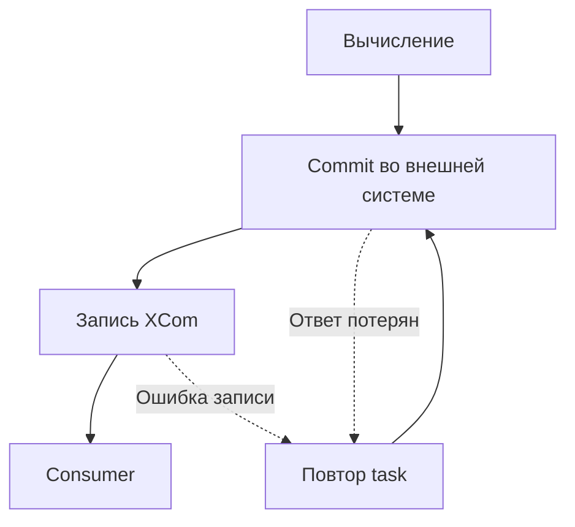
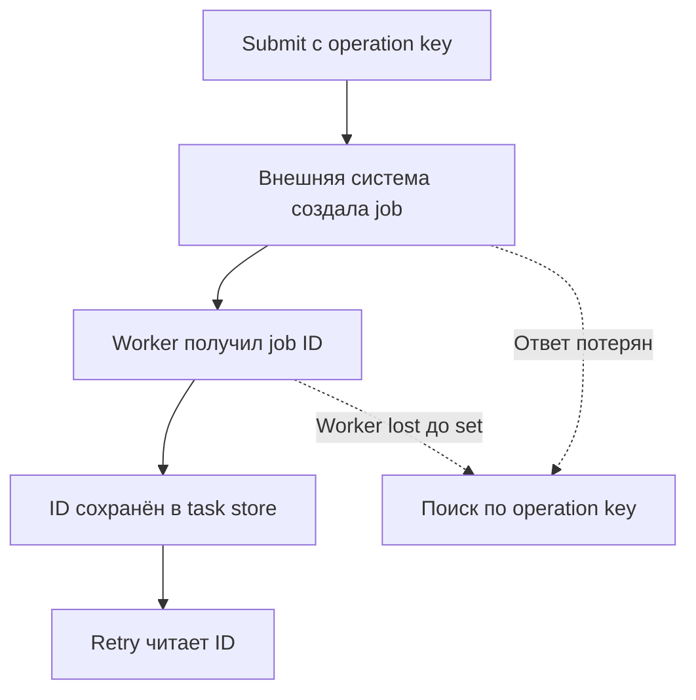
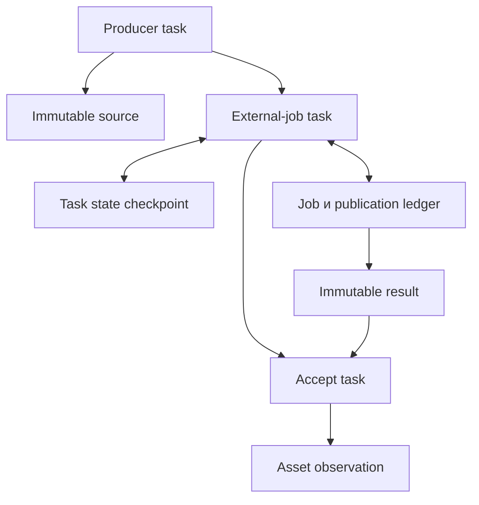

# 10. XCom, сериализация, контракты и state stores

**Apache Airflow Zero to Hero · Профессиональный справочник**

| Параметр | Значение |
| --- | --- |
| Базовая линия | Apache Airflow 3.3.2, Task SDK 1.3.2, Standard provider 1.19.0, Common IO provider 1.9.0, Python 3.12 |
| Дополнительный разобранный provider | Apache Spark provider 6.3.2 |
| Дата проверки | 20 октября 2026 года |
| Покрытие README | Все 9 тем и 46 пунктов раздела, в исходном порядке |
| Предварительные знания | TaskFlow, состояния и retries, run_id/map_index, интервалы данных, восстановление и resource lifecycle |
| Сквозной сценарий | Передать immutable manifest, пережить потерю ответа внешнего job, восстановить результат и проверить публикацию |
| Практический результат | Выбрать канал данных/состояния, версионировать контракт и доказать корректность повторного выполнения |

Нужно различать четыре разных объекта: **результат задачи, checkpoint попытки, состояние asset и бизнес-публикацию**.

Если сохранить внешний job ID в XCom, это ещё не делает его checkpoint для retry. Если записать watermark в asset state store, это ещё не создаёт транзакцию с warehouse. Если сериализация прошла, consumer ещё не доказал правильность бизнес-схемы.

| Механизм | Основное назначение | Область |
| --- | --- | --- |
| XCom | Передать небольшое значение или ссылку следующей задаче | DAG/run/task/map index/key |
| Task state store | Сохранить checkpoint задачи между attempts | Один TaskInstance: DAG/run/task/map index |
| Asset state store | Хранить метаданные, принадлежащие asset, между runs | Asset/key |
| Внешний registry / sink | Управлять бизнес-операциями, commit, ownership и историей | Контракт конкретной системы |

Task state store и asset state store добавлены в Airflow 3.3. Для примеров этой главы нужна закреплённая версия, а не произвольный Airflow 3.x. Публичные symbols сверены с SDK, версии packages — с constraints. [S15](#source-15) [S30](#source-30)

Важные особенности базовой линии:

- Универсального лимита всех современных XCom «48 KB» нет.
- Task state store изолирован по run_id: он не становится глобальным cross-run checkpoint.
- Retention задаёт возможность фоновой очистки; это не строгий lease, проверяемый при каждом чтении.
- Asset state store не использует task retention и clear_on_success.
- ResumableJobMixin не закрывает распределённое окно submit → persist ID.
- Object-storage XCom backend при некоторых ошибках чтения возвращает исходную ссылку; после pull требуется проверка контракта.

## Содержание

1. [Назначение XCom](#s10-1)
2. [Размер и стоимость данных](#s10-2)
3. [Сериализация и типы](#s10-3)
4. [Object storage XCom backend](#s10-4)
5. [Повторные попытки и mapping](#s10-5)
6. [Task state store в Airflow 3.3+](#s10-6)
7. [Asset state store в Airflow 3.3+](#s10-7)
8. [Resumable execution](#s10-8)
9. [Контракты между задачами](#s10-9)
10. [Лабораторная: immutable artifacts и внешний job](#lab-core)
11. [Лабораторная: DAG и четыре сценария восстановления](#lab-dag)
12. [Проверки и тесты](#tests)
13. [Разбор ситуаций](#cases)
14. [Самопроверка](#questions)
15. [Критерии освоения](#mastery)
16. [Проверка материала](#verification)
17. [Официальные источники](#sources)

<a id="s10-1"></a>
## 10.1. Назначение XCom

### 10.1.1. Небольшие значения управления и ссылки на результаты

XCom — механизм обмена значениями между tasks. Практическая граница проходит по стоимости управления: XCom удобен для manifest, URI, числа строк, job result receipt или небольшой структуры настроек. Он не предназначен для неограниченного dataset. [S01](#source-01)

| Хороший payload | Почему подходит |
| --- | --- |
| URI immutable artifact | Данные остаются в предназначенном для них storage |
| row_count/checksum/schema_version | Consumer может проверить контракт |
| Небольшой список запланированных shards | Управляет ограниченным mapping |
| Commit receipt | Содержит идентичность уже выполненной публикации |
| Небольшое значение расчёта | Нагрузка известна и ограничена |

Слово «ссылка» не означает любой строковый путь. `/tmp/result.json` на одном worker обычно недоступен другому. Ссылка должна разрешаться из execution runtime consumer и сохраняться достаточно долго.

Не возвращай открытое соединение, SparkSession, iterator над сокетом или объект клиента API. Это ресурсы процесса, а не переносимые результаты.

XCom не заменяет output table, object storage либо transactional outbox. Он хранит управляющее представление результата.

### 10.1.2. `return_value`, автоматический push и `do_xcom_push`

Обычный результат task сохраняется под ключом `return_value`, если автоматический push включён и результат подлежит сохранению. TaskFlow затем разрешает ссылку на этот результат для consumer. [S02](#source-02) [S03](#source-03)

`do_xcom_push=False` отключает автоматическую публикацию return. Это полезно для tasks, результат которых никто не читает. Явный вызов `ti.xcom_push(...)` является отдельным действием; не считай его автоматически запрещённым этим флагом.

В базовой линии return None обычно не создаёт обычный return_value. У downstream-generated mapping есть специальные требования к наличию и типу output; не используй отсутствие return как корректный способ передать пустой список.

| Намерение | Контракт |
| --- | --- |
| Передать пустой набор | Вернуть явно [] либо manifest row_count=0 |
| Передать отсутствующее необязательное поле | Nullable поле внутри проверяемого сообщения |
| Не создавать output | do_xcom_push=False / отсутствие возвращаемого результата |
| Сообщить failure | Ошибка/соответствующее исключение, а не return None |
| Сообщить ожидаемый no-op | Явный receipt или осмысленный skip по главе 9 |

Если внешний commit завершился, а push return_value упал, task может стать failed при уже существующих бизнес-данных. Повтор должен проверить publication identity, а не слепо записывать всё ещё раз.

### 10.1.3. `xcom_push()`, `xcom_pull()`, ключи и область конкретного запуска

В Airflow 3 взаимодействуй через runtime task instance из SDK context. Прямой ORM-доступ к metadata DB из task не является нормальным API авторства.

```python
# example: explicit_xcom
from datetime import datetime, timezone

from airflow.sdk import DAG, get_current_context, task

with DAG(
    dag_id="ch10_explicit_xcom",
    schedule=None,
    start_date=datetime(2026, 10, 1, tzinfo=timezone.utc),
    catchup=False,
    is_paused_upon_creation=True,
) as explicit_xcom:
    @task(do_xcom_push=False)
    def inspect() -> None:
        ti = get_current_context()["ti"]
        ti.xcom_push(key="inspection_v1", value={
            "schema_version": 1,
            "source_status": "ready",
            "row_count": 3,
        })

    @task
    def read_inspection() -> int:
        ti = get_current_context()["ti"]
        message = ti.xcom_pull(task_ids="inspect", key="inspection_v1")
        if not isinstance(message, dict) or message.get("schema_version") != 1:
            raise ValueError("Inspection contract is absent or incompatible")
        if type(message.get("row_count")) is not int:
            raise ValueError("row_count must be an integer")
        return message["row_count"]

    produced = inspect()
    consumed = read_inspection()
    produced >> consumed
```

Runtime pull не создаёт ребро при parse. Поэтому зависимость в примере задана явно.

Область XCom включает dag_id, run_id, task_id, map_index и key. Try number не является дополнительным namespace обычного XCom. Новая попытка не получает отдельный вечный набор outputs.

SDK 3.3.2 позволяет у pull указать run_id, dag_id, key, map_indexes, include_prior_dates и default. По умолчанию используется текущий run; map-index нормализация зависит от формы запроса. При mapped tasks задавай нужный индекс явно, когда контракт требует конкретный экземпляр. [S03](#source-03)

include_prior_dates=True расширяет поиск; это не замена точной идентичности checkpoint. «Возьми последний доступный результат» может незаметно прочитать другой бизнес-период.

Для отсутствующего XCom default обычно None. Проверяй обязательность поля явно: отсутствие output не должно превращаться в пустой корректный dataset.

### 10.1.4. `multiple_outputs` и контракт именованных результатов

При `multiple_outputs=True` возвращённый mapping разворачивается в отдельные XCom keys. В 3.3.2 сохраняется также полный mapping под return_value. Ключи должны быть строками. [S03](#source-03)

```python
# example: named_outputs
from datetime import datetime, timezone

from airflow.sdk import DAG, task

with DAG(
    dag_id="ch10_named_outputs",
    schedule=None,
    start_date=datetime(2026, 10, 1, tzinfo=timezone.utc),
    catchup=False,
    is_paused_upon_creation=True,
) as named_outputs:
    @task(multiple_outputs=True)
    def inspect() -> dict:
        return {
            "row_count": 3,
            "total_minor": 1400,
            "schema_version": 1,
        }

    @task
    def check_count(row_count: int) -> None:
        if row_count != 3:
            raise ValueError("Unexpected source count")

    outputs = inspect()
    check_count(outputs["row_count"])
```

Типизация return Mapping/dict может включить inference multiple_outputs у TaskFlow. Если нужен один целый manifest, задай `multiple_outputs=False` явно. [S07](#source-07)

Разница принципиальна:

| Объект | Что означает obj["row_count"] |
| --- | --- |
| Обычный dict во время выполнения | Доступ к полю dict |
| XComArg во время построения DAG | Ссылка на XCom key row_count |
| XComArg producer с multiple_outputs=False | Ключ row_count может вообще не быть записан |

Не предполагается, что SDK автоматически прочитает весь будущий JSON и выполнит обычное индексирование его поля при любой такой записи.

Множество именованных keys — API producer. Переименование key ломает consumers и сохранённые ожидания исторических runs. Если consumers всегда читают весь объект, отдельные keys часто не нужны.

### 10.1.5. XComArg как ссылка на будущий результат при построении DAG

XComArg связывает граф и будущий output, а не содержит готовые данные. Вызов decorated function в фабрике DAG создаёт task/operator и XComArg. [S06](#source-06)

Основные следствия:

- Передача XComArg в TaskFlow аргумент создаёт data dependency.
- str(XComArg) не превращает объект в вычисленный JSON.
- Python if/for по будущему output не является runtime-выбором.
- Для изменяющегося числа tasks используется mapping, а не цикл по результату на parse.
- Выход skipped ветки может отсутствовать; join contract из главы 9 остаётся обязательным.

Различай task definition, TaskInstance и XCom value. Одна decorated function может создать несколько разных task definitions; один task_id имеет много TIs по runs и map indexes.

Сериализованный DAG хранит описание ссылок и структуры. Это другой вид сериализации, чем сериализация XCom payload.

<a id="s10-2"></a>
## 10.2. Размер и стоимость данных

### 10.2.1. Ограничения backend, СУБД, сериализации и Execution API

Эффективный предел XCom определяется всей цепочкой:

| Участок | Возможное ограничение |
| --- | --- |
| Producer process | Память на исходный объект и сериализацию |
| SDK serializer | Поддерживаемые типы, вложенность и wire format |
| Worker/supervisor/API | Размер и стоимость передаваемого сообщения |
| Proxy/network | Body limits, timeout, throughput |
| Metadata DB | Тип столбца, размер строки, transaction/WAL/replication |
| Custom backend | Object limits, compression, credentials и latency |
| Consumer | Память и время десериализации |
| UI/API inspection | Чтение/отображение тяжёлого значения |

В Airflow 3 SDK BaseXCom сериализует значение и передаёт его через execution path; server хранит полученное представление. Custom backend может записать blob на worker и отправить только reference. [S02](#source-02) [S04](#source-04)

«База технически принимает» не означает «разумно передавать». Если output размером 200 MB проходит один тест, это не доказывает приемлемость 1000 параллельных таких задач.

Полезно установить собственный contract budget, например ограничение размера manifest и числа shards. Это правило проекта, а не универсальная константа Airflow.

### 10.2.2. Отсутствие универсального современного лимита XCom в 48 KB

Утверждение «все XCom ограничены 48 KB» исторически переносится между версиями и backends. Для рассматриваемой реализации это неверный универсальный контракт.

Проверяй:

1. Установленные core/SDK/provider.
2. Реальный класс XCom backend.
3. Где выполняются serialize/deserialize.
4. Фактические API/proxy/DB limits.
5. Прикладной размер и memory budget.

Не смешивай разные параметры:

| Параметр | Чего касается |
| --- | --- |
| xcom_objectstorage_threshold | Граница размещения XCom в Common IO backend |
| max_map_length | Ограничение расширения mapping, а не байтов XCom |
| state_store.max_value_storage_bytes | Policy для task/asset state, а не XCom |
| Лимит HTTP body | Конкретная транспортная конфигурация |
| Лимит manifest проекта | Ваш business/data contract |

В 3.3.2 policy state store по умолчанию равна 65535, но она не становится общим XCom limit. Подробности различия public API и worker writes — ниже. [S24](#source-24)

### 10.2.3. Цена записи, чтения, отображения и хранения больших значений

Оцени нагрузку числом сообщений, а не только размером одного dict.

При N mapped TIs, R runs и K отдельных ключах плюс полном return_value:

`rows ≈ N × R × (K + 1)`.

Для 1000 TIs, 30 runs и трёх именованных outputs получается 120000 XCom values. Даже при среднем payload 1 KiB это около 117 MiB только значений, без индексов, исторических обновлений, WAL и сетевых копий.

| Стоимость | Почему возрастает |
| --- | --- |
| CPU | Повторная сериализация и проверка типов |
| Worker memory | Исходный объект + сериализованные представления |
| Metadata DB | INSERT/UPDATE/DELETE, индексы, backup/replication |
| API | Запросы чтения, JSON encoding и передача |
| Object storage | PUT/GET/DELETE, listing, мелкие объекты |
| UI | Получение и отображение диагностического payload |

Common IO offload уменьшает payload в metadata DB, но не отменяет первоначальную JSON-сериализацию в worker memory. Если producer сначала материализовал гигантский DataFrame, offload уже не решает эту проблему.

Не логируй весь manifest или DataFrame для измерения размера. Достаточно bytes, schema_version, checksum и ограниченного набора IDs.

### 10.2.4. Запрет на неограниченные DataFrame и массивы в управляющем канале

Поддержка сериализации DataFrame каким-либо provider не является рекомендацией передавать любой объём таблицы через XCom.

Промышленный pattern:

- Task пишет данные в предназначенный storage.
- Формирует небольшой immutable manifest.
- Передаёт manifest через XCom.
- Consumer проверяет schema, identity и integrity.
- Работает с данными через storage/вычислительную систему.

Для Spark task обычно передаёт URI таблицы/партиции, snapshot ID, application/job ID и receipt. Данные остаются в Spark/storage.

Небольшой список допустим, если у него есть явная верхняя граница. Например, до 100 именованных shards по контракту. Неограниченный список из миллиона файлов не становится хорошим control payload после переименования в manifest. Разделение task boundaries и хранения данных соответствует практикам проектирования Airflow pipelines. [S31](#source-31)

Для больших inventories используй manifest artifact и передавай ссылку на него; mapping создавай по ограниченным batches с понятной ценой восстановления.

### 10.2.5. Manifest с URI, размером, checksum, схемой и версией

Manifest описывает конкретный артефакт и его интерпретацию.

```json
{
  "schema_version": 1,
  "dataset": "orders",
  "format": "json",
  "source_snapshot": "orders-demo-v1",
  "business_window": {
    "start": "2026-10-01T00:00:00Z",
    "end": "2026-10-02T00:00:00Z"
  },
  "uri": "s3://training-bucket/orders/sha256/example.json",
  "size_bytes": 312,
  "sha256": "0000000000000000000000000000000000000000000000000000000000000000",
  "row_count": 3
}
```

Это **иллюстрация структуры**, а не manifest существующего объекта: размер и checksum в ней демонстрационные. Лабораторная формирует реальные значения из байтов.

Поля отвечают на разные вопросы:

| Поле | Проверка |
| --- | --- |
| schema_version | Consumer понимает формат сообщения |
| dataset / format | Выбран правильный parser и ожидаемый dataset |
| business_window | Это нужный период, [start,end) |
| source_snapshot | Какие исходные данные использованы |
| URI/object version | Читается именно заявленный объект |
| size_bytes | Объём соответствует ожиданию и budget |
| sha256 | Байты не изменились |
| row_count / totals | Бизнес-сверка с независимым ожиданием |

Checksum доказывает соответствие байтов manifest, но не правильность самих данных. Если producer ошибочно записал 1600 и посчитал checksum этих байтов, hash будет корректным, а бизнес-результат — ошибочным.

URI не должен содержать bearer token, пароль или временную signed query. Используй устойчивую identity объекта и credentials через принятый механизм доступа.

<a id="s10-3"></a>
## 10.3. Сериализация и типы

### 10.3.1. JSON-совместимые значения и поддерживаемые serializers

Надёжный контракт должен пережить границы Python-процессов, версий пакета и компонентов Airflow.

Минимальный переносимый набор — JSON-совместимые primitives/collections со строковыми keys и явными schema/version. SDK также поддерживает зарегистрированные serializers и некоторые Python-типы, но это дополнительный контракт окружения. [S08](#source-08) [S09](#source-09)

| Значение | Предпочтительное представление контракта |
| --- | --- |
| Дата/время | ISO 8601 с timezone и ясной семантикой |
| Денежная сумма | Integer minor units либо decimal string с валютой/scale |
| UUID/job ID | Строка |
| Binary payload | Artifact + URI/checksum |
| Enum | Стабильное строковое значение |
| Большая таблица | Table/snapshot/partition reference |
| Ошибка внешнего API | Ограниченный структурированный error code |

У Python bool является подклассом int. Проверка `isinstance(True, int)` не защищает поле row_count от bool. Для строгого integer-контракта часто нужен `type(value) is int`.

NaN/Infinity не являются стандартными JSON numbers. В собственном codec используй `allow_nan=False` и проверяй finite numbers. Public state-store models 3.3.2 также отвергают non-finite значения. [S23](#source-23)

### 10.3.2. Даты, dataclasses и пользовательские типы

Typed object удобен внутри библиотеки, но его передача требует доступного класса и совместимого decoder у consumer.

Dataclasses и attrs могут автоматически сериализоваться. Вложенные dataclasses при автоматическом преобразовании способны терять информацию о типах: после восстановления внутри окажется dict, а не исходный вложенный класс. Это отмечено в SDK implementation. [S08](#source-08)

Для стабильного межзадачного сообщения часто проще явно построить JSON envelope:

- Дата хранится строкой с timezone.
- Decimal хранится строкой либо minor units.
- Schema version — обязательное integer поле.
- Nullable-поля определяются схемой, а не догадкой consumer.
- Python class path не становится единственной идентичностью бизнес-контракта.

Если нужен собственный класс, размести его в устанавливаемом пакете на уровне модуля. Локальный класс внутри task не является хорошей importable identity для другого процесса.

### 10.3.3. Регистрация serializer и версия формата

Есть два разных расширения:

| Подход | Что поддерживает |
| --- | --- |
| Класс предоставляет serialize()/deserialize(data,version) | Собственный тип и явно контролируемый формат |
| Зарегистрированный serializer module | Типы, которыми нельзя управлять напрямую |
| Dataclass/attrs fallback | Автоматическое представление простых структур |

В SDK 3.3.2 registry находится в namespace `airflow.sdk.serde.serializers`. Старые материалы могут показывать прежний core namespace. Не объявляй регистрацию завершённой только потому, что модуль импортирован в одном DAG process. [S08](#source-08)

Фактический код сначала обрабатывает коллекции, затем может выбрать зарегистрированный serializer по типу, а после — object serializer/dataclass/attrs fallback. Не полагайся на порядок, пересказанный без проверки версии.

Пример класса для файла `corp_contracts/message.py`:

```python
# example: versioned_message
from dataclasses import dataclass
from typing import ClassVar

@dataclass(frozen=True)
class OrderSummary:
    __version__: ClassVar[int] = 1
    row_count: int
    total_minor: int

    def serialize(self) -> dict:
        if type(self.row_count) is not int or self.row_count < 0:
            raise ValueError("Invalid row_count")
        if type(self.total_minor) is not int:
            raise ValueError("Invalid total_minor")
        return {"row_count": self.row_count, "total_minor": self.total_minor}

    @staticmethod
    def deserialize(data: dict, version: int) -> "OrderSummary":
        if version != 1:
            raise ValueError("Unsupported OrderSummary wire version")
        if not isinstance(data, dict) or set(data) != {"row_count", "total_minor"}:
            raise ValueError("Invalid OrderSummary fields")
        result = OrderSummary(data["row_count"], data["total_minor"])
        result.serialize()
        return result
```

Этот класс демонстрирует методы объекта, а не изменение глобального registry. Для восстановления классу нужна importability и разрешение на deserialization по policy окружения. SDK wire-версия __version__ и schema_version бизнес-manifest решают разные задачи; не смешивай их.

### 10.3.4. Совместимость producer/consumer при обновлении пакета

Новая версия producer должна понимать, кто ещё читает старые outputs: старый worker image, исторический run, paused consumer или внешняя система.

| Изменение | Риск |
| --- | --- |
| Добавлено необязательное поле | Старый strict consumer может отклонить |
| Поле переименовано | Старый consumer не найдёт значение |
| int заменён строкой | Меняется интерпретация/сравнение |
| Изменены единицы суммы | Число выглядит правдоподобно, смысл неверен |
| Python-класс перенесён в другой модуль | Старый class path не импортируется |
| Checksum стал считаться по другому encoding | Старый verifier отклоняет тот же смысловой объект |

Схема совместимости должна быть явной: поддерживаем v1/v2, мигрируем при чтении либо отклоняем неизвестную версию.

Не принимай произвольный future version «если поля похожи». Старый consumer не знает изменившуюся семантику.

Проверяй golden fixtures: v1 bytes читаются новой библиотекой, а новый producer не ломает ещё поддерживаемого consumer. Обновление core/SDK и обновление вашего contract package — отдельные изменения.

### 10.3.5. Ограничения доверия и удаление pickle-подходов в Airflow 3

Не переносите инструкции Airflow 2 по включению pickling как решение «не сериализуется любой объект». В рассматриваемом XCom path используется SDK serialization; pickle не является универсальным поддерживаемым обходом ограничений.

Deserialization классов — trust boundary. Код класса исполняется в процессе consumer; разрешение произвольного import path расширяет поверхность исполнения. [S08](#source-08)

Практические правила:

- Предпочитай проверяемый JSON для межсистемного контракта.
- Для custom class разрешай конкретный полный class path через соответствующую deserialization policy.
- Не используй allowlist "*" ради удобства.
- Устанавливай package из доверенного источника с управляемой версией.
- Не принимай manifest URI, schema class и shell command как равнозначные «просто строки».

Успешная сериализация не очищает PII и secrets. Поля останутся в XCom/state/logs/storage согласно доступу и retention.

<a id="s10-4"></a>
## 10.4. Object storage XCom backend

### 10.4.1. Backend из common-io provider и порог выноса в хранилище

Common IO provider 1.9.0 предоставляет:

`airflow.providers.common.io.xcom.backend.XComObjectStorageBackend`.

Он хранит небольшие значения обычным XCom path, а большие сериализованные payload — в object storage, оставляя reference в metadata DB. В Airflow 3 этот backend использует SDK BaseXCom. [S10](#source-10)

Точная граница по коду:

| Threshold | Поведение |
| --- | --- |
| < 0 | Не offload; обычное хранение |
| 0 | Offload всех непустых сериализованных JSON payload |
| N > 0, bytes < N | Обычное хранение |
| N > 0, bytes >= N | Object storage |

Равенство threshold относится к object storage. Размер считается по UTF-8 serialized JSON **до compression**.

Конфигурация для S3, где xcom_storage — существующий Airflow Connection ID:

```ini
[core]
xcom_backend = airflow.providers.common.io.xcom.backend.XComObjectStorageBackend

[common.io]
xcom_objectstorage_path = s3://xcom_storage@training-bucket/airflow-xcom/
xcom_objectstorage_threshold = 1048576
xcom_objectstorage_compression = gzip
```

Connection ID в user-part URL — соглашение ObjectStoragePath; это не пароль. Bucket, Connection и права должны быть подготовлены отдельно. [S11](#source-11) [S12](#source-12)

### 10.4.2. Ссылка в метабазе и payload в S3/GCS/совместимом storage

У одной логической записи появляются две части:

| Часть | Где находится |
| --- | --- |
| XCom identity и reference | Metadata DB / Airflow API |
| Serialized payload | Object storage |
| Credentials и backend implementation | Execution environment нужного worker |

Объект получает уникальный адрес в configured prefix. Если object PUT завершился, а metadata reference не записался, остаётся orphaned blob. Если reference записан, но blob удалён lifecycle policy, pull больше не даёт ожидаемый payload.

Перемещение prefix, смена backend class или credentials влияет и на чтение старых XCom. Это migration, а не только настройка будущих runs.

Значение, само являющееся URI в configured prefix, также требует проверки поведения decoder: backend отличает reference по своему протоколу, а не по бизнес-намерению автора строки.

Не путай custom backend offload и собственный artifact manifest. В первом случае backend управляет blob для XCom; во втором lifecycle и бизнес-версионирование артефакта проектирует ваш pipeline.

### 10.4.3. Сжатие, encryption, credentials и сетевой доступ workers

Compression влияет на object bytes и CPU, но threshold применяется к несжатому serialized value. Gzip не превращает огромный Python object в дешёвый output.

| Аспект | Что проверить |
| --- | --- |
| Compression support | Нужный codec установлен у readers/writers |
| Encryption in transit | Настройка endpoint/TLS конкретного storage |
| Encryption at rest | Bucket/provider/KMS policy; sample config этого не доказывает |
| Credentials | Worker может писать/читать/удалять нужный prefix |
| Network | Endpoint доступен из всех execution runtimes |
| Package versions | Backend и protocol одинаково понимают reader/writer |
| Retry behavior | Что произойдёт после PUT success и API failure |

Не выдавай API server облачные credentials только из предположения, что он обязан выполнять worker-side offload. Определи реальные write/read/inspection paths deployment.

Некоторые настройки backend кэшируются в процессе. После смены конфигурации перезапусти соответствующие процессы и проверь round-trip на старом и новом payload. Не считай смену env в другом shell обновлением работающего worker.

### 10.4.4. Lifecycle объектов, удаление XCom и orphaned blobs

Удаление строки metadata DB и удаление blob не являются общей транзакцией.

SDK BaseXCom.delete вызывает purge custom backend. Но core XComModel.clear прямо предупреждает: server-side clear не гарантирует purge custom data. Execution path передаёт keys worker для очистки там, где backend доступен. Массовая чистка DB не обязана пройти тот же путь. [S02](#source-02) [S05](#source-05) [S32](#source-32)

| Событие | Возможный остаток |
| --- | --- |
| PUT success, reference write failure | Blob без metadata |
| DB cleanup без purge | Blob без metadata |
| Storage lifecycle раньше retention metadata | Reference без blob |
| Переезд на новый prefix | Старые ссылки не читаются прежней конфигурацией |
| Ошибка DELETE | Часть cleanup завершилась, часть нет |

Для production нужны согласованные retention, учёт объёма, независимый orphan cleanup и периодическая проверка references. Не удаляй бизнес-артефакты по короткой политике временных XCom blobs.

Сначала определи горизонт восстановления historical runs. Затем настрой lifetime, сохранив outputs, которые ещё нужны для replay/audit.

### 10.4.5. Диагностика отсутствующего объекта и несовместимого backend

В Common IO 1.9.0 при FileNotFoundError, TypeError или ValueError на определённом участке чтения deserialize_value может вернуть исходное значение reference. Это означает, что consumer вместо dict получит строку URI. Другие ошибки, например доступ/сеть, могут распространяться как исключения. [S10](#source-10)

Поэтому после pull обязателен contract guard:

```python
# example: require_manifest_shape
def require_manifest_shape(value: object) -> dict:
    if not isinstance(value, dict):
        raise ValueError("Expected a manifest object, possibly unresolved XCom reference")
    if value.get("schema_version") != 1:
        raise ValueError("Unsupported manifest schema")
    if not isinstance(value.get("uri"), str):
        raise ValueError("Artifact URI is absent")
    return value
```

Это только ранняя shape-проверка. Лабораторная дополнительно проверяет полный набор полей, URI root, размер, hash, schema и business reconciliation.

Порядок диагностики:

1. Определи фактический backend в execution environment.
2. Проверь, является ли stored value ожидаемым reference.
3. Проверь prefix/codec/credentials reader.
4. Проверь наличие и версию объекта.
5. Отличи missing blob от несовместимой deserialization.
6. Проверь отсутствие fallback к raw reference в consumer.
7. Восстанавливай из retained artifact либо повторяй producer по проверяемому контракту.

Не исправляй отсутствие объекта простым return None: downstream потеряет различие между «результат отсутствует» и «корректный no-op».

<a id="s10-5"></a>
## 10.5. Повторные попытки и mapping

### 10.5.1. Жизненный цикл XCom при retry и clear

XCom — output обмена, а не durable checkpoint незавершённой задачи. При новом обычном исполнении после retry/clear прежние XCom этой task могут очищаться. В 3.3.2 execution path специально передаёт worker keys для удаления, чтобы учитывать custom backend. При deferral continuation действует отдельная логика. [S03](#source-03) [S32](#source-32)

Не строй recovery на предположении, что task сначала push-нет job_id, упадёт, а на retry гарантированно прочитает этот XCom.

| Нужно сохранить | Подходящий механизм |
| --- | --- |
| Output для downstream после success | XCom |
| In-flight external job ID между attempts | Task state store / external registry |
| Cross-run watermark asset | Asset state store с корректной concurrency policy |
| Business commit и его audit | Sink/transactional registry |
| Большие данные для replay | Retained immutable artifact |

Clear task и `task_state_store.clear()` — разные операции. Одно означает восстановление исполнения, другое — удаление checkpoint keys.

После clear того же TI task store может сохранить прежнее logical scope, если его данные не удалили policy/GC/ручной операцией. Новый run_id получает другой namespace. Это нужно проверять вместе с версией кода и правилами reuse job.

### 10.5.2. Изоляция результатов разных runs и mapped instances

XCom identity включает map_index. Task store также изолирован по map_index.

| Экземпляр | Отдельный namespace |
| --- | --- |
| DAG A, run 1, task load, index 0 | Да |
| DAG A, run 1, task load, index 1 | Да |
| DAG A, run 2, task load, index 0 | Да |
| DAG B, run 1, task load, index 0 | Да |

Немаппированный индекс обычно -1. Не передавай его как «любой mapped task».

Consumer, читающий конкретный mapped output, должен знать идентичность элемента, а не только позицию. Если list order изменился между attempts, index 7 может описывать другой file/object.

Для business idempotency key используй stable shard/entity ID и source version. map_index пригоден для Airflow-идентичности экземпляра, но часто недостаточен как бизнес-идентичность операции.

### 10.5.3. Lazy sequences и стоимость принудительного `list()`

Mapping может возвращать ленивое представление коллекции XCom. Оно позволяет получать значения по мере чтения. Это не бесплатный готовый list в памяти. [S06](#source-06)

Материализация `list(values)` способна:

- Выполнить множество API/backend reads.
- Скачать offloaded payload каждого элемента.
- Загрузить весь набор в память consumer.
- Увеличить latency одной финальной task.
- Повторить эту стоимость при retry.

Ленивость не равна распределённой Spark-вычислительной модели. Consumer всё равно исполняется в своём процессе с ограниченными ресурсами.

Для большого fan-in лучше агрегировать компактные receipts либо делать проверку по manifest в storage/warehouse. Если полный list нужен, заранее оцени cardinality и byte budget.

Обычный ti.xcom_pull с несколькими фильтрами и mapped TaskFlow output могут возвращать разные формы результата. Не обобщай lazy semantics на любой XCom API; проверяй конкретный тип/путь. [S33](#source-33)

### 10.5.4. Версионирование входного manifest для стабильного mapping

Mapping input должен быть воспроизводимым.

| Поле shard | Назначение |
| --- | --- |
| stable shard_id | Идентичность бизнес-работы |
| source URI/version/checksum | Неизменный вход |
| business window | Период обработки |
| operation revision | Намеренное изменение вычисления |
| schema/transform version | Интерпретация и алгоритм |
| Позиция в manifest | Устойчивая связь с map_index внутри версии |

Зафиксируй sorting и manifest checksum до расширения. При новом списке входов формируй новую manifest version, а не переписывай старую по тому же адресу.

Даже детерминированная сортировка не спасает при добавлении файла в начало изменяемого списка: все последующие indexes сдвинутся. Поэтому immutable inventory важнее одной sort().

В checkpoint храни source/request fingerprint вместе с job ID. Если сохранённый job относился к другому manifest, нельзя молча reattach.

### 10.5.5. Отсутствие атомарности XCom и внешнего commit

Обычная последовательность:



Airflow не объединяет эти шаги в одну распределённую транзакцию.

Правильное восстановление опирается на проверяемый commit receipt и idempotency contract внешней системы. Если commit уже выполнен с тем же request fingerprint, повтор возвращает прежний результат.

«Task failed» не означает «commit отсутствует». «Task success» не доказывает полноту данных без проверки sink. «XCom отсутствует» не означает «внешний job не запускался».

Лабораторная покажет все эти границы на controllable failures.

<a id="s10-6"></a>
## 10.6. Task state store в Airflow 3.3+

### 10.6.1. `task_state_store` для сохраняемого состояния задачи

Task state store — key/value API для checkpoint одного TaskInstance. Он доступен в runtime context через `context["task_state_store"]`. [S13](#source-13) [S28](#source-28)

Основные методы:

| Метод | Назначение |
| --- | --- |
| get(key, default=None) | Прочитать значение либо default при отсутствии |
| set(key, value, retention=...) | Записать/заменить JSON-значение |
| delete(key) | Удалить один ключ |
| clear() | Удалить keys текущего scope |

Top-level value=None при set запрещён. Это не мешает использовать null как поле внутри JSON-объекта, если такая nullable-семантика задана контрактом.

Для datetime используй явный ISO string. XCom serialization и JSON-value contract state store не являются одинаковыми API: custom XCom class не обязан приниматься state accessor.

Ошибку чтения state store нельзя бездумно превращать в «ключ отсутствует». SDK различает not found и другие runtime errors. Если control store недоступен, повторный submit может нарушить recovery policy.

### 10.6.2. Область ключей и поведение между attempts и runs

Логическая область:

`(dag_id, run_id, task_id, map_index, key)`.

Try number в неё не входит. Поэтому следующая попытка того же TI читает checkpoint предыдущей. Другой run_id или mapped index получает другое пространство. [S14](#source-14) [S17](#source-17)

| Событие | Ожидание |
| --- | --- |
| Retry того же TI | Scope сохраняется |
| Worker crash и следующая попытка | Scope сохраняется, если запись успела завершиться |
| Clear с повтором того же logical TI | Scope не становится новым только из-за нового attempt |
| Новый DagRun | Другой namespace |
| Новый map_index | Другой namespace |
| Переименование task | Другая task identity |
| Ручной clear()/policy cleanup | Сохранённых keys может больше не быть |

Не используй task store другого run как неявный общий watermark. SDK accessor привязан к текущему TI; cross-run бизнес-состояние требует другого явного контракта.

Даже сохранённое состояние может исчезнуть после GC, clear_on_success, удаления DagRun или административной очистки. «Durable» означает сохранение вне памяти worker при известных условиях, а не бессрочное существование любой записи.

### 10.6.3. Persisted job ID, cursor и возобновление внешней работы

Checkpoint должен содержать достаточно информации, чтобы доказать, к какой работе он относится.

```json
{
  "checkpoint_version": 1,
  "operation_id": "orders-2026-10-01-revision-2",
  "request_sha256": "1111111111111111111111111111111111111111111111111111111111111111",
  "job_id": "external-job-123",
  "phase": "submitted"
}
```

Пример иллюстрирует структуру, а не существующий job.

Одного job_id иногда мало: после изменения manifest либо transform version сохранённый ID может относиться к другому запросу.

При восстановлении:

1. Валидируй checkpoint version и schema.
2. Сравни operation identity и request fingerprint.
3. Проверь job у внешней системы.
4. Если running — reattach.
5. Если succeeded — получи и проверь прежний результат.
6. Если failed/unknown/missing — применяй явную policy, а не произвольный fresh submit.

Cursor сохраняется **после** подтверждённой обработки соответствующей части работы. Если сначала продвинуть cursor, а затем писать данные, crash создаст пропуск. Если сначала commit, затем cursor, возможен повтор; его нужно сделать идемпотентным.

### 10.6.4. Retention, `NEVER_EXPIRE`, `clear_on_success` и уборка

В SDK 3.3.2 retention принимает timedelta, None либо импортируемый sentinel NEVER_EXPIRE.

```python
# example: task_store_checkpoint
from datetime import timedelta

from airflow.sdk import NEVER_EXPIRE, get_current_context, task

@task
def remember_checkpoint() -> dict:
    store = get_current_context()["task_state_store"]
    checkpoint = {"checkpoint_version": 1, "job_id": "training-example"}
    store.set("external_job_v1", checkpoint, retention=NEVER_EXPIRE)
    store.set("diagnostic_v1", {"phase": "submitted"}, retention=timedelta(hours=6))
    restored = store.get("external_job_v1")
    if restored != checkpoint:
        raise ValueError("Checkpoint round-trip failed")
    return restored
```

Это демонстрация accessor API. Она не создаёт реальный job.

| Настройка/значение | Поведение базовой линии |
| --- | --- |
| retention=None | Использует default_retention_days |
| timedelta(hours=6) | expires_at рассчитывается на worker как now+duration |
| NEVER_EXPIRE | expires_at=NULL |
| default_retention_days=30 | Default task retention |
| default_retention_days=0 | Нет time-based expiry |
| clear_on_success=False | Default: состояние остаётся после success |
| clear_on_success=True | Task state очищается при success |
| state_cleanup_batch_size | Размер cleanup batches, 0 — без batching |

retention=7 не означает семь дней: это не поддерживаемый timedelta contract. Импортируй NEVER_EXPIRE из SDK, а не воспроизводи его внутреннее представление вручную. [S13](#source-13) [S24](#source-24)

**Expiry не является строгим TTL чтения.** В MetastoreBackend 3.3.2 get выбирает строку по scope/key без фильтра expires_at. Просроченная запись может читаться до cleanup; GC удаляет по expires_at < now. Поэтому retention нельзя использовать как lease/fencing проверку владения ресурсом. [S16](#source-16)

NEVER_EXPIRE защищает от time-based GC, но не от clear_on_success=True, delete/clear и удаления связанной metadata. Условия очистки независимы.

В API expiry задаётся absolute timestamp/default/null, а в SDK — timedelta/sentinel. Не смешивай эти формы.

### 10.6.5. Default backend в метабазе и worker-side custom backend

Default server backend:

`airflow.state.metastore.MetastoreBackend`.

Worker обращается через SDK/supervisor/Execution API, а не открывает ORM-сессию metadata DB. State хранится JSON-представлением в task_state_store model. [S16](#source-16) [S19](#source-19)

Две настройки имеют разные роли:

| Настройка | Область |
| --- | --- |
| [state_store] backend | Server-side backend, default MetastoreBackend |
| [workers] state_store_backend | Worker-side offload backend с credentialed storage |

Worker-side class реализует BaseStoreBackend contract и специальные методы:

- serialize_task_state_store_to_ref(value,key,scope)
- deserialize_task_state_store_from_ref(ref)
- serialize_asset_state_store_to_ref(value,key,scope)
- deserialize_asset_state_store_from_ref(ref)
- delete/clear и необходимые sync/async lifecycle methods

Scope у worker asset backend содержит name/uri, тогда как server может работать с integer asset_id. Самостоятельно угадывать равенство этих identities нельзя. [S14](#source-14)

Пример конфигурационного намерения:

```ini
[state_store]
backend = airflow.state.metastore.MetastoreBackend
default_retention_days = 30
clear_on_success = False
max_value_storage_bytes = 65535
state_cleanup_batch_size = 10000

[workers]
state_store_backend = corp_state.backend.ObjectStoreBackend
```

corp_state.backend.ObjectStoreBackend здесь — **ваш реализуемый класс**, а не встроенный backend или готовый файл лабораторной. Не применяй эту строку, пока package и весь contract класса не реализованы и не протестированы.

У worker offload значение сначала записывается во внешний backend, затем reference отправляется server. Это дополнительная граница orphaned payload/reference. Delete/clear сначала удаляют DB reference, затем вызывают внешний cleanup; частичный отказ требует собственного reconciliation.

Policy max_value_storage_bytes в 3.3.2: public REST API отклоняет слишком большой value с validation error/422, а worker path предупреждает и продолжает запись. При offload policy оценивает передаваемое представление/reference. Это policy координационного state, а не invitation хранить dataset в key/value API. [S13](#source-13) [S23](#source-23) [S24](#source-24)

### 10.6.6. Конкурентные обновления и границы гарантии сохранённого состояния

Обычные get/set не предоставляют compare-and-swap либо атомарный increment. Запись одного key перезаписывает значение.

Пример lost update:

| Момент | Writer A | Writer B |
| --- | --- | --- |
| 1 | Читает cursor=100 | Читает cursor=100 |
| 2 | Пишет cursor=120 | Ещё обрабатывает старый snapshot |
| 3 | Завершился | Пишет cursor=110 |
| Итог | Продвижение потеряно | Последняя запись победила |

Даже если в норме Airflow исполняет один TI, после потери связи старая внешняя работа может жить одновременно с новой попыткой. State store не становится distributed lock только из-за привязки к TI.

Для критической конкуренции нужны один обоснованный writer, транзакция/CAS в предназначенном для этого storage либо fencing на стороне sink.

Не считай атомарность одного upsert атомарностью нескольких keys. Если checkpoint fields должны меняться вместе, храни один ограниченный versioned object. Это уменьшает окно частичного обновления, но не добавляет CAS.

<a id="s10-7"></a>
## 10.7. Asset state store в Airflow 3.3+

### 10.7.1. `asset_state_store` и состояние, связанное с asset

Asset state store хранит метаданные самого asset независимо от конкретного run. Типичные данные: source cursor, watermark, versioned incremental-load state, последний verified receipt. [S18](#source-18) [S29](#source-29)

Доступ из task определяется объявленными inlets/outlets. Для обычного сценария объяви concrete Asset и выбери его явно:

```python
# example: asset_store_access
from datetime import datetime, timezone

from airflow.sdk import Asset, DAG, get_current_context, task

ORDERS = Asset(name="ch10_example_orders", uri="file:///training/orders")

with DAG(
    dag_id="ch10_asset_state_example",
    schedule=None,
    start_date=datetime(2026, 10, 1, tzinfo=timezone.utc),
    catchup=False,
    is_paused_upon_creation=True,
    max_active_runs=1,
) as asset_state_example:
    @task(outlets=[ORDERS])
    def record_observation() -> dict:
        store = get_current_context()["asset_state_store"][ORDERS]
        previous = store.get("observation_v1", default={"schema_version": 1})
        store.set("observation_v1", {
            "schema_version": 1,
            "status": "training_observation",
        })
        return previous

    record_observation()
```

Это запись метаданных наблюдения; она не подтверждает загрузку настоящей таблицы.

При одном concrete asset доступен shorthand без [ORDERS]. При нескольких используй subscript. Явная форма обычно яснее и устойчивее при добавлении нового inlet/outlet.

### 10.7.2. Отличие от истории asset events и XCom одного запуска

| Механизм | Что хранит |
| --- | --- |
| Asset events | Факты событий/обновлений в истории Airflow |
| Asset state | Текущее значение выбранного key asset |
| XCom | Output конкретного task/run/index |
| Task state | Checkpoint конкретного TI |
| Внешний audit ledger | Бизнес-историю по вашему контракту |

Asset state — изменяемая key/value запись, а не автоматический журнал всех прежних watermarks.

Запись store.set не равна испусканию asset event. Успешный task с outlet и явная работа с event metadata относятся к другому механизму. Нельзя предполагать общую транзакцию state update + external commit + asset event.

Если consumer должен знать, **какой snapshot произвёл конкретный run**, используй immutable receipt/event metadata с точной identity. Текущее last_snapshot в asset state могло уже обновиться следующим run.

### 10.7.3. Доступ из tasks/triggers и управление через API

Task без подходящих declared assets не получает произвольный глобальный доступ по любому Asset object. В базовой линии context population и accessor mapping учитывают inlets/outlets. Alias outlets сами по себе не объявляют state scope; advanced alias/reference cases проверяй отдельно. [S13](#source-13)

В asset accessor доступны sync get/set/delete/clear и async aget/aset/adelete/aclear. Task state accessor из предыдущего раздела не следует автоматически считать обладателем того же async API.

BaseEventTrigger watcher получает bound asset_state_store при выполнении run(). Он не предназначен для доступа в __init__/serialize(); обычный BaseTrigger для task deferral не получает это свойство автоматически. В event loop предпочтительны async методы. [S20](#source-20) [S29](#source-29)

Public REST API базовой линии:

| Scope | Path относительно /api/v2 |
| --- | --- |
| Task state | /dags/{dag_id}/dagRuns/{dag_run_id}/taskInstances/{task_id}/state-store |
| Asset state | /assets/{asset_id}/state-store |

GET на collection читает keys, GET /{key} — value, PUT /{key} — создаёт/заменяет, DELETE /{key} удаляет key, DELETE collection очищает соответствующий scope. Task API также имеет PATCH /{key} для изменения value с сохранением expiry. Для mapped task явно задавай map_index по API выбранной версии. [S21](#source-21) [S22](#source-22)

Task PUT body:

```json
{
  "value": {
    "checkpoint_version": 1,
    "job_id": "training-example"
  },
  "expires_at": "default"
}
```

Здесь null вместо "default" означает never expire; timezone-aware datetime задаёт абсолютную границу. Asset set не имеет task retention parameter.

Public API управляется auth manager и соответствующими разрешениями. Знание URI и asset_id не является авторизацией записи. Для custom worker offload public API может видеть reference representation; не рассчитывай, что административный PUT простого JSON автоматически повторит ваш worker-side offload.

### 10.7.4. Собственные правила времени жизни; отличие от task retention

Asset state не использует default_retention_days task store. clear_on_success также не очищает asset state — иначе следующий run терял бы watermark. [S16](#source-16) [S29](#source-29)

Записи сохраняются до явного удаления либо orphan cleanup после deactivation asset. В 3.3.2 resolver Execution API ориентируется на активные assets; stale строки могут ещё существовать до GC.

| Событие | Asset state |
| --- | --- |
| Task success | Автоматически не удаляется по clear_on_success |
| Task retry | Остаётся связанным с asset |
| Новый DagRun | Читает прежнее cross-run состояние |
| Task retention expiry | Не является сроком жизни asset state |
| Explicit delete/clear | Удаляет выбранное состояние |
| Asset deactivation и GC | Может удалить orphan rows |

Пауза DAG не обязательно означает деактивацию asset. Не используй её как очистку cursor.

Удаление cursor требует replay-плана: откуда начинать, какие данные повторятся и как дедуплицировать уже committed результаты.

### 10.7.5. Совместное использование, права и миграция формата состояния

Asset state могут читать/писать разные tasks и watcher. У него нет автоматического single-writer правила только потому, что max_active_runs=1 установлен у одного DAG.

Для критического watermark определи:

| Поле политики | Вопрос |
| --- | --- |
| Owner | Кто имеет право продвигать cursor? |
| Ordering | По какому offset/time/version сравниваем? |
| Commit | Как доказано завершение соответствующих данных? |
| Concurrency | Как исключён stale overwrite? |
| Replay | Что происходит при late events и повторной обработке? |
| Migration | Как читаются v1/v2 checkpoint objects? |

Простое `get; max(old,new); set` не является атомарным monotonic update. Два writers могут потерять продвижение друг друга.

Event-time max не всегда пригоден как ingestion cursor: позднее событие со старым event time выпадет из следующего запроса. Часто нужен source offset либо overlap + deduplication.

Для миграции используй versioned object/key, проверяемое преобразование и сохранение прежнего состояния на срок rollback. Не переименовывай watermark key в активном deployment без плана для отстающих readers.

<a id="s10-8"></a>
## 10.8. Resumable execution

### 10.8.1. `ResumableJobMixin` и поддержка конкретным provider

ResumableJobMixin из `airflow.sdk` даёт synchronous operator pattern: сохранить внешний job ID и reconnect на следующем attempt. Он не освобождает worker slot во время poll и не является синонимом deferrable operator. [S25](#source-25) [S26](#source-26)

Provider должен реализовать submit/status/classification/poll/result methods и вызвать execute_resumable() на поддерживаемом execution path.

| Механизм | Worker во время ожидания | Crash recovery |
| --- | --- | --- |
| Sync polling без checkpoint | Занят | Зависит от собственного кода |
| Resumable synchronous operator | Занят | Сохранённый ID + provider reconnect |
| Deferrable operator | Может освобождаться | Зависит от реализации deferral/job protocol |
| Async Python task | Остаётся занятым | Async сам по себе checkpoint не добавляет |

У SparkSubmitOperator provider 6.3.2 есть durable support, но недостаточно просто написать durable=True. В execute выбор resumable path зависит от deployment tracking:

| Spark mode/path | Что учитывать по реализации |
| --- | --- |
| Standalone driver tracking | Нужен поддерживаемый driver-status path |
| Kubernetes cluster | Нужен включённый API tracking driver pod |
| YARN cluster | Durable требует yarn_track_via_rm_api=True |
| Client/local/другой fallback | Может выполняться обычный hook.submit без resumable path |

Проверяй сочетание provider/core и режима подключения, а не только сигнатуру operator. [S27](#source-27)

### 10.8.2. Submit, сохранение идентификатора, reconnect и fetch result

Фактическая последовательность ResumableJobMixin 3.3.2:

| Состояние checkpoint/job | Действия |
| --- | --- |
| durable=False | Submit → poll → get result, без checkpoint logic |
| State store отсутствует | Warning, fresh submit; recovery выключен |
| ID отсутствует | Submit → set ID → poll → get result |
| Сохранённый job active | Status → reconnect/poll |
| Сохранённый job succeeded | Status → get result без submit/poll |
| Сохранённый job не active и не succeeded | Fresh submit по классификации provider |

Три детали требуют отдельной проверки:

1. Mixin записывает ID обычным set без собственного NEVER_EXPIRE override; применяется retention accessor/config.
2. external_id_key — стабильный ключ. Переименование ломает активные retries.
3. При active reconnect ветка 3.3.2 возвращает результат poll_until_complete напрямую; fresh/succeeded пути используют get_job_result. Поэтому контракт return может различаться. [S25](#source-25)

У SparkSubmitOperator рассматриваемой версии get_job_result возвращает None, поэтому там различие не создаёт payload contract. Для собственного operator с результатом это нужно проверить отдельно.

Не считай неизвестный статус автоматически безопасным terminal failure. Если provider классифицирует его неверно, mixin может перейти к fresh submit. Ошибки status lookup и исчезнувшие jobs требуют явной recovery policy.

### 10.8.3. Потеря ответа после submit и поиск уже созданного job

Самый опасный промежуток:



Task store помогает после успешного сохранения ID. Он не может сам доказать, что submit не случился до этой записи.

Чтобы закрыть gap логически, внешняя система должна поддерживать стабильный idempotency token либо надёжный поиск по уникальной operation identity. Повторный submit с тем же token должен вернуть прежний job или однозначный конфликт request fingerprint.

Поиск «по похожему имени за последние пять минут» недостаточен при параллельных runs и сетевых задержках.

Если provider не поддерживает ни idempotency, ни надёжный lookup, нельзя честно обещать отсутствие duplicate jobs. Тогда нужны допустимость duplicates, компенсация либо другой способ интеграции.

### 10.8.4. Retention состояния относительно retry delay и длительности job

Retention checkpoint должен покрывать не только retry_delay.

`required_horizon >= remaining_job_time + outage + scheduling_backlog + recovery_window`.

Это инженерная оценка, а не формула гарантии конкретного provider.

| Окно | Почему важно |
| --- | --- |
| Job ещё работает | Нужно reattach, а не submit duplicate |
| Worker/API outage | Retry может начаться намного позже delay |
| Ограничение pool/concurrency | Attempt ждёт мощности |
| Ручной clear после расследования | Старый job/receipt ещё нужен |
| Metadata cleanup | Может удалить checkpoint раньше бизнес-horizon |
| Provider result retention | Job ID есть, но status/result уже удалены |

NEVER_EXPIRE полезен для долгоживущей операции при вашей lifecycle policy. Но вечный ключ не восстанавливает удалённый provider result и не отменяет clear_on_success.

Нужно согласовать lifetime входного artifact, task checkpoint, внешнего job, его logs/status и output receipt.

### 10.8.5. Durable state и идемпотентность внешней системы как отдельные условия

Устойчивость требует нескольких независимых свойств:

| Свойство | Что предотвращает |
| --- | --- |
| Durable checkpoint | Потерю известного ID при worker restart |
| Idempotent submit | Duplicate job после потери ответа |
| Request fingerprint | Reattach к работе с другими входами |
| Idempotent commit | Повтор бизнес-публикации после failure |
| Fencing/version checks | Запись устаревшим worker |
| Reconciliation | Неверный вывод из неполной истории Airflow |

Task store не является scheduler lock, warehouse transaction или provider deduplication service.

Гарантию формулируй точно: «для одинакового operation_id и request fingerprint external API возвращает один logical job; повторное чтение подтверждает один business commit». Это проверяемое утверждение, в отличие от «Airflow выполняет задачу ровно один раз».

В лабораторной idempotent submit и commit обеспечиваются собственным SQLite mock внешней системы. Реальный provider обязан подтвердить такие же свойства своим API.

<a id="s10-9"></a>
## 10.9. Контракты между задачами

### 10.9.1. Схема сообщения, обязательные поля и nullable-значения

Contract — не только Python type annotation. Он должен описывать shape, допустимые значения, семантику единиц, версии и поведение при отсутствии.

| Категория | Пример |
| --- | --- |
| Обязательное | schema_version, dataset, artifact identity |
| Nullable | error_detail может быть null при success |
| Ограниченное | row_count >= 0, bytes <= project budget |
| Enum | format=json/parquet; phase=submitted/completed |
| Связанное | end > start; checksum соответствует object bytes |
| Неизвестная версия | Явно отклоняется либо мигрируется |
| Неизвестное поле | Политика versioned schema, а не случайность |

Для отсутствующего обязательного manifest выдавай понятный failure. Не разрешай consumer догадаться о schema по расширению файла либо имени task.

Проверки serialization и бизнес-проверки разделяй. JSON с total_minor=1600 корректен синтаксически, но неверен для нашего synthetic snapshot.

### 10.9.2. Артефакты по неизменяемому адресу и контроль целостности

Immutable artifact помогает повторить вход после retry/clear/backfill.

Два подхода:

- Content-addressed path, например SHA-256 bytes в object key.
- Storage version/snapshot ID с гарантиями чтения конкретной версии.

Путь latest.json без сохранённой object version изменяем. Даже если manifest хранит checksum, поздний reader уже не сможет восстановить прежние bytes.

Checksum не является подписью/авторизацией: если недоверенный writer меняет и artifact, и manifest, hash лишь подтвердит их согласованность. Trust определяется правами, provenance и вашим storage protocol.

Лабораторная использует SHA-256 имени, запрет overwrite и allowlist local root. Это конкретный single-host протокол, а не утверждение об универсальной атомарности object storage.

### 10.9.3. Совместимость старого consumer с новым producer

Выбери стратегию заранее:

| Стратегия | Когда подходит |
| --- | --- |
| Strict schema version | Закрытый учебный/внутренний контракт с coordinated deploy |
| Backward-compatible fields | Старые consumers допускают новые optional поля |
| Dual-read v1/v2 | Нужен постепенный переход |
| Dual-write | Временная миграция с контролем стоимости/согласованности |
| Explicit adapter | Старый и новый wire formats существенно различаются |

В этой лабораторной schema v1 strict: неизвестные fields/versions отклоняются. Добавление поля требует решения о новой версии, а не молчаливой смены output.

Не обновляй decoder так, чтобы старый consumer тихо переинтерпретировал новые единицы или business window.

Сохраняй golden examples и отрицательные fixtures: wrong version, missing field, wrong type, changed bytes, wrong snapshot, wrong operation fingerprint.

### 10.9.4. Секреты и персональные данные в XCom/state/UI

Состояние и outputs могут быть доступны в UI/API, diagnostics, backups и storage. Не превращай их в secret store.

| Не сохранять как обычный payload | Сохранять вместо этого |
| --- | --- |
| API token/password | Connection/secret reference |
| Signed URL с bearer query | Stable artifact URI без credentials |
| Полные пользовательские записи для диагностики | Counts, masked sample по policy, dataset reference |
| Неограниченный stack/HTTP body | Error code и ограниченное сообщение |
| Secret в operation_id | Неперсональный стабильный ID |

Маскирование логов не является гарантией очистки XCom/state/объектов. Самостоятельно проектируй минимальный набор полей и доступ.

Manifest URI также требует проверки: consumer не должен читать любой file:// или сетевой адрес только потому, что получил строку от upstream. В laboratory reader разрешён только один заданный local root.

### 10.9.5. Cleanup состояния без разрушения возможности восстановления

Удаление checkpoint — изменение recovery capability.

Перед уборкой ответь:

1. Операция окончательно завершена и сверена?
2. Может ли task ещё retry/clear?
3. Где останется authoritative commit receipt?
4. Как найти job после удаления state?
5. Сохраняются ли входы/outputs на необходимый replay horizon?
6. Не удаляется ли cross-run asset cursor по task-level policy?
7. Можно ли восстановиться после частичного cleanup DB/blob?

Task state может быть временным, если external registry надёжно найдёт операцию по stable token. Если единственный job ID хранится только в удаляемом state key, очистка может вынудить duplicate submit.

Используй явную lifecycle policy для каждой категории: checkpoint, XCom blob, business artifact, provider result, audit ledger и asset watermark.

<a id="lab-core"></a>
## Лабораторная: immutable artifacts и внешний job

### Цель и границы

Создадим synthetic источник из трёх событий: 1000, -100 и 500 minor units. Правильный итог — **1400**.

Артефакты хранятся по content hash, а внешняя система моделируется отдельной SQLite-базой. TaskFlow task использует настоящий SDK task_state_store; core-функции принимают store через небольшой интерфейс, поэтому их можно проверить без Airflow.

**Это local single-host лабораторная.** SQLite здесь не metadata DB Airflow. Mock job завершается синхронно и не запускает Spark/облачный кластер. Filesystem publication и SQLite commit не являются общей транзакцией; orphaned artifact допустим, а видимость бизнес-публикации определяется записью publications.

| Файл проекта | Назначение |
| --- | --- |
| src/corp_state_lab/__init__.py | Пустой файл пакета |
| src/corp_state_lab/core.py | Codec, manifest, immutable reader/writer, job simulator и recovery |
| src/corp_state_lab/verify.py | Независимая проверка artifacts/commit |
| dags/ch10_state_lab.py | TaskFlow DAG |
| tests/test_core.py | Unit-тесты без Airflow |

Четыре сценария:

| Case | Инъекция отказа | Что должен сделать retry |
| --- | --- | --- |
| normal | Нет | Создать один job и один commit |
| lost_submit_response | Job создан, ответ потерян до checkpoint | Найти job по operation_id |
| lost_after_state | ID сохранён, worker/task теряет исполнение | Прочитать checkpoint и продолжить |
| lost_after_commit | Commit выполнен, task ещё не вернула output | Прочитать прежний result, не публиковать повторно |

Отказ имитируется обычным исключением. Это контролируемый тест соответствующего окна, а не настоящий hard kill worker.

### Модуль core.py

```python
# example: state_lab_core
from __future__ import annotations

import hashlib
import json
import os
import re
import sqlite3
import tempfile
import uuid
from contextlib import contextmanager
from pathlib import Path
from typing import Protocol
from urllib.parse import unquote, urlsplit

CASES = {"normal", "lost_submit_response", "lost_after_state", "lost_after_commit"}
WINDOW = {"start": "2026-10-01T00:00:00Z", "end": "2026-10-02T00:00:00Z"}
ROWS = [
    {"event_id": "a", "amount_minor": 1000},
    {"event_id": "b", "amount_minor": -100},
    {"event_id": "c", "amount_minor": 500},
]
MANIFEST_FIELDS = {
    "schema_version", "kind", "dataset", "source_snapshot", "business_window",
    "uri", "size_bytes", "sha256", "row_count",
}
CHECKPOINT_KEY = "external_job_v1"
MAX_ARTIFACT_BYTES = 1048576

class ContractError(ValueError):
    pass

class RecoveryError(RuntimeError):
    pass

class OperationConflict(RecoveryError):
    pass

class InjectedFailure(RuntimeError):
    pass

class Store(Protocol):
    def get(self, key: str, default=None): ...
    def set(self, key: str, value, *, retention=None) -> None: ...

def encode(value) -> bytes:
    return json.dumps(
        value, sort_keys=True, separators=(",", ":"),
        ensure_ascii=False, allow_nan=False,
    ).encode("utf-8")

def fingerprint(value) -> str:
    return hashlib.sha256(encode(value)).hexdigest()

def _root(root: str) -> Path:
    path = Path(root)
    if not path.is_absolute():
        raise ContractError("Artifact root must be absolute")
    return path.resolve()

def validate_manifest(manifest: dict, *, kind: str) -> None:
    if not isinstance(manifest, dict) or set(manifest) != MANIFEST_FIELDS:
        raise ContractError("Invalid manifest fields")
    if type(manifest["schema_version"]) is not int or manifest["schema_version"] != 1:
        raise ContractError("Unsupported manifest schema")
    if kind not in {"source", "result"} or manifest["kind"] != kind:
        raise ContractError("Unexpected artifact kind")
    if manifest["dataset"] != "orders" or manifest["source_snapshot"] != "orders-demo-v1":
        raise ContractError("Unexpected dataset/snapshot")
    if manifest["business_window"] != WINDOW:
        raise ContractError("Unexpected business window")
    for name in ("row_count", "size_bytes"):
        if type(manifest[name]) is not int or manifest[name] < 0:
            raise ContractError(f"Invalid {name}")
    if not 0 < manifest["size_bytes"] <= MAX_ARTIFACT_BYTES:
        raise ContractError("Artifact exceeds the training byte budget")
    if not isinstance(manifest["sha256"], str) or not re.fullmatch(
        r"[0-9a-f]{64}", manifest["sha256"]
    ):
        raise ContractError("Invalid SHA-256")
    if not isinstance(manifest["uri"], str):
        raise ContractError("Invalid artifact URI")

def put_artifact(root: str, payload: dict, *, kind: str, row_count: int) -> dict:
    directory = _root(root)
    directory.mkdir(parents=True, exist_ok=True)
    raw = encode(payload)
    if not 0 < len(raw) <= MAX_ARTIFACT_BYTES:
        raise ContractError("Artifact exceeds the training byte budget")
    digest = hashlib.sha256(raw).hexdigest()
    destination = directory / f"{digest}.json"
    # Сначала полный temp file; затем no-overwrite link в том же filesystem.
    with tempfile.NamedTemporaryFile(dir=directory, prefix=".pending-", delete=False) as file:
        temporary = Path(file.name)
        try:
            file.write(raw)
            file.flush()
            os.fsync(file.fileno())
        except BaseException:
            temporary.unlink(missing_ok=True)
            raise
    try:
        try:
            os.link(temporary, destination)
        except FileExistsError:
            if destination.read_bytes() != raw:
                raise ContractError("Existing content-addressed artifact was changed")
    finally:
        temporary.unlink(missing_ok=True)
    manifest = {
        "schema_version": 1,
        "kind": kind,
        "dataset": "orders",
        "source_snapshot": "orders-demo-v1",
        "business_window": dict(WINDOW),
        "uri": destination.as_uri(),
        "size_bytes": len(raw),
        "sha256": digest,
        "row_count": row_count,
    }
    validate_manifest(manifest, kind=kind)
    return manifest

def read_artifact(root: str, manifest: dict, *, kind: str):
    validate_manifest(manifest, kind=kind)
    uri = urlsplit(manifest["uri"])
    if uri.scheme != "file" or uri.netloc or uri.query or uri.fragment:
        raise ContractError("Only local file URIs without credentials/query are allowed")
    path = Path(unquote(uri.path)).resolve()
    directory = _root(root)
    if not path.is_relative_to(directory):
        raise ContractError("Artifact escaped the allowed root")
    if path.name != manifest["sha256"] + ".json":
        raise ContractError("Artifact address does not match its content identity")
    if path.stat().st_size != manifest["size_bytes"]:
        raise ContractError("Artifact size changed")
    raw = path.read_bytes()
    if len(raw) != manifest["size_bytes"]:
        raise ContractError("Artifact size changed while reading")
    if hashlib.sha256(raw).hexdigest() != manifest["sha256"]:
        raise ContractError("Artifact checksum changed")
    return json.loads(raw)

def source_manifest(root: str) -> dict:
    return put_artifact(
        root, {"schema_version": 1, "rows": [dict(row) for row in ROWS]},
        kind="source", row_count=3,
    )

def load_source(root: str, manifest: dict) -> list[dict]:
    payload = read_artifact(root, manifest, kind="source")
    if not isinstance(payload, dict) or set(payload) != {"schema_version", "rows"}:
        raise ContractError("Invalid source payload")
    if type(payload["schema_version"]) is not int or payload["schema_version"] != 1:
        raise ContractError("Invalid source payload schema")
    rows = payload["rows"]
    if not isinstance(rows, list) or len(rows) != manifest["row_count"]:
        raise ContractError("Source count does not reconcile")
    for row in rows:
        if not isinstance(row, dict) or set(row) != {"event_id", "amount_minor"}:
            raise ContractError("Invalid source row")
        if type(row["amount_minor"]) is not int:
            raise ContractError("Amounts must be integer minor units")
    if rows != ROWS:
        raise ContractError("Synthetic immutable snapshot does not reconcile")
    return rows

def verify_result(root: str, manifest: dict) -> dict:
    payload = read_artifact(root, manifest, kind="result")
    expected = {
        "schema_version": 1, "event_ids": ["a", "b", "c"],
        "row_count": 3, "total_minor": 1400,
    }
    if not isinstance(payload, dict):
        raise ContractError("Result payload is not an object")
    if any(type(payload.get(k)) is not int for k in
           ("schema_version", "row_count", "total_minor")):
        raise ContractError("Invalid result numeric types")
    if manifest["row_count"] != 3 or payload != expected:
        raise ContractError("Result failed independent business reconciliation")
    return payload

def make_request(operation_id: str, manifest: dict) -> dict:
    request = {
        "contract_version": 1, "operation_id": operation_id,
        "transform_version": "signed-sum-v1", "source": manifest,
    }
    validate_request(request)
    return request

def validate_request(request: dict) -> None:
    if not isinstance(request, dict) or set(request) != {
        "contract_version", "operation_id", "transform_version", "source"
    }:
        raise ContractError("Invalid job request")
    if type(request["contract_version"]) is not int or request["contract_version"] != 1:
        raise ContractError("Unsupported request version")
    if not isinstance(request["operation_id"], str) or not re.fullmatch(
        r"[a-z0-9][a-z0-9_-]{1,79}", request["operation_id"]
    ):
        raise ContractError("Invalid operation identity")
    if request["transform_version"] != "signed-sum-v1":
        raise ContractError("Unsupported transform version")
    validate_manifest(request["source"], kind="source")

SCHEMA = """
CREATE TABLE IF NOT EXISTS jobs (
    operation_id TEXT PRIMARY KEY,
    job_id TEXT NOT NULL UNIQUE,
    request_hash TEXT NOT NULL,
    request_json TEXT NOT NULL,
    status TEXT NOT NULL CHECK (status IN ('RUNNING', 'SUCCEEDED', 'FAILED')),
    result_json TEXT
);
CREATE TABLE IF NOT EXISTS publications (
    operation_id TEXT PRIMARY KEY,
    job_id TEXT NOT NULL,
    request_hash TEXT NOT NULL,
    output_sha256 TEXT NOT NULL,
    row_count INTEGER NOT NULL,
    total_minor INTEGER NOT NULL
);
CREATE TABLE IF NOT EXISTS faults (
    operation_id TEXT NOT NULL,
    point TEXT NOT NULL,
    PRIMARY KEY (operation_id, point)
);
"""

@contextmanager
def transaction(database: str):
    path = Path(database)
    if not path.is_absolute():
        raise ContractError("Service database path must be absolute")
    path.parent.mkdir(parents=True, exist_ok=True)
    connection = sqlite3.connect(path, isolation_level=None, timeout=10)
    connection.row_factory = sqlite3.Row
    try:
        connection.executescript(SCHEMA)
        connection.execute("BEGIN IMMEDIATE")
        try:
            yield connection
            connection.execute("COMMIT")
        except BaseException:
            connection.execute("ROLLBACK")
            raise
    finally:
        connection.close()

def _job(row) -> dict | None:
    if row is None:
        return None
    return {
        "operation_id": row["operation_id"],
        "job_id": row["job_id"],
        "request_hash": row["request_hash"],
        "status": row["status"],
        "result": json.loads(row["result_json"]) if row["result_json"] else None,
    }

class JobClient:
    """Single-host external service simulator, not an Airflow state backend."""

    def __init__(self, database: str, artifact_root: str, case: str = "normal"):
        if case not in CASES:
            raise ContractError("Unknown fault scenario")
        self.database, self.artifact_root, self.case = database, artifact_root, case

    def find(self, operation_id: str) -> dict | None:
        with transaction(self.database) as connection:
            return _job(connection.execute(
                "SELECT * FROM jobs WHERE operation_id=?", (operation_id,)
            ).fetchone())

    def get(self, job_id: str) -> dict:
        with transaction(self.database) as connection:
            job = _job(connection.execute(
                "SELECT * FROM jobs WHERE job_id=?", (job_id,)
            ).fetchone())
        if job is None:
            raise RecoveryError("Stored external job is missing; reconcile before resubmit")
        return job

    def fail_once(self, operation_id: str, point: str) -> None:
        selected = {
            "lost_submit_response": "after_accept",
            "lost_after_state": "after_state",
            "lost_after_commit": "after_commit",
        }.get(self.case)
        if point != selected:
            return
        with transaction(self.database) as connection:
            inserted = connection.execute(
                "INSERT INTO faults VALUES (?, ?) ON CONFLICT DO NOTHING",
                (operation_id, point),
            ).rowcount == 1
        if inserted:
            raise InjectedFailure(f"Injected failure at {point}")

    def submit(self, request: dict) -> dict:
        validate_request(request)
        load_source(self.artifact_root, request["source"])
        op, request_hash = request["operation_id"], fingerprint(request)
        created = False
        with transaction(self.database) as connection:
            existing = connection.execute(
                "SELECT * FROM jobs WHERE operation_id=?", (op,)
            ).fetchone()
            if existing is not None:
                if existing["request_hash"] != request_hash:
                    raise OperationConflict("Operation key already has different inputs")
                result = _job(existing)
            else:
                job_id = "training-job-" + uuid.uuid4().hex
                connection.execute(
                    "INSERT INTO jobs VALUES (?, ?, ?, ?, 'RUNNING', NULL)",
                    (op, job_id, request_hash, encode(request).decode()),
                )
                result = _job(connection.execute(
                    "SELECT * FROM jobs WHERE operation_id=?", (op,)
                ).fetchone())
                created = True
        if created:
            self.fail_once(op, "after_accept")
        return result

    def complete(self, job_id: str) -> dict:
        job = self.get(job_id)
        if job["status"] == "SUCCEEDED":
            return job["result"]
        if job["status"] != "RUNNING":
            raise RecoveryError("Failed job requires an explicit resubmission policy")
        with transaction(self.database) as connection:
            raw_request = connection.execute(
                "SELECT request_json FROM jobs WHERE job_id=?", (job_id,)
            ).fetchone()[0]
        request = json.loads(raw_request)
        rows = load_source(self.artifact_root, request["source"])
        payload = {
            "schema_version": 1,
            "event_ids": sorted(row["event_id"] for row in rows),
            "row_count": len(rows),
            "total_minor": sum(row["amount_minor"] for row in rows),
        }
        result = put_artifact(
            self.artifact_root, payload, kind="result", row_count=len(rows)
        )
        verified = verify_result(self.artifact_root, result)
        with transaction(self.database) as connection:
            current = _job(connection.execute(
                "SELECT * FROM jobs WHERE job_id=?", (job_id,)
            ).fetchone())
            if current["status"] == "SUCCEEDED":
                return current["result"]
            if current["status"] != "RUNNING":
                raise RecoveryError("Job changed state before commit")
            connection.execute(
                "INSERT INTO publications VALUES (?, ?, ?, ?, ?, ?)",
                (job["operation_id"], job_id, job["request_hash"], result["sha256"],
                 verified["row_count"], verified["total_minor"]),
            )
            connection.execute(
                "UPDATE jobs SET status='SUCCEEDED', result_json=? WHERE job_id=?",
                (encode(result).decode(), job_id),
            )
        return result

def run_resumable(
    store: Store, client: JobClient, request: dict, *, retention
) -> dict:
    validate_request(request)
    op, request_hash = request["operation_id"], fingerprint(request)
    checkpoint = store.get(CHECKPOINT_KEY)
    if checkpoint is not None:
        if not isinstance(checkpoint, dict) or set(checkpoint) != {
            "checkpoint_version", "operation_id", "request_sha256", "job_id", "phase"
        }:
            raise RecoveryError("Malformed checkpoint")
        if type(checkpoint["checkpoint_version"]) is not int or checkpoint["checkpoint_version"] != 1:
            raise RecoveryError("Unsupported checkpoint version")
        if checkpoint["operation_id"] != op or checkpoint["request_sha256"] != request_hash:
            raise OperationConflict("Checkpoint belongs to another request")
        if not isinstance(checkpoint["phase"], str) or checkpoint["phase"] not in {"submitted", "completed"}:
            raise RecoveryError("Unknown checkpoint phase")
        if not isinstance(checkpoint["job_id"], str) or not checkpoint["job_id"]:
            raise RecoveryError("Malformed checkpoint job_id")
        job = client.get(checkpoint["job_id"])
    else:
        job = client.find(op)
        if job is None:
            job = client.submit(request)
    if job["operation_id"] != op or job["request_hash"] != request_hash:
        raise OperationConflict("External job belongs to another request")
    checkpoint = {
        "checkpoint_version": 1, "operation_id": op,
        "request_sha256": request_hash, "job_id": job["job_id"], "phase": "submitted",
    }
    store.set(CHECKPOINT_KEY, checkpoint, retention=retention)
    client.fail_once(op, "after_state")
    if job["status"] == "SUCCEEDED":
        result = job["result"]
    elif job["status"] == "RUNNING":
        result = client.complete(job["job_id"])
    else:
        raise RecoveryError("External job is not resumable under this policy")
    client.fail_once(op, "after_commit")
    checkpoint = {**checkpoint, "phase": "completed"}
    store.set(CHECKPOINT_KEY, checkpoint, retention=retention)
    return result
```

### Что обеспечивает модель

| Инвариант | Где реализован |
| --- | --- |
| Immutable bytes | Temp file + no-overwrite link + повторная сверка существующего содержимого |
| Allowlisted read | Только file URI внутри artifact root |
| Integrity | Размер и SHA-256 до JSON interpretation |
| Business correctness | Отдельная проверка count/IDs/total=1400 |
| Один logical job на operation_id | Primary key + request fingerprint |
| Потерянный submit reply | Внешний lookup по operation_id |
| Один commit на operation | Publications primary key и job status в одной SQLite transaction |
| Checkpoint не относится к чужому запросу | request_sha256 и operation_id |
| Failed/unknown job | Явный recovery error, без слепого fresh submit |

Файл и SQLite — разные системы. Код не обещает отсутствие orphaned artifact после аварии. Он не измеряет throughput, не реализует lease renewal и не защищает production sink от любого внешнего stale writer. Локальные транзакции и JSON codec опираются на стандартную библиотеку; codec здесь детерминирован для нашего формата, но не объявляется реализацией универсального JSON canonicalization standard. [S35](#source-35) [S36](#source-36)

Temp file publication зависит от одного локального filesystem с поддержкой hard links. Для S3/GCS/табличного формата нужен подходящий conditional write/versioning/commit protocol.

<a id="lab-dag"></a>
## Лабораторная: DAG и четыре сценария восстановления

### Определение ch10_state_lab.py

```python
# example: state_lab_dag
import os
from datetime import datetime, timedelta, timezone

from airflow.sdk import Asset, DAG, NEVER_EXPIRE, Param, get_current_context, task

from corp_state_lab.core import (
    JobClient,
    make_request,
    run_resumable,
    source_manifest,
    verify_result,
)

ORDERS = Asset(
    name="ch10_orders_receipts",
    uri="file:///training/ch10/orders-receipts",
)

def artifact_root() -> str:
    return os.environ["AIRFLOW_STATE_LAB_ROOT"]

def service_database() -> str:
    return os.environ["AIRFLOW_STATE_LAB_DB"]

with DAG(
    dag_id="ch10_state_lab",
    schedule=None,
    start_date=datetime(2026, 10, 1, tzinfo=timezone.utc),
    catchup=False,
    is_paused_upon_creation=True,
    max_active_runs=1,
    max_active_tasks=3,
    dagrun_timeout=timedelta(minutes=10),
    default_args={
        "retries": 2,
        "retry_delay": timedelta(seconds=3),
        "execution_timeout": timedelta(minutes=2),
    },
    params={
        "case": Param(
            "normal",
            type="string",
            enum=["normal", "lost_submit_response", "lost_after_state", "lost_after_commit"],
        ),
        "operation_id": Param(
            "ch10-normal-v1",
            type="string",
            pattern="^[a-z0-9][a-z0-9_-]{1,79}$",
        ),
    },
    tags=["chapter10", "training"],
) as workflow:
    @task(multiple_outputs=False)
    def produce_source() -> dict:
        return source_manifest(artifact_root())

    @task(multiple_outputs=False)
    def external_job(source: dict, params: dict) -> dict:
        context = get_current_context()
        request = make_request(params["operation_id"], source)
        client = JobClient(service_database(), artifact_root(), case=params["case"])
        return run_resumable(
            context["task_state_store"],
            client,
            request,
            retention=NEVER_EXPIRE,
        )

    @task(outlets=[ORDERS], multiple_outputs=False)
    def accept_result(result: dict, params: dict) -> dict:
        verified = verify_result(artifact_root(), result)
        receipt = {
            "receipt_version": 1,
            "operation_id": params["operation_id"],
            "artifact_uri": result["uri"],
            "sha256": result["sha256"],
            "row_count": verified["row_count"],
            "total_minor": verified["total_minor"],
        }
        store = get_current_context()["asset_state_store"][ORDERS]
        # Информационный last-observed receipt, не transactional ingestion cursor.
        store.set("last_verified_receipt_v1", receipt)
        return receipt

    source = produce_source()
    result = external_job(source)
    accepted = accept_result(result)
```

Данные между tasks — manifests и компактный receipt. Task state external_job не становится общим state всех трёх tasks: каждый TI имеет собственный scope.

Asset URI здесь — логический идентификатор набора receipts. Реальные immutable artifacts адресуются URI из manifest.

Asset state хранит **последнее наблюдение**. Это не журнал всех операций и не concurrency-safe watermark. Реальная полнота проверяется publications ledger, а не единственным last_verified_receipt_v1.

### Где находится состояние



Ссылки producer→job и job→consumer передаются через XCom. Остальные стрелки показывают доступ к данным/состоянию, а не дополнительные Airflow task dependencies.

### Подготовка стенда

Используй стенд главы 2, Python 3.12 и закреплённые core/SDK/providers. Для Common IO раздела нужен соответствующий provider; сама лабораторная работает и с default XCom backend.

Проверка:

```bash
airflow version
airflow providers list
airflow config get-value state_store clear_on_success
airflow config get-value state_store default_retention_days
python -c 'from importlib.metadata import version; print("SDK", version("apache-airflow-task-sdk"))'
```

Для отдельного окружения проверки Common IO можно установить provider с той же constraints baseline:

```bash
python -m pip install \
  "apache-airflow==3.3.2" \
  "apache-airflow-providers-common-io==1.9.0" \
  --constraint "https://raw.githubusercontent.com/apache/airflow/constraints-3.3.2/constraints-3.12.txt"
```

В контейнерном стенде зависимости добавляются в образ, а не только в случайный интерактивный shell.

Native окружение из корня созданного учебного проекта:

```bash
STATE_LAB_PROJECT="$PWD"
mkdir -p "$STATE_LAB_PROJECT/data/artifacts"
export PYTHONPATH="$STATE_LAB_PROJECT/src"
export AIRFLOW_STATE_LAB_ROOT="$STATE_LAB_PROJECT/data/artifacts"
export AIRFLOW_STATE_LAB_DB="$STATE_LAB_PROJECT/data/service.sqlite"

af() {
    airflow "$@"
}

lab_python() {
    python "$@"
}
```

Добавь src к уже существующим import paths, если они используются. Env должен быть доступен processor и execution runtime при запуске соответствующих процессов. Изменение переменных другого shell не обновляет работающие workers.

Для локального Compose нужны общий local mount и одинаковые пути:

```yaml
environment:
  AIRFLOW_STATE_LAB_ROOT: /opt/airflow/state_lab_data/artifacts
  AIRFLOW_STATE_LAB_DB: /opt/airflow/state_lab_data/service.sqlite
  PYTHONPATH: /opt/airflow/state_lab_src
volumes:
  - ./src:/opt/airflow/state_lab_src:ro
  - ./data:/opt/airflow/state_lab_data
```

Это фрагмент общего Compose блока. Объедини его с существующими environment/volumes; сохрани DAG/logs mounts и настройки главы 2. UID должен иметь доступ на запись к data.

Обёртки для такого Compose:

```bash
af() {
    docker compose exec -T airflow-scheduler airflow "$@"
}

lab_python() {
    docker compose exec -T airflow-scheduler python "$@"
}
```

**В Compose verifier запускается внутри окружения с тем же абсолютным artifact path**, а не на хосте с другим путём: сохранённые file URIs содержат контейнерный адрес. Несколько разных хостов с независимыми файлами этому протоколу не соответствуют.

### Загрузка и четыре запуска

```bash
af dags list-import-errors
af dags list
af dags unpause ch10_state_lab
```

Запускай следующий сценарий после terminal завершения предыдущего:

```bash
af dags trigger --run-id ch10-normal --conf '{"case":"normal","operation_id":"ch10-normal-v1"}' ch10_state_lab
af dags state ch10_state_lab ch10-normal
af tasks states-for-dag-run ch10_state_lab ch10-normal
```

```bash
af dags trigger --run-id ch10-lost-submit --conf '{"case":"lost_submit_response","operation_id":"ch10-lost-submit-v1"}' ch10_state_lab
af dags state ch10_state_lab ch10-lost-submit
af tasks states-for-dag-run ch10_state_lab ch10-lost-submit
```

```bash
af dags trigger --run-id ch10-lost-state --conf '{"case":"lost_after_state","operation_id":"ch10-lost-state-v1"}' ch10_state_lab
af dags state ch10_state_lab ch10-lost-state
af tasks states-for-dag-run ch10_state_lab ch10-lost-state
```

```bash
af dags trigger --run-id ch10-lost-commit --conf '{"case":"lost_after_commit","operation_id":"ch10-lost-commit-v1"}' ch10_state_lab
af dags state ch10_state_lab ch10-lost-commit
af tasks states-for-dag-run ch10_state_lab ch10-lost-commit
```

В fault cases external_job сначала должен получить retry, а затем success. Состояние сразу после trigger может быть queued/running/up_for_retry. Имена CLI-команд сверены с закреплёнными definitions. [S34](#source-34)

Эффективные Params должны соответствовать conf; проверь dag_run_conf_overrides_params и настройки runtime parameters выбранного стенда.

Четыре operation_id изолируют **четыре учебных эксперимента**. В production новый operation_id означает новую логическую операцию/ревизию; его нельзя менять на каждом attempt ради обхода конфликта. Publications здесь — ledger операций, а не append четырёх копий в настоящую orders-таблицу.

### Независимый verifier

Файл `src/corp_state_lab/verify.py`:

```python
# example: state_lab_verify
import argparse
import hashlib
import json
import os
import re
import sqlite3
from pathlib import Path
from urllib.parse import unquote, urlsplit

def read_verified(manifest: dict, root: Path, *, kind: str) -> dict:
    if not isinstance(manifest, dict) or set(manifest) != {
        "schema_version", "kind", "dataset", "source_snapshot", "business_window",
        "uri", "size_bytes", "sha256", "row_count",
    }:
        raise ValueError("Invalid manifest fields")
    if type(manifest["schema_version"]) is not int or manifest["schema_version"] != 1:
        raise ValueError("Invalid manifest schema")
    if (
        manifest["kind"] != kind or manifest["dataset"] != "orders"
        or manifest["source_snapshot"] != "orders-demo-v1"
        or manifest["business_window"] != {
            "start": "2026-10-01T00:00:00Z", "end": "2026-10-02T00:00:00Z"
        }
    ):
        raise ValueError("Artifact business identity does not reconcile")
    if type(manifest["row_count"]) is not int or manifest["row_count"] != 3:
        raise ValueError("Invalid manifest row count")
    if type(manifest["size_bytes"]) is not int or not 0 < manifest["size_bytes"] <= 1048576:
        raise ValueError("Invalid artifact size budget")
    if not isinstance(manifest["sha256"], str) or not re.fullmatch(r"[0-9a-f]{64}", manifest["sha256"]):
        raise ValueError("Invalid checksum identity")
    uri = urlsplit(manifest["uri"])
    if uri.scheme != "file" or uri.netloc or uri.query or uri.fragment:
        raise ValueError("Unexpected URI")
    path = Path(unquote(uri.path)).resolve()
    if not path.is_relative_to(root) or path.name != manifest["sha256"] + ".json":
        raise ValueError("Artifact address is outside the contract")
    if path.stat().st_size != manifest["size_bytes"]:
        raise ValueError("Size mismatch before read")
    raw = path.read_bytes()
    if len(raw) != manifest["size_bytes"]:
        raise ValueError("Size mismatch")
    if hashlib.sha256(raw).hexdigest() != manifest["sha256"]:
        raise ValueError("Checksum mismatch")
    return json.loads(raw)

def main() -> None:
    parser = argparse.ArgumentParser()
    parser.add_argument("--operation-id", required=True)
    parser.add_argument(
        "--case", required=True,
        choices=["normal", "lost_submit_response", "lost_after_state", "lost_after_commit"],
    )
    args = parser.parse_args()
    database = Path(os.environ["AIRFLOW_STATE_LAB_DB"])
    root = Path(os.environ["AIRFLOW_STATE_LAB_ROOT"]).resolve()
    if not database.is_absolute() or not database.is_file():
        raise ValueError("An existing absolute service database is required")
    connection = sqlite3.connect(database)
    connection.row_factory = sqlite3.Row
    try:
        jobs = connection.execute(
            "SELECT * FROM jobs WHERE operation_id=?", (args.operation_id,)
        ).fetchall()
        publications = connection.execute(
            "SELECT * FROM publications WHERE operation_id=?", (args.operation_id,)
        ).fetchall()
        if len(jobs) != 1 or len(publications) != 1:
            raise ValueError("Expected one logical job and one publication")
        job, publication = jobs[0], publications[0]
        if job["status"] != "SUCCEEDED":
            raise ValueError("External job has not succeeded")
        request = json.loads(job["request_json"])
        if (
            request["operation_id"] != args.operation_id
            or type(request["contract_version"]) is not int
            or request["contract_version"] != 1
            or request["transform_version"] != "signed-sum-v1"
        ):
            raise ValueError("Request business identity does not reconcile")
        request_bytes = json.dumps(
            request, sort_keys=True, separators=(",", ":"),
            ensure_ascii=False, allow_nan=False,
        ).encode()
        expected_hash = hashlib.sha256(request_bytes).hexdigest()
        if job["request_hash"] != expected_hash or publication["request_hash"] != expected_hash:
            raise ValueError("Request fingerprints do not reconcile")
        source = read_verified(request["source"], root, kind="source")
        if not isinstance(source, dict) or type(source.get("schema_version")) is not int:
            raise ValueError("Invalid source payload schema")
        if source != {"schema_version": 1, "rows": [
            {"event_id": "a", "amount_minor": 1000},
            {"event_id": "b", "amount_minor": -100},
            {"event_id": "c", "amount_minor": 500},
        ]}:
            raise ValueError("Source snapshot does not reconcile")
        manifest = json.loads(job["result_json"])
        result = read_verified(manifest, root, kind="result")
        if any(type(result.get(k)) is not int for k in
               ("schema_version", "row_count", "total_minor")):
            raise ValueError("Invalid result numeric fields")
        if result != {
            "schema_version": 1, "event_ids": ["a", "b", "c"],
            "row_count": 3, "total_minor": 1400,
        }:
            raise ValueError("Result does not reconcile")
        if (
            publication["job_id"] != job["job_id"]
            or publication["output_sha256"] != manifest["sha256"]
            or publication["row_count"] != 3
            or publication["total_minor"] != 1400
        ):
            raise ValueError("Publication ledger does not reconcile")
        fault_count = connection.execute(
            "SELECT COUNT(*) FROM faults WHERE operation_id=?", (args.operation_id,)
        ).fetchone()[0]
        if fault_count != (0 if args.case == "normal" else 1):
            raise ValueError("Injected failure count does not match scenario")
        print(json.dumps({
            "operation_id": args.operation_id,
            "job_count": len(jobs),
            "publication_count": len(publications),
            "fault_count": fault_count,
            "total_minor": 1400,
            "verification": "passed",
        }, sort_keys=True))
    finally:
        connection.close()

if __name__ == "__main__":
    main()
```

Verifier не импортирует вычисляющие функции core. Он независимо проверяет source/result bytes, literal business expectations и ledger.

```bash
lab_python -m corp_state_lab.verify --operation-id ch10-normal-v1 --case normal
lab_python -m corp_state_lab.verify --operation-id ch10-lost-submit-v1 --case lost_submit_response
lab_python -m corp_state_lab.verify --operation-id ch10-lost-state-v1 --case lost_after_state
lab_python -m corp_state_lab.verify --operation-id ch10-lost-commit-v1 --case lost_after_commit
```

DagRun state, task state_store entry и asset observation проверяются отдельно через UI/API. Локальный ledger не подменяет состояние Airflow.

### Ожидаемый результат и восстановление

| Case | Job после первого отказа | Checkpoint после первого отказа | Публикация после retry |
| --- | --- | --- | --- |
| normal | Succeeded без отказа | Completed | Одна |
| lost_submit_response | Running | Отсутствует | Одна, найден прежний job |
| lost_after_state | Running | Submitted | Одна, reattach |
| lost_after_commit | Succeeded | Submitted | Та же, без повторного commit |

После четырёх успешных экспериментов в общей базе ожидаются 4 jobs, 4 publications и 3 fault markers. Источник/итог имеют одинаковые bytes во всех cases, поэтому content-addressed storage может содержать всего два разных JSON artifact.

Для проверки нового run с прежней business operation используй тот же operation_id и новые Airflow run_id. Task store будет новым, а внешний service должен найти прежний job. Это внешняя идемпотентность, а не cross-run scope task store.

Не удаляй service.sqlite между attempts. Иначе уничтожается external registry — именно тот источник истины, который должен пережить потерю worker.

<a id="tests"></a>
## Проверки и тесты

### Unit-тесты без Airflow

Файл `tests/test_core.py`. MemoryStore здесь — ограниченный test double интерфейса; он не моделирует retention, GC, API authorization или настоящий Airflow scope.

```python
# example: state_lab_tests
import copy
import json
import sqlite3
import tempfile
import unittest
from pathlib import Path

from corp_state_lab import core

class MemoryStore:
    def __init__(self):
        self.values = {}
        self.retention = {}

    def get(self, key, default=None):
        return copy.deepcopy(self.values.get(key, default))

    def set(self, key, value, *, retention=None):
        self.values[key] = json.loads(json.dumps(value, allow_nan=False))
        self.retention[key] = retention

class StateLabTests(unittest.TestCase):
    def setUp(self):
        self.directory = tempfile.TemporaryDirectory()
        self.addCleanup(self.directory.cleanup)
        self.root = str(Path(self.directory.name) / "artifacts")
        self.database = str(Path(self.directory.name) / "service.sqlite")
        self.manifest = core.source_manifest(self.root)
        self.request = core.make_request("unit-operation-v1", self.manifest)
        self.store = MemoryStore()

    def client(self, case="normal"):
        return core.JobClient(self.database, self.root, case=case)

    def execute(self, case="normal", store=None, request=None):
        return core.run_resumable(
            self.store if store is None else store,
            self.client(case),
            self.request if request is None else request,
            retention="opaque-test-retention",
        )

    def count(self, table):
        if table not in {"jobs", "publications", "faults"}:
            raise ValueError("Unknown test table")
        with sqlite3.connect(self.database) as connection:
            return connection.execute(f"SELECT COUNT(*) FROM {table}").fetchone()[0]

    def test_source_roundtrip(self):
        self.assertEqual(core.load_source(self.root, self.manifest), core.ROWS)

    def test_immutable_write_reuses_address(self):
        self.assertEqual(self.manifest, core.source_manifest(self.root))
        self.assertEqual(len(list(Path(self.root).glob("*.json"))), 1)

    def test_rewrite_of_existing_content_address_is_rejected(self):
        path = Path(self.root) / (self.manifest["sha256"] + ".json")
        path.write_bytes(b"changed")
        with self.assertRaises(core.ContractError):
            core.source_manifest(self.root)

    def test_unknown_manifest_version_is_rejected(self):
        bad = {**self.manifest, "schema_version": 2}
        with self.assertRaises(core.ContractError):
            core.load_source(self.root, bad)

    def test_same_size_corruption_is_detected(self):
        path = Path(self.root) / (self.manifest["sha256"] + ".json")
        raw = path.read_bytes()
        changed = raw.replace(
            b'"amount_minor":1000,"event_id":"a"',
            b'"event_id":"a","amount_minor":1000',
            1,
        )
        self.assertNotEqual(raw, changed)
        self.assertEqual(json.loads(raw), json.loads(changed))
        path.write_bytes(changed)
        with self.assertRaisesRegex(core.ContractError, "checksum"):
            core.load_source(self.root, self.manifest)

    def test_uri_escape_is_rejected(self):
        outside = Path(self.directory.name) / (self.manifest["sha256"] + ".json")
        outside.write_bytes((Path(self.root) / outside.name).read_bytes())
        bad = {**self.manifest, "uri": outside.as_uri()}
        with self.assertRaisesRegex(core.ContractError, "root"):
            core.load_source(self.root, bad)

    def test_missing_blob_is_not_empty_input(self):
        path = Path(self.root) / (self.manifest["sha256"] + ".json")
        path.unlink()
        with self.assertRaises(FileNotFoundError):
            core.load_source(self.root, self.manifest)

    def test_wrong_size_is_rejected(self):
        bad = {**self.manifest, "size_bytes": self.manifest["size_bytes"] + 1}
        with self.assertRaises(core.ContractError):
            core.load_source(self.root, bad)

    def test_boolean_count_is_rejected(self):
        bad = {**self.manifest, "row_count": True}
        with self.assertRaises(core.ContractError):
            core.load_source(self.root, bad)

    def test_wrong_snapshot_is_rejected(self):
        bad = {**self.manifest, "source_snapshot": "different"}
        with self.assertRaises(core.ContractError):
            core.load_source(self.root, bad)

    def test_valid_hash_does_not_prove_correct_business_total(self):
        bad = core.put_artifact(self.root, {
            "schema_version": 1, "event_ids": ["a", "b", "c"],
            "row_count": 3, "total_minor": 1600,
        }, kind="result", row_count=3)
        with self.assertRaisesRegex(core.ContractError, "business"):
            core.verify_result(self.root, bad)

    def test_nonfinite_json_is_rejected(self):
        with self.assertRaises(ValueError):
            core.encode({"value": float("nan")})

    def test_normal_one_job_one_publication(self):
        result = self.execute()
        self.assertEqual(core.verify_result(self.root, result)["total_minor"], 1400)
        self.assertEqual(self.count("jobs"), 1)
        self.assertEqual(self.count("publications"), 1)

    def test_lost_submit_reply_recovers_without_checkpoint(self):
        with self.assertRaises(core.InjectedFailure):
            self.execute("lost_submit_response")
        self.assertIsNone(self.store.get(core.CHECKPOINT_KEY))
        self.assertEqual(self.count("jobs"), 1)
        self.assertEqual(self.count("publications"), 0)
        result = self.execute("lost_submit_response")
        core.verify_result(self.root, result)
        self.assertEqual(self.count("jobs"), 1)
        self.assertEqual(self.count("publications"), 1)

    def test_lost_after_state_reattaches(self):
        with self.assertRaises(core.InjectedFailure):
            self.execute("lost_after_state")
        checkpoint = self.store.get(core.CHECKPOINT_KEY)
        self.assertEqual(checkpoint["phase"], "submitted")
        result = self.execute("lost_after_state")
        core.verify_result(self.root, result)
        self.assertEqual(
            self.store.get(core.CHECKPOINT_KEY)["job_id"], checkpoint["job_id"]
        )
        self.assertEqual(self.count("jobs"), 1)

    def test_lost_after_commit_does_not_repeat_publication(self):
        with self.assertRaises(core.InjectedFailure):
            self.execute("lost_after_commit")
        self.assertEqual(self.count("publications"), 1)
        self.assertEqual(self.store.get(core.CHECKPOINT_KEY)["phase"], "submitted")
        self.execute("lost_after_commit")
        self.assertEqual(self.count("jobs"), 1)
        self.assertEqual(self.count("publications"), 1)
        self.assertEqual(self.store.get(core.CHECKPOINT_KEY)["phase"], "completed")

    def test_new_run_store_uses_external_idempotency(self):
        original = self.execute()
        new_run_store = MemoryStore()
        self.assertIsNone(new_run_store.get(core.CHECKPOINT_KEY))
        repeated = self.execute(store=new_run_store)
        self.assertEqual(repeated, original)
        self.assertEqual(self.count("jobs"), 1)
        self.assertEqual(self.count("publications"), 1)

    def test_changed_request_is_rejected_by_checkpoint(self):
        self.execute()
        changed = copy.deepcopy(self.request)
        changed["source"]["row_count"] = 4
        with self.assertRaises(core.OperationConflict):
            self.execute(request=changed)
        self.assertEqual(self.count("jobs"), 1)

    def test_changed_request_is_rejected_without_checkpoint(self):
        self.execute()
        changed = copy.deepcopy(self.request)
        changed["source"]["row_count"] = 4
        with self.assertRaises(core.OperationConflict):
            self.execute(store=MemoryStore(), request=changed)
        self.assertEqual(self.count("jobs"), 1)

    def test_unknown_checkpoint_version_is_rejected(self):
        self.execute()
        self.store.values[core.CHECKPOINT_KEY]["checkpoint_version"] = 2
        with self.assertRaises(core.RecoveryError):
            self.execute()

    def test_malformed_checkpoint_fields_are_rejected(self):
        self.execute()
        checkpoint = self.store.get(core.CHECKPOINT_KEY)
        for field, value in [("job_id", []), ("job_id", ""), ("phase", [])]:
            with self.subTest(field=field, value=value):
                self.store.values[core.CHECKPOINT_KEY] = {**checkpoint, field: value}
                with self.assertRaises(core.RecoveryError):
                    self.execute()

    def test_missing_external_job_does_not_blindly_resubmit(self):
        self.execute()
        with sqlite3.connect(self.database) as connection:
            connection.execute("DELETE FROM jobs")
        with self.assertRaisesRegex(core.RecoveryError, "missing"):
            self.execute()
        self.assertEqual(self.count("jobs"), 0)

    def test_failed_external_job_requires_explicit_policy(self):
        with self.assertRaises(core.InjectedFailure):
            self.execute("lost_after_state")
        with sqlite3.connect(self.database) as connection:
            connection.execute("UPDATE jobs SET status='FAILED'")
        with self.assertRaises(core.RecoveryError):
            self.execute("lost_after_state")
        self.assertEqual(self.count("jobs"), 1)
        self.assertEqual(self.count("publications"), 0)

    def test_state_write_failure_leaves_job_discoverable(self):
        class BrokenWriteStore(MemoryStore):
            def set(self, *args, **kwargs):
                raise OSError("state write unavailable")
        with self.assertRaises(OSError):
            self.execute(store=BrokenWriteStore())
        self.assertEqual(self.count("jobs"), 1)
        self.assertEqual(self.count("publications"), 0)
        self.execute(store=MemoryStore())
        self.assertEqual(self.count("jobs"), 1)
        self.assertEqual(self.count("publications"), 1)

    def test_state_read_failure_is_not_treated_as_absence(self):
        class BrokenReadStore(MemoryStore):
            def get(self, *args, **kwargs):
                raise OSError("state read unavailable")
        with self.assertRaises(OSError):
            self.execute(store=BrokenReadStore())
        self.assertFalse(Path(self.database).exists())

    def test_commit_failure_rolls_back_publication_and_can_resume(self):
        self.client().submit(self.request)
        with sqlite3.connect(self.database) as connection:
            connection.execute(
                "CREATE TRIGGER reject_success BEFORE UPDATE OF status ON jobs "
                "WHEN NEW.status='SUCCEEDED' BEGIN "
                "SELECT RAISE(ABORT, 'injected db failure'); END"
            )
        with self.assertRaises(sqlite3.DatabaseError):
            self.execute()
        self.assertEqual(self.count("publications"), 0)
        with sqlite3.connect(self.database) as connection:
            status = connection.execute("SELECT status FROM jobs").fetchone()[0]
            self.assertEqual(status, "RUNNING")
            connection.execute("DROP TRIGGER reject_success")
        self.execute()
        self.assertEqual(self.count("jobs"), 1)
        self.assertEqual(self.count("publications"), 1)

    def test_unresolved_reference_string_is_rejected(self):
        with self.assertRaises(core.ContractError):
            core.verify_result(self.root, self.manifest["uri"])

if __name__ == "__main__":
    unittest.main()
```

```bash
python -m unittest discover -s tests -v
```

Проверки здесь различают:

- Identity job и количество submissions/publications.
- Hash integrity и отдельную бизнес-сверку.
- Сохранённый checkpoint и внешний lookup при его отсутствии.
- Ошибку state API и настоящий not found.
- Atomic SQLite commit и неатомарный artifact lifecycle.

### Definition и integration tests

На установленном Airflow проверь:

| Уровень | Критерий |
| --- | --- |
| DAG load | Нет import errors; три task IDs |
| TaskFlow | produce_source→external_job→accept_result |
| Auto outputs | multiple_outputs=False, передаются manifests |
| Runtime context | Task state доступен external_job; asset state — declared ORDERS у accept_result |
| Retry | Fault case даёт одну intentional failure и затем success |
| State namespace | Новый run_id не читает task checkpoint прошлого run |
| External identity | Тот же operation_id и fingerprint находят прежний job |
| Asset observation | После success содержит verified receipt |
| Lifecycle | clear_on_success и GC соответствуют выбранной policy |
| Backend | Round-trip small/large values и missing object проверен в реальном окружении |

DAG можно проверить через SDK graph methods в окружении с настоящими пакетами:

```python
# example: state_lab_definition_checks
from ch10_state_lab import workflow

workflow.check_cycle()
workflow.validate_setup_teardown()
assert set(workflow.task_ids) == {"produce_source", "external_job", "accept_result"}
assert workflow.get_task("external_job").upstream_task_ids == {"produce_source"}
assert workflow.get_task("accept_result").upstream_task_ids == {"external_job"}
assert workflow.get_task("external_job").multiple_outputs is False
assert workflow.get_task("accept_result").outlets
```

Для этой команды модуль ch10_state_lab должен быть доступен в import path; это не обращение к произвольной metadata DB из task.

### Практические задания

1. Добавь source schema v2 и adapter; проверь чтение сохранённого v1 manifest.
2. Измени порядок inventory и докажи, что stable shard_id важнее map_index.
3. Удали blob большого XCom в тестовом Common IO prefix; зафиксируй фактический return deserialize.
4. Сравни значения bytes threshold-1, threshold и threshold+1.
5. Включи gzip и проверь, что threshold определяется до compression.
6. Включи clear_on_success в учебном окружении; докажи, что asset state остался.
7. Удали task checkpoint после success, сохрани external registry; повтори ту же operation_id новым run.
8. Смоделируй два writers asset watermark и lost update; предложи transactional/CAS contract.
9. Добавь failed/unknown external status policy, исключающую случайную resubmission.
10. Составь retention matrix для inputs, XCom, task state, asset state, external job и receipts.

<a id="cases"></a>
## Разбор ситуаций

### Ситуация 1. Job ID был в XCom, но retry отправил новый job

**Причина:** XCom использован как in-flight checkpoint, хотя новый execution path очищает outputs предыдущей попытки.

**Исправление:** task state store для checkpoint и стабильный external operation token для submit gap. После удачного завершения передавать downstream compact receipt через XCom.

**Проверка:** потерять ответ после submit до state write. На следующей попытке должен найтись один прежний job, даже если task checkpoint отсутствует.

### Ситуация 2. Object-storage backend включён, но worker всё равно падает по памяти

**Причина:** backend сначала сериализует огромный объект в worker memory. До object PUT могли одновременно существовать DataFrame, JSON string и encoded bytes.

**Исправление:** данные записываются непосредственно в storage/warehouse, через XCom передаётся ограниченный manifest.

**Проверка:** измерить peak memory producer при реальном объёме и числе параллельных TIs. Сам факт уменьшения metadata row не доказывает уменьшение пика памяти.

### Ситуация 3. Consumer получил строку вместо ожидаемого dict

**Причина:** missing/corrupt offloaded payload, изменённый prefix либо несовместимый backend. Common IO 1.9.0 в некоторых read failure случаях возвращает raw reference.

**Исправление:** проверить backend и объект, восстановить артефакт/producer, добавить строгую shape/schema/integrity проверку.

**Проверка:** удаление blob в тестовом prefix должно давать понятный contract failure, а не пустой dataset или случайную обработку URI как данных.

### Ситуация 4. DagRun failed, но таблица уже обновлена

**Причина:** external commit завершился, затем task потеряла ответ либо не смогла записать XCom/state.

**Исправление:** reconciliation по authoritative commit receipt. Повтор по той же operation identity должен вернуть прежний результат или безопасно завершить недостающие действия.

**Проверка:** после lost_after_commit в лабораторной publication_count остаётся 1, task возвращает прежний manifest.

### Ситуация 5. Новый run не видит job ID из task state

**Причина:** run_id входит в TaskScope. Это ожидаемая изоляция.

**Исправление:** для cross-run бизнес-операции использовать внешний registry с stable operation_id либо подходящий asset-level state, если это именно состояние asset. Не превращать task key в deployment-wide Variable.

**Проверка:** пустой MemoryStore нового run находит прежний external job по operation_id; другой operation_id создаёт другую логическую работу.

### Ситуация 6. Watermark asset откатился назад

**Причина:** два writers прочитали старый cursor и выполнили обычный set. Get/set не являются CAS, а max_active_runs одного DAG не ограничивает всех writers asset.

**Исправление:** single-writer ownership, transactional/CAS storage и monotonic revision policy. Учитывать late events и различие event-time/ingestion offset.

**Проверка:** искусственно задержать stale writer после нового commit. Он не должен перезаписать подтверждённую новую revision.

### Ситуация 7. Ключ с NEVER_EXPIRE исчез после success

**Причина:** NEVER_EXPIRE относится к time-based expiry. Clear_on_success=True, explicit clear/delete либо удаление связанной metadata — другие причины очистки.

**Исправление:** согласовать policies и внешний recovery source of truth. Нужный бизнес-аудит не должен жить только в task checkpoint.

**Проверка:** сравнить default False и True на стенде; убедиться, что asset state не был ошибочно включён в task-level cleanup.

### Ситуация 8. Resumable operator вернул None после reconnect

**Причина:** в ResumableJobMixin 3.3.2 active reconnect возвращает poll_until_complete напрямую, а fresh/succeeded paths используют get_job_result. Provider с poll return None получает разный output contract.

**Исправление:** проверить конкретный provider/wrapper и сделать return contract согласованным. Не выводить обязательный downstream payload только из наличия durable=True.

**Проверка:** отдельно прогнать fresh, active reconnect, already succeeded и terminal failed cases. Для SparkSubmitOperator базовой версии result намеренно None; данные читаются из внешнего sink.

<a id="questions"></a>
## Самопроверка

1. **Для чего нужен XCom?**

   Для небольших значений управления и ссылок между tasks. Неограниченный dataset должен храниться в предназначенном для него storage.

2. **Какой ключ используется для обычного return task?**

   return_value. Автоматический push зависит от task settings и результата; None не следует использовать вместо корректного empty manifest.

3. **Запрещает ли do_xcom_push=False явный ti.xcom_push?**

   Нет. Флаг относится к автоматическому output push; явный вызов — самостоятельное действие.

4. **Создаёт ли runtime xcom_pull ребро в DAG?**

   Нет. Объяви зависимость явно либо передай XComArg при построении графа.

5. **Почему XComArg["uri"] может не прочитать поле manifest?**

   Это ссылка на XCom key uri, а не универсальное индексирование будущего dict. Producer должен сохранить соответствующий key либо consumer должен получить весь manifest.

6. **Что дополнительно сохраняет multiple_outputs=True в 3.3.2?**

   Именованные keys и полный mapping под return_value. Это может дублировать payload и увеличивать количество записей.

7. **Есть ли универсальный лимит XCom 48 KB в рассматриваемой версии?**

   Нет. Проверяются backend/serializer/API/DB и прикладной budget. State-store policy и mapping length — другие ограничения.

8. **Убирает ли Common IO backend memory cost сериализации?**

   Нет. Offload выполняется после формирования сериализованного представления. Большие данные лучше писать в storage напрямую.

9. **Доказывает ли правильный SHA-256 правильность суммы?**

   Нет. Hash подтверждает bytes, а бизнес-ожидание проверяется отдельно. Ошибочно вычисленные 1600 тоже имеют корректный hash.

10. **Какие данные нужны в manifest помимо URI?**

    Schema/version, dataset/format, source snapshot, business window, bytes/checksum и контрольные counts/totals по контракту.

11. **Когда лучше JSON envelope, чем custom Python class?**

    Когда важны межпроцессная/межверсионная совместимость и независимость от class import path. Custom class требует согласованного package и deserialization policy.

12. **Что произойдёт с nested dataclass при автоматической сериализации?**

    Информация о вложенном типе может потеряться и восстановиться как dict. Для сохранения типа нужен проверенный явный serializer.

13. **Зачем wire format version собственного serializer?**

    Чтобы decoder мог явно поддержать либо отклонить сохранённый формат. Это не то же самое, что версия бизнес-схемы manifest.

14. **Что происходит при payload bytes == Common IO threshold?**

    В 1.9.0 выбирается object storage. В database остаются значения строго меньше положительного threshold.

15. **До или после compression считается threshold?**

    До compression, по UTF-8 serialized JSON bytes. Маленький gzip-файл не означает маленький исходный control payload.

16. **Почему после missing blob pull может не выбросить FileNotFoundError?**

    Backend подавляет некоторые read errors и возвращает stored reference. Consumer должен отклонить неожиданную строку по contract guard.

17. **Гарантирует ли удаление metadata XCom удаление object blob?**

    Нет. SDK delete/purge и server-side DB cleanup имеют разные paths; нужны согласованные lifecycle и orphan cleanup.

18. **Какова область task state store?**

    DAG/run/task/map_index/key. Try number не входит, новый run_id получает другой namespace.

19. **Можно ли set(key,None) в task/asset store?**

    Top-level None запрещён. Для удаления используй delete; nullable поле внутри JSON object — другой контракт.

20. **Означает ли retention=7 семь дней?**

    Нет. SDK принимает timedelta, None либо NEVER_EXPIRE. Integer не является timedelta contract.

21. **Пропадает ли expired task state точно в момент expires_at?**

    Нет: MetastoreBackend 3.3.2 get не фильтрует expiry. Строка может читаться до GC, поэтому retention не является lease.

22. **Что не отменяет NEVER_EXPIRE?**

    Clear_on_success, explicit clear/delete, удаление metadata и независимый lifecycle внешнего payload. Sentinel отменяет time-based expiry, а не все способы удаления.

23. **Чем asset state отличается от task state?**

    Он принадлежит asset и сохраняется между runs. Он не использует task retention и clear_on_success.

24. **Является ли set asset watermark одновременно asset event и warehouse commit?**

    Нет. Это разные действия и границы транзакций. Нужны отдельный commit protocol и история событий/receipts.

25. **Достаточно ли get; max; set для monotonic cursor?**

    Нет. Без CAS/transaction/single writer stale update может затереть новый cursor.

26. **Где watcher trigger получает asset_state_store?**

    В run() BaseEventTrigger, привязанный к watched asset. Это не автоматический accessor любого BaseTrigger и не состояние конструктора.

27. **Освобождает ли ResumableJobMixin worker при polling?**

    Нет. Это synchronous recovery pattern. Для освобождения worker подходит соответствующий deferrable implementation.

28. **Какое окно остаётся даже при durable task state?**

    External submit accepted → ID ещё не сохранён. Нужны idempotent submit token либо надёжный lookup.

29. **Можно ли всегда считать return resumable operator одинаковым?**

    Нет. Нужно проверить fresh/reconnect/succeeded paths и provider contract; в 3.3.2 active reconnect mixin возвращает poll result напрямую.

30. **Какие доказательства нужны после retry, чтобы признать операцию завершённой?**

    Проверенный input/request fingerprint, один нужный logical job, authoritative commit receipt, integrity и business reconciliation результата. Одного success TaskInstance недостаточно.

<a id="mastery"></a>
## Критерии освоения

| Уровень | Проверяемое умение |
| --- | --- |
| Базовый | Передать небольшой output через XCom и прочитать его с правильным key/run/index |
| Уверенный | Спроектировать versioned manifest, выбрать multiple_outputs и проверить bytes/schema |
| Production | Разделить task/asset state, согласовать retention, пережить submit/commit failure windows |
| Senior | Доказать operation identity, concurrency policy, migration/cleanup и границы гарантий provider |

Ты готов двигаться дальше, если можешь:

- Объяснить, почему missing XCom не доказывает отсутствие внешнего commit.
- Выбрать механизм отдельно для output, in-flight checkpoint и cross-run watermark.
- Воспроизвести recovery без duplicate logical job после потерянного submit reply.
- Проверить actual provider path durable execution.
- Спланировать миграцию payload/backend, сохранив historical readers.
- Обосновать lifetime и способ очистки каждого типа state/artifact.
- Найти failure между любыми двумя неатомарными действиями pipeline.

Следующая глава **«Params, Jinja, runtime context и конфигурация»** углубит правила формирования эффективных параметров и безопасного использования runtime input.

<a id="verification"></a>
## Проверка материала

При подготовке главы выполнены следующие проверки:

- Все 9 тем и 46 пунктов сверены с README: сохранены названия, порядок и нумерация. Проверены внутренние ссылки, 36 источников, 42 таблицы, 8 ситуаций и 30 вопросов с ответами.
- Проверен синтаксис всех 11 Python-блоков и 11 Bash-блоков; разобраны 3 JSON-примера, JSON внутри CLI-команд, 2 INI-конфигурации и YAML-фрагмент окружения.
- Пройдены 27 unit-тестов Python/SQLite-лабораторной. Они обнаруживают пять намеренных ошибок: пропуск checksum, обход artifact root, отсутствие business reconciliation, снятие привязки к request identity и commit вместо rollback при отказе.
- Выполнены реальные тела трёх учебных tasks с явно заданными context fixtures. Normal требует одной попытки, каждый fault case — двух. Получены 4 jobs, 4 publications, 3 fault markers и 2 различных immutable JSON artifacts. Независимый verifier прошёл все четыре сценария и отклонил подменённый business window.
- В изоляции выполнены закреплённые SDK task/asset accessor methods с подставленным supervisor: retention/default/NEVER_EXPIRE, get/set/delete/clear, run/index isolation, asset declaration/shorthand/async, запрет task retention для asset. Отдельно выполнен public state-value validator и getter MetastoreBackend с подставленной SQL/session зависимостью.
- Выполнены методы Common IO backend 1.9.0 с локальным path fixture: пять границ threshold, gzip до/после выбора размещения, round-trip, purge, missing/corrupt blob fallback и prefix guard.
- Выполнен ResumableJobMixin 3.3.2 с подставленными operator/tracing/provider зависимостями: семь decision paths, ошибка status lookup и submit/persist gap. Отдельно проверены пять ветвей routing SparkSubmitOperator 6.3.2. Методы custom message serialize/deserialize проверены на корректных и некорректных входах.

**Граница проверки:** полноценная загрузка DAG настоящим Airflow SDK, scheduler/executor, metadata DB, supervisor и Execution API transport здесь не запускались. Не выполнялись реальные CLI mutations, HTTP API запросы, XCom persistence, asset events, GC scheduling или облачные jobs. Локальные path/message/SQL fixtures не проверяют S3/GCS credentials, fsspec deployment, worker-side custom state backend либо гарантии Spark/YARN/Kubernetes. Эти уровни остаются отдельными integration-проверками стенда.

<a id="sources"></a>
## Официальные источники

Поведение закреплено для Airflow 3.3.2, SDK базовой линии и указанных provider tags. Примеры artifact protocol, JobClient и business reconciliation написаны для этой главы и не являются встроенными гарантиями Airflow.

<a id="source-01"></a>
**S01.** [XComs, исходная документация 3.3.2](https://github.com/apache/airflow/blob/3.3.2/airflow-core/docs/core-concepts/xcoms.rst). Назначение, outputs, retries и custom backends.

<a id="source-02"></a>
**S02.** [SDK BaseXCom, ref 3.3.2](https://github.com/apache/airflow/blob/3.3.2/task-sdk/src/airflow/sdk/bases/xcom.py). Serialize/deserialize, runtime push/pull, delete и purge.

<a id="source-03"></a>
**S03.** [SDK Task Runner, ref 3.3.2](https://github.com/apache/airflow/blob/3.3.2/task-sdk/src/airflow/sdk/execution_time/task_runner.py). Runtime xcom_pull, outputs/multiple_outputs и task state context.

<a id="source-04"></a>
**S04.** [Execution API XCom routes, ref 3.3.2](https://github.com/apache/airflow/blob/3.3.2/airflow-core/src/airflow/api_fastapi/execution_api/routes/xcoms.py). Получение/запись XCom representation на server.

<a id="source-05"></a>
**S05.** [Core XComModel, ref 3.3.2](https://github.com/apache/airflow/blob/3.3.2/airflow-core/src/airflow/models/xcom.py). DB identity, query scope, serialization и clear без guaranteed custom purge.

<a id="source-06"></a>
**S06.** [SDK XComArg, ref 3.3.2](https://github.com/apache/airflow/blob/3.3.2/task-sdk/src/airflow/sdk/definitions/xcom_arg.py). Future values, named keys, lazy sequences и mapping resolution.

<a id="source-07"></a>
**S07.** [SDK TaskFlow decorators, ref 3.3.2](https://github.com/apache/airflow/blob/3.3.2/task-sdk/src/airflow/sdk/bases/decorator.py). Return annotation inference и multiple_outputs.

<a id="source-08"></a>
**S08.** [SDK serde, ref 3.3.2](https://github.com/apache/airflow/blob/3.3.2/task-sdk/src/airflow/sdk/serde/__init__.py). Registry, object serializers, dataclasses, allowlist и wire versions.

<a id="source-09"></a>
**S09.** [Serializers guide, исходная документация 3.3.2](https://github.com/apache/airflow/blob/3.3.2/airflow-core/docs/authoring-and-scheduling/serializers.rst). Форматы расширения и versioned deserialize contract.

<a id="source-10"></a>
**S10.** [Common IO XCom backend, 1.9.0](https://github.com/apache/airflow/blob/providers-common-io/1.9.0/providers/common/io/src/airflow/providers/common/io/xcom/backend.py). Threshold boundary, compression, reference fallback и purge.

<a id="source-11"></a>
**S11.** [Common IO provider configuration, 1.9.0](https://github.com/apache/airflow/blob/providers-common-io/1.9.0/providers/common/io/provider.yaml). Имена settings, defaults и object-storage параметры.

<a id="source-12"></a>
**S12.** [Common IO XCom backend guide, 1.9.0](https://github.com/apache/airflow/blob/providers-common-io/1.9.0/providers/common/io/docs/xcom_backend.rst). S3/Connection URL и configuration examples.

<a id="source-13"></a>
**S13.** [SDK runtime context/state accessors, ref 3.3.2](https://github.com/apache/airflow/blob/3.3.2/task-sdk/src/airflow/sdk/execution_time/context.py). Task/asset scope, retention, NEVER_EXPIRE, offload и async asset access.

<a id="source-14"></a>
**S14.** [Shared state interfaces, ref 3.3.2](https://github.com/apache/airflow/blob/3.3.2/shared/state/src/airflow_shared/state/__init__.py). TaskScope, AssetScope, BaseStoreBackend и serialization-to-reference hooks.

<a id="source-15"></a>
**S15.** [SDK public exports, ref 3.3.2](https://github.com/apache/airflow/blob/3.3.2/task-sdk/src/airflow/sdk/__init__.py). Публичные imports NEVER_EXPIRE, ResumableJobMixin и авторские SDK symbols.

<a id="source-16"></a>
**S16.** [MetastoreBackend, ref 3.3.2](https://github.com/apache/airflow/blob/3.3.2/airflow-core/src/airflow/state/metastore.py). Upsert/read scope, expires_at cleanup и asset-state lifetime.

<a id="source-17"></a>
**S17.** [TaskStateStoreModel, ref 3.3.2](https://github.com/apache/airflow/blob/3.3.2/airflow-core/src/airflow/models/task_state_store.py). Logical identity, expiry и metadata relations.

<a id="source-18"></a>
**S18.** [AssetStateStoreModel, ref 3.3.2](https://github.com/apache/airflow/blob/3.3.2/airflow-core/src/airflow/models/asset_state_store.py). Asset/key identity и writer metadata.

<a id="source-19"></a>
**S19.** [Task state Execution API, ref 3.3.2](https://github.com/apache/airflow/blob/3.3.2/airflow-core/src/airflow/api_fastapi/execution_api/routes/task_state_store.py). TI UUID resolution в logical scope и state CRUD.

<a id="source-20"></a>
**S20.** [Asset state Execution API, ref 3.3.2](https://github.com/apache/airflow/blob/3.3.2/airflow-core/src/airflow/api_fastapi/execution_api/routes/asset_state_store.py). Active asset resolution и authorized task/watcher access.

<a id="source-21"></a>
**S21.** [Public task state API, ref 3.3.2](https://github.com/apache/airflow/blob/3.3.2/airflow-core/src/airflow/api_fastapi/core_api/routes/public/task_state_store.py). Collection/key routes, map_index, PUT expiry и PATCH.

<a id="source-22"></a>
**S22.** [Public asset state API, ref 3.3.2](https://github.com/apache/airflow/blob/3.3.2/airflow-core/src/airflow/api_fastapi/core_api/routes/public/asset_state_store.py). Asset state inspection/management и permissions.

<a id="source-23"></a>
**S23.** [Public task state request models, ref 3.3.2](https://github.com/apache/airflow/blob/3.3.2/airflow-core/src/airflow/api_fastapi/core_api/datamodels/task_state_store.py). Null/non-finite rejection, size policy и expires_at input.

<a id="source-24"></a>
**S24.** [Airflow configuration source, ref 3.3.2](https://github.com/apache/airflow/blob/3.3.2/airflow-core/src/airflow/config_templates/config.yml). State-store defaults и worker-side backend setting.

<a id="source-25"></a>
**S25.** [ResumableJobMixin, ref 3.3.2](https://github.com/apache/airflow/blob/3.3.2/task-sdk/src/airflow/sdk/bases/resumablejobmixin.py). Fresh/reconnect/succeeded/resubmit paths, ID persistence и return semantics.

<a id="source-26"></a>
**S26.** [Resumable tasks, исходная документация 3.3.2](https://github.com/apache/airflow/blob/3.3.2/airflow-core/docs/core-concepts/resumable-tasks.rst). Сравнение synchronous resumable, deferrable и async approaches.

<a id="source-27"></a>
**S27.** [SparkSubmitOperator, Spark provider 6.3.2](https://github.com/apache/airflow/blob/providers-apache-spark/6.3.2/providers/apache/spark/src/airflow/providers/apache/spark/operators/spark_submit.py). Durable support и условия выбора resumable execution path.

<a id="source-28"></a>
**S28.** [Task state store, исходная документация 3.3.2](https://github.com/apache/airflow/blob/3.3.2/airflow-core/docs/core-concepts/task-state-store.rst). Accessor API, scope, retention и use cases.

<a id="source-29"></a>
**S29.** [Asset state store, исходная документация 3.3.2](https://github.com/apache/airflow/blob/3.3.2/airflow-core/docs/core-concepts/asset-state-store.rst). Cross-run lifetime, declared assets, watcher API и orphan cleanup.

<a id="source-30"></a>
**S30.** [Airflow 3.3.2 constraints для Python 3.12](https://github.com/apache/airflow/blob/constraints-3.3.2/constraints-3.12.txt). Закреплённые версии packages; constraints не являются списком установленного runtime.

<a id="source-31"></a>
**S31.** [Best practices, исходная документация 3.3.2](https://github.com/apache/airflow/blob/3.3.2/airflow-core/docs/best-practices.rst). Task boundaries, idempotency, testing и data-passing подход.

<a id="source-32"></a>
**S32.** [Execution API TaskInstance lifecycle, ref 3.3.2](https://github.com/apache/airflow/blob/3.3.2/airflow-core/src/airflow/api_fastapi/execution_api/routes/task_instances.py). XCom cleanup keys, deferral distinction и clear_on_success.

<a id="source-33"></a>
**S33.** [Dynamic task mapping, исходная документация 3.3.2](https://github.com/apache/airflow/blob/3.3.2/airflow-core/docs/authoring-and-scheduling/dynamic-task-mapping.rst). Mapping outputs, lazy reduction и ограничения расширения.

<a id="source-34"></a>
**S34.** [CLI definitions, ref 3.3.2](https://github.com/apache/airflow/blob/3.3.2/airflow-core/src/airflow/cli/cli_config.py). Trigger/state, states-for-dag-run, config inspection и unpause.

<a id="source-35"></a>
**S35.** [Python sqlite3 source documentation, v3.12.14](https://github.com/python/cpython/blob/v3.12.14/Doc/library/sqlite3.rst). Local transactions, bound parameters и connection lifecycle.

<a id="source-36"></a>
**S36.** [Python json source documentation, v3.12.14](https://github.com/python/cpython/blob/v3.12.14/Doc/library/json.rst). JSON encode/decode, ensure_ascii и allow_nan semantics.


