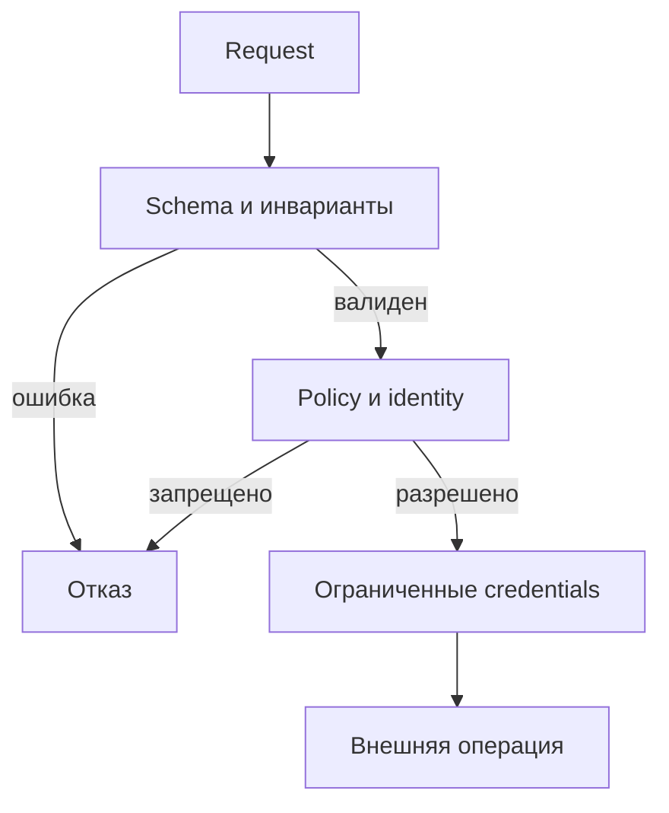
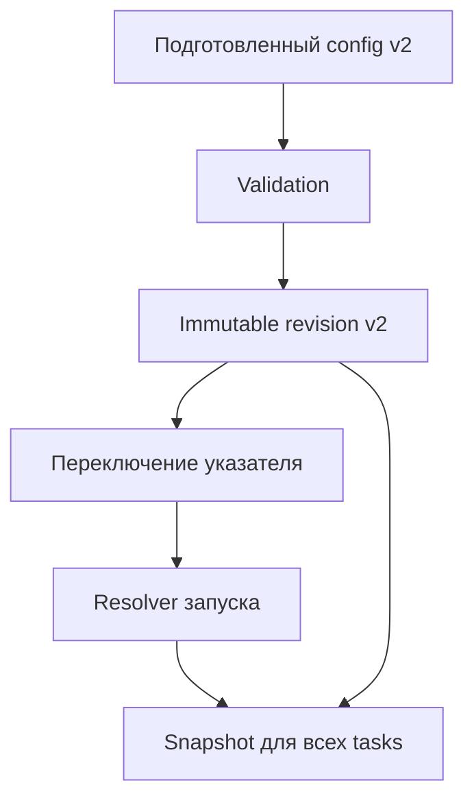
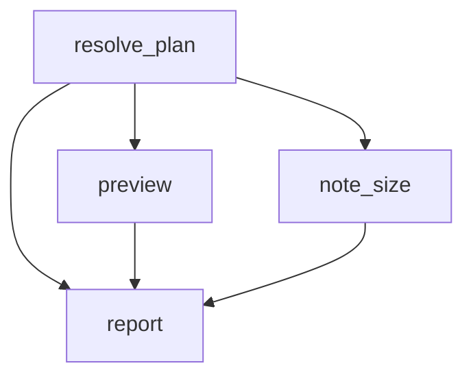

# 11. Params, Jinja, runtime context и конфигурация

Эта глава учит превращать настройки DAG в проверяемый контракт запуска. Ты разберёшь, откуда задача получает значения, когда они проверяются и шаблонизируются, как сохранить типы и как воспроизвести старый расчёт после изменения конфигурации.

Структура восьми основных тем и всех 40 пунктов сохранена по README курса. После них идут законченная лабораторная работа, тесты, восемь инженерных ситуаций и 30 вопросов с ответами.

| Базовая линия | Версия |
| --- | --- |
| Apache Airflow | 3.3.2 |
| Apache Airflow Task SDK | 1.3.2 |
| Standard provider | 1.19.0 |
| Common SQL provider для отдельного SQL-примера | 2.1.1 |
| Python | 3.12 |
| Jinja2 / jsonschema | 3.1.6 / 4.26.0 |

Это закреплённая учебная линия, а не утверждение о последних доступных релизах. Поведение Airflow сверено с тегом 3.3.2, версии зависимостей — с constraints для Python 3.12. Для Airflow 2.x и ранних 3.x необходимо отдельно проверить импорты и доступность конкретных аргументов. [S29](#source-29)

Главная модель главы:

**Контракт запуска → проверенные значения → конкретная версия конфигурации → runtime plan → выполнение.**

Jinja находится между получением контекста и исполнением оператора. Она формирует значения полей, но сама по себе не обеспечивает SQL binding, shell escaping, авторизацию или воспроизводимость.

| Вопрос | Правильная точка решения |
| --- | --- |
| Какие значения пользователь вправе передать? | Схема входа и политика доступа |
| Какое значение победит при конфликте? | Явно определённый merge |
| Какую конфигурацию использует этот run? | Версия конфигурации и сохранённый snapshot |
| Когда подставится значение? | Render конкретного template field |
| Сохранится ли тип? | Режим Jinja и контракт consumer |
| Можно ли выполнить операцию? | Проверка полномочий и права runtime identity |
| Повторится ли исторический расчёт? | Версии кода, конфигурации, входных данных и окружения |

## Содержание

1. [Слои конфигурации](#s11-1)
2. [Params и JSON Schema](#s11-2)
3. [Runtime context](#s11-3)
4. [Основы Jinja templating](#s11-4)
5. [Типы и отладка шаблонов](#s11-5)
6. [Доступ к конфигурации из шаблонов](#s11-6)
7. [Безопасность параметров](#s11-7)
8. [Управляемая конфигурация окружений](#s11-8)
9. [Лабораторная: контракт и snapshot](#lab-core)
10. [Лабораторная: DAG и шаблон SQL](#lab-dag)
11. [Проверки и тесты](#tests)
12. [Инженерные ситуации](#cases)
13. [Самопроверка с ответами](#questions)
14. [Критерии освоения](#mastery)
15. [Проверка материала](#verification)
16. [Официальные источники](#sources)

<a id="s11-1"></a>
## 11.1. Слои конфигурации

### 11.1.1. Platform config, environment config и настройки отдельного DAG

Конфигурация платформы отвечает за работу Airflow как системы: API, scheduler, execution runtime, секретные backend, логирование, ограничения и поведение отдельных механизмов. Конфигурация окружения выбирает ресурсы dev/stage/prod. Конфигурация DAG описывает конкретный workflow и его прикладные правила.

Эти слои связаны, но не образуют универсальную автоматически работающую иерархию.

| Слой | Пример | Кто обычно управляет | Когда применяется |
| --- | --- | --- | --- |
| Airflow platform | `dag_run_conf_overrides_params`, executor, secrets backend | Команда платформы | При запуске компонента / обращении к config |
| Deployment environment | Namespace, service account, разрешённый conn_id | Платформа и команда приложения | При развёртывании и выполнении |
| DAG definition | Schedule, task IDs, template search path | Автор DAG через Git | При построении DAG |
| Task definition | Pool, retries, timeout, task Params | Автор оператора / DAG | При построении task и подготовке выполнения |
| Run request | Интервал, список клиентов, версия расчёта | Разрешённый инициатор | При создании DagRun |
| Effective run plan | Разрешённая таблица, лимит, snapshot | Код разрешения конфигурации | В начале выполнения |

Например, `params={"workers": 50}` не увеличивает автоматически число Celery workers. `params={"pool": "large"}` не меняет автоматически поле `pool` оператора. Сопоставление входного значения с поведением требуется явно реализовать, проверить и, если оно затрагивает ресурсы, ограничить.

Для платформенного config существует собственный порядок приоритетов. В документации 3.3.2 он начинается с прямой environment variable, затем её `_CMD` и `_SECRET` вариантов, далее идут прямое значение в `airflow.cfg`, command/secret варианты в файле и встроенный default. Варианты `_CMD`/`_SECRET` поддерживаются только для предусмотренных настроек; это не общий механизм для любого прикладного ключа. [S11](#source-11)

```bash
airflow config get-value core dag_run_conf_overrides_params
```

Эта команда показывает настройку процесса, в котором запущена CLI. Она не доказывает автоматически, что каждый worker, API server и DAG processor получил ту же deployment-конфигурацию. Проверять нужно настройки нужного компонента.

Прикладной код обычно не должен импортировать внутренний глобальный Airflow config ради каждого бизнес-решения. Лучше передать проверенный прикладной объект настроек с понятным владельцем.

### 11.1.2. Params запуска, Variables, Connections и статический конфиг в Git

Выбирай механизм по назначению и сроку жизни значения.

| Механизм | Подходит для | Необходимое условие |
| --- | --- | --- |
| `Param` / runtime `params` | Интервал, режим обработки, ограниченный список сущностей | JSON Schema и проверка прикладных инвариантов |
| Variable | Изменяемая прикладная настройка или указатель на config release | Понятные scope, права, версия и момент чтения |
| Connection | Endpoint, authentication и параметры подключения | Ограниченный доступ; секреты не копируются в Params |
| Config в Git / DAG bundle | Структура графа, allowlists, схемы и defaults | Проверка в CI, согласованная доставка |
| Environment variable deployment | Идентичность окружения, настройки процесса | Задаётся доверенным deployment |
| Внешний config registry | Версионированные наборы настроек и snapshot | Immutable revisions и история выбора |
| State store | Checkpoint прогресса / состояние вычисления | Отдельная модель конкурентных обновлений |

`Params` — имя механизма Airflow. `dag_run.conf` — сохранённый JSON запроса запуска. `context["params"]` — результат runtime merge и проверки. Это три связанных понятия, которые нельзя считать одним объектом.

Variable не становится секретом только из-за размещения вне Git. Connection может содержать секретные поля, но conn_id обычно является идентификатором подключения, а не самим credential. Ограничения доступа важны в обоих случаях.

Пример решения: список таблиц и их схемы хранится в Git; пользователь передаёт `dataset="sales"`; код выбирает соответствующий разрешённый ресурс; credential получает Hook по фиксированному conn_id. Пользователь не получает право прислать произвольный URI или Connection.

Перенос настройки из Python-константы в Variable меняет свойства системы: значение можно обновить без новой версии DAG, но исторический run способен получить новую конфигурацию. Это архитектурное решение, а не косметическое изменение.

### 11.1.3. Значения по умолчанию и явный порядок переопределения

У Airflow есть несколько независимых merge-процессов:

1. Разрешение платформенных settings.
2. Наследование аргументов операторов через `default_args` и TaskGroup.
3. Объединение DAG-level, task-level и run-level Params.
4. Твой прикладной merge, если он предусмотрен.

Не объединяй их в правило «последний источник всегда важнее».

Для Params в runtime 3.3.2 базовый порядок такой: DAG Params → task Params → `dag_run.conf`, если включён `dag_run_conf_overrides_params`. После объединения вызывается validation. [S02](#source-02)

| Источник | Значение `batch_size` | Итог при overrides=True |
| --- | --- | --- |
| DAG `params` | 100 | Затеняется следующими |
| Task `params` | 200 | Побеждает, если run не переопределил |
| Run `conf` | 300 | 300 для соответствующего task |
| Variable `batch_size` | 400 | Не участвует автоматически |

При overrides=False итог здесь — 200. Сама Variable не прочитается ни при одном значении флага.

Вложенные объекты Params не получают гарантированный recursive deep merge. Если runtime передал новый объект для одного ключа, проверяется новое значение этого ключа целиком. Ожидание, что отсутствующие вложенные поля автоматически дополнятся DAG default, часто приводит к ошибке.

Для собственного merge документируй:

- Какие ключи вообще можно переопределять.
- Заменяется ли массив целиком.
- Означает ли `null` удаление, отсутствие либо допустимое значение.
- Можно ли добавить неизвестный ключ.
- Как фиксируется источник итогового значения.
- Какие ограничения нельзя ослабить runtime-вводом.

Лимит платформы удобно применять как верхнюю границу, а не как обычный default. Например, запрос `row_limit=10000` не должен обходить deployment policy `max_row_limit=1000`. Само слово «override» не даёт пользователю право изменить policy.

### 11.1.4. Конфигурация и изменяемое рабочее состояние

Конфигурация определяет правила выполнения. Рабочее состояние фиксирует то, что уже произошло.

| Значение | Класс | Почему |
| --- | --- | --- |
| `max_window_days=7` | Конфигурация / policy | Ограничивает допустимый запрос |
| `config_id="sales-v4"` | Выбор версии конфигурации | Определяет поведение run |
| `last_committed_partition` | Рабочее состояние | Меняется в ходе обработки |
| `external_job_id` | Checkpoint | Нужен для восстановления attempt |
| `source_schema_version` | Контракт данных | Определяет совместимость |
| `last_successful_run_id` | Операционные метаданные | Описывает историю выполнения |

Variable технически позволяет хранить и «последний обработанный день», но это не добавляет атомарности read-modify-write, защиты от двух параллельных runs или транзакции с sink. Эти вопросы относятся к главе 10 и модели бизнес-публикации.

Изменяемое состояние обычно требует concurrency control: транзакции, compare-and-swap, идемпотентного ключа или lease. Конфигурация требует versioning, validation и управляемой публикации. Смешивание этих требований в одном JSON затрудняет и откат, и восстановление.

Snapshot config также нельзя использовать вместо checkpoint. Он сообщает, с какими правилами надо работать, но не доказывает, что конкретная партиция уже опубликована.

### 11.1.5. Схема, ранняя валидация и история изменений

Проверять нужно в нескольких точках, потому что в каждой доступны разные сведения.

| Точка | Что можно проверить | Чего ещё может не быть |
| --- | --- | --- |
| CI | Синтаксис, schema, согласованность конфигов, стабильность графа | Реальные runtime credentials |
| DAG parse | Локальный config, корректные defaults, допустимый deployment env | Run request и TaskInstance |
| Trigger | JSON пользовательского запроса | Результаты upstream tasks |
| Начало task | Effective Params, runtime identity, выбранный snapshot | Результат внешней операции |
| Перед side effect | Полномочия, квоты, актуальные policy | Гарантия успешной будущей публикации |

Ранняя проверка уменьшает область отказа. Она не отменяет повторной проверки перед необратимым действием: права или внешние условия могли измениться.

Для истории храни как минимум config ID, hash содержимого, время выбора, версию схемы, код / bundle version и инициатора. Для конфиденциального config храни безопасный manifest и ссылку на защищённую версию, а не секретный JSON в логах.

Сообщение об ошибке должно называть поле и нарушенное правило: «window.end должен быть позже window.start; максимальная длина — 7 дней». Сообщение «invalid config» недостаточно для эксплуатации.

Схема — тоже версионируемый артефакт. Изменение default, допустимого enum или смысла `null` способно поменять результат без изменения сигнатуры Python-функции.

<a id="s11-2"></a>
## 11.2. Params и JSON Schema

### 11.2.1. `Param`, тип, default, description и ограничения значения

`Param` связывает значение по умолчанию с правилами JSON Schema. В публичном authoring API Airflow 3 используй импорт из `airflow.sdk`. [S01](#source-01) [S02](#source-02)

```python
from airflow.sdk import Param

RUN_PARAMS = {
    "row_limit": Param(
        100,
        type="integer",
        minimum=1,
        maximum=1000,
        title="Максимум строк",
        description="Ограничивает объём preview, а не размер исходной таблицы.",
    ),
    "mode": Param(
        "preview",
        type="string",
        enum=["preview", "validate"],
        description="Выберите разрешённую операцию.",
    ),
}
```

В `Param(100, ...)` число 100 — default Airflow Param. Это отличается от JSON Schema keyword `default` внутри вручную составленной schema: обычная JSON Schema validation не обязана вставлять значения по умолчанию в документ.

`description` объясняет смысл. `title` задаёт удобное название. `type`, `minimum` и `enum` задают машинно проверяемые ограничения. Текст «не больше тысячи» без `maximum` не ограничивает ввод.

Правильная schema не преобразует `"100"` в 100. Если клиент прислал строку, а контракт ожидает integer, это ошибка типа. JSON Schema имеет собственные правила: например, число 10.0 математически является integer; Python `True` не должен приниматься как JSON Schema integer только потому, что `bool` наследует `int`.

В 3.3.2 `Param.resolve` проверяет JSON-сериализуемость и вызывает `jsonschema.validate` с `FormatChecker`. Проверка типов и форматов не подменяет бизнес-проверки. [S02](#source-02)

Для automatically scheduled DAG defaults должны быть разрешимыми и валидными: в SDK проверка привязана к возможности timetable создавать scheduled runs. При `schedule=None` можно объявить required Param без default и требовать значение при ручном запуске. Неверный default при этом не становится хорошим — ошибка просто может проявиться позже. [S03](#source-03)

### 11.2.2. Enum, числовые диапазоны, массивы и вложенные структуры

Схема должна ограничивать форму и размер запроса.

```python
from airflow.sdk import Param

FILTER_PARAMS = {
    "customers": Param(
        ["acme"],
        type="array",
        items={"type": "string", "enum": ["acme", "north"]},
        minItems=1,
        maxItems=2,
        uniqueItems=True,
    ),
    "window": Param(
        {"start": "2026-01-01", "end": "2026-01-03"},
        type="object",
        properties={
            "start": {"type": "string", "format": "date"},
            "end": {"type": "string", "format": "date"},
        },
        required=["start", "end"],
        additionalProperties=False,
    ),
    "comment": Param(
        None,
        type=["null", "string"],
        maxLength=200,
    ),
}
```

| Требование | Keyword / проверка |
| --- | --- |
| Разрешённые значения | `enum`, `const` |
| Диапазон числа | `minimum`, `maximum`, exclusive-варианты |
| Длина строки | `minLength`, `maxLength` |
| Тип элементов массива | `items` |
| Размер массива | `minItems`, `maxItems` |
| Отсутствие дублей | `uniqueItems` |
| Обязательные поля объекта | `required` |
| Запрет лишних полей объекта | `additionalProperties=False` |
| Nullable значение | `type=["null", "..."]` |
| Семантика интервала | Прикладная проверка дат |
| Полномочия на dataset | Авторизация и права подключения |

`maxLength` считает длину строки по правилам schema, а не размер UTF-8 payload в байтах. Ограничение HTTP request body и итогового job spec требует отдельной границы.

`pattern` не означает автоматически полный match: если нужен весь идентификатор, используй якоря `^...$` и ограничения длины. Сложные регулярные выражения и неконтролируемые remote `$ref` не стоит превращать в пользовательскую возможность.

`additionalProperties=False` внутри `window` запрещает только лишние поля этого вложенного объекта. Оно не запрещает неизвестные top-level Params. Для всего запроса нужна общая schema или явная проверка набора ключей.

Обычная структурная schema не выражает удобно правило «end позже start, диапазон не длиннее семи дней, а publish разрешён только этой identity». После schema выполняй прикладную проверку.

### 11.2.3. Форма ручного запуска, validation errors и пользовательский ввод

DAG-level Params используются для построения формы ручного запуска. Простые типы получают соответствующие элементы ввода; metadata помогают сгруппировать и объяснить поля. Backend проверяет отправленные значения. [S01](#source-01)

Хорошая форма даёт пользователю:

- Ясное название поля.
- Единицы измерения.
- Пример допустимого значения.
- Описание значения по умолчанию.
- Пояснение границы интервала.
- Причину отказа при нарушении правила.

`section`, `description_md`, `examples` и другие поддерживаемые UI metadata полезны для формы, но конкретное отображение надо проверять в закреплённой UI-версии. Поддержка сложных JSON Schema constructs сервером шире, чем возможности автоматически построенной формы.

В Airflow 3 поддержка старого `custom_html_form` удалена. Не переноси такой пример из Airflow 2 без проверки. [S01](#source-01)

Если значение не прошло проверку, нормальный trigger path должен отклонить запрос. Но это не означает, что форма способна проверить доступность внешней таблицы или права будущего runtime credential. Не делай сеть в schema validation ради иллюзии полной проверки.

Различай четыре ошибки:

| Ошибка | Пример | Где исправлять |
| --- | --- | --- |
| Неверная schema | Неправильно описан тип | В коде / CI |
| Неверный input | `row_limit="many"` | В запросе |
| Недопустимая комбинация | start ≥ end | В проверке контракта |
| Недоступная операция | Identity не имеет права на prod | В policy / доступах |

Не публикуй полный request в traceback или логи: пользователь мог ошибочно вставить credential в свободное текстовое поле. Для диагностики обычно достаточно имени поля, типа и безопасной причины.

### 11.2.4. DAG-level, task-level и runtime параметры

DAG-level Params задают исходный контракт. Task-level Params могут уточнить локальный default. Runtime input задаётся при trigger и попадает в effective Params при соответствующей настройке.

```python
from airflow.sdk import DAG, Param, get_current_context, task

with DAG(
    dag_id="ch11_params_precedence",
    schedule=None,
    params={"row_limit": Param(100, type="integer", minimum=1, maximum=1000)},
) as precedence_dag:

    @task(params={"row_limit": Param(200, type="integer", minimum=1, maximum=500)})
    def show_effective_limit():
        context = get_current_context()
        effective = context["params"]["row_limit"]
        return {"effective_row_limit": effective}

    show_effective_limit()
```

При overrides=True и `conf={"row_limit": 300}` задача получает 300. Без run override — 200. Run input 700 не проходит task-level ограничение maximum=500, хотя DAG-level maximum=1000 шире.

Task-level контракт и DAG-level форма способны разойтись: значение, принятое на уровне DAG, может оказаться неподходящим конкретному task. Поэтому общие внешние параметры лучше ограничить согласованно; более узкие внутренние настройки вынести под отдельное имя.

Важная тонкость реализации: task-level значение `Param` может заменить DAG-level объект со schema. Нельзя предполагать, что разные schemas автоматически пересекаются. Даже обычное task-level значение без явно заданных ограничений способно изменить контракт. Для критичных входов проверяй общую schema в начале workflow и не переопределяй её случайно. [S02](#source-02) [S04](#source-04)

`context["dag"].params` описывает значения из definition. Для effective runtime input используй `context["params"]`. Чтение `dag.params` при построении графа не даёт доступ к будущему ручному запуску.

Дополнительная тонкость legacy `default_args["params"]`: у него есть собственные merge-ветки в реализации. Не используй несколько способов объявить один и тот же ключ, если это не требуется совместимостью. Предпочти явные `DAG(params=...)` и task `params=...`.

### 11.2.5. Влияние `dag_run_conf_overrides_params` на контракт запуска

В базовой линии default флага — True. При включённом флаге runtime merge учитывает `dag_run.conf` поверх task Params. При выключенном — не учитывает. [S02](#source-02) [S10](#source-10)

```bash
export AIRFLOW__CORE__DAG_RUN_CONF_OVERRIDES_PARAMS=True
```

Изменение env в shell не перенастраивает уже работающий кластер. Значение должно быть доставлено нужным компонентам штатным deployment-процессом.

| Что делает приложение | overrides=True | overrides=False |
| --- | --- | --- |
| Читает `context["params"]` | Получает merged input | Получает defaults / task-level values |
| Читает `context["dag_run"].conf` | Читает сырой request | По-прежнему читает сырой request |
| Вручную объединяет conf и defaults | Следует своему коду | Может фактически обойти смысл флага |
| Читает Variable | Не зависит от флага | Не зависит от флага |

Флаг не запрещает существование `dag_run.conf` и не превращает его в доверенный объект. Код, который напрямую использует conf в SQL или shell, сохраняет соответствующие риски.

В реализации ParamsDict неизвестный ключ оборачивается в `Param(value)` без автоматически созданных прикладных ограничений. Поэтому набор DAG Params сам по себе не является закрытой top-level schema для всех возможных run keys. [S02](#source-02)

Практическая политика должна отвечать на вопрос: «Если пользователь передал override, но он не применён, завершаем run ошибкой или явно выполняем defaults?» Молчаливое игнорирование особенно опасно для исторических диапазонов и destructive modes.

Если контракт требует overrides=True, фиксируй это как deployment prerequisite и проверяй поведение интеграционным тестом. Не определяй поведение по внешнему виду формы.

<a id="s11-3"></a>
## 11.3. Runtime context

### 11.3.1. `dag_run`, `task_instance`, `run_id` и `map_index`

Runtime context — словарь значений и accessors, доступных конкретному task во время выполнения. Это не JSON config, который разумно целиком сериализовать и передавать наружу.

```python
from airflow.sdk import get_current_context, task

@task
def execution_identity():
    context = get_current_context()
    ti = context["ti"]
    return {
        "dag_id": ti.dag_id,
        "task_id": ti.task_id,
        "run_id": context["run_id"],
        "map_index": ti.map_index,
        "try_number": ti.try_number,
    }
```

| Элемент | Назначение | На что обратить внимание |
| --- | --- | --- |
| `dag_run` | Runtime-представление DagRun | Это не свободный доступ к ORM |
| `task_instance` / `ti` | Runtime TaskInstance | В SDK это runtime protocol / object |
| `run_id` | Идентичность запуска внутри DAG | Не извлекай бизнес-даты из текста ID |
| `ti.map_index` | Индекс mapped instance | У unmapped task обычно -1 |
| `ti.try_number` | Номер attempt | Меняется при retry; это не идентичность данных |
| `task` | Оператор текущего выполнения | Его template fields уже могут быть изменены render |

Полная execution identity обычно включает DAG ID, run ID, task ID и map index. Для attempt добавляют try number. Один `run_id` не является глобально уникальным ключом всей платформы.

`get_current_context()` вызывается из исполняемой функции task. На верхнем уровне модуля DAG runtime context отсутствует. Для helper лучше передать необходимые поля явными аргументами: так его легче проверять без Airflow.

Не рассчитывай, что `map_index` всегда существует как самостоятельная top-level Jinja variable. Надёжный путь для данного примера — `task_instance.map_index`. Не путай его с `map_index_template`, который отвечает за отображаемое имя mapped instance. [S05](#source-05) [S06](#source-06) [S09](#source-09)

### 11.3.2. Data interval, logical date и nullable поля

`logical_date` описывает временную идентичность run согласно выбранной модели планирования. Она не равна обязательно времени старта task. `data_interval_start/end` описывают интервал данных, если для данного run он определён.

В SDK 3.3.2 часть временных ключей добавляется в context только при наличии logical date. Следовательно, возможны и отсутствующий ключ, и значение None. Используй `context.get(...)` и проверяй контракт. [S05](#source-05)

```python
def require_data_interval(context):
    start = context.get("data_interval_start")
    end = context.get("data_interval_end")
    if start is None or end is None:
        raise ValueError("Для этой операции нужен явный интервал данных")
    if end <= start:
        raise ValueError("Ожидается непустой интервал [start, end)")
    return start, end
```

Нулевой interval может быть нормальным для trigger timetable, поэтому такая функция подходит только операции, которая действительно требует непустое окно. Не делай её универсальной проверкой всех DAG.

| Сценарий | Что проверять |
| --- | --- |
| Scheduled data-interval run | Обе границы и бизнес-смысл timetable |
| Trigger timetable | Возможен точечный интервал |
| Manual run | Как были заданы logical date и временная модель |
| Asset-triggered run | События / partitions; time interval может отсутствовать |
| Исторический preview | Явный request window либо документированный interval |
| Unit test | Контекст собирается под конкретный сценарий |

Нельзя исправить отсутствие интервала безусловной подстановкой `now()`: это меняет смысл перерасчёта и делает его зависимым от момента retry.

`ds` — строковое представление даты, если соответствующий ключ существует. Она теряет время и timezone и не является уникальным ключом run. Для выбора данных предпочитай явный интервал или partition contract.

### 11.3.3. `params`, `inlet_events`, `outlet_events` и triggering asset events

Эти элементы отвечают на разные вопросы.

| Элемент | Вопрос |
| --- | --- |
| `params` | С какими проверенными параметрами выполняется task? |
| `inlet_events` | Какие события доступны по объявленным входным assets? |
| `triggering_asset_events` | Какие asset events участвовали в запуске данного DAG? |
| `outlet_events` | Какую metadata добавить к событиям выходных assets? |
| `asset_state_store` | Какое сохранённое состояние принадлежит asset? |

`inlet_events` — accessor, чтение которого может вызвать получение истории. `triggering_asset_events` связан с consumed events текущего DagRun. Последнее событие во всей истории asset не обязательно совпадает с событием, запустившим run.

`outlet_events` — не произвольная замена конфигурации downstream. Это механизм metadata публикации asset event. Привязывай данные к объявленному asset и учитывай условия успешного завершения producer. [S05](#source-05) [S14](#source-14) [S30](#source-30)

Для обработки события полезно проверять версию metadata, URI / dataset identity, partition key, границы данных и ссылку на immutable artifact. Событие о наличии данных не даёт автоматически полномочий читать произвольный URI из его payload.

Не смешивай `params["config_id"]`, metadata event и состояние asset в один «config». У них разные владельцы, время создания и правила изменения.

В этой главе лабораторная использует явный request window. Для asset-driven workflow нужно отдельно определить, кто задаёт окно: событие, asset partition contract или пользовательский запрос, и что делать при конфликте.

### 11.3.4. Отсутствие некоторых значений у разных типов запуска

Контекст зависит от типа run, стадии выполнения и доступных серверных данных. TypedDict с известными именами помогает читать код, но не доказывает наличие каждого ключа в каждой ситуации.

| Значение | Почему может отсутствовать / быть пустым | Корректная реакция |
| --- | --- | --- |
| `logical_date`, `ds` | Run без logical date | Проверить наличие; выбрать явный контракт |
| `data_interval_*` | Нет подходящей временной модели | Требовать request window либо другой тип DAG |
| `prev_*_success` | Нет предыдущего успешного run | Обработать первый запуск явно |
| `triggering_asset_events` | Run не создан по asset events | Пустой набор не считать ошибкой автоматически |
| `expanded_ti_count` | Task не mapped / expansion ещё не подходит контексту | Не использовать как обязательную бизнес-метрику |
| `exception` | Обычное выполнение вместо error callback | Не ожидать исключение в каждом task |
| `templates_dict` | Поле относится к конкретному оператору | Не считать общим input всех TaskFlow tasks |

Есть три разных состояния: ключ не передан, значение явно None и значение пустое. Для бизнес-проверок это часто разные случаи.

В Jinja `is defined` проверяет наличие. `is not none` проверяет значение. Например:

```jinja

  interval_start={{ data_interval_start.isoformat() }}

  interval_start=absent

```

Этот шаблон безопасно сообщает отсутствие. Для обязательного SQL predicate лучше завершить подготовку ошибкой, чем удалить фильтр через условный блок.

Проверь каждый поддерживаемый run type отдельно: scheduled, manual, backfill и asset-triggered. Один успешный `dag.test` не покрывает все эти контексты.

### 11.3.5. Публичный SDK вместо прямого доступа к ORM-моделям

В Airflow 3 task execution runtime взаимодействует с сервисами платформы через поддерживаемые интерфейсы. Авторский task не должен создавать SQLAlchemy Session к metadata DB ради получения config или изменения TaskInstance. [S06](#source-06) [S17](#source-17)

| Задача | Предпочтительный интерфейс |
| --- | --- |
| Получить runtime context | `airflow.sdk.get_current_context` |
| Получить Variable | `airflow.sdk.Variable.get` |
| Получить Connection | Hook по conn_id / `airflow.sdk.Connection.get` |
| Объявить входной параметр | `airflow.sdk.Param` |
| Отключить templating значения | `airflow.sdk.literal` |
| Управлять DAG извне | Поддерживаемый REST API / CLI |
| Работать с прикладной БД | Provider Hook и ограниченный credential |

Не используй ORM-представления из старого примера как гарантию методов runtime `dag_run` или `ti`. Одинаковое имя поля не делает объекты одинаковыми.

SDK-модель также помогает тестам: бизнес-функция принимает маленький DTO с нужными значениями, а тонкий Airflow task извлекает их из context. В тесте DTO задаётся напрямую.

Не передавай весь context в external job. Он содержит accessors и runtime objects, а также может раскрыть лишние сведения. Формируй ограниченный job spec с проверяемой schema.

<a id="s11-4"></a>
## 11.4. Основы Jinja templating

### 11.4.1. Выражения, фильтры, macros и условные блоки

Jinja — язык построения текста и, в native mode, некоторых Python-значений. Шаблон задаёт доверенный автор кода; context предоставляет значения.

| Синтаксис | Значение | Пример |
| --- | --- | --- |
| `{{ ... }}` | Вычислить выражение и вывести результат | `{{ params.row_limit }}` |
| `` | Управляющий блок | `` |
| `{# ... #}` | Комментарий шаблона | `{# exclusive upper bound #}` |
| `value \| filter` | Применить фильтр | `{{ logical_date \| ds }}` |
| `value is defined` | Проверка наличия | `` |
| Вызов macro | Вызвать доступную функцию | `{{ macros.ds_add(ds, -1) }}` |

Jinja-переменная `params` — не Python global. Она появляется из runtime context. Нельзя ожидать её в обычном Python f-string или в модуле, который вообще не прошёл templating.

Для dictionary keys с именами вроде `items`, `keys` или `values` удобнее явная форма `params["items"]`. Dot lookup может столкнуться с методом объекта. В сложном шаблоне это выглядит как неожиданная ошибка типа.

Фильтр `int` удобен для форматирования известных данных, но не заменяет validation: некоторые преобразования возвращают default при ошибке. Проверяй вход до render, а не пытайся «починить» `"ten"` в шаблоне.

Условные блоки используй для ограниченной вариативности структуры. Например, включить заранее предусмотренный диагностический столбец. Не отключай обязательный фильтр интервала при отсутствии context — это способ случайно выполнить full scan.

Macros Airflow содержат функции работы с датами и другие helpers. Не используй случайность или текущее время macro как идентичность исторической партиции. Наличие функции в шаблоне не делает результат детерминированным.

Полезное правило: преобразования данных и бизнес-правила живут в тестируемом Python; Jinja связывает уже проверенные значения с небольшим текстовым шаблоном.

### 11.4.2. `template_fields`, `template_ext` и `template_searchpath`

Airflow не шаблонизирует любой строковый аргумент любого объекта. Оператор объявляет поля, в которых поддерживается templating. [S07](#source-07) [S08](#source-08)

| Механизм | Отвечает за | Пример |
| --- | --- | --- |
| `template_fields` | Какие атрибуты оператора рендерить | `("sql", "parameters")` |
| `template_ext` | Какие строковые значения считать путями к template file | `(".sql",)` |
| `template_searchpath` DAG | Где loader ищет файлы | Каталог templates в bundle |
| `template_fields_renderers` | Как UI отображает содержимое | `{"sql": "sql"}` |

`template_fields_renderers` не запускает SQL и не добавляет templating к полю. Это настройка отображения.

В 3.3.2:

- BashOperator шаблонизирует `bash_command`, `env`, `cwd`.
- PythonOperator шаблонизирует `templates_dict`, `op_args`, `op_kwargs`.
- SQLExecuteQueryOperator шаблонизирует `sql`, `parameters` и поля базового SQL-оператора, включая conn_id.
- Конкретный provider и его версия определяют точный список. [S18](#source-18) [S19](#source-19)

Loader DAG включает каталог самого DAG-файла и дополнительные search paths. Используй согласованно доставляемые пути; локальная папка ноутбука не становится доступной worker автоматически.

Имя файла шаблона выбирай доверенным кодом. Пользовательский `params.template_path` не должен давать возможность читать произвольный файл. Даже если loader ограничивает часть traversal, это не замена allowlist разрешённых templates.

На этапе подготовки Airflow также может разрешать содержимое template files. Поэтому различай доставку / чтение файла и подстановку runtime context. Доступность файлов должна быть обеспечена и соответствующим компонентам разбора, и execution runtime.

### 11.4.3. Шаблонизация SQL, shell и аргументов operators

В SQL разделяй **структуру запроса** и **значения данных**. Jinja может выбрать заранее разрешённую структуру. Значения передаются драйверу через `parameters`.

Ниже пример для PostgreSQL-совместимого Hook / драйвера с pyformat placeholders. Для другого драйвера placeholder syntax проверяется отдельно. Connection `warehouse_readonly` должен существовать и иметь подходящий provider.

```python
from airflow.providers.common.sql.operators.sql import SQLExecuteQueryOperator
from airflow.sdk import DAG, Param

def customer_bindings(context, jinja_env):
    p = context["params"]
    return {"customer_id": p["customer_id"], "row_limit": p["row_limit"]}

with DAG(
    dag_id="ch11_bound_sql",
    schedule=None,
    params={
        "customer_id": Param("acme", type="string", enum=["acme", "north"]),
        "row_limit": Param(100, type="integer", minimum=1, maximum=1000),
    },
) as bound_sql_dag:
    preview_sales = SQLExecuteQueryOperator(
        task_id="preview_sales",
        conn_id="warehouse_readonly",
        sql=(
            "SELECT customer_id, amount_cents FROM analytics.sales "
            "WHERE customer_id = %(customer_id)s "
            "ORDER BY business_date, customer_id LIMIT %(row_limit)s"
        ),
        parameters=customer_bindings,
        do_xcom_push=False,
    )
```

Callable template field получает `context` и `jinja_env` и возвращает готовое значение. Airflow не обязан повторно шаблонизировать его результат. Здесь это позволяет передать словарь с исходными типами без дополнительного строкового преобразования. [S07](#source-07) [S08](#source-08)

В shell пользовательские значения нельзя вставлять в исходный текст программы. Передавай их отдельными аргументами процесса или через environment; внутри shell используй корректное quoting. Конкретный рабочий пример приведён в 11.7.2.

TaskFlow имеет отдельное важное правило: аргументы decorated Python task сами по себе не проходят обычную Jinja-подстановку как `op_kwargs` PythonOperator. Для `@task` получай context внутри функции или передавай реальные значения / XComArg. [S08](#source-08)

```python
from airflow.sdk import get_current_context, task

@task
def taskflow_value():
    p = get_current_context()["params"]
    return {"row_limit": p["row_limit"]}
```

Вызов decorated task с аргументом `"{{ params.row_limit }}"` не следует считать способом получить integer. PythonOperator и TaskFlow нужно изучать как разные authoring-интерфейсы.

### 11.4.4. Вложенные структуры и пользовательские template fields

В templated field Airflow рекурсивно обрабатывает поддерживаемые контейнеры: например, список аргументов или словарь job settings. Для собственного вложенного объекта нужно явно обозначить его template fields. Все промежуточные уровни должны участвовать в обходе. [S07](#source-07)

```python
from dataclasses import dataclass
from typing import ClassVar

from airflow.sdk import BaseOperator

@dataclass
class JobSpec:
    template_fields: ClassVar[tuple[str, ...]] = ("label", "options")
    label: str
    options: dict

class DescribeJobOperator(BaseOperator):
    template_fields = ("job",)
    template_fields_renderers = {"job": "json"}

    def __init__(self, *, job: JobSpec, **kwargs):
        super().__init__(**kwargs)
        self.job = job

    def execute(self, context):
        return {
            "label": self.job.label,
            "row_limit": self.job.options["row_limit"],
        }
```

Использование:

```python
job = DescribeJobOperator(
    task_id="describe_job",
    job=JobSpec(
        label="{{ run_id }}",
        options={"row_limit": "{{ params.row_limit }}"},
    ),
    render_template_as_native_obj=True,
)
```

В 3.3.2 аргумент `render_template_as_native_obj` доступен и на уровне BaseOperator: None означает наследование настройки DAG. Это удобно, когда один task должен получить native values, а соседний shell task — строки. Не переноси эту возможность на произвольный старый релиз без проверки. [S04](#source-04)

Вложенный templating и сериализация DAG — разные требования. Для production custom objects отдельно проверь сериализацию, доставку класса, доступность импорта и round trip в своём deployment. Наличие `template_fields` само по себе не регистрирует serializer.

Не изменяй пользовательское значение в `__init__` до render так, что связь между именем аргумента и атрибутом становится неочевидной. Создание клиента, сеть и тяжёлые операции относятся к `execute`.

Dict keys в обычной ветке templater не рендерятся как значения. Не строй design на предположении, что `{"{{ params.key }}": ...}` переименует ключ. [S07](#source-07)

### 11.4.5. Порядок render и фактическое выполнение задачи

Упрощённый жизненный цикл:

1. Python-модуль создаёт definition DAG и operators.
2. Airflow доставляет / восстанавливает definition для выполнения.
3. Runtime получает сведения о TaskInstance и DagRun.
4. Строится context, разрешаются и проверяются Params.
5. Готовится execution-копия оператора и рендерятся template fields.
6. Сведения о rendered fields могут передаваться платформе.
7. Выполняется код оператора / Python callable.

В SDK 3.3.2 `_prepare` вызывает `prepare_for_execution`, затем `render_templates` и подготовку rendered fields перед основной execution-логикой. [S05](#source-05)

Следствия:

- Syntax error Python может сломать import ещё до runtime.
- Отсутствующий template file может проявиться при подготовке.
- Неверная Jinja variable способна остановить task до входа в `execute`.
- Ошибка SQL появляется после успешного render.
- Повторная попытка может заново получить изменяемые внешние настройки.
- Проверка внутри `execute` не предотвращает утечку, уже возникшую при render.

Airflow рендерит поля in place на execution-копии. Один render не означает рекурсивное исполнение Jinja, появившейся в результате подстановки.

Например, если пользовательское строковое значение равно `"{{ conn.private.password }}"` и подставлено через `{{ params.note }}`, обычный однократный render не обязан интерпретировать получившуюся строку как новый шаблон. Опасность возникает, если приложение затем само вызывает второй `from_string(...).render(...)`.

В лабораторной SQL template принадлежит коду, а пользовательская заметка остаётся данными. Эти границы должны быть видны в design.

<a id="s11-5"></a>
## 11.5. Типы и отладка шаблонов

### 11.5.1. `render_template_as_native_obj` и строковые значения

Обычный render обычно возвращает строку. Native render использует правила Jinja NativeEnvironment, включая попытку интерпретировать Python literals. Это шире, чем «сохранить тип Param». [S07](#source-07) [S20](#source-20)

| Вход | Обычный render | Native render |
| --- | --- | --- |
| `params.n = 42`; `{{ params.n }}` | `"42"` | 42 |
| `params.n = "42"`; `{{ params.n }}` | `"42"` | Может стать 42 |
| `params.flag = "False"` | `"False"` | Может стать False |
| `params.code = "001"` | `"001"` | Остаётся строкой: это не валидный integer literal Python |
| `params.items = [1, 2]` | Строковое представление | Список |
| `limit={{ params.n }}` | `"limit=42"` | Обычно строка |
| `{{ params.value }}` при None | `"None"` | None |

Не используй эту таблицу как schema: результат зависит от полного шаблона и правил NativeEnvironment. Проверять нужно конкретное выражение с конкретными данными.

Особенно опасны внешние идентификаторы: `"42"` как customer code не должен случайно превратиться в число. Аналогично строка `"False"` может быть значимым кодом, а не логическим false.

Для точного string contract:

- Отключи native render у соответствующего оператора.
- Либо верни готовую строку / dict из callable template field.
- Либо передай значение обычным Python-кодом.
- После render проверь тип, если consumer чувствителен к нему.

Фильтр `string` внутри NativeEnvironment не является универсальной гарантией конечного string: итоговый текст всё ещё может быть разобран как literal. Тестируй конечный объект.

Для shell environment значения должны быть строками. DAG с native render и `env={"LIMIT": "{{ params.row_limit }}"}` способен передать integer туда, где нужен str. В 3.3.2 можно явно поставить оператору `render_template_as_native_obj=False`.

### 11.5.2. Undefined variables, проверки наличия и безопасные defaults

DAG SDK по умолчанию использует `jinja2.StrictUndefined`. Это полезно: опечатка не должна незаметно превращать SQL-фильтр в пустую строку. [S03](#source-03) [S07](#source-07)

Различай undefined, None и falsy values.

| Выражение | Поведение |
| --- | --- |
| `value is defined` | Проверяет существование |
| `value is none` | Проверяет None |
| `value \| default("fallback")` | Подставляет для undefined |
| `value \| default("fallback", true)` | Подставляет также для falsy: 0, False, "", пустых коллекций |
| `value or "fallback"` | Тоже заменяет falsy values |
| `mapping.get("key", default)` | Default только при отсутствующем ключе |

Если `row_limit=0` имеет специальный допустимый смысл, `default(100, true)` молча изменит его. Если `False` отключает feature flag, `flag or True` включит её обратно.

Defaults должны иметь бизнес-смысл. Для необязательной подписи разумен пустой текст. Для prod table, customer scope, timezone или интервала default может опасно расширить операцию.

Предпочтительная стратегия для обязательных значений: отклонить request schema validation или явной проверкой. Для optional value — обработать отсутствие рядом с местом использования.

Не подавляй все Jinja errors общей подстановкой «default config». Ошибка имени и отсутствие необязательного поля — разные ситуации. Повреждённый JSON Variable также не надо автоматически превращать в безопасный-looking empty dict.

### 11.5.3. Rendered templates в UI и команды CLI

Rendered templates помогают увидеть результат подстановки для конкретного task instance. Смотри нужные run, task, map index и attempt, если UI предоставляет такой выбор.

Проверяй не только строку SQL, но и `parameters`, типы job spec, environment и путь к шаблону. При большом payload отображение может быть ограничено, скрыто или отредактировано secret masking.

В CLI 3.3.2 поддерживается:

```bash
airflow tasks render ch11_bound_sql preview_sales 'manual__example_run'
airflow tasks render ch11_bound_sql preview_sales '2026-01-03T00:00:00+00:00'
```

Третий positional argument — logical date или run ID. Для mapped task поддерживается `--map-index`; bundle выбирается соответствующей опцией CLI. Сверяй `airflow tasks render --help` в закреплённой установке. [S27](#source-27)

CLI render — средство диагностики. Оно может потребовать существующий DAG/run, доступные bundles и конфигурацию runtime. Не считай произвольный run ID в примере реально созданным запуском.

Существенное ограничение: повторный render с сегодняшними Variables может отличаться от сохранённого исторического результата. «Я сейчас отрендерил» и «worker тогда исполнил» — разные доказательства.

Сам render способен выполнять lookup и пользовательские macros/callables. Поэтому это не гарантированно чистая строковая операция без обращений к сервисам.

Для SQL дополнительно проверяй driver binding и query plan. Корректный render не доказывает корректность SQL dialect, наличие таблицы или ограниченную стоимость запроса.

### 11.5.4. Различия literal string, пути к файлу и шаблона

В templated field строка, заканчивающаяся на `template_ext`, может трактоваться как имя файла. Из-за этого `bash_command="cat script.sh"` способен привести к поиску template с именем всей строки. [S07](#source-07) [S08](#source-08)

```python
from airflow.providers.standard.operators.bash import BashOperator
from airflow.sdk import literal

show_script = BashOperator(
    task_id="show_script",
    bash_command=literal("cat script.sh"),
    do_xcom_push=False,
)
```

`literal` отключает и file resolution, и Jinja templating внутри обёрнутого значения. Если там была `{{ params.x }}`, она останется текстом.

| Намерение | Подход |
| --- | --- |
| Загрузить доверенный SQL template | `sql="preview.sql"` + search path |
| Передать текст без подстановки | `literal(text)` |
| Рендерить inline text, отключив file detection | Осознанно изменить `template_ext` конкретного task |
| Передать точный typed value | Python / callable field / XComArg |
| Передать пользовательскую строку как данные | Value binding или env/argument passing |

Исторический обход с пробелом после имени файла зависит от проверки суффикса и не объясняет намерение. Явный `literal` проще поддерживать.

Файл шаблона — часть доставляемого артефакта. Не выбирай его произвольным путём из Params и не рассчитывай, что file extension автоматически проверит безопасное содержимое.

Python f-string имеет собственную обработку фигурных скобок. Для сохранения Jinja double braces внутри f-string нужны четыре скобки:

```python
dataset = "sales"
label = f"{dataset}: {{{{ run_id }}}}"
assert label == "sales: {{ run_id }}"
```

Если смешение двух языков не нужно, обычная строка понятнее.

### 11.5.5. Unit-тесты шаблонов с конкретным context

Хороший тест шаблона проверяет смысл и границы:

- Получился правильный тип.
- Обязательный фильтр сохранился.
- Неизвестное поле вызвало ошибку.
- Интервал без logical date обработан по контракту.
- Dangerous-looking value осталось данными.
- Нужный template file найден.
- Snapshot даёт стабильный результат после изменения current config pointer.

Минимальный тест обычной и native Jinja:

```python
from jinja2 import StrictUndefined, UndefinedError
from jinja2.nativetypes import NativeEnvironment
from jinja2.sandbox import SandboxedEnvironment

string_env = SandboxedEnvironment(undefined=StrictUndefined)
native_env = NativeEnvironment(undefined=StrictUndefined)
context = {"params": {"external_id": "42", "row_limit": 100}}

assert string_env.from_string("{{ params.external_id }}").render(context) == "42"
assert native_env.from_string("{{ params.external_id }}").render(context) == 42
assert string_env.from_string("{{ params.row_limit }}").render(context) == "100"

try:
    string_env.from_string("{{ params.missing }}").render(context)
except UndefinedError:
    pass
else:
    raise AssertionError("Отсутствующий обязательный ключ должен остановить render")
```

Этот тест проверяет Jinja, а не весь Airflow templater. Для проверки интеграции нужны отдельные тесты оператора в Airflow: template fields, file loading, callable fields, nested objects, XComArg resolution и сохранение rendered fields.

Snapshot SQL полезен для структуры, но не должен быть единственным тестом. Если неправильный запрос переписали вместе с snapshot, тест пройдёт. Добавь поведенческую проверку на маленькой БД и assertions по binding values.

Не используй production Connections и Variables в unit tests. Задавай небольшой фиксированный context и счётчики lookup; интеграционный доступ проверяй отдельно.

<a id="s11-6"></a>
## 11.6. Доступ к конфигурации из шаблонов

### 11.6.1. `var.value`, `var.json` и runtime lookup

В template context `var` содержит accessors для получения Variables. Они выполняют lookup, а не представляют заранее загруженный снимок всех значений.

```jinja
label={{ var.value.get("preview_label", "preview") }}
region={{ var.json.get("preview_options", {"region": "eu"})["region"] }}
```

| Выражение | Результат |
| --- | --- |
| `var.value.some_key` | Строковое значение Variable |
| `var.value.get("some.key", "fallback")` | Lookup ключа с явным default |
| `var.json.some_key` | JSON-десериализованное значение |
| `var.json.get("options", {})` | JSON lookup либо default при отсутствии |
| `Variable.get("options", deserialize_json=True)` | SDK-эквивалент из Python task |

Ключ с точкой проще читать через `get("some.key")`. Dot notation означает последовательность обращений, а не автоматически единое имя ключа.

Для SDK 3.3.2 используй аргумент `default`, например:

```python
from airflow.sdk import Variable, get_current_context, task

@task
def runtime_options():
    options = Variable.get(
        "preview_options",
        default={"region": "eu"},
        deserialize_json=True,
    )
    if not isinstance(options, dict) or options.get("region") not in {"eu", "us"}:
        raise ValueError("Некорректный контракт preview_options")
    requested = get_current_context()["params"]["row_limit"]
    return {"region": options["region"], "row_limit": requested}
```

Старое имя `default_var` из примеров ORM Variable не надо механически переносить в SDK. [S12](#source-12)

Default применяется при предусмотренном случае отсутствия Variable. Он не должен маскировать любой access denied, сетевой сбой или ошибку структуры. `var.json` также не гарантирует, что результат будет объектом: JSON может содержать список, число или null.

Lookup из шаблона переносит чтение ближе к runtime по сравнению с верхнеуровневым `Variable.get` в DAG-модуле. Однако каждый task может прочитать своё актуальное значение. Если workflow требует одну версию, прочитай конфигурацию один раз, проверь её и передай immutable snapshot / reference дальше.

Environment Variable `AIRFLOW_VAR_PREVIEW_OPTIONS` относится к источнику Variable. Она отличается от платформенной `AIRFLOW__CORE__...` и прикладной deployment variable вроде `CH11_ENV`.

### 11.6.2. `conn` и поля Connection без вывода секретов

Template accessor `conn` позволяет получить Connection и её поля. Например, несекретные metadata:

```jinja
host={{ conn.warehouse_readonly.host }}
schema={{ conn.get("warehouse_readonly").schema }}
region={{ conn.warehouse_readonly.extra_dejson.get("region_name", "eu") }}
```

Это демонстрация доступа, а не рекомендация выводить все эти поля в логи. Host, schema и extras тоже могут содержать внутреннюю информацию.

`Connection.extra_dejson` разбирает JSON extras. Наличие extras не гарантирует нужной schema. Проверяй конкретный provider contract: какие поля он использует и каким образом. [S13](#source-13)

Не собирай connection URI с password в шаблоне только ради передачи следующему процессу. Лучше использовать provider Hook и передать ему conn_id. Если external job требует secret, предоставь credential через механизм секретов execution-платформы, не через Params или XCom.

| Практика | Оценка |
| --- | --- |
| Фиксированный conn_id в коде | Прозрачный resource boundary |
| Allowlist логических подключений | Допустимо при отдельной проверке прав |
| conn_id из произвольного Params | Риск доступа к лишним ресурсам |
| `{{ conn.x.password }}` в shell / SQL text | Секрет попадает в rendered field |
| `Connection.get(...).get_hook()` в runtime | Поддерживаемый подход при доступном provider |
| Полный URI в return task | Нежелательное копирование credential в XCom |

Secret masking полезен для уменьшения случайного раскрытия. Он не доказывает, что секрет не был сохранён, отправлен наружу или преобразован так, что маска его больше не распознаёт.

В шаблоне не существует магической границы «только безопасные поля». Доступ определяют identity и secrets backend, а безопасность использования — твой код и свойства consumer.

### 11.6.3. Собственные macros и filters

Custom macro — именованная функция в template environment. Custom filter преобразует переданное значение. Держи их небольшими, детерминированными и без сети.

```python
from airflow.sdk import DAG

ALLOWED_TABLES = {
    "sales": "analytics.sales",
    "returns": "analytics.returns",
}

def approved_table(dataset):
    try:
        return ALLOWED_TABLES[dataset]
    except (KeyError, TypeError):
        raise ValueError("Dataset отсутствует в allowlist") from None

def compact_label(value):
    if not isinstance(value, str):
        raise TypeError("Label должен быть строкой")
    return value.strip().lower().replace(" ", "_")

macros_dag = DAG(
    dag_id="ch11_macro_example",
    schedule=None,
    user_defined_macros={"approved_table": approved_table},
    user_defined_filters={"compact_label": compact_label},
)
```

В SQL template `{{ approved_table(params.dataset) }}` выбирает строку только из кода. Параметры значений всё равно передаются через driver binding.

Filter `compact_label` подходит для подписи. Он не является sanitizer для SQL identifier, shell program, URL или filesystem path. Безопасность всегда зависит от синтаксиса и назначения.

Не читай Variable из macro, вызываемой сто раз в SQL loop. Это скрывает lookup внутри кажущегося чистым render и затрудняет стабильные тесты. Получи значение заранее и передай в context.

Функции должны быть доступны там, где создаётся template environment. Для production проверь их import path, доставку в bundle и воспроизводимость зависимостей. Lambda в notebook может работать локально и оказаться неудобной для эксплуатации.

Не принимай произвольный Jinja template от обычного пользователя и не рендери его с полным Airflow context. В 3.3.2 native environment не является просто sandboxed environment с другим return type: классы различаются. И обычный sandbox не заменяет модель полномочий. [S07](#source-07)

### 11.6.4. Стабильный контекст для тестирования SQL и конфигураций jobs

Стабильный context содержит только значения, необходимые конкретному шаблону.

| Для SQL preview | Для external job spec |
| --- | --- |
| Разрешённый table name | Версия job contract |
| Явные start/end | Immutable input references |
| Список placeholder names | Ограниченные resource settings |
| Feature flag из snapshot | Config ID и hash |
| Значения binding отдельно | Run/task identity без лишних объектов |

Не привязывай шаблон к тому, что доступно случайно: текущая директория worker, полный ORM object, process environment или «последняя» Variable.

Раздели тесты на три уровня:

1. **Pure render:** фиксированный context, никаких SDK lookups.
2. **Config resolution:** конкретный request + конкретный config release → ожидаемый plan.
3. **Airflow integration:** runtime Params, template fields, SDK accessors и нужные run types.

Это делает причину отказа понятной. Если pure render прошёл, а интеграция упала, нужно искать различия среды, контекста или подключения поля к templating.

Для контракта job spec проверяй schema итогового объекта после render. До render там могли быть строки `"{{ ... }}"`, которые не говорят о фактическом типе и значении.

В лабораторной запрос строится из фиксированного SQL-файла и небольшого context. Его values передаются в SQLite отдельно, что позволяет проверить реальную границу между SQL program и данными.

### 11.6.5. Стоимость повторных lookup и кеширование согласно версии

Каждое обращение к accessor потенциально запускает цепочку источников: worker secrets backend, настроенный secrets backend, environment / platform lookup и соответствующие обращения через execution interface.

Порядок источников и особенности worker-side backend нужно проверять по deployment. Если один ключ определён в нескольких местах, UI метаданных может показывать значение, которое фактически затенено более приоритетным источником. [S16](#source-16)

В SDK 3.3.2 `VariableAccessor` и `ConnectionAccessor` сами по себе не являются dict с memoization каждого ключа. Повторный доступ вызывает lookup-функцию. Наличие кеша на другом уровне не следует из самого выражения `var.value.key`. [S14](#source-14)

`SecretCache` проверяет, инициализирован ли cache, использует TTL и имеет отдельные операции invalidation. Инициализация зависит от настройки `[secrets] use_cache` и контекста процесса; её нельзя предполагать во всех workers. `cache_size=0` в Jinja environment относится к template cache, а не к кешу Variables. [S07](#source-07) [S15](#source-15)

| Ситуация | Инженерный вывод |
| --- | --- |
| Lookup в верхнем уровне DAG | Повторяется при parse; способен замедлять DAG processor |
| Lookup в loop шаблона | Может повториться для каждого элемента |
| Один lookup в resolver task | Даёт одну выбранную версию для downstream |
| Process cache | Не создаёт транзакцию между workers |
| TTL истёк между tasks | Значения могут различаться |
| Variable записана, но затенена env / backend | Прочитается другое значение |
| Изменён credential | Требуется согласовать rotation и lifetime клиентов |

Измеряй количество backend/API requests, latency render и долю cache hits, если они доступны. По одному fast local test нельзя заключить, что config lookup бесплатен.

Для повторных чтений в одной функции сохрани значение в локальную переменную. Для согласованности workflow используй snapshot. Для долгоживущего платформенного кеша опиши scope и invalidation.

<a id="s11-7"></a>
## 11.7. Безопасность параметров

### 11.7.1. SQL parameters для значений и allowlist идентификаторов

Два разных механизма решают две разные задачи:

- Driver binding передаёт значение как данные.
- Allowlist выбирает допустимую часть SQL structure.

Плохой пример: `WHERE customer_id = '{{ params.customer_id }}'`. Кавычки вокруг Jinja expression не превращают его в безопасное binding.

Хороший пример: `WHERE customer_id = :customer_id` с отдельным dictionary values для SQLite; для PostgreSQL-провайдера placeholder syntax может быть `%(customer_id)s`. Эти синтаксисы нельзя смешивать без проверки driver.

Идентификатор таблицы обычно нельзя передать как value placeholder: `FROM :table` не означает безопасный выбор таблицы. Используй фиксированное сопоставление логических names:

```python
TABLES = {"sales": "analytics.sales", "returns": "analytics.returns"}

def select_table(dataset):
    if dataset not in TABLES:
        raise ValueError("Недопустимый dataset")
    return TABLES[dataset]
```

Если нужен динамический identifier вне конечного allowlist, используй предусмотренный драйвером механизм composable identifiers и отдельную policy. Regex допустимых символов сам по себе не доказывает право обратиться к таблице.

Для `IN (...)` создавай placeholders по числу проверенных элементов, а значения связывай отдельно. Ограничь количество элементов. Пустой список обработай явно — `IN ()` имеет разную поддержку и смысл в dialects.

Проверь также:

- Read-only credential для preview.
- Ограничение времени и стоимости запроса.
- Разрешённую schema / tenant scope.
- Отсутствие multi-statement input.
- Политики row-level access, если они нужны.
- Соответствие bindings реальным типам драйвера.

Binding предотвращает изменение SQL grammar через значение. Оно не отменяет дорогой full scan, ошибочную бизнес-логику или возможность читать все строки, разрешённые credential.

### 11.7.2. Shell environment/argument passing вместо небезопасной интерполяции

Опасная конструкция — встраивание input в `bash_command`. Даже если автор добавил кавычки, пользовательская строка может нарушить структуру программы.

Проверяемый вариант для BashOperator:

```python
from airflow.providers.standard.operators.bash import BashOperator

note_size = BashOperator(
    task_id="note_size",
    bash_command='set -eu\nprintf "%s" "$NOTE" | wc -c\n',
    env={"NOTE": "{{ params.note }}"},
    append_env=True,
    render_template_as_native_obj=False,
    do_xcom_push=False,
)
```

`bash_command` фиксирован. Заметка попадает в environment. `"$NOTE"` сохраняет значение одним shell word. Подстановка environment variable не выполняет заново `$(...)`, содержащийся в её значении. Запрещены последующие `eval`, `bash -c "$NOTE"` и аналогичное повторное исполнение.

Здесь `wc -c` считает байты, не Unicode characters. Note не печатается; в вывод попадает только длина.

`append_env=True` сохраняет environment worker и добавляет переданные values. При `env` и default `append_env=False` BashOperator формирует environment иначе; не рассчитывай на случайно унаследованный PATH. Это функциональная настройка, а не способ сделать секретный env безопасным. [S18](#source-18)

Для Python чаще удобнее вообще обойти shell:

```python
import subprocess

def run_tool(executable, customer):
    if customer not in {"acme", "north"}:
        raise ValueError("Неизвестный customer")
    return subprocess.run(
        [executable, "--customer", customer],
        check=True,
        capture_output=True,
        text=True,
    )
```

`executable` в этом примере должен задаваться доверенным deployment, не пользовательским Param. Argument passing предотвращает shell interpolation, но сама программа может интерпретировать аргумент как опцию, путь или код. Если инструмент поддерживает `--` для окончания опций, используй его там, где это требуется.

### 11.7.3. Запрет секретов в Params, логах и rendered templates

Params и `dag_run.conf` предназначены для operational input, который может отображаться в UI, логах, API и сохранённых metadata. Это неподходящий канал для credentials.

Не передавай через Params:

- Password и private key.
- API access token.
- Connection URI с credentials.
- Signed URL, дающий доступ к приватным данным.
- Полный secret payload.
- Персональные данные, если для задачи достаточно идентификатора.

Передай логический resource ID, а секрет получи в runtime через предназначенный механизм доступа.

Секрет может утечь до `execute`: при render или сериализации rendered fields. Также он может попасть в traceback, debug job spec, stdout дочернего процесса, XCom или внешнюю job API.

Masking снижает риск случайного отображения. Оно не заменяет отказ от лишнего копирования и контроль доступа. Base64, склейка строк или другой формат способны изменить распознаваемый шаблон.

Для audit записывай безопасный request manifest: config ID, schema version, допустимый dataset, интервал, размеры, hash non-secret config, outcome и identity. Не логируй весь `context`.

Checksum секрета также не всегда безопасен: по hash короткого предсказуемого значения можно делать перебор. Воспроизводимость конфигурации не требует публиковать credential или его незащищённый fingerprint.

### 11.7.4. Валидация URL, путей, размеров и диапазонов backfill

Schema типа `string` — только начало.

| Вход | Что дополнительно проверить |
| --- | --- |
| URL | Scheme, exact host allowlist, port, credentials, redirects, network policy |
| Filesystem path | Разрешённый root, canonical path, symlinks, способ открытия |
| Object storage URI | Разрешённые bucket/account/prefix и версия объекта |
| Список сущностей | Размер, уникальность и доступ к каждой сущности |
| Диапазон дат | Timezone, [start,end), порядок, длина и исторические границы |
| Размер output | Байты, число строк, partitions, quota |
| Resource settings | Верхние границы CPU/memory/concurrency |
| Config reference | Допустимый registry и immutable revision |

`urllib.parse.urlparse` разбирает URL, но не является полной проверкой безопасности. Allowlist host не решает все вопросы DNS rebinding, redirects и сетевой доступности. Для фиксированного сервиса надёжнее выбирать Connection из allowlist и ограничить egress. [S24](#source-24)

Для path проверка `Path.resolve()` и `relative_to(root)` полезна, но сама по себе не устраняет race с заменой symlink после проверки. В важных сценариях используй подходящий безопасный механизм открытия, права filesystem и выбор логического artifact ID вместо произвольного пути. [S25](#source-25)

Диапазон backfill ограничивай по нескольким измерениям. «Не больше семи дней» при миллионе клиентов всё равно может создать огромную нагрузку. Бюджет можно оценивать по числу partitions × entities × предполагаемой стоимости.

Не путай request window с полномочиями: допустимые даты не доказывают право перерасчитать финансовый отчёт. Для destructive / expensive операций нужны соответствующие policy и quotas.

Лабораторная ограничивает window, список клиентов и row limit. Она не принимает произвольные URL, пути, таблицы и connection IDs.

### 11.7.5. Различие корректной JSON Schema и авторизации операции

Validation отвечает: «Вход имеет допустимую форму и значения?» Авторизация отвечает: «Эта identity вправе выполнить данную операцию над данным ресурсом?»

Корректный `{"environment": "prod", "action": "publish"}` может полностью соответствовать schema и всё равно быть запрещённым.

Не принимай `requested_by`, `is_admin` или `approved=True` из Params как доказательство полномочий. Пользователь контролирует свой request. Trusted identity должна происходить из authentication / authorization системы и управляемого execution окружения.



Если пользователь может выбирать conn_id или output prefix, оцени не только синтаксис, но и область ресурсов, к которой этот выбор открывает доступ.

Разрешение trigger DAG не обязательно должно означать разрешение любой потенциальной операции из его Params. Делай действие ограниченным по дизайну, разделяй workflows с разными полномочиями или вводи отдельную policy enforcement point.

Для historical replay runtime права проверяются заново. Старый config snapshot объясняет исходное поведение, но не даёт бессрочное разрешение выполнить операцию сегодня.

<a id="s11-8"></a>
## 11.8. Управляемая конфигурация окружений

### 11.8.1. Разделение dev/stage/prod и одинаковый DAG-код

Одинаковый DAG-код позволяет проверить одну логику и доставить её в разные окружения. При этом credentials, data scope, quotas и destination resources должны задаваться доверенным deployment.

| Что одинаково | Что различается |
| --- | --- |
| Код operators и business logic | Service account / runtime identity |
| Schema входа | Разрешённые Connections |
| Логические dataset names | Реальные ресурсы dev/stage/prod |
| Структура task graph, если это требование продукта | Quotas и protection policy |
| Тестируемые SQL templates | Тестовые и production данные |
| Способ расчёта config hash | Конкретный config release / environment section |

Не выбирай prod только по `params.env` от обычного trigger user. Environment — свойство deployment или отдельно авторизованного operation routing.

В лабораторной `CH11_ENV` — доверенная environment variable deployment с явной allowlist. Она не включена в Params. Это не полноценная авторизация, но понятная граница выбора окружения.

Проверяй совместимость package versions, timezone, database dialect и filesystem layout. «Тот же DAG-файл» не означает то же execution environment.

Configuration drift измеряй через безопасные manifests и hashes non-secret config. Для секретов используй revision metadata подходящего secret manager, если она доступна и допустима к аудиту.

### 11.8.2. Git-конфиг для структуры графа и runtime stores для изменяемых значений

Структура графа должна быть предсказуема во время parse. Для известного набора источников используй локальный validated config, доставленный с кодом. Подробная генерация DAG будет в главе 12.

| Вопрос | Parse-time config | Runtime config |
| --- | --- | --- |
| Какие task IDs создать? | Да | Обычно слишком поздно |
| Какие статические зависимости задать? | Да | Для другого поведения нужны branches/mapping |
| Какой limit запросил run? | Нет будущего run | Да |
| Какую версию модели использовать? | Default / allowlist | Выбранная версия с проверкой |
| Нужно ли делать remote lookup при каждом parse? | Желательно исключить | Допустимо при контролируемой стоимости |

Не помещай `Variable.get` в top-level loop фабрики только ради удобства. Это добавляет внешнюю зависимость к повторяющемуся parse и может менять graph от состояния runtime store.

Если конкретное runtime значение определяет число jobs, используй предусмотренный dynamic task mapping с ограниченным входом, а не попытку дописать tasks внутри уже выполняющейся функции.

Config в Git не обязан быть Python-кодом. JSON, YAML или сгенерированный package подходят, если проверены schema, imports и доставка. Важно, что config входит в воспроизводимый release.

Runtime store подходит для управляемого указателя `current_config_id`. После чтения указателя нужно разрешить immutable revision и зафиксировать её для run.

### 11.8.3. Feature flags и безопасное изменение поведения

Feature flag — часть контракта выполнения, если она влияет на результат.

| Flag | Когда фиксировать |
| --- | --- |
| Новая формула округления | В config snapshot run |
| Новая схема output | В версии контракта и snapshot |
| Дополнительная диагностика | Зависит от влияния на стоимость / данные |
| Переключение алгоритма публикации | В release и план миграции |
| Emergency stop / kill switch | Проверять живую policy перед side effect |

Различай reproducibility flags и live protection policy. Первые объясняют, как именно рассчитан результат. Вторая может остановить выполнение даже старого плана.

Не читай одно и то же значение flag независимо в extract, transform и publish: при обновлении Variable получишь смешанное поведение. Передавай один выбранный snapshot.

Для rollout задай критерии: какие DAG/runs получают новую версию, как сравнить результат, какой сигнал остановит rollout, как вернуть предыдущий release и что делать с уже начатыми runs.

Hash config не даёт смысловой совместимости. Изменение формулы округления может требовать новой версии result schema или новой business revision, даже если поля остались теми же.

Не делай default новой feature равным True только потому, что поле отсутствует в старом config. Для миграций явная версия и проверяемая совместимость надёжнее неявного fallback.

### 11.8.4. Атомарность публикации набора настроек

Если десять Variables обновляются по одной, reader может увидеть смесь двух releases.

Например, `schema_version=2` уже опубликована, а `output_prefix` ещё относится к версии 1. Каждый ключ корректен отдельно; набор несовместим.

Один из рабочих протоколов:

1. Подготовить новый полный config object.
2. Проверить schema и прикладные invariants.
3. Сохранить объект под новой immutable revision.
4. Проверить доступность и hash.
5. Атомарно переключить один указатель на revision.
6. Каждый run прочитает указатель один раз и зафиксирует выбранную revision.



Атомарность шага 5 зависит от конкретного store: transactional row update, object version / generation, CAS или другой документированный механизм. Обычная последовательность `Variable.set` не превращается в общую multi-key транзакцию.

Один JSON в Variable уменьшает риск разорванного набора внутри одной прочитанной строки, но не решает всю задачу. Разные tasks могут прочитать разные версии этого JSON; backend cache может давать разные моменты наблюдения.

Для конкурентных writers нужны правила ownership и конфликта. Если два deploy одновременно переключили pointer, last write wins может быть неправильной политикой. Используй expected revision / CAS там, где это требуется.

Hash проверяет соответствие bytes / canonical representation ожидаемому содержимому. Если пользователь способен поменять и object, и ожидаемый hash, это не доказательство доверенного происхождения.

### 11.8.5. Воспроизводимость historical run после изменения Variables

Историческое выполнение должно отвечать на вопрос: «Что именно мы повторяем?»

| Режим | Конфигурация | Смысл |
| --- | --- | --- |
| Retry attempt | Snapshot исходного run | Восстановление той же операции |
| Clear task того же run | Сохранённый plan / immutable reference | Повтор с исходными правилами, если так определён контракт |
| Replay в новом run | Явный previous config ID / plan reference | Новая execution identity, прежняя вычислительная семантика |
| Recompute по новой логике | Новый config release и revision результата | Осознанный новый расчёт |
| Debug «как сейчас» | Текущая конфигурация | Не доказательство исторической воспроизводимости |

Если resolver читает `Variable.get("current_config")` заново после clear, он может выбрать другую версию. Даже сохранённый XCom не является вечной гарантией: clear producer, cleanup и другие действия способны удалить или заменить результат.

Для production historical plan сохраняют в предназначенном durable registry с identity run, immutable revision и контролируемой retention. Downstream получает компактную ссылку и hash. При повторном разрешении run plan используется прежняя запись, а не сегодняшняя Variable.

В лабораторной Params содержат явный `config_id`, а registry хранится вместе с кодом. Это убирает зависимость от live pointer. Дополнительные условия:

- Release под этим ID не перезаписывается.
- Сохраняется выбранная версия bundle / registry.
- Очистка и rerun не подменяют код незаметно.
- Исторические input data остаются доступными.
- Версии libraries / image и SQL dialect известны.

В Airflow 3 versioned DAG bundles помогают закрепить код, но поддержка versioning зависит от bundle backend. Локальная изменяемая папка не становится immutable архивом автоматически. Также проверь политику rerun with latest version. [S03](#source-03)

Секреты обычно ротируются независимо от исторического business config. Воспроизводимость расчёта не требует вернуть старый скомпрометированный credential. Используй актуальный разрешённый credential для доступа к тем же зафиксированным данным и ресурсам.

В следующей практике snapshot содержит только non-secret settings. Connection ID — metadata; password в snapshot не включается.

<a id="lab-core"></a>
## Лабораторная: контракт запуска и snapshot конфигурации

**Задача:** построить preview продаж, который принимает ограниченный request, выбирает явный config release и использует одну конфигурацию во всех tasks.

Это учебный preview на SQLite `:memory:`. Он выполняется локально внутри одного task и не требует реального warehouse. Логические connection IDs в registry служат metadata; Connections для этой лабораторной создавать не нужно. Production-публикацию пример не выполняет.

| Файл | Содержимое |
| --- | --- |
| `dags/ch11/__init__.py` | Пустой файл package |
| `dags/ch11/config_contract.py` | Схемы, resolver, проверки snapshot, query bindings |
| `dags/ch11/config_registry.json` | Версионированный non-secret config |
| `dags/ch11/templates/preview.sql` | Доверенный SQL template |
| `dags/ch11/configuration_dag.py` | Четыре tasks и dependencies |
| `tests/test_ch11_config.py` | Тесты core и Jinja |

Каталог `dags` должен быть доступен для imports; при запуске tests укажи `PYTHONPATH=dags`. Package name `ch11` выбран явно и одинаков во всех imports. Доставь весь package, включая JSON и SQL, в bundle и execution runtime.

### Контракт лабораторной

Request содержит пять полей:

| Поле | Контракт |
| --- | --- |
| `config_id` | Явный version ID; никакого неявного current |
| `window` | Date-only интервал [start,end), 1–7 дней согласно config |
| `customers` | Непустой уникальный subset из acme/north |
| `row_limit` | Integer, schema limit и дополнительный config limit |
| `note` | Необязательная по смыслу, но явная строка; без secrets и NUL |

Date-only window — осознанное упрощение бизнес-модели. Оно не означает, что любые timestamp datasets надо фильтровать таким способом. Для timezone-aware timestamps нужна отдельная нормализация границ.

Входы на URL, filesystem path, table name, conn_id, deployment environment и publish отсутствуют. Это уменьшает область доступного поведения.

### Файл config_contract.py

Схемы request, settings, registry и snapshot проверяются одним Draft202012Validator. Ошибки schema возвращаются без включения пользовательского значения в текст: поле note не должно случайно попасть в traceback.

```python
# file: dags/ch11/config_contract.py
from __future__ import annotations

import hashlib
import json
import sqlite3
from datetime import date

from jinja2 import StrictUndefined
from jinja2.sandbox import SandboxedEnvironment
from jsonschema import Draft202012Validator, FormatChecker

ENVIRONMENTS = ("dev", "stage", "prod")
TABLES = {"sales": "sales"}
FORMAT_CHECKER = FormatChecker()

RUN_SCHEMA = {
    "$schema": "https://json-schema.org/draft/2020-12/schema",
    "type": "object",
    "properties": {
        "config_id": {
            "type": "string",
            "pattern": r"^sales-v[1-9][0-9]*$",
            "maxLength": 40,
        },
        "window": {
            "type": "object",
            "properties": {
                "start": {"type": "string", "format": "date",
                          "pattern": r"^\d{4}-\d{2}-\d{2}$"},
                "end": {"type": "string", "format": "date",
                        "pattern": r"^\d{4}-\d{2}-\d{2}$"},
            },
            "required": ["start", "end"],
            "additionalProperties": False,
        },
        "customers": {
            "type": "array",
            "items": {"type": "string", "enum": ["acme", "north"]},
            "minItems": 1,
            "maxItems": 2,
            "uniqueItems": True,
        },
        "row_limit": {"type": "integer", "minimum": 1, "maximum": 1000},
        "note": {"type": "string", "maxLength": 200},
    },
    "required": ["config_id", "window", "customers", "row_limit", "note"],
    "additionalProperties": False,
}

SETTINGS_SCHEMA = {
    "type": "object",
    "properties": {
        "schema_version": {"type": "integer", "const": 1},
        "dataset": {"type": "string", "enum": ["sales"]},
        "warehouse_conn_id": {
            "type": "string",
            "enum": ["warehouse_dev_ro", "warehouse_stage_ro", "warehouse_prod_ro"],
        },
        "round_to_unit": {"type": "boolean"},
        "max_window_days": {"type": "integer", "minimum": 1, "maximum": 7},
        "max_row_limit": {"type": "integer", "minimum": 1, "maximum": 1000},
    },
    "required": [
        "schema_version", "dataset", "warehouse_conn_id", "round_to_unit",
        "max_window_days", "max_row_limit",
    ],
    "additionalProperties": False,
}

ENV_RELEASE_SCHEMA = {
    "type": "object",
    "properties": {name: SETTINGS_SCHEMA for name in ENVIRONMENTS},
    "required": list(ENVIRONMENTS),
    "additionalProperties": False,
}

REGISTRY_SCHEMA = {
    "type": "object",
    "properties": {
        "registry_version": {"type": "integer", "const": 1},
        "releases": {
            "type": "object",
            "minProperties": 1,
            "propertyNames": {"pattern": r"^sales-v[1-9][0-9]*$", "maxLength": 40},
            "additionalProperties": ENV_RELEASE_SCHEMA,
        },
    },
    "required": ["registry_version", "releases"],
    "additionalProperties": False,
}

SNAPSHOT_SCHEMA = {
    "type": "object",
    "properties": {
        "config_id": RUN_SCHEMA["properties"]["config_id"],
        "environment": {"type": "string", "enum": list(ENVIRONMENTS)},
        "settings": SETTINGS_SCHEMA,
    },
    "required": ["config_id", "environment", "settings"],
    "additionalProperties": False,
}

DEFAULT_REQUEST = {
    "config_id": "sales-v1",
    "window": {"start": "2026-01-01", "end": "2026-01-03"},
    "customers": ["acme"],
    "row_limit": 100,
    "note": "",
}

for _schema in (RUN_SCHEMA, SETTINGS_SCHEMA, REGISTRY_SCHEMA, SNAPSHOT_SCHEMA):
    Draft202012Validator.check_schema(_schema)

def validate_document(document, schema, label):
    validator = Draft202012Validator(schema, format_checker=FORMAT_CHECKER)
    error = next(validator.iter_errors(document), None)
    if error is not None:
        # Не включаем error.message: оно может содержать исходное значение.
        field = ".".join(str(part) for part in error.absolute_path) or "<root>"
        raise ValueError(
            f"{label}: поле {field}, нарушено правило {error.validator}"
        ) from None

def canonical_json(value):
    # Конвенция этого проекта, не заявка на реализацию RFC canonical JSON.
    return json.dumps(
        value, sort_keys=True, separators=(",", ":"),
        ensure_ascii=False, allow_nan=False,
    )

def clone_json(value):
    return json.loads(canonical_json(value))

def fingerprint(value):
    return hashlib.sha256(canonical_json(value).encode("utf-8")).hexdigest()

def validate_registry(registry):
    validate_document(registry, REGISTRY_SCHEMA, "registry")
    for release in registry["releases"].values():
        for environment in ENVIRONMENTS:
            expected = f"warehouse_{environment}_ro"
            if release[environment]["warehouse_conn_id"] != expected:
                raise ValueError("registry: conn_id не соответствует окружению")

def validate_request(request):
    validate_document(request, RUN_SCHEMA, "request")
    if "\x00" in request["note"]:
        raise ValueError("request: note не должен содержать NUL")
    # Нормализуем JSON Schema integer 10.0 к Python int только после validation.
    normalized = clone_json(request)
    normalized["row_limit"] = int(normalized["row_limit"])
    return normalized

def validate_limits(request, settings):
    start = date.fromisoformat(request["window"]["start"])
    end = date.fromisoformat(request["window"]["end"])
    days = (end - start).days
    if not 1 <= days <= settings["max_window_days"]:
        raise ValueError("window: требуется 1..max_window_days дней, [start,end)")
    if request["row_limit"] > settings["max_row_limit"]:
        raise ValueError("row_limit превышает policy выбранного config")

def resolve_run(request, registry, environment):
    if environment not in ENVIRONMENTS:
        raise ValueError("Неизвестное deployment environment")
    validate_registry(registry)
    request = validate_request(request)
    release = registry["releases"].get(request["config_id"])
    if release is None:
        raise ValueError("Config release отсутствует в registry")
    settings = clone_json(release[environment])
    validate_limits(request, settings)
    snapshot = {
        "config_id": request["config_id"],
        "environment": environment,
        "settings": settings,
    }
    body = {
        "plan_version": 1,
        "request": request,
        "snapshot": snapshot,
        "config_sha256": fingerprint(snapshot),
    }
    return {**body, "plan_sha256": fingerprint(body)}

def verify_plan(plan):
    expected_keys = {
        "plan_version", "request", "snapshot", "config_sha256", "plan_sha256",
    }
    if not isinstance(plan, dict) or set(plan) != expected_keys:
        raise ValueError("Некорректная структура plan")
    if type(plan["plan_version"]) is not int or plan["plan_version"] != 1:
        raise ValueError("Неподдерживаемая версия plan")
    request = validate_request(plan["request"])
    validate_document(plan["snapshot"], SNAPSHOT_SCHEMA, "snapshot")
    snapshot = plan["snapshot"]
    if request["config_id"] != snapshot["config_id"]:
        raise ValueError("Request и snapshot относятся к разным releases")
    expected_conn = f"warehouse_{snapshot['environment']}_ro"
    if snapshot["settings"]["warehouse_conn_id"] != expected_conn:
        raise ValueError("Snapshot: conn_id не соответствует окружению")
    validate_limits(request, snapshot["settings"])
    if plan["config_sha256"] != fingerprint(snapshot):
        raise ValueError("Config hash mismatch")
    body = {k: v for k, v in plan.items() if k != "plan_sha256"}
    if plan["plan_sha256"] != fingerprint(body):
        raise ValueError("Plan hash mismatch")
    return plan

def build_query(plan, template_text):
    verify_plan(plan)
    request = plan["request"]
    dataset = plan["snapshot"]["settings"]["dataset"]
    table = TABLES[dataset]  # Identifier только из allowlist кода.
    values = {
        "start": request["window"]["start"],
        "end": request["window"]["end"],
        "row_limit": int(request["row_limit"]),
    }
    placeholders = []
    for index, customer in enumerate(request["customers"]):
        key = f"customer_{index}"
        placeholders.append(f":{key}")
        values[key] = customer
    env = SandboxedEnvironment(undefined=StrictUndefined)
    sql = env.from_string(template_text).render(
        {"table": table, "placeholders": placeholders}
    )
    return sql, values

def preview_sales(plan, template_text):
    sql, values = build_query(plan, template_text)
    # Отдельная БД создаётся внутри вызова; filesystem между tasks не нужен.
    with sqlite3.connect(":memory:") as connection:
        connection.execute(
            "CREATE TABLE sales (business_date TEXT, customer TEXT, "
            "amount_cents INTEGER CHECK(amount_cents >= 0))"
        )
        connection.executemany(
            "INSERT INTO sales VALUES (?, ?, ?)",
            [
                ("2026-01-01", "acme", 1050),
                ("2026-01-02", "acme", 225),
                ("2026-01-03", "acme", 9999),
                ("2026-01-02", "north", 300),
            ],
        )
        rows = connection.execute(sql, values).fetchall()
    round_to_unit = plan["snapshot"]["settings"]["round_to_unit"]
    output = [
        {
            "business_date": day,
            "customer": customer,
            # Учебное округление положительных cents до целой единицы.
            "amount_cents": ((cents + 50) // 100) * 100 if round_to_unit else cents,
        }
        for day, customer, cents in rows
    ]
    return {
        "row_count": len(output),
        "rows": output,
        "config_sha256": plan["config_sha256"],
        "plan_sha256": plan["plan_sha256"],
    }

def build_receipt(plan, result, config_label):
    verify_plan(plan)
    if config_label != plan["request"]["config_id"]:
        raise ValueError("Rendered label не соответствует plan")
    if (
        result["plan_sha256"] != plan["plan_sha256"]
        or result["config_sha256"] != plan["config_sha256"]
        or result["row_count"] != len(result["rows"])
    ):
        raise ValueError("Результат не соответствует plan")
    return {
        "config_id": config_label,
        "environment": plan["snapshot"]["environment"],
        "row_count": result["row_count"],
        "config_sha256": plan["config_sha256"],
        "plan_sha256": plan["plan_sha256"],
    }
```

Hash здесь обнаруживает случайную подмену или рассогласование содержимого. Он не является подписью, encryption или доказательством права выполнить plan. Доверенная доставка code/config и policy остаются отдельными требованиями.

`verify_plan` намеренно повторяет schema и limits в consumer. Маленький DTO, пришедший через XCom, всё равно проверяется на соответствие ожидаемому контракту.

### Файл config_registry.json

Версия `sales-v1` содержит одинаковую вычислительную логику в dev/stage/prod и разные logical connection IDs. Каждое окружение задано явно.

```json
{
  "registry_version": 1,
  "releases": {
    "sales-v1": {
      "dev": {
        "schema_version": 1,
        "dataset": "sales",
        "warehouse_conn_id": "warehouse_dev_ro",
        "round_to_unit": false,
        "max_window_days": 7,
        "max_row_limit": 100
      },
      "stage": {
        "schema_version": 1,
        "dataset": "sales",
        "warehouse_conn_id": "warehouse_stage_ro",
        "round_to_unit": false,
        "max_window_days": 7,
        "max_row_limit": 100
      },
      "prod": {
        "schema_version": 1,
        "dataset": "sales",
        "warehouse_conn_id": "warehouse_prod_ro",
        "round_to_unit": false,
        "max_window_days": 7,
        "max_row_limit": 100
      }
    }
  }
}
```

Production registry не должен позволять менять содержимое существующего release. В тестах копии этого JSON изменяются намеренно: так проверяется реакция на разные inputs и configs.

<a id="lab-dag"></a>
## Лабораторная: DAG, SQL template и controlled input

### Файл templates/preview.sql

Все значения остаются placeholders. Jinja получает только разрешённое имя таблицы и созданные кодом имена placeholders.

```sql
SELECT business_date, customer, amount_cents
FROM {{ table }}
WHERE business_date >= :start
  AND business_date < :end
  AND customer IN ({{ placeholders | join(', ') }})
ORDER BY business_date, customer
LIMIT :row_limit
```

`ORDER BY` делает preview предсказуемым на данном учебном наборе. Для реального источника с несколькими строками на day/customer нужен дополнительный стабильный ключ сортировки.

### Файл configuration_dag.py

`resolve_plan` проверяет неизвестные top-level conf keys и отсутствие молча проигнорированных overrides. Затем строит один plan. `preview` исполняет SQL на маленькой локальной БД. `note_size` демонстрирует безопасную передачу input в shell. `report` демонстрирует Jinja в PythonOperator вместе с typed XCom values.

```python
# file: dags/ch11/configuration_dag.py
from __future__ import annotations

import json
import os
from pathlib import Path

from airflow.providers.standard.operators.bash import BashOperator
from airflow.providers.standard.operators.python import PythonOperator
from airflow.sdk import DAG, Param, get_current_context, task

from ch11.config_contract import (
    DEFAULT_REQUEST,
    ENVIRONMENTS,
    RUN_SCHEMA,
    build_receipt,
    preview_sales,
    resolve_run,
    validate_registry,
)

PACKAGE_DIR = Path(__file__).resolve().parent
REGISTRY = json.loads(
    (PACKAGE_DIR / "config_registry.json").read_text(encoding="utf-8")
)
validate_registry(REGISTRY)  # Только локальная проверка, без DB/API lookup.

def report_receipt(plan, result, config_label):
    receipt = build_receipt(plan, result, config_label)
    print(json.dumps(receipt, sort_keys=True))
    return receipt

with DAG(
    dag_id="ch11_configuration",
    schedule=None,
    catchup=False,
    max_active_runs=1,
    render_template_as_native_obj=False,
    params={
        key: Param(value, **RUN_SCHEMA["properties"][key])
        for key, value in DEFAULT_REQUEST.items()
    },
    tags=["chapter-11", "configuration", "preview"],
) as configuration_dag:

    @task
    def resolve_plan():
        context = get_current_context()
        raw_conf = context["dag_run"].conf or {}
        if not isinstance(raw_conf, dict):
            raise ValueError("Ожидается объект run conf")
        if set(raw_conf) - set(RUN_SCHEMA["properties"]):
            raise ValueError("Run conf содержит неизвестные top-level keys")
        effective = context["params"]
        for key, value in raw_conf.items():
            if key not in effective or effective[key] != value:
                raise ValueError("Run override не применён к effective Params")
        environment = os.environ.get("CH11_ENV")
        if environment not in ENVIRONMENTS:
            raise ValueError("Deployment должен задать CH11_ENV=dev|stage|prod")
        return resolve_run(effective, REGISTRY, environment)

    @task
    def preview(plan):
        template = (PACKAGE_DIR / "templates" / "preview.sql").read_text(
            encoding="utf-8"
        )
        return preview_sales(plan, template)

    plan = resolve_plan()
    result = preview(plan)

    note_size = BashOperator(
        task_id="note_size",
        bash_command='set -eu\nprintf "%s" "$NOTE" | wc -c\n',
        env={"NOTE": "{{ params.note }}"},
        append_env=True,
        render_template_as_native_obj=False,
        do_xcom_push=False,
    )

    report = PythonOperator(
        task_id="report",
        python_callable=report_receipt,
        op_kwargs={
            "plan": plan,
            "result": result,
            "config_label": "{{ params.config_id }}",
        },
        render_template_as_native_obj=False,
    )

    plan >> note_size
    note_size >> report
```

Dependency `preview → report` возникает через XComArg result; `resolve_plan → report` — через plan. Обе независимые после resolver ветви должны завершиться перед report.



В `report` ordinary string render применяется к `config_label`. Значения `plan` и `result` разрешаются из XComArg и остаются структурами; отключение native mode не превращает каждый уже существующий dict в строку.

Лабораторная не использует Airflow file loader для SQL: core явно читает фиксированный bundled file и рендерит его ограниченным Jinja context. Это делает pure tests независимыми от runtime Airflow. File-loader behavior оператора разбирается отдельно в основных разделах и integration checks.

### Запуск

Нужны установленная базовая линия Airflow, Standard provider, Jinja2/jsonschema и доступный shell `bash` с `wc` в execution image. Установка Airflow и constraints уже разобрана в главе 2.

Задай `CH11_ENV=dev` и `AIRFLOW__CORE__DAG_RUN_CONF_OVERRIDES_PARAMS=True` в deployment соответствующего runtime. Для локального стенда:

```bash
export CH11_ENV=dev
export AIRFLOW__CORE__DAG_RUN_CONF_OVERRIDES_PARAMS=True

airflow dags list-import-errors
airflow dags trigger ch11_configuration --conf '{"config_id":"sales-v1","window":{"start":"2026-01-01","end":"2026-01-03"},"customers":["acme"],"row_limit":100,"note":"preview"}'
```

Trigger создаёт run; его выполнение требует работающих компонентов платформы. Успешное выполнение CLI trigger не означает, что все tasks уже завершились.

Ожидаемый результат preview:

```json
{
  "row_count": 2,
  "rows": [
    {"business_date": "2026-01-01", "customer": "acme", "amount_cents": 1050},
    {"business_date": "2026-01-02", "customer": "acme", "amount_cents": 225}
  ]
}
```

Реальный return `preview_sales` содержит также config/plan hashes. Строка от 3 января не включена из-за exclusive upper bound.

### Практические эксперименты

| Эксперимент | Что изменить | Ожидаемый эффект |
| --- | --- | --- |
| Лимит | row_limit=1 | Одна первая строка |
| Клиенты | customers=["acme","north"] | Три строки в том же окне |
| Неверный тип | row_limit="100" | Validation error |
| Неизвестное поле | environment="prod" в conf | Resolver отклонит запрос |
| Некорректное окно | end раньше start | Ошибка до SQL |
| Превышение policy | row_limit=101 | Schema integer допустим, config limit отклонит |
| Runtime overrides выключены | Отличающийся input | Run не должен молча исполнить defaults |
| Shell-like note | Символы кавычек и `$(...)` | Только подсчёт байтов |
| Новый release | sales-v2 с round_to_unit=true | Новая вычислительная семантика |
| Исторический replay | sales-v1 после появления v2 | Прежний результат при сохранённом v1 |

Для добавления v2 скопируй полный release в новую запись, измени flag и выбери новый config_id. Не перезаписывай v1.

Для production продолжения замени учебный registry на immutable config service, закрепи run-plan reference в durable registry, подключи Hook с read-only credential и реализуй настоящую policy. Preview SQLite остаётся упражнением в контракте и render.

<a id="tests"></a>
## Проверки и тесты

### Файл tests/test_ch11_config.py

Тесты запускают реальный Jinja2 3.1.6, jsonschema 4.26.0 и SQLite. Airflow им не нужен. Это позволяет проверить вычислительную часть без scheduler и metadata DB.

В тесте SQL binding значение намеренно подменяется после schema validation: так проверяется отдельная граница driver binding, даже если schema уже запрещает такой customer ID.

```python
# file: tests/test_ch11_config.py
from __future__ import annotations

import copy
import json
import os
import sqlite3
import subprocess
import tempfile
import unittest
from pathlib import Path

from jinja2 import StrictUndefined, UndefinedError
from jinja2.nativetypes import NativeEnvironment
from jinja2.sandbox import SandboxedEnvironment

from ch11 import config_contract as core

PACKAGE_DIR = Path(core.__file__).resolve().parent
REGISTRY = json.loads(
    (PACKAGE_DIR / "config_registry.json").read_text(encoding="utf-8")
)
SQL = (PACKAGE_DIR / "templates" / "preview.sql").read_text(encoding="utf-8")

class ConfigurationTests(unittest.TestCase):
    def setUp(self):
        self.request = copy.deepcopy(core.DEFAULT_REQUEST)
        self.registry = copy.deepcopy(REGISTRY)

    def plan(self):
        return core.resolve_run(self.request, self.registry, "dev")

    def test_default_preview(self):
        result = core.preview_sales(self.plan(), SQL)
        self.assertEqual(result["row_count"], 2)
        self.assertEqual(
            [row["amount_cents"] for row in result["rows"]], [1050, 225]
        )

    def test_upper_bound_exclusive(self):
        self.request["window"] = {"start": "2026-01-03", "end": "2026-01-04"}
        result = core.preview_sales(self.plan(), SQL)
        self.assertEqual([r["amount_cents"] for r in result["rows"]], [9999])

    def test_one_day_window(self):
        self.request["window"] = {"start": "2026-01-02", "end": "2026-01-03"}
        self.assertEqual(
            [r["amount_cents"] for r in core.preview_sales(self.plan(), SQL)["rows"]],
            [225],
        )

    def test_row_limit_changes_result(self):
        self.request["row_limit"] = 1
        result = core.preview_sales(self.plan(), SQL)
        self.assertEqual(result["row_count"], 1)
        self.assertEqual(result["rows"][0]["amount_cents"], 1050)

    def test_customer_filter(self):
        self.request["customers"] = ["north"]
        result = core.preview_sales(self.plan(), SQL)
        self.assertEqual([r["customer"] for r in result["rows"]], ["north"])

    def test_unknown_top_level_key(self):
        self.request["environment"] = "prod"
        with self.assertRaises(ValueError):
            self.plan()

    def test_required_field(self):
        del self.request["window"]
        with self.assertRaises(ValueError):
            self.plan()

    def test_string_limit_rejected(self):
        self.request["row_limit"] = "100"
        with self.assertRaises(ValueError):
            self.plan()

    def test_boolean_is_not_integer(self):
        self.request["row_limit"] = True
        with self.assertRaises(ValueError):
            self.plan()

    def test_json_integer_float_normalized(self):
        self.request["row_limit"] = 10.0
        plan = self.plan()
        self.assertIs(type(plan["request"]["row_limit"]), int)

    def test_invalid_calendar_date(self):
        self.request["window"]["start"] = "2026-02-30"
        with self.assertRaises(ValueError):
            self.plan()

    def test_empty_and_reverse_windows(self):
        for end in ("2026-01-01", "2025-12-31"):
            with self.subTest(end=end), self.assertRaises(ValueError):
                self.request["window"]["end"] = end
                self.plan()

    def test_window_limit_boundary(self):
        self.request["window"]["end"] = "2026-01-08"
        core.verify_plan(self.plan())
        self.request["window"]["end"] = "2026-01-09"
        with self.assertRaises(ValueError):
            self.plan()

    def test_config_limit_is_stricter_than_request_schema(self):
        self.request["row_limit"] = 101
        core.validate_request(self.request)  # В общей schema максимум 1000.
        with self.assertRaises(ValueError):
            self.plan()

    def test_duplicate_customer_rejected(self):
        self.request["customers"] = ["acme", "acme"]
        with self.assertRaises(ValueError):
            self.plan()

    def test_unknown_customer_rejected(self):
        self.request["customers"] = ["outsider"]
        with self.assertRaises(ValueError):
            self.plan()

    def test_nul_cannot_enter_environment(self):
        self.request["note"] = "hello\x00world"
        with self.assertRaises(ValueError):
            self.plan()

    def test_unknown_config_release(self):
        self.request["config_id"] = "sales-v99"
        with self.assertRaises(ValueError):
            self.plan()

    def test_environment_allowlist(self):
        with self.assertRaises(ValueError):
            core.resolve_run(self.request, self.registry, "production")

    def test_registry_environment_connection_binding(self):
        self.registry["releases"]["sales-v1"]["dev"]["warehouse_conn_id"] = (
            "warehouse_prod_ro"
        )
        with self.assertRaises(ValueError):
            self.plan()

    def test_snapshot_does_not_share_registry_objects(self):
        plan = self.plan()
        self.registry["releases"]["sales-v1"]["dev"]["round_to_unit"] = True
        self.assertFalse(plan["snapshot"]["settings"]["round_to_unit"])
        self.assertEqual(core.preview_sales(plan, SQL)["rows"][0]["amount_cents"], 1050)

    def test_config_hash_checked_even_with_recomputed_plan_hash(self):
        plan = self.plan()
        plan["snapshot"]["settings"]["round_to_unit"] = True
        body = {k: v for k, v in plan.items() if k != "plan_sha256"}
        plan["plan_sha256"] = core.fingerprint(body)
        with self.assertRaises(ValueError):
            core.verify_plan(plan)

    def test_request_hash_checked(self):
        plan = self.plan()
        plan["request"]["note"] = "changed"
        with self.assertRaises(ValueError):
            core.verify_plan(plan)

    def test_explicit_v1_survives_new_release(self):
        original = core.preview_sales(self.plan(), SQL)
        self.registry["releases"]["sales-v2"] = copy.deepcopy(
            self.registry["releases"]["sales-v1"]
        )
        for settings in self.registry["releases"]["sales-v2"].values():
            settings["round_to_unit"] = True
        old_result = core.preview_sales(self.plan(), SQL)
        self.assertEqual(original, old_result)
        self.request["config_id"] = "sales-v2"
        new_result = core.preview_sales(self.plan(), SQL)
        self.assertEqual(
            [r["amount_cents"] for r in new_result["rows"]], [1100, 200]
        )
        self.assertNotEqual(original["config_sha256"], new_result["config_sha256"])

    def test_receipt_rejects_different_plan(self):
        plan = self.plan()
        result = core.preview_sales(plan, SQL)
        result["plan_sha256"] = "0" * 64
        with self.assertRaises(ValueError):
            core.build_receipt(plan, result, "sales-v1")

    def test_receipt_rejects_different_label(self):
        plan = self.plan()
        with self.assertRaises(ValueError):
            core.build_receipt(plan, core.preview_sales(plan, SQL), "sales-v2")

    def test_native_conversion_of_external_id(self):
        context = {"params": {"external_id": "42"}}
        text = SandboxedEnvironment(undefined=StrictUndefined)
        native = NativeEnvironment(undefined=StrictUndefined)
        template = "{{ params.external_id }}"
        self.assertEqual(text.from_string(template).render(context), "42")
        self.assertEqual(native.from_string(template).render(context), 42)

    def test_missing_variable_fails_render(self):
        env = SandboxedEnvironment(undefined=StrictUndefined)
        with self.assertRaises(UndefinedError):
            env.from_string("{{ required_value }}").render({})

    def test_default_filter_preserves_false_unless_boolean_requested(self):
        env = SandboxedEnvironment(undefined=StrictUndefined)
        self.assertEqual(
            env.from_string("{{ value | default('fallback') }}").render(value=False),
            "False",
        )
        self.assertEqual(
            env.from_string("{{ value | default('fallback', true) }}").render(value=False),
            "fallback",
        )

    def test_driver_binding_keeps_value_outside_sql_program(self):
        sql, values = core.build_query(self.plan(), SQL)
        values["customer_0"] = "acme' OR 1=1; DROP TABLE sales; --"
        self.assertNotIn(values["customer_0"], sql)
        with sqlite3.connect(":memory:") as connection:
            connection.execute(
                "CREATE TABLE sales (business_date TEXT, customer TEXT, amount_cents INT)"
            )
            connection.execute(
                "INSERT INTO sales VALUES (?, ?, ?)", ("2026-01-01", "acme", 10)
            )
            self.assertEqual(connection.execute(sql, values).fetchall(), [])
            self.assertEqual(
                connection.execute("SELECT COUNT(*) FROM sales").fetchone()[0], 1
            )

    def test_shell_value_is_not_executed(self):
        with tempfile.TemporaryDirectory() as directory:
            marker = Path(directory) / "executed"
            note = f'$(touch "{marker}"); "quoted"; $HOME\nnext'
            result = subprocess.run(
                ["/bin/bash", "-c", 'printf "%s" "$NOTE"'],
                env={**os.environ, "NOTE": note},
                check=True, capture_output=True, text=True,
            )
            self.assertEqual(result.stdout, note)
            self.assertFalse(marker.exists())

    def test_inserted_template_text_is_not_rendered_again(self):
        env = SandboxedEnvironment(undefined=StrictUndefined)
        note = "{{ forbidden_secret.password }}"
        rendered = env.from_string("{{ params.note }}").render(params={"note": note})
        self.assertEqual(rendered, note)

    def test_error_does_not_print_invalid_value(self):
        secret_like = "example-sensitive-value"
        self.request["row_limit"] = secret_like
        with self.assertRaises(ValueError) as caught:
            self.plan()
        self.assertNotIn(secret_like, str(caught.exception))
        self.assertIn("row_limit", str(caught.exception))

    def test_unknown_table_cannot_enter_snapshot(self):
        plan = self.plan()
        plan["snapshot"]["settings"]["dataset"] = "sales; DROP TABLE sales"
        with self.assertRaises(ValueError):
            core.verify_plan(plan)

if __name__ == "__main__":
    unittest.main()
```

Запуск pure suite в отдельном виртуальном окружении:

```bash
python -m pip install "Jinja2==3.1.6" "jsonschema==4.26.0"
PYTHONPATH=dags python -m unittest discover -s tests -p 'test_ch11_config.py' -v
```

### Что необходимо проверить в настоящем Airflow

Pure suite не проверяет работу scheduler, формы trigger и execution API. В Airflow-стенде добавь следующие integration checks.

| Проверка | Ожидаемое поведение |
| --- | --- |
| Импорт всего bundle | Нет import errors, JSON/SQL доступны |
| Два значения флага overrides | Override либо применяется, либо run явно отклоняется |
| Form/API input invalid type | Запрос отклоняется на соответствующем validation path |
| Неизвестный top-level key | Resolver не допускает продолжения |
| PythonOperator label | Jinja подставляет строковый config_id |
| XComArg plan/result | Приходят как dict, не как их repr |
| Bash env | Note остаётся строкой, команда фиксирована |
| Mapped integration, если добавишь mapping | Проверяется конкретный map index |
| Run без logical date | Явное window работает без обращения к ds |
| Clear / replay | Сохраняются выбранные code/config revisions |
| Rendered fields / logs | Нет credentials и полного context |
| Реальный warehouse provider | Placeholder syntax, readonly права, timeout и quota |

Пример локальной проверки DAG через Python в установленной базовой линии:

```python
# Запускается только в настроенном Airflow-стенде с package ch11.
from ch11.configuration_dag import configuration_dag

if __name__ == "__main__":
    configuration_dag.test(
        run_conf={
            "config_id": "sales-v1",
            "window": {"start": "2026-01-01", "end": "2026-01-03"},
            "customers": ["acme"],
            "row_limit": 100,
            "note": "integration preview",
        }
    )
```

`dag.test` выполняет задачи и их side effects. Для этой лабораторной это preview в памяти и подсчёт длины строки; для другого DAG сначала оцени фактические действия.

### Диагностика ошибок

| Симптом | Вероятная причина | Следующая проверка |
| --- | --- | --- |
| `ModuleNotFoundError: ch11` | Неверная доставка / import path | Package, __init__.py, DAG root |
| Не найден SQL-файл | В bundle попал только Python | Состав артефакта |
| Resolver отклоняет environment | CH11_ENV не задан у runtime | Deployment worker |
| Значение conf проигнорировано | Overrides=False / рассогласованный config | Флаг в нужных компонентах |
| `ParamValidationError` | Input/schema или task-level ограничение | Поле, schema, merge |
| `UndefinedError` | Опечатка / отсутствующий context key | Конкретный run type |
| `TemplateNotFound` | Строка принята за путь / file отсутствует | template_ext, literal, search path |
| env получил int | Native render | Operator-level mode / callable |
| SQL syntax error | Неверный dialect / placeholder | Provider и driver |
| Старый run дал другой результат | Live config / code / data изменились | Все закреплённые revisions |

<a id="cases"></a>
## Инженерные ситуации

### Ситуация 1. Пользователь ввёл 500, task использовал 100

**Наблюдение.** Trigger form показывает row_limit=500, но задача использует 100.

**Разбор.** Возможны разные причины: код читает `dag.params` вместо runtime `params`; overrides выключены; нужный компонент получил другую platform config; task-level default затенил DAG-level; вычисление произошло при parse.

**Исправление.** Найти точку чтения, проверить effective Params конкретного TaskInstance, сверить флаг и task definition. Не пытаться исправить runtime input чтением Variable с тем же именем.

**Проверка.** Запустить с явно отличающимся значением. Убедиться, что input либо применён, либо отклонён согласно контракту. Лабораторный resolver запрещает молчаливое продолжение при отличающемся проигнорированном override.

### Ситуация 2. Схема строгая, неизвестный top-level параметр всё равно принят

**Наблюдение.** У `window` задано `additionalProperties=False`. Пользователь передал `{"admin": true}` рядом с window, и общий Params merge не отклонил новый ключ.

**Разбор.** Ограничение относится к объекту window. В runtime ParamsDict неизвестные ключи могут стать новыми Params без прикладной schema.

**Исправление.** Проверять весь request объект с закрытым набором properties. Отдельно отклонять неизвестные keys в сыром conf, если дальнейшая нормализация способна их потерять.

**Проверка.** Добавить неизвестный ключ и во вложенный объект, и на верхний уровень. Проверить оба сценария. Никогда не использовать `admin` из пользовательского input как identity claim.

### Ситуация 3. Customer code "42" стал числом

**Наблюдение.** API downstream ожидает строковый идентификатор, а PythonOperator отправляет integer.

**Разбор.** NativeEnvironment анализирует конечный результат как Python literal. Даже исходно строковый Param может превратиться в число.

**Исправление.** Для этого оператора отключить native mode либо вернуть точное значение callable field / Python-кодом. Проверить schema итогового job spec.

**Проверка.** Использовать набор "42", "001", "False", "None" и обычную строку. Проверять тип, а не только `str(value)`, иначе тест скроет ошибку.

### Ситуация 4. SQL binding есть, но пользователь выбрал другую таблицу

**Наблюдение.** Все filter values переданы безопасно, однако `table` приходит напрямую из Params и вставляется Jinja.

**Разбор.** Binding защищает values, но не определяет допустимые identifiers и доступ к ресурсам. Пользователь может выбрать запрещённую таблицу даже без SQL injection.

**Исправление.** Ввести logical dataset allowlist, контролируемое сопоставление с физической таблицей и ограниченный credential. Для multi-tenant запроса дополнительно проверить scope каждой сущности.

**Проверка.** Разрешённый dataset работает. Неизвестный dataset и другой schema namespace отклоняются до SQL. Опасная строка в value остаётся данными и не расширяет выборку.

### Ситуация 5. Заметка содержит shell-синтаксис

**Наблюдение.** Пользователь отправил кавычки, перевод строки и `$(...)`. В старом DAG заметка встраивалась прямо в command string.

**Разбор.** Вставка значения в программу даёт ему роль синтаксиса. Набор ручных замен символов трудно доказать корректным.

**Исправление.** Оставить команду фиксированной, передать note через env и использовать `"$NOTE"`. Ещё лучше для обычного Python-инструмента — subprocess argv без shell. Проверить отсутствие последующего eval.

**Проверка.** Сравнить полученное значение побайтно / по строке и проверить, что marker file не появился. Для лабораторного BashOperator проверить только byte count и отсутствие side effects.

### Ситуация 6. После clear старый отчёт изменился

**Наблюдение.** Код DAG визуально тот же, но повторная обработка старой даты дала новый результат.

**Разбор.** Resolver заново прочитал current Variable; поменялся feature flag. Дополнительно могли измениться bundle, input table или library.

**Исправление.** Определить replay contract. Сохранять immutable config revision / run plan и зафиксированные input references. Для нового алгоритма создавать новый result revision, а не выдавать recompute за прежний расчёт.

**Проверка.** Изменить current pointer, повторить старый plan и получить прежний результат. Отдельно запустить новый release и доказать ожидаемое отличие. Clear resolver не должен случайно выбирать current вместо сохранённого plan.

### Ситуация 7. Частичный rollout создал несовместимый job spec

**Наблюдение.** Одни tasks получили schema v2, другие — output layout v1. Все Variables по отдельности валидны.

**Разбор.** Multi-key update не был атомарным. Workers также могли наблюдать разные cache states.

**Исправление.** Публиковать проверенный immutable config целиком, переключать один pointer, фиксировать snapshot в run. Ввести CAS / revision guard при конкурентных writers, если store поддерживает такой протокол.

**Проверка.** Имитировать reader между обновлениями. После исправления run выбирает либо полный v1, либо полный v2. Нельзя получить смешанный набор. TTL cache не использовать в качестве доказательства consistency.

### Ситуация 8. Manual/asset run не имеет ожидаемого ds

**Наблюдение.** Один и тот же шаблон работает для scheduled run и падает для другого типа запуска.

**Разбор.** Код считал `ds` и data interval обязательными при любом запуске. Подстановка текущей даты «для исправления» меняет семантику.

**Исправление.** Выбрать явный контракт: window из validated Params, partition/event metadata или требование time-based run. Проверять наличие нужных полей и объяснять отказ.

**Проверка.** Контексты с temporal fields и без них. Для лабораторной explicit window должен работать без logical date. Разрешение запускать такую обработку по-прежнему определяется policy, а не наличием date fields.

<a id="questions"></a>
## Самопроверка с ответами

1. **Чем Params отличаются от платформенного config?**

   Params описывают вход workflow / task. Платформенный config задаёт поведение компонентов Airflow. Param с именем executor не меняет executor автоматически.

2. **Что находится в dag_run.conf?**

   JSON запроса создания run. Он не равен готовому effective Params и не является доверенным объектом только потому, что хранится в Airflow.

3. **Каков основной runtime приоритет Params?**

   DAG-level → task-level → run conf при включённом overrides. Variable в этот merge автоматически не входит.

4. **Что меняется при overrides=False?**

   Run conf не накладывается на effective Params этим механизмом. Прямое чтение conf приложением всё ещё возможно.

5. **Почему чтение dag.params не подходит для ручного ввода?**

   DAG definition создаётся до выполнения конкретного run и содержит definition defaults. Для runtime input нужен context Params.

6. **Запрещает ли список DAG Params все неизвестные conf keys?**

   Нет. Для закрытого request contract проверяй весь объект или набор keys явно.

7. **Является ли JSON Schema default автоматическим заполнением документа?**

   В общем случае нет. Airflow Param default задаётся значением Param; keyword schema default сам по себе не нормализует request.

8. **Как объявить nullable string?**

   Через `type=["null","string"]` и необходимые ограничения. Отсутствие поля, null и пустая строка имеют разные смыслы.

9. **Может ли JSON Schema проверить порядок двух дат?**

   Обычные строковые properties с format=date этого не делают. Нужна прикладная проверка start/end и длины интервала.

10. **Почему task-level Param требует осторожности?**

    Он может заменить не только default, но и schema исходного параметра. Автоматического пересечения ограничений ожидать нельзя.

11. **Когда допустим required Param без default?**

    Например, в DAG с schedule=None для ручного input. Automatically scheduled DAG должен иметь разрешимые defaults согласно своей модели расписания.

12. **Где можно вызвать get_current_context?**

    Во время выполнения task. Не на верхнем уровне модуля при parse. Helpers лучше передавать нужные поля явно.

13. **Какая identity нужна для конкретной mapped task instance?**

    DAG ID, run ID, task ID и map index. Для attempt также try number.

14. **Почему logical_date и ds нельзя считать всегда доступными?**

    Некоторые runs не имеют logical date; SDK условно добавляет связанные keys. Нужна проверка конкретного context и run type.

15. **Чем triggering_asset_events отличаются от inlet_events?**

    Первые относятся к событиям, участвовавшим в запуске run. Второй accessor предоставляет события входных assets и способен давать более широкую историю.

16. **Шаблонизируется ли любой аргумент оператора?**

    Нет. Это определяется template_fields, вложенной структурой и реализацией оператора.

17. **Что делает template_ext?**

    Помогает трактовать строковое значение как путь к template file. Это не schema validation содержимого и не разрешение выполнить файл.

18. **Что делает literal?**

    Возвращает значение без обычного Jinja / file templating внутри него. Поэтому macro expression в literal останется текстом.

19. **Шаблонизирует ли TaskFlow аргумент "{{ params.x }}" как PythonOperator?**

    Обычные аргументы decorated Python task не следует считать Jinja op_kwargs. Получи runtime Params внутри task либо передай реальные typed values.

20. **Что произойдёт со строкой "42" в native rendering?**

    Она может стать integer 42. Для внешнего string ID нужен явный string contract и проверка результата.

21. **Чем default("x") отличается от default("x", true)?**

    Первый подставляет значение для undefined; второй также заменяет falsy values, включая False и 0.

22. **Доказывает ли успешный tasks render работоспособность SQL?**

    Нет. Ещё нужны driver syntax, binding, permissions, schema и cost checks. Повторный render также может увидеть сегодняшние Variables.

23. **Когда var.json полезнее var.value?**

    Когда ожидается JSON value. Но после десериализации всё равно проверяется schema; JSON необязательно является dict.

24. **Гарантирует ли accessor var один lookup на ключ?**

    Нет. Это динамический accessor. Кеширование на другом уровне зависит от версии и процесса; для consistency нужен snapshot.

25. **Можно ли передать table name как обычный SQL value parameter?**

    Обычно нет. Выбери identifier через allowlist или поддерживаемый драйвером identifier-composition API с policy.

26. **Почему env + quoted variable безопаснее Jinja в bash_command?**

    Значение остаётся данными и не становится частью исходного shell program. Это верно при отсутствии последующего eval / повторного исполнения.

27. **Доказывает ли valid JSON Schema право publish в prod?**

    Нет. Авторизация использует доверенную identity и policy. Поле approved=True от пользователя не является подтверждением.

28. **Почему один JSON Variable ещё не решает consistency workflow?**

    Разные tasks могут прочитать разные revisions. Нужны однократное разрешение и общий snapshot / immutable reference.

29. **Достаточно ли config hash для воспроизводимости?**

    Нет. Требуются само содержимое / доступная revision, код, dependencies, input data и известные правила replay. Hash также не доказывает доверенного происхождения.

30. **Что нужно сделать перед historical replay после изменения Variables?**

    Выбрать исходный config / plan, закрепить code/data revisions, проверить текущие полномочия и явно отделить replay от расчёта по новой логике.

<a id="mastery"></a>
## Критерии освоения

| Уровень | Проверяемый результат |
| --- | --- |
| Начальный | Отличаешь Params, Variables и Connections; читаешь runtime input корректно |
| Уверенный junior | Пишешь schema с типами и ограничениями; понимаешь template fields |
| Middle | Тестируешь context variants, сохраняешь типы, используешь SQL binding и безопасный shell |
| Strong middle | Проектируешь versioned config, rollout, snapshots и понятную диагностику |
| Senior | Определяешь contract, policy, provenance, atomic publication и historical replay для распределённого runtime |

Ты освоил главу, если можешь без подсказки:

- Объяснить все источники effective значения и воспроизвести merge.
- Предсказать различие definition Params и runtime Params.
- Закрыть неизвестные keys и проверить связанные поля.
- Показать, где происходит render и почему task ещё не вошёл в execute.
- Доказать сохранение string ID при нужном режиме.
- Разделить Jinja SQL structure и driver values.
- Передать shell input без создания пользовательской программы.
- Объяснить стоимость lookup и границы кеширования.
- Организовать публикацию полного config release без смешивания.
- Повторить старый plan после изменения current config.
- Различить вычислительный snapshot и текущую authorization policy.
- Указать, какие свойства доказаны unit tests, а какие требуют Airflow integration.

Связь со следующей главой: **12. Динамическая генерация DAG и производительность импорта** использует эти принципы для построения графов из конфигурации. Там важны детерминированность, стабильные IDs и стоимость parse.

<a id="verification"></a>
## Проверка материала

Материал сверен с README: сохранены названия, порядок восьми тем и всех 40 пунктов. Основные API проверены по исходникам Airflow 3.3.2 и закреплённым provider releases.

Выполненные проверки:

| Проверка | Результат |
| --- | --- |
| Структура README → глава | 8 тем, 40 пунктов; точное совпадение |
| Python code blocks | Все 21 блока прошли syntax check |
| Bash / JSON / Jinja / SQL templates | Синтаксис проверен соответствующим способом |
| Pure suite | 34 теста прошли |
| Mutation checks | Обнаружены все 6 намеренных ошибок |
| Исходные SDK-методы и явные fixtures | 43 проверки прошли |
| Markdown rendering | 36 таблиц, 35 code blocks; три схемы Mermaid присутствуют как блоки исходного кода |
| Навигация и source anchors | Внутренние ссылки и 30 источников проверены структурно |
| Практика и самопроверка | 8 ситуаций, 30 вопросов с ответами |

В mutation checks отключались закрытая top-level schema, проверка длины окна, config row limit, независимое копирование snapshot и config checksum. Отдельно exclusive upper bound SQL заменялся на inclusive. Тесты обнаружили каждую ошибку.

Реально исполнялись Jinja2 3.1.6, jsonschema 4.26.0, SQLite и shell на Python 3.12.14. Дополнительно исполнялись выбранные тела методов Param/ParamsDict/process_params, SDK templater, VariableAccessor и построения runtime context из закреплённых исходников. Их внешние зависимости заменялись явными fixtures; это проверка конкретной логики, а не установленного Airflow.

DAG definition и тела его tasks также проверены с authoring/runtime fixtures: четыре tasks, зависимости, resolver, SQL preview, shell byte count и итоговый receipt. Проверены отказы для неизвестного conf key, проигнорированного отличающегося override и отсутствующего deployment environment.

**Airflow, scheduler, execution API, trigger UI и полный DAG runtime в этой среде не запускались.** Проверки реального импорта/сериализации DAG, формы запуска, XCom transport, file delivery и provider integration перечислены отдельно для Airflow-стенда. Подмена этих интеграционных проверок unit tests здесь не заявляется.

<a id="sources"></a>
## Официальные источники

Ссылки на Airflow ведут на закреплённый tag 3.3.2, на providers — на их отдельные release tags. Веб-страница stable со временем меняется; поэтому для спорных деталей здесь указаны исходники конкретной версии. Инженерные рекомендации о snapshot, policy и rollout являются выводами из описанных свойств, а не дополнительной автоматической гарантией Airflow.

<a id="source-01"></a>
**S01.** [Params guide, Airflow 3.3.2](https://github.com/apache/airflow/blob/3.3.2/airflow-core/docs/core-concepts/params.rst). Definition/runtime distinction, validation, trigger form и native rendering.

<a id="source-02"></a>
**S02.** [SDK Param, ParamsDict и process_params](https://github.com/apache/airflow/blob/3.3.2/task-sdk/src/airflow/sdk/definitions/param.py). Реальный merge, FormatChecker, неизвестные ключи и замена Param.

<a id="source-03"></a>
**S03.** [SDK DAG definition](https://github.com/apache/airflow/blob/3.3.2/task-sdk/src/airflow/sdk/definitions/dag.py). Defaults, scheduled Param validation, StrictUndefined и построение Jinja environment.

<a id="source-04"></a>
**S04.** [SDK BaseOperator](https://github.com/apache/airflow/blob/3.3.2/task-sdk/src/airflow/sdk/bases/operator.py). Task defaults, Params inheritance и operator-level native rendering.

<a id="source-05"></a>
**S05.** [SDK task runner](https://github.com/apache/airflow/blob/3.3.2/task-sdk/src/airflow/sdk/execution_time/task_runner.py). Runtime context, temporal keys, preparation и rendered fields.

<a id="source-06"></a>
**S06.** [SDK context definition](https://github.com/apache/airflow/blob/3.3.2/task-sdk/src/airflow/sdk/definitions/context.py). Public context helpers и render functions.

<a id="source-07"></a>
**S07.** [SDK templater](https://github.com/apache/airflow/blob/3.3.2/task-sdk/src/airflow/sdk/definitions/_internal/templater.py). Fields, containers, callable values, literal handling, native/sandboxed environments и template cache.

<a id="source-08"></a>
**S08.** [Operators guide](https://github.com/apache/airflow/blob/3.3.2/airflow-core/docs/core-concepts/operators.rst). Templating rules, TaskFlow distinction, nested objects и file interpretation.

<a id="source-09"></a>
**S09.** [Templates reference](https://github.com/apache/airflow/blob/3.3.2/airflow-core/docs/templates-ref.rst). Доступные variables, filters, macros и context differences.

<a id="source-10"></a>
**S10.** [Airflow configuration template](https://github.com/apache/airflow/blob/3.3.2/airflow-core/src/airflow/config_templates/config.yml). Default dag_run_conf_overrides_params и platform settings.

<a id="source-11"></a>
**S11.** [Setting configuration options](https://github.com/apache/airflow/blob/3.3.2/airflow-core/docs/howto/set-config.rst). Environment variables, precedence, _CMD/_SECRET и component scope.

<a id="source-12"></a>
**S12.** [SDK Variable](https://github.com/apache/airflow/blob/3.3.2/task-sdk/src/airflow/sdk/definitions/variable.py). get/default/deserialize_json и публичные операции.

<a id="source-13"></a>
**S13.** [SDK Connection](https://github.com/apache/airflow/blob/3.3.2/task-sdk/src/airflow/sdk/definitions/connection.py). Runtime retrieval, Hook integration и extra_dejson.

<a id="source-14"></a>
**S14.** [SDK runtime context accessors](https://github.com/apache/airflow/blob/3.3.2/task-sdk/src/airflow/sdk/execution_time/context.py). Variable/Connection accessors, lookup, masking и asset events.

<a id="source-15"></a>
**S15.** [SDK SecretCache](https://github.com/apache/airflow/blob/3.3.2/task-sdk/src/airflow/sdk/execution_time/cache.py). Инициализация, TTL, scope ключей и invalidation.

<a id="source-16"></a>
**S16.** [Secrets backend guide](https://github.com/apache/airflow/blob/3.3.2/airflow-core/docs/security/secrets/secrets-backend/index.rst). Source lookup order, worker backend и collisions.

<a id="source-17"></a>
**S17.** [Public SDK exports](https://github.com/apache/airflow/blob/3.3.2/task-sdk/src/airflow/sdk/__init__.py). Поддерживаемые authoring imports.

<a id="source-18"></a>
**S18.** [BashOperator, Standard provider 1.19.0](https://github.com/apache/airflow/blob/providers-standard/1.19.0/providers/standard/src/airflow/providers/standard/operators/bash.py). Template fields, env, append_env и запуск shell.

<a id="source-19"></a>
**S19.** [Common SQL operators, provider 2.1.1](https://github.com/apache/airflow/blob/providers-common-sql/2.1.1/providers/common/sql/src/airflow/providers/common/sql/operators/sql.py). SQLExecuteQueryOperator, parameters и templated connection fields.

<a id="source-20"></a>
**S20.** [Jinja NativeEnvironment, 3.1.6](https://github.com/pallets/jinja/blob/3.1.6/src/jinja2/nativetypes.py). Native concatenation и Python literal evaluation.

<a id="source-21"></a>
**S21.** [Jinja filters, 3.1.6](https://github.com/pallets/jinja/blob/3.1.6/src/jinja2/filters.py). default и остальные встроенные преобразования.

<a id="source-22"></a>
**S22.** [JSON Schema Validation, Draft 2020-12](https://json-schema.org/draft/2020-12/json-schema-validation). Types, bounds, required, annotations и validation vocabulary.

<a id="source-23"></a>
**S23.** [SQLite3 documentation, CPython 3.12.14](https://github.com/python/cpython/blob/v3.12.14/Doc/library/sqlite3.rst). Placeholder binding, DB-API и in-memory database.

<a id="source-24"></a>
**S24.** [URL parsing, CPython 3.12.14](https://github.com/python/cpython/blob/v3.12.14/Doc/library/urllib.parse.rst). Parsing и прямое указание на отличие parsing от validation.

<a id="source-25"></a>
**S25.** [Pathlib, CPython 3.12.14](https://github.com/python/cpython/blob/v3.12.14/Doc/library/pathlib.rst). Resolve, relative paths и filesystem operations.

<a id="source-26"></a>
**S26.** [JSON, CPython 3.12.14](https://github.com/python/cpython/blob/v3.12.14/Doc/library/json.rst). Serialization, sort_keys, ensure_ascii и allow_nan.

<a id="source-27"></a>
**S27.** [CLI command definitions, Airflow 3.3.2](https://github.com/apache/airflow/blob/3.3.2/airflow-core/src/airflow/cli/cli_config.py). tasks render, logical date/run ID, map index и bundle arguments.

<a id="source-28"></a>
**S28.** [Task CLI implementation](https://github.com/apache/airflow/blob/3.3.2/airflow-core/src/airflow/cli/commands/task_command.py). Render path и связь с реальным TaskInstance / runtime.

<a id="source-29"></a>
**S29.** [Constraints Airflow 3.3.2, Python 3.12](https://github.com/apache/airflow/blob/constraints-3.3.2/constraints-3.12.txt). Package versions учебной линии.

<a id="source-30"></a>
**S30.** [Asset scheduling guide](https://github.com/apache/airflow/blob/3.3.2/airflow-core/docs/authoring-and-scheduling/asset-scheduling.rst). Asset events и metadata.


