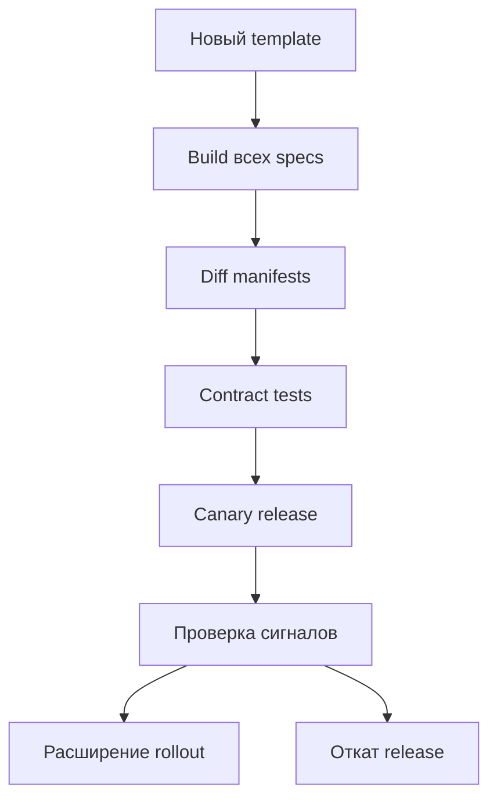
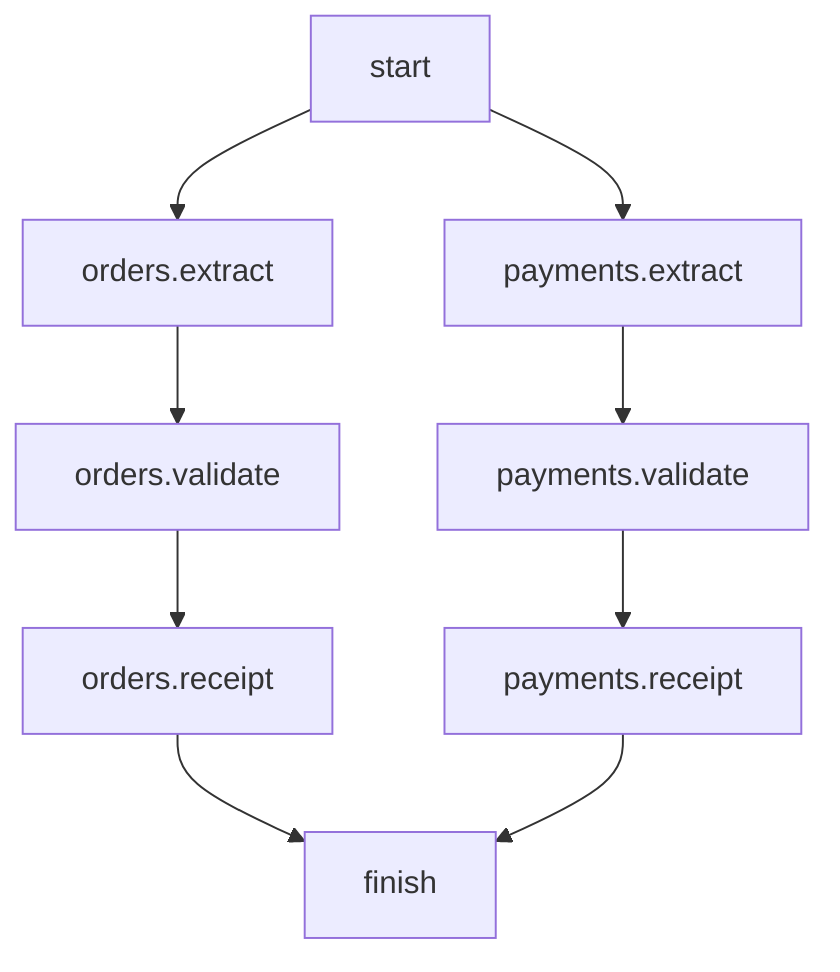

# 12. Динамическая генерация DAG и производительность импорта

Глава посвящена DAG-фабрикам: как из проверенной конфигурации получить множество воспроизводимых workflow, сохранить стабильные идентификаторы и не перегрузить DAG processor.

Восемь тем и все 40 пунктов идут в порядке README. После теории находятся законченная фабрика, конфигурация, entry point, тесты на настоящем Airflow, benchmark, восемь ситуаций и 30 вопросов с ответами.

| Компонент | Учебная версия |
| --- | --- |
| Apache Airflow | 3.3.2 |
| Task SDK | 1.3.2 |
| Standard provider | 1.19.0 |
| Python | 3.12 |
| jsonschema | 4.26.0 |

Это закреплённая линия примеров, а не утверждение о последнем доступном релизе. Версии пакетов согласованы с constraints Airflow для Python 3.12. [S19](#source-19)

Основная модель:

**Versioned config → validation → нормализованные specs → детерминированная фабрика → обнаруженные DAG → сериализованные definitions.**

Полный разбор создаёт весь каталог. Выборочный разбор перед выполнением task создаёт нужный DAG с теми же task IDs, зависимостями и настройками. Оптимизация не должна менять смысл workflow.

| К концу главы ты умеешь | Инженерное доказательство |
| --- | --- |
| Создавать несколько DAG из одного файла | Ожидаемый набор обнаружен через DagBag |
| Разделять generation и mapping | Знаешь, когда определяется graph / число instances |
| Сохранять идентичность | Добавление источника не переименовывает существующие tasks |
| Снижать стоимость импорта | Замерены конкретные фазы и размер создаваемого каталога |
| Обнаруживать конфигурационные ошибки | CI отклоняет неверный release до deployment |
| Делать фабрику продуктом | Есть контракт, версия, ownership, миграции и диагностика |

## Содержание

1. [Parse-time генерация](#s12-1)
2. [Источники конфигурации](#s12-2)
3. [Детерминированность графа](#s12-3)
4. [Discovery и импорты](#s12-4)
5. [Стоимость Python-модуля](#s12-5)
6. [Оптимизация генераторов](#s12-6)
7. [Ошибки конфигурации](#s12-7)
8. [Фабрики как платформенный продукт](#s12-8)
9. [Лабораторная: контракт и фабрика](#lab-core)
10. [Лабораторная: entry point и discovery](#lab-discovery)
11. [Тесты](#tests)
12. [Benchmark](#benchmark)
13. [Разбор ситуаций](#cases)
14. [Самопроверка](#questions)
15. [Критерии освоения](#mastery)
16. [Проверка материала](#verification)
17. [Официальные источники](#sources)

<a id="s12-1"></a>
## 12.1. Parse-time генерация

### 12.1.1. Несколько DAG в одном Python-модуле

DAG-файл — исполняемый Python-модуль. Во время разбора Python выполняет его верхнеуровневый код, который создаёт DAG и operators. Число объектов определяется логикой модуля и доступной в этот момент конфигурацией. [S01](#source-01)

В одном файле можно создать несколько независимых DAG:

```python
from airflow.providers.standard.operators.empty import EmptyOperator
from airflow.sdk import DAG

for dataset in ("sales", "returns"):
    with DAG(
        dag_id=f"example_generated_{dataset}",
        schedule=None,
        catchup=False,
        tags=["chapter12"],
    ):
        EmptyOperator(task_id="start")
        EmptyOperator(task_id="finish")
```

Две tasks в этом коротком примере независимы: одинаковое расположение строк в Python не создаёт зависимость. Если требуется порядок, явно задай `start >> finish`.

Современный Airflow умеет автоматически регистрировать DAG из context manager / вызова `@dag`. Это поведение нужно отличать от общего правила обнаружения произвольных DAG objects в globals. [S01](#source-01) [S06](#source-06)

Один файл даёт общую точку конфигурации, но создаёт общую область import failure и единицу работы parser. Если он строит 500 DAG, изменение одного источника может потребовать повторной работы над всем файлом.

Несколько DAG в файле не превращаются в один DagRun. У каждого собственные schedule, runs, состояние и ограничения. Между ними нет автоматической зависимости по порядку создания.

Число файлов, DAG, tasks и TaskInstances — разные величины. Один файл может создавать много DAG; один DAG — много tasks; одна mapped task definition — много runtime TaskInstances.

### 12.1.2. Фабрики DAG и типизированная конфигурация

Фабрика — функция, создающая DAG из проверенного spec. Её задача — преобразовать декларативное описание в предсказуемые operators и edges.

Хорошая граница выглядит так:

| Компонент | Ответственность |
| --- | --- |
| Loader | Прочитать ограниченный локальный artifact |
| Schema validator | Проверить форму и допустимые значения |
| Normalizer | Сортировка, defaults, immutable typed specs |
| Factory | Построить один DAG |
| Entry point | Выбрать набор specs и опубликовать DAG |
| Runtime business code | Выполнить реальную работу задачи |

Type hints не валидируют произвольный JSON. `PipelineSpec(**raw)` не заменяет schema validation: Python dataclass без дополнительных проверок может принять значение неправильного типа.

Фабрика не должна возвращать новый случайный graph при одинаковых входах. Формализуй её контракт как:

`graph = F(template_version, config_revision, environment)`.

Все значимые зависимости должны быть явными. Если внутри F скрыто читается «последняя» Variable или API, одинаковый config revision больше не определяет результат.

Используй immutable dataclasses / tuples там, где это помогает исключить изменение spec во время построения. Но frozen dataclass с mutable dict внутри остаётся лишь частично immutable: учитывай вложенные структуры.

Не делай фабрику универсальным интерпретатором произвольного Python из YAML. Ограниченная schema с понятными primitives обычно проще для безопасности, тестирования и миграций.

### 12.1.3. Циклы создания задач с известной структурой

Python `for` создаёт объекты сразу при разборе:

```python
from airflow.providers.standard.operators.empty import EmptyOperator
from airflow.sdk import DAG

with DAG("example_source_loop", schedule=None) as source_loop:
    start = EmptyOperator(task_id="start")
    finish = EmptyOperator(task_id="finish")
    for source_key in sorted(("orders", "payments", "refunds")):
        check = EmptyOperator(task_id=f"check_{source_key}")
        start >> check >> finish
```

При каждом полном parse здесь создаются пять operators: start, finish и три check. Airflow не откладывает этот цикл до запуска run.

Ключевые правила:

- Task ID следует из устойчивого business key.
- Порядок обхода стабилен.
- Все operators относятся к нужному DAG / TaskGroup.
- Зависимости задаются явно.
- Число объектов ограничено контрактом конфигурации.

Для TaskGroups применяется тот же принцип: цикл создаёт определения групп и tasks, а не runtime instances.

Следи за late binding замыканий. Если lambda / функция читает переменную цикла позже, все tasks могут увидеть последнее значение. Передавай конкретные значения через task arguments / op_kwargs или создавай функцию с явными аргументами.

```python
from airflow.providers.standard.operators.python import PythonOperator

def describe_source(source_key):
    return {"source_key": source_key}

def create_source_task(source_key, dag):
    return PythonOperator(
        task_id=f"describe_{source_key}",
        python_callable=describe_source,
        op_kwargs={"source_key": source_key},
        dag=dag,
    )
```

У этой функции значение source_key сохраняется в конкретном operator. Runtime callable не зависит от изменяемой loop variable.

### 12.1.4. Различие генерации графа и runtime dynamic task mapping

Parse-time generation и mapping решают разные задачи. [S01](#source-01)

| Свойство | Parse-time generation | Dynamic Task Mapping |
| --- | --- | --- |
| Когда известен набор | Во время построения DAG | Может стать известен по результату upstream task |
| Что создаётся | DAG/task definitions | Mapped instances для конкретного run |
| Где обычный Python for | В authoring code | Сам по себе не выполняет scheduler mapping |
| Устойчивый ключ | DAG/task IDs из config | Business key элемента + map index |
| Основная нагрузка | Parse, сериализация, размер graph | Scheduler, metadata, executor, fan-out |
| Оптимизация get_parsing_context | Может пропустить другие DAG | Не отменяет runtime expansion |
| Типичный пример | DAG на каждую управляемую таблицу | Jobs по списку файлов данного run |

`expand()` с константным списком тоже является mapping, хотя список известен заранее. Различие определяется механизмом создания TaskInstances, а не только источником списка.

Не выполняй API discovery внутри parse, если реальные объекты доступны только в момент run. Получи bounded manifest отдельной task и используй mapping, если это соответствует модели workflow.

Не пытайся добавить новые operators из тела уже запущенной task. Scheduler работает с зарегистрированным definition, а не со случайным DAG object, созданным внутри runtime Python-функции.

В главе 13 будет подробно разобран mapping. Здесь фабрика создаёт фиксированный graph для конкретной config revision.

### 12.1.5. Границы количества объектов и стоимость повторного импорта

Если файл создаёт K DAG по T tasks, размер работы уже порядка K×T объектов. Edges тоже важны: all-to-all dependency между группами по N tasks создаёт N² связей.

Упрощённая модель стоимости одного разбора:

`T_parse ≈ T_startup + T_imports + T_load + T_validate + T_build + T_serialize`.

Она помогает измерять фазы, но не является точной формулой внутреннего accounting Airflow. Обработка результатов, IPC и metadata DB добавляют собственную стоимость.

Для группы файлов с service times pᵢ и P parsing processes грубая нижняя оценка времени обработки набора — max(max pᵢ, Σpᵢ/P). Она не учитывает I/O contention, очереди и ограничения инфраструктуры. Один огромный файл не делится автоматически на P независимых parse jobs.

| Ограничение | Почему нужно |
| --- | --- |
| Число pipelines в config | Ограничивает полный каталог |
| Число источников на DAG | Ограничивает размер graph |
| Размер config artifact | Ограничивает чтение / validation |
| Число edges | Предотвращает случайный квадратичный рост |
| Время parse p95 | Контролирует задержку доставки |
| Peak memory / RSS процесса | Ограничивает безопасный parsing parallelism |

Повторный импорт entry point не гарантирует повторный импорт каждого helper: Python кеширует modules в `sys.modules`. При этом новый parser process может иметь другой cache state. Поэтому warm in-process benchmark и fresh-process benchmark измеряют разное.

Не существует универсального безопасного числа «100 DAG на файл». Выбирай размер по измеренной стоимости, области отказа и требованиям доставки.

<a id="s12-2"></a>
## 12.2. Источники конфигурации

### 12.2.1. Локальные YAML/JSON и schema validation

Локальный config удобен, если он доставляется вместе с DAG и не требует сети при parse. [S01](#source-01)

Loader должен:

1. Использовать путь относительно package / entry point, а не текущую рабочую директорию.
2. Ограничить размер.
3. Проверить синтаксис.
4. Проверить schema.
5. Проверить уникальность и межполевые правила.
6. Нормализовать в стабильный порядок.

| Проверка | Пример отказа |
| --- | --- |
| Schema version | Фабрика не поддерживает template v3 |
| Required fields | У pipeline нет owner |
| Types | retries="three" |
| Bounds | 100000 источников в одном DAG |
| Unknown keys | Опечатка retry вместо retries |
| Uniqueness | Две записи с одним pipeline key |
| Cross-field rules | Разрешённый pool не соответствует policy |
| Identifier contract | task key нельзя однозначно представить в ID |

Для YAML используй safe loader, но помни: safe parsing не заменяет прикладную schema. Не принимай произвольные Python object tags.

Для JSON желательно отклонять duplicate object keys: стандартный json.loads обычно сохраняет последнее значение. Формально валидный для parser документ может скрыть конфликт настроек.

Различай syntax error, schema error и business invariant error. Сообщение должно содержать artifact и поле, но не полный payload с возможными secrets.

В лабораторной JSON не содержит credentials, задаёт закрытую schema и ограниченную вложенность структуры.

### 12.2.2. Сгенерированные Python constants и metadata packages

CI может преобразовать источник metadata в Python-модуль с constants. Runtime тогда импортирует готовое представление вместо обращения к внешнему каталогу.

```python
# Пример результата доверенного генератора, а не пользовательский Python.
CATALOG_VERSION = 1
SOURCE_KEYS = ("orders", "payments", "refunds")
```

Это уменьшает часть работы с форматами, но не делает импорт бесплатным. Python всё равно читает / загружает code object, создаёт values и кеширует module в процессе.

Проверяй воспроизводимость generator: одинаковый input должен давать одинаковые bytes, порядок keys и formatting. В артефакте полезны generator version, input revision и checksum non-secret metadata.

Не вставляй пользовательские строки в шаблон Python-кода через необработанную конкатенацию. Используй безопасное представление literals и проверяй generated file через compile / AST. Артефакт с Python-кодом обладает возможностью исполнения, поэтому его публикация — доверенный CI-процесс.

Metadata package должен иметь уникальное имя и согласованную версию с template library. Не называй его `airflow`, `json` или `config` на верхнем уровне import path.

Кеш Python constants не заменяет версионирование deployment: старый процесс может продолжать использовать старый imported module.

### 12.2.3. Версионирование конфигурации вместе с DAG bundle

Для graph generation нужны согласованные версии entry point, factory library и config. Иначе один и тот же release ID не описывает построенный graph.

| Артефакт | Что фиксировать |
| --- | --- |
| DAG entry point | Commit / bundle revision |
| Config | Schema version и content revision |
| Template library | Package / template version |
| Providers | Закреплённые versions |
| Execution image | Image digest / окружение |
| Дополнительные SQL templates | Тот же release или явный immutable reference |

Versioned bundle помогает доставить согласованную версию, но свойства зависят от backend. Mutable local directory не является историческим архивом автоматически. [S15](#source-15)

Не публикуй factory.py и config.json как два независимых обновления без согласованной точки release. Parser может увидеть новый код со старой schema.

Воспроизводимость definitions не доказывает воспроизводимость данных. Исторический rerun также требует известного input data contract и runtime config, разобранных в главе 11.

Если helper установлен отдельным wheel в image, его version должна быть частью release manifest. Bundle с прежним DAG-файлом и новым wheel может построить другой graph.

### 12.2.4. Environment variables при построении графа

Environment variables читаются локально и подходят для trusted deployment settings. Но они тоже являются входом фабрики. [S01](#source-01)

Например, `CH12_ENV=dev|stage|prod` может выбирать DAG namespace и разрешённые resource policies. Значение должно быть проверено по allowlist, а parser и task runtime должны получить совместимые настройки.

| Подход | Последствие |
| --- | --- |
| Env выбирает logical resource | Один код для разных deployments |
| Env меняет число tasks | Разные graphs; это надо тестировать |
| Env меняет DAG ID | Разные identities; нужно запланировать миграцию |
| Env различается у processor и worker | Выборочный parse может не найти ожидаемый DAG |
| Env меняется без новой версии release | История graph становится менее прозрачной |

Не считай environment variable секретным каналом автоматически. Её могут читать дочерние процессы и диагностические средства; credentials должны иметь отдельный управляемый lifecycle.

Не используй произвольный пользовательский Param как deployment environment при parse: конкретного DagRun ещё нет.

Если одинаковая identity DAG нужна во всех изолированных окружениях, env можно исключить из ID. Если окружения разделяют одну установку, namespace должен однозначно предотвращать коллизии. Это продуктовая политика, а не требование Airflow.

### 12.2.5. Исключение DB/API lookup из верхнего уровня модуля

Top-level code выполняется при разборе, который повторяется. DB/API calls в нём превращают внешнюю систему в зависимость discovery DAG.

Плохие последствия:

- Нестабильная latency parse.
- Дополнительная нагрузка на metadata / secrets / внешние сервисы.
- Import errors во время временного outage.
- Разный graph при двух последовательных чтениях.
- Неожиданная потребность в credentials у DAG processor.

В Airflow 3 runtime доступы проходят через соответствующие SDK / execution interfaces; не переноси старое представление «любой Variable.get всегда напрямую открывает metadata DB» на любой компонент. Важен сам факт внешнего lookup и его стоимость. [S02](#source-02)

| Потребность | Предпочтительный момент |
| --- | --- |
| Список поддерживаемых pipelines | CI export → local artifact |
| Текущий список файлов этого run | Runtime task → bounded manifest |
| Credential для операции | Runtime Hook / secrets mechanism |
| Schema конфигурации | CI и локальная проверка |
| Политика graph generation | Versioned code/config |
| Текущее внешнее состояние | Runtime, с явным consistency contract |

Даже `Variable.get("x", default=...)` может выполнить lookup прежде, чем использовать default. Cache уменьшает некоторые обращения, но не создаёт детерминированный release.

Полезная архитектурная граница: CI собирает metadata artifact, DAG processor его читает, task runtime обращается к data systems.

<a id="s12-3"></a>
## 12.3. Детерминированность графа

### 12.3.1. Стабильная сортировка источников и task IDs

Сортировка и идентичность — разные требования. Сортировка стабилизирует последовательность построения; ID привязывает объект к его устойчивому ключу.

| Схема ID | Что произойдёт при вставке нового источника |
| --- | --- |
| `task_0`, `task_1` из enumerate | Возможен сдвиг IDs всех последующих tasks |
| `task_<source_key>` | Существующие источники сохранят IDs |
| ID из случайного UUID | Новый набор identities при каждом parse |
| ID из текущего display name | Переименование подписи меняет history identity |
| ID из постоянного key | Подпись можно менять отдельно |

Не «санитизируй» разные keys до одинаковой строки молча. Например, a-b и a_b могут столкнуться после замены символов. Либо явно ограничь допустимый identifier alphabet, либо используй проверяемое однозначное сопоставление.

Сортируй records по явному key, а не только полагайся на сохранение порядка dict. Источник может прийти из set, unordered query, YAML merge или другого генератора.

Проверяй итоговые fully qualified task IDs после TaskGroup prefixes. Локальный extract в двух разных группах допустим, но одинаковый group_id с одинаковым leaf task_id — конфликт.

### 12.3.2. Отсутствие `now()`, случайных значений и сетевых side effects

Нестабильность возникает не только в IDs. Runtime-varying values в start_date, tags, task arguments или generated config могут менять сериализованный definition.

| Источник | Проблема | Замена |
| --- | --- | --- |
| now() в start_date | Время definition меняется при parse | Явная фиксированная дата |
| UUID в task_id | Теряется identity | Постоянный source key |
| random в operator args | Меняется serialized content | Versioned выбор / runtime вычисление |
| API discovery | Зависимость от текущего состояния | CI snapshot или runtime manifest |
| Текущее содержимое папки | Нестабильный набор tasks | Проверяемый artifact index |
| Timestamp build в doc_md | Лишние definition changes | Release revision, а не время каждого parse |

Случайность может быть корректной внутри runtime algorithm с зафиксированным seed и контрактом. Она не должна незаметно определять graph identity.

Не отправляй уведомления и не создавай внешние ресурсы при import. Parser способен запустить один файл многократно, даже если DagRun ни разу не стартовал.

Default аргумент функции вычисляется при её определении. Поэтому `def f(client=create_client())` выполняет создание клиента во время import, хотя вызов находится визуально рядом с функцией. Для тяжёлого runtime object используй None и создание внутри выполнения.

### 12.3.3. Повторный импорт создаёт одинаковую структуру

Для одинаковых входов сравнивай не только список task IDs.

Полезный semantic manifest включает:

- DAG ID и timetable policy.
- Полный набор task IDs и типы операторов.
- Directed edges.
- Pool, retries, timeouts, concurrency settings.
- Owner / tags по продуктовому контракту.
- Значимые op_kwargs и ссылки на config revision.
- Template version.

Не используй весь `dag.__dict__` как контракт: там могут быть runtime / parse bookkeeping и внутренние поля.

Два graphs с одинаковыми IDs, но разными edges, pools или params — разные workflow. Один topology-only hash этого не обнаружит, если настройки не вошли в representation.

В CI сравнивай нормализованный manifest. Для проверки платформенной сериализации используй поддерживаемый для закреплённой версии serializer и объясняй, какие volatile поля исключены. Не исключай поля массово только ради зелёного теста.

Full и selective generation должны давать одинаковое представление нужного DAG. Это основной regression test оптимизации get_parsing_context.

### 12.3.4. Устойчивые идентификаторы при добавлении одного источника

Добавление source должно менять только предусмотренную часть graph. Например, новая группа src_refunds добавляет три task IDs и связанные edges, не переименовывая src_orders.

Сформулируй change contract:

| Изменение config | Ожидаемое изменение |
| --- | --- |
| Переставить записи | Ничего в semantic manifest |
| Добавить source | Новая группа и её edges |
| Поменять description | Только разрешённая metadata |
| Поменять key | Identity migration |
| Удалить source | Осознанное удаление definitions |
| Переименовать DAG | Новый DAG ID, а не косметический rename |

Стабильный ID не означает неизменный смысл. Если task с прежним именем теперь пишет другую таблицу, история становится вводящей в заблуждение. Версионируй смысл и планируй такую миграцию отдельно.

Для удалений проверь активные runs, исторические bundles, callbacks и политику повторного выполнения. Не удаляй source из каталога только потому, что он временно не ответил в API.

Храни identity key отдельно от human-readable title. Это позволяет изменить понятную подпись без ненужного переезда IDs.

### 12.3.5. Проверка случайного роста числа DAG versions

Versioned definitions полезны, когда graph действительно меняется. Если новая версия создаётся при каждом parse без бизнес-изменений, растут metadata, шум audit и сложность диагностики.

В Airflow 3.3.2 перед обычным разбором DAG processor вызывает AST-based stability check. Настройка `[dag_processor] dag_version_inflation_check_level` поддерживает off, warning и error; default — warning. [S10](#source-10) [S13](#source-13) [S14](#source-14)

| Уровень | Поведение |
| --- | --- |
| off | Проверка отключена |
| warning | Подозрительные конструкции дают предупреждение |
| error | Обнаруженная проблема может заблокировать обычный parse |
| Любой уровень | Не является математическим доказательством детерминированности |

Checker распознаёт определённые AST patterns, в том числе известные runtime-varying calls. Он не способен доказать свойства произвольной фабрики, imported helper или внешнего API.

Повторный вызов DagBag сам по себе не показывает число сохранённых DAG versions: для этого нужен persistence path и metadata DB. Локальный serialization / manifest test проверяет только соответствующую часть.

Наблюдай количество versions вместе с releases и изменениями content. Рост без deployment — сигнал искать timestamps, randomness, меняющийся config, порядок коллекций и нестабильные сериализуемые значения.

Не лечи нестабильность увеличением интервала записи serialized DAG: это может уменьшить частоту проявления, но не исправляет причину.

<a id="s12-4"></a>
## 12.4. Discovery и импорты

### 12.4.1. Доступность объектов DAG и автоматическая регистрация

Обнаружение состоит из нескольких этапов: найти candidate file, импортировать его и извлечь DAG objects. Успешный Python import ещё не означает, что Airflow увидел ожидаемый каталог.

В Python importer 3.3.2 учитываются DAG objects в module globals и DAG из набора autoregistration. Просто положить DAG в произвольный list / dict недостаточно для универсального обхода коллекции: importer не обязан рекурсивно искать objects внутри любого контейнера. [S06](#source-06)

| Authoring pattern | Что требуется |
| --- | --- |
| `dag = DAG(...)` на уровне модуля | Object доступен в globals |
| `with DAG(...)` с auto_register=True | Срабатывает поддерживаемая autoregistration |
| Вызов `@dag` factory | Создаётся и регистрируется DAG по соответствующим правилам |
| Функция объявлена, но не вызвана | DAG ещё не создан |
| `DAG(...)` только в локальной переменной обычной функции | Нужна публикация / поддерживаемая регистрация |
| Dict DAG objects | Явно экспортировать objects в globals либо использовать autoregistration |

Для прозрачного учебного контракта лабораторная использует `auto_register=False` и явный `globals().update(generated_dags)` в entry point. В production не обязательно применять именно этот способ, но регистрация должна быть проверена.

Discovery safe mode — эвристика. В 3.3.2 default heuristic читает bytes файла и ищет airflow вместе с dag либо asset без учёта регистра. Wrapper, скрывший все признаки в другом модуле, способен привести к skip. [S08](#source-08)

Не устраняй такую проблему случайным комментарием, который никто не понимает. Сделай entry point явным Airflow authoring module, проверь safe-mode behavior и задокументируй политику.

### 12.4.2. `.airflowignore`, glob/regex и различия версий

`.airflowignore` исключает пути из поиска DAG. Он не запрещает Python импортировать helper package и не является механизмом доступа.

В 3.3.2 `[core] dag_ignore_file_syntax` по умолчанию равен glob; также поддерживается regexp. Старые инструкции могут предполагать другой default. [S10](#source-10)

| Режим | Как мыслить о pattern |
| --- | --- |
| glob | Gitignore-подобные правила путей и wildcard semantics |
| regexp | Регулярное выражение по правилам реализации |
| Оба | Scope определяется расположением ignore file и деревом поиска |

Не считай glob pattern регулярным выражением. `.*` и `*` имеют разные значения в этих режимах.

В лабораторной helper package исключён из discovery, а entry point остаётся видимым. Это уменьшает бессмысленное сканирование и предотвращает случайное создание вспомогательных DAG.

Проверь правила реальным file listing / DagBag с safe mode, а не только визуальным чтением ignore file. Negative pattern, вложенные ignore files и platform path separators способны влиять на результат.

Полезный regression test: library по-прежнему импортируется, но её Python-файлы не перечисляются как DAG candidates; entry point найден.

### 12.4.3. Python package layout, абсолютные импорты и namespace collisions

Python разрешает imports через `sys.path` и кеширует loaded modules. Структура проекта должна одинаково работать у parser, worker и tests. [S09](#source-09) [S22](#source-22)

Используй уникальный top-level package, например `zth_factory_lib`, и абсолютные imports:

```python
from zth_factory_lib.catalog import load_catalog
from zth_factory_lib.factory import build_catalog
```

Избегай файлов вроде `airflow.py`, `logging.py`, `json.py`, `random.py` в корне import path. Они могут затенить платформенный или стандартный модуль.

У package folders добавляй `__init__.py` согласно модели доставки Airflow. Не полагайся без проверки на implicit namespace packages или различное поведение относительных imports при запуске как file / module / test.

Особая тонкость plugins: auto-import plugin modules может регистрировать bare filename даже при вложенной структуре. Перенос `logging.py` в глубину plugins tree не является надёжной защитой от collision. [S09](#source-09)

Не исправляй каждую ошибку import добавлением случайного `sys.path.append` внутри DAG-файла. Сначала определи packaging и deployment contract.

DAG folder не обязан быть доступен API/UI-компоненту для выполнения author code. Code dependencies доставляй только тем компонентам, которым они действительно нужны.

### 12.4.4. Разделение DAG entry points и библиотеки бизнес-логики

Entry point должен быть маленьким: загрузить config, получить parsing context, выбрать specs, построить и экспортировать DAG.

| Слой | Допустимо | Нежелательно |
| --- | --- | --- |
| Entry point | Несколько явных imports, orchestration сборки | ETL, сетевой discovery, credentials |
| Catalog module | Schema, local parsing, immutable specs | Создание operators |
| Factory module | DAG / operators / dependencies | Тяжёлые вычисления над данными |
| Business module | Runtime transformations и adapters | Побочные эффекты при import |
| Tests | Контракты graphs и поведения | Доступ к production resources |

Такое разделение позволяет тестировать config без Airflow и graph без запуска задач.

Оно также уменьшает случайный import тяжёлых runtime dependencies. Если factory импортирует business module, а тот на верхнем уровне импортирует ML SDK, стоимость всё равно попадёт в parse.

Выбирай границы модулей по import graph, а не только по названиям папок. Один `from company.runtime import run_job` способен транзитивно загрузить целый стек.

Helper package исключается из DAG discovery, но все его dependencies остаются частью импортируемого кода. Ignore file не устраняет стоимость imports.

### 12.4.5. Plugins, lazy loading и перезапуск процессов после изменений

Plugins и providers могут загружаться лениво. Настройки `lazy_load_plugins` и `lazy_discover_providers` влияют на момент работы, а не отменяют её. [S10](#source-10) [S16](#source-16)

| Механизм | Где возникает ловушка |
| --- | --- |
| Python module cache | Helper изменился на диске, процесс держит прежний object |
| Plugin loading | Изменение файла не означает hot reload каждого компонента |
| Provider discovery | Первый вызов дороже последующих |
| Pre-import modules | Parser child может стартовать с уже загруженными dependencies |
| Long-lived worker | В окружении может оставаться прежняя версия package |

Планируй rollout с учётом реальной модели процессов и executor. Перезапускай нужные компоненты штатным deployment-процессом, если смена packages/plugins этого требует.

Не обещай, что «новый parse гарантированно перечитает любую imported библиотеку». Python importer обновляет entry module, но общие modules в процессе могут оставаться cached.

Не вызывай `importlib.reload` всего дерева зависимостей из DAG-файла ради эмуляции deployment. Это усложняет shared state и не даёт согласованной замены references.

Для измерений отдельно фиксируй first import и steady state. Эффект lazy loading без такого разделения легко принять за улучшение фабрики.

<a id="s12-5"></a>
## 12.5. Стоимость Python-модуля

### 12.5.1. Тяжёлые импорты pandas, ML SDK и облачных клиентов

Import выполняет код импортируемого модуля и его dependencies. Даже если после import не вызывается ни одна функция, цена уже уплачена. [S02](#source-02)

Тяжёлую runtime dependency можно импортировать внутри task callable:

```python
def transform_partition(records):
    import pandas as pd
    frame = pd.DataFrame.from_records(records)
    return {"row_count": len(frame)}
```

Это переносит цену на runtime. Сам pandas должен существовать в execution environment, если эта функция будет вызвана. Пример не является причиной устанавливать pandas только для теста DAG-фабрики.

| Стратегия | Компромисс |
| --- | --- |
| Top-level import | Быстрый доступ позже, дорогой parse |
| Function-local import | Дешевле parse, цена при execution |
| Отдельный runtime package | Ясные зависимости, нужна согласованная доставка |
| External job / container | Изоляция, дополнительный startup и operational complexity |
| Только лёгкие adapters в factory | Нужен аккуратный import graph |

Локальный import не гарантирует новый холодный import при каждом вызове: внутри одного процесса действует sys.modules. И он не делает library безопасной по памяти после загрузки.

Не выбирай isolation mechanism только ради одного дорогого import без измерения. Сначала проверь транзитивные imports и возможность отделить authoring от runtime code.

### 12.5.2. Вычисления в default arguments и конструкторах operators

Следующие конструкции исполняются при import / построении graph:

- Function default values.
- Class body.
- Decorator expressions.
- Operator constructor arguments.
- List/dict comprehensions в верхнем уровне.
- Валидаторы, вызываемые сразу при создании objects.
- Свойства / descriptors, к которым обращается authoring code.

Пример скрытой стоимости:

```python
def create_runtime_client():
    raise RuntimeError("Создание клиента должно происходить только в runtime")

def process_with_client(client=None):
    if client is None:
        client = create_runtime_client()
    return client
```

Здесь клиент не создаётся при объявлении process_with_client. Если написать `client=create_runtime_client()` в default, он создастся немедленно.

Constructor operator должен сохранять проверяемые параметры, а не выполнять запросы и создавать внешние jobs.

Оцени число вызовов: быстрые 2 ms в constructor при 5000 tasks превращаются примерно в 10 s чистой последовательной работы. Это арифметическая оценка, а не измерение Airflow.

Не включай в constructor данные целой таблицы или большой schema catalog, если достаточно versioned reference.

### 12.5.3. Создание hook/client в `execute`, а не в `__init__`

Ресурсы процесса относятся к execution runtime.

```python
from airflow.sdk import BaseOperator

class ReadCountOperator(BaseOperator):
    def __init__(self, *, conn_id, sql, **kwargs):
        super().__init__(**kwargs)
        self.conn_id = conn_id
        self.sql = sql

    def execute(self, context):
        from airflow.sdk import Connection
        hook = Connection.get(self.conn_id).get_hook()
        row = hook.get_first(self.sql)
        return {"row_count": row[0]}
```

Этот пример показывает lifecycle; для конкретного provider используй его корректный Hook / connection contract и безопасный SQL binding. Лабораторная ниже не требует Common SQL provider для подключения и не обращается к реальной БД.

Connection выбирает зарегистрированный Hook по типу подключения; подходящий provider должен быть установлен. Для конкретного warehouse проверь его Hook, connection extras и поддерживаемый SQL dialect.

Клиент в `__init__` способен потребовать secrets у parser, открыть socket при discovery и оказаться непереносимым через serialization. SDK не превращает его в безопасный shared object.

`cached_property` над client может быть полезна в одном execution object, но только если к ней не обращаются при parse и она не попадает в сериализуемые поля. Это не глобальный pool соединений платформы.

### 12.5.4. Локальные файлы, process startup и зависимые модули

Локальный config не равен бесплатному config. Имеют значение число stat/open, размер, filesystem latency, decompression и JSON/schema processing.

| Фаза | Что измерять |
| --- | --- |
| Process startup | Wall time нового interpreter / parser child |
| Imports | Собственное и cumulative время imports |
| Config I/O | Bytes, open/stat, latency filesystem |
| Validation | Число records и сложность schema |
| Object construction | DAG/tasks/edges и allocations |
| Serialization | Время и bytes output |
| Persistence | Latency записи и version decisions |

Один файл config рядом с entry point обычно предсказуемее сотен мелких сетевых файлов. Но большой монолит увеличивает validation cost и область отказа.

Зависимый helper может измениться, когда mtime entry point не менялся. Доставка через согласованный bundle и refresh policy надёжнее ожидания, что любой file watcher проследит все Python dependencies.

Pre-import Airflow modules в manager может улучшать child startup. Настройка `[dag_processor] parsing_pre_import_modules` в 3.3.2 по умолчанию True. Эффект зависит от модели запуска процессов. [S10](#source-10)

Обычный запуск `python entry.py` полезен для диагностики, но не идентичен реальному parser process с pre-imports, plugins, importer hooks и persistence.

### 12.5.5. Профилирование import time и памяти DAG processor

Используй несколько инструментов, потому что они измеряют разные вещи.

```bash
python -X importtime dags/generated_entry.py 2> importtime.log
python -m cProfile -o factory_profile.pstats dags/generated_entry.py
python -m pstats factory_profile.pstats
```

`-X importtime` показывает self/cumulative imports; формат и дополнительные режимы зависят от версии Python. Для Python 3.12 достаточно обычного importtime. [S20](#source-20)

| Метрика | Смысл | Ограничение |
| --- | --- | --- |
| perf_counter duration | Wall time выбранного участка | Нужно точно задать границы |
| cProfile | Calls и cumulative execution time | Сам profiling добавляет overhead |
| tracemalloc peak | Python allocations после старта tracing | Не вся native memory |
| RSS | Resident memory процесса | Включает imports и allocator behavior |
| Processor duration | Реальная обработка файла | Включает больше фаз, чем factory loop |
| Deployment visibility latency | От release до доступности DAG | Зависит от всей цепочки доставки |

В 3.3.2 manager публикует `dag_processing.last_duration` с tags файла/bundle, `dag_processing.file_path_queue_size`, `dag_processing.import_errors` и `dag_processing.processor_timeouts`. `dag_processing.total_parse_time` относится к обработке цикла набора файлов, а не к одной task или одному import. Имена / mapping backend проверяются по версии. [S12](#source-12)

Не сравнивай 10 ms warm factory loop с 2 s cold process и не называй разницу ускорением DAG processor.

RSS после операции может не вернуться к исходному уровню даже после освобождения объектов: allocator и shared libraries влияют на resident memory. Проверяй peak и steady state под реальной concurrency.

<a id="s12-6"></a>
## 12.6. Оптимизация генераторов

### 12.6.1. Ограничение числа DAG на файл и независимая доставка

Выбор единицы разбиения — компромисс.

| Организация | Сильная сторона | Цена |
| --- | --- | --- |
| Один DAG на файл | Изолированное изменение и parse | Много files/startup/scanning |
| Небольшой shard DAG на файл | Баланс common work и parallelism | Нужна устойчивая shard policy |
| Один огромный factory file | Простая общая конфигурация | Большая область отказа и длинный parse |
| Generated entry points | CI может распределить работу | Больше generated artifacts и lifecycle |

Не шардируй по позиции в отсортированном массиве, если вставка одного pipeline перемещает много definitions между файлами. Для устойчивого shard mapping нужен стабильный алгоритм и план изменения числа shards.

Также не используй встроенный `hash(key)` для persistent shard assignment: string hash Python может зависеть от hash seed процесса. Используй явный stable hash / закреплённый индекс. [S20](#source-20)

Сначала исправь внешние lookup, тяжёлые imports и случайный квадратичный graph. После этого измеряй пользу file sharding.

Разбиение не отменяет необходимость согласованной версии общей factory library.

### 12.6.2. `get_parsing_context()` и выбор нужного DAG при task execution

Public API:

```python
from airflow.sdk import get_parsing_context

context = get_parsing_context()
selected_dag_id = context.dag_id
selected_task_id = context.task_id
```

При полном разборе dag_id/task_id обычно None. Когда execution path знает конкретный DAG/task, context позволяет пропустить создание остальных DAG данного файла. [S01](#source-01) [S05](#source-05)

Нужные условия:

- DAG строятся независимо.
- Выбор не зависит от side effects предыдущих iterations.
- Нужный spec можно однозначно найти.
- Выбранный DAG имеет ту же полную структуру.
- Нет изменения resource policies между режимами.

Пропускать остальные DAG и обрезать tasks внутри выбранного DAG — разные оптимизации. Не удаляй все tasks кроме выбранной по task_id: это может нарушить dependencies, XCom references и operator preparation.

Parsing context не является runtime context конкретного task. В нём нет effective Params, данных upstream и run business window.

В лабораторной фильтрация происходит до создания operators, но после проверки полного каталога. Поэтому O(N) чтения/validation остаётся. Для очень большого каталога следующий шаг — versioned index / shard configs, а не заявление «теперь всё O(1)».

### 12.6.3. Предварительная генерация кода в CI

Часть работы можно выполнить один раз до deployment:

1. Получить metadata из разрешённых систем.
2. Проверить schema и policy.
3. Нормализовать порядок и identifiers.
4. Сформировать config / constants / entry points.
5. Проверить imports, graph manifests и serialization.
6. Опубликовать один согласованный release.

Сгенерированный код должен быть воспроизводимым. Отключи timestamps генерации в semantic output, если они создают ненужные definition changes; provenance можно хранить отдельно.

| CI artifact | Когда полезен |
| --- | --- |
| Validated JSON | Config удобен для review |
| Python literals | Нужен простой import готовых metadata |
| DAG entry points по shards | Нужна независимая единица parse |
| Manifest графов | Нужен diff перед release |
| Content checksums | Нужна проверка согласованности |

Не коммить secrets в generated config. Config review должен показывать поведение и resource references, а credentials разрешаются отдельно.

Генератор сам становится production tool: у него нужны version, tests и понятная реакция на недоступный upstream каталог. Частичный ответ API не должен незаметно удалять половину DAG.

### 12.6.4. Кеширование неизменяемых входов с понятной инвалидизацией

Кешировать безопаснее immutable config по явной revision, чем «последний файл» без ключа версии.

| Cache scope | Что гарантирует | Чего не гарантирует |
| --- | --- | --- |
| Local variable | Нет повторного lookup в функции | Согласованность разных processes |
| Module constant | Повторное использование в процессе | Автоматическое обновление после deploy |
| lru_cache по revision | Reuse immutable input | Бессрочную доступность старого artifact |
| Shared content-addressed cache | Проверяемое содержимое | Авторизацию и корректный release |
| TTL cache mutable value | Ограничивает часть lookup | Один snapshot для всех readers |

Не кешируй единственный DAG object и не мутируй его для создания другого DAG. Tasks и dependencies принадлежат конкретному definition; shared mutable object даёт трудноуловимые ошибки.

Не кешируй clients в фабрике ради скорости parse. Они относятся к execution runtime.

Инвалидация должна отвечать: какой cache key меняется при config revision, template version и environment? Если часть этих входов не входит в ключ, reuse может быть неправильным.

Измеряй hit/miss отдельно. Кеш, который помогает notebook с десятком повторных вызовов, может почти не помочь постоянно создаваемым parser children.

### 12.6.5. Измерение эффекта на parse duration и время доставки изменений

Прежде чем оптимизировать, зафиксируй baseline и критерий успеха.

Для file parse измеряй p50/p95, errors/timeouts, objects, serialized size и memory. Для deployment — задержку от публикации release до видимости нужного DAG definition. Для task startup — задержку загрузки definition перед фактическим execute.

| Эксперимент | Что фиксировать |
| --- | --- |
| Full против selected | Одинаковый catalog и целевой semantic manifest |
| До/после lazy import | Одинаковая версия зависимостей |
| Один file против shards | Общее число DAG/tasks и parsing capacity |
| JSON против constants | Cost генерации отдельно от runtime |
| Изменение parsing_processes | CPU, RSS и filesystem contention |
| Изменение parse interval | Задержку обновлений и постоянную нагрузку |

Минимум несколько повторений и одинаковые условия. Для коротких phases учитывай шум. Порядок режимов можно чередовать, чтобы не принять прогрев cache за эффект.

Не выдавай локальный benchmark фабрики за production capacity planning. Он помогает найти стоимость конструкции; реальный processor добавляет доставку, IPC, serialization, metadata и соседние файлы.

Основные knobs закреплённой версии: [S10](#source-10)

| Настройка Airflow 3.3.2 | Default | Что меняет |
| --- | --- | --- |
| core.dagbag_import_timeout | 30.0 s | Границу ожидания Python import |
| dag_processor.dag_file_processor_timeout | 50 s | Границу работы file processor |
| dag_processor.min_file_process_interval | 30 s | Частоту повторного разбора файла |
| dag_processor.refresh_interval | 300 s | Частоту поиска обновлений / files bundle, с учётом backend overrides |
| dag_processor.parsing_processes | 2 | Число concurrent parsing processes |
| dag_processor.file_parsing_sort_mode | modified_time | Приоритет файлов в очереди |

Это defaults, а не рекомендуемая настройка каждого кластера. Увеличение import timeout без согласования с processor timeout может не дать ожидаемого результата. Рост parsing_processes требует проверки CPU, memory и I/O. Повышение интервалов снижает часть нагрузки, но меняет задержку доставки. Сортировка очереди файлов не заменяет стабильный порядок sources внутри DAG.

Именно поэтому benchmark ниже отдельно выводит cold process wall time и внутреннюю фазу load/validate/build.

<a id="s12-7"></a>
## 12.7. Ошибки конфигурации

### 12.7.1. Fail-fast schema validation и понятный import error

Если config определяет graph, неправильный config должен быть отвергнут до публикации нового набора definitions.

Хорошее сообщение:

`catalog.json: pipelines.2.sources.1.key: нарушен identifier contract`.

Плохое сообщение:

`Invalid factory config` или полный dump config со всеми полями.

| Категория | Что сообщать |
| --- | --- |
| Отсутствует файл | Artifact / ожидаемую relative location |
| Неверный JSON | Строку/столбец без содержимого credentials |
| Schema mismatch | Path поля и правило |
| Duplicate key | Тип конфликтующей identity |
| Недопустимый environment | Перечень допустимых значений |
| Неизвестный selected DAG | Ошибка согласованности config/context |

Не делай fallback к пустому каталогу после любого exception. Успешный import с нулём DAG может выглядеть как намеренное удаление.

С другой стороны, одного traceback в UI мало. Нужны alert на import errors, release identity и способ сопоставить ошибку с изменением конфигурации.

Проверь, какие errors возникают при обычном Python import, а какие только при Airflow discovery / serialization. CI должен покрывать обе стадии.

### 12.7.2. Одна некорректная запись и область отказа фабрики

Fail-fast всего файла — понятная атомарная политика: либо config согласован, либо новый набор из него не принимается. Но она связывает доступность всех DAG файла.

| Политика | Преимущество | Риск |
| --- | --- | --- |
| Reject entire catalog | Нельзя незаметно получить неполный release | Одна запись блокирует общий import |
| Skip invalid records | Часть DAG доступна | Незаметные пропуски / удаления |
| Отдельные shards | Меньшая область отказа | Нужны routing и shared config compatibility |
| Immutable previously validated release | Ошибка не попадает в deployment | Нужны надёжный CI и release protocol |

Если chosen policy — skip, отсутствие записи должно быть явным outcome с alert, а не молчаливым `except: continue`. При этом активные runs и discovery history требуют отдельного анализа.

Import failure не означает автоматически мгновенное удаление всех ранее сохранённых definitions. Состояние зависит от persistence и stale-DAG policy. Не обещай ни вечное сохранение, ни немедленное исчезновение без проверки deployment.

Лабораторная отклоняет неверный каталог целиком. Даже selected mode валидирует весь bounded artifact. Это осознанная простая модель, а не максимальная изоляция отказов.

### 12.7.3. Duplicate DAG ID, task ID и потерянная регистрация

Дубли DAG ID в разных файлах не становятся корректным переопределением «последний победил». Airflow должен диагностировать конфликт, а результат может зависеть от конкретного discovery path. [S07](#source-07)

Проверяй collisions до создания objects:

- Pipeline keys уникальны.
- DAG ID из key/environment однозначен.
- Source keys уникальны внутри pipeline.
- Group IDs и task IDs соответствуют правилам.
- Сгенерированные shards не экспортируют один DAG дважды.

Set task IDs помогает найти duplicates, но не ловит потерю: если ожидалось 20 tasks, а обнаружено 10 уникальных, set тоже выглядит корректным. Сравни expected inventory с actual.

В tests проверяй точное число DAG и tasks, а не только `assert not import_errors`.

Потерянная регистрация часто возникает, когда factory возвращает dict, но entry point его не публикует. Или `@dag` функция объявлена и ни разу не вызвана. Или safe mode исключил файл до import.

Если auto_register=False, тест явного экспорта особенно важен.

### 12.7.4. Отсутствующий файл/секрет и отличия окружений

Отсутствующий bundled config — deployment error. Отсутствующий runtime credential — execution configuration error. Не смешивай их без необходимости.

| Ошибка | Где желательно проявиться |
| --- | --- |
| Нет config.json в release | CI / import check |
| Не установлен authoring provider | CI / parser image validation |
| Нет runtime-only ML package | Execution image validation |
| Нет Connection для runtime task | Integration / runtime lookup |
| Неверный pool | Policy / проверка окружения |
| Worker не видит helper version | Deployment compatibility test |

Не вынуждай parser читать password только ради проверки, что Connection существует. Так увеличивается доступ parser к credentials и зависимость discovery от secrets backend.

Но и перенос всех ошибок на первый production run плох: проверяй execution image и non-secret resource references подходящими integration tests.

Проверяй package versions в parser и runtime. Одинаковое имя модуля не означает одинаковые bytes.

Файл, доступный относительно текущей директории при локальном запуске, может быть недоступен в другом процессе. Используй package-relative paths и доставляй все non-Python artifacts.

### 12.7.5. Проверка всех комбинаций конфигурации до публикации

Проверяй не только одну счастливую запись.

Минимальная matrix:

| Ось | Проверки |
| --- | --- |
| Environment | dev/stage/prod |
| Parse mode | Full и каждый selected DAG |
| Source count | Минимум, типичный, максимум, превышение |
| Input order | Прямой, обратный, перемешанный |
| Keys | Duplicate, invalid, collision candidates |
| Release version | Поддерживаемая и неизвестная |
| Optional fields | Явный default, отсутствие, неверный тип |
| Artifacts | Все файлы включены в release |
| Discovery | Safe mode и ignore rules |
| Serialization | Все созданные DAG сериализуются |

Для большого каталога сочетания нужно выбирать осмысленно. Все environment × каждый DAG × full/selected часто выполнимы; полный перебор всех значений строк не нужен.

Добавляй property-like tests: перестановка records сохраняет manifest; добавление одного source сохраняет старые IDs; selected equivalent to full; неизвестный key отклоняется.

CI без production credentials должен быть нормой для authoring checks. Отдельный integration stage проверяет реальные resource contracts ограниченными правами.

Не публикуй «частично прошедший» release, если продукт обещает атомарный каталог.

<a id="s12-8"></a>
## 12.8. Фабрики как платформенный продукт

### 12.8.1. Версия шаблона, ownership и контракт пользователя

Фабрика — API для авторов конфигурации. Его изменения имеют потребителей, совместимость и operational consequences.

Разделяй:

| Версия | Что меняет |
| --- | --- |
| Config schema version | Формат документа |
| Template version | Семантика создаваемого workflow |
| Factory package version | Реализация библиотеки |
| Config revision | Конкретный набор пользовательских настроек |
| Bundle/image revision | Доставленные артефакты |

Изменение значения default retries может быть breaking change поведения даже без изменения schema.

У каждого generated DAG нужен owner, канал поддержки и понятный путь к исходному spec. Само указание team в tags не назначает реальные обязанности — это часть договорённости.

Self-service contract должен объяснять allowed fields, limits, resource policies, supported workload types и условия отказа.

В лабораторной template_version=1 и список допустимых владельцев/лимитов заданы явно. Это небольшой пример управляемого API, а не универсальная enterprise schema.

### 12.8.2. Прозрачная конфигурация retries, pools и observability

Автор spec должен понимать effective settings. Не прячь важные overrides глубоко в фабрике без manifest.

| Настройка | Что нужно объяснить |
| --- | --- |
| retries / retry_delay | Цена повторной операции и идемпотентность |
| execution_timeout | Граница одной попытки |
| pool / pool_slots | Внешняя quota и admission control |
| max_active_runs | Параллельность runs |
| max_active_tasks | Семантика закреплённой версии |
| trigger rules | Поведение при failures/skips |
| logging | Безопасный контекст диагностики |

В Airflow 3.3.2 DAG max_active_tasks действует на отдельный DagRun согласно текущему контракту версии; не переноси автоматически трактовку из старых releases. [S03](#source-03)

Pool ограничивает tasks, использующие этот pool, но не задаёт credentials и не заменяет внешнюю rate limiting policy.

Для observability полезны DAG ID, template version, owner и config revision. Избегай безграничных labels вроде полного payload, случайного UUID и run_id во всех метриках: это способ создать лишнюю cardinality.

Проектируй manifest effective configuration, который можно увидеть без чтения factory source.

### 12.8.3. Escape hatches и пределы универсального генератора

Фабрика хороша, когда workflows действительно похожи. Если для каждого нового pipeline появляется уникальный conditional branch в generator, abstraction перестаёт упрощать систему.

Варианты extension:

- Ограниченный enum supported modes.
- Явные implementation types.
- Версионированный registry разрешённых adapters.
- Отдельный custom DAG с общими библиотечными helpers.
- Поддерживаемый hook extension с тестируемым interface.

Не давай config произвольно импортировать class path и выполнять code без соответствующей модели доверия. Это фактически plugin execution API.

Определи, какие задачи фабрика не поддерживает: например, сложный streaming lifecycle, произвольная runtime topology или уникальный multi-stage recovery protocol.

Escape hatch должен оставлять ownership, observability и policy понятными. Возможность `custom_python="..."` в YAML обычно разрушает этот контракт.

Иногда правильная оптимизация — сохранить простой custom DAG, а не расширять генератор десятками special cases.

### 12.8.4. Контрактные тесты и управляемая миграция сотен DAG

Миграция template version начинается с inventory и semantic diff.



Не ограничивай diff количеством tasks. Сравни IDs, edges, schedule, retries, pools, timeout, Params contract, operators и output semantics.

Для active runs заранее реши, с какой версией definition / bundle они продолжат работу и как будут выполняться retries. Возможности historical code зависят от deployment.

Управляй совместимостью config v1/v2. Старые потребители не должны получить новые defaults без явного решения.

Rollback к прежней фабрике не отменяет внешние side effects уже выполненных tasks. Такие операции требуют собственной модели idempotency / compensations.

### 12.8.5. Диагностика конкретного экземпляра без чтения всего генератора

Для каждого generated DAG дай возможность получить:

- Source config key и revision.
- Template / factory version.
- Effective environment.
- Полный manifest задач и зависимостей.
- Effective resource settings.
- Причину выбора конкретного adapter.
- Историю semantic diff.
- Контакт владельца и инструкцию triage.

В UI полезны doc_md, tags и понятные task IDs. Не включай в doc_md secrets и меняющийся parse timestamp.

Fingerprint лучше рассчитывать на relevant spec конкретного DAG. Если поместить общий hash всего каталога в каждый DAG, добавление одного pipeline изменит metadata всех остальных.

Для ошибки вида «не найден DAG при selected parse» диагностика должна показать ожидаемые namespace, environment и config revision. Не нужно выводить полный внутренний catalog или credentials.

Фабрика готова к эксплуатации, когда инженер может объяснить поведение одного экземпляра по его manifest и release identity, а не восстанавливать ход всех conditional branches вручную.

<a id="lab-core"></a>
## Лабораторная: проверяемая DAG-фабрика

Построим несколько независимых DAG из одного локального каталога. На каждый источник создаётся TaskGroup с extract → validate → receipt. Tasks возвращают маленькие учебные manifests; внешние data systems не вызываются.

Практика проверяет graph generation, discovery, serialization и import performance. Она не имитирует настоящую загрузку warehouse и не выдаёт manifest за commit данных.

| Файл | Роль |
| --- | --- |
| `dags/generated_entry.py` | Публичный Airflow entry point |
| `dags/.airflowignore` | Исключает библиотеку из discovery |
| `dags/zth_factory_lib/__init__.py` | Пустой package marker |
| `dags/zth_factory_lib/catalog.py` | Schema, typed specs и local loader |
| `dags/zth_factory_lib/catalog.json` | Пример каталога |
| `dags/zth_factory_lib/business.py` | Лёгкие runtime callables |
| `dags/zth_factory_lib/factory.py` | Генерация DAG и semantic manifest |
| `tests/test_ch12_factory.py` | Config, topology и integration tests |
| `tools/bench_factory.py` | Сравнение full / selected в новых processes |

### Файл catalog.py

Loader запрещает duplicate JSON keys, non-finite constants и неизвестные поля. Сначала проверяется весь документ, затем создаются отсортированные immutable specs.

Лимиты 128 pipelines, восемь sources на pipeline и 256000 bytes — учебная policy, выбранная явно. Это не встроенные пределы Airflow. В identifier schema отдельно запрещены CR/LF: regex `$` в используемом engine может совпасть перед конечным переводом строки.

```python
# file: dags/zth_factory_lib/catalog.py
from __future__ import annotations

import json
from dataclasses import dataclass
from pathlib import Path

from jsonschema import Draft202012Validator

TEMPLATE_VERSION = 1
ENVIRONMENTS = ("dev", "stage", "prod")
MAX_CONFIG_BYTES = 256_000
KEY_SCHEMA = {
    "type": "string",
    "pattern": r"^[a-z][a-z0-9_]{0,39}$",
    "not": {"pattern": r"[\r\n]"},
}
SOURCE_SCHEMA = {
    "type": "object",
    "properties": {"key": KEY_SCHEMA, "dataset": KEY_SCHEMA},
    "required": ["key", "dataset"],
    "additionalProperties": False,
}
PIPELINE_SCHEMA = {
    "type": "object",
    "properties": {
        "key": KEY_SCHEMA,
        "owner": {"type": "string", "enum": ["data_platform", "finance"]},
        "schedule": {"enum": [None, "@daily"]},
        "pool": {"type": "string", "const": "default_pool"},
        "retries": {"type": "integer", "minimum": 0, "maximum": 3},
        "sources": {
            "type": "array", "minItems": 1, "maxItems": 8,
            "items": SOURCE_SCHEMA,
        },
    },
    "required": ["key", "owner", "sources"],
    "additionalProperties": False,
}
SCHEMA = {
    "$schema": "https://json-schema.org/draft/2020-12/schema",
    "type": "object",
    "properties": {
        "schema_version": {"type": "integer", "const": 1},
        "template_version": {"type": "integer", "const": TEMPLATE_VERSION},
        "pipelines": {
            "type": "array", "minItems": 1, "maxItems": 128,
            "items": PIPELINE_SCHEMA,
        },
    },
    "required": ["schema_version", "template_version", "pipelines"],
    "additionalProperties": False,
}
Draft202012Validator.check_schema(SCHEMA)
VALIDATOR = Draft202012Validator(SCHEMA)

class ConfigError(ValueError):
    pass

@dataclass(frozen=True)
class SourceSpec:
    key: str
    dataset: str

@dataclass(frozen=True)
class PipelineSpec:
    key: str
    owner: str
    schedule: str | None
    pool: str
    retries: int
    sources: tuple[SourceSpec, ...]

@dataclass(frozen=True)
class Catalog:
    schema_version: int
    template_version: int
    pipelines: tuple[PipelineSpec, ...]

def _unique_object(pairs):
    result = {}
    for key, value in pairs:
        if key in result:
            raise ConfigError("JSON содержит duplicate object key")
        result[key] = value
    return result

def _reject_constant(value):
    raise ConfigError("Non-finite JSON constant запрещён")

def parse_catalog(document):
    error = next(VALIDATOR.iter_errors(document), None)
    if error is not None:
        field = ".".join(map(str, error.absolute_path)) or "<root>"
        raise ConfigError(f"catalog: {field}: правило {error.validator}") from None
    seen_pipelines = set()
    pipelines = []
    for raw in sorted(document["pipelines"], key=lambda item: item["key"]):
        key = raw["key"]
        if key in seen_pipelines:
            raise ConfigError("Duplicate pipeline key")
        seen_pipelines.add(key)
        seen_sources = set()
        sources = []
        for source in sorted(raw["sources"], key=lambda item: item["key"]):
            if source["key"] in seen_sources:
                raise ConfigError("Duplicate source key внутри pipeline")
            seen_sources.add(source["key"])
            sources.append(SourceSpec(source["key"], source["dataset"]))
        pipelines.append(
            PipelineSpec(
                key=key,
                owner=raw["owner"],
                schedule=raw.get("schedule"),
                pool=raw.get("pool", "default_pool"),
                retries=int(raw.get("retries", 1)),
                sources=tuple(sources),
            )
        )
    return Catalog(1, TEMPLATE_VERSION, tuple(pipelines))

def load_catalog(path):
    path = Path(path)
    try:
        with path.open("rb") as stream:
            raw = stream.read(MAX_CONFIG_BYTES + 1)
    except OSError as exc:
        raise ConfigError("Не удалось прочитать локальный catalog artifact") from exc
    if len(raw) > MAX_CONFIG_BYTES:
        raise ConfigError("Catalog artifact превышает byte limit")
    try:
        document = json.loads(
            raw.decode("utf-8"),
            object_pairs_hook=_unique_object,
            parse_constant=_reject_constant,
        )
    except (UnicodeDecodeError, json.JSONDecodeError) as exc:
        raise ConfigError("Catalog artifact содержит некорректный UTF-8/JSON") from exc
    return parse_catalog(document)

def dag_id_for(environment, pipeline_key):
    if environment not in ENVIRONMENTS:
        raise ConfigError("Неизвестное deployment environment")
    return f"zth_factory_{environment}_{pipeline_key}"

def select_pipelines(catalog, environment, selected_dag_id=None):
    # Проверяем environment и при полном режиме.
    if environment not in ENVIRONMENTS:
        raise ConfigError("Неизвестное deployment environment")
    if selected_dag_id is None:
        return catalog.pipelines
    selected = tuple(
        spec for spec in catalog.pipelines
        if dag_id_for(environment, spec.key) == selected_dag_id
    )
    if not selected:
        raise ConfigError("Selected DAG отсутствует в данной revision/environment")
    return selected
```

Необязательные fields получают documented defaults: schedule=None, pool=default_pool, retries=1. Integer-valued JSON number нормализуется в int только после schema validation.

Функция parse_catalog предназначена для JSON-подобного документа. Путь production entry point проходит через load_catalog, который дополнительно ограничивает bytes и синтаксис.

### Файл catalog.json

```json
{
  "schema_version": 1,
  "template_version": 1,
  "pipelines": [
    {
      "key": "sales",
      "owner": "finance",
      "schedule": null,
      "pool": "default_pool",
      "retries": 1,
      "sources": [
        {"key": "payments", "dataset": "payments"},
        {"key": "orders", "dataset": "orders"}
      ]
    },
    {
      "key": "returns",
      "owner": "data_platform",
      "schedule": null,
      "pool": "default_pool",
      "retries": 0,
      "sources": [
        {"key": "refunds", "dataset": "refunds"}
      ]
    }
  ]
}
```

Порядок специально отличается от алфавитного. Normalizer стабилизирует порядок pipelines и sources.

Schedule=None оставляет учебные DAG ручными. Допустимый @daily — отдельное поведение базовой линии Airflow; если бизнес требует data interval, выбери timetable явно согласно главам 6–7.

### Файл business.py

Все функции исполняются только при запуске соответствующих tasks. При import нет сети, clients, чтения Variables или создания ресурсов.

```python
# file: dags/zth_factory_lib/business.py
def extract_manifest(pipeline_key, source_key, dataset):
    # Учебный deterministic payload, не реальная выгрузка.
    return {
        "pipeline_key": pipeline_key,
        "source_key": source_key,
        "dataset": dataset,
        "row_count": 3,
    }

def validate_manifest(manifest):
    expected = {"pipeline_key", "source_key", "dataset", "row_count"}
    if not isinstance(manifest, dict) or set(manifest) != expected:
        raise ValueError("Неверный manifest contract")
    if type(manifest["row_count"]) is not int or manifest["row_count"] < 0:
        raise ValueError("Некорректный row_count")
    return {**manifest, "validation": "passed"}

def make_receipt(manifest):
    if manifest.get("validation") != "passed":
        raise ValueError("Manifest не прошёл validation")
    return {
        "pipeline_key": manifest["pipeline_key"],
        "source_key": manifest["source_key"],
        "dataset": manifest["dataset"],
        "row_count": manifest["row_count"],
        "mode": "preview",
    }
```

### Файл factory.py

В этом package нет глобально созданных DAG. Только entry point вызывает build_catalog и публикует результат.

Semantic manifest является контрактом лабораторной. Он не заявлен как полное представление любого возможного Airflow operator.

```python
# file: dags/zth_factory_lib/factory.py
from __future__ import annotations

import hashlib
import json
from dataclasses import asdict
from datetime import datetime, timedelta, timezone

from airflow.providers.standard.operators.empty import EmptyOperator
from airflow.providers.standard.operators.python import PythonOperator
from airflow.sdk import DAG, TaskGroup, XComArg

from zth_factory_lib.business import (
    extract_manifest,
    make_receipt,
    validate_manifest,
)
from zth_factory_lib.catalog import (
    TEMPLATE_VERSION,
    dag_id_for,
    select_pipelines,
)

def canonical_json(value):
    return json.dumps(
        value, sort_keys=True, separators=(",", ":"), ensure_ascii=False,
        allow_nan=False,
    )

def spec_hash(spec, environment):
    value = {
        "template_version": TEMPLATE_VERSION,
        "environment": environment,
        "pipeline": asdict(spec),
    }
    return hashlib.sha256(canonical_json(value).encode("utf-8")).hexdigest()

def build_dag(spec, environment):
    dag = DAG(
        dag_id=dag_id_for(environment, spec.key),
        schedule=spec.schedule,
        start_date=datetime(2026, 1, 1, tzinfo=timezone.utc),
        catchup=False,
        max_active_runs=1,
        max_active_tasks=8,
        auto_register=False,
        default_args={
            "owner": spec.owner,
            "pool": spec.pool,
            "retries": spec.retries,
            "retry_delay": timedelta(seconds=30),
        },
        tags=["chapter12", "factory_v1"],
        doc_md=(
            f"Factory template v{TEMPLATE_VERSION}; pipeline={spec.key}; "
            f"environment={environment}; spec_sha256={spec_hash(spec, environment)}"
        ),
    )
    with dag:
        start = EmptyOperator(task_id="start")
        finish = EmptyOperator(task_id="finish")
        for source in spec.sources:
            with TaskGroup(group_id=f"src_{source.key}"):
                extract = PythonOperator(
                    task_id="extract",
                    python_callable=extract_manifest,
                    op_kwargs={
                        "pipeline_key": spec.key,
                        "source_key": source.key,
                        "dataset": source.dataset,
                    },
                    execution_timeout=timedelta(seconds=30),
                    show_return_value_in_logs=False,
                )
                validate = PythonOperator(
                    task_id="validate",
                    python_callable=validate_manifest,
                    op_kwargs={"manifest": extract.output},
                    execution_timeout=timedelta(seconds=30),
                    show_return_value_in_logs=False,
                )
                receipt = PythonOperator(
                    task_id="receipt",
                    python_callable=make_receipt,
                    op_kwargs={"manifest": validate.output},
                    execution_timeout=timedelta(seconds=30),
                    show_return_value_in_logs=False,
                )
            start >> extract
            receipt >> finish
    return dag

def build_catalog(catalog, environment, selected_dag_id=None):
    return {
        dag.dag_id: dag
        for spec in select_pipelines(catalog, environment, selected_dag_id)
        for dag in (build_dag(spec, environment),)
    }

def _manifest_value(value):
    if isinstance(value, XComArg):
        return {"upstream_task_id": value.operator.task_id, "xcom_key": value.key}
    if value is None or isinstance(value, (str, int, float, bool)):
        return value
    if isinstance(value, dict):
        return {key: _manifest_value(item) for key, item in sorted(value.items())}
    if isinstance(value, (list, tuple)):
        return [_manifest_value(item) for item in value]
    raise TypeError("Manifest не поддерживает этот argument type")

def semantic_manifest(dag):
    return {
        "dag_id": dag.dag_id,
        "timetable": type(dag.timetable).__name__,
        "catchup": dag.catchup,
        "max_active_runs": dag.max_active_runs,
        "max_active_tasks": dag.max_active_tasks,
        "doc_md": dag.doc_md,
        "tags": sorted(dag.tags),
        "tasks": [
            {
                "task_id": task.task_id,
                "operator": f"{type(task).__module__}.{type(task).__qualname__}",
                "owner": task.owner,
                "pool": task.pool,
                "retries": task.retries,
                "retry_delay_s": task.retry_delay.total_seconds(),
                "execution_timeout_s": (
                    task.execution_timeout.total_seconds()
                    if task.execution_timeout is not None else None
                ),
                "upstream": sorted(task.upstream_task_ids),
                "downstream": sorted(task.downstream_task_ids),
                "op_kwargs": _manifest_value(getattr(task, "op_kwargs", {})),
            }
            for task in sorted(dag.tasks, key=lambda item: item.task_id)
        ],
    }
```

XComArg references автоматически создают extract → validate → receipt dependencies. Две явные edges связывают группу со start/finish.

Для sales получаются восемь tasks: start/finish и две группы по три tasks. Для returns — пять. Пять pipelines по четыре sources дали бы 70 tasks, а не пять runtime jobs.



<a id="lab-discovery"></a>
## Лабораторная: entry point и discovery

### Файл generated_entry.py

```python
# file: dags/generated_entry.py
from __future__ import annotations

import os
from pathlib import Path

from airflow.sdk import DAG, get_parsing_context

from zth_factory_lib.catalog import load_catalog
from zth_factory_lib.factory import build_catalog

CATALOG_PATH = Path(__file__).resolve().parent / "zth_factory_lib" / "catalog.json"
CATALOG = load_catalog(CATALOG_PATH)
ENVIRONMENT = os.environ.get("CH12_ENV", "dev")
SELECTED_DAG_ID = get_parsing_context().dag_id

GENERATED_DAGS: dict[str, DAG] = build_catalog(
    CATALOG, ENVIRONMENT, SELECTED_DAG_ID
)
globals().update(GENERATED_DAGS)
```

Entry point использует только публичный get_parsing_context. Никаких private environment keys SDK в production authoring code нет.

Auto-register отключён в factory, поэтому явный экспорт — часть проверяемого контракта.

### Файл .airflowignore

Для default glob mode:

```text
zth_factory_lib/
```

Package остаётся доступным для Python imports. Внутренние files не рассматриваются как самостоятельные DAG candidates.

В test environment укажи `PYTHONPATH=dags`. В Airflow deployment этот package должен быть доступен согласованным способом; нельзя рассчитывать, что текущая рабочая директория совпадает с project root.

### Проверка в настроенном Airflow-стенде

```bash
export CH12_ENV=dev
export AIRFLOW__CORE__DAG_IGNORE_FILE_SYNTAX=glob
airflow dags list-import-errors --local
airflow dags list --local
airflow dags report
```

Команды используют configured DAG sources / bundles. Настройка deployment и metadata DB относится к стенду главы 2. Здесь CLI-примеры не устанавливают кластер автоматически.

Ожидаемые IDs:

| DAG ID | Tasks |
| --- | --- |
| zth_factory_dev_returns | 5 |
| zth_factory_dev_sales | 8 |

Если импорт завершился без errors, но набор пустой, проверь export, safe mode, ignore patterns и source location.

<a id="tests"></a>
## Тесты фабрики и discovery

Тесты используют настоящий Airflow 3.3.2. Они строят SDK objects, проверяют discovery через DagBag и вызывают закреплённый serializer. Scheduler и внешний executor для этого не нужны.

`DagSerialization` — version-specific integration API этого стенда. Это не рекомендация импортировать внутренний serializer из обычного runtime task. В 3.3.2 используется `DagSerialization.to_dict`; старый пример с `SerializedDAG.to_dict` нельзя переносить механически.

### Файл test_ch12_factory.py

```python
# file: tests/test_ch12_factory.py
from __future__ import annotations

import copy
import json
import os
import runpy
import tempfile
import unittest
from dataclasses import FrozenInstanceError
from pathlib import Path
from types import SimpleNamespace
from unittest.mock import patch

from airflow.dag_processing.dagbag import DagBag
from airflow.serialization.serialized_objects import DagSerialization
from airflow.utils.file import list_py_file_paths, might_contain_dag

from zth_factory_lib import business, catalog as config, factory

ROOT = Path(__file__).resolve().parents[1]
ENTRY = ROOT / "dags" / "generated_entry.py"
CATALOG_PATH = ROOT / "dags" / "zth_factory_lib" / "catalog.json"
RAW = json.loads(CATALOG_PATH.read_text(encoding="utf-8"))

class FactoryTests(unittest.TestCase):
    def setUp(self):
        self.raw = copy.deepcopy(RAW)

    def catalog(self):
        return config.parse_catalog(self.raw)

    def dags(self, environment="dev", selected=None):
        return factory.build_catalog(self.catalog(), environment, selected)

    def test_normalized_order(self):
        catalog = self.catalog()
        self.assertEqual([p.key for p in catalog.pipelines], ["returns", "sales"])
        sales = next(p for p in catalog.pipelines if p.key == "sales")
        self.assertEqual([s.key for s in sales.sources], ["orders", "payments"])

    def test_duplicate_pipeline(self):
        self.raw["pipelines"].append(copy.deepcopy(self.raw["pipelines"][0]))
        with self.assertRaises(config.ConfigError):
            self.catalog()

    def test_duplicate_source(self):
        pipeline = self.raw["pipelines"][0]
        pipeline["sources"].append(copy.deepcopy(pipeline["sources"][0]))
        with self.assertRaises(config.ConfigError):
            self.catalog()

    def test_invalid_identifier(self):
        for key in ("Orders", "a-b", "a.b", "_a", "has space", "orders\n"):
            with self.subTest(key=key), self.assertRaises(config.ConfigError):
                self.raw["pipelines"][0]["key"] = key
                self.catalog()

    def test_unknown_field(self):
        self.raw["pipelines"][0]["retry"] = 2
        with self.assertRaises(config.ConfigError):
            self.catalog()

    def test_unsupported_template_version(self):
        self.raw["template_version"] = 2
        with self.assertRaises(config.ConfigError):
            self.catalog()

    def test_required_owner(self):
        del self.raw["pipelines"][0]["owner"]
        with self.assertRaises(config.ConfigError):
            self.catalog()

    def test_bool_is_not_retries_integer(self):
        self.raw["pipelines"][0]["retries"] = True
        with self.assertRaises(config.ConfigError):
            self.catalog()

    def test_source_count_limit(self):
        self.raw["pipelines"][0]["sources"] = [
            {"key": f"source_{i}", "dataset": "orders"} for i in range(9)
        ]
        with self.assertRaises(config.ConfigError):
            self.catalog()

    def test_pipeline_count_limit(self):
        pipeline = copy.deepcopy(self.raw["pipelines"][0])
        self.raw["pipelines"] = [
            {**pipeline, "key": f"pipe_{i}"} for i in range(129)
        ]
        with self.assertRaises(config.ConfigError):
            self.catalog()

    def test_duplicate_json_object_key(self):
        with tempfile.TemporaryDirectory() as directory:
            path = Path(directory) / "config.json"
            path.write_text('{"schema_version":1,"schema_version":2}')
            with self.assertRaises(config.ConfigError):
                config.load_catalog(path)

    def test_nonfinite_json_rejected(self):
        with tempfile.TemporaryDirectory() as directory:
            path = Path(directory) / "config.json"
            path.write_text('{"bad":NaN}')
            with self.assertRaises(config.ConfigError):
                config.load_catalog(path)

    def test_byte_limit(self):
        with tempfile.TemporaryDirectory() as directory:
            path = Path(directory) / "config.json"
            path.write_bytes(b" " * (config.MAX_CONFIG_BYTES + 1))
            with self.assertRaises(config.ConfigError):
                config.load_catalog(path)

    def test_missing_file(self):
        with tempfile.TemporaryDirectory() as directory:
            with self.assertRaises(config.ConfigError):
                config.load_catalog(Path(directory) / "missing.json")

    def test_defaults_are_explicit(self):
        raw = self.raw["pipelines"][0]
        for field in ("pool", "retries", "schedule"):
            raw.pop(field, None)
        spec = next(p for p in self.catalog().pipelines if p.key == "sales")
        self.assertEqual((spec.pool, spec.retries, spec.schedule), ("default_pool", 1, None))

    def test_specs_are_immutable(self):
        spec = self.catalog().pipelines[0]
        with self.assertRaises(FrozenInstanceError):
            spec.key = "changed"

    def test_runtime_business_contract(self):
        manifest = business.extract_manifest("sales", "orders", "orders")
        checked = business.validate_manifest(manifest)
        receipt = business.make_receipt(checked)
        self.assertEqual(receipt["row_count"], 3)
        self.assertEqual(receipt["mode"], "preview")
        with self.assertRaises(ValueError):
            business.validate_manifest({**manifest, "row_count": True})

    def test_invalid_environment(self):
        with self.assertRaises(config.ConfigError):
            self.dags(environment="production")

    def test_unknown_selected_dag(self):
        with self.assertRaises(config.ConfigError):
            self.dags(selected="zth_factory_dev_missing")

    def test_exact_inventory(self):
        dags = self.dags()
        self.assertEqual(
            {key: len(dag.tasks) for key, dag in dags.items()},
            {"zth_factory_dev_returns": 5, "zth_factory_dev_sales": 8},
        )

    def test_expected_dependencies(self):
        dag = self.dags()["zth_factory_dev_sales"]
        self.assertEqual(
            dag.get_task("start").downstream_task_ids,
            {"src_orders.extract", "src_payments.extract"},
        )
        for key in ("orders", "payments"):
            self.assertEqual(
                dag.get_task(f"src_{key}.validate").upstream_task_ids,
                {f"src_{key}.extract"},
            )
            self.assertEqual(
                dag.get_task(f"src_{key}.receipt").upstream_task_ids,
                {f"src_{key}.validate"},
            )
        self.assertEqual(
            dag.get_task("finish").upstream_task_ids,
            {"src_orders.receipt", "src_payments.receipt"},
        )

    def test_input_permutation_keeps_manifests(self):
        before = {k: factory.semantic_manifest(d) for k, d in self.dags().items()}
        self.raw["pipelines"].reverse()
        for pipeline in self.raw["pipelines"]:
            pipeline["sources"].reverse()
        after = {k: factory.semantic_manifest(d) for k, d in self.dags().items()}
        self.assertEqual(before, after)

    def test_adding_source_keeps_old_ids(self):
        original = self.dags()["zth_factory_dev_sales"]
        old_ids = set(original.task_ids)
        sales = next(p for p in self.raw["pipelines"] if p["key"] == "sales")
        sales["sources"].insert(0, {"key": "adjustments", "dataset": "adjustments"})
        updated = self.dags()["zth_factory_dev_sales"]
        self.assertTrue(old_ids <= set(updated.task_ids))
        self.assertEqual(
            set(updated.task_ids) - old_ids,
            {"src_adjustments.extract", "src_adjustments.validate", "src_adjustments.receipt"},
        )

    def test_unrelated_pipeline_does_not_change_existing_dag(self):
        old = factory.semantic_manifest(self.dags()["zth_factory_dev_sales"])
        extra = copy.deepcopy(self.raw["pipelines"][0])
        extra["key"] = "extra"
        self.raw["pipelines"].append(extra)
        new = factory.semantic_manifest(self.dags()["zth_factory_dev_sales"])
        self.assertEqual(old, new)

    def test_full_selected_equivalence(self):
        full = self.dags()
        for dag_id, dag in full.items():
            selected = self.dags(selected=dag_id)
            self.assertEqual(set(selected), {dag_id})
            self.assertEqual(
                factory.semantic_manifest(dag),
                factory.semantic_manifest(selected[dag_id]),
            )

    def test_graphs_do_not_share_operator_instances(self):
        first, second = self.dags(), self.dags()
        dag_id = "zth_factory_dev_sales"
        self.assertIsNot(first[dag_id], second[dag_id])
        for task_id in first[dag_id].task_ids:
            self.assertIsNot(
                first[dag_id].get_task(task_id), second[dag_id].get_task(task_id)
            )

    def test_effective_resource_settings(self):
        dag = self.dags()["zth_factory_dev_sales"]
        for task in dag.tasks:
            self.assertEqual(task.owner, "finance")
            self.assertEqual(task.pool, "default_pool")
            self.assertEqual(task.retries, 1)
        self.assertEqual(dag.get_task("src_orders.extract").execution_timeout.total_seconds(), 30)

    def test_environment_matrix(self):
        for environment in config.ENVIRONMENTS:
            with self.subTest(environment=environment):
                dags = self.dags(environment)
                self.assertEqual(
                    set(dags),
                    {f"zth_factory_{environment}_sales", f"zth_factory_{environment}_returns"},
                )

    def test_real_dagbag_discovery(self):
        with patch.dict(os.environ, {"CH12_ENV": "dev"}), patch(
            "airflow.sdk.get_parsing_context",
            return_value=SimpleNamespace(dag_id=None, task_id=None),
        ):
            bag = DagBag(dag_folder=str(ENTRY), safe_mode=True)
        self.assertEqual(bag.import_errors, {})
        self.assertEqual(set(bag.dags), set(self.dags()))

    def test_selected_entry_uses_public_parsing_context(self):
        selected = "zth_factory_dev_sales"
        with patch.dict(os.environ, {"CH12_ENV": "dev"}), patch(
            "airflow.sdk.get_parsing_context",
            return_value=SimpleNamespace(dag_id=selected, task_id="src_orders.extract"),
        ):
            namespace = runpy.run_path(str(ENTRY))
        self.assertEqual(set(namespace["GENERATED_DAGS"]), {selected})
        self.assertIs(namespace[selected], namespace["GENERATED_DAGS"][selected])

    def test_ignore_excludes_library_but_import_still_works(self):
        with patch.dict(os.environ, {"AIRFLOW__CORE__DAG_IGNORE_FILE_SYNTAX": "glob"}):
            candidates = list_py_file_paths(str(ROOT / "dags"), safe_mode=False)
        self.assertEqual(
            {Path(path).resolve() for path in candidates}, {ENTRY.resolve()}
        )
        self.assertEqual(config.load_catalog(CATALOG_PATH).template_version, 1)

    def test_real_serialization_is_stable(self):
        first = self.dags()
        for dag_id, dag in first.items():
            selected = self.dags(selected=dag_id)[dag_id]
            self.assertEqual(
                DagSerialization.to_dict(dag), DagSerialization.to_dict(selected)
            )

    def test_dataset_change_changes_semantics_without_renaming(self):
        before = self.dags()["zth_factory_dev_sales"]
        sales = next(p for p in self.raw["pipelines"] if p["key"] == "sales")
        sales["sources"][0]["dataset"] = "changed_dataset"
        after = self.dags()["zth_factory_dev_sales"]
        self.assertEqual(set(before.task_ids), set(after.task_ids))
        self.assertNotEqual(factory.semantic_manifest(before), factory.semantic_manifest(after))

    def test_build_does_not_execute_business_callables(self):
        with patch.object(factory, "extract_manifest") as extract, patch.object(
            factory, "validate_manifest"
        ) as validate, patch.object(factory, "make_receipt") as receipt:
            self.dags()
        extract.assert_not_called()
        validate.assert_not_called()
        receipt.assert_not_called()

    def test_entry_passes_safe_mode_heuristic(self):
        self.assertTrue(might_contain_dag(str(ENTRY), safe_mode=True))

if __name__ == "__main__":
    unittest.main()
```

В тесте selected entry context подменяется явно. Это проверяет реакцию entry point на public API, но не заявляет запуск worker task runner. Full discovery и serialization при этом выполняются реальными Airflow-компонентами.

Запуск в подготовленной виртуальной среде:

```bash
PYTHONPATH=dags python -m unittest discover -s tests -p 'test_ch12_factory.py' -v
```

Тест сериализации не пишет DAG versions в metadata DB. Поэтому он не является проверкой persistence / version count, хотя помогает исключить нестабильный serialized output.

### Какие свойства должны сохранить оптимизации

| Свойство | Какой тест это доказывает |
| --- | --- |
| Полный каталог не потерял DAG | Exact inventory и DagBag |
| Selected mode не строит все DAG | Exact selected set |
| Нужный DAG не изменён | Full/selected manifest и serialization |
| Порядок input не влияет | Permutation test |
| Добавление source не ломает history IDs | Stable old IDs |
| Один pipeline не меняет чужой definition | Per-DAG fingerprint test |
| Work не выполняется при parse | Callables not called |
| Config failure не превращается в пустой каталог | Явные error cases |
| Helper не становится отдельным DAG file | Ignore/discovery check |

<a id="benchmark"></a>
## Benchmark: full generation и selected generation

Замер рассчитан на Linux и выполняется в новых Python processes. В каждом child сначала импортируются dependencies, затем отдельно измеряются load/validate/build и serialization. Parent измеряет всё время жизни child, включая startup/imports.

Для сравнения строится synthetic catalog с одинаковыми source structures. Целевой DAG должен иметь одинаковый semantic hash в обоих режимах.

### Файл bench_factory.py

```python
# file: tools/bench_factory.py
from __future__ import annotations

import argparse
import hashlib
import json
import os
import resource
import statistics
import subprocess
import sys
import tempfile
import time
import tracemalloc
from pathlib import Path

def child(args):
    # Imports находятся до внутреннего phase timer, но входят в process wall.
    from airflow.serialization.serialized_objects import DagSerialization
    from zth_factory_lib.catalog import load_catalog
    from zth_factory_lib.factory import (
        build_catalog, canonical_json, semantic_manifest,
    )

    if args.trace_memory:
        tracemalloc.start()
    started = time.perf_counter()
    catalog = load_catalog(args.catalog)
    dags = build_catalog(catalog, "dev", args.selected)
    generation_s = time.perf_counter() - started
    python_peak_mib = (
        tracemalloc.get_traced_memory()[1] / 1024**2
        if args.trace_memory else None
    )
    if args.trace_memory:
        tracemalloc.stop()
    if sys.platform != "linux":
        raise RuntimeError("Этот RSS benchmark рассчитан на Linux")
    # Linux ru_maxrss измеряется в KiB: high-water mark до этой точки.
    rss_mib = resource.getrusage(resource.RUSAGE_SELF).ru_maxrss / 1024

    started = time.perf_counter()
    serialized = [DagSerialization.to_dict(dag) for dag in dags.values()]
    serialized_bytes = len(canonical_json(serialized).encode("utf-8"))
    serialization_s = time.perf_counter() - started

    target = dags["zth_factory_dev_pipe_000"]
    digest = hashlib.sha256(
        canonical_json(semantic_manifest(target)).encode("utf-8")
    ).hexdigest()
    print(json.dumps({
        "generation_s": generation_s,
        "serialization_s": serialization_s,
        "python_peak_mib": python_peak_mib,
        "rss_peak_before_serialization_mib": rss_mib,
        "serialized_bytes": serialized_bytes,
        "dag_count": len(dags),
        "task_count": sum(len(dag.tasks) for dag in dags.values()),
        "target_manifest_sha256": digest,
    }, sort_keys=True))

def controller(args):
    if args.repeats < 3:
        raise ValueError("Для median нужны хотя бы три повтора в этом упражнении")
    document = {
        "schema_version": 1,
        "template_version": 1,
        "pipelines": [
            {
                "key": f"pipe_{index:03d}",
                "owner": "data_platform",
                "sources": [
                    {"key": f"source_{source:02d}", "dataset": "orders"}
                    for source in range(args.sources)
                ],
            }
            for index in range(args.pipelines)
        ],
    }
    collected = {"full": [], "selected": []}
    with tempfile.TemporaryDirectory() as directory:
        catalog_path = Path(directory) / "catalog.json"
        catalog_path.write_text(json.dumps(document), encoding="utf-8")
        for _ in range(args.repeats):
            for mode in ("full", "selected"):
                command = [
                    sys.executable, str(Path(__file__).resolve()), "--child",
                    "--catalog", str(catalog_path),
                ]
                if mode == "selected":
                    command += ["--selected", "zth_factory_dev_pipe_000"]
                if args.trace_memory:
                    command += ["--trace-memory"]
                started = time.perf_counter()
                completed = subprocess.run(
                    command, check=False, capture_output=True, text=True,
                    env=os.environ.copy(),
                )
                if completed.returncode != 0:
                    raise RuntimeError(
                        "Benchmark child failed:\n" + completed.stderr[-4000:]
                    )
                process_wall_s = time.perf_counter() - started
                sample = json.loads(completed.stdout.strip().splitlines()[-1])
                sample["process_wall_s"] = process_wall_s
                collected[mode].append(sample)
    hashes = {
        sample["target_manifest_sha256"]
        for samples in collected.values() for sample in samples
    }
    if len(hashes) != 1:
        raise AssertionError("Full и selected изменили semantic manifest цели")
    metrics = (
        "generation_s", "serialization_s", "process_wall_s",
        "rss_peak_before_serialization_mib", "serialized_bytes",
    )
    result = {
        "repeats_per_mode": args.repeats,
        "pipelines": args.pipelines,
        "sources_per_pipeline": args.sources,
        "tracemalloc_enabled": args.trace_memory,
        "target_manifest_equal": True,
        "modes": {},
        "samples": collected,
    }
    for mode, samples in collected.items():
        result["modes"][mode] = {
            "dag_count": samples[0]["dag_count"],
            "task_count": samples[0]["task_count"],
            **{
                name: statistics.median(sample[name] for sample in samples)
                for name in metrics
            },
        }
        if args.trace_memory:
            result["modes"][mode]["python_peak_mib"] = statistics.median(
                sample["python_peak_mib"] for sample in samples
            )
    print(json.dumps(result, sort_keys=True, indent=2))

def main():
    parser = argparse.ArgumentParser()
    parser.add_argument("--child", action="store_true")
    parser.add_argument("--catalog", type=Path)
    parser.add_argument("--selected")
    parser.add_argument("--pipelines", type=int, default=60)
    parser.add_argument("--sources", type=int, default=4)
    parser.add_argument("--repeats", type=int, default=5)
    parser.add_argument("--trace-memory", action="store_true")
    args = parser.parse_args()
    child(args) if args.child else controller(args)

if __name__ == "__main__":
    main()
```

Запуск:

```bash
PYTHONPATH=dags python tools/bench_factory.py --pipelines 60 --sources 4 --repeats 5 > benchmark.json
PYTHONPATH=dags python tools/bench_factory.py --pipelines 60 --sources 4 --repeats 3 --trace-memory > benchmark_memory.json
```

Второй запуск включает tracing и поэтому измеряет другую, instrumented workload. Не сравнивай его абсолютное время с первым как regression. Tracemalloc показывает Python allocations после старта trace; RSS содержит также импортированные libraries и память процесса. В Linux RSS counter здесь получен через getrusage; это high-water mark до точки измерения. [S21](#source-21) [S25](#source-25)

### Интерпретация полей

| Поле | Что включает |
| --- | --- |
| generation_s | Чтение local JSON, validation, typed specs и object construction |
| serialization_s | Serialization всех построенных DAG и JSON encoding |
| process_wall_s | Весь child: startup, imports, phases и вывод |
| rss_peak_before_serialization_mib | Linux RSS high-water mark child до serialization, включая imports |
| python_peak_mib | Peak traced Python allocations фазы при включённом tracing |
| serialized_bytes | Bytes сериализованного построенного набора |
| target_manifest_equal | Проверка одинаковой семантики целевого DAG |

Full phase строит 60 DAG × (2 + 4×3) = 840 tasks. Selected — один DAG и 14 tasks. При этом оба режима читают и проверяют все 60 specs.

Сериализация всего каталога в full и одного DAG в selected — сравнение размеров соответствующих наборов. Production execution path не обязан сериализовать selected DAG тем же способом; эта фаза — отдельная диагностика объёма definitions.

### Результат выполненного локального замера

Linux, Python 3.12.14, Airflow 3.3.2, SDK 1.3.2, Standard 1.19.0. Основной прогон: пять fresh-process повторов на режим, tracing выключен; в таблице medians.

| Показатель | Full | Selected |
| --- | --- | --- |
| Построено DAG | 60 | 1 |
| Построено tasks | 840 | 14 |
| Load / validate / build | 166.95 ms | 16.96 ms |
| Serialization + JSON encoding | 298.28 ms | 33.10 ms |
| Полный child process wall | 3.239 s | 2.379 s |
| RSS high-water mark до serialization | 116.85 MiB | 114.80 MiB |
| Serialized bytes | 714301 | 11906 |
| Semantic manifest целевого DAG | Совпадает | Совпадает |

Внутренняя generation phase сократилась примерно в 9.8 раза, полное время child — примерно в 1.36 раза. Создание лишних objects устранено, но startup/imports и validation полного каталога остаются. Medians отдельных phases не следует складывать как durations одного конкретного sample.

Отдельный memory-probe выполнен по три раза с tracing: peak traced Python allocations generation составил около 3.68 MiB для full и 0.249 MiB для selected. Эти значения не равны полному RSS; абсолютные timings instrumented run нельзя подставлять в основной baseline.

Цифры относятся к данному учебному каталогу и среде. Это не production SLO, не оценка capacity кластера и не измерение scheduler latency.

### Почему ускорение не равно уменьшению времени deployment

Selected generation оптимизирует task-side загрузку нужного DAG. DAG processor при полном discovery всё равно должен построить полный набор.

Если SLO нарушает full parse, нужны изменения его работы: уменьшение graph, локальная конфигурация, imports, CI generation или sharding. Сам get_parsing_context не превращает полный parse в selected.

Доставка изменений дополнительно включает bundle refresh, очередь файлов, parser scheduling, serialization и persistence. Benchmark не измеряет эту цепочку.

<a id="cases"></a>
## Разбор инженерных ситуаций

### Ситуация 1. Один factory file задерживает сотни DAG

**Симптом.** После небольшого изменения новый definition появляется через несколько минут.

**Разбор.** Один файл — одна крупная parse job. В нём много operators, тяжёлый import и чтение внешнего каталога. Дополнительные parsing processes не разделяют один файл на части автоматически.

**Решение.** Разложить latency по фазам, убрать remote lookup, отделить runtime imports, ограничить граф и затем оценить sharding. Отдельно проверить bundle delivery и очередь parser.

**Доказательство.** Сравнить p95 file duration и release-to-visible latency при одинаковом объёме каталога. Не подменять их временем одного factory loop.

### Ситуация 2. После вставки источника переименовались старые tasks

**Симптом.** Новый source появился в начале списка, task_0/task_1 теперь относятся к другим сущностям.

**Разбор.** IDs построены по позиции. Стабильная сортировка не спасает от сдвига индексов при изменении набора.

**Решение.** Ввести постоянный source key и IDs из него. Сам переход с индексных IDs — identity migration, его нельзя выдать за незаметный refactor.

**Доказательство.** Тест вставки нового source сохраняет все прежние IDs и добавляет только ожидаемую группу.

### Ситуация 3. Full parse работает, task-side parse не находит DAG

**Симптом.** DAG есть в UI, но перед execution worker не может построить нужное определение.

**Разбор.** У worker другой environment/config revision либо selector сравнивает не тот namespace. Другой вариант — генерация зависела от предыдущих iterations.

**Решение.** Согласовать code/config/environment, сделать factories независимыми и сравнивать полный DAG ID. Не возвращать пустой каталог при неизвестной цели.

**Доказательство.** Для каждого DAG full и selected дают одинаковые manifest/serialization; неизвестная цель даёт понятную ошибку.

### Ситуация 4. Import успешен, DAG inventory пустой

**Симптом.** Исключений Python нет, но Airflow ничего не обнаружил.

**Разбор.** Factory вернула dict, но objects не опубликованы; auto_register=False; либо entry point исключён ignore/safe-mode rules.

**Решение.** Проверить candidate files, затем module exports / autoregistration. Функцию factory нужно вызвать, а результат опубликовать выбранным способом.

**Доказательство.** Exact DagBag inventory, не только отсутствие import errors. В тесте намеренное удаление globals export должно обнаруживаться.

### Ситуация 5. Память росла после добавления parsing processes

**Симптом.** CPU utilization улучшился, но появились OOM и timeouts.

**Разбор.** Каждый concurrent process держит свой набор imported libraries и graph objects. RSS не равен размеру config.json.

**Решение.** Измерить per-process RSS/peak при реальном графе, исключить тяжёлые parse dependencies и подобрать concurrency в пределах ресурсов.

**Доказательство.** Сравнить throughput, p95, queue и memory одновременно. Быстрый parse в одном процессе не доказывает безопасность большого parallelism.

### Ситуация 6. Новая DAG version возникает без deployment

**Симптом.** Definitions постоянно меняются, хотя config в Git не трогали.

**Разбор.** Возможны now()/UUID в arguments, timestamp в doc_md, unordered metadata, меняющийся helper или live config. AST warning помогает найти часть случаев, но не все.

**Решение.** Сравнить нормализованные manifests и serialized payload двух разборов. Убрать меняющиеся значения из definition. Runtime timestamps вычислять при выполнении task.

**Доказательство.** Повторные fresh-process builds дают одинаковую семантику. Реальное отсутствие version inflation отдельно проверяется через persistence в стенде.

### Ситуация 7. Один испорченный spec заблокировал всех соседей

**Симптом.** Ошибка owner одной записи остановила import всего файла.

**Разбор.** Это следствие выбранной общей области validation. Молчаливый skip изменил бы контракт и мог бы скрыть потерянные DAG.

**Решение.** Сохранить fail-fast как явную политику либо перейти к изолированным shards / validated immutable releases. Нужен продуктовый выбор, а не произвольный except continue.

**Доказательство.** CI отклоняет ошибочный release. Для shard модели failure затрагивает ровно документированную область.

### Ситуация 8. CI быстро импортирует DAG, production медленно

**Симптом.** Локальная проверка занимает миллисекунды, parser — секунды.

**Разбор.** В CI прогреты imports, отсутствуют plugins, меньше artifacts и другое filesystem. Или benchmark измеряет только build после preload.

**Решение.** Зафиксировать phase boundaries, versions, cold/warm state и размеры каталога. Добавить fresh processes и реальный DagBag/serialization. Production latency проверять непосредственно.

**Доказательство.** Отчёт одновременно показывает inner generation time, process wall, object counts, serialization bytes и границы измерения.

<a id="questions"></a>
## Самопроверка с ответами

1. **Что именно делает Python for в DAG-файле?**

   Создаёт definitions при разборе. Он не становится автоматически runtime mapping.

2. **Могут ли в одном файле находиться независимые DAG?**

   Да. У каждого собственные runs/schedule/identity; общий файл связывает parse cost и область import failure.

3. **Почему число DAG-файлов не равно числу DAG?**

   Один файл может создать много DAG, а отдельный helper вообще не создавать ни одного.

4. **Нужны ли type hints вместо schema validation?**

   Type hints полезны, но не проверяют произвольный JSON в runtime автоматически. Schema и invariants остаются необходимыми.

5. **Когда использовать mapping вместо parse-time discovery?**

   Когда набор элементов определяется данными конкретного run, например manifest результата upstream task.

6. **Почему stable sort не заменяет stable ID?**

   Вставка элемента меняет позиции даже в отсортированном списке. ID должен происходить из постоянного key.

7. **Что опасного в автоматическом sanitizing identifiers?**

   Разные исходные keys могут превратиться в один ID. Нужна проверка коллизий или ограниченный однозначный alphabet.

8. **Как избежать late binding переменной цикла?**

   Передавать конкретные values через arguments/op_kwargs или создавать callable с явным контрактом, не читающий изменяемую loop variable позже.

9. **Что может выполниться до первого DagRun?**

   Top-level code, imports, defaults функций, class bodies, decorators и constructors.

10. **Почему client=None лучше client=create_client() в default?**

    В первом случае client можно создать внутри execution. Во втором функция создания вызывается при определении функции.

11. **Может ли local JSON замедлять parse?**

    Да: размер, I/O, filesystem latency, validation и normalizing стоят времени и памяти.

12. **Чем опасны duplicate JSON object keys?**

    Parser может молча оставить последнее значение. Политика loader должна явно определять поведение.

13. **Почему config и factory надо версионировать вместе?**

    Одинаковые metadata при другой реализации способны построить другой graph; release должен фиксировать обе стороны.

14. **Подходит ли Variable.get на верхнем уровне с default?**

    Default не отменяет lookup. Для graph metadata предпочтителен проверенный локальный release artifact.

15. **Что делает .airflowignore?**

    Управляет discovery candidate paths. Не запрещает обычный Python import и не является security boundary.

16. **Какой ignore syntax default в 3.3.2?**

    Glob. Также поддерживается regexp; старые defaults нельзя предполагать без проверки версии.

17. **Обнаружит ли Airflow DAG внутри произвольного dict автоматически?**

    Не следует на это рассчитывать. Нужны поддерживаемая autoregistration или явный export DAG objects в globals.

18. **Что означает успешный import при пустом DagBag?**

    Это ещё не успех релиза. Проверь ожидаемый inventory, exports, safe mode и ignore rules.

19. **Почему нельзя называть helper logging.py?**

    Он способен затенить стандартный модуль. Для plugins коллизии bare filenames могут возникать даже во вложенных папках.

20. **Что возвращает get_parsing_context?**

    Parsing context с dag_id/task_id для соответствующего path. Это не runtime context с Params и upstream data.

21. **Можно ли в selected mode оставить только одну task?**

    Без отдельного доказанного механизма — нельзя. Структура выбранного DAG должна сохранять необходимые dependencies и references.

22. **Что selective generation не оптимизирует в лабораторной?**

    Чтение/validation всего каталога и полный discovery DAG processor.

23. **Почему встроенный hash не подходит для persistent sharding?**

    Hash строк может меняться между processes из-за hash seed. Нужен explicit stable algorithm.

24. **Почему warm import benchmark недостаточен?**

    Он использует sys.modules и другой startup state. Реальный parser может работать в новом процессе или с pre-imports.

25. **Чем RSS отличается от tracemalloc peak?**

    RSS относится к resident memory процесса, tracing — к отслеженным Python allocations после старта. Они не измеряют одно и то же.

26. **Достаточно ли увеличить import timeout?**

    Это меняет границу отказа, но не устраняет дорогие imports, I/O и graph construction.

27. **Доказывает ли AST stability checker детерминированность?**

    Нет. Он ищет известные patterns и не анализирует полностью произвольный code / external state.

28. **Доказывает ли одинаковая serialization отсутствие новых DAG versions в DB?**

    Она проверяет важное условие, но не весь persistence path. Version count проверяется отдельно в реальном стенде.

29. **Почему общий catalog hash в каждом doc_md нежелателен?**

    Изменение одного pipeline поменяет metadata всех DAG. Для локальной provenance подходит hash relevant spec.

30. **Когда фабрика становится платформенным продуктом?**

    Когда у неё есть versioned contract, limits, ownership, supported extensions, migration policy, tests и диагностика конкретного экземпляра.

<a id="mastery"></a>
## Критерии освоения

| Уровень | Проверяемый результат |
| --- | --- |
| Начальный | Создаёшь один DAG и понимаешь parse-time код |
| Junior | Строишь bounded tasks из local config со стабильными IDs |
| Middle | Разделяешь loader/factory/runtime, проверяешь discovery и serialization |
| Strong middle | Делаешь selected generation, profiling и осмысленное sharding |
| Senior | Проектируешь release contract, failure domains, migration и SLO фабрики |

Самостоятельное итоговое упражнение: добавь pipeline, затем source существующему pipeline; докажи изменение только ожидаемой части inventory, стабильность старых IDs и эквивалентность full/selected. После этого измерь новый baseline и объясни, какая фаза выросла.

Следующая глава — **13. Dynamic Task Mapping и управляемый fan-out**: там число instances определяется входом конкретного run, а нагрузка переносится на expansion, scheduler и управление результатами.

<a id="verification"></a>
## Проверка материала

Структура сверена с README: восемь тем и 40 пунктов сохранены с исходными названиями и порядком. Основные API проверены по исходникам закреплённой версии.

Фактически выполнено:

- 35 тестов с настоящими Airflow SDK objects, DagBag и DagSerialization.
- Шесть mutation checks: разрешение duplicate pipeline, отключение сортировки, игнорирование selected filter, IDs из позиции, потеря upstream reference и удаление globals export. Все поломки обнаружены.
- Проверка реального AST stability checker в режимах off/warning/error и на стабильном примере.
- Два fresh-process запуска с PYTHONHASHSEED=1 и 77: semantic manifest совпал.
- Benchmark на 60 pipelines × четыре sources: пять новых процессов для каждого режима без tracing.
- Отдельный memory-probe: по три процесса на режим с tracemalloc.
- Syntax checks Python, Bash и JSON, проверка разметки, навигации, tables и code blocks.
- Проверка покрытия восьми ситуаций и 30 вопросов с ответами.

Среда: Python 3.12.14, apache-airflow 3.3.2, apache-airflow-task-sdk 1.3.2, Standard provider 1.19.0, jsonschema 4.26.0.

Тесты discovery и serialization используют установленные компоненты Airflow. Подмена public parsing context применяется только в явно обозначенном тесте selected entry; это не запуск execution task runner.

**Scheduler, execution API service, persistence DAG versions в metadata DB и полный DagRun не запускались.** Runtime business callables проверены как обычные Python-функции. CLI deployment commands и реальные delivery/SLO требуют настроенного стенда.

Стабильность manifest/serialization помогает обнаружить изменяющийся definition, но не подменяет проверку сохранения versions и поведение historical runs в конкретном bundle backend.

<a id="sources"></a>
## Официальные источники

Airflow-ссылки закреплены на 3.3.2, Standard provider — на 1.19.0, Python — на 3.12.14. Архитектурные рекомендации о manifests, failure domains, release protocol и выборе shards являются инженерными выводами из описанной модели, а не дополнительными автоматическими гарантиями Airflow.

<a id="source-01"></a>
**S01.** [Dynamic DAG generation](https://github.com/apache/airflow/blob/3.3.2/airflow-core/docs/howto/dynamic-dag-generation.rst). Config sources, autoregistration и selected parsing.

<a id="source-02"></a>
**S02.** [Best practices](https://github.com/apache/airflow/blob/3.3.2/airflow-core/docs/best-practices.rst). Top-level work, costly imports и тестирование authoring code.

<a id="source-03"></a>
**S03.** [SDK DAG definition](https://github.com/apache/airflow/blob/3.3.2/task-sdk/src/airflow/sdk/definitions/dag.py). Constructor, constraints, scheduling и graph definition.

<a id="source-04"></a>
**S04.** [SDK BaseOperator](https://github.com/apache/airflow/blob/3.3.2/task-sdk/src/airflow/sdk/bases/operator.py). Construction, defaults, attributes и lifecycle.

<a id="source-05"></a>
**S05.** [SDK context definitions](https://github.com/apache/airflow/blob/3.3.2/task-sdk/src/airflow/sdk/definitions/context.py). AirflowParsingContext и public get_parsing_context.

<a id="source-06"></a>
**S06.** [Python DAG importer](https://github.com/apache/airflow/blob/3.3.2/airflow-core/src/airflow/dag_processing/importers/python_importer.py). Import module, globals и autoregistration extraction.

<a id="source-07"></a>
**S07.** [DagBag](https://github.com/apache/airflow/blob/3.3.2/airflow-core/src/airflow/dag_processing/dagbag.py). Discovery, validation и duplicate DAG IDs.

<a id="source-08"></a>
**S08.** [File discovery helpers](https://github.com/apache/airflow/blob/3.3.2/airflow-core/src/airflow/utils/file.py). Candidate listing и safe-mode heuristic.

<a id="source-09"></a>
**S09.** [Modules management](https://github.com/apache/airflow/blob/3.3.2/airflow-core/docs/administration-and-deployment/modules_management.rst). Package layout, imports, names и plugins collisions.

<a id="source-10"></a>
**S10.** [Configuration template](https://github.com/apache/airflow/blob/3.3.2/airflow-core/src/airflow/config_templates/config.yml). Defaults ignore syntax, timeouts, intervals, parallelism и stability policy.

<a id="source-11"></a>
**S11.** [DAG file processing](https://github.com/apache/airflow/blob/3.3.2/airflow-core/docs/administration-and-deployment/dagfile-processing.rst). Процессы, стоимость parse и подход к tuning.

<a id="source-12"></a>
**S12.** [DAG processor manager](https://github.com/apache/airflow/blob/3.3.2/airflow-core/src/airflow/dag_processing/manager.py). Очереди, duration, metrics и timeout handling.

<a id="source-13"></a>
**S13.** [DAG processor](https://github.com/apache/airflow/blob/3.3.2/airflow-core/src/airflow/dag_processing/processor.py). Stability check, parsing и serialization phases.

<a id="source-14"></a>
**S14.** [DAG version inflation checker](https://github.com/apache/airflow/blob/3.3.2/airflow-core/src/airflow/utils/dag_version_inflation_checker.py). AST patterns, уровни и ограничения проверки.

<a id="source-15"></a>
**S15.** [DAG bundles](https://github.com/apache/airflow/blob/3.3.2/airflow-core/docs/administration-and-deployment/dag-bundles.rst). Доставка, refresh и versioned source model.

<a id="source-16"></a>
**S16.** [Plugins guide](https://github.com/apache/airflow/blob/3.3.2/airflow-core/docs/administration-and-deployment/plugins.rst). Loading, process lifecycle и обновления.

<a id="source-17"></a>
**S17.** [DAG serialization](https://github.com/apache/airflow/blob/3.3.2/airflow-core/docs/administration-and-deployment/dag-serialization.rst). Serialized definitions и versioned contract.

<a id="source-18"></a>
**S18.** [Serialization implementation](https://github.com/apache/airflow/blob/3.3.2/airflow-core/src/airflow/serialization/serialized_objects.py). DagSerialization и serialized output.

<a id="source-19"></a>
**S19.** [Constraints 3.3.2 / Python 3.12](https://github.com/apache/airflow/blob/constraints-3.3.2/constraints-3.12.txt). Package baseline.

<a id="source-20"></a>
**S20.** [Python command line](https://github.com/python/cpython/blob/v3.12.14/Doc/using/cmdline.rst). -X importtime и PYTHONHASHSEED.

<a id="source-21"></a>
**S21.** [Tracemalloc](https://github.com/python/cpython/blob/v3.12.14/Doc/library/tracemalloc.rst). Область tracing и peak allocations.

<a id="source-22"></a>
**S22.** [Importlib](https://github.com/python/cpython/blob/v3.12.14/Doc/library/importlib.rst). Import machinery, cache и reload behavior.

<a id="source-23"></a>
**S23.** [Time](https://github.com/python/cpython/blob/v3.12.14/Doc/library/time.rst). perf_counter и временные измерения.

<a id="source-24"></a>
**S24.** [PythonOperator, Standard 1.19.0](https://github.com/apache/airflow/blob/providers-standard/1.19.0/providers/standard/src/airflow/providers/standard/operators/python.py). Callable arguments, return values и runtime execution.

<a id="source-25"></a>
**S25.** [Resource usage, CPython 3.12.14](https://github.com/python/cpython/blob/v3.12.14/Doc/library/resource.rst). getrusage, resource counters и platform-specific memory accounting.


