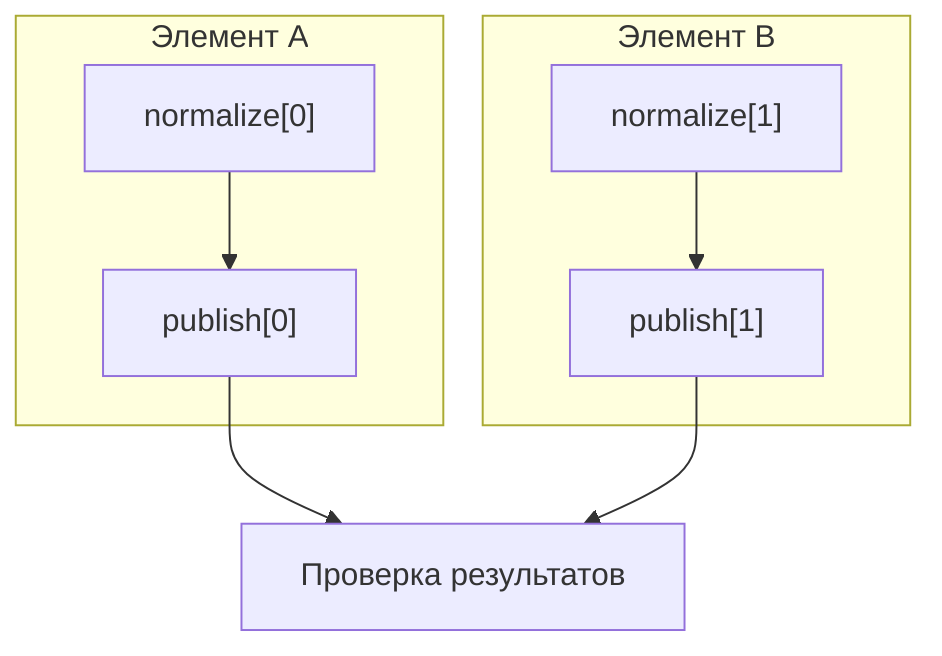

# 13. Dynamic Task Mapping и управляемый fan-out

**Dynamic Task Mapping позволяет определять число экземпляров задачи по данным конкретного запуска DAG.** Например, upstream-задача обнаруживает 40 файлов, после чего Airflow создаёт 40 экземпляров задачи обработки.

На уровне senior необходимо спроектировать весь процесс: ограничить размер разворачивания, защитить внешние системы, обеспечить повторяемость входов, восстановление отдельных элементов и проверку полноты результатов.

Материал привязан к **Airflow 3.3.2 и Task SDK 1.3.2**. Примеры классических операторов ориентированы на Standard provider 1.19.0 и Common SQL provider 2.1.1. Базовая модель mapping описана в официальном руководстве Task SDK. [Apache Airflow Task SDK Documentation](https://airflow.apache.org/docs/task-sdk/1.3.2/dynamic-task-mapping.html?utm_source=chatgpt.com)

**Граница проверки:** API и особенности реализации сверены с закреплёнными исходниками. Примеры здесь не запускались: среда исполнения недоступна. Отдельный Markdown-файл создать не удалось, поэтому глава приведена целиком в сообщении.

---

## 13.1. Модель runtime mapping

### 13.1.1. Число TaskInstance определяется данными во время выполнения

Рассмотрим задачу:

> Найти доступные выгрузки за интервал данных и обработать каждую выгрузку независимо.

При написании DAG неизвестно, сколько выгрузок появится:

- сегодня — 3;
- завтра — 80;
- в отдельный день — ни одной.

При mapping определение задачи остаётся одним, а число её экземпляров определяется для конкретного `DagRun`.

```python
files = discover_files()

process_file.expand(file=files)
```

Здесь происходят разные действия на разных этапах:

1. При разборе DAG Airflow получает описание задачи `discover_files` и mapped-задачи `process_file`.
2. Во время выполнения `discover_files` возвращает коллекцию.
3. Когда Airflow может определить её длину, он разворачивает `process_file`.
4. Каждый экземпляр получает собственный элемент коллекции.
5. Каждый экземпляр отдельно проходит состояния выполнения, может завершиться ошибкой и повториться.

Если producer вернул:

```python
[
    {"file_id": "a", "uri": "s3://raw/a.json"},
    {"file_id": "b", "uri": "s3://raw/b.json"},
    {"file_id": "c", "uri": "s3://raw/c.json"},
]
```

Airflow создаёт три экземпляра `process_file`.

**Runtime mapping меняет число экземпляров задач внутри запуска.** Определения задач, их программный код и схема зависимостей задаются при построении DAG.

Важное следствие: результат обнаружения входов становится частью контракта выполнения. От его содержания зависят:

- объём работы;
- количество записей в метабазе;
- нагрузка на scheduler;
- потребление ресурсов;
- возможность воспроизвести обработку.

Поэтому producer должен возвращать проверенный и ограниченный план работ.

### 13.1.2. Mapped operator, unmapped operator и `map_index`

**Unmapped operator** создаёт обычный экземпляр задачи для запуска.

**Mapped operator** описывает задачу, которая может развернуться в несколько экземпляров.

`map_index` различает эти экземпляры.

| Объект | `task_id` | `map_index` | Значение |
|---|---|---:|---|
| Обычная задача | `discover_files` | `-1` | Обычный экземпляр |
| Mapped-задача до разворачивания | `process_file` | `-1` | Служебный неразвёрнутый экземпляр |
| Первый элемент | `process_file` | `0` | Обработка первого выбранного элемента |
| Второй элемент | `process_file` | `1` | Обработка второго выбранного элемента |
| Третий элемент | `process_file` | `2` | Обработка третьего выбранного элемента |

Для диагностики экземпляр удобно описывать набором:

```text
dag_id + run_id + task_id + map_index
```

Номер попытки выполнения — отдельное измерение. Retry того же элемента обычно сохраняет `map_index` и увеличивает номер попытки.

**`map_index` не является бизнес-идентификатором.**

Сегодня индекс `1` может соответствовать файлу `b.json`, а после изменения manifest — файлу `c.json`.

Для устойчивой идентификации нужны отдельные поля:

```python
{
    "item_id": "orders:2026-01-02",
    "source_revision": "version-17",
    "uri": "s3://raw/orders/2026-01-02.json",
}
```

Логи и receipts должны связывать этот бизнес-ключ с техническим `map_index`.

### 13.1.3. `expand()` и допустимые типы источника mapping

`expand()` принимает **именованные аргументы**:

```python
process.expand(item=items)
```

Позиционная форма не используется:

```python
# Неправильно:
process.expand(items)
```

Для учебных и производственных контрактов наиболее понятны:

- список значений;
- список записей;
- словарь, если его семантика действительно нужна;
- `XComArg`, который во время выполнения разрешается в подходящую коллекцию.

В Task SDK 1.3.2 проверка допускает упорядоченные `Sequence` и `dict`, исключая `str`, `bytes` и `bytearray`. Однако контракт между задачами лучше делать явно сериализуемым: обычный список или словарь с понятной схемой.

Не следует рассчитывать, что источником mapping автоматически станут:

- генератор;
- `set`;
- произвольный iterator;
- DataFrame;
- строка с JSON;
- объект клиента облачного хранилища.

Например:

```python
@task
def discover():
    return '["a.json", "b.json"]'
```

Это строка, а не список.

Правильно:

```python
@task
def discover():
    return ["a.json", "b.json"]
```

Есть тонкость с прямым mapping по словарю. В рассматриваемой реализации SDK выбирается пара:

```python
(key, value)
```

Поэтому для читаемости предпочтительнее явно подготовить записи:

```python
[
    {"item_id": "a", "value": 10},
    {"item_id": "b", "value": 20},
]
```

Такой контракт проще расширять, валидировать и диагностировать.

Реализация проверки типов и разворачивания находится в [`mappedoperator.py`](https://github.com/apache/airflow/blob/3.3.2/task-sdk/src/airflow/sdk/definitions/mappedoperator.py) и [`expandinput.py`](https://github.com/apache/airflow/blob/3.3.2/task-sdk/src/airflow/sdk/definitions/_internal/expandinput.py).

### 13.1.4. Mapping по статическому списку и результату upstream task

**Статический mapping** использует коллекцию, известную при построении DAG:

```python
square.expand(value=[2, 3, 5])
```

**Task-generated mapping** использует результат upstream-задачи:

```python
square.expand(value=discover_numbers())
```

Полный минимальный DAG:

```python
from datetime import datetime, timezone

from airflow.sdk import DAG, task


@task
def discover_numbers() -> list[int]:
    return [2, 3, 5]


@task
def square(value: int) -> int:
    return value * value


@task
def total(values) -> int:
    return sum(values)


with DAG(
    dag_id="ch13_minimal_mapping",
    start_date=datetime(2026, 1, 1, tzinfo=timezone.utc),
    schedule=None,
    catchup=False,
) as dag:
    numbers = discover_numbers()

    squared = square.expand(value=numbers)

    total(squared)
```

Ожидаемая логика:

```text
discover_numbers → [2, 3, 5]

square[0] → 4
square[1] → 9
square[2] → 25

total → 38
```

`numbers` при построении DAG — ссылка на будущий результат.

Аналогично `squared` в вызове `total(squared)` описывает получение результатов mapped-задачи, а не выполняет вычисления прямо сейчас.

В остальных небольших примерах главы предполагается, что задачи создаются внутри контекста DAG. Законченная практика приведена отдельно.

### 13.1.5. Отличие от `for` при парсинге и вычислительного parallel map

Есть три разных механизма:

| Механизм | Когда определяется число работ | Единица выполнения | Где управляется параллелизм |
|---|---|---|---|
| Python `for` при построении DAG | При разборе файла | Отдельные определения задач | Airflow |
| Dynamic Task Mapping | Для конкретного запуска | Mapped TaskInstance | Airflow |
| Spark/Flink/Ray и подобные системы | В вычислительном job | Partition, task, actor и т. п. | Вычислительный движок |

Пример генерации задач через `for`:

```python
for region in ["eu", "us", "apac"]:
    load_region.override(
        task_id=f"load_{region}",
    )(region=region)
```

Здесь создаются разные определения задач:

```text
load_eu
load_us
load_apac
```

При mapping:

```python
load_region.expand(region=["eu", "us", "apac"])
```

остаётся одно определение `load_region`, у которого появляются разные экземпляры.

Dynamic Task Mapping полезен, когда отдельному элементу нужны:

- собственное состояние;
- отдельный retry;
- отдельные логи;
- независимое ограничение ресурсов;
- возможность адресного восстановления.

Для обработки миллионов строк обычно разумнее передать вычисления Spark или другому движку, а Airflow поручить запуск и контроль job.

Цена одной TaskInstance существенно выше цены обычной итерации Python: нужны планирование, состояния, взаимодействие компонентов, логирование и метаданные.

---

## 13.2. Аргументы mapping

### 13.2.1. `partial()` для неизменяемых аргументов

`partial()` фиксирует аргументы, которые одинаковы для всех экземпляров.

```python
@task
def load_partition(
    partition: str,
    destination: str,
    write_mode: str,
):
    return {
        "partition": partition,
        "destination": destination,
        "write_mode": write_mode,
    }


load_partition.partial(
    destination="analytics.orders",
    write_mode="merge",
).expand(
    partition=[
        "2026-01-01",
        "2026-01-02",
        "2026-01-03",
    ],
)
```

Каждый экземпляр получает:

- собственный `partition`;
- общий `destination`;
- общий `write_mode`.

Для TaskFlow следует различать:

```python
task_function.partial(...)
```

для аргументов Python-функции и:

```python
task_function.override(...)
```

для настроек задачи.

Например:

```python
load_partition.override(
    task_id="load_orders",
    retries=3,
    pool="warehouse_writes",
).partial(
    destination="analytics.orders",
    write_mode="merge",
).expand(
    partition=["2026-01-01", "2026-01-02"],
)
```

Пул из примера должен быть заранее создан.

Фиксированные параметры также являются частью воспроизводимости. Изменение `write_mode` между первоначальным запуском и восстановлением может изменить бизнес-результат даже при прежнем manifest.

### 13.2.2. `expand()` для разворачиваемых keyword arguments

Аргументы в `expand()` определяют измерения разворачивания.

```python
process.expand(item=items)
```

Каждый экземпляр получает одно значение `item`.

Имена аргументов должны соответствовать сигнатуре функции:

```python
@task
def process(item):
    ...
```

Если вызвать:

```python
process.expand(record=items)
```

при отсутствии аргумента `record`, возникает ошибка проверки вызова.

Входы следует проверять на двух уровнях:

1. **Форма mapping:** подходящий контейнер, корректные имена аргументов.
2. **Бизнес-схема элемента:** обязательные поля, типы, допустимые значения.

Корректный список ещё не означает корректный план:

```python
[
    {"item_id": "a", "uri": "s3://raw/a.json"},
    {"item_id": None, "uri": ""},
]
```

Для Airflow это может быть допустимая коллекция, но для обработки второй элемент непригоден.

Такую ошибку лучше обнаружить до массового разворачивания.

### 13.2.3. `expand_kwargs()` для списка конфигураций

`expand_kwargs()` удобно применять, когда каждый элемент уже содержит полный набор аргументов.

```python
@task
def export_table(
    table: str,
    destination: str,
    compression: str,
):
    return {
        "table": table,
        "destination": destination,
        "compression": compression,
    }


export_table.expand_kwargs(
    [
        {
            "table": "orders",
            "destination": "s3://exports/orders/",
            "compression": "gzip",
        },
        {
            "table": "customers",
            "destination": "s3://exports/customers/",
            "compression": "zstd",
        },
    ]
)
```

Здесь создаются два экземпляра.

Каждый словарь описывает одну работу. Связь между `table`, `destination` и `compression` сохраняется.

Это особенно полезно для:

- конфигураций внешних jobs;
- отдельных SQL-запросов;
- файлов с разными настройками;
- клиентов с разными параметрами обработки.

Входные словари необходимо валидировать:

- нет ли лишних ключей;
- присутствуют ли обязательные;
- допустимы ли значения;
- не конфликтуют ли они с параметрами из `partial()`.

По умолчанию `expand_kwargs()` использует строгую проверку пересечений с фиксированными аргументами. Политику переопределения лучше не использовать как скрытый механизм конфигурации.

### 13.2.4. Несколько аргументов и декартово произведение

Несколько аргументов в `expand()` образуют **декартово произведение**.

```python
evaluate.expand(
    region=["eu", "us"],
    model=["baseline", "candidate", "experimental"],
)
```

Число экземпляров:

\[
N = 2 \times 3 = 6
\]

Будут обработаны все сочетания регионов и моделей.

Для произвольного числа измерений:

\[
N = \prod_{j=1}^{d} n_j
\]

Это частая причина неожиданно большого fan-out.

Например:

```text
100 клиентов × 30 дней × 4 типа отчёта = 12 000 TaskInstance
```

Если требуются связанные пары:

```text
eu → baseline
us → candidate
```

следует использовать:

```python
evaluate.expand_kwargs(
    [
        {"region": "eu", "model": "baseline"},
        {"region": "us", "model": "candidate"},
    ]
)
```

Порядок назначения `map_index` комбинациям не следует превращать в бизнес-контракт.

Проверять нужно и длины отдельных списков, и итоговое произведение.

### 13.2.5. Аргументы BaseOperator, которые не подлежат mapping

Настройки самой задачи отличаются от её рабочих входов.

К настройкам относятся, например:

- `task_id`;
- `pool`;
- `queue`;
- `retries`;
- ограничения параллелизма.

Их задают при определении задачи, через `.override()` у TaskFlow или через `.partial()` у классического оператора.

Пример TaskFlow:

```python
process.override(
    task_id="process_orders",
    pool="orders_api",
    retries=3,
    max_active_tis_per_dag=8,
).expand(item=items)
```

Пример классического оператора:

```python
SomeOperator.partial(
    task_id="submit_jobs",
    pool="external_jobs",
    retries=3,
).expand(
    job_config=job_configs,
)
```

Конкретные рабочие аргументы зависят от оператора и его provider.

Нельзя автоматически считать любой параметр конструктора пригодным для mapping.

Если разные элементы требуют принципиально разных пулов или политик выполнения, полезно разделить их на отдельные mapped-задачи по классу нагрузки:

```text
короткие запросы → отдельная mapped-задача
тяжёлые запросы → отдельная mapped-задача
```

Это делает управление ресурсами и диагностику понятнее.

---

## 13.3. Композиция преобразований

### 13.3.1. Repeated mapping и цепочки mapped tasks

Результат mapped-задачи можно использовать как источник следующего mapping.

```python
@task
def add_one(value: int) -> int:
    return value + 1


@task
def multiply_by_two(value: int) -> int:
    return value * 2


first = add_one.expand(value=[1, 2, 3])

second = multiply_by_two.expand(value=first)
```

Логически:

```text
[1, 2, 3]
    ↓
[2, 3, 4]
    ↓
[4, 6, 8]
```

Однако индекс следующей стадии не следует считать неизменным идентификатором исходного элемента.

Причины:

- предыдущая стадия может отфильтровать элементы;
- некоторые результаты могут отсутствовать;
- порядок исходного manifest может измениться при переобработке.

Передавайте бизнес-ключ через всю цепочку:

```python
{
    "item_id": "orders:2026-01-01",
    "source_revision": "v5",
    "normalized_uri": "s3://stage/...",
}
```

Обычная цепочка repeated mapping также не задаёт автоматически зависимости вида:

```text
stage_b[i] зависит только от stage_a[i]
```

Для обработки каждого элемента последовательностью стадий с такими зависимостями используется mapped TaskGroup.

### 13.3.2. `XComArg.map()` как предварительная обработка значений

`XComArg.map()` преобразует элементы перед передачей downstream-задаче.

```python
def to_copy_kwargs(item):
    return {
        "source": item["uri"],
        "destination": f"s3://processed/{item['item_id']}.json",
    }


copy_file.expand_kwargs(
    discover_files().map(to_copy_kwargs)
)
```

Функция `to_copy_kwargs` здесь — обычная Python-функция.

Её не нужно декорировать `@task`.

Особенности:

- отдельная TaskInstance для преобразования не создаётся;
- преобразование выполняется в контексте подготовки входов downstream-задачи;
- при повторном выполнении downstream оно может выполниться снова;
- собственного состояния и отдельного retry у преобразования нет.

Поэтому здесь уместны:

- переименование полей;
- сборка небольшого словаря;
- проверка простого условия;
- формирование аргументов вызова.

Для тяжёлого запроса к БД или обнаружения файлов лучше использовать отдельную задачу.

Такой код будет трудно контролировать:

```python
def to_config(item):
    # Сетевой запрос при разрешении mapped-входа.
    return fetch_large_configuration_from_service(item)
```

Преобразователь желательно делать детерминированным и без внешних побочных эффектов.

### 13.3.3. `zip()` и политика разной длины входов

`zip()` объединяет источники по позиции.

```python
pairs = file_ids().zip(destinations())
```

Если источники содержат:

```python
["a", "b", "c"]
```

и:

```python
["x", "y"]
```

без заполнителя получится:

```python
[("a", "x"), ("b", "y")]
```

Длина определяется коротким источником.

В Task SDK 1.3.2 параметр заполнения называется **`fillvalue`**:

```python
pairs = file_ids().zip(
    destinations(),
    fillvalue=None,
)
```

Теперь длина определяется длинным источником:

```python
[
    ("a", "x"),
    ("b", "y"),
    ("c", None),
]
```

В этом API нет аналога `strict=True` встроенного Python `zip()`.

Если несовпадение длин является ошибкой, выполните явную проверку в отдельной задаче.

Ещё важнее различать сопоставление:

- **по позиции**;
- **по бизнес-ключу**.

Если два запроса к БД вернули разные порядки записей, позиционный `zip()` может связать чужие значения.

Для значимых связей лучше подготовить записи:

```python
{
    "item_id": "customer-17",
    "source": "...",
    "destination": "...",
}
```

через явный join и проверку отсутствующих ключей.

В примерах этой главы обе стороны `XComArg.zip()` — XCom-ссылки. Это соответствует сигнатуре рассматриваемого SDK.

Сигнатура и реализация доступны в [`xcom_arg.py`](https://github.com/apache/airflow/blob/3.3.2/task-sdk/src/airflow/sdk/definitions/xcom_arg.py).

### 13.3.4. `concat()` и объединение нескольких источников

`concat()` объединяет последовательности:

```python
all_files = files_from_primary().concat(
    files_from_secondary()
)

process_file.expand(file=all_files)
```

Если источники содержат:

```python
["a", "b"]
```

и:

```python
["c", "d"]
```

результат соответствует:

```python
["a", "b", "c", "d"]
```

Длина:

\[
N = N_1 + N_2 + \dots + N_k
\]

`concat()` не выполняет:

- удаление дубликатов;
- сортировку;
- join по ключу;
- проверку конфликтующих версий одного элемента.

Если один файл присутствует в двух источниках, он может попасть в обработку дважды.

До mapping нужно определить политику:

- дубликаты запрещены;
- одинаковые версии объединяются;
- выбирается источник с заданным приоритетом;
- конфликт ревизий считается ошибкой.

Для классических операторов используется `.output`:

```python
combined = primary_operator.output.concat(
    secondary_operator.output
)
```

### 13.3.5. Map/reduce и агрегирование результатов

После mapping часто нужен fan-in — объединение результатов.

```python
receipts = process_file.expand(file=files)

summarize(receipts)
```

Вместо больших данных каждая задача может возвращать небольшой receipt:

```python
{
    "item_id": "orders:2026-01-01",
    "output_uri": "s3://curated/orders/2026-01-01.parquet",
    "row_count": 152_300,
    "input_revision": "version-17",
    "operation_key": "…",
}
```

Reducer может:

- проверить полноту обработки;
- сложить счётчики;
- собрать ссылки на результаты;
- записать итог обработки;
- разрешить публикацию следующего слоя.

Следует различать три проверки:

1. Все нужные задачи завершились в подходящем состоянии.
2. На каждый ожидаемый бизнес-элемент получен результат.
3. Результат соответствует ожидаемой версии входа и операции.

Один успешный `sum()` подтверждает только то, что удалось сложить доступные значения.

Для больших объёмов данные следует агрегировать там, где они хранятся: в SQL-движке, Spark или другом вычислительном сервисе.

---

## 13.4. Классические operators

### 13.4.1. `Operator.partial(...).expand(...)`

Mapping поддерживается и для классических операторов.

Пример с `BashOperator`:

```python
from airflow.providers.standard.operators.bash import BashOperator


BashOperator.partial(
    task_id="print_items",
    bash_command='printf "%s\\n" "$ITEM"',
    append_env=True,
    do_xcom_push=False,
).expand(
    env=[
        {"ITEM": "orders"},
        {"ITEM": "customers"},
        {"ITEM": "products"},
    ]
)
```

Фиксированы:

- `task_id`;
- команда;
- политика окружения;
- отсутствие результата в XCom.

Разворачивается `env`.

Каждый экземпляр получает собственное значение переменной `ITEM`.

Передавать значение через окружение обычно удобнее, чем собирать shell-команду конкатенацией строк из входных данных.

При использовании конкретного provider нужно проверить:

- поддерживаемые аргументы;
- возвращаемый результат;
- семантику retries;
- поведение при timeout;
- способ ожидания внешней операции.

Mapping сам по себе не делает внешний job идемпотентным.

### 13.4.2. Mapping SQL parameters и конфигураций внешних jobs

Пример для PostgreSQL-подобного DB-API binding:

```python
from airflow.providers.common.sql.operators.sql import (
    SQLExecuteQueryOperator,
)


SQLExecuteQueryOperator.partial(
    task_id="count_orders",
    conn_id="analytics_postgres",
    sql="""
        SELECT COUNT(*)
        FROM orders
        WHERE event_date = CAST(%(day)s AS DATE)
    """,
    do_xcom_push=False,
    map_index_template="{{ task.parameters['day'] }}",
).expand(
    parameters=[
        {"day": "2026-01-01"},
        {"day": "2026-01-02"},
        {"day": "2026-01-03"},
    ]
)
```

Для выполнения нужны соответствующий database provider, Connection и таблица. Формат placeholders зависит от драйвера.

Следует различать:

- `params` — параметры контекста шаблонизации Airflow;
- `parameters` — аргументы SQL-оператора, передаваемые драйверу.

Значения данных следует передавать через binding драйвера. Имена таблиц и другие SQL identifiers требуют отдельной контролируемой обработки.

Для внешних jobs полезен аналогичный контракт:

```python
[
    {
        "job_name": "daily_orders",
        "input_uri": "s3://raw/orders/2026-01-01/",
        "output_uri": "s3://curated/orders/2026-01-01/",
        "idempotency_key": "orders-2026-01-01-v3",
    },
]
```

Не стоит разрешать произвольные команды, Connections или привилегированные настройки из непроверенного manifest.

### 13.4.3. `.output` классического operator как источник

У классического оператора `.output` создаёт XCom-ссылку на его результат.

```python
from airflow.providers.standard.operators.python import (
    PythonOperator,
)


def discover_paths():
    return ["a.json", "b.json"]


list_files = PythonOperator(
    task_id="list_files",
    python_callable=discover_paths,
)


@task
def validate_file(path: str):
    return {"path": path, "valid": True}


validate_file.expand(path=list_files.output)
```

При этом оператор должен действительно:

- вернуть подходящий результат;
- сохранить его в XCom;
- использовать ожидаемый ключ результата.

Отключение `do_xcom_push` лишает downstream этого источника.

Есть важное ограничение рассматриваемого SDK: непосредственный mapping по XCom с произвольным ключом не поддерживается проверкой `ensure_xcomarg_return_value`.

Поэтому такая форма может оказаться неправильной:

```python
process.expand(item=producer.output["items"])
```

Здесь `["items"]` у `XComArg` означает ссылку на отдельный XCom-ключ.

Надёжнее ввести адаптер:

```python
@task(multiple_outputs=False)
def extract_items(manifest: dict) -> list[dict]:
    return manifest["items"]


items = extract_items(producer.output)

process.expand(item=items)
```

Теперь mapping использует обычный `return_value` задачи `extract_items`.

### 13.4.4. Шаблонизация mapped arguments и её ограничения

Поле, которое передаётся через mapping, не следует считать автоматически отрендеренным Jinja-шаблоном.

Например:

```python
show.expand(
    value=["{{ ds }}"]
)
```

Значение может попасть в задачу как буквальная строка:

```text
{{ ds }}
```

Наличие поля в `template_fields` оператора не означает, что для mapped-значений выполняется привычная дополнительная шаблонизация.

Предпочтительный подход — подготовить реальные значения upstream:

```python
from airflow.sdk import get_current_context, task


@task
def build_items():
    context = get_current_context()

    interval_start = context["data_interval_start"]
    interval_end = context["data_interval_end"]

    return [
        {
            "item_id": "orders",
            "interval_start": interval_start.isoformat(),
            "interval_end": interval_end.isoformat(),
        }
    ]
```

Такой контракт:

- явно типизирован;
- проще проверяется;
- не зависит от скрытого второго этапа рендеринга;
- удобнее для повторного выполнения.

Если требуется явный Jinja rendering, его нужно спроектировать отдельно и контролировать, какие шаблоны разрешены.

### 13.4.5. Named mapping через `map_index_template`

Числовой индекс удобен для технической адресации, но в UI полезнее видеть бизнес-имя.

```python
@task(
    map_index_template="{{ item_label }}",
)
def process(item: dict):
    context = get_current_context()

    context["item_label"] = item["item_id"]

    return {
        "item_id": item["item_id"],
        "status": "processed",
    }
```

Для классического SQL-оператора можно использовать:

```python
map_index_template="{{ task.parameters['day'] }}"
```

`map_index_template` задаёт отображаемую метку.

Он не заменяет:

- числовой `map_index`;
- бизнес-ключ в manifest;
- idempotency key;
- ключ результата во внешнем хранилище.

В Airflow 3.3.2 реализация может попытаться отрендерить имя до выполнения, если доступного контекста достаточно, и повторить рендеринг после выполнения. Поэтому формулировка «имя всегда формируется только после задачи» была бы слишком сильной.

Метки стоит делать:

- короткими;
- устойчивыми;
- понятными оператору;
- без секретов и лишних персональных данных.

Повторяющиеся метки также не создают уникальности бизнес-элементов.

---

## 13.5. Mapped TaskGroups

### 13.5.1. Разворачивание переиспользуемого `@task_group`

Mapped TaskGroup применяется, когда каждому элементу нужна одинаковая последовательность задач.

```python
from airflow.sdk import task, task_group


@task
def normalize(item: dict) -> dict:
    return {
        **item,
        "normalized": True,
    }


@task
def validate(item: dict) -> dict:
    if not item["normalized"]:
        raise ValueError("Item must be normalized")

    return item


@task
def publish(item: dict) -> dict:
    return {
        "item_id": item["item_id"],
        "published": True,
    }


@task_group
def process_one(item):
    normalized = normalize(item)

    validated = validate(normalized)

    return publish(validated)


receipts = process_one.expand(item=items)
```

Для каждого элемента создаются экземпляры задач:

```text
normalize
validate
publish
```

Сама TaskGroup не становится отдельной выполняемой TaskInstance.

Если элементов `N`, а в группе `K` выполняемых задач, базовая оценка количества экземпляров:

\[
N_{\text{TI}} \approx N \times K
\]

Дополнительно учитываются задачи вне группы.

Если группа должна отдавать результаты downstream, нужно явно вернуть соответствующую XCom-ссылку.

### 13.5.2. Depth-first dependencies между задачами одного элемента

Mapped TaskGroup позволяет задавать зависимости внутри одного развёрнутого элемента.



`publish[0]` может стать готовой к выполнению после `normalize[0]`, пока `normalize[1]` ещё работает.

Такое выполнение называют depth-first: отдельный элемент может продвигаться по своей цепочке.

Преимущества:

- меньше задержка до готовности первого результата;
- медленный элемент меньше задерживает остальные;
- проще сохранять связь стадий с одним входом;
- естественнее выделять ресурсы на этапы одного элемента.

Фактическое время старта всё равно зависит от:

- пулов;
- executor;
- доступных workers;
- task-level ограничений;
- других зависимостей.

Depth-first описывает готовность по зависимостям, а не гарантирует немедленное выполнение.

### 13.5.3. Передача входов внутри группы и lazy references

Функция `@task_group` выполняется при построении DAG.

При mapping её аргумент — ссылка на будущее значение.

Поэтому такой код не реализует runtime-ветвление:

```python
@task_group
def process_one(item):
    if item["enabled"]:
        ...
```

В момент построения группы реальная запись ещё неизвестна.

Проверку нужно перенести в выполняемую задачу:

```python
@task
def validate_enabled(item: dict):
    if not item["enabled"]:
        raise ValueError("Item is disabled")

    return item


@task_group
def process_one(item):
    validated = validate_enabled(item)

    return publish(validated)
```

Аналогично нельзя рассчитывать, что при построении группы получится:

- прочитать runtime-поле;
- пройти Python-циклом по runtime-списку;
- выполнить арифметику над будущим значением;
- получить его длину обычным `len()`.

Группа строит связи. Задачи обрабатывают реальные значения.

### 13.5.4. Ветвление по входам mapped group

Внутри mapped TaskGroup можно использовать branch-задачу, которая получает конкретный вход элемента.

```python
from airflow.sdk import task, task_group


@task_group(group_id="route")
def route_one(item):
    @task.branch
    def choose(item: dict):
        if item["size_class"] == "large":
            return "route.large"

        return "route.small"

    @task
    def large(item: dict):
        return {"item_id": item["item_id"], "route": "large"}

    @task
    def small(item: dict):
        return {"item_id": item["item_id"], "route": "small"}

    @task(
        trigger_rule="none_failed_min_one_success",
    )
    def finish():
        return {"finished": True}

    decision = choose(item)

    large_task = large(item)
    small_task = small(item)
    finish_task = finish()

    decision >> [large_task, small_task]

    [large_task, small_task] >> finish_task


route_one.expand(
    item=[
        {"item_id": "a", "size_class": "small"},
        {"item_id": "b", "size_class": "large"},
    ]
)
```

В этом примере `group_id` фиксирован. При изменении вложенности и идентификаторов нужно использовать фактические полные `task_id` ветвей.

Ветвление выполняется по входу конкретного элемента группы.

Не следует переносить сюда предположение, что можно произвольно построить branch поверх агрегированных выходов mapped-задачи и получить ту же поэлементную семантику.

Для объединения ветвей важен trigger rule: одна ветка обычно будет `skipped`.

### 13.5.5. Ограничения nested mapping и проверка поддержки версии

В рассматриваемой версии нельзя выполнять дополнительное mapping внутри уже mapped TaskGroup.

Концептуально такая схема не поддерживается:

```python
@task_group
def process_customer(customer):
    process_partition.expand(
        partition=customer["partitions"],
    )


process_customer.expand(customer=customers)
```

Проблема не решается простым добавлением второго `.expand()`.

Варианты архитектуры:

1. **Подготовить плоский manifest.**

```python
[
    {
        "customer_id": "a",
        "partition": "2026-01-01",
    },
    {
        "customer_id": "a",
        "partition": "2026-01-02",
    },
]
```

2. **Обрабатывать небольшой внутренний список в одной задаче.**

При этом retry относится ко всей такой задаче.

3. **Передать внутреннее распределение вычислительному движку.**

4. **Разделить работу на управляемые запуски или очереди.**

Обычная вложенность статических TaskGroups — отдельная возможность. Она не означает поддержку nested mapping.

При обновлении Airflow эту область нужно проверять по документации и тестам целевой версии. Ограничение относится к реализации, а не к абстрактной идее DAG.

---

## 13.6. Пустые и ошибочные входы

### 13.6.1. Zero-length mapping и автоматический skip

Если источник mapping — пустой список:

```python
[]
```

рабочие экземпляры с индексами `0..N-1` не создаются.

Mapped-узел получает состояние `skipped` через служебный экземпляр.

Это не означает полное отсутствие записей в метабазе: служебный экземпляр с `map_index=-1` может существовать.

Пустой вход может означать разные бизнес-ситуации:

| Ситуация | Возможная политика |
|---|---|
| В интервале действительно нет данных | Успешный пустой результат |
| Источник ещё не готов | Ожидание или перенос обработки |
| Исчез обязательный файл | Ошибка |
| Фильтр исключил все записи | Успех либо ошибка по контракту |
| Ошибка запроса ошибочно превращена в `[]` | Дефект обработки |

Поэтому producer должен отличать:

```python
return []
```

от:

```python
except Exception:
    return []
```

Второй вариант может скрыть недоступность источника.

Политику пустого входа следует определить до выбора trigger rule reducer.

### 13.6.2. Неподдерживаемый тип и превышение допустимой длины

Два разных класса ошибок:

**Неподходящий тип:**

```python
return "a.json"
```

**Слишком большая коллекция:**

```python
return huge_list
```

Ошибка типа может обнаружиться при финализации producer, когда SDK проверяет результат, предназначенный для mapping.

В рассматриваемой реализации используются, в частности:

- `UnmappableXComTypePushed`;
- `XComForMappingNotPushed`.

Проверка длины связана с `max_map_length` и передачей metadata в Execution API.

Для диагностики важно искать причину в producer:

- что он действительно вернул;
- был ли сохранён XCom;
- какой тип значения получился;
- сколько элементов обнаружено;
- какое ограничение сработало.

Лучше завершить producer понятной бизнес-ошибкой:

```python
if len(items) > MAX_ITEMS_PER_RUN:
    raise ValueError(
        f"Fan-out budget exceeded: {len(items)} > {MAX_ITEMS_PER_RUN}"
    )
```

Тогда в логах будет видно нарушение собственного контракта.

### 13.6.3. Фильтрация через `None` и skip-исключение в соответствующем контексте

Здесь важно различать несколько случаев.

| Контекст | Действие | Результат |
|---|---|---|
| Mapped-задача | `return None` | Задача может быть успешной, но её результат не передаётся как обычный элемент следующего mapping |
| Функция в `XComArg.map()` | `return None` | `None` остаётся значением преобразования |
| Функция в `XComArg.map()` | `raise AirflowSkipException` | Соответствующая downstream TaskInstance пропускается при подготовке входа |
| Обычный producer для mapping | `return None` | Отсутствует необходимая коллекция; это не эквивалент пустого списка |

Пример фильтрации через mapped-задачу:

```python
@task
def prepare_file(path: str):
    if not path.endswith(".json"):
        return None

    return {
        "source": path,
        "destination": f"s3://processed/{path}",
    }


configs = prepare_file.expand(
    path=["a.json", "b.txt", "c.json"]
)

copy_file.expand_kwargs(configs)
```

Пример пропуска при preprocessing:

```python
from airflow.sdk.exceptions import AirflowSkipException


def prepare_kwargs(path: str):
    if not path.endswith(".json"):
        raise AirflowSkipException(
            f"Unsupported extension: {path}"
        )

    return {
        "source": path,
        "destination": f"s3://processed/{path}",
    }


copy_file.expand_kwargs(
    discover_paths().map(prepare_kwargs)
)
```

Для production полезно сохранять причину исключения элемента из обработки.

Если после фильтрации требуется доказать полноту, нужен manifest допустимых элементов или отдельный журнал решений:

```python
{
    "item_id": "b",
    "decision": "excluded",
    "reason": "unsupported_extension",
}
```

Отсутствующий результат сам по себе не объясняет причину.

### 13.6.4. Ошибка producer и отсутствие materialized mapped instances

Если producer не завершился успешно, downstream может не получить длину разворачивания.

Например:

```text
discover_files → failed
process_file → ещё не развёрнут
```

Неправильно диагностировать такую ситуацию как «упали все 10 000 обработчиков», если эти экземпляры ещё не были материализованы.

Нужно различать:

1. Не удалось построить план работ.
2. План построен, но разворачивание не завершено.
3. Экземпляры созданы, но ждут ресурсов.
4. Экземпляры начали обработку и завершились ошибкой.

При неизвестной длине и недоступном upstream-результате служебный mapped-экземпляр может получить `upstream_failed`.

Состояния и механизм разворачивания реализованы в [`taskmap.py`](https://github.com/apache/airflow/blob/3.3.2/airflow-core/src/airflow/models/taskmap.py).

Обработку ошибки producer нужно начинать с восстановления источника и воспроизводимости manifest, а не с массового clear downstream.

### 13.6.5. Trigger rules при пустом, частично failed и skipped fan-out

Trigger rule определяет, когда reducer может выполняться с точки зрения состояний зависимостей.

Если рассматривается только соответствующий fan-out, полезна такая таблица:

| Trigger rule | Ошибки upstream допустимы | Все upstream skipped допустимы | Применение |
|---|---:|---:|---|
| `all_success` | Нет | Обычно reducer пропускается | Строгая обработка без ожидаемых skips |
| `none_failed` | Нет | Да | Пустой результат разрешён |
| `none_failed_min_one_success` | Нет | Нет | Нужен хотя бы один успех |
| `all_done` | Да | Да | Аудит после завершения |
| `one_success` | Да, правило может сработать раньше остальных | Нужен успех | Раннее продолжение по одному успеху |

Точное множество учитываемых upstream зависит от графа, mapped-групп и релевантных индексов.

Практические следствия:

- `one_success` не подходит для подтверждения полного fan-in.
- `all_done` разрешает запустить аудит после ошибок.
- `none_failed` полезен для легального пустого manifest.
- `all_success` может пропустить reducer из-за `skipped`.

Отдельная опасность — итоговый DAG с успешной leaf-задачей `all_done`, которая скрывает ошибку предыдущей обработки на уровне общего состояния запуска.

Аудит должен сохранять информацию об ошибке. Финальная проверка должна подтверждать бизнес-условия завершения или оставлять в графе соответствующий неуспешный leaf.

Для task-generated mapping правило `ALWAYS` не поддерживается соответствующей проверкой API: сначала должен существовать источник разворачивания.

---

## 13.7. Ограничение параллелизма

### 13.7.1. `max_map_length` как предел разворачивания

По умолчанию:

```ini
[core]
max_map_length = 1024
```

Этот параметр защищает сценарии, где XCom-результат запускает mapping.

Но его нельзя считать универсальным ограничителем общего числа TaskInstance в DAG.

В частности:

- несколько mapped-задач могут суммарно создать больше экземпляров;
- mapped TaskGroup умножает число элементов на число задач;
- декартово произведение требует отдельного расчёта;
- статические источники и разные пути разворачивания нельзя сводить к одной проверке длины producer.

Например:

```text
500 элементов × 6 задач в группе = примерно 3 000 TaskInstance
```

Даже при длине источника меньше 1024.

Нужны собственные бюджеты:

```python
MAX_ITEMS_PER_RUN = 500
MAX_TASK_INSTANCES_PER_RUN = 3_500
MAX_MANIFEST_BYTES = 2_000_000
```

Числа здесь иллюстративные. Их выбирают по нагрузочным тестам и требованиям платформы.

Повышение `max_map_length` следует сопровождать оценкой:

- скорости создания экземпляров;
- scheduler latency;
- API latency;
- нагрузки на XCom;
- времени открытия UI;
- массовых retries и clear.

### 13.7.2. `max_active_tis_per_dag` и лимиты конкретного run

Лимиты отвечают на разные вопросы:

| Настройка | Область ограничения |
|---|---|
| `max_active_tis_per_dag` | Активные экземпляры конкретной задачи по запускам этого DAG |
| `max_active_tis_per_dagrun` | Активные экземпляры конкретной задачи в одном DagRun |
| DAG `max_active_tasks` | В Airflow 3.3.2 — активные задачи в отдельном DagRun |
| DAG `max_active_runs` | Число активных запусков DAG |

Пример:

```python
@task(
    max_active_tis_per_dag=12,
    max_active_tis_per_dagrun=4,
)
def call_api(item):
    ...
```

Если одновременно обрабатываются пять запусков:

- один запуск не должен занять больше четырёх разрешённых активных экземпляров этой задачи;
- суммарно для задачи действует ограничение 12.

Фактическое выполнение может быть ниже из-за других ресурсов.

Важная версионная деталь Airflow 3.3.2: task-level счётчики активных экземпляров включают и некоторые состояния без занятого worker, в частности `deferred`. Для `max_active_tasks` учёт worker slots отличается.

Поэтому «активный» не всегда означает «сейчас исполняет Python-код на worker».

Области счётчиков видны в [`scheduler_job_runner.py`](https://github.com/apache/airflow/blob/3.3.2/airflow-core/src/airflow/jobs/scheduler_job_runner.py).

**Ограничение активных экземпляров не ограничивает общее число уже созданных экземпляров.**

### 13.7.3. Pools, `pool_slots`, executor capacity и внешние квоты

Pools ограничивают потребление общего ресурса несколькими задачами и DAG.

Например:

```python
@task(
    pool="warehouse_queries",
    pool_slots=2,
)
def run_heavy_query(item):
    ...
```

Если в пуле 10 slots, такая задача потребляет два.

Но нужно определить, какую реальную величину представляет slot:

- активный запрос к warehouse;
- активный внешний job;
- соединение;
- условную стоимость нагрузки.

Pool не является универсальным rate limiter.

Например:

```text
10 одновременно работающих задач
```

может дать:

```text
10 запросов/сек
```

или:

```text
10 000 запросов/сек
```

в зависимости от поведения каждой задачи.

Для внешних API нужно отдельно учитывать:

- requests per second;
- burst;
- число активных jobs;
- ограничения клиента или tenant;
- повторные запросы после ошибок;
- время удержания внешнего ресурса.

Если задача только отправила job и завершилась, slot освободился, хотя job продолжает работать во внешней системе.

Следовательно, лимит отправляющих задач не гарантирует лимит одновременно работающих внешних jobs.

Для distributed rate limiting требуется согласованное ограничение между workers, а не отдельный локальный счётчик в каждом процессе.

### 13.7.4. Разбиение большого списка на bounded batches

Пусть нужно обработать 100 000 небольших объектов.

Mapping по одному объекту создаёт 100 000 экземпляров одной задачи.

При batch size 200:

\[
N_{\text{batches}}
=
\left\lceil
\frac{100\,000}{200}
\right\rceil
=
500
\]

Простая функция разбиения:

```python
def split_batches(items: list[dict], batch_size: int):
    if batch_size <= 0:
        raise ValueError("batch_size must be positive")

    return [
        items[offset:offset + batch_size]
        for offset in range(0, len(items), batch_size)
    ]
```

Однако передача огромного исходного списка через XCom сохраняет проблему объёма.

Для большого масштаба лучше передавать batch descriptors:

```python
{
    "batch_id": "batch-0042",
    "manifest_uri": "s3://plans/run-123/batch-0042.json",
    "manifest_sha256": "…",
    "item_count": 200,
}
```

Batching меняет гранулярность восстановления.

Если один элемент из 200 упал:

- повтор всей batch может повторить успешные действия;
- нужен per-item idempotency;
- полезен журнал уже завершённых элементов;
- batch-задача должна отличать полный успех от частичного.

Batch size выбирают по времени выполнения, стоимости запуска, вариативности элементов и цене повторной обработки.

### 13.7.5. Backpressure без миллионов объектов в метабазе

Backpressure ограничивает объём работы, который система принимает и держит в обработке.

Одна только настройка:

```python
max_active_tis_per_dag=10
```

не решает проблему, если до этого созданы два миллиона TaskInstance.

Более управляемая схема:

1. Во внешнем durable store находятся ожидающие работы.
2. Producer выбирает ограниченную порцию.
3. Выбранные элементы фиксируются в manifest.
4. Создаётся ограниченный fan-out.
5. Результаты подтверждаются в журнале.
6. Следующая порция выбирается по правилам очереди или следующего запуска.

Для надёжности нужно определить:

- атомарный claim элемента;
- владельца обработки;
- lease и восстановление после потери worker;
- правила повторного выбора;
- границу публикации manifest;
- поведение producer при retry.

Если producer сначала забрал работы, затем упал до сохранения manifest, система должна уметь вернуть эти работы в доступное состояние или найти уже созданный план.

**Количество ожидающих бизнес-элементов может быть большим, а число одновременно материализованных Airflow-задач — ограниченным.**

---

## 13.8. Результаты и восстановление

### 13.8.1. Lazy result sequence и стоимость доступа к каждому элементу

В reducer результаты mapped-задачи могут поступать как lazy sequence.

```python
@task
def summarize(receipts):
    total_rows = 0

    for receipt in receipts:
        total_rows += receipt["row_count"]

    return {"total_rows": total_rows}
```

Это позволяет не материализовывать всё немедленно.

В Task SDK 1.3.2 операции могут обращаться к Execution API:

- получение длины;
- чтение элемента;
- получение среза.

Поэтому нельзя считать доступ к последовательности бесплатным локальным чтением.

Например:

```python
for i in range(len(receipts)):
    consume(receipts[i])
```

может породить много обращений за отдельными элементами.

Явное преобразование:

```python
all_receipts = list(receipts)
```

материализует все результаты и увеличивает потребление памяти.

Для небольшого fan-out это нормально, если сделано осознанно.

Для большого:

- проходите результаты один раз;
- возвращайте компактные receipts;
- не переносите исходные datasets через XCom;
- используйте внешние manifests и журналы;
- избегайте повторного чтения одной последовательности.

Нельзя обещать универсальную формулу «один SQL-запрос на элемент»: между пользовательским кодом и БД находится API, а реализация зависит от версии и backend.

### 13.8.2. Partial retry и clear выбранных map indices

Каждый mapped-экземпляр имеет собственные попытки.

Если из 100 элементов не прошли два, автоматические retries относятся к этим экземплярам.

После исчерпания retries можно выполнить clear выбранных индексов.

Безопасная последовательность восстановления:

1. Найти `DagRun`.
2. Определить проблемные бизнес-элементы.
3. Связать их с текущими `map_index`.
4. Проверить manifest и версию кода.
5. Проверить идемпотентность внешних действий.
6. Выбрать конкретные экземпляры.
7. При необходимости очистить итоговую проверку.
8. Сначала просмотреть состав операции.

Для Airflow 3.3.2 API clear поддерживает адресацию парой `task_id` и `map_index`.

Пример тела запроса для учебного DAG:

```http
POST /api/v2/dags/ch13_controlled_fan_out/clearTaskInstances
Content-Type: application/json
```

```json
{
  "dag_run_id": "ФАКТИЧЕСКИЙ_RUN_ID",
  "task_ids": [
    ["process", 1],
    "summarize"
  ],
  "only_failed": false,
  "dry_run": true,
  "include_upstream": false,
  "include_downstream": false,
  "include_past": false,
  "include_future": false,
  "reset_dag_runs": true,
  "run_on_latest_version": false
}
```

`dry_run: true` позволяет проверить выборку. Для выполнения используется отдельный запрос после проверки состава.

`only_failed: false` здесь нужен, чтобы выборка не исключила явно выбранную итоговую задачу из-за её состояния.

Producer в выборку не включён: повторное обнаружение входов может изменить план.

Флаг версии не заменяет доступность исходного DAG bundle. При восстановлении нужно учитывать используемый механизм доставки и хранения версий кода.

Схема запроса закреплена в [`ClearTaskInstancesBody`](https://github.com/apache/airflow/blob/3.3.2/airflow-core/src/airflow/api_fastapi/core_api/datamodels/task_instances.py).

### 13.8.3. Стабильный manifest при retry, backfill и изменении источника

Manifest фиксирует, **что именно требуется обработать**.

Пример:

```json
{
  "contract_version": 1,
  "plan_id": "orders-2026-01-01-v3",
  "items": [
    {
      "item_id": "orders:2026-01-01",
      "source_uri": "s3://raw/orders/2026-01-01.json",
      "source_revision": "object-version-17",
      "input_sha256": "…"
    }
  ],
  "manifest_sha256": "…"
}
```

Стабильная сортировка полезна, но недостаточна.

Если источник изменился, отсортированный повторный listing всё равно даст другой набор.

Для повторяемости нужны:

- неизменяемый manifest;
- конкретные версии объектов или snapshot;
- hash либо другой контроль ревизии;
- версия схемы;
- версия бизнес-преобразования;
- определённая политика переобработки.

Для небольшого учебного DAG manifest можно передать через XCom.

В production большой manifest обычно хранится вне метабазы, а XCom содержит:

```python
{
    "manifest_uri": "...",
    "manifest_sha256": "...",
    "item_count": 500,
}
```

Backfill должен отвечать на вопрос:

> Обрабатываем данные исторического snapshot или текущее состояние источника для исторического интервала?

Это разные операции, даже если даты совпадают.

### 13.8.4. Идентификация элемента бизнес-ключом вместо надежды на порядок списка

Полезно разделять идентификаторы:

| Идентификатор | Что определяет |
|---|---|
| `map_index` | Технический экземпляр в текущем разворачивании |
| `item_id` | Бизнес-элемент |
| `source_revision` | Версию входа |
| `manifest_sha256` | Конкретный план обработки |
| `operation_key` | Логическую операцию над конкретным входом |
| `run_id` | Запуск Airflow |

Пример operation key:

```python
operation_key = sha256(
    operation_version
    + item_id
    + source_revision
    + input_sha256
)
```

Реально значения нужно кодировать однозначно, например canonical JSON, а не склеивать неоднозначными строками.

Такой ключ может сохраняться между разными запусками Airflow, если повторяется та же логическая операция.

Политика зависит от бизнеса:

- повтор той же операции должен вернуть существующий результат;
- новая ревизия входа должна создать новый результат;
- изменившаяся логика преобразования должна иметь новую версию.

Ключ:

```text
run_id + map_index
```

не защищает от дублирования той же бизнес-операции в другом запуске.

Гарантия отсутствия двойного эффекта требует поддержки внешней системы: уникального ограничения, транзакции, условной записи или другого протокола идемпотентности.

### 13.8.5. Проверка полноты fan-in и обнаружение потерянных результатов

Проверка:

```python
len(receipts) == expected_count
```

недостаточна.

Пример:

```text
Ожидали: a, b, c
Получили: a, a, c
```

Количество совпало, но `b` потерян.

Нужно проверить:

\[
ExpectedKeys = ActualKeys
\]

и отдельно отсутствие дубликатов.

Также проверяют:

- manifest hash;
- версию входа;
- operation key;
- допустимый статус результата;
- обязательные поля;
- контрольные счётчики;
- существование опубликованного результата, если это часть контракта.

Особенно опасен такой код:

```python
try:
    do_work()
except Exception as exc:
    return {
        "item_id": item_id,
        "status": "error",
        "error": str(exc),
    }
```

Для Airflow функция вернулась успешно.

Если такой контракт выбран намеренно, reducer обязан считать `"status": "error"` ошибкой бизнес-обработки.

Отсутствие исключения в задаче не доказывает успешность бизнес-операции.

Для критичных процессов receipt должен появляться после подтверждения внешнего commit либо ссылаться на достоверную запись durable ledger.

---

## 13.9. Производительность и диагностика

### 13.9.1. Измерение числа TaskInstance до запуска большого fan-out

Для простого mapping:

\[
T = M + N
\]

где:

- `M` — число обычных задач;
- `N` — число mapped-элементов.

Для группы:

\[
T = M + N \times K
\]

Для нескольких стадий с фильтрацией:

\[
T = M + \sum_{j=1}^{s} N_j
\]

Для декартова произведения:

\[
N_j = \prod_{i=1}^{d} n_i
\]

Попытки выполнения считаются отдельно:

\[
A = \sum_{t=1}^{T} \left(1 + r_t\right)
\]

где `r_t` — фактически выполненные дополнительные попытки конкретного экземпляра.

Пример:

```text
2 000 элементов
4 задачи в группе
3 обычные задачи

2 000 × 4 + 3 = 8 003 TaskInstance
```

Если часть задач нестабильна, инфраструктурная нагрузка будет выше из-за retries.

До запуска полезно публиковать план:

```python
{
    "item_count": 2000,
    "tasks_per_item": 4,
    "estimated_task_instances": 8003,
    "estimated_external_jobs": 2000,
}
```

И отклонять план, нарушающий бюджет.

### 13.9.2. Нагрузка на scheduler, API, XCom и UI

Большой fan-out нагружает несколько подсистем одновременно.

| Подсистема | Источник нагрузки |
|---|---|
| Scheduler | Создание экземпляров, проверка зависимостей, выбор задач |
| Метабаза | TaskInstance, состояния, история, XCom metadata |
| Execution API | Получение контекста и XCom, обновления выполнения |
| Executor | Отправка и учёт задач |
| Workers | Запуск процессов или контейнеров |
| XCom backend | Сериализация и чтение результатов |
| Logging | Большое число потоков логов |
| UI | Списки экземпляров, фильтры, история попыток |

На коротких задачах накладные расходы могут оказаться сравнимы со временем полезной работы.

Если задача обрабатывает элемент за 20 мс, индивидуальная TaskInstance обычно требует отдельного обоснования.

Диагностику начинайте с определения стадии задержки:

| Симптом | Что проверить |
|---|---|
| Mapped-экземпляров ещё нет | Producer, XCom, длину mapping, ошибки разворачивания |
| Много `scheduled` | Pools, concurrency limits, scheduler |
| Много `queued` | Executor, workers, очередь, запуск контейнеров |
| Долго выполняются | Внешнюю систему и сам код |
| Медленный reducer | Объём результатов, lazy reads, materialization |
| Массовые retries | Общий отказ источника, отсутствие backoff, внешнюю квоту |
| Медленный UI | Размер запуска, запросы API, историю экземпляров |

Увеличение workers помогает только там, где они действительно являются ограничением.

### 13.9.3. Корреляция `map_index` с источником данных

В логах полезно иметь структурированную запись:

```python
{
    "dag_id": "...",
    "run_id": "...",
    "task_id": "process",
    "map_index": 17,
    "try_number": 2,
    "item_id": "orders:2026-01-01",
    "source_revision": "v17",
    "manifest_sha256": "...",
    "operation_key": "...",
}
```

Так можно ответить на вопросы:

- какой источник обрабатывал индекс;
- какая версия входа использована;
- повторялась ли эта операция в другом запуске;
- какой результат опубликован;
- относится ли ошибка к одному элементу или всему сервису.

`map_index_template` помогает человеку в UI, но не заменяет структурированный журнал.

Не стоит писать в логи:

- credentials;
- содержимое токенов;
- большие исходные datasets;
- полный payload с персональными данными, если для диагностики достаточно ключа.

Для расследования нужен компактный контекст, который связывает Airflow с внешней операцией.

### 13.9.4. Сравнение mapping, batching и внешнего распределённого job

| Критерий | Один элемент на TI | Batch на TI | Внешний distributed job |
|---|---|---|---|
| Адресный retry элемента | Прямой | Требует внутреннего учёта | Зависит от движка |
| Нагрузка на Airflow | Высокая при большом `N` | Ниже | Обычно небольшое число задач |
| Накладные расходы на мелкие элементы | Высокие | Амортизируются | Управляются движком |
| Видимость элемента в UI | Хорошая | На уровне batch | Обычно во внешнем UI |
| Управление вычислительными partitions | Ограниченное | В пользовательском коде | Нативное |
| Подходит для независимых API jobs | Часто да | Часто да | Зависит от системы |
| Подходит для обработки миллионов строк | Обычно через более крупные единицы | Иногда | Часто |

Практический выбор строится вокруг единицы ответственности.

Если отдельный элемент — часовой экспорт клиента, mapping естественен.

Если отдельный элемент — строка таблицы, следует поднять гранулярность до partition, файла, batch или job.

Возможна комбинированная схема:

```text
Airflow mapping по клиентам
    → один Spark job на клиента
        → внутреннее распределение по partitions
```

В таком случае нужно отдельно ограничить число одновременно активных Spark jobs.

### 13.9.5. Нагрузочные тесты массового создания, clear и retry

Нужно проверять не только успешное выполнение.

Минимальный набор сценариев:

1. Массовое разворачивание.
2. Длительное ожидание в pool.
3. Ошибка небольшой доли элементов.
4. Общий отказ внешней системы.
5. Массовые retries после восстановления.
6. Clear выбранного подмножества.
7. Clear большого числа экземпляров.
8. Пустой manifest.
9. Медленный reducer.
10. Несколько одновременных DagRuns.

Метрики:

- время от готовности manifest до появления экземпляров;
- скорость запуска задач;
- задержка `scheduled → queued → running`;
- API latency и ошибки;
- нагрузка на метабазу;
- объём XCom;
- потребление памяти reducer;
- время открытия и фильтрации UI;
- время восстановления выбранных элементов;
- число внешних дубликатов.

Нагрузочные сценарии clear и retry выполняют на тестовом окружении с контролируемыми внешними эффектами.

Пороговые значения задаются требованиями конкретной платформы. Универсального безопасного числа mapped-задач для всех установок нет.

---

## 13.10. Практика: ограниченный fan-out с manifest и проверкой полноты

Цель практики — собрать небольшой DAG, который демонстрирует:

- фиксированный и проверяемый manifest;
- `expand_kwargs()`;
- ограничения числа работ и параллелизма;
- бизнес-идентификаторы;
- display names;
- отдельный retry;
- корректный пустой запуск;
- проверку пропусков и дубликатов в fan-in.

Данные представлены неизменяемыми учебными fixtures. Внешние сервисы и общее локальное хранилище между workers не требуются.

Ниже приведено содержимое трёх файлов учебного проекта. **Файлы в этой сессии не созданы, тесты не выполнены.**

### 13.10.1. Контракт обработки

Manifest:

```python
{
    "contract_version": 1,
    "items": [
        {
            "item_id": "...",
            "source_key": "...",
            "source_revision": "...",
            "input_sha256": "...",
            "expected_rows": 3,
        }
    ],
    "manifest_sha256": "...",
}
```

Рабочий элемент для `expand_kwargs()`:

```python
{
    "item": {...},
    "manifest_sha256": "...",
}
```

Receipt:

```python
{
    "item_id": "...",
    "manifest_sha256": "...",
    "input_sha256": "...",
    "operation_key": "...",
    "row_count": 3,
    "output_sum": 15,
}
```

Hash защищает от случайного изменения содержимого. Обычный SHA-256 без ключа не подтверждает подлинность недоверенного отправителя.

### 13.10.2. Чистое ядро: `ch13_mapping_core.py`

Модуль не зависит от Airflow. Его можно проверять обычными unit-тестами.

```python
from __future__ import annotations

import hashlib
import json
from collections.abc import Iterable


MAX_ITEMS = 8
CONTRACT_VERSION = 1
SOURCE_REVISION = "fixture-v1"
OPERATION_VERSION = "sum-v1"

FIXTURES = {
    "orders_2026_01_01": (3, 5, 7),
    "orders_2026_01_02": (11, 13),
    "orders_2026_01_03": (17,),
}

DEMO_KEYS = tuple(sorted(FIXTURES))

ITEM_FIELDS = {
    "item_id",
    "source_key",
    "source_revision",
    "input_sha256",
    "expected_rows",
}

MANIFEST_FIELDS = {
    "contract_version",
    "items",
    "manifest_sha256",
}

RECEIPT_FIELDS = {
    "item_id",
    "manifest_sha256",
    "input_sha256",
    "operation_key",
    "row_count",
    "output_sum",
}


def digest(value) -> str:
    payload = json.dumps(
        value,
        sort_keys=True,
        separators=(",", ":"),
        ensure_ascii=False,
        allow_nan=False,
    ).encode("utf-8")

    return hashlib.sha256(payload).hexdigest()


def require_fields(value, expected: set[str], label: str):
    if type(value) is not dict:
        raise ValueError(f"{label} must be a plain dict")

    if set(value) != expected:
        raise ValueError(f"{label} has unexpected fields")


def require_sha256(value, label: str):
    if (
        type(value) is not str
        or len(value) != 64
        or any(char not in "0123456789abcdef" for char in value)
    ):
        raise ValueError(f"{label} must be a lowercase SHA-256")


def validate_item(item: dict):
    require_fields(item, ITEM_FIELDS, "item")

    for name in (
        "item_id",
        "source_key",
        "source_revision",
        "input_sha256",
    ):
        if type(item[name]) is not str:
            raise ValueError(f"{name} must be a string")

    source_key = item["source_key"]

    if source_key not in FIXTURES:
        raise ValueError(f"Unknown source: {source_key}")

    if item["item_id"] != source_key:
        raise ValueError("item_id must match source_key in this lab")

    if item["source_revision"] != SOURCE_REVISION:
        raise ValueError("Unsupported source revision")

    if (
        type(item["expected_rows"]) is not int
        or item["expected_rows"] < 0
    ):
        raise ValueError("expected_rows must be a non-negative integer")

    require_sha256(item["input_sha256"], "input_sha256")


def build_manifest(keys: list[str]) -> dict:
    if type(keys) is not list:
        raise ValueError("keys must be a list")

    if any(type(key) is not str for key in keys):
        raise ValueError("Every source key must be a string")

    if len(keys) > MAX_ITEMS:
        raise ValueError(
            f"Fan-out budget exceeded: {len(keys)} > {MAX_ITEMS}"
        )

    if len(keys) != len(set(keys)):
        raise ValueError("Duplicate source keys")

    if any(key not in FIXTURES for key in keys):
        raise ValueError("Unknown source key")

    items = []

    for key in sorted(keys):
        values = list(FIXTURES[key])

        items.append(
            {
                "item_id": key,
                "source_key": key,
                "source_revision": SOURCE_REVISION,
                "input_sha256": digest(values),
                "expected_rows": len(values),
            }
        )

    body = {
        "contract_version": CONTRACT_VERSION,
        "items": items,
    }

    return {
        **body,
        "manifest_sha256": digest(body),
    }


def validate_manifest(manifest: dict):
    require_fields(manifest, MANIFEST_FIELDS, "manifest")

    if (
        type(manifest["contract_version"]) is not int
        or manifest["contract_version"] != CONTRACT_VERSION
    ):
        raise ValueError("Unsupported manifest contract")

    items = manifest["items"]

    if type(items) is not list:
        raise ValueError("manifest.items must be a list")

    if len(items) > MAX_ITEMS:
        raise ValueError("Manifest exceeds fan-out budget")

    for item in items:
        validate_item(item)

    item_ids = [item["item_id"] for item in items]

    if item_ids != sorted(set(item_ids)):
        raise ValueError("Items must be unique and sorted")

    require_sha256(
        manifest["manifest_sha256"],
        "manifest_sha256",
    )

    body = {
        "contract_version": manifest["contract_version"],
        "items": items,
    }

    if digest(body) != manifest["manifest_sha256"]:
        raise ValueError("Manifest checksum mismatch")


def build_work(manifest: dict) -> list[dict]:
    validate_manifest(manifest)

    return [
        {
            "item": dict(item),
            "manifest_sha256": manifest["manifest_sha256"],
        }
        for item in manifest["items"]
    ]


def operation_key(item: dict) -> str:
    return digest(
        {
            "operation_version": OPERATION_VERSION,
            "item_id": item["item_id"],
            "source_revision": item["source_revision"],
            "input_sha256": item["input_sha256"],
        }
    )


def run_item(item: dict, manifest_sha256: str) -> dict:
    validate_item(item)
    require_sha256(manifest_sha256, "manifest_sha256")

    values = list(FIXTURES[item["source_key"]])

    if digest(values) != item["input_sha256"]:
        raise ValueError("Input content differs from manifest")

    if len(values) != item["expected_rows"]:
        raise ValueError("Input row count differs from manifest")

    return {
        "item_id": item["item_id"],
        "manifest_sha256": manifest_sha256,
        "input_sha256": item["input_sha256"],
        "operation_key": operation_key(item),
        "row_count": len(values),
        "output_sum": sum(values),
    }


def reconcile(
    manifest: dict,
    receipts: Iterable[dict],
) -> dict:
    validate_manifest(manifest)

    expected = {
        item["item_id"]: item
        for item in manifest["items"]
    }

    seen = set()
    total_rows = 0
    total_sum = 0

    for receipt in receipts:
        require_fields(receipt, RECEIPT_FIELDS, "receipt")

        item_id = receipt["item_id"]

        if type(item_id) is not str:
            raise ValueError("Receipt item_id must be a string")

        if item_id not in expected:
            raise ValueError(f"Unexpected item: {item_id}")

        if item_id in seen:
            raise ValueError(f"Duplicate receipt: {item_id}")

        item = expected[item_id]

        if receipt["manifest_sha256"] != manifest["manifest_sha256"]:
            raise ValueError("Receipt belongs to another manifest")

        if receipt["input_sha256"] != item["input_sha256"]:
            raise ValueError("Receipt input revision mismatch")

        if receipt["operation_key"] != operation_key(item):
            raise ValueError("Receipt operation key mismatch")

        if (
            type(receipt["row_count"]) is not int
            or receipt["row_count"] != item["expected_rows"]
        ):
            raise ValueError("Receipt row count mismatch")

        if type(receipt["output_sum"]) is not int:
            raise ValueError("Receipt output_sum must be an integer")

        seen.add(item_id)
        total_rows += receipt["row_count"]
        total_sum += receipt["output_sum"]

    missing = set(expected) - seen

    if missing:
        raise ValueError(f"Missing receipts: {sorted(missing)}")

    return {
        "manifest_sha256": manifest["manifest_sha256"],
        "expected_items": len(expected),
        "processed_items": len(seen),
        "total_rows": total_rows,
        "total_sum": total_sum,
    }
```

Здесь проверки решают разные задачи:

- `build_manifest()` ограничивает и упорядочивает план;
- `validate_manifest()` проверяет контракт и целостность;
- `build_work()` подготавливает обычный `return_value` для mapping;
- `run_item()` проверяет соответствие фактического входа manifest;
- `reconcile()` проверяет полноту набора receipts.

`operation_key` не содержит `run_id` и `map_index`. Одна и та же логическая операция имеет одинаковый ключ в разных запусках.

В учебном примере внешней записи нет. Поэтому он демонстрирует детерминированность вычисления и контракты, но не реализует транзакционную дедупликацию внешних эффектов.

### 13.10.3. DAG: `ch13_controlled_fan_out.py`

Оба модуля должны быть доступны в окружении выполнения задач — например, в одном учебном DAG bundle. В production общую библиотеку часто поставляют отдельным версионированным пакетом.

```python
from datetime import datetime, timedelta, timezone

from airflow.sdk import (
    DAG,
    Param,
    TriggerRule,
    get_current_context,
    task,
)

from ch13_mapping_core import (
    DEMO_KEYS,
    build_manifest,
    build_work,
    reconcile,
    run_item,
)


@task(multiple_outputs=False)
def discover():
    context = get_current_context()
    case = context["params"]["case"]

    keys = [] if case == "empty" else list(DEMO_KEYS)

    return build_manifest(keys)


@task(multiple_outputs=False)
def prepare(manifest: dict):
    return build_work(manifest)


@task(
    multiple_outputs=False,
    retries=2,
    retry_delay=timedelta(seconds=5),
    execution_timeout=timedelta(minutes=1),
    max_active_tis_per_dag=4,
    max_active_tis_per_dagrun=2,
    pool="default_pool",
    pool_slots=1,
    map_index_template="{{ item_label }}",
)
def process(item: dict, manifest_sha256: str):
    context = get_current_context()

    context["item_label"] = item["item_id"]

    case = context["params"]["case"]
    try_number = context["ti"].try_number

    if (
        case == "retry_once"
        and item["item_id"] == DEMO_KEYS[1]
        and try_number == 1
    ):
        raise RuntimeError("Demonstration failure on first attempt")

    return run_item(
        item=item,
        manifest_sha256=manifest_sha256,
    )


@task(
    multiple_outputs=False,
    trigger_rule=TriggerRule.NONE_FAILED,
)
def summarize(manifest: dict, receipts):
    return reconcile(manifest, receipts)


with DAG(
    dag_id="ch13_controlled_fan_out",
    start_date=datetime(2026, 1, 1, tzinfo=timezone.utc),
    schedule=None,
    catchup=False,
    max_active_runs=2,
    max_active_tasks=8,
    params={
        "case": Param(
            default="normal",
            type="string",
            enum=["normal", "empty", "retry_once"],
        )
    },
    tags=["learning", "mapping", "chapter-13"],
) as dag:
    manifest = discover()

    work = prepare(manifest)

    receipts = process.expand_kwargs(work)

    result = summarize(
        manifest=manifest,
        receipts=receipts,
    )

    work >> result
```

Почему выбраны именно такие решения:

| Решение | Причина |
|---|---|
| `multiple_outputs=False` | Словари остаются единым результатом, без ненужного разложения по XCom-ключам |
| Отдельная `prepare` | Mapping использует `return_value`, а не custom XCom key |
| `expand_kwargs()` | Каждый элемент содержит связанную конфигурацию одного вызова |
| `max_active_tis_per_dagrun=2` | Один запуск ограничен двумя активными обработчиками |
| `max_active_tis_per_dag=4` | Два запуска ограничены суммарным бюджетом задачи |
| `NONE_FAILED` у summary | Разрешён корректный пустой fan-out |
| `work >> result` | Явно задана зависимость итоговой проверки от подготовки плана |
| Business label | Элемент легче найти в UI |
| Manifest hash | Receipt связан с конкретным планом |
| Operation key | Идентичность операции не зависит от индекса |

### 13.10.4. Тесты инвариантов: `test_ch13_mapping_core.py`

```python
import copy
import unittest

from ch13_mapping_core import (
    DEMO_KEYS,
    MAX_ITEMS,
    build_manifest,
    build_work,
    reconcile,
    run_item,
    validate_manifest,
)


def execute_manifest(manifest):
    return [
        run_item(**work)
        for work in build_work(manifest)
    ]


class MappingContractTests(unittest.TestCase):
    def test_manifest_is_independent_of_discovery_order(self):
        forward = build_manifest(list(DEMO_KEYS))
        reverse = build_manifest(list(reversed(DEMO_KEYS)))

        self.assertEqual(forward, reverse)

    def test_duplicate_sources_are_rejected(self):
        with self.assertRaises(ValueError):
            build_manifest([DEMO_KEYS[0], DEMO_KEYS[0]])

    def test_fan_out_budget_is_enforced(self):
        with self.assertRaises(ValueError):
            build_manifest([DEMO_KEYS[0]] * (MAX_ITEMS + 1))

    def test_empty_manifest_is_valid(self):
        manifest = build_manifest([])

        result = reconcile(manifest, [])

        self.assertEqual(result["processed_items"], 0)
        self.assertEqual(result["total_rows"], 0)
        self.assertEqual(result["total_sum"], 0)

    def test_complete_result(self):
        manifest = build_manifest(list(DEMO_KEYS))
        receipts = execute_manifest(manifest)

        result = reconcile(manifest, receipts)

        self.assertEqual(result["expected_items"], 3)
        self.assertEqual(result["processed_items"], 3)
        self.assertEqual(result["total_rows"], 6)
        self.assertEqual(result["total_sum"], 56)

    def test_missing_receipt_is_rejected(self):
        manifest = build_manifest(list(DEMO_KEYS))
        receipts = execute_manifest(manifest)

        with self.assertRaises(ValueError):
            reconcile(manifest, receipts[:-1])

    def test_duplicate_receipt_is_rejected(self):
        manifest = build_manifest(list(DEMO_KEYS))
        receipts = execute_manifest(manifest)

        with self.assertRaises(ValueError):
            reconcile(manifest, receipts + [receipts[0]])

    def test_receipt_from_another_manifest_is_rejected(self):
        manifest = build_manifest(list(DEMO_KEYS))
        receipts = execute_manifest(manifest)

        changed = copy.deepcopy(receipts)
        changed[0]["manifest_sha256"] = "0" * 64

        with self.assertRaises(ValueError):
            reconcile(manifest, changed)

    def test_manifest_mutation_is_detected(self):
        manifest = build_manifest(list(DEMO_KEYS))

        changed = copy.deepcopy(manifest)
        changed["items"][0]["expected_rows"] += 1

        with self.assertRaises(ValueError):
            validate_manifest(changed)

    def test_changed_input_checksum_is_rejected(self):
        manifest = build_manifest(list(DEMO_KEYS))

        changed_item = copy.deepcopy(manifest["items"][0])
        changed_item["input_sha256"] = "0" * 64

        with self.assertRaises(ValueError):
            run_item(
                changed_item,
                manifest["manifest_sha256"],
            )

    def test_operation_key_is_independent_of_plan_size(self):
        small = build_manifest([DEMO_KEYS[0]])
        full = build_manifest(list(DEMO_KEYS))

        small_receipt = execute_manifest(small)[0]
        full_receipt = execute_manifest(full)[0]

        self.assertEqual(
            small_receipt["operation_key"],
            full_receipt["operation_key"],
        )


if __name__ == "__main__":
    unittest.main()
```

Эти тесты проверяют контракты данных и полноту результатов. Они не подтверждают поведение scheduler, retries или trigger rules.

При размещении ядра в `dags`, а тестов в `tests` команда из корня учебного проекта:

```bash
PYTHONPATH=dags python -m unittest discover \
  -s tests \
  -p 'test_ch13_mapping_core.py'
```

### 13.10.5. Проверка в работающем Airflow

После того как DAG processor обработал файлы:

```bash
airflow dags list-import-errors
```

Затем:

```bash
airflow dags unpause ch13_controlled_fan_out
```

Запуски:

```bash
airflow dags trigger \
  --conf '{"case":"normal"}' \
  ch13_controlled_fan_out
```

```bash
airflow dags trigger \
  --conf '{"case":"empty"}' \
  ch13_controlled_fan_out
```

```bash
airflow dags trigger \
  --conf '{"case":"retry_once"}' \
  ch13_controlled_fan_out
```

Передача `case` через `--conf` предполагает, что в установке разрешено переопределение DAG Params через run configuration. Альтернатива — запуск через UI с соответствующим Param.

Ожидаемые результаты:

| Сценарий | Ожидаемое поведение |
|---|---|
| `normal` | Три обработанных элемента, 6 строк, сумма 56 |
| `empty` | Mapped-узел skipped, итоговая задача успешна с нулевыми значениями |
| `retry_once` | Один элемент повторяется, итоговые значения совпадают с `normal` |
| Два одновременных запуска | На один run действует лимит 2, на задачу по запускам — 4 |

В нормальном сценарии ожидаются три обычные задачи и три mapped-экземпляра `process`. У самой mapped-задачи нет отдельного дополнительного выполняемого «родителя».

### 13.10.6. Что проверить интеграционно

В реальном Airflow необходимо подтвердить:

- DAG успешно импортируется и сериализуется;
- mapping разворачивается в ожидаемое число экземпляров;
- UI показывает business labels;
- пустой manifest приводит к ожидаемому skip;
- summary выполняется при пустом входе;
- повторяется только выбранный ошибочный элемент;
- ограничения работают между двумя запусками;
- clear выбранного индекса не перезапускает producer;
- итоговая задача повторно проверяет восстановленный результат.

Для проверки detection пропусков можно в отдельной тестовой версии намеренно вернуть `None` для одного `process`. Итоговая сверка должна обнаружить отсутствующий receipt, даже если сама mapped-задача завершилась успешно.

### 13.10.7. Как перенести пример в production

Нужны дополнительные компоненты:

1. Неизменяемое внешнее хранилище manifest.
2. Реальная версия входного объекта или snapshot.
3. Durable ledger операций.
4. Атомарный протокол публикации результата.
5. Защита от повторного бизнес-эффекта.
6. Политика очистки временных данных.
7. Контроль внешних квот.
8. Нагрузочно проверенный fan-out budget.
9. Метрики полноты и задержки.
10. Проверенный сценарий восстановления.

Проверка receipt подтверждает соответствие контракту. Достоверность самого внешнего результата зависит от того, когда и кем receipt создан.

---

## 13.11. Восемь инженерных кейсов

### 13.11.1. Вместо 300 задач появились 90 000

**Причина:** два списка длиной 300 передали в один `expand()`.

```python
process.expand(
    source=sources,
    destination=destinations,
)
```

Получилось:

\[
300 \times 300 = 90\,000
\]

**Исправление:** сформировать связанные записи для `expand_kwargs()`.

**Дополнительная защита:** до разворачивания вычислять ожидаемое число экземпляров и проверять бюджет.

### 13.11.2. Данные пропали после `zip()`

Первый источник вернул 100 элементов, второй — 97.

Обычный `zip()` дал 97 пар.

**Исправление:** явная проверка длин или join по бизнес-ключу с диагностикой отсутствующих значений.

`fillvalue` позволяет сохранить длинный источник, но не определяет бизнес-политику для отсутствующего значения.

### 13.11.3. Фильтрация через `.map()` передала `None` в оператор

Преобразователь вернул `None`, ожидая исключить элемент.

Downstream получил это значение как результат preprocessing.

**Исправление:** использовать `AirflowSkipException` в preprocessing либо заранее строить отфильтрованный manifest.

Если нужна прозрачная отчётность, сохранять решения об исключении элементов.

### 13.11.4. Пустой день сделал итоговую задачу `skipped`

Источник корректно вернул `[]`, mapped-узел пропущен, reducer с `all_success` также пропущен.

**Исправление:** определить допустимость пустого запуска и выбрать подходящий trigger rule.

При разрешённом пустом manifest итоговая проверка должна вернуть явный результат:

```python
{
    "expected_items": 0,
    "processed_items": 0,
}
```

### 13.11.5. После clear producer изменились соответствия индексов

Первоначально:

```text
0 → a
1 → b
2 → c
```

После нового listing:

```text
0 → a
1 → c
```

Оператор восстановил индекс `1`, считая его элементом `b`.

**Исправление:** сохранять исходный manifest, адресовать бизнес-элемент через `item_id`, перед clear проверять текущее соответствие.

При изменении длины реализации также приходится обрабатывать старые индексы; лишние экземпляры могут получить `removed`.

### 13.11.6. Pool на 10 slots не ограничил число внешних jobs десятью

Каждая задача быстро отправляла job и завершалась.

Освободившиеся slots позволяли отправлять новые jobs, пока предыдущие ещё выполнялись.

**Исправление:** ограничивать весь жизненный цикл внешнего job либо вести отдельный согласованный учёт активных jobs.

Для deferrable-операторов дополнительно проверяется политика учёта deferred-задач.

### 13.11.7. Reducer подтвердил неполный результат

Одна mapped-задача вернула `None`. Остальные завершились успешно.

Reducer сложил доступные значения и завершился успешно.

**Исправление:** сравнивать фактические бизнес-ключи с ожидаемым manifest, а не только выполнять агрегацию.

### 13.11.8. Увеличение workers почти не ускорило обработку

Полезная работа занимала десятки миллисекунд, а запускались десятки тысяч TaskInstance.

Основная задержка приходилась на orchestration и запуск процессов.

**Исправление:** увеличить гранулярность работы через batching либо перенести внутренний parallelism в вычислительный движок.

Решение принимают по измерению длительности стадий, а не только по загрузке CPU workers.

---

## 13.12. Контрольные вопросы с ответами

1. **Что становится динамическим при Dynamic Task Mapping?**  
   Число экземпляров mapped-задачи для конкретного запуска.

2. **Создаёт ли mapping отдельное определение задачи на каждый элемент?**  
   Нет. Разворачиваются экземпляры одного определения.

3. **Когда нужен parse-time `for`?**  
   Когда нужно построить известный набор отдельных определений задач или DAG-структур.

4. **Что означает `map_index=-1`?**  
   Обычный экземпляр либо служебное состояние ещё не развёрнутой mapped-задачи; контекст нужно учитывать.

5. **Подходит ли `map_index` для бизнес-идентификации?**  
   Для устойчивой идентификации нужен отдельный бизнес-ключ.

6. **Можно ли вызвать `.expand()` позиционно?**  
   Используется форма с keyword arguments.

7. **Что произойдёт с двумя аргументами в `.expand()`?**  
   Будет построено декартово произведение.

8. **Как передать связанные наборы аргументов?**  
   Через `expand_kwargs()` со списком словарей.

9. **Для чего нужен `partial()`?**  
   Для фиксации одинаковых аргументов всех mapped-вызовов.

10. **Как задать pool у TaskFlow-задачи?**  
    Через `@task(...)` или `.override(...)`.

11. **Является ли `XComArg.map()` отдельной задачей?**  
    Нет, это preprocessing входов downstream.

12. **Нужно ли декорировать функцию `.map()` через `@task`?**  
    Нет, используется обычная Python-функция.

13. **Удаляет ли `None` элемент в `.map()`?**  
    Нет, `None` остаётся результатом преобразования.

14. **Как пропустить элемент в preprocessing?**  
    Поднять `AirflowSkipException`.

15. **Как называется заполнитель в `XComArg.zip()` Task SDK 1.3.2?**  
    `fillvalue`.

16. **Что делает `zip()` без заполнителя при разных длинах?**  
    Ограничивается коротким источником.

17. **Выполняет ли `concat()` дедупликацию?**  
    Нет.

18. **Что предоставляет `.output` классического оператора?**  
    XCom-ссылку на его результат.

19. **Можно ли без проверки mapping использовать custom XCom key?**  
    В рассматриваемом SDK непосредственный mapping ограничен `return_value`; удобен adapter task.

20. **Рендерится ли Jinja автоматически внутри mapped-значений?**  
    На такую дополнительную шаблонизацию рассчитывать нельзя.

21. **Меняет ли `map_index_template` техническую идентичность TI?**  
    Нет, это отображаемая метка.

22. **Есть ли у TaskGroup собственный worker?**  
    Нет. Выполняются задачи внутри неё.

23. **Что даёт depth-first в mapped TaskGroup?**  
    Следующая стадия элемента зависит от соответствующей предыдущей стадии этого элемента.

24. **Можно ли читать runtime-значение обычным `if` в функции группы?**  
    В mapped-группе там находится ссылка; условие нужно перенести в задачу.

25. **Поддерживается ли nested mapping внутри mapped TaskGroup в рассматриваемой версии?**  
    Нет.

26. **Что происходит при пустом источнике?**  
    Рабочие mapped-экземпляры не создаются, mapped-узел пропускается.

27. **Ограничивает ли `max_map_length` число одновременно работающих задач?**  
    Нет, это отдельная область ограничений.

28. **Достаточно ли pool для requests-per-second quota?**  
    Нет, число одновременно занятых slots и скорость запросов — разные величины.

29. **Почему совпадения числа receipts недостаточно?**  
    Возможны дубликаты и пропущенные бизнес-ключи.

30. **Что необходимо для надёжного восстановления одного элемента?**  
    Исходный manifest, идентификация элемента, версия кода и входа, идемпотентная операция, адресный clear и повторная проверка результата.

---

## 13.13. Критерии освоения темы

На базовом уровне вы умеете:

- построить mapping по статическому списку и upstream-результату;
- использовать `partial()`, `expand()` и `expand_kwargs()`;
- читать состояния отдельных индексов;
- собирать результаты в reducer.

На уровне middle вы умеете:

- различать декартово произведение и позиционное объединение;
- применять repeated mapping;
- работать с классическими operators;
- строить mapped TaskGroups;
- корректно обрабатывать пустой вход и skips;
- настраивать task-level limits и pools;
- восстанавливать выбранные элементы.

На уровне senior вы умеете:

- обосновать выбранную гранулярность;
- рассчитать fan-out до разворачивания;
- спроектировать immutable manifest;
- обеспечить устойчивую бизнес-идентификацию;
- связать retry с внешней идемпотентностью;
- доказать полноту fan-in;
- организовать bounded batches и backpressure;
- учитывать API, XCom, scheduler и метабазу;
- провести нагрузочный тест восстановления;
- объяснить границы гарантий Airflow и внешней системы.

**Практический критерий:** вы можете восстановить один неуспешный бизнес-элемент после изменения источника, не потеряв соответствие входа, операции и результата.

Следующая тема курса: **14. Sensors, deferrable operators и асинхронные triggers**.