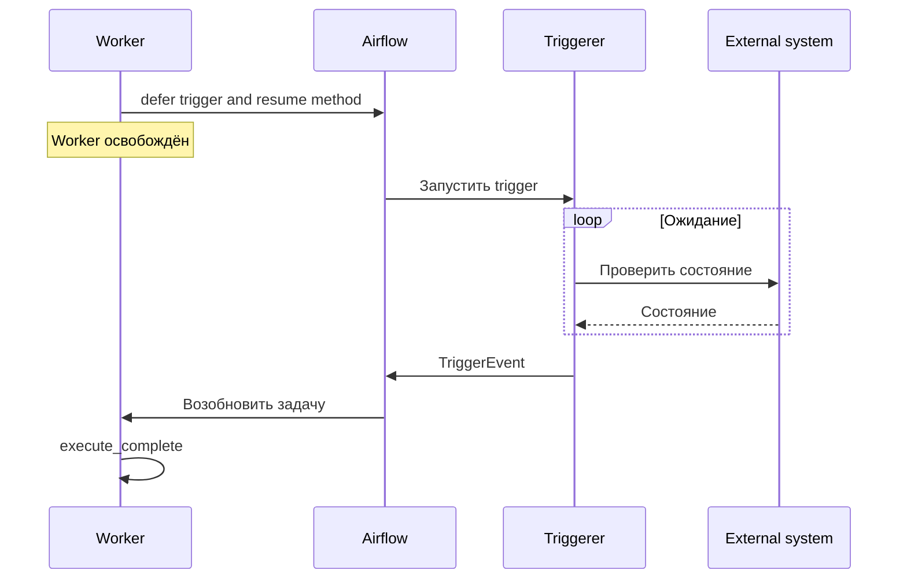

# 14. Sensors, deferrable operators и асинхронные triggers

Ожидание — полноценная часть проектирования конвейера данных.

Пайплайн может ждать публикации партиции, завершения внешнего job, появления сообщения, разрешения следующего временного окна или результата другого DAG. От способа ожидания зависят загрузка workers, нагрузка на scheduler, стоимость инфраструктуры, задержка обработки и поведение при сбоях.

В этой главе последовательно разбираются все темы и пункты раздела 14 из README:

1. Модель ожидания.
2. Режим poke.
3. Режим reschedule.
4. Стандартные сенсоры.
5. Deferrable execution.
6. Triggerer.
7. Собственный trigger.
8. Собственный deferrable operator.
9. Event triggers и shared streams.
10. Проверка отказов ожидания.

После теории приведены законченная лабораторная работа, тесты контрактов, сценарии отказов, контрольные вопросы и критерии освоения.

## Версии и границы проверки

Основная версия:

- Apache Airflow 3.3.2;
- Apache Airflow Task SDK 1.3.2;
- Python 3.12.

Provider-specific поведение сверялось по следующим версиям:

- Standard provider 1.19.0;
- HTTP provider 6.0.4;
- Common SQL provider 2.1.1;
- Amazon provider 9.31.0.

Проверка выполнена по документации и исходникам. Код и интеграционные сценарии в этой сессии не исполнялись.

Для production необходимо отдельно проверить совместимость установленного набора packages, конфигурацию executor, доставку пользовательских пакетов и доступность внешних ресурсов.

---

## 14.1. Модель ожидания

### 14.1.1. Ожидание готовности данных, состояния job или наступления времени

Сенсор отвечает на вопрос:

> Выполнено ли условие, после которого конвейер может продолжить работу?

Условием может быть:

- опубликован manifest входного набора;
- внешний job перешёл в terminal state;
- наступил заданный момент;
- producer завершил публикацию партиции;
- в журнале появилась подтверждённая запись;
- upstream DAG завершил нужную задачу.

Хорошо спроектированное ожидание имеет контракт:

```python
{
    "resource_id": "orders:2026-10-20",
    "expected_revision": "snapshot-17",
    "ready_condition": "published",
    "deadline": "2026-10-20T18:00:00+00:00",
    "on_terminal_failure": "fail",
}
```

В контракте должны быть определены:

1. Какой конкретно ресурс ожидается.
2. Какая его версия подходит.
3. Что означает готовность.
4. Какие состояния считаются окончательным отказом.
5. До какого момента разрешено ждать.
6. Что происходит при истечении срока.

Фраза «ждать успешного job» недостаточна без идентификатора job. Иначе сенсор может принять успех предыдущего запуска за готовность текущего.

Аналогично «ждать таблицу» обычно слабее необходимого бизнес-условия. Таблица может существовать постоянно, а нужная партиция ещё не опубликована.

Нужно проверять состояние конкретного входа:

```text
таблица orders
+ business_date
+ source_revision
+ publication_state
```

Для временных ожиданий различают:

- конкретный абсолютный момент;
- время относительно интервала данных;
- задержку относительно запуска задачи;
- бизнес-календарь.

Эти условия ведут себя по-разному при backfill и повторном запуске.

### 14.1.2. Polling, callbacks, event streams и стоимость каждого подхода

Есть несколько способов получить информацию о готовности.

| Подход | Как обнаруживается изменение | Основная стоимость | Типичный риск |
|---|---|---|---|
| Polling | Периодические запросы | Число запросов и задержка обнаружения | Перегрузка источника |
| Callback | Источник вызывает принимающий endpoint | Приём, аутентификация и доставка | Потерянный или повторный callback |
| Event stream | Чтение событий из брокера | Соединения, offsets, обработка backlog | Ошибка acknowledgement |
| Ожидание времени | Сравнение с заданным моментом | Таймер и инфраструктура ожидания | Неверный timezone или базовый момент |

Deferrable execution может использовать polling.

Например, trigger каждые 30 секунд вызывает API внешнего сервиса. Отличие от poke-сенсора состоит в том, что ожидание выполняется в triggerer и не удерживает worker.

Следовательно, освобождение workers не обязательно уменьшает число запросов к источнику.

Для `N` независимых ожиданий с интервалом `Δ` и коротким запросом приблизительная частота:

\[
Q \approx \frac{N}{\Delta}
\]

Например:

```text
6 000 ожиданий / 30 секунд ≈ 200 запросов в секунду
```

При ненулевой длительности проверки эффективный период также включает время запроса и задержки выполнения.

Callback уменьшает polling, но требует собственного протокола:

- подтверждение подлинности отправителя;
- устойчивый идентификатор события;
- повторная доставка;
- дедупликация;
- запись события до подтверждения приёма;
- reconciliation, если callback не пришёл.

Event stream также не гарантирует однократный бизнес-эффект. Повторная доставка после сбоя — нормальная ситуация, к которой consumer должен быть готов.

Выбор механизма нужно оценивать одновременно по стоимости и требованиям к надёжности.

### 14.1.3. Сенсор как проверка условия и отдельная работа в task

Проверка готовности должна быть короткой и понятной.

Хорошая проверка:

```python
def poke(context):
    state = read_publication_state(
        partition=context["data_interval_start"],
    )

    return state == "published"
```

Плохая граница ответственности:

```python
def poke(context):
    download_all_files()
    transform_dataset()
    publish_table()
    return True
```

Во втором случае сенсор выполняет основную обработку. Это усложняет:

- retries;
- диагностику;
- измерение длительности;
- контроль побочных эффектов;
- повторяемость reschedule;
- перенос ожидания в triggerer.

Обычно лучше разделить:

```text
wait_for_publication → validate_input → process → publish
```

Важное требование к проверке — безопасная повторяемость.

Сенсор может выполнить проверку много раз. Поэтому нежелательно, чтобы каждая проверка:

- повторно создавала job;
- списывала сообщение без подтверждённого сохранения;
- записывала одну и ту же бизнес-операцию;
- изменяла источник таким образом, что следующий запрос увидит другую семантику.

Для передачи компактного результата готовности используется `PokeReturnValue`:

```python
from airflow.sdk import PokeReturnValue


def poke(context):
    publication = read_publication()

    if publication["state"] != "published":
        return False

    return PokeReturnValue(
        is_done=True,
        xcom_value={
            "manifest_uri": publication["manifest_uri"],
            "revision": publication["revision"],
        },
    )
```

Результат должен быть небольшим: идентификатор, версия, ссылка на manifest, контрольные счётчики.

Передавать весь dataset через результат сенсора обычно не требуется.

### 14.1.4. Ограниченное время ожидания и условия прекращения

Ожидание должно иметь конечную политику.

Возможные исходы:

| Наблюдение | Действие |
|---|---|
| Условие ещё не выполнено | Продолжать ожидание |
| Условие выполнено | Завершить успешно |
| Внешняя операция окончательно failed | Завершить ошибкой |
| Операция отменена | Применить политику cancellation |
| Истёк срок ожидания | Fail или skip согласно контракту |
| Некорректный ответ | Ошибка протокола |
| Временная сетевая проблема | Ограниченный повтор |

Необходимо различать:

- timeout отдельного сетевого запроса;
- timeout сенсора;
- timeout одной deferral;
- `execution_timeout`;
- общий бизнес-deadline;
- SLO всего конвейера.

Пример общего бюджета:

```text
SLO публикации результата: 60 минут.

Ожидание входа: максимум 35 минут.
Обработка: максимум 15 минут.
Проверка и публикация: максимум 5 минут.
Резерв на инфраструктурные задержки: 5 минут.
```

Если ожидание может занять все 60 минут, времени на оставшиеся этапы уже нет.

Абсолютный deadline особенно полезен при retries:

```python
remaining = deadline - now
```

При повторном выполнении нельзя безусловно выдавать операции новый полный бюджет.

Для сохранения срока через retries, clear и перезапуск компонентов deadline должен находиться в устойчивом контракте запроса или durable store.

### 14.1.5. Отличие ожидания файла от подтверждения его полной публикации

Существование пути — слабое условие готовности.

На локальной файловой системе producer может:

1. Создать файл.
2. Постепенно записывать содержимое.
3. Закрыть файл.

Сенсор, проверяющий существование, способен увидеть файл между первым и третьим шагами.

Для набора объектов ситуация сложнее:

```text
part-0001.parquet
part-0002.parquet
part-0003.parquet
```

Появление одного объекта не доказывает публикацию всего набора.

Надёжный протокол публикации может использовать manifest:

```json
{
  "dataset": "orders",
  "partition": "2026-10-20",
  "revision": "snapshot-17",
  "state": "published",
  "files": [
    {
      "uri": "s3://curated/orders/revision-17/part-0001.parquet",
      "rows": 120000,
      "sha256": "..."
    }
  ],
  "total_rows": 120000
}
```

Producer публикует подтверждение после завершения записи и проверки набора.

Consumer проверяет:

- правильную партицию;
- ожидаемую ревизию;
- завершённость публикации;
- целостность manifest;
- доступность перечисленных объектов.

Marker `_SUCCESS` также нуждается в контексте версии. Старый marker в переиспользуемом каталоге может дать ложный положительный результат.

Между проверкой и чтением ресурс способен измениться. Для устранения этой гонки полезны неизменяемые пути, версии объектов и чтение конкретной опубликованной ревизии.

---

## 14.2. Режим poke

### 14.2.1. `poke_interval`, `timeout` и занятый worker slot

В режиме `poke` задача остаётся запущенной на worker.

Упрощённая модель:

```python
while True:
    if poke(context):
        return

    if waiting_time_exceeded():
        raise TimeoutError

    time.sleep(poke_interval)
```

Между проверками CPU может почти не использоваться, но worker slot остаётся занят.

Параметры:

| Параметр | Назначение |
|---|---|
| `poke_interval` | Пауза между проверками |
| `timeout` | Бюджет ожидания сенсора |
| `execution_timeout` | Ограничение выполнения задачи |
| `retries` | Число допустимых повторных попыток при соответствующих ошибках |

Пример:

```python
SomeSensor(
    task_id="wait_for_input",
    mode="poke",
    poke_interval=10,
    timeout=300,
)
```

Такое ожидание может занять worker на несколько минут.

Важно: `poke_interval=10` не гарантирует новый запрос ровно каждые 10 секунд. Проверка тоже занимает время.

При длительности проверки `R` примерный период:

\[
P \approx R + \Delta
\]

где `Δ` — интервал ожидания между проверками.

### 14.2.2. Длительность одного сетевого запроса и `execution_timeout`

Сенсорный `timeout` не заменяет timeout HTTP-клиента или драйвера БД.

Если `poke()` завис в сетевом вызове, цикл сенсора не сможет своевременно перейти к следующей проверке elapsed time.

Нужны отдельные ограничения:

```text
connect timeout
read/request timeout
sensor timeout
task execution timeout
```

Например:

```text
Подключение к API: до 3 секунд.
Один запрос: до 10 секунд.
Общее ожидание: до 30 минут.
```

При `mode="poke"` процесс остаётся работающим и во время сна. Поэтому `execution_timeout` охватывает и ожидание внутри этого исполнения.

Для reschedule ситуация отличается: между проверками работающий процесс освобождается.

Практическое правило:

> Каждый блокирующий запрос должен иметь собственный ограниченный срок.

Нужно также проверить, какой именно параметр timeout принимает используемый hook:

- общий timeout;
- отдельные connect/read значения;
- statement timeout;
- server-side timeout;
- client-side timeout.

Это provider-specific поведение.

### 14.2.3. Когда короткое ожидание оправдывает занятый процесс

Poke может быть разумным, если:

- ожидание обычно занимает несколько секунд;
- число одновременных сенсоров небольшое;
- нужен короткий интервал проверки;
- освобождение и повторный запуск worker дороже самого ожидания;
- нагрузка укладывается в выделенный бюджет.

Например, короткая проверка сразу после запуска внешнего сервиса может завершаться за 2–5 секунд.

Но решение нужно принимать по распределению длительности, а не только по среднему.

Если:

```text
p50 = 3 секунды
p95 = 20 минут
```

длинный хвост способен занять workers при массовой задержке источника.

Полезно измерять:

- p50/p95/p99 ожидания;
- одновременное число ожиданий;
- worker-seconds;
- долю времени сна;
- число внешних запросов.

Poke следует выбирать как осознанную оптимизацию короткого ожидания.

### 14.2.4. Retry сетевой ошибки и повторная проверка условия

Отрицательный результат проверки и исключение — разные события.

```python
return False
```

означает:

> Проверка выполнена, условие пока не выполнено.

Исключение может означать:

> Проверку выполнить не удалось.

Например:

- HTTP 202 может означать продолжающуюся обработку;
- HTTP 503 — временную недоступность;
- HTTP 401 — проблему аутентификации;
- некорректный JSON — нарушение протокола.

Не стоит превращать всё в `False`:

```python
try:
    return check_ready()
except Exception:
    return False
```

Так исчезает различие между медленным producer и недоступным сервисом.

Существуют разные уровни повторов:

1. Повтор запроса внутри клиента.
2. Следующий poke.
3. Retry TaskInstance.
4. Повтор всего запуска.

Их суммарная стоимость может оказаться неожиданно большой.

В Task SDK 1.3.2 `AirflowSensorTimeout` обрабатывается как окончательный отказ без обычного retry. Другие ошибки могут использовать configured retries.

Следовательно, нельзя предполагать одинаковую retry-политику для всех timeout.

### 14.2.5. Риск занять все workers ожидающими задачами

Пусть доступно 100 worker slots.

Если 100 poke-сенсоров ждут внешний результат, для полезной обработки свободных slots может не остаться.

Особенно опасна схема:

```text
сенсоры ждут результаты,
которые должны произвести задачи,
ожидающие свободных workers
```

Получается ресурсная блокировка.

Варианты защиты:

- deferrable execution;
- reschedule;
- отдельные pools;
- отдельные очереди и worker groups;
- ограничение числа активных запусков;
- ограничение fan-out;
- устранение циклических зависимостей.

Отдельный pool помогает только при корректно выбранной ёмкости и общей ресурсной модели.

Полезная метрика:

\[
WorkerOccupancy =
\frac{\text{slots, занятые ожиданием}}
     {\text{все доступные worker slots}}
\]

Она показывает, какая доля исполнительной мощности используется для ожидания.

---

## 14.3. Режим reschedule

### 14.3.1. Освобождение worker между проверками

В режиме `reschedule` сенсор выполняет одну проверку.

Если условие не выполнено:

1. Определяется время следующей проверки.
2. Задача переходит в `up_for_reschedule`.
3. Текущий worker освобождается.
4. Scheduler позже снова делает задачу доступной к выполнению.
5. Следующая проверка может происходить в другом процессе.

```python
SomeSensor(
    task_id="wait_for_input",
    mode="reschedule",
    poke_interval=120,
    timeout=3600,
)
```

Это позволяет не удерживать worker весь час.

Однако стоимость остаётся:

- повторное планирование;
- повторный запуск исполнения;
- чтение контекста;
- запись состояния;
- обращение к источнику.

Reschedule хорошо подходит для достаточно редких коротких проверок.

### 14.3.2. Состояние `up_for_reschedule` и запись истории ожиданий

`up_for_reschedule` означает, что задача ждёт времени следующей проверки.

Это не то же самое, что:

- `up_for_retry`;
- `queued`;
- `deferred`;
- ошибка выполнения.

Одна логическая попытка сенсора может включать несколько reschedule.

История reschedule позволяет Airflow восстанавливать начало ожидания и учитывать elapsed time.

В рассматриваемом SDK начало ищется через runtime API с учётом истории попыток. Поэтому timeout не должен трактоваться как новый полный бюджет каждого отдельного poke.

Не следует хранить важное состояние только в полях объекта:

```python
self.previous_files = current_files
```

Новый процесс может получить новый экземпляр оператора.

Нужное состояние должно быть:

- восстановимо из источника;
- передано через устойчивый контракт;
- сохранено в поддерживаемом state store;
- реализовано механизмом конкретного сенсора.

### 14.3.3. Нагрузка повторных запусков на scheduler и метабазу

Reschedule уменьшает занятость workers, но увеличивает число коротких циклов выполнения.

Пример:

```text
10 000 сенсоров
интервал 60 секунд
ожидание 1 час
```

Грубая оценка числа проверок:

\[
10\,000 \times 60 = 600\,000
\]

Это не 600 000 разных задач, но это значительное количество проверок и переходов состояния.

Нагрузка включает:

- scheduler;
- TaskReschedule history;
- executor;
- API;
- запуск процессов или контейнеров;
- логирование;
- внешние запросы.

Особенно дорогим может быть reschedule при executor, который создаёт отдельный pod для каждого исполнения.

Для большого числа частых ожиданий deferrable execution обычно требует отдельного рассмотрения.

### 14.3.4. Выбор интервала проверки по требуемой задержке

Интервал связан с задержкой обнаружения.

При равномерном попадании события между проверками и коротком запросе:

\[
E[D_{\text{poll}}] \approx \frac{\Delta}{2}
\]

При интервале 120 секунд средняя добавочная задержка polling составляет около минуты.

Но фактическая задержка включает:

```text
интервал
+ scheduler delay
+ executor queue
+ запуск worker
+ запрос к источнику
```

Поэтому `poke_interval=60` не является обещанием обнаружения за 60 секунд.

Выбор интервала должен учитывать:

- допустимую задержку;
- число одновременно ожидающих задач;
- лимиты API;
- стоимость запроса;
- стоимость повторного запуска;
- поведение при массовом восстановлении.

Для production reschedule документация базового сенсора рекомендует достаточно редкие проверки, обычно больше минуты.

Короткие интервалы могут использоваться в маленьких учебных примерах, но их нельзя механически переносить на тысячи сенсоров.

### 14.3.5. Различие reschedule и полноценного асинхронного deferral

| Свойство | Reschedule | Deferrable |
|---|---|---|
| Где выполняется проверка | Worker | Triggerer |
| Что инициирует продолжение | Плановый повтор исполнения | Trigger event |
| Worker между проверками | Освобождён | Освобождён |
| Новый запуск worker на каждый poll | Обычно да | Обычно нет |
| Поддержка event stream | Не является общей моделью режима | Возможна через trigger |
| Требование triggerer | Нет | Да |
| Сохранение локального состояния процесса | Нет | Нет |

Reschedule повторно запускает проверку в task runtime.

Deferral передаёт ожидание специализированному асинхронному компоненту, а затем возобновляет задачу через заданный метод.

Оба механизма освобождают workers, но имеют разные пути выполнения и отказов.

---

## 14.4. Стандартные сенсоры

### 14.4.1. `FileSensor`, time/date sensors и доступность локального пути

`FileSensor` проверяет файловую систему, доступную процессу проверки.

Это особенно важно в распределённой установке:

| Режим | Где должен быть доступен путь |
|---|---|
| Poke | Worker, выполняющий сенсор |
| Reschedule | Каждый worker, который может получить следующую проверку |
| Deferrable | Triggerer; начальная проверка может также требовать путь на worker |

Локальный файл внутри одного worker pod может отсутствовать в triggerer.

Нужны согласованные mounts и разрешения.

Пример:

```python
from airflow.providers.standard.sensors.filesystem import FileSensor


FileSensor(
    task_id="wait_for_manifest",
    fs_conn_id="shared_fs",
    filepath="orders/2026-10-20/manifest.json",
    mode="reschedule",
    poke_interval=120,
    timeout=3600,
)
```

Connection и файловая система должны существовать в учебном окружении.

Для времени в Standard provider есть разные сенсоры:

- `DateTimeSensor`;
- `DateTimeSensorAsync`;
- `TimeSensor`;
- `TimeDeltaSensor`;
- `WaitSensor`.

В Standard provider 1.19.0:

- `TimeDeltaSensor` поддерживает `deferrable=True`;
- `TimeDeltaSensorAsync` deprecated;
- `TimeDeltaSensor` отсчитывает задержку от `data_interval_end`, а при его отсутствии использует `run_after`;
- `WaitSensor` предназначен для задержки относительно начала задачи.

Пример:

```python
from datetime import timedelta

from airflow.providers.standard.sensors.time_delta import (
    TimeDeltaSensor,
)


TimeDeltaSensor(
    task_id="wait_after_interval",
    delta=timedelta(minutes=15),
    deferrable=True,
    timeout=3600,
)
```

При backfill абсолютная целевая дата может уже находиться в прошлом. Это должно приводить к корректному немедленному продолжению, а не к искусственному ожиданию нового полного периода.

### 14.4.2. `HttpSensor`, `SqlSensor` и критерии готовности ответа

HTTP 200 означает успешный HTTP-ответ. Он не обязательно означает готовность данных.

Пример ответа:

```json
{
  "job_id": "job-17",
  "state": "running"
}
```

Сенсор должен проверять бизнес-поле.

Нужно определить:

- какие HTTP-коды считаются «пока не готово»;
- какие считаются временным отказом;
- какие означают окончательную ошибку;
- какую схему имеет body;
- какой `job_id` ожидается;
- какой terminal state разрешает продолжение.

В HTTP provider 6.0.4 есть важная особенность: при заданном `response_check` `HttpSensor` использует обычное выполнение базового сенсора даже при `deferrable=True`.

Следовательно, наличие флага само по себе не доказывает фактическое использование triggerer.

Это следует проверять по состояниям задачи и реализации provider.

Для `SqlSensor` нужно учитывать, какое значение проверяется. В Common SQL provider 2.1.1 из первого результата извлекается значение через selector; затем применяются failure/success predicates.

Запрос должен возвращать однозначный сигнал готовности.

Например:

```sql
SELECT CASE
    WHEN EXISTS (
        SELECT 1
        FROM publication_log
        WHERE dataset_name = %(dataset)s
          AND partition_key = %(partition)s
          AND state = 'published'
    )
    THEN 1
    ELSE 0
END
```

Следует избегать дорогого полного сканирования таблицы ради каждой проверки готовности.

### 14.4.3. Object storage key/prefix sensors и проверка количества объектов

Object storage sensors могут ждать:

- конкретный key;
- набор keys;
- соответствие prefix или pattern;
- отсутствие изменений в наборе;
- выполнение дополнительного predicate.

Но следует различать:

```text
найден хотя бы один объект
```

и:

```text
опубликован весь ожидаемый набор
```

Количество объектов тоже недостаточно без идентификации:

```text
ожидали a, b, c
получили a, b, d
```

Нужен manifest либо другой полный контракт.

Для `S3KeysUnchangedSensor` Amazon provider 9.31.0 отдельно предупреждает о некорректной работе в reschedule: состояние предыдущего listing теряется между исполнениями.

Отсюда важное правило:

> Нельзя считать каждый сенсор автоматически совместимым со всеми режимами ожидания.

Период без изменений также является эвристикой. Он не доказывает, что producer завершил публикацию, если producer просто временно остановился.

Для критичных данных лучше использовать явный publication commit.

### 14.4.4. External task/job sensors и соответствие logical date

`ExternalTaskSensor` ждёт определённый DAG, task или TaskGroup в другом запуске.

Ключевой вопрос:

> Какому upstream-запуску соответствует текущий downstream-запуск?

При одинаковых расписаниях logical dates могут совпадать.

При разных расписаниях требуется явное сопоставление.

Нельзя автоматически считать эквивалентными:

- одинаковый `ds`;
- одинаковое фактическое время старта;
- одинаковый `run_id`;
- одинаковый интервал данных.

Пример ожидания конкретной upstream-задачи:

```python
from airflow.providers.standard.sensors.external_task import (
    ExternalTaskSensor,
)


ExternalTaskSensor(
    task_id="wait_for_upstream_publication",
    external_dag_id="ingest_orders",
    external_task_id="publish",
    allowed_states=["success"],
    failed_states=["failed", "upstream_failed"],
    skipped_states=["skipped"],
    poke_interval=60,
    timeout=3600,
    deferrable=True,
)
```

В Standard provider 1.19.0 для интервала проверки следует использовать `poke_interval`; `poll_interval` deprecated.

Если ожидается целый DAG, допустимые состояния отличаются от состояний отдельной задачи.

Для manual и некоторых event-driven запусков logical date может отсутствовать. Такой сценарий требует отдельного контракта сопоставления.

Для внешнего job нужен его устойчивый `job_id` и, при необходимости, idempotency key.

### 14.4.5. `soft_fail`, skipped states и ожидаемые отрицательные результаты

`soft_fail` позволяет в определённых случаях завершить сенсор как `skipped`.

Это влияет на downstream trigger rules.

Например:

```text
optional_input_sensor → optional_processing → join
```

Если optional input отсутствует, skip может быть нормальным исходом.

Но для обязательной ежедневной выгрузки skip способен скрыть нарушение обязательства.

Нужно разделять:

| Ситуация | Возможная политика |
|---|---|
| Необязательный источник не прислал данные | Skip |
| Обязательный источник не готов к deadline | Fail |
| Источник явно отменил операцию | По контракту |
| Ошибка credentials | Обычно fail |
| Неверная схема ответа | Fail |
| Upstream task skipped | Явно заданная политика skipped states |

`soft_fail` не следует воспринимать как универсальное преобразование любой ошибки в skip.

В базовом сенсоре также существуют `silent_fail` и `never_fail`, но они меняют наблюдаемость отказов и требуют отдельного обоснования.

Маскировка недоступности источника под «данных нет» создаёт ложные успешные запуски.

---

## 14.5. Deferrable execution

### 14.5.1. Параметр `deferrable` у поддерживающего operator

`deferrable=True` имеет смысл только у оператора, который реализует соответствующий путь выполнения.

Такой оператор обычно:

1. Выполняет начальную работу на worker.
2. Создаёт trigger.
3. Вызывает `self.defer(...)`.
4. Позже возобновляется через заданный метод.

Флаг не превращает произвольный синхронный Python-код в асинхронный.

Поддержка зависит от:

- класса оператора;
- версии provider;
- дополнительных параметров;
- выбранной ветки выполнения.

Встречаются два API:

```python
SomeSensor(deferrable=True)
```

и отдельный класс:

```python
SomeSensorAsync(...)
```

Нельзя выводить актуальный API только из названия. Некоторые `Async`-классы уже deprecated в пользу флага.

При ревью полезно проверить фактическое состояние `deferred` и появление trigger.

### 14.5.2. Освобождение worker и перенос ожидания в triggerer

После deferral worker освобождается.

Ожидание выполняется в triggerer как coroutine.

Рабочий процесс не остаётся «спящим до события».

Из этого следуют ограничения:

- локальные переменные не сохраняются;
- открытая сессия клиента не переносится;
- соединение с БД не переносится;
- временный локальный файл не становится автоматически доступным;
- динамически присвоенное поле объекта не является durable state.

Нужно явно сохранить данные для продолжения.

Типичные значения:

```python
{
    "job_id": "job-17",
    "expected_revision": "v4",
    "deadline": "...",
    "operation_key": "...",
}
```

В них не должно быть живых клиентов, sockets, generators и других объектов процесса.

### 14.5.3. `deferred`, trigger event и возобновление через execute method

Основной цикл:



Обычно возобновление проходит через `resume_execution()`, который вызывает метод, указанный в `method_name`.

Пример:

```python
self.defer(
    trigger=JobTrigger(job_id=job_id),
    method_name="execute_complete",
    kwargs={"job_id": job_id},
)
```

Позже вызывается:

```python
def execute_complete(
    self,
    context,
    job_id,
    event=None,
):
    ...
```

Продолжение начинается в указанном методе. Строка после `self.defer()` не является точкой возобновления Python-стека.

В отдельных поддерживаемых сценариях trigger может завершить задачу без возврата на worker. Но такой путь подходит только тогда, когда не требуется выполнить дополнительную worker-side проверку или публикацию.

### 14.5.4. Учитывание deferred tasks в pool slots по конфигурации pool

По умолчанию deferred-задачи не занимают pool slots.

Pool можно настроить так, чтобы учитывать их.

Это выбор ресурсной модели.

Если pool представляет:

```text
число занятых workers
```

освобождение slot при deferral естественно.

Если pool представляет:

```text
число одновременно работающих внешних jobs
```

освобождение slot может нарушить лимит.

Пример:

1. Задача запустила внешний job.
2. Перешла в `deferred`.
3. Pool slot освободился.
4. Следующая задача запустила ещё один job.
5. Во внешней системе накопилось больше jobs, чем разрешено.

Политика `include_deferred` должна соответствовать тому ресурсу, который ограничивает pool.

Отдельно нужно учитывать task-level concurrency limits: в Airflow 3.3.2 deferred входит в соответствующие счётчики активных экземпляров задачи.

Освобождение worker, освобождение pool slot и исключение из task-level limit — разные решения.

### 14.5.5. Provider-specific поддержка и отсутствие автоматического deferral любого кода

Для каждого оператора нужно проверить:

- реализован ли `deferrable`;
- какие параметры меняют путь выполнения;
- какой trigger используется;
- как передаётся timeout;
- как обрабатываются success/error events;
- поддерживается ли cancellation;
- какие зависимости нужны triggerer.

Пример HTTP provider показывает, что дополнительный callback может переключить исполнение обратно на worker.

Следует также различать:

| Механизм | Где работает ожидание или I/O |
|---|---|
| Deferrable operator | Triggerer во время deferral |
| Обычная async task | Worker, который остаётся выполняющим задачу |
| Resumable task | Отдельный механизм сохранения и восстановления состояния |
| Human-in-the-loop | Может использовать `awaiting_input`, без triggerer |

В поддерживающих классах существуют `start_from_trigger` и `end_from_trigger`.

Они позволяют уменьшить начальные или завершающие worker-запуски, но требуют отдельной проверки сериализации и доступного контекста.

Особенно важно это при Dynamic Task Mapping: путь старта из trigger может отличаться от обычного выполнения конструктора на worker.

---

## 14.6. Triggerer

### 14.6.1. Async event loop и множество ожиданий в одном процессе

Triggerer запускает много coroutines в одном event loop.

Когда одна coroutine ожидает I/O:

```python
await client.get_status(...)
```

другая может продолжить работу.

Эффективность появляется благодаря тому, что ожидания большую часть времени не выполняют CPU work.

Это не означает бесконечную ёмкость.

Каждый trigger потребляет:

- память;
- runtime metadata;
- время event loop;
- соединения;
- файловые дескрипторы;
- внешние запросы;
- ресурсы обработки события.

Большое число тяжёлых triggers способно перегрузить triggerer даже при небольшом потреблении CPU в среднем.

### 14.6.2. Capacity, heartbeat, HA и перераспределение triggers

В Airflow 3.3.2 default capacity одного triggerer — 1000 triggers.

Это конфигурационный предел, а не гарантия производительности для любого trigger.

Для HA запускают несколько triggerer.

При потере экземпляра его triggers могут быть назначены другим.

Нужно проверить:

- суммарную capacity;
- capacity после отказа одного экземпляра;
- heartbeat;
- время обнаружения отказа;
- задержку перераспределения;
- доступность одинакового кода;
- сетевые возможности оставшихся экземпляров.

Если вся ёмкость занята, новые deferred-задачи могут ждать запуска trigger.

При N+1-проектировании важна capacity оставшейся системы:

```text
рабочая нагрузка должна помещаться после отказа одного triggerer
```

В Airflow 3.3.2 есть также ограничения числа triggers, выбираемых за один цикл, чтобы один экземпляр не забирал всю работу в HA deployment.

### 14.6.3. Blocking I/O, CPU work и остановка всего event loop

Опасный код:

```python
async def run(self):
    time.sleep(30)
```

Объявление `async def` не делает `time.sleep()` неблокирующим.

Аналогичные проблемы:

```python
requests.get(url)
```

без асинхронного клиента и:

```python
perform_large_cpu_computation()
```

внутри event loop.

Один такой trigger может задержать другие ожидания в том же процессе.

Правильный принцип:

```python
await asyncio.sleep(30)
```

и async-safe I/O.

`asyncio.to_thread()` может помочь при ограниченной совместимости с синхронной библиотекой, но не является универсальным решением:

- thread pool тоже ограничен;
- отмена coroutine не обязана остановить выполняющийся поток;
- блокирующий запрос всё равно требует timeout;
- массовое число threads создаёт новую проблему ресурсов.

Тяжёлую обработку следует выполнять на workers или во внешнем compute service.

### 14.6.4. Доступ к сети, async clients и secrets в triggerer environment

Успешный запрос с worker не доказывает доступность того же ресурса из triggerer.

Проверяются:

- DNS;
- маршрутизация;
- firewall;
- TLS certificates;
- proxy;
- service account;
- IAM;
- Connections;
- secrets backend;
- зависимости async-клиента.

Triggerer должен иметь код trigger и нужные библиотеки.

Async client создаётся во время выполнения coroutine:

```python
async def run(self):
    async with SomeAsyncClient(...) as client:
        ...
```

Открывать клиент в `__init__()` опасно: конструктор вызывается в другом контексте, а клиент должен принадлежать нужному event loop.

Для `aiohttp` применяется `ClientSession` с ограниченным timeout и корректным закрытием.

Credentials лучше получать через поддерживаемый provider механизм, передавая устойчивый Connection ID.

Сериализуемые kwargs triggers шифруются при хранении, но это не отменяет необходимости ограничивать секреты в логах, repr и event payload.

### 14.6.5. Метрики задержки event loop и backlog deferred tasks

Нужно наблюдать несколько независимых стадий:

```text
задача deferred
→ trigger назначен
→ trigger запущен
→ событие обнаружено
→ событие сохранено
→ задача запланирована
→ worker начал resume
```

Метрики из реализации Airflow 3.3.2 включают:

- `triggers.running`;
- `triggerer.capacity_left`;
- `triggers.succeeded`;
- `triggers.failed`;
- `triggers.blocked_main_thread`;
- `triggerer_heartbeat`.

Имена и tags нужно сверять с используемым metrics backend.

Дополнительно полезны:

- число deferred-задач без активно работающего trigger;
- возраст самого старого ожидания;
- event loop lag;
- request latency внешнего API;
- ошибки аутентификации;
- время `event → resume`;
- длительность cleanup;
- число повторных назначений.

Backlog может расти и при свободном CPU: например, из-за нехватки capacity или ограничений соединений.

---

## 14.7. Собственный trigger

### 14.7.1. `BaseTrigger`, `serialize()` и асинхронный `run()`

Trigger наследуется от `BaseTrigger`.

Для рассматриваемой версии используется:

```python
from airflow.triggers.base import BaseTrigger, TriggerEvent
```

Основные методы:

```python
class MyTrigger(BaseTrigger):
    def __init__(self, resource_id):
        super().__init__()
        self.resource_id = resource_id

    def serialize(self):
        return (
            "my_package.triggers.MyTrigger",
            {"resource_id": self.resource_id},
        )

    async def run(self):
        ...
        yield TriggerEvent(...)
```

`serialize()` возвращает:

```text
import path класса
+
kwargs для его восстановления
```

Должно выполняться свойство:

```text
исходный trigger
→ serialize
→ новый trigger из kwargs
→ эквивалентное ожидание
```

В `__init__()` не следует выполнять сетевые запросы или создавать события с новым случайным смыслом.

`run()` — asynchronous generator: он выдаёт `TriggerEvent`.

Для обычной deferral нужен terminal event, который разрешает возобновление задачи.

### 14.7.2. `TriggerEvent`, JSON-совместимый payload и очистка ресурсов

Payload должен быть сериализуемым.

Пример:

```python
{
    "contract_version": 1,
    "job_id": "job-17",
    "input_revision": "v4",
    "status": "success",
    "output_uri": "s3://results/job-17/manifest.json",
}
```

Не стоит передавать:

- живой response object;
- client session;
- generator;
- coroutine;
- DataFrame;
- открытый файл;
- произвольный объект библиотеки.

Событие — контракт между trigger и resume method.

Оператор должен проверить:

- схему;
- версию;
- идентификатор операции;
- ожидаемую ревизию;
- допустимый terminal status;
- обязательные поля результата.

Для локальных ресурсов используются:

- `async with`;
- `try/finally`;
- `cleanup()`.

В Airflow 3.3.2 `cleanup()` предназначен для освобождения локальных ресурсов при завершении trigger.

Его нельзя считать гарантированным при аварийном уничтожении процесса или потере узла. Для внешних ресурсов нужны TTL, leases или отдельный reconciliation.

### 14.7.3. Восстановление после перезапуска без сохранения локальной памяти

Trigger может быть остановлен и восстановлен в другом процессе.

Поэтому такое состояние ненадёжно:

```python
self.started_at = datetime.now(...)
self.last_seen_offset = ...
self.already_published = True
```

Если значения не входят в восстановимый контракт или durable store, после restart они исчезнут.

Особенно опасно заново вычислять deadline:

```python
def __init__(self, timeout_seconds):
    self.deadline = now() + timeout_seconds
```

Каждая реконструкция продлевает ожидание.

Правильно передавать абсолютный момент:

```python
{
    "deadline": "2026-10-20T18:00:00+00:00"
}
```

При восстановлении:

```python
remaining = deadline - now
```

Для внешнего job восстанавливаются:

- тот же `job_id`;
- та же версия входа;
- тот же deadline;
- тот же смысл terminal state.

Создавать новый job при каждом восстановлении trigger нельзя без специального идемпотентного протокола.

### 14.7.4. Дедупликация событий и повторное назначение trigger

При HA возможны периоды, когда логически одно ожидание выполняется более одного раза.

Например:

1. Triggerer потерял связь.
2. Другой triggerer получил ожидание.
3. Первый экземпляр ещё успел обнаружить готовность.
4. Оба сформировали событие.

Поэтому terminal event должен иметь устойчивую идентичность.

Плохо:

```python
{
    "event_id": str(uuid.uuid4()),
    "observed_at": now().isoformat(),
    "job_id": "job-17",
}
```

Два наблюдателя создадут разные payload для одного факта.

Лучше опираться на:

```text
job_id
+ revision
+ terminal state
+ event sequence или source event ID
```

Airflow имеет механизмы обработки повторных trigger events, но это не создаёт глобальную exactly-once гарантию для внешней записи.

Resume method и последующее действие должны быть идемпотентны либо использовать транзакционный протокол внешней системы.

### 14.7.5. Совместимость import path и аргументов после обновления кода

В метаданных хранится import path trigger.

Например:

```text
company_airflow.triggers.RemoteJobTrigger
```

Если пакет переименован, уже ожидающие задачи могут потерять возможность восстановления.

Опасные изменения:

- удаление класса;
- перенос модуля без compatibility alias;
- переименование kwargs;
- изменение формата дат;
- изменение смысла status;
- удаление поддержки старой версии payload.

Стратегия обновления:

1. Сохранить старые import paths.
2. Поддерживать ранее сериализованные kwargs.
3. Ввести `contract_version`.
4. Проверить round-trip старых примеров.
5. Дождаться завершения старых ожиданий.
6. Затем удалять совместимость.

В Airflow 3.3.2 trigger не должен находиться только в DAG bundle: triggerer не инициализирует bundles для импорта trigger.

Практический вариант — установить отдельный Python package в окружения:

- DAG processor;
- workers;
- triggerer.

Изменение кода trigger требует учитывать перезапуск triggerer и действующие сериализованные ожидания.

---

## 14.8. Собственный deferrable operator

### 14.8.1. `defer()`, resume method и передача сериализуемого состояния

`self.defer()` завершает текущий путь исполнения специальным исключением `TaskDeferred`.

```python
self.defer(
    trigger=RemoteJobTrigger(
        job_id=job_id,
        deadline=deadline,
    ),
    method_name="execute_complete",
    kwargs={
        "job_id": job_id,
        "expected_revision": revision,
        "deadline": deadline,
    },
    timeout=remaining,
)
```

Передаются два связанных контракта:

- kwargs trigger — что и как ждать;
- kwargs resume method — как проверить и продолжить операцию.

Не следует рассчитывать на код после `defer()`:

```python
self.defer(...)

# Это не продолжение после события.
publish_result()
```

Также не следует перехватывать `BaseException` так, чтобы проглотить `TaskDeferred`.

Состояние, необходимое после resume, должно быть сериализуемым и явно переданным.

### 14.8.2. `execute_complete()` и обработка успешного/ошибочного события

Resume method не должен слепо доверять событию.

Проверка может выглядеть так:

```python
def execute_complete(
    self,
    context,
    job_id,
    expected_revision,
    event=None,
):
    if not isinstance(event, dict):
        raise ValueError("Missing or invalid trigger event")

    if event.get("job_id") != job_id:
        raise ValueError("Unexpected job identity")

    if event.get("input_revision") != expected_revision:
        raise ValueError("Unexpected input revision")

    if event.get("status") != "success":
        raise RuntimeError("External operation did not succeed")

    return {
        "job_id": job_id,
        "output_uri": event["output_uri"],
    }
```

Нужно определить отдельную политику для:

- внешнего `failed`;
- внешнего `cancelled`;
- ошибки протокола;
- временной недоступности;
- timeout;
- отсутствующего события.

Для окончательной бизнес-ошибки может использоваться `AirflowFailException`, чтобы не повторять бессмысленное ожидание того же failed job.

Для временного отказа допустим обычный retry, если он сохраняет identity и deadline операции.

### 14.8.3. Общий timeout операции и таймаут отдельных запросов

Нужны несколько уровней:

| Уровень | Что ограничивает |
|---|---|
| Client timeout | Один сетевой вызов |
| Trigger polling policy | Повтор проверок и backoff |
| `defer(timeout=...)` | Конкретное deferred-ожидание |
| `execution_timeout` | Выполнение согласно runtime пути версии |
| Absolute deadline | Полный бизнес-бюджет операции |

Для Airflow 3.3.2 есть важная версионная оговорка.

Руководство описывает `execution_timeout` как общий runtime через deferrals. Однако в обычном Task SDK / Execution API пути исходников 3.3.2 остаются TODO по обработке execution timeout при deferral.

При этом start-from-trigger путь имеет отдельную логику ограничения trigger timeout.

Поэтому опасно строить общий бизнес-deadline исключительно на предположении о поведении `execution_timeout`.

Надёжный подход:

```python
remaining = deadline - now

if remaining.total_seconds() <= 0:
    raise AirflowFailException("Operation deadline expired")

self.defer(
    ...,
    timeout=remaining,
)
```

Deadline передаётся также в trigger и resume kwargs.

При повторной deferral вычисляется оставшийся бюджет того же deadline.

Этот вывод основан на просмотре:

- Task SDK task runner;
- Execution API обработки deferred state;
- TaskInstance start-from-trigger пути.

Поведение требуется подтвердить интеграционным тестом конкретной установки.

### 14.8.4. Повторная deferral, cancellation и незавершённый внешний ресурс

Оператор может defer несколько раз.

Например:

```text
submit job
→ wait for completion
→ validate publication
→ wait for replication
→ finish
```

Для каждой стадии нужно сохранить:

- текущую фазу;
- идентификаторы ресурсов;
- общий deadline;
- уже выполненные побочные эффекты;
- ключ идемпотентности.

Cancellation требует отдельной политики.

В Airflow 3.3.2 у `BaseTrigger` есть:

```python
async def cleanup(self):
    ...
```

и:

```python
async def on_kill(self):
    ...
```

Их назначения отличаются:

| Hook | Назначение |
|---|---|
| `cleanup()` | Освободить локальные ресурсы trigger |
| `on_kill()` | Обработать явное пользовательское прекращение deferred-задачи |

`on_kill()` не вызывается просто из-за обычного restart или перераспределения trigger.

Не нужно отменять внешний job в `cleanup()`: тогда rolling restart triggerer сможет отменять нормальные операции.

При этом cancellation остаётся best-effort:

- API отмены может быть недоступен;
- hook может не успеть завершиться;
- процесс может аварийно исчезнуть;
- внешний job может уже завершиться.

Нужен reconciliation незавершённых ресурсов.

Если несколько задач ждут один общий job, право на его отмену также должно быть определено явно.

### 14.8.5. Ограничения произвольного `@task` относительно operator deferral

Обычная TaskFlow-функция не становится deferrable от того, что внутри написано ожидание.

```python
@task
def wait():
    while not ready():
        time.sleep(30)
```

Это работающий worker process.

Обычный `async def` также не означает перенос в triggerer. Асинхронная задача может выполнять concurrent I/O на worker, продолжая занимать его runtime.

Для поддерживаемого deferral нужен соответствующий class-based operator.

Не следует вызывать другой оператор изнутри `@task`, рассчитывая таким образом получить корректный жизненный цикл deferred TaskInstance.

Практические варианты:

- готовый provider operator;
- собственный `BaseOperator`;
- собственный `BaseSensorOperator` с deferrable-путём;
- отдельная задача запуска job и отдельная задача ожидания.

Выбор должен сохранять понятные границы retries и внешних эффектов.

---

## 14.9. Event triggers и shared streams

### 14.9.1. `BaseEventTrigger` и пригодность для событийного планирования

Обычный trigger возобновляет существующую задачу.

Event trigger используется для событийного планирования, например через `AssetWatcher`.

Для совместимости с таким планированием применяется `BaseEventTrigger`.

```python
from airflow.triggers.base import BaseEventTrigger
```

Однако наследование само по себе не делает семантику корректной.

Нужно определить:

- что считается новым событием;
- как оно идентифицируется;
- как восстанавливается cursor;
- что происходит при повторе;
- когда событие подтверждается;
- как ограничивается backlog.

Ожидание текущего состояния и обработка новых событий — разные задачи.

Например:

```text
job находится в success
```

может оставаться истинным постоянно.

А событие:

```text
job-17 впервые завершился с revision-4
```

имеет конкретную идентичность.

### 14.9.2. Событие изменения и постоянно истинное состояние

Предположим, watcher каждый раз проверяет:

```python
file_exists("ready.json")
```

После появления файла условие остаётся истинным.

Если каждое положительное наблюдение создаёт событие, DAG способен запускаться снова и снова.

Нужен протокол новых фактов:

```python
{
    "event_id": "publication-174",
    "dataset": "orders",
    "partition": "2026-10-20",
    "revision": "v7",
    "event_type": "published",
}
```

Возможные источники identity:

- broker message ID;
- offset;
- source sequence;
- publication ID;
- версия объекта;
- transaction ID.

Если источником служит polling, необходимо хранить информацию о последней обработанной ревизии.

Локальное поле:

```python
self.last_seen = revision
```

не обеспечивает восстановление после restart.

Для временных или исчезающих событий требуется durable source либо reconciliation фактического состояния.

### 14.9.3. Shared stream subscriptions в поддерживаемых версиях Airflow 3.3

Shared streams появились в Airflow 3.3.

Они позволяют sibling event triggers использовать один underlying I/O stream.

Пример:

```text
20 watchers
→ один общий polling REST endpoint
→ индивидуальная фильтрация для каждого watcher
```

Основные hooks:

- `shared_stream_key()`;
- `open_shared_stream()`;
- `filter_shared_stream()`.

`shared_stream_key()` должен быть детерминированным.

Например:

```python
(
    "publication-api",
    connection_id,
    endpoint,
    polling_interval,
)
```

Ключ должен учитывать параметры, влияющие на общий источник.

Нельзя объединять разные credentials или scopes только потому, что URL совпадает.

Разделение:

| Объект | Разделяется |
|---|---|
| Underlying poll loop | Да |
| Upstream I/O | Да |
| Trigger DB row | Нет |
| Trigger instance | Нет |
| Per-trigger filtering | Нет |
| Scheduling metadata | Нет |

Следовательно, shared stream уменьшает I/O, но не устраняет линейное число watchers и их метаданных.

Общность действует в соответствующем runtime triggerer; это не глобальный singleton на весь кластер.

У каждого subscriber есть ограниченная очередь. Медленный subscriber может переполнить её и завершиться ошибкой.

### 14.9.4. Acknowledgement, cursor и повтор после triggerer restart

Для брокеров важен момент подтверждения сообщения.

Нельзя безопасно делать:

```text
прочитать
→ подтвердить брокеру
→ попытаться сохранить trigger event
```

При сбое между подтверждением и сохранением факт может потеряться.

В shared streams 3.3 поддерживается ack mode через:

```python
create_shared_stream_producer(...)
```

Producer реализует:

- открытие stream;
- выдачу raw event и broker payload;
- `advance(batch)`;
- закрытие ресурсов.

Подтверждение связывается с прогрессом subscribers и сохранением порождённых trigger events.

Важно различать:

```text
trigger event сохранён в Airflow
```

и:

```text
downstream DAG завершил бизнес-обработку
```

Ack mode относится к доставке и сохранению события. Он не ждёт полного завершения downstream-пайплайна.

Дополнительные особенности:

- набор subscribers фиксируется в момент fan-out события;
- поздний subscriber не становится автоматически получателем уже отправленного события;
- restart теряет in-memory resolution state;
- неподтверждённые сообщения могут прийти повторно;
- idempotency остаётся необходимой;
- broker-specific решение commit, retry или DLQ реализует producer.

Для ordered sources подтверждают безопасный непрерывный prefix.

Для Kafka-подобного источника порядок удобно разделять по topic/partition через advance lanes.

Нельзя commit более поздний offset поверх ещё не разрешённого предыдущего события той же partition.

### 14.9.5. Защита от бесконечного повторного создания запусков

Нужны несколько уровней защиты:

1. Устойчивая source event identity.
2. Durable cursor или журнал обработанных событий.
3. Идемпотентная публикация факта готовности.
4. Ограничение активных запусков.
5. Контроль backlog.
6. Reconciliation потерянных и дублированных событий.

В Airflow 3.3.2 для shared streams есть:

- `shared_stream_subscriber_queue_size`;
- `shared_stream_ack_timeout`;
- `shared_stream_cohort_grace_period`.

Значения по умолчанию включают очередь 1024 и ack timeout 300 секунд.

Grace period позволяет дать sibling triggers время присоединиться после restart.

Но это best-effort окно. Оно не гарантирует, что очень медленный subscriber успеет получить уже подтверждённое событие.

При строгом требовании доставки каждому consumer нужны подходящие durable subscriptions или отдельные cursors.

Общий shared stream не должен превращаться в неявный механизм гарантированной доставки всем когда-либо существовавшим watchers.

---

## 14.10. Проверка отказов ожидания

### 14.10.1. Timeout, пропавший triggerer и недоступный upstream

Необходимо проверять разные причины остановки:

| Сценарий | Что проверяется |
|---|---|
| Условие не выполнено до deadline | Окончательное завершение ожидания |
| Triggerer остановлен | Переназначение и восстановление |
| Все triggerer недоступны | Backlog и срабатывание сроков |
| API upstream недоступен | Ограниченные запросы и повторы |
| Неверные credentials | Быстрый видимый отказ |
| Источник вернул terminal failure | Отсутствие бессмысленного ожидания |
| Ответ нарушает schema | Ошибка протокола |

Нужно измерять время:

```text
сбой
→ обнаружение
→ переназначение
→ восстановление
→ resume
```

Наличие HA не означает отсутствие паузы.

### 14.10.2. Повтор события и потеря соединения после подтверждения

Критические окна:

```text
событие прочитано
→ trigger event сформирован
→ trigger event сохранён
→ broker ack
```

Сбой между шагами способен привести к повтору.

Нужно проверить:

- повтор того же payload;
- повтор после restart;
- потерю ответа на ack;
- ошибку сохранения события;
- ошибку producer.advance();
- позднее присоединение subscriber.

Результат должен быть определён для каждого окна.

Глобальную exactly-once гарантию нельзя выводить только из наличия acknowledgement.

Защита бизнес-результата строится на идентификаторе операции и атомарной дедупликации в системе, где возникает эффект.

### 14.10.3. Retry, clear и отмена ожидающей задачи

Retry и clear могут изменить жизненный цикл.

Нужно ответить:

- повторно ли запускается внешний job;
- сохраняется ли прежний `job_id`;
- сохраняется ли deadline;
- отменяется ли старое ожидание;
- остаются ли внешние ресурсы;
- какую версию кода использует восстановление.

Нежелательный сценарий:

```text
submit job
→ defer
→ clear
→ submit ещё один job
```

Если повторный submit не идемпотентен, возникают дубликаты.

Варианты защиты:

- idempotency key на submit;
- lookup существующего job;
- durable operation ledger;
- разделение submit и wait;
- explicit cancellation policy.

Clear producer, который формирует deadline, также может непреднамеренно выдать новый бюджет.

Это нужно рассматривать как изменение плана, а не как безусловно безопасное восстановление.

### 14.10.4. Учёт времени ожидания в SLO конвейера

Полное время доставки результата включает:

\[
D =
D_{\text{source}}
+
D_{\text{detection}}
+
D_{\text{event}}
+
D_{\text{scheduler}}
+
D_{\text{queue}}
+
D_{\text{processing}}
+
D_{\text{publication}}
\]

Освобождение worker не убирает время ожидания из пользовательского SLO.

Полезные timestamps:

- когда вход должен был появиться;
- когда источник фактически опубликовал его;
- когда sensor обнаружил готовность;
- когда trigger event сохранён;
- когда начался resume;
- когда опубликован результат.

Это позволяет различать:

- upstream lateness;
- polling delay;
- triggerer backlog;
- scheduler delay;
- worker saturation;
- медленную обработку.

Необходимо проверить смысл используемых Airflow duration metrics: одна метрика не обязана соответствовать полному бизнес-времени.

### 14.10.5. Измерение стоимости poke, reschedule и deferrable на одной нагрузке

Сравнивать нужно одинаковые условия:

- одинаковое число ожиданий;
- одинаковое распределение времени готовности;
- одинаковый polling interval;
- одинаковое число внешних запросов;
- одинаковые ограничения;
- одинаковая политика отказов.

Метрики:

| Метрика | Что показывает |
|---|---|
| Worker-seconds | Стоимость удержания workers |
| Число запусков task runtime | Цена reschedule |
| Scheduler/API latency | Нагрузка control plane |
| External request rate | Нагрузка источника |
| Triggerer CPU/RAM | Цена async ожиданий |
| Detection latency | Скорость обнаружения |
| Event-to-resume latency | Задержка после события |
| Recovery latency | Поведение при сбое |
| Duplicate external effects | Корректность восстановления |

Не следует заранее объявлять deferrable победителем по всем показателям.

Для короткого одиночного ожидания poke может быть проще и дешевле.

Для большого числа длительных ожиданий deferrable часто существенно экономит worker capacity.

Выбор подтверждается измерением своей нагрузки.

---

## 14.11. Лабораторная работа: один контракт, три режима ожидания

### 14.11.1. Цель и устройство примера

Реализуем ожидание абсолютного момента:

```text
not_before ≤ текущий момент < deadline
```

Один и тот же контракт проверяется:

- poke-сенсором;
- reschedule-сенсором;
- собственным deferrable-сенсором.

Вход:

```python
{
    "contract_version": 1,
    "request_id": "...",
    "not_before": "...",
    "deadline": "...",
}
```

Событие:

```python
{
    "contract_version": 1,
    "request_id": "...",
    "not_before": "...",
    "deadline": "...",
    "status": "ready",
}
```

Возможен также status `timeout`.

В примере нет сетевого источника, поэтому можно изолированно изучить lifecycle Airflow.

Политика deadline строгая: если resume произошло после deadline, операция считается просроченной даже при ранее сформированном ready event.

Для реальной системы допустима другая политика, но её нужно определить явно.

### 14.11.2. Структура пакета

```text
airflow-wait-lab/
    pyproject.toml
    src/
        airflow_wait_lab/
            __init__.py
            contracts.py
            triggers.py
            operators.py
    tests/
        test_waiting.py

dags/
    ch14_waiting_modes.py
```

Trigger находится в устанавливаемом Python package.

Размещения только в DAG bundle недостаточно.

### 14.11.3. `pyproject.toml`

```toml
[build-system]
requires = ["setuptools>=68"]
build-backend = "setuptools.build_meta"

[project]
name = "airflow-wait-lab"
version = "0.1.0"
requires-python = ">=3.12"

[tool.setuptools]
package-dir = {"" = "src"}

[tool.setuptools.packages.find]
where = ["src"]
```

`__init__.py` может быть пустым.

Пакет устанавливается в уже подготовленное окружение Airflow соответствующей версии.

### 14.11.4. Контракты: `contracts.py`

```python
from __future__ import annotations

from datetime import datetime, timezone


PLAN_FIELDS = {
    "contract_version",
    "request_id",
    "not_before",
    "deadline",
}

EVENT_FIELDS = PLAN_FIELDS | {"status"}


def parse_instant(value: str) -> datetime:
    if type(value) is not str:
        raise ValueError("Timestamp must be a string")

    result = datetime.fromisoformat(value)

    if result.tzinfo is None or result.utcoffset() is None:
        raise ValueError("Timestamp must contain timezone")

    return result.astimezone(timezone.utc)


def validate_plan(plan: dict) -> dict:
    if type(plan) is not dict:
        raise ValueError("Plan must be a plain dict")

    if set(plan) != PLAN_FIELDS:
        raise ValueError("Unexpected plan fields")

    if (
        type(plan["contract_version"]) is not int
        or plan["contract_version"] != 1
    ):
        raise ValueError("Unsupported contract version")

    request_id = plan["request_id"]

    if (
        type(request_id) is not str
        or not request_id
        or len(request_id) > 128
    ):
        raise ValueError("Invalid request_id")

    parse_instant(plan["not_before"])
    parse_instant(plan["deadline"])

    return dict(plan)


def phase(plan: dict, now: datetime) -> str:
    plan = validate_plan(plan)

    if now.tzinfo is None or now.utcoffset() is None:
        raise ValueError("now must contain timezone")

    now = now.astimezone(timezone.utc)

    if now >= parse_instant(plan["deadline"]):
        return "timeout"

    if now >= parse_instant(plan["not_before"]):
        return "ready"

    return "pending"


def make_event(plan: dict, status: str) -> dict:
    plan = validate_plan(plan)

    if status not in {"ready", "timeout"}:
        raise ValueError("Unsupported terminal status")

    return {
        **plan,
        "status": status,
    }


def validate_event(event: dict, plan: dict) -> dict:
    plan = validate_plan(plan)

    if type(event) is not dict:
        raise ValueError("Event must be a plain dict")

    if set(event) != EVENT_FIELDS:
        raise ValueError("Unexpected event fields")

    if (
        type(event["contract_version"]) is not int
        or event["contract_version"] != 1
    ):
        raise ValueError("Unsupported event version")

    for key in PLAN_FIELDS:
        if event[key] != plan[key]:
            raise ValueError(f"Event mismatch: {key}")

    if event["status"] not in {"ready", "timeout"}:
        raise ValueError("Unexpected event status")

    return dict(event)
```

План с `not_before` позже deadline разрешён намеренно: он используется для проверки timeout.

Сравнение с deadline выполняется первым. Это задаёт точное поведение на границе.

### 14.11.5. Trigger: `triggers.py`

```python
from __future__ import annotations

import asyncio
import math
from datetime import datetime, timezone

from airflow.triggers.base import BaseTrigger, TriggerEvent

from airflow_wait_lab.contracts import (
    make_event,
    parse_instant,
    phase,
    validate_plan,
)


class NotBeforeTrigger(BaseTrigger):
    def __init__(
        self,
        *,
        plan: dict,
        poll_interval: float = 3.0,
    ):
        super().__init__()

        if (
            type(poll_interval) not in (int, float)
            or not math.isfinite(poll_interval)
            or poll_interval <= 0
        ):
            raise ValueError("poll_interval must be finite and positive")

        self.plan = validate_plan(plan)
        self.poll_interval = float(poll_interval)

    def serialize(self):
        return (
            "airflow_wait_lab.triggers.NotBeforeTrigger",
            {
                "plan": dict(self.plan),
                "poll_interval": self.poll_interval,
            },
        )

    async def run(self):
        target = parse_instant(self.plan["not_before"])
        deadline = parse_instant(self.plan["deadline"])

        while True:
            now = datetime.now(timezone.utc)
            current_phase = phase(self.plan, now)

            if current_phase in {"ready", "timeout"}:
                yield TriggerEvent(
                    make_event(self.plan, current_phase)
                )
                return

            delay = min(
                self.poll_interval,
                (target - now).total_seconds(),
                (deadline - now).total_seconds(),
            )

            await asyncio.sleep(delay)
```

Свойства:

- конструктор не выполняет I/O;
- deadline не пересчитывается после restart;
- kwargs сериализуемы;
- ожидание уступает управление event loop;
- terminal payload не содержит случайного event ID;
- два наблюдателя одного terminal fact создают одинаковое содержимое.

Локальных внешних ресурсов у этого trigger нет, поэтому отдельный cleanup не требуется.

### 14.11.6. Sensor: `operators.py`

```python
from __future__ import annotations

from datetime import datetime, timezone

from airflow.sdk import BaseSensorOperator, PokeReturnValue
from airflow.sdk.exceptions import AirflowFailException

from airflow_wait_lab.contracts import (
    make_event,
    parse_instant,
    phase,
    validate_event,
    validate_plan,
)
from airflow_wait_lab.triggers import NotBeforeTrigger


class NotBeforeSensor(BaseSensorOperator):
    template_fields = ("plan",)

    def __init__(
        self,
        *,
        plan,
        deferrable: bool = False,
        **kwargs,
    ):
        super().__init__(**kwargs)
        self.plan = plan
        self.deferrable = deferrable

    def poke(self, context):
        plan = validate_plan(self.plan)
        current_phase = phase(
            plan,
            datetime.now(timezone.utc),
        )

        if current_phase == "timeout":
            raise AirflowFailException(
                "Absolute operation deadline expired"
            )

        if current_phase == "ready":
            return PokeReturnValue(
                is_done=True,
                xcom_value=make_event(plan, "ready"),
            )

        return False

    def execute(self, context):
        if not self.deferrable:
            return super().execute(context)

        plan = validate_plan(self.plan)
        now = datetime.now(timezone.utc)
        current_phase = phase(plan, now)

        if current_phase == "timeout":
            raise AirflowFailException(
                "Absolute operation deadline expired"
            )

        if current_phase == "ready":
            return make_event(plan, "ready")

        remaining = parse_instant(plan["deadline"]) - now

        self.defer(
            trigger=NotBeforeTrigger(
                plan=plan,
                poll_interval=self.poke_interval,
            ),
            method_name="execute_complete",
            kwargs={"expected_plan": plan},
            timeout=remaining,
        )

    def execute_complete(
        self,
        context,
        expected_plan,
        event=None,
    ):
        event = validate_event(event, expected_plan)

        if event["status"] != "ready":
            raise AirflowFailException(
                "Trigger reported deadline expiration"
            )

        current_phase = phase(
            expected_plan,
            datetime.now(timezone.utc),
        )

        if current_phase != "ready":
            raise AirflowFailException(
                "Ready event is premature or operation is overdue"
            )

        return event
```

У оператора есть два пути:

```text
deferrable=False → BaseSensorOperator lifecycle
deferrable=True → собственный defer/resume lifecycle
```

`expected_plan` передаётся через resume kwargs. Проверка события не зависит от динамически присвоенных полей старого процесса.

### 14.11.7. DAG: `ch14_waiting_modes.py`

```python
from datetime import datetime, timedelta, timezone
import hashlib

from airflow.sdk import (
    DAG,
    Param,
    get_current_context,
    task,
)

from airflow_wait_lab.operators import NotBeforeSensor


@task(
    multiple_outputs=False,
    retries=0,
)
def make_plan():
    context = get_current_context()

    case = context["params"]["case"]
    now = datetime.now(timezone.utc)

    delay_seconds = -1 if case == "ready" else 15
    budget_seconds = 5 if case == "timeout" else 90

    request_identity = (
        f"{context['dag'].dag_id}:{context['run_id']}"
    )

    request_id = hashlib.sha256(
        request_identity.encode("utf-8")
    ).hexdigest()

    return {
        "contract_version": 1,
        "request_id": request_id,
        "not_before": (
            now + timedelta(seconds=delay_seconds)
        ).isoformat(),
        "deadline": (
            now + timedelta(seconds=budget_seconds)
        ).isoformat(),
    }


@task
def compare_results(poke_result, reschedule_result, deferred_result):
    if not (
        poke_result == reschedule_result == deferred_result
    ):
        raise ValueError("Waiting modes returned different results")

    return {
        "request_id": poke_result["request_id"],
        "status": poke_result["status"],
        "verified_modes": 3,
    }


with DAG(
    dag_id="ch14_waiting_modes",
    start_date=datetime(2026, 1, 1, tzinfo=timezone.utc),
    schedule=None,
    catchup=False,
    max_active_runs=1,
    params={
        "case": Param(
            default="success",
            type="string",
            enum=["success", "ready", "timeout"],
        )
    },
    tags=["learning", "sensors", "deferrable"],
) as dag:
    plan = make_plan()

    common = {
        "plan": plan,
        "poke_interval": 3,
        "timeout": 120,
        "execution_timeout": timedelta(minutes=3),
        "pool": "default_pool",
        "retries": 1,
        "retry_delay": timedelta(seconds=3),
    }

    wait_poke = NotBeforeSensor(
        task_id="wait_poke",
        mode="poke",
        deferrable=False,
        **common,
    )

    wait_reschedule = NotBeforeSensor(
        task_id="wait_reschedule",
        mode="reschedule",
        deferrable=False,
        **common,
    )

    wait_deferrable = NotBeforeSensor(
        task_id="wait_deferrable",
        deferrable=True,
        **common,
    )

    compare_results(
        wait_poke.output,
        wait_reschedule.output,
        wait_deferrable.output,
    )
```

Интервал 3 секунды выбран для короткой лабораторной работы.

Это не рекомендация для production reschedule на большом числе сенсоров.

Ветка `deferrable=True` использует собственный lifecycle; унаследованный mode не управляет этим путём.

### 14.11.8. Тесты контрактов и trigger

```python
import asyncio
import importlib
import unittest

from datetime import datetime, timedelta, timezone

from airflow_wait_lab.contracts import (
    make_event,
    phase,
    validate_event,
    validate_plan,
)
from airflow_wait_lab.triggers import NotBeforeTrigger


def plan_at(now, target_delta=10, deadline_delta=60):
    return {
        "contract_version": 1,
        "request_id": "request-17",
        "not_before": (
            now + timedelta(seconds=target_delta)
        ).isoformat(),
        "deadline": (
            now + timedelta(seconds=deadline_delta)
        ).isoformat(),
    }


class ContractTests(unittest.TestCase):
    def setUp(self):
        self.now = datetime(
            2026, 10, 20, 12, 0,
            tzinfo=timezone.utc,
        )

    def test_pending_ready_and_deadline_boundaries(self):
        plan = plan_at(self.now)

        self.assertEqual(
            phase(plan, self.now),
            "pending",
        )

        self.assertEqual(
            phase(plan, self.now + timedelta(seconds=10)),
            "ready",
        )

        self.assertEqual(
            phase(plan, self.now + timedelta(seconds=60)),
            "timeout",
        )

    def test_naive_timestamp_is_rejected(self):
        plan = plan_at(self.now)
        plan["deadline"] = "2026-10-20T12:01:00"

        with self.assertRaises(ValueError):
            validate_plan(plan)

    def test_foreign_request_event_is_rejected(self):
        plan = plan_at(self.now)
        event = make_event(plan, "ready")
        event["request_id"] = "another-request"

        with self.assertRaises(ValueError):
            validate_event(event, plan)

    def test_serialization_round_trip(self):
        original = NotBeforeTrigger(
            plan=plan_at(self.now),
            poll_interval=2,
        )

        classpath, kwargs = original.serialize()

        module_name, class_name = classpath.rsplit(".", 1)
        module = importlib.import_module(module_name)
        restored_class = getattr(module, class_name)

        restored = restored_class(**kwargs)

        self.assertEqual(
            restored.serialize(),
            original.serialize(),
        )


class TriggerTests(unittest.IsolatedAsyncioTestCase):
    async def test_ready_event(self):
        now = datetime.now(timezone.utc)
        plan = plan_at(now, target_delta=-10)

        generator = NotBeforeTrigger(plan=plan).run()

        event = await asyncio.wait_for(
            anext(generator),
            timeout=1,
        )

        self.assertEqual(event.payload["status"], "ready")
        await generator.aclose()

    async def test_expired_event(self):
        now = datetime.now(timezone.utc)

        plan = plan_at(
            now,
            target_delta=30,
            deadline_delta=-10,
        )

        generator = NotBeforeTrigger(plan=plan).run()

        event = await asyncio.wait_for(
            anext(generator),
            timeout=1,
        )

        self.assertEqual(event.payload["status"], "timeout")
        await generator.aclose()

    async def test_duplicate_observers_emit_same_payload(self):
        now = datetime.now(timezone.utc)
        plan = plan_at(now, target_delta=-10)

        first = NotBeforeTrigger(plan=plan).run()
        second = NotBeforeTrigger(plan=plan).run()

        a = await anext(first)
        b = await anext(second)

        self.assertEqual(a.payload, b.payload)

        await first.aclose()
        await second.aclose()

    async def test_pending_wait_can_be_cancelled(self):
        now = datetime.now(timezone.utc)

        generator = NotBeforeTrigger(
            plan=plan_at(now, target_delta=30),
            poll_interval=1,
        ).run()

        waiting = asyncio.create_task(anext(generator))

        await asyncio.sleep(0.01)

        self.assertFalse(waiting.done())

        waiting.cancel()

        with self.assertRaises(asyncio.CancelledError):
            await waiting

        await generator.aclose()


if __name__ == "__main__":
    unittest.main()
```

Эти тесты не заменяют интеграционную проверку Airflow.

Они проверяют:

- границы времени;
- timezone;
- identity события;
- round-trip сериализации;
- одинаковый payload дублирующих наблюдателей;
- возможность отмены асинхронного ожидания.

Тесты не запускались в этой сессии.

### 14.11.9. Запуск лабораторной работы

Установка пакета в подготовленное окружение:

```bash
python -m pip install --no-deps ./airflow-wait-lab
```

Та же версия пакета должна быть доступна всем компонентам, которые импортируют классы.

Тесты:

```bash
python -m unittest discover \
  -s airflow-wait-lab/tests \
  -p 'test_waiting.py'
```

После доставки DAG и обработки DAG processor:

```bash
airflow dags list-import-errors
```

Для deferrable execution должен работать triggerer:

```bash
airflow triggerer
```

В контейнерной установке это обычно отдельный сервис, а не дополнительный процесс внутри случайного worker.

Запуск DAG:

```bash
airflow dags unpause ch14_waiting_modes
```

```bash
airflow dags trigger \
  --conf '{"case":"success"}' \
  ch14_waiting_modes
```

```bash
airflow dags trigger \
  --conf '{"case":"ready"}' \
  ch14_waiting_modes
```

```bash
airflow dags trigger \
  --conf '{"case":"timeout"}' \
  ch14_waiting_modes
```

Передача Param через `--conf` предполагает соответствующую настройку переопределения Params.

### 14.11.10. Ожидаемое поведение

| Case | Ожидаемый результат |
|---|---|
| `success` | Все три режима возвращают одинаковый ready event |
| `ready` | Условие уже выполнено; длительное ожидание не требуется |
| `timeout` | Условие находится за пределами deadline; итоговая проверка не должна стать успешной |

При `success`:

- poke удерживает worker;
- reschedule переходит в `up_for_reschedule`;
- deferrable переходит в `deferred`.

Это ожидаемая модель, которую нужно подтвердить в UI и логах работающей установки.

### 14.11.11. Проверка восстановления

Отдельные эксперименты:

1. Остановить один triggerer во время ожидания.
2. Проверить восстановление на другом.
3. Убедиться, что deadline не изменился.
4. Проверить импорт trigger после restart.
5. Восстановить ожидание с прежними kwargs.
6. Увеличить очередь workers и проверить late resume.
7. Выполнить clear только ожидающей задачи.
8. Проверить повтор с прежним plan.
9. Проверить ошибку при чужом event payload.
10. Проверить поведение при удалённом import path.

Не следует очищать `make_plan`, если задача эксперимента — сохранить прежний deadline.

Для production план и deadline должны храниться так, чтобы их можно было восстановить даже после переобработки producer.

---

## 14.12. Восемь инженерных кейсов

### 14.12.1. Workers свободны по CPU, но новые задачи не запускаются

Причина: slots заняты poke-сенсорами.

Проверить:

- число running sensors;
- время сна;
- pool occupancy;
- executor slots.

Решение: изменить модель ожидания или выделение ресурсов.

### 14.12.2. `deferrable=True`, но задача остаётся running

Возможная причина: provider использует обычный путь при определённой конфигурации.

Пример: `HttpSensor` с `response_check` в рассмотренной версии.

Решение: проверить исходник и фактический lifecycle, затем выбрать поддерживаемый путь.

### 14.12.3. После перехода на deferrable FileSensor перестал видеть файл

Причина: путь доступен worker, но не triggerer.

Решение: согласовать mounts либо заменить локальный путь на подходящий общий publication contract.

### 14.12.4. Каждый restart triggerer продлевает ожидание ещё на час

Причина: deadline вычисляется в конструкторе как `now + timeout`.

Решение: сериализовать абсолютный deadline и использовать оставшийся бюджет.

### 14.12.5. Rolling restart отменяет внешние jobs

Причина: отмена помещена в `cleanup()`.

Решение: локальное освобождение ресурсов оставить в cleanup; явную cancellation обрабатывать отдельной политикой и подходящим hook.

### 14.12.6. Watcher бесконечно создаёт запуски

Причина: проверяется постоянно истинное состояние.

Решение: identity нового события, cursor, дедупликация и контроль повторной публикации.

### 14.12.7. После ack пропало событие для одного consumer

Возможные причины:

- ack выполнен до durable persistence;
- producer проигнорировал неуспешные outcomes;
- subscriber присоединился после fan-out;
- неверно спроектирована shared subscription.

Решение: разобрать конкретное окно отказа и гарантии broker/stream, а не полагаться на общий термин «ack».

### 14.12.8. Timeout задачи не ограничил общий срок операции

Причина: смешаны client timeout, execution timeout, deferral timeout и бизнес-deadline.

Решение: определить абсолютный срок операции, передавать его через lifecycle и проверить поведение конкретной версии интеграционно.

---

## 14.13. Контрольные вопросы с ответами

1. **Что проверяет сенсор?**  
   Готовность конкретного условия, после которого разрешено продолжение.

2. **Почему существования таблицы недостаточно?**  
   Нужная партиция или версия данных может ещё не быть опубликована.

3. **Освобождает ли poke worker во время сна?**  
   Нет.

4. **Что означает `poke_interval`?**  
   Интервал ожидания между проверками, а не гарантированное расписание запросов.

5. **Заменяет ли sensor timeout сетевой timeout?**  
   Нет.

6. **Чем `False` отличается от исключения?**  
   `False` сообщает о невыполненном условии; исключение — об ошибке проверки.

7. **Зачем нужен `PokeReturnValue`?**  
   Чтобы вернуть признак готовности и компактный результат.

8. **Что делает reschedule?**  
   Освобождает worker и планирует следующую проверку.

9. **Является ли reschedule retry?**  
   Нет.

10. **Можно ли сохранять состояние reschedule только в `self`?**  
    На это нельзя рассчитывать между разными процессами.

11. **Почему частый reschedule дорог?**  
    Он создаёт повторные циклы планирования и исполнения.

12. **Всегда ли deferrable использует callbacks?**  
    Нет, trigger может выполнять polling.

13. **Что нужно для deferrable execution?**  
    Поддерживающий оператор и работающий triggerer.

14. **Продолжится ли Python-стек после `defer()`?**  
    Нет, выполнение возобновляется через указанный метод.

15. **Сохраняются ли локальные переменные?**  
    Автоматически не сохраняются.

16. **Что возвращает `serialize()`?**  
    Import path и kwargs для реконструкции trigger.

17. **Где должен находиться код trigger?**  
    В импортируемом окружении triggerer, а не только в DAG bundle.

18. **Можно ли использовать `time.sleep()` в trigger?**  
    Он блокирует event loop; нужен асинхронный способ ожидания.

19. **Для чего нужен `cleanup()`?**  
    Для освобождения локальных ресурсов trigger.

20. **Для чего нужен `on_kill()` у trigger в Airflow 3.3.2?**  
    Для обработки явного пользовательского прекращения deferred-задачи.

21. **Вызывается ли `on_kill()` при обычном restart?**  
    Нет, перераспределение ожидания имеет другой смысл.

22. **Почему deadline должен быть абсолютным?**  
    Чтобы restart и retry не выдавали новый полный бюджет.

23. **Всегда ли deferred освобождает pool slot?**  
    Это зависит от конфигурации pool.

24. **Является ли async task deferrable?**  
    Это разные модели выполнения.

25. **Зачем нужен `BaseEventTrigger`?**  
    Для triggers, предназначенных для событийного планирования.

26. **Почему проверка `file_exists` опасна для watcher?**  
    Условие может оставаться истинным и порождать повторные запуски.

27. **Что экономит shared stream?**  
    Общий poll loop и I/O, сохраняя отдельные trigger metadata и фильтры.

28. **Означает ли broker ack завершение downstream DAG?**  
    Нет.

29. **Зачем нужна идемпотентность после restart?**  
    Неподтверждённые события могут доставляться повторно.

30. **Что необходимо для production-проверки ожидания?**  
    Тесты timeout, restart, duplicate delivery, cancellation, resource accounting и полного SLO.

---

## 14.14. Критерии освоения

На базовом уровне вы умеете:

- выбрать сенсор;
- настроить interval и timeout;
- отличить отрицательный результат от ошибки;
- объяснить занятость worker в poke.

На уровне middle вы умеете:

- выбирать между poke, reschedule и deferrable;
- учитывать локальность ресурсов;
- проверять provider-specific поведение;
- работать с terminal states;
- настраивать pools;
- измерять задержку обнаружения.

На уровне senior вы умеете:

- проектировать контракт публикации данных;
- сохранять identity и deadline через retries;
- писать реконструируемый trigger;
- проверять resume event;
- проектировать cancellation и reconciliation;
- планировать triggerer HA и capacity;
- разбирать acknowledgement и cursors;
- защищать event-driven scheduling от повторных запусков;
- учитывать ожидание в SLO;
- подтверждать выбранную модель нагрузочными и отказными тестами.

Практический критерий: после restart triggerer вы можете доказать, что система продолжает ждать тот же ресурс, той же версии и в пределах прежнего срока, а повтор события не создаёт лишнего бизнес-эффекта.